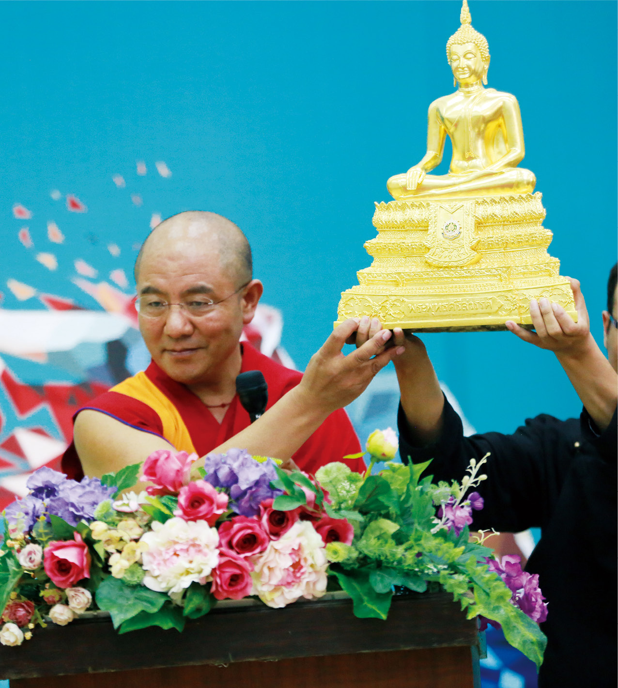
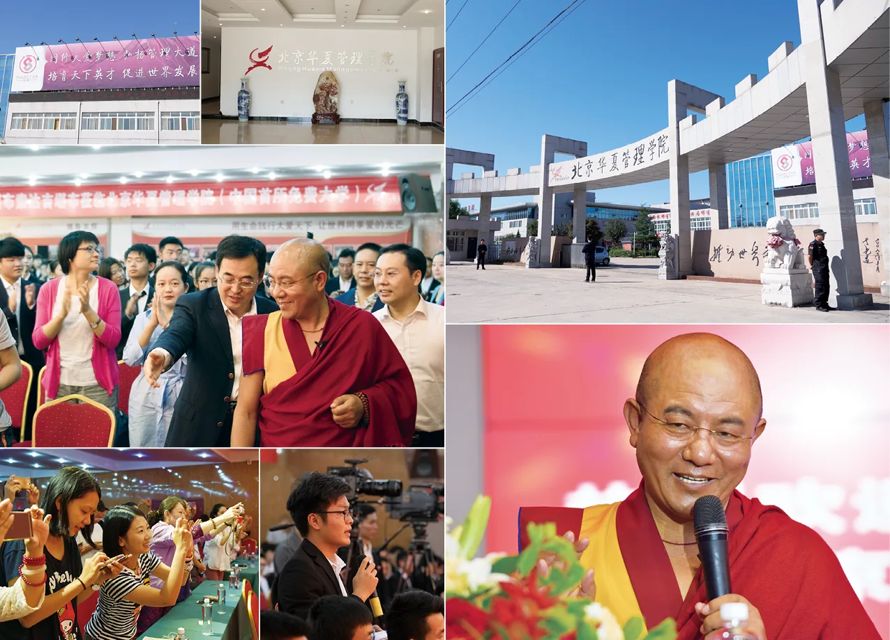
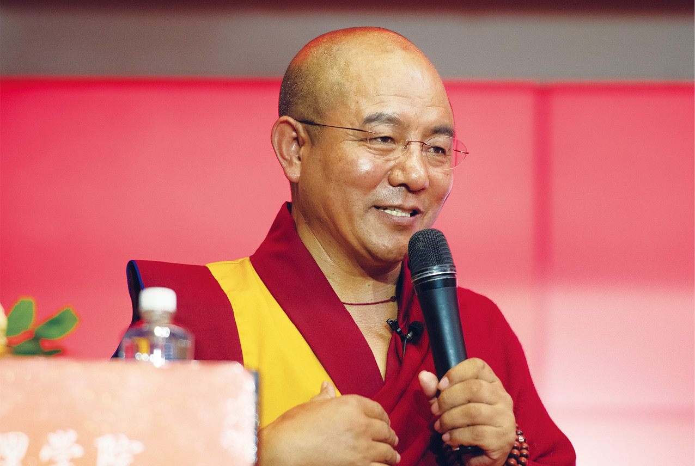

表面上看是帮助别人，

实际上也是帮助自己。

第148场

北京华夏管理学院

Beijing Huaxia Management College

中国·北京

2017 / 9 / 12

## 爱的智慧

## Love with Wisdom

主持人：

今天，我们非常荣幸地邀请到一位藏地的班智达——索达吉堪布。欢迎堪布来到中国首所免费大学——北京华夏管理学院，为我们开启佛学的奥秘，分享心灵的智慧。

索达吉堪布是喇荣五明佛学院的大堪布。在翻译方面，堪布已将大量珍贵藏文论典译成汉文；在讲法方面，堪布借用网络视频等方式，给大家分享心灵的智慧；在慈善方面，堪布在贫困地区建立了多所学校和养老院，为失学儿童和孤寡老人提供教育和赡养服务，并发起了“启动爱心”的倡议；在学术方面，堪布曾应邀前往清华、北大、人大、复旦，以及香港中文、香港理工等大学，与大家广泛地交流，令莘莘学子深感受益匪浅。

下面有请华夏管理学院的姜校长致辞——

姜校长：

我谨代表华夏学院的所有师生，对索达吉堪布的到来，表示最热烈的欢迎和最衷心的感谢！

人的一生中会有三个最重要的选择。第一个是人生导师，决定了一生的智慧；第二个是合作伙伴，决定了事业的成就；第三个是人生伴侣，决定了幸福的指数。索达吉堪布是我非常敬重的一位师长，堪布不但有极高的佛学造诣，而且还积极地弘法利生，影响了无数人的生命。相信他的到来，一定能为我们全体师生带来重要的加持和引领，希望大家能用心聆听堪布的分享。

欢迎堪布——

首先，很感谢姜校长的付出，给同学们带来了方方面面的关爱，诸如优美的环境、快乐的生活以及心灵的成长等等。来到华夏管理学院之后，我发现这里确实有一种爱的氛围。刚才，我们去参观了“大爱堂书院”，相信这些智慧的书籍一定会让大家的内心充满爱。后来，我们还在“爱天下”的石刻旁合了影。我发自内心地希望，依靠这种因缘，每一位同学和老师都能从内心深处爱天下所有的众生。实际上，这也是大乘佛教的核心思想。

我看到会场的门口写着“让世界享受爱的光芒”。我个人理解，这个标语有两层意思，一是在座的各位正在享受爱的光芒，比如有些同学正在接受爱心人士的资助；二是当大家离开校园步入社会以后，也都有着不可推卸的责任——我们要将自己曾经感受过的关爱传递给更多的人，让世界充满爱。

今天，我想围绕“爱的智慧”这个主题，谈一些个人的心得体会，与大家一起交流探讨。

## 爱的光芒无处不在

每个人来到这个世界，都需要爱和陪伴。要知道，在还不会说话的时候，我们就已经开始享受父母的爱，父母为我们提供了能力范围内最好的一切，食物、衣服和教育等等，一直到我们长大成人。在读书期间，老师也把自己所有的智慧传递给我们，因此学校也是一个感受爱的场所。进入社会以后，表面上看好像身边的同事跟自己没有很深的关系，但实际上，我们仍生活在爱的环境当中。如果身边的人都对你不屑一顾，其实也很难生存下去。所以，人与人之间是相互依赖、相互依靠的关系，彼此之间有一种爱，以明显或不明显的方式一直传递着。

爱的力量真的很伟大，我们每个人都应该认真地学习与思考。如果人人都充满爱心，不仅自己会生活得很快乐，更重要的是可以帮助到身边的人，与他们分享爱的光芒。如果大家用心观察，就会发现爱在生活中有不同的表现形式。比如在一个家庭中，孩子需要父母的爱，父母也需要孩子的爱。夫妻之间更是如此，需要互相爱着对方，一旦离开了爱，这个家庭就维系不下去了。同样的道理，在学校里，学生一定要爱老师，如果学生恨老师的话，就不是一个好学生；如果老师不爱学生的话，也不是一个好老师。另外，同学之间也要互相友爱，否则所谓的“同学”就只是一个名称而已。其实，当我们用智慧去详细观察自己所处的环境时，就会发现原来爱无处不在，每个角落都散发着它灿烂的光芒。

## 不要活得像机器人

其实，我们从小就应该接受爱的教育。不管是东方还是西方，学校都是培养人才的基地。学校的教育理念会直接影响到学生的未来，以及他们的价值观、人生观和生活观。如果他们能在学校里就接受到爱和慈悲的教育，以后很可能会成为非常了不起的人。否则，他们长大之后如果变得十分冷漠，没有爱心，那是非常可怕的事，也是我最担心的事情。

苹果公司的现任总裁蒂姆·库克（Tim Cook, 1960-）曾在麻省理工学院的毕业典礼上讲道：“我不担心人工智能让计算机像人类一样思考问题，我更担心的是人类像计算机那样思考问题——摒弃同情心和价值观，并且不计后果。”我个人很赞同他的观点。如果没有慈悲心、同情心和爱心，人与人之间的关系就会变得非常冷淡。要知道，做人做事的底线很重要。如果连基本的人格都没有，坏起来没有任何底线，无恶不作，这样的人最可怕！

实际上，机器人不一定能毁灭我们的世界，更应该让我们感到害怕的，是那些不计因果、丝毫不关心他人感受的人。如果这些人有了能力和智慧、掌握了技术，很可能会做出许多危害人类的事情，甚至将整个世界毁于一旦。所以，我们要特别重视爱的教育。老师要为了孩子们的成长倾注爱心，逐渐地由知识的传递转变为智慧的传递，让爱的涓涓小溪汇成汪洋大海。这是一件非常重要的事情。我们每个人都要反思，自己到底是不是一个有爱心的人？

佛经中讲，每个众生都受前世业力的影响。如果前世积累了许多恶业，即生当中会遭遇种种不顺意的事情；如果前世积累了许多善业，即生当中一切都会如愿以偿，做事情也更容易成功。虽然人生是一段充满未知的旅程，但如果我们能用爱来拥抱世界、拥抱他人，人生的道路上也会有人爱着你、帮助你；如果抛弃了这颗爱心，从来也不关心和帮助他人，在遭遇人生挫折时，很可能会走投无路。

## 利他是高层次的利己

在座各位主要学的是管理，将来应该会在不同的行业中发展。不管从事什么工作，原则上我认为最好要有一颗慈悲心。如果我们多去帮助别人，乐于付出，表面上看是帮助别人，实际上也是帮助自己，唤醒了自己的爱心和善心。要知道，心是一个巨大的宝库，里面积存着很多善的资源。只不过有些人遇到了一些恶缘，比如恶环境、恶知识，导致内心的良善没有被开发出来，甚至滋生出很多恶心。

因此，大家以后要努力开发内心善的宝藏。在学习、工作和生活中，我们要无条件地帮助别人。如果你有一定的财富和地位，可以运用这些资源帮助他人；如果你没有这样的资源，也可以用其他的方式，哪怕只是一个微笑、一声安慰。这样的话，不仅帮助了别人，还开发了自己内心的宝藏。

佛教中经常讲，每个人都本具如来藏。这是一种非常珍贵的宝藏，通过帮助他人能够逐渐地开发出来，我本人对此就深有感触。其实，我经常会收到别人的供养。一般情况下，我会用这些钱资助山区贫困的学生。我认为，这些钱的价值不仅是在经济上帮助了别人，更重要的是，在接触这些人的过程中，我内心中很多善的正能量，自然而然就开发出来了。

我们每个人都应该珍惜这种因缘。为什么这样讲呢？如果没有这种对境，我们的心可能永远沉睡于一种无记的状态中。正是依靠这种因缘，才唤醒了人们本具的善心。所以，大家在平时的生活中，要多用慈悲心去帮助别人。与此同时，你的善心也会得到开发，所以说最大的得利者就是你自己。

据我所知，很多企业家都积极倡导利他的经营理念。比如，星巴克就始终坚持一种理念——星巴克出售的不是咖啡，而是人们对咖啡的体验。事实上，星巴克刚刚起步时并不赚钱，但他们坚持以人为本，真诚地致力于发展顾客，为此付出了很多努力。后来，这家公司也自然而然获得了丰厚的商业回报。

其实，如果我们想要损害他人利益，或者想从他人那里赚到钱，别人也会谨慎地观察。尤其是生活在这个时代，大多数人都很有智慧，内心各有盘算。相反，如果我们真心为他人付出，不断地帮助别人，这样自然而然会积聚很多不可思议的善缘，带来意想不到的收获。大家经常可以看到，有些爱心人士总觉得自己对他人有不可推卸的责任，继而发自内心地坚持做慈善，这让他们获得了好名声，事业也蒸蒸日上。因此，我希望大家能依靠自己的智慧和悲心，开发出心的宝藏。

## 用爱守护每个生命

每个人的生活都不容易，但我们还是要学会爱。不同的人对爱有不同的理解，从佛教的观点来讲，在爱自己的同时，还应该做到不伤害众生，帮助众生。

有些资料中提到，苹果公司的创始人史蒂夫·乔布斯（Steve Jobs, 1955-2011）处于癌症晚期时，医生告诉他，必须马上进行肝移植，才能挽救他的生命。有人找到医院院长和州长，希望他们能把乔布斯的手术排到前面，但他们都遵守美国法律，最后没有答应。

这个时候，身边的人对乔布斯说：“要不要花点钱，给有关人员打点一下，让您先移植？”乔布斯听了，非常惊讶地说：“这怎么行？一切生命都是平等的，我怎么能插队排到其他人前面呢？”

六个星期后，乔布斯终于等来了可供移植的肝脏。可是，由于等待时间太长，他的癌细胞已经扩散了。虽然手术很成功，但也只为他赢得了两年的时间。而在他去世的时候，乔布斯仍没有后悔当初的选择。

大家可以想一下，如果我们在生死边缘徘徊，会不会想方设法插队呢？其实，生命都是平等的，每一个生命都值得我们用爱去守护，这也是佛教的核心思想。在生活中，我们每天都要经历很多事情。这个时候，我们往往既有拯救他人生命的能力，也有剥夺他人生命的能力，所以说接受爱的教育很重要。

实际上，爱有很多种，总体可以分为大爱和小爱。小爱就是爱家、爱父母，也包括世间所谓的爱情。如果处理不好这种恋爱关系，很可能会变成憎恨、变成痛苦，引发一些负面的情绪，甚至还会葬送自己的生命。因为情感的问题，现在很多学生会选择自杀。事实上，他们根本不懂爱，只是过于执著自己那份小小的爱，最后连最宝贵的生命也失去了。所以，希望大家懂得爱惜自己的生命，也尊重他人的生命，这是非常重要的一件事情。

按照大乘佛教的思想，真正意义上的爱，既要懂得爱自己，也要懂得爱别人、保护别人，并且是无条件的保护——即使对方伤害了你，还是要帮助他。这种爱是无私而伟大的爱，一般人恐怕难以想象。

## 学会接纳各种不同

每个人的价值观和喜好都不相同，心的“基因”也不一样。比如，你们喜欢舒服漂亮的衣服，而我更喜欢僧装。实际上，不管是吃饭、穿衣，还是信仰以及所追求的目标，大家都持有不同的观点。因此，我们以后要学会尊重别人，不能因为对方跟自己不同就瞧不起别人。

我经常参加一些学校举办的交流活动，发现有些老师对佛教徒不够包容。有些人从来没有见过出家人，不理解为什么要穿成这个样子，所以就会建议我换个便装，或者穿着西装去演讲。但我会坚持自己的原则，如果对方不接受我穿僧装，那我也可以不去。

步入社会以后，大家会遇到各种各样的人。你们可能会感到奇怪：怎么会有人穿这种衣服，怎么会有人喜欢这种饭，怎么会有人喜欢这种人，怎么会有人愿意做这种工作，怎么会有人尊敬这种领导……如果从个人眼光和角度来看，可能会觉得难以接受。事实上，世界上有各种各样的商品，人的心态和行为也都有所不同。所以，大家最好不要用自己的标准去衡量别人。到了社会上以后，你们会慢慢明白沟通与学习的重要性。

在学校里面，不同老师给学生传递不同的思想，这种学习方式很有意义。学校虽然提供了循序渐进的课程，但如果同学们平时与人交流得太少，当他们到了社会上，往往会变得没有主见，整个人都硬邦邦的，活得像个机器人一样。所以，同学们除了要学习课堂知识以外，更重要的是学会做人做事，以及与人沟通的技巧，同时还要学会独立解决问题。

我有两位亲戚，一个是大学毕业，一个小学都没读完就出去打工了。有一次，我和他们一起待了两天。在那期间，我发现上过大学的那个孩子，虽然懂得很多知识，但过于封闭和保守，说话做事很幼稚，让人感觉大学都白读了；而小学没毕业的那个孩子，社会经验很丰富，知道要怎么样做事情。可见，有时候人需要在不同的环境中学习和成长。如果能有所收获的话，不管你上哪所学校都很有意义。

## 何谓大爱

佛教中有一部经典，叫《付法藏因缘传》[^1]，里面记载了很多著名的历史人物故事，其中有一则是关于龙树菩萨的弟子圣天论师。印度佛教和藏传佛教都有运用逻辑思维辩论的传统。这位圣天论师就很有智慧，以辩论而闻名于世。据我所知，很多大学也经常举办辩论赛，其实辩论对开发智慧很有帮助。当年，龙树菩萨离世时曾叮嘱圣天论师，希望他能发挥自己的智慧，去弘扬佛法以及龙树菩萨的传承教法。从那以后，圣天论师便前往不同的地方讲经说法。

有一次，他来到南印度一个不信仰佛法的国家，为了弘扬佛法，他就对当地的国王说：“我想要和当地的论士们开展一场辩论赛，输的人要把头颅送给对方。”国王应允了这场辩论，而圣天论师也很顺利地在辩论中获胜。

有一位外道导师对他说：“你现在可以斩去我的头了。”但圣天论师却说：“我不需要你的脑袋，但你要剃除头发，随我出家修行。”后来，这位外道导师便剃了一个像我这样的光头，放弃了自己的宗派，自愿皈依佛教。但是，这位外道导师的弟子中有人愤愤不平，觉得圣天论师侮辱了他的老师，他发誓说：“你圣天以口胜我师，我要以刀胜你！”自此以后，他一直暗中跟踪圣天论师，准备随时刺杀他。但圣天论师弟子众多，一直无从下手。

有一天，圣天论师正在一处森林中禅修，弟子们都不在身边，这个外道弟子便抓住机会，举刀刺入了圣天论师的腹部，以至于五脏六腑都流了出来，场面十分骇人。但是，圣天论师不仅没有心怀怨恨，反而还怜悯这位年轻人的鲁莽行为，诚恳地对他说：“我有一些资具，你把它们拿去换钱，这对你以后的生活会有些帮助。你现在杀了我，要赶快离开，不然被我的弟子们发现，你就走不了了……”

年轻人见圣天论师竟如此宽恕他，不由得泪流满面，立刻跪下来忏悔认罪。圣天论师甚至只剩下最后一口气还在说：“你快逃命去吧，沿着这条路走，你就不会被人发现。”那人只得逃上山去了。

在大乘佛教的思想中，有一种以德报怨的心态和气度，不计较别人的仇恨，这与普通人的思维方式有很大不同。一般情况下，如果有人对我们诽谤诋毁、心怀恨意、态度恶劣，我们很可能会想要报复。即便不会报复，也绝不想帮助他。如果真的有人拿刀刺伤我们，我们会不会怨恨对方呢？绝大部分人会的。从我个人来说，虽然学习佛教的慈悲精神已经很多年了，但一提到这种高层次的境界，我也深感惭愧。在人类历史的长河中，曾经出现过许多伟大的人物。就算是在现代社会，也有很多人愿意付出自己的时间、金钱，甚至是生命去帮助他人。但我自问能不能做到呢？确实很难做到。

有些人认为，如果别人对自己好，自己也应该回报别人。如果别人对自己不好，也要以怨报怨。这是一种比较普遍的想法。现在很多人会在口头上说爱他人、爱众生、爱世界，但究竟应该如何去爱呢？其实，爱有很多层次。有一种比较狭隘的爱，就像人们常说的“爱得越深，恨得越深”。如果对方对自己稍微有一点不好，或者说话的语气和眼神有一点不对，自己就会特别生气，然后把对方控制得更紧，就像把他关进监狱一样。这样的话，反而会起到很多反作用，最后可能互相都感觉不爱了。

人与人之间的相处，最重要的是发自内心地爱对方，在佛教里叫做慈悲心。具体来说，慈心是希望所有众生获得快乐；悲心是希望所有正在感受痛苦的众生，在最快的时间内脱离痛苦。也就是说，从让众生得到快乐的角度，叫做慈心；从让众生离开痛苦的角度，叫做悲心。实际上，这就是所谓的大爱。

## 每个人心中都有爱

大家应该清楚，今天我们所处的时代，是一个特殊的时代，很多人缺少爱人之心。但是，国内仍有这样一所免费大学，这背后离不开姜校长和全体教师默默无闻的付出。事实上，爱就是一种付出。如果没有这份爱的力量，同学们也不会有这么好的学习机会。因此，我们应该将这份爱一代一代地传递下去，而这依赖于良好的教育。如果没有良好的教育，爱就无法传递下去。

如今，科技越来越发达，让这个时代不同于以往任何一个时代。面对人工智能的发展，很多人担心未来人类可能会被机器人取代。但我一直认为，虽然人工智能具有一定的学习能力，操作系统和应用程序也在不断地更新，但其实人工智能和人类思维有着本质的区别。因为每个人的心中都有爱，即使是最坏的人，他的内心当中也有爱。

我经常去一些监狱和戒毒所讲课。人们通常会认为，那里的人都非常坏，但其实他们心中也有一颗爱的种子。而人工智能再怎么发展，也不可能产生爱他人、爱众生、爱世界的心。如果我们要想战胜这个世界，超越这个世界，就需要凭借一股不可思议的爱的力量。

因此，大家要学习爱、传播爱，这就是我们所追求的目标和学习的宗旨。

现场互动

问：有时候我积极地去帮忙，对方却觉得我是在帮倒忙，这让人很气馁。请问，应该以怎样的方式和心态去帮助别人？

堪布：这是一个很现实的问题。人心是非常复杂的，有时候我们帮助了别人，但他可能会有种种的顾虑和不满，尤其是在当今这个社会，情况也变得更加复杂。比如，我在国内讲课都是免费的，但在西方国家讲课时，一般都要收取门票，不然他们会觉得我别有用心。

如果我们想无条件地提供帮助，而别人对此会有些质疑，这也是一种正常现象。俗话说：“路遥知马力，日久见人心。”想要不间断地行善做好事，就要有耐心和恒心，不能因为别人的拒绝、不理解和误解，就产生一种厌烦心，再也不愿意做好事了。

有些人在做善事的过程中，总觉得有些地方和自己想的不一样，从此以后便心生厌烦。事实上，如果你经常做善事，肯定会遭遇一些障碍，会有不如意的事情发生，甚至还可能遭到别人的谩骂。从我自身经历来说，我在助学的过程中，也遇到过各种各样的事情，甚至还有人会使用欺骗手段。我们今年资助学生的时候，有一个女孩其实家境非常富裕，但她当天特意穿着破破烂烂的衣服来申请助学金。一般情况下，我们都会提前进行家访，但当天来的人特别多，所以个别人的家庭状况还没来得及核实。后来听人说她平时脸上都会化妆，身上还会佩戴藏族传统的珊瑚饰品等。但那天她来的时候，既没有化妆，也没有戴任何首饰，反而说自己的家里特别穷，所以我们就给通过了。当了解实际情况后，我心里也有点不舒服，后来又调整了心态。每个人都爱钱，这也是没办法的事情。虽然她家里已经很有钱了，但还是会为了钱去欺骗别人，想明白这一点，我就没有再追究了。

在帮助别人的过程中，难免会一而再、再而三地遇到挫折，但只要不断行善利他，人生一定会有好的转变。时间久了，不可能所有的人都对你产生误解，这颗纯洁的心自然而然会展现于世人面前。到了那时，你做任何善事都不会有困难。

问：每次买菜时，我都会给隔壁邻居送一些，刚开始对方还会口头表示感谢，但后来突然有一天没给他送菜，他就开始埋怨、记恨，我也很不开心。遇到诸如此类的情况时，请问我们还要继续传播爱心吗？

堪布：在现实生活中，确实经常发生这样的事情。前段时间，我遇到一个法国佛教徒，他说他每个月都会给一个乞丐二十元钱，坚持了很长时间。后来，他家里的经济状况出了点问题，就对那个乞丐说：“以前我经济状况好的时候，可以给你二十元钱，但现在我家里也困难，以后每个月只能给你十元钱了。”乞丐听了之后大发雷霆，认为这个人扣下了原本属于自己的钱，当街对他破口大骂。

由此可见，一旦人们习惯了接受别人的帮助，心里就会形成一种固定的观念，会把对方的东西执著为自己的，甚至认为自己有权处置这份财产。这是一种非常颠倒的想法。

如果遇到这种情况，我们可以考虑换一种方式帮助。当然，对方很可能因此而记恨你。因为有的人确实比较愚笨，当他适应了你对他的好，就觉得这是应该的。我每年都要资助一些大学生，有些人第一年拿到资助款的时候，往往会对我特别感恩，甚至激动得流下眼泪。但最后毕业的时候，连个招呼也不打。我知道他们已经习惯了，觉得自己每年得到资助是很正常的一件事。人有时候会有一种很奇怪的心理，这可能是无明愚痴导致的吧。

问：现在我们的世界发展得越来越快，人们的思想也随之发生了变化。在这个纷繁复杂的世界中，怎样才能让自己的心安住下来，不受外界的影响？

堪布：从佛教的角度而言，会用戒、定、慧三种修学方法来认知自己。首先，戒律是做人的基本标准，也是行为规范；然后，通过禅定让心安定下来；最后，我们才会产生智慧。可见，传承了两千五百多年的修行教言，对当代人的思想管理与发展仍有很大帮助。

表面上看，这个世界正在发生日新月异的变化，但人们的内心不一定是在发展，可能在不断后退。相较而言，古人忠厚淳朴，思想简单，并且他们更有感恩心、报恩心，更加乐于助人。而现在这个时代，有各种各样的发明，城市里交通发达、信息畅通、高楼耸立，跟以往任何一个时代都不同。除了贫穷落后的非洲以外，大多数国家都发生了翻天覆地的变化。但我们的内心却时常感到困惑和迷茫，找不到人生的方向。很多年轻人会有这样的想法，中年人的压力也越来越大，因为想要做的事情有很多。

要知道，每个人身心的承受力是有限的。在这样的压力下，很多人感觉分身乏术、心力交瘁，最后白天吃不好，晚上睡不着，压力非常大。表面上看，这个时代五彩斑斓，好像每天都在不断地更新、进步，但人们内心的快乐和安全感，总感觉一代不如一代。面对这样的情况，我们应该花点时间思考一下，如何才能获得内心的安宁。

我个人建议，大家心中最好有一个坚定的信仰。这样的话，当你面对这个复杂的社会时，内心会变得强大起来，会知道这个社会和世界的变化是怎么回事，还不会有很大的压力。如果心中没有信仰，没有丝毫的智慧和禅定，即便是出家人也可能会感到迷茫。因此，我们应该对人生的真理有所了知。

如果真正懂得了，那你面对世界的方式也会有所改变。以前是迷茫地面对，现在是开心地面对。

另外，希望大家能学习一下传统文化中的智慧，以及大乘佛教中的利他思想。如果我们心怀利他，即便是感受痛苦，也不会很严重；如果我们心怀自私，所产生的痛苦会给我们带来更大的伤害。

问：从某种意义上来说，每个人都走在取经的路上，而修行就一定会经历考验。我觉得您是一个伟大的修行者，请问您在修行过程中遇到的最大考验是什么？您又是如何克服的？

堪布：其实，我算不上是真正的修行者。我的主要任务是讲课，所以更像是一名老师。昨天我还在微博上说，我当老师已经三十三个年头了。从1985年到今天，不论是外出还是在佛学院，我每天都会坚持讲一两堂课，甚至有时连讲几堂课。

至于修行的话，相对在家人而言，我早晚还是会做一些功课，但根本谈不上有修行的成就。我一直认为，这一生中没什么可后悔的，唯一遗憾的就是修行的时间不够。我其实很想在一个寂静的地方闭关，甚至还和另一位堪布去看过地点，打算建个闭关房。

以前我总在想，等到四十岁的时候，要好好地闭关五六年，但后来到了四十岁也没有实现；然后我又想，等到五十岁的时候再去闭关，也没有成功；过几年我就六十岁了，不知道那时能不能放下手里的事情，在没死之前好好地闭关修行。也许到六十岁的时候，我还是在不停地奔波，不断地忙碌。这样看的话，我的修行确实很差。但我始终认为，修行特别重要，因为理论只是停留在口头上，没有在心里经常进行串习、沉淀，恐怕很难变成自己的体悟。

佛教中经常会提到“闻、思、修”，也就是先要听闻佛法，然后进行思考，再慢慢地实修。只有经过长时间的闻思修行，才能把佛法的知识变成自己的智慧。所以，如果想要生起真正的利他菩提心，也需要经过长时间的修行，这样才能发自内心地行持利他行为。

在我的修行生涯当中，对我影响最大的是上师们的无私精神。他们并没有把这种精神停留在口头上，而是通过实际行动来传递爱的力量。不论是自己的弟子，还是素不相识的人，都愿意为对方无条件地付出。我认为这就是一种修行境界的体现。

我见过很多伟大的上师，他们都有一个共同点：从来不考虑自己的身体和事业，而是真真切切地把内心中的爱和智慧传递给别人。当然，他们毕竟生活在这个复杂的社会当中，也会受到别人的误解和攻击。在修行和弘法利生的过程中，他们可能有过一点放弃的念头，但最终还是坚持下来了，毫不夸张地说，他们把一生都奉献给了众生。有些企业家在从事慈善事业的过程中，也有体现出这种宝贵的精神，这一点非常令人钦佩。

总之，佛教中有很多伟大的上师，他们用自己的一生来爱护所有众生。不仅限于自己的弟子，还包括那些曾经诽谤过、痛恨过、嫉妒过自己的人，这是常人难以做到的。由此可见，爱确实有不同的层次。

[^1]: 《付法藏因缘传》：也称为《付法藏传》，或《付法藏经》，六卷。本书编译的因缘，大概如《内典录》等所说：北魏太武帝太平真君七年（446）信崔浩之言，下诏大杀沙门，毁佛经像，诏书中并谈到佛法“皆是前世汉人无赖子弟刘元真、吕伯疆之徒，乞胡之诞言，用老庄之虚假，附而益之，皆非真实”。七年后，北魏文成帝即位重兴佛法，昙曜等感奋之余，乃于北台石窟和吉迦夜编译此书，以明释教之由来，历然可考。
