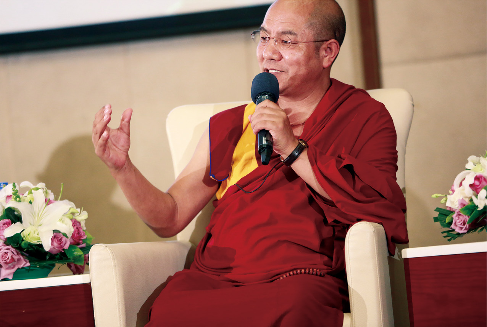
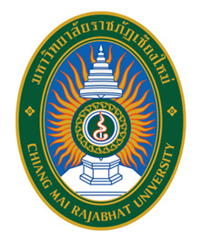
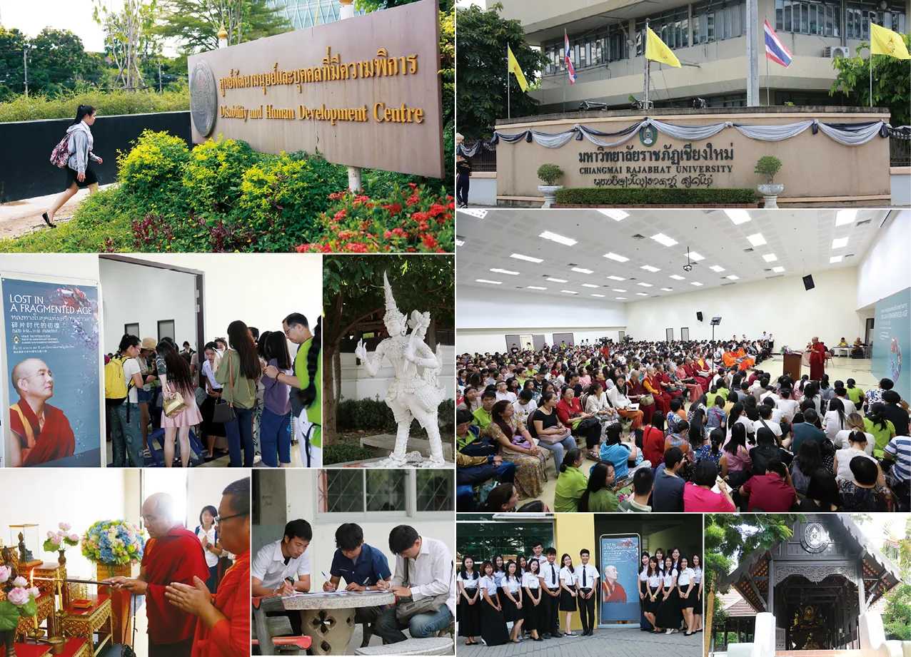
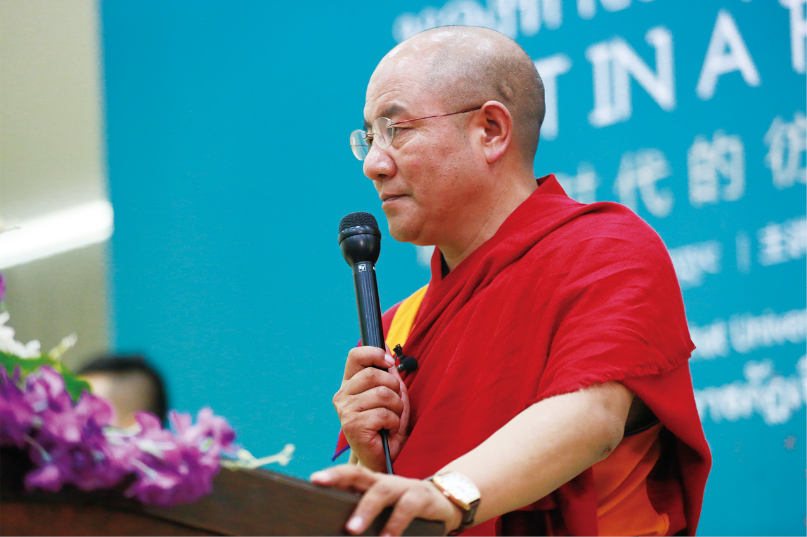
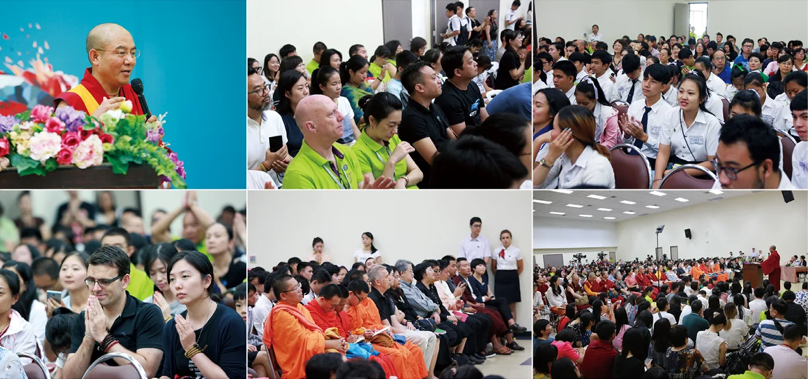
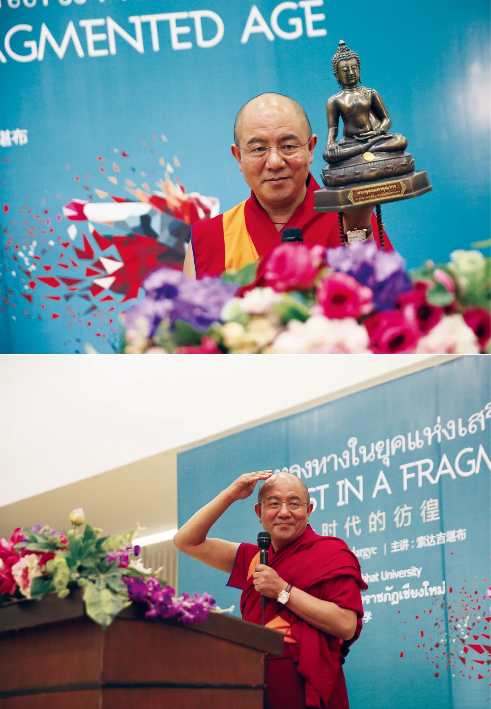
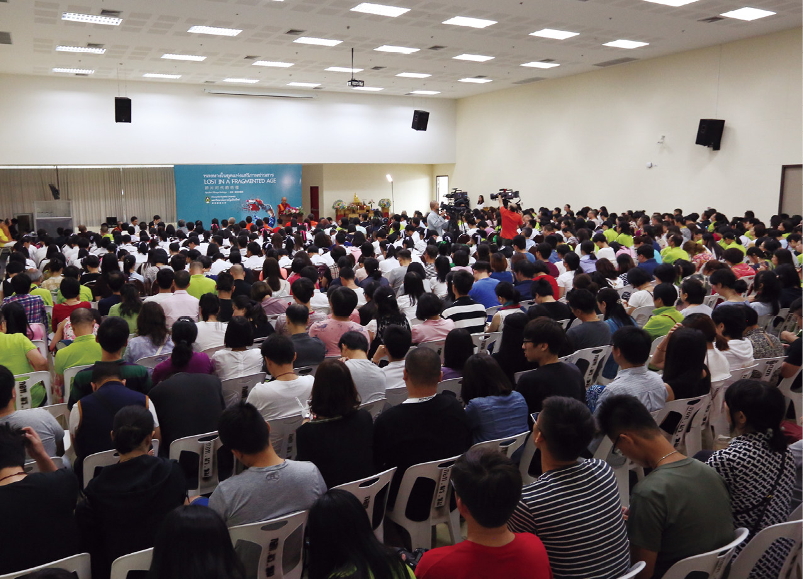
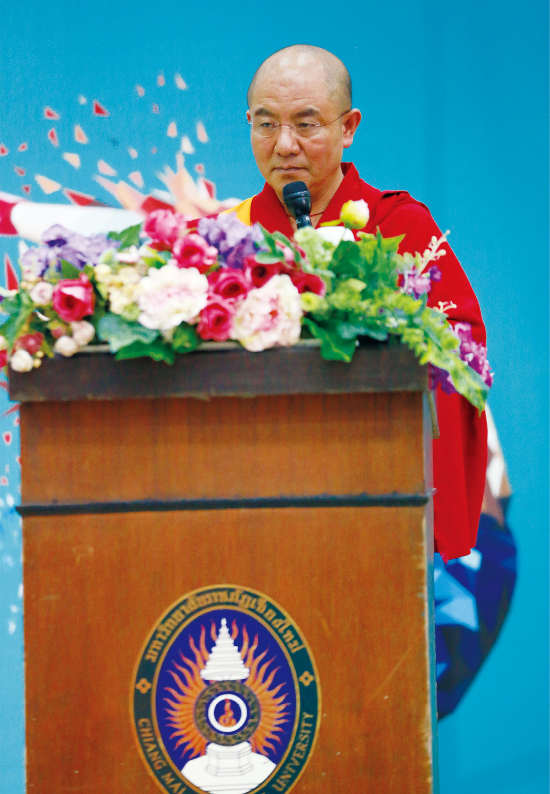
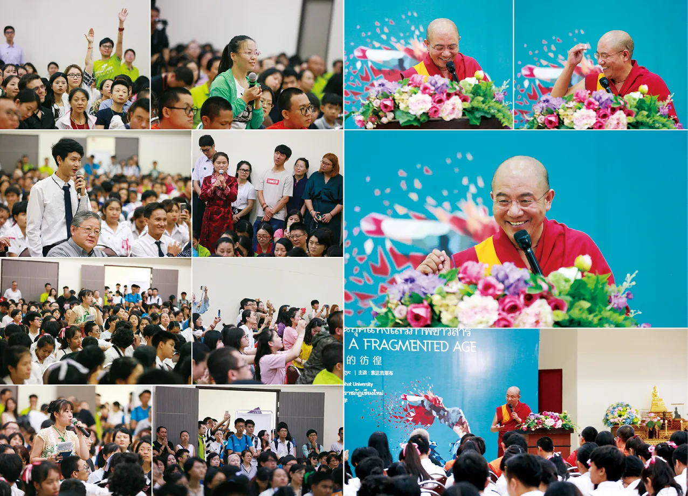
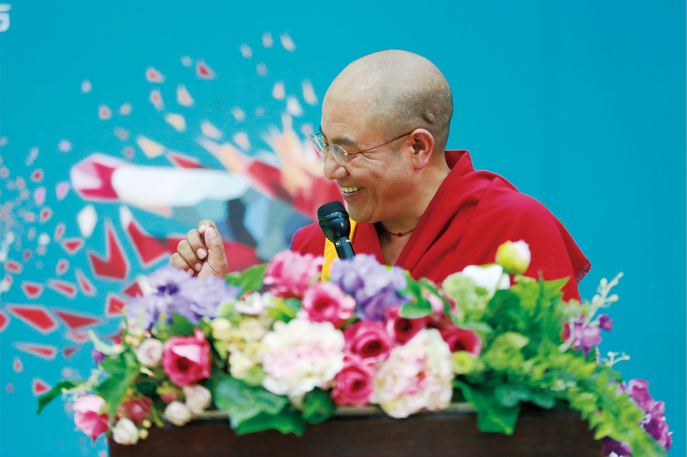

我们人类的注意力居然还比不上一条鱼。

第147场

泰国清迈皇家大学

Chiang Mai Rajabhat University

泰国·清迈

2017 / 8/ 3

## 碎片时代的彷徨

## Lost in the Age of Fragmentation

主持人：

亲爱的清迈皇家大学的各位老师、各位同学、各位嘉宾，大家早上好！欢迎大家！

今天，我们非常开心来到美丽的清迈皇家大学，跟所有在座的老师和同学们见面。清迈皇家大学是一所教育性大学，是由泰国国王拉玛九世[^1]在1982年正式批准成立的。首先，有请清迈皇家大学人文社科学院西方语言学苏查那·恩塔穆拉教授代表校方致辞！

苏查那·恩塔穆拉教授：

尊敬的各位教授、各位同学、各位来宾，今天，能在这里见到大家，并给大家致欢迎辞，我感到很荣幸。我谨代表清迈皇家大学对尊贵的索达吉堪布表达我们的感谢。索达吉堪布用尽他的一生来传播佛法，促进佛教事业不断发展。今天早上的会议，是第七届世界青年佛学研讨会的后续会议。会议选择在清迈皇家大学召开，我们感到非常荣幸。

今天的会议共有三个主办和协办方，分别是世界青年佛学研讨会、泰国摩诃朱拉隆功大学和清迈皇家大学。大家都知道，在当今社会，佛教是全世界最重要的宗教之一，它是通向我们人类幸福生活的一条大道。我个人也这么认为。所以，我要再次感谢大家来到这里，支持佛教，支持全世界的和谐！我也要再一次感谢尊贵的索达吉堪布，是您让我们大家聚集在这里，共同为清迈皇家大学创造一个历史性的精彩时刻！感谢您！

主持人：

非常感谢来自清迈皇家大学的代表苏查那·恩塔穆拉教授给我们带来的精彩发言。亲爱的朋友们，接下来我们要进行的是一个传统的开场仪式：由泰方长老和我们的堪布共同点亮明灯。有请我们的长老和堪布！全场起立。

这是一个点灯祈福的时刻。让我们把全世界所有美好的祝福，送给全人类所有的朋友，愿每一位朋友都在幸福之路上永远走下去！

（点灯祈福仪式）

接下来，清迈皇家大学人文社科学院西方语言学的苏查那·恩塔穆拉教授，将用她非常非常富有爱心的礼物，来交换我们堪布手中别有深意的礼物。他们交换礼物，也交换彼此的心意，共同许下美好的祝愿：祝愿天下所有的朋友平安、幸福、圆满！

（教授和堪布交换礼物）

我们处在一个现代化、信息化的时代，每天都会接收成千上万条信息。在大街上、商场内、小巷里，每一个角落里的每一个人，手里都拿着手机。据英国《每日邮报》（Daily Mail）报道：在现代社会，平均每人每隔6.5分钟就要看一下手机。这已成了我们共同的一种习惯。然而，大量的信息不但没有为我们带来快乐，反而让我们产生了种种迷茫。这究竟是为什么？下面，有请索达吉堪布就这个问题为我们做开示。他开示的题目是“碎片时代的彷徨”。

尊敬的各位老师、各位同学：

上午好！

今天在清迈皇家大学跟大家一起交流，我感到很幸福，很快乐。我感到幸福快乐的原因有两个：第一个，第七届世界青年佛学研讨会已在昨天正式闭幕。经过四天的探讨，我们都对幸福有了一定的认识。皇家大学也是积极参与此次大会的支持单位，我心中充满了特别的感恩之情。第二个，我去过很多大学，但像今天这样，演讲之前先礼佛，再供灯、供香，然后才开始正式的会议流程，还是第一次。作为一个佛教徒，能亲自参与这样的仪式，我心里无比欢喜。

到了泰国，就好像到了我的家乡藏地。这里上上下下的人都信仰佛教，人们从小就对佛陀有不共的信心和敬仰。和这里千千万万的人一样，我来到这个世界后的第一个信仰就是崇拜佛陀，而且这个信仰一生都没有改变。在如今这个碎片时代，能保持这样的信仰，真的很难得，很珍贵，是一笔巨大的精神财富。

因为今天用两种语言翻译，不懂其他语言的人可能比较容易犯困，甚至想睡觉。在中通寺的时候，大家都有这种感觉。不过，这对我来说没关系，你们即使睡觉，我也会坚持把两个小时讲完。但是你们以后要是在电视上看见自己睡觉的场面，或者被别人发现自己听演讲时睡觉，不一定很“光荣”。那天我在中通寺也很困，由于担心被直播晒到全世界，所以拼命地挣扎，一直不敢睡。（众笑）

## 碎片时代的眼泪

今天我们的主题是“碎片时代的彷徨”。这个主题的内涵，大家应该都很清楚。不管是泰国人，还是其他任何一个国家的人，大家都已经共同来到了一个多元化的时代、信息化的时代、碎片文化的时代、快餐文化的时代……在这样一个特殊的时代，人们的生活变得跟以往完全不同。以前人类社会的进步，一千年，两千年，好像都是划着横线过来的，没什么太大的变化，但现在却变成了直线，不管上升还是下落，都是直线式的，非常快，或者说变成了非常弯曲的一种方式，理不出头绪，找不到根源。处于这样一个时代，每个人心里都难免有一些恐慌、彷徨，找不到安全感。

这个时代的我们，每个人手里时时都拿着一部手机，有的甚至两部三部。表面看起来，这让人与人之间的沟通和联系变得非常方便，实际上带给我们的却是很多的不安全，很多的隐患、过患，很多的不良影响。

有很多学生，天天玩手机，不好好学习，最后成绩彻底垮掉，再也上不去了，考试的时候哭得很伤心。但哭是没有用的，平时没有好好用功，最后肯定是这样的结果。手机对大人的影响也是有目共睹的。现在一些教授、老师，因为忙于在手机上发布各种信息，进行各种反馈，用在学问研究、知识传递、备课、上课等各方面的时间都减少了，给自己和学生带来一定的损失。

当我们意识到手机偷走了自己的大好时光和宝贵人生时，往往悔不当初，痛哭流涕。只不过，学生的泪是挂在脸上的，大人的泪却滴在了心里。但是，都已经晚了，追不回来了。

## 五种可怕的因素

网络和手机给人类身心带来的不良因素非常可怕，下面我把这种种的可怕给大家分析一下。

第一个，现在很多人得了所谓的网络瘾、手机瘾。这已成为一种比较普遍的精神障碍。据一些相关的统计显示，有71%的人一旦离开了手机，心里就会不舒服；35%的人早上醒来第一件事是关心自己的手机，只有10%的人会关心自己的父母和亲人。可见这个时代绝大部分人的身心，都已经被网络和手机控制了，成了网络和手机的奴隶，非常可怕。

第二个，世界卫生组织的调查显示，2017年2月份，因为碎片文化引起心理不健康的人，全世界大概有3亿多，每年因此而导致自杀的约有80万。虽然对这个数据有一些不同的说法，但也足以说明碎片文化已成为这个可怕的时代症结的主要推手。

第三个，最近美国《时代周刊》（Time）引用了微软公司的一份研究报告：现在人类的注意力持续时间已明显降低。以前一个人的平均注意力持续时间是12秒，现在已经降低到8秒。而人类养在水里的金鱼，注意力持续的时间是9秒。我们人类的注意力居然还比不上水里的一条鱼……不要说禅定，不要说听课，连短短的12秒都不能集中注意力，这确实很可悲，也很可怕。究其原因，也跟碎片文化有关：我们天天在手机上刷屏，眼睛和心连一刹那都不肯停下来，怎么可能训练出持久的注意力呢？

第四个，人类的智慧已经变得非常浅薄。最近有一本非常畅销的书叫《浅薄》[^2]，主要探讨人类是互联网的主人还是奴仆的问题。书中认为，由于碎片文化的侵蚀，人类正在丧失本有的专注能力、深思能力和反省能力，面临着大脑被掏空的危险。我们的智慧和意识现在变得非常浅薄，绝大多数人除了每天在手机上漫无目的地刷屏，追逐一些七零八碎的东西，已经不可能一本书一本书地看下去，也不可能一个项目一个项目地深入下去……

表面上看来，我们好像学得很不错，什么东西都看过，什么知识都知道一点，但实际上我们的智慧已经远远落后于古人——不会像古人那样深入地思考一个问题，更不会像古人那样进行各种深层次的研究和探索。法国哲学家笛卡尔说：“我思，故我在。”如今，在这个碎片文化时代，却出现了一群不会思考的人类，真的很可怕。

第五个，手机上有很多不健康的信息，给我们的身心都带来很大的危害。但是很多人却毫无察觉，而且还不自觉地让自己成为不良信息的源头，给自他都带来危害。我听说按照泰国的法律，伤害动物的场景是不能放在网上的——也许是为了倡导社会的慈悲风气。那么，如果你看到有些人在杀动物，出于新奇刺激的心态，把这个场景拍下来放到网络上去，这样的行为就是犯法的，你自己一定会受到法律的惩罚。

在碎片文化时代，世界各国的很多年轻人，从小受到不良信息的熏染，伦理道德意识比较淡薄，往往随便在手机上发布一些不良图片，危害社会风气的同时，也把自己送进了监狱。这也是很可怕的一件事。

## 寻找方法，挽救自己

面对如此可怕的现实，我们该怎么办呢？人类已经到了21世纪，已经进入了碎片时代，不可能再走回头路，去把每个人的手机都毁掉。即便想这么做，也做不到。有什么方法能挽救我们自己呢？

第一个方法，认清碎片文化的利弊。处于这样一个无奈的时代，可能每个人都想着利用碎片文化的特点，为自己谋取一些利益。实际情况如何呢？也许会事与愿违，我们从中受到的危害远远超过得到的利益。

所以，大家一定要认识清楚，碎片文化对自己究竟有利，还是有弊。每个老师，每个学生，都应该尽量在学习和生活中去细致了解，去深入分析。要清楚地了知它如何对我们产生作用，它给我们带来的损害或者利益究竟是怎样发生的。一旦明白了这一点，心里就会有所顾忌，不会再像以前一样整天沉迷，浑浑噩噩。

还有一种方法：有节制地使用电子产品。不管是电脑还是手机，都尽量不要一天到晚盯住不放。有统计数据显示，许多人在一天24小时中，有8个小时都花在手机上。长期下去，我们的精神会因此而颓废，我们的眼睛会因此而无光，我们的整个身体也会因此而垮掉。

在我们国内，很多人用微信、微博和博客，国外主要用推特、YouTube或者其他一些交流工具。就整个世界形势而言，这些交流软件的用户现在越来越多。而这些平台给我们传递的信息，大多数都是无用的，甚至是有害的。如果每天的生活都任由这些网络信息全面覆盖，身心都将变得疲惫不堪，状况百出。

所以，我希望我们的老师和同学，不要太沉迷于这样的虚妄世界。每个人都应该观察自己，每一天花在手机上的时间有多少，需要用手机处理事情的时间有多少。如果你用得过多，对你的身心健康肯定是不利的，一定要纠正过来。

如何纠正呢？可以规定自己，每天只用一小段时间，处理完一些必须处理的事情后，就放在一边，不再打开它，也不再关注它。我自己在佛学院的时候就是这样做的。基本上到了下午，手机就会关掉。一直到今天都是这样。

## 以纯正的信仰治愈

让我们在碎片时代独善其身的最好方法，其实是拥有一个纯正的信仰——泰国人在这方面可以说是很有福报的。如果有了信仰，生活中出现的抑郁症、焦虑症等心理疾病和很多身体疾病都可以得到治愈。因为一个真正有信仰的人，能修行，能通达万法的甚深真相，能认识自己心的本来面目。一旦有了这样的境界，就再也不会沉迷于虚拟的网络世界。

佛法的很多思想，都是教我们如何在虚幻世界保持清醒。我在这里把南传佛教、汉传佛教和藏传佛教的观点结合起来，给大家讲一个非常甚深的四念处修法。对于这个修法，南传佛教的信众是比较精通的，在座很多研究佛教的大学生和老师，可能也比较了解，所以我只用简略或者说以窍诀的方式来宣讲。

佛陀在世的时候，有一次，阿难尊者问佛陀：“现在很多年轻人感受不到轮回的痛苦，有什么殊胜的法可以对治他们的痛苦和烦恼呢？”佛陀告诉阿难尊者：“有四念处的修行，能断除一切烦恼和痛苦。”

按照南传佛教的观点，四念处可以修七年、六年、五年、四年、三年、一年，甚至几个月或者七天。修行这个法，能证悟无我，获得圣果，断除我们所有的烦恼和痛苦。按照藏传佛教的教义，修四念处能断除法我执，证悟人无我和法无我，这在《入行论·智慧品》里讲得非常清楚。所以这是特别深奥的一个修法。

第一个是观身不净。也就是观察我们的身体不清净的本质。表面上看来，我们的身体很漂亮，很好看，实际上，这个身体外面是皮肤，里面是肉，再里面是骨头，骨头里面是骨髓……我们的整个身体，里里外外都是由很多不干净的物质组成的。

泰国很多地方都是专门修不净观的，所以我不用在这里多讲。这个修法确实很有意义，不过很多人可能只是在理论上知道一点，实际修持怎么样，不好说。

总之，要尽量观察我们的身体，认清它从头到脚乃至整个全身都是不净的本质，并进一步认识到，对这样一个不净的身体，无论如何经营，都是徒劳的，不如放下对它的执著，随缘而安。

第二，观受皆苦。也就是说，我们的各种感受，包括快乐、痛苦和不苦不乐，都是苦的自性。大家都知道，痛苦的感受，其本性肯定是苦，这叫做苦苦。而快乐——我们正在感受的快乐，由于它处于不断的变化之中，很快就会消失，其本性也是苦的，这叫做变苦。还有一种不苦不乐的感受，表面上好像没有什么痛苦，实际上就像身上长了脓疱，只是暂时没有发作而已，但只要这个脓疱存在，终有一天是要发作溃烂的，其本性依然是痛苦，这叫行苦。

佛教常说，人生的一切都是苦。也就是说苦苦、变苦和行苦，这三大苦充斥着我们人生的整个过程。生命的本性只有一个字：苦。虽然每个人都在努力追求幸福，但却不知道幸福的本质其实是痛苦，根本不值得我们付出巨大的代价去争取。

一旦明白了佛教宣讲的这个甚深道理，对幸福的理解会更加深刻，更加理性，炽热的心会慢慢变得清凉。

第三个，观心无常。我们的心总在跳跃、变化，不断产生各种各样的情绪，一会儿快乐，一会儿痛苦，一会儿生起贪心，一会儿生起嗔恨心，一会儿生起傲慢心，一会儿又生起大悲心、信心……所有这些好的情绪和不好的情绪，都是无常的，生了又灭，灭了又生，不可能永远跟着我们。

我们藏地有一句俗话：“晚上睡觉的心，早上起来就没有了。”有时候，我们晚上因为失眠而痛苦，第二天早上起来时，心却一下子被外面鸟语花香的热闹感染了，顿时觉得充满了活力，失眠的痛苦当下也就消失了。

可见，我们的每一个心念都是无常的，都不可能长久存留。既然如此，又何必深深耽著于一闪即逝的所谓快乐和痛苦呢？

第四个，观法无我。不管是外面的万事万物，还是内心产生的无量情绪，这所有的法都是因缘而生的。既然所有的法都是因缘而生，那这个世界上，就不可能有一个恒常、独立、坚固、常有的法存在。

因为凡是观待因缘的法，都不可能长久，不可能有自己的本体。虽然这个观点有很多的理论支撑，但因为时间关系，我今天不多说。最重要的是，大家一定要明白，所有法都是互相观待、互相依赖的，没有一个独立存在的实有的法。我们一直认为，“这是我的法，那是我所的法”，实际上，所有这些法的本体都是空性的，无我的。一切显现都是空性，根本没有一个恒常不变的我和我所。

这就是四念处。“念”就是正念的意思，让我们的心一直系念于前面讲到的“四念”上，随时忆念这四个法所讲的甚深道理。关于四念处，在南传佛教的《阿含经》中讲得很清楚，在我们藏地的《正法念处经》里讲得也很清楚。

如果一个人能经常观察自己的身体，观察自己的感受，观察自己的心念，观察跟自己有关的万事万物，那他总有一天会认识到这个世界虚幻的本相。不管是自己的小世界也好，外面的大世界也好，都是现而无有自性的，都是虚幻不实的。到时候，虚幻这个词，将不再是口头上的说辞，而会变成你实际行持中真真切切的体会。那时，你将发自内心地感叹：佛陀两千五百多年前给我们展示的这个宇宙万物的真相，是任何一个现代科学家和理论学家都难以触及的甚深真理。

刚才我的这种讲法，跟南传佛教的讲法有没有不同的地方？没有，是吧？最究竟的意义上应该没有什么不同，因为都是佛陀的教言。佛教融入不同国家和民族的文化后，可能在一些方式方法上有所不同，但究竟的意义应该是相同的。

## 给泰国在家人提几点希望

### 1．深入学习佛陀的教言

我们藏地的传统，跟泰国的传统有很多相似之处。在藏地，以前对佛法的深入学习只在寺院里进行，在家群体对佛法以研讨、辩论等方式进行系统学习的情况比较少。我在1999年来过泰国，那时候我的感受是，这里每个人的信仰都非常虔诚，很值得随喜，但在具体的学习方面，也许还可以有更多的方法。

释迦牟尼佛赐予我们四众弟子的权利都是一样的。除了出家人的内部戒律以外，其他的佛法在家人都可以学。佛陀在《贤愚经》里讲过，佛法就像水一样，所有的人都可以享用，所有的人都可以接受。

我们要学会看全世界的变化。如今全世界的佛教徒中，有相当一部分在家人对佛教的经律论三藏有一定的系统学习。在这样的时代，大家作为在家人，一定要深入研究佛教——我在自己的家乡藏地，也在努力推广这个理念。如果我们不能真正了解佛陀八万四千的广大法门，不能透彻理解佛教甚深的基本道理，在这个迷茫的时代，暂时的信心很容易改变，很容易退失。

泰国有很多了不起的高僧大德，有一部分在城市里弘法，有一部分可能终生在山里修行。我在这里特别建议，希望大部分出家人都出来弘法，否则，佛法在将来可能很容易消失——形象的佛法容易保留，而真正的佛法很容易消失。

### 2．把佛法的智慧传递给下一代

我们的领导或老师给学生讲课的时候，有必要将佛陀真正的智慧广泛地传递给学生。不是从信仰上，而是从理论上，从排除了信仰成分的逻辑和理论上，广泛地给孩子们宣讲佛法的道理。在这个特殊的时代，佛教的教理需要理性、深入和全面的传播，因为全人类需要佛法的帮助。

### 3．保护好自己的传统文化

我们世青会的第五届、第六届和第七届，都是在泰国举办的。为什么呢？因为这里有信仰的力量，有传统文化的魅力，还有出家人的加持。这些都跟其他很多地方有所不同。我们举办世青会，别的国家也发出过邀请，但是我们还是选择了泰国，因为这里有特殊的加持。

泰国跟西方很多国家相比，经济不那么发达，但是在精神世界，泰国人应该是很富裕的。所以，我希望在座的老师和同学，一定要保护好你们的传统文化。你们的语言，你们的文字，你们的传统服饰，你们的建筑，都要好好保护。

现在全世界都受到西方文化的冲击，很多有价值的传统文化都不存在了。幸运的是，泰国在这方面做得比较好，很多传统的东西还在。在座的每个年轻人，都有责任保护你们自己传承了几千年的珍贵文化。一定要好好保护。

## 结语

这次我到清迈，很多高僧大德都给我做了特别的加持。前两天去见清迈校区原来的老校长，大概有84岁了，老人家给了我一尊佛像，我很欢喜地接受了。后来又去中通寺，寺里的老方丈已经94岁了，也给了我一尊佛像，我觉得加持也很大。

今天现场有来自各个学校参加世青会的老师和同学，我现在把这两尊佛像让大家看一下，给大家加持一下。我这次感受到了清迈高僧大德和学校的佛法加持，非常欢喜。希望你们回去的时候，也把清迈的小佛像请一些回去，这些小佛像还是有加持力的。

这里确实是一个佛教非常兴盛的地方，有这么多的出家人，这么多有信仰的人集聚在一起。这样的场景，可能是我们在其他地方根本感受不到的。我这次得到了两尊非常珍贵的佛像，回去之后会很好地保存起来。

我的演讲到这里就结束了。接下来是问答环节，祈祷三宝——佛陀、正法和僧众加持我们所有的人。谢谢大家！

现场互动

问：真正的幸福是什么？

堪布：昨天你们泰国有一个演出队，给世界青年佛学研讨会的闭幕式跳了一支舞，叫《幸福像花儿一样》。所谓的幸福，表面上看来就像花儿一样，非常非常美丽，但是真正去观察的时候，却丝毫也找不到，因为一切都是空性的。这叫做“诸法无我”。

问：刚才堪布讲，为了减少手机对我们的控制，最好整个下午都关机。但是我们是学生会的工作人员，如果下午关了机，工作就没法做了。尤其是在学校开展各种活动、讲座以及选修课程的时候，如果没有及时回复老师的信息，工作就会延误，造成不好的影响。我想请教堪布，怎么样才能找到一个平衡点？

堪布：如果白天实在没办法关机，晚上关机也可以。

问：顶礼堪布！我有点紧张。因为工作压力太大，现在很多人都有各种各样的心理疾病。对于抑郁症等，现在已经有很好的认知和治疗方法，但是性心理跟性教育这方面的研究还是很少。末学以后想从事性科学方面的行业和研究，因为现在这方面的发声太少了。每当听到有小孩子被侵犯，然后死掉的时候，我都觉得非常心痛。但是，这对以后学佛跟发心，会不会带来障碍？二者有没有冲突？

堪布：关于性方面的科学研究是很有必要的。我们佛教也有对生理的研究，这些内容在戒律和《阿含经》里面都有。

现在很多的疾病，包括男性的疾病、女性的疾病、艾滋病等，这些与人类生理有关的课题和疾病，都需要有人去研究，需要有专业水准的人出来给大众解说、指点。人们不管是从健康方面，从信仰方面，还是从伦理方面，明白这些道理都很有必要。

我们出家人虽然有戒律，但也会研究人类身体健康和心理健康方面的所有知识。所以，你的选择与你的修行不会有什么冲突。

问：帕扎阿扎卓利大师有问题想请教一下堪布。有一次，帕扎阿扎卓利大师的徒弟在医院做手术，已经打了麻醉药，睡着了，等着开刀。正在那时，他却给卓利大师打了个电话，两人在电话里沟通了30分钟。可当时他已经被麻醉了——一个睡着的人，怎么还能打电话过来？这个现象是怎么发生的？

堪布：现在有很多濒死的科学研究表明，一个人的肉体在医院里躺着时，他的心识是可以超越肉体、去到其他地方的。所以我估计，当时这个徒弟的身体虽然被麻醉了，但心识很有可能以某种方式离开了肉体，然后以另一种方式跟大师进行了电话沟通。

问：《西藏生死书》（The Tibetan Book of Living and Dying）里面讲，发现心的本性，是把这个念头和下一个念头之间的空隙无限地放大，然后在这个中间专注并安住于当下的状态。我禅修的时候偶尔会有这种放空的感觉，不知道这是不是正确的状态。如果不是，希望您指点一下。

堪布：我先给大家说最后一件事，再来回答你的问题。

在座的很多同学，可能今天就要离开了，因为我刚才看到好多的行李放在门口。大家对法的热情很高，有些同学没能进来，听说是在外面收看视频直播。今天人比较多，我们在这个地方结上善缘，很好。虽然今天没有讲很深的法，但四念处也可以说是最深的。希望大家回去以后好好修行，尤其是四念处，这对你们来说很重要。

关于专注的问题，《西藏生死书》里讲了一些密法的修行方法。现在我们参禅的时候，是观自己的觉知，观察自己的每一个起心动念。实际上这个观法和专注的本体是一样的。

在对自己的心一直专注的过程中，会认识到心的本性，认识到心的本性没有局限性。禅宗这样讲，密法也这样讲。不过，如果你没有认识心的本性，那么，未来、过去和现在就会有一定的局限性。

当我们用自己的心来观心的时候，会明白当下这颗心的本来面目。这种状态用语言很难描述，但是自己在观心的时候，或者说祈祷上师的时候，的确会有所觉悟。

问：堪布慈悲！我来自同济大学。这次真的非常欢喜，也非常感恩，能得到堪布加持过的如此殊胜的本师释迦牟尼佛的佛像。为了一切众生的利益，祈请堪布给大家传一下《释迦牟尼佛修法仪轨》。

堪布：好。

（堪布传授此法的传承……）

[^1]: 泰国国王拉玛九世，即普密蓬·阿杜德（Bhumibol Adulyadej，1927-2016），中文名郑固。1946年登基，1950年加冕，是却克里王朝（曼谷王朝）第9位国王，也是目前世界上在任时间最长的国家元首。
[^2]: 《浅薄》（The Shallows: What the Internet Is Doing to Our Brains），作者为尼古拉斯·卡尔（Nicholas Carr, 1959-），2010年12月由中信出版社出版。
