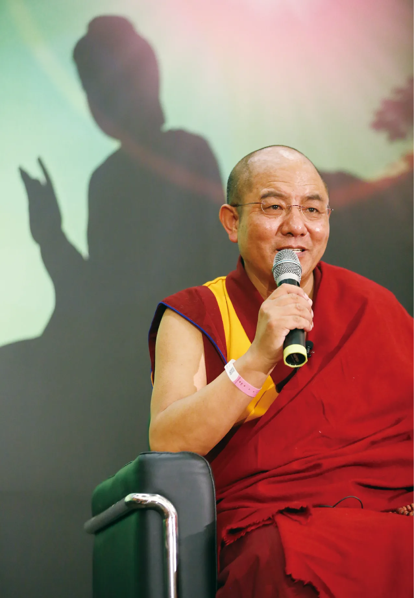
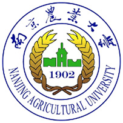
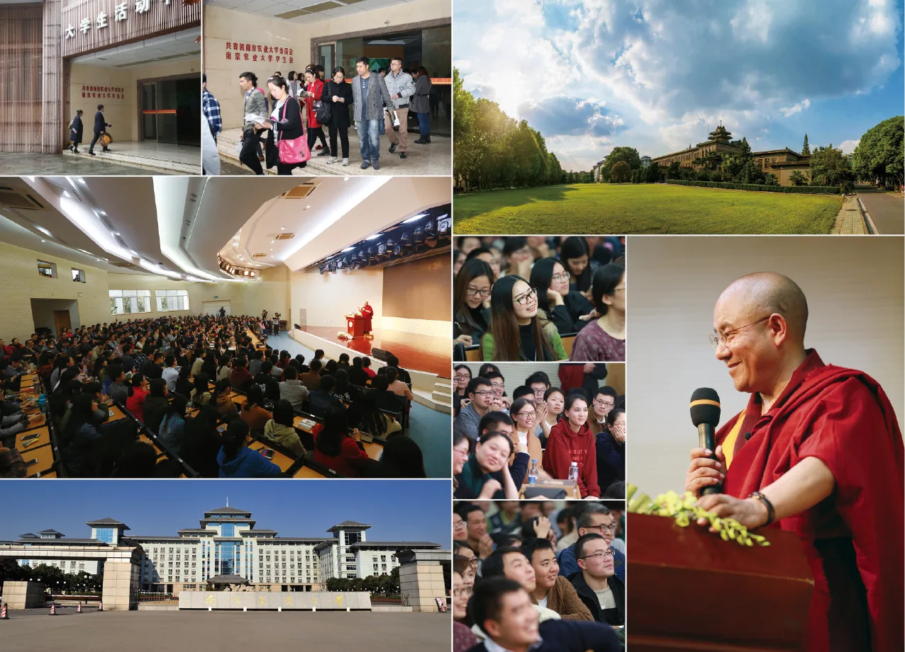
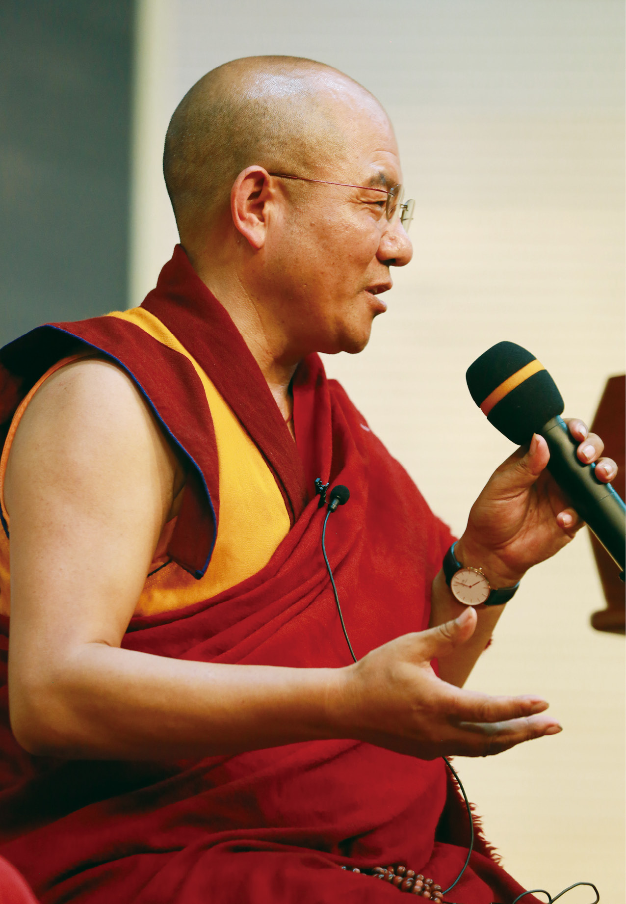
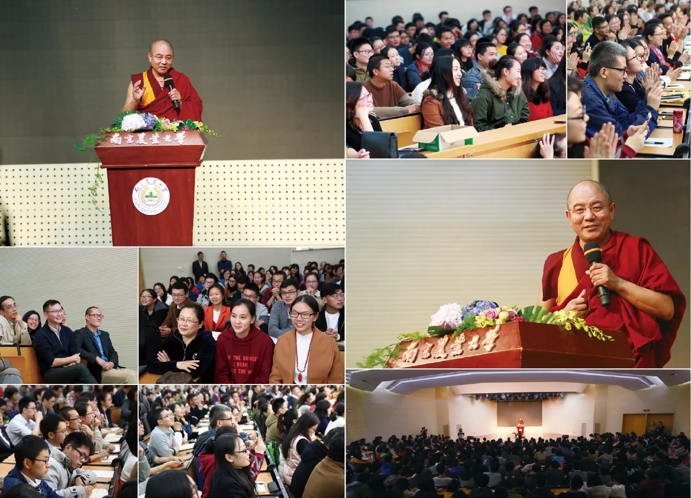
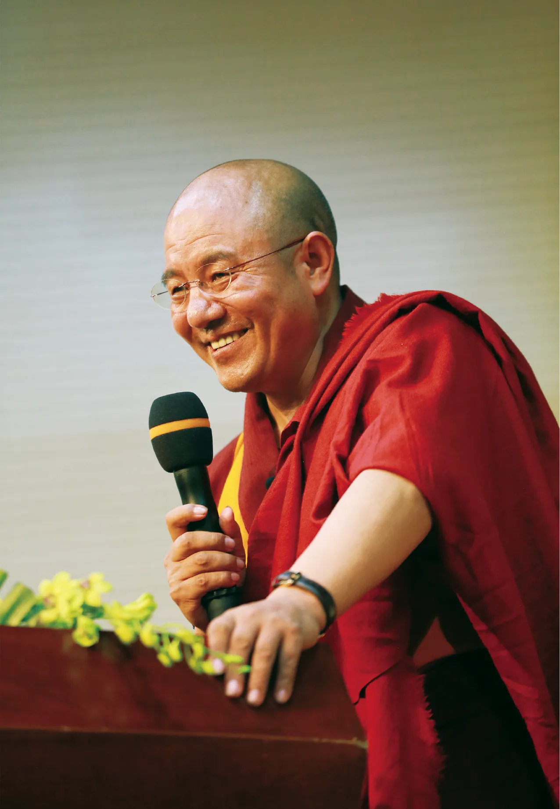
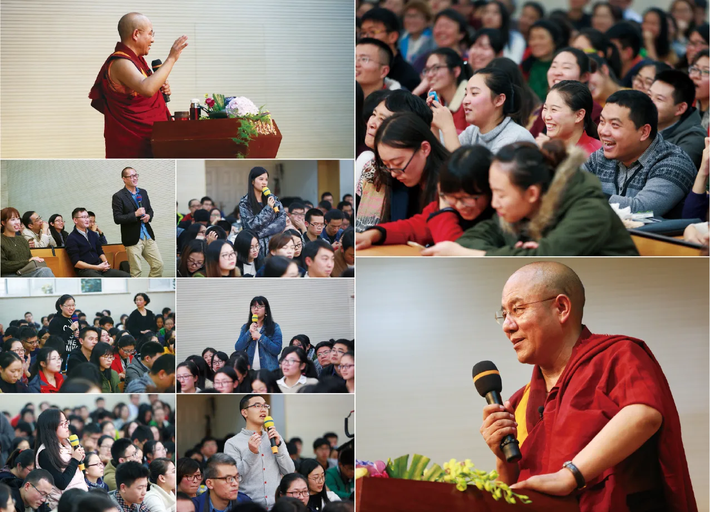
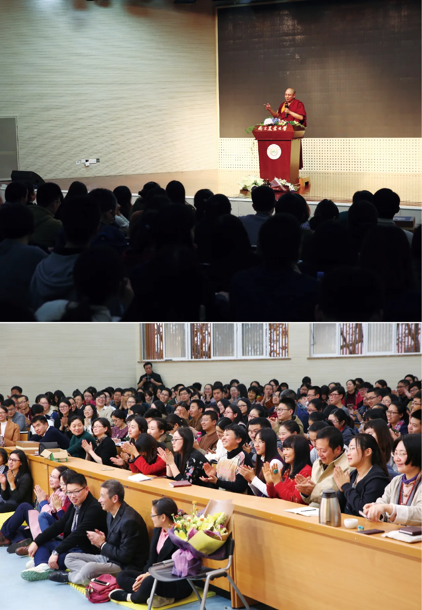
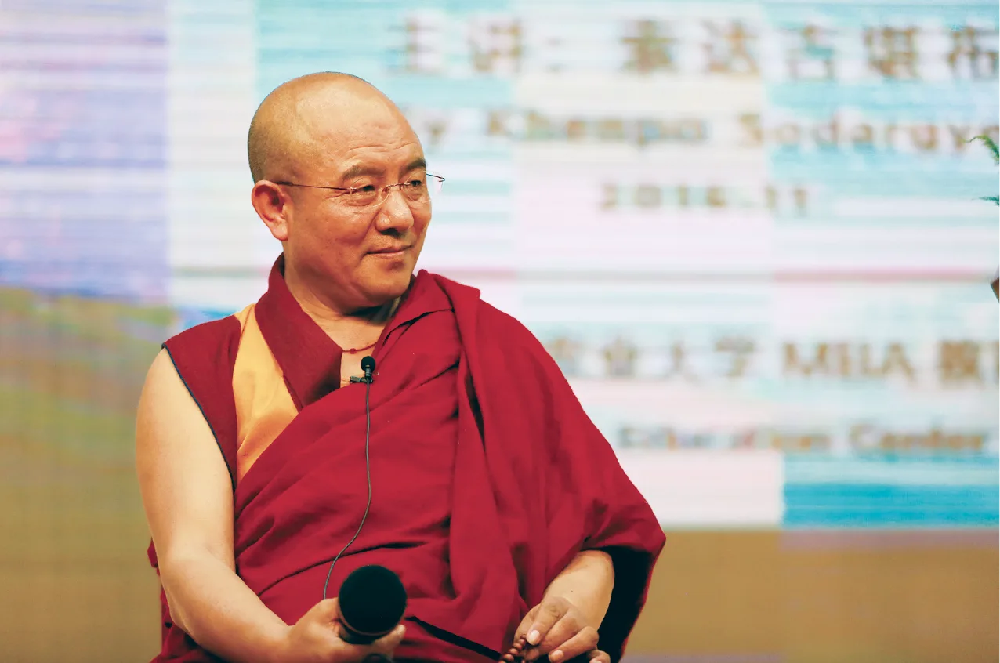
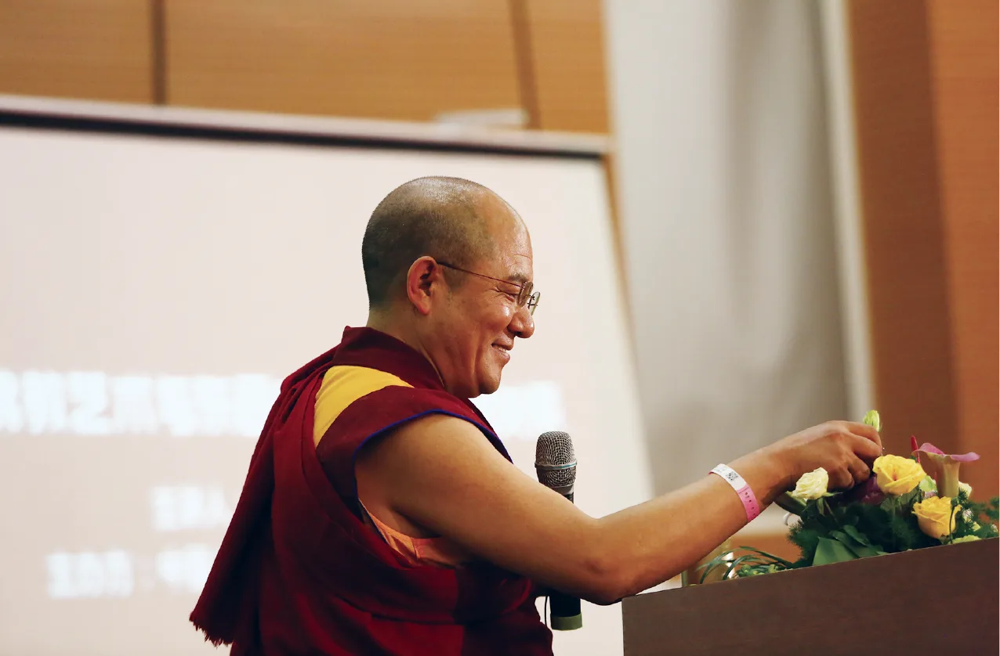

钱财若没有以智慧摄持，

就会变成祸害。

第142场

南京农业大学

Nanjing Agricultural University

中国·南京

2016 / 11 / 19

## 财富与人生价值

## Value of Wealth and Value of Life

主持人：

尊敬的索达吉堪布，以及各位嘉宾、各位同学，大家下午好！

今天对在座各位来说是一个非常欢喜、非常殊胜也非常幸福的日子，因为学校MBA教育中心再次恭请到索达吉堪布仁波切来给我们讲课。堪布不辞辛劳远道而来，我们也非常珍惜这样一个机缘。用耿院长的话来说，堪布和我们学校及经管学院都有非常好的因缘。

首先，有请南京农业大学经管学院青年才俊、新生代的院长耿献辉教授致欢迎辞！

耿院长：

尊敬的各位来宾、在座的MBA学员，大家下午好！

今天，我们很荣幸地邀请到了来自色达喇荣五明佛学院、资历等同于大学教授的大堪布——索达吉堪布为我们做演讲，演讲的题目是：财富与人生价值。现在有请堪布老师！

主持人：

在堪布您做开示之前，我代表同学们想先问您一个问题。提出此问题，是因为安排这次讲座的主题“财富与人生价值”时，有的同学问：来做演讲的老师是不是来自保险公司，是不是位理财师？所以，在开示之前想请问您，您平时在生活中是否理财？比如说购买股票、储蓄、保险等等。感恩堪布！

索达吉堪布：

理财。

主持人：

下面我们就有请佛学大师从最古老的文化以及佛教的角度来诠释“财富与人生价值”，大家欢迎——

尊敬的耿院长、尊敬的各位老师和同学：

很高兴今天和大家有这么一个交流的机会！

刚才主持人问我的第一个问题是：我是否理财。其实“财”的定义有很多，有精神财富和物质财富。精神财富中也分为一般精神层面的财富以及更高层面的圣人财富，例如在佛教中就有“圣者七财”，分别是：信心、戒律、多闻、布施、知惭、有愧、智慧。现在很多人特别想理财，想要拥有更多的财富，但你获得的越多，随之而来的风险也很大，而人们对风险较低的理财又不太愿意投入，这种情况大家都深有体会。

今天，与各位聚在一起利用下午的时光共同学习，我很开心。我本人去年也来过农业大学，这是第二次来这里。从某种意义上讲，在农业大学的老师和学生面前，我应该没有资格演讲，因为我不是大学生，在你们面前演讲是班门弄斧。但对于今天“财富与人生价值”的话题，我们可以在思想上互相碰撞，也许我可以给你们带来一些提醒、思考，以及一些小小的建议。我也特别希望得到你们的提问和指点，共享互相学习的美好时光。

其实，每个人的每一天、每一小时、每一分钟、每一秒都非常珍贵，并且由此而形成了我们的生命。我们把生命用在学习古今中外的知识上是非常值得的。但现在很多人并没有把生命用于学习、思考，这很可惜。希望我们今天下午的交流会对个别人有少许利益。

## 钱并不可怕

在我看来，无论从传统文化还是从佛教文化来看，钱财本身没有什么过错，并不像有些人认为的，钱财像毒蛇般不可触碰，否则会带来无穷危害。还有些人认为，在佛教中，穿得破破烂烂才是真正的出家人，不去挣钱的人才是真正的佛教徒。但事实并非如此。根据佛教的理念，一个人只要有福报，并能合理使用钱财，财富可以多多益善；如果钱财使用不当，即使钱再少也是在造恶。因此，佛教对待财富的态度是不堕两边——不堕富边，也不堕穷边，关键是看你如何运用，有没有一颗知足少欲的心。

佛教中有部非常著名的经典，叫《佛遗教经》[^1]，经中说：“知足之人，虽卧地上，犹为安乐；不知足者，虽处天堂，亦不称意。”意思是：知足少欲的人即使没什么钱，内心也会特别快乐；不知足的人，哪怕过着天人般的生活，也不会感到称心如意。还有一句是：“不知足者，虽富而贫；知足者，虽贫而富。”不满足的人，纵然物质条件富足，但由于内心贪婪，相当于穷人一般痛苦；而知足的人即使生活贫寒，但有了满足感，也是天下第一等富人。这是佛教对财富的基本认知和定位，也符合传统文化的一些观点。

《论语》[^2]中有句话：“富与贵，是人之所欲也……贫与贱，是人之所恶也。”大富大贵是人人都渴望的，而贫穷下贱是人人都排斥的。当然，从某种意义上，追求财富也合情合理。荀子说：“义与利者，人之所两有也。”也就是，追逐利益和遵循道德，是人们最向往的两样东西。如果没钱，恐怕在这世上寸步难行，但你有了倾国之富后，没有道德的话，也不一定能让自己真正快乐。因此，传统文化告诉我们，对财富的态度应秉持中道。

## 人这辈子不能只有钱

大多数人认为，衡量一个人成功与否，主要看他财富多少。如果钱很多，那是非常成功的，反之说明他混得不好。其实，人应该追求的，不一定只有钱。丰子恺在他的漫画书里说：“人生有三层楼，第一层是物质生活，第二层是精神生活，第三层是灵魂生活。”然而，多数人目前只停留在物质追求上，追求精神层面的寥寥无几，崇尚宗教和哲学等灵魂层面的更是凤毛麟角。

不知道你们农业大学的情况如何？国内不少大学只要是跟钱有关的专业，比如金融、经贸、会计，招生报名就特别火爆，而历史、宗教、政治、哲学等专业非常冷门，乏人问津。所以很多老师在进行职业规划时，不得不放弃自己之前所学的专业。我曾经遇到一位老师是宗教博士，他讲的宗教课特别好，但他对我诉苦道：“在国内，我很难招到报名宗教专业的学生，因为他们都去学金融了。”出现这种现象的原因，一方面是，好多大学生就业后需要一定的经济支撑；另一方面，父母亲友对你的人生指导有一定影响，他们都会建议你选个热门的专业，这样工资就挣得特别多。然而，在西方有些国家却截然相反，学习宗教、历史和哲学的学生特别多——不过，这几年听说也变了，报金融的学生多了不少，人们对金钱也越来越渴望了。

在座的各位可以想想，人活着到底是为了什么？除了赚钱，是否还有其他可以追求的？人若只用金钱来衡量自己成功与否，除此以外，无法享受到精神层面的快乐，实际上是很可悲的。当然，这种现象的发生，也是人心的贪欲越来越重所致。我看过一个叫《蛇尾》的故事：有一种贪欲很强的蛇，当把周围的食物吃光后，便开始吞食自己的尾巴，直至吃尽自己的身体。其实，我们人类也是如此，贪执周围环境的各种资源，什么都想不择手段地得到，这样到了最后，很可能是自身难保。

不过，当人的贪心疯狂膨胀时，任何东西都很难让他停下来。昨天有个人跟我说：“现在不去做点投资是不行的。如果把一辈子的钱只存在银行里，可能连一个卫生间都买不起。虽然明知投资有风险，但不这么做又能怎么办呢？”确实，这是比较现实的问题，但另一方面，这也是人互相攀比的心态在作怪。现在MBA的很多同学聚会时，探讨的话题主要就是“钱”：你买了房子没有？买了车没有？买的是什么车？这车性能不行，应该买更好的；这房子太小，要再宽敞舒适一点；这个花园应该修整一下……欲望永无止境，即使一个月挣一万，也会觉得挣两万才合适；但当你真的每月挣两万时，又认为这不够花，随之想着三万、十万，甚至一百万。

我看一本书里说，有个爱马仕的包卖2100多万，因为包上镶有很多钻石。但有人仍觉得这不是最好的，因为还有一款3000多万的包。试想，如果有人拎着一个3000多万的包，那与之相配的衣服、车、房肯定更贵，否则，只有包如此昂贵而其他东西都很低廉，也不相称。物质追求到了一定程度，人的欲望就会不断扩张，心思全部放在赚钱上，不可能触及上面所说的第二、第三层生活境界，这样活着非常累。

我去过一些国家，发现许多人没有这样的攀比心理，在街头演奏乐器或者唱歌卖艺也很享受，当乞丐流浪汉也自得其乐。听说有个中国人认识一个流浪汉，他好心想把对方安排在饭店工作，每月还有固定工资可拿。但对方说：“难道你觉得我现在的人生不好吗？我对现状很满足，请不要限制我。”可见，不少人的人生价值，也不都体现在金钱上，因为钱多不一定就好，甚至可能截然相反——它会膨胀自己的欲望，给人生带来极大痛苦，就像一些腐败分子，最终走上贪污违法的道路。

如果缺乏自律，从小没受过良好的教育引导，到了社会上遇到不好的群体时，很容易做恶事。有句古话叫“近朱者赤，近墨者黑”。与贪欲重的人在一起，你会增长贪欲；跟爱钱的人在一起，你会变得嗜财如命。其实每个人可以有很多爱好，像你们，有些喜欢哲学，有些喜欢文艺，但由于这个时代大势所趋，你不得不拿出全副精力去拼命挣钱。不管是汉地的大城市，还是藏地的小乡镇，很多年轻人疯狂地想赚钱来实现所谓的完美人生——由于一些媒体的鼓吹，他们觉得挣到很多钱就特别成功；又不愿为此付出实际行动，老想着能一夜暴富，就如黄粱美梦般不切实际。

我们都知道“井底之蛙”，小小的水井中有一只青蛙，它只看得到头顶那一片天，直至跳出井口后，才知道还有更辽阔的天地。同样，我们在现在的大环境下，觉得追求金钱才最重要，但若放开眼界去了解世界真相，看看那些精神上非常富足的人，就会恍然大悟，原来人还可以选择这样活，依此得到的快乐更加可靠、踏实。

如今，包括老师和学生在内，贪欲也在不断增长，以至于没有足够的时间去学习和研究知识。我去过很多大学，很多老师都在争取竞争力强的科研项目，也有些老师热衷于炒股、做生意。虽然老师被称为“人类灵魂的工程师”，但也会受到金钱刺激而向财富奔去。老师尚且如此，学生就更不用说了，他们在清净的校园中也不努力学习，整天盘算着怎样挣钱。“学生”，从字面意义上看，本就不同于商人，应该一心一意攻读学业，但如今的“学生”都变味了，每天琢磨的是股票涨跌之类的问题，以至于整个大学四年的时光付诸东流，这非常可惜。因此，大家应该再三思考人生的定位。

## 财富要有智慧相伴

其实，有很多钱不一定真的好。钱财若没有以智慧摄持，就会变成祸害，而有智慧的财富才对自他有利。什么是“有智慧的财富”呢？合理善用金钱，并能断除执著，懂得知足少欲。

佛教中有一个故事，出自马鸣菩萨编集的《大庄严论经》[^3]。经中讲，有一位优婆塞，他有个朋友是婆罗门。一次有人问他：“你那位婆罗门朋友整天都在苦行，吃得特别差，穿得破烂不堪。这样知足少欲的修行人，你见过吗？”优婆塞听后，回答说：“我们可以去问他为什么这样修行。”于是他们亲自去问，可婆罗门的回答有些出人意料，他说：“我苦行是想将来变成国王，以享受各种荣华富贵。”优婆塞告诉那个人：“有些人表面在精进苦行，目的却是为了贪求更多，这岂能叫知足少欲？我们的国王频婆娑罗王看似穿金戴银，吃穿不愁，可是他并不执著财富，还乐于布施和分享，这才叫知足少欲。”

前阵子，很多人在网上议论大悲寺和少林寺的僧人真假，刚才有几位老师也在谈论此事。其实，有些信息不一定能反映事实，有修养的人不会整天在网上讨论是非。现在很多人对佛教了解有限，认为网上说的都是真的，甚至觉得僧人穿好衣服、开好车、寺院金碧辉煌都不合理。其实这也未必，如果僧人对这些身外之物没有贪著，也不是通过非法途径获得的，那戒律中是开许接受的。《毗奈耶经》中说：出家人只要没有贪执，享用多少金银财宝都可以；但若有贪执或行为非法，享受少许也不开许。

## 佛教的理财秘密

有人认为，真正的佛教徒必须穿着破烂，学佛一定要让自己变穷。但事实并非如此。学佛之人完全可以理财，刚才也有老师问佛教徒如何理财，我现在就把具体方法告诉你：

在《善生经》[^4]中，佛陀说要把财富分成四份，一份用于自己的生活，一份存起来以缓燃眉之急，余下的两份用于投资理财。此外，《中阿含经》[^5]也提到这种观点，我在中央财经大学演讲时引用过。佛教中关于钱财的分配方法，其实很好。不像现在有些人，把钱全部拿出去投资，不够还向亲朋好友去借，一旦失败了，自己的钱、亲友的钱都赔进去了，于是就欠下很多债。

按照佛经的观点，有智慧的人应把财产分成四份，一半用于自身，这样的话，哪怕形势不好，自己也有稳定的财富。比如你有100万，拿出25万作为生活用；25万一直存着，家人生病或急需钱时不会一筹莫展；然后用剩余的50万投资理财——也许它能变成100万，但这时不要贪得无厌而要赶快收手，不然，有了100万想着200万，可能一夜之间都化为泡影，甚至本钱也烟消云散。

如今，有福报和有运气的人少之又少，大部分人好像都缺钱，不管我去哪个国家，人们都在抱怨经济形势不好。与此同时，利用网络生财的手段却相当厉害，一些狡猾的人以小利引诱，让你先尝到高利润的甜头，心甘情愿把全部家当投进去，但突然某一天，他们就彻底失联了，钱也全部不见了。网上这些赚钱方法，就像传销一样有许多不为人知的伎俩，所以大学生们是否要开始理财的确不好说。

总之，按照佛教的观点，人不能太贪。像历史上的慈禧太后，一个人控制了清朝好几代皇帝，权力都掌握在自己手里。她特别贪婪奢侈，把国库很多钱占为己有，每天吃一顿饭都要花好多银子。她最喜欢吃的是西瓜，而且只吃西瓜瓤中心一点，一次要耗用三百六十多个西瓜；死时还要无数金银财宝陪葬。这样贪得无厌，对自身非常不利，福德很容易被自己耗光。

## 人要接纳不完美

作为一个人，还是要留些不完美，或许是财富不足，或许是感情不顺，或许是知识欠缺。

我们藏地民间有一种说法：“碗有缺口是不吉祥的。”以前每当我看到自己的碗有残缺，就觉得这次出门可能不吉祥。有一次我随上师去国外，在饭店用餐时发现碗有缺口，就马上让服务员换一个。上师不解地问我为什么要换，我说：“因为碗边有缺代表不吉祥。您看，这上面有一点缺口。”上师说：“这没事。其实人生有点欠缺，是对自己有利的。”从那以后，无论我去什么地方，包括去小饭馆吃饭，就算杯子和碗有残缺，我也都欣然接受。虽然自己曾经很排斥缺口，但“谦受益，满招损”，人生太完美了不一定好。

佛教认为，吉祥与不吉祥其实是一体两面的，吉祥中隐藏着不吉祥，不吉祥中蕴含着吉祥。所以，一个人和家人感情很好，事业上财源滚滚，社会地位非常不错，这没什么好得意的；一个人财富、感情、事业、健康样样不顺，也没必要心生绝望，毕竟好坏都是无常的，是互相转化的。我以前发过一条微博：“当你事事顺利的时候，不要沾沾自喜，因为这正在用尽你的福报；当你屡屡受挫的时候，不要怨天尤人，因为依此可消除你往昔的罪业。”

我们点点滴滴的福分，其实体现在人生的每一个角落。有些人特别追求完美：“我要身体健健康康，心情快快乐乐，家庭圆圆满满，人生十全十美！”但光喊这些口号也没什么用，现实生活不一定能事事如意。也许今天你很快乐，明天就会遇到痛苦。尤其是一些大学生，由于人生智慧还没成熟，遭受失恋、失业等各种刺激时，一下子接受不了，要么得抑郁症，要么用暴力发泄，要么选择自杀，这是非常可怕的。

所以，要真正懂得人生，才能化解不必要的情绪。国学大师季羡林写过一本书，叫《不完满才是人生》，我在兰州机场还买过。也许有人不接受这种说法，其实在这个世界上，没有一个人的一生是圆满无缺、始终快乐的，人生就如一条曲折之路，那些感受到的快乐，都不过稍纵即逝。重要的是，无论我们遇到什么，都应把这一切当作修行的好机会。

前几年我和别人一起去了台湾阿里山，那里有些大树高耸入云、郁郁葱葱，但根部有好多难看的孔洞。有些游客觉得树洞不错，把它当成山洞坐在里面。其实人生也是这样，我们要把任何不完美当做机会，当做学习的经历，不要轻易被它击垮。

不知道大家是否研究过《易经》？《易经》中有种说法叫“祸福相依”，意思是祸和福是相互依赖、相互转化的，祸中有福，福中有祸。有些人因为一夜暴富而特别风光，人人特别羡慕他，但其实没必要太高兴，自己要想想，为什么无缘无故来了这么一大笔钱；有些人莫名其妙出现了财务亏损，或是遭受众人冤枉，他不明白自己对别人那么好，为什么却落得这个下场。其实这一切的背后肯定都有因果。

有一次，我去一所大学演讲，路上听到一个女孩正在打电话，她歇斯底里地大喊：“我对你那么好，你却这样对我！我不活了，要死给你看！”其实，当我这个出家人在校园里出现时，很多大学生看我的眼神就像看到了外星人，但我就这么站在那个女孩旁边，她却没有注意到我的存在，应该是心情特别低落，情绪特别激动。其实，在这种情况下，要尽量平复自己的情绪。的确，未来是年轻人的时代，是很有希望的时代，但年轻人也有诸多让人担心的地方。那天有人问我为什么经常去大学做演讲，我说：“因为我对大学生充满希望，同时也存在着担忧。我很想把有些学生不太正确的人生观稍微做些调整。一个人在年轻时，能找到正确的人生方向，这是非常重要的！”

孔子在《论语》中说：“吾十有五而志于学，三十而立，四十而不惑，五十而知天命，六十而耳顺，七十而从心所欲不逾矩。”我们从15到30岁是学真理的关键时段，一定要努力完成学业，到30岁时，要找到人生的立足点和真正的价值观，这样到了40岁就不会对人生感到困惑，50岁会洞彻万法的规律和因缘，60岁不会随外境而转，70岁不管想做什么都不会越矩——但这也不好说，现在70岁老人越矩的也比较多。像特朗普，70岁当上美国总统，之后在他任期的四年中到底会发生什么，大家都在纷纷议论。

孔子提到“五十而知天命”，也就是人到了50岁要懂得因果，而在其他传统典籍里说，人到了50岁就“不犯大过”。其实我很希望大学生在20岁时就懂得因果道理，不然，50岁才明白的话，的确是有点晚了。如果越来越多的大学生在50岁前就能通达人生真相，现在的学习、积累的知识、不断规范的德行变得越来越圆满，那今生中的一切都应该让人很快乐。

## 贤善人格的重要性

清华大学的校训是“厚德载物”，佛教也常讲“精勤不如积德”，其实有时候勤奋不如积德来得好，否则，没有福报却想赚大钱、做大事，确实有一定困难。世间许多现象都遵循客观规律，因此，我在这里和大家分享的重要一点就是：人生需要有智慧来陪伴，而且这种智慧要与福德相匹配。

福德，主要来自贤善的人格。法王晋美彭措对人格的培养非常重视，无论对出家人还是在家人，有信仰者还是无信仰者，经常强调人格的重要性。法王如意宝诸多著作中有一部非常著名的《教诲甘露明点》，书中讲到，做人要做好七个方面：

第一，心地善良。不管是什么人，都不要损人利己、恶心害他。如果想侵吞别人的财富或是伤害别人，确实不能称之为善良。

第二，无有狡诈。这个时代，不精明狡诈的人虽然会被欺负、占便宜，但我们仍要做一个正直的人，不能故意欺骗、诱惑、损害众生。

第三，性格温良。有些老师与所有同事的关系都不好，有些学生与所有同学的关系也不和睦，这就是性格不好的表现。大家都会害怕这类人。如果一个班里的某些人大家都怕他、讨厌他，这也是性格不好的缘故。一个性格温良的人，谁都会喜欢和他做朋友，同样，某人在社会上若特别招人喜欢，这也是因为性格好。如今我们佛学院有一些出家人是从英国、美国或者加拿大留学归来的，他们刚来的时候，连我都很羡慕他们。他们中有些人性格还不错，但也有个别人可能受到以个人主义为中心的西方文化影响，个性非常要强，有时对于老师的话都不听，甚至态度不友好，对父母也不孝顺。如果我是西方老师，那也有些受不了——学生的态度如果是这样，怎么讲课呢？所以，具备温良的性格对自他都很重要。

第四，要有远见。做人不要鼠目寸光，要对事情高瞻远瞩，不能只盯着眼前的小事。有些学生因为年龄和智慧还没成熟，可能把事情看得长远有一定困难。但作为老师，应该能做得到，不管是教书也好、育人也好，应该有一种登高望远的智慧。

第五，人格稳重。我们把稳重分为：身体稳重、语言稳重和心稳重。身体要稳重，不管自己在哪里，都不要特别三心二意。现在有些企业招到的大学生，今天来上班，明天就消失不见了，又跑去别的地方应聘了。有些人坚持了三天的工作突然就要放弃，今天换这个行业，明天换那个行业，这就叫做身体不稳重。心若不稳重，就会情绪很波动，高兴了就像天人一样笑得特别灿烂，痛苦时又哭得天崩地裂，周围的人都对他退避三舍。语言不稳重是什么呢？体现为说话不算数，一会儿说得特别漂亮，一会儿又把之前说的都推翻了，根本什么都实现不了。现在有些人语言着实不负责。所以我们要谨言慎行，做一个身语意都稳重的人。

第六，包容之心。人在世间要有一颗包容心，若能如此，自己会过得很快乐，不论发生什么都可以接受。有些人总为种种小事而计较，什么情况都不轻易说“行”，你开车时他说“不要往这边开”，吃饭时又说“不能这样吃，要那样吃”，对什么都要指手画脚，过于干涉别人的生活，连孩子吃一口饭的饭量大小都要叨叨。人和人之间的关心固然重要，但这种关心也需要建立在包容的基础上。所以，不管对于什么人，都要豁达大度，待人宽厚。

第七，具足世出世间的智慧。智慧有世间和出世间两种。世间的智慧，就是为人处事、待人接物，不管是专业智慧还是一般智慧都很重要，没有智慧的人寸步难行，这点大家都有感悟。出世间的智慧，是指在佛法上的修行，包括人文教育更深层的研究，超越自然现象的一些更深领域。现在有很多对更深层科学研究感兴趣的大学生群体，其实这也是超世间的一种智慧。

如果具足了这七条，就可以称为贤善人格。我也希望在座的各位都具足贤善人格，这就是我们的人生价值。对于财富，我们既要有物质财富，更要有精神财富。如果精神财富特别富足，那无论处于什么环境、经历什么事情都会保持开心，并能将这种幸福持久下去。

现场互动

问：我是国贸班的学生，今天听了堪布的演讲感觉受益匪浅。您在介绍财富的时候说，拥有财富是合理的，但又说人不应该有贪欲。请问：如何在拥有财富时能控制自己的贪欲？如果一个人拥有了财富就会想住更好的房子、去买更贵的轿车，这是贪欲吗？如果是，那该如何控制呢？

堪布：佛教中所达到的最高境界，就是要将所有贪欲、执著全部看破放下，但对一般的世间人，要求并没有这么高。

如果我们贪欲过多，超出了自己可承受的范围，可能不太好。但你各方面的能力或福德如果具足，自然而然可以住高档的别墅、坐豪华的轿车，这也是没问题的。

但现在很多人并非如此。明明知道自己没有这个能力，却又特别向往和追求一些无法实现的东西，结果因为目标定得太高、力量又太弱，把自己弄得特别焦虑。就像一名运动员，明明跳不高，可定位又特别高，这很容易让自己受伤。

其实追求财富应当适度，如果非要占有很多资源，导致身边很多人的资源稀缺，这也不一定合适。如果能和他人共享资源，将是一种莫大的功德。所以，我们的心要放开一点，就像之前提到的，把财富分成四份，拿一份去做功德和慈善，这样的财富是会让自己快乐的。

问：我是2015级MBA的学生。昨晚得知您要来学校演讲，我很激动，但今天看到您进来时，我觉得自己很平静。这种平静可能是您带给我的，我不确定是不是像《金刚经》里说的“不著相”。而我现在向您提问，却感到有点紧张，是不是我又著相了？想请教堪布，如何理解“不著相”这件事。

堪布：很多人觉得我是神秘人物，也有些人觉得我是“卖保险”的。以前我去过泰国曼谷，那天正好是1999年9月9日，我去当地的佛教大学时，那里所有人都惊呆了，因为很多学生从来没见过像我这样的人。这几年我也去过不少地方，有些人看到我比较惊讶，有些人也没有什么感觉。其实我的确并不神秘，比如，我没有头发，你也没有，大家很多方面都一样。（众笑）

实际上“不著相”的境界比较高，普通人不容易做到。《金刚经》里讲“无人相、无众生相、无寿者相”，还有“凡所有相，皆是虚妄”，讲了很多关于“相”的道理。举例说，当心里的白色、红色、有无、是非等一切执著全部泯灭的时候，那就是“不著相”，但是我们现在做不到。为什么呢？因为我们无始以来一直不断在“相”中串习。

若要灭除所有的“相”，有两种方法：第一种，通过禅宗或者密法的开悟方式，在当下恍然大悟的刹那，一切“相”自然就破灭了；第二种，按照藏传佛教的剖析和辩论方法来学习中观，就像你们做科学研究一样，要不断地去思维、去研究，最后发现世间所有“相”原来都是假象，不管是爱恨、美丑全都是假的。这个道理并非只是文字上的建立，而是要在学习过程中深深体会到。

我学习佛法的时间比较长，早期把所有时间、精力投入佛法的学习和研究中，因此对理论研究得比较透彻。我们现在执著的这些相，都是假的，像做梦一般，从真正意义上观察，这些都是不可得。因此，当我听到别人诽谤时，会立刻安住在无“相”的状态中，当下会感到很自在。其实，世间中一切都是如梦如幻，在这种状态中安住时，所有情绪都会荡然无存，这个道理对我们很重要。

问：之前您说“五十岁而知天命”时，建议年轻人最好在二十多岁时要懂得因果的道理。我本人学佛，自己也相信因果，可是我的一位亲人对此并不相信。如今他以杀生来谋生，我跟他说这样比较造业，从因果规律来说，即使现在挣了钱，终究也是要还的，但对方不信，每天仍在剁众生的肉。我不知道如何劝说对方，请您教我如何让这位亲人相信因果？

堪布：是否相信因果，取决于每个人的价值观。有些人因为环境、教育、家庭等原因，确实对因果有所排斥。在这种情况下，我们没有必要去强迫或以其他方式使他人相信因果。

每个人的生活方式不同，我觉得能否说服对方，要取决于你在家中的地位，如果对方是长辈，可能不会轻易接受你的意见。不过对于老师和学生来说，还是要重视因果规律。我之前也提到，确实有特别多的因果公案，虽然因果是一种无形的力量，但善恶之报如影随形。佛经中也说到，善和恶的报应，我们虽看不到摸不着，但它一直跟随着我们，一旦因缘成熟，自然会感受到相应的果报。只不过果报显现的时间，也许是两年、三年、这辈子或是下一世，所以会导致因果的道理凡夫人无法相信，这也是正常的。

但是我们对其要有了解，不能把自己变成得过且过的“废物”，更不能让自己成为社会、他人的“危险品”。昨日我去监狱里讲课，里面不少是80、90后的年轻人，看起来特别可惜。我曾经也去过很多女子、男子监狱，从服刑者的智慧和能力上看，恐怕并不低于我们，这些人中有学艺术的、学音乐的，其中也有高官，总之，监狱里什么样的人都有，人才济济。其实，监狱是人间的一个惩罚之所，按照佛教里讲，人死后有个地狱，是离世后的惩罚之所，两个“狱”字一样。但他们很多人至今不懂其中的道理，如果从小就有因果方面的教育，即生中也不一定会落到坐牢的下场。所以我很希望大家在年轻时要有一个正确的人生观和价值观。

今天在场的大学老师也比较多，其实现在不太缺乏知识的传授，像哈佛大学、哥伦比亚大学、斯坦福大学等一流学府，在网上公开了成千上万的课程，可以直接下载来听。如果你是一名合格的老师，建议不要光授课，更应该在学生成长的关键时期去影响他们的价值观，有机会要面对面指出学生人生中的一些迷误，改正他们一些错误的观念和方向，一定要让他们做个好人。

当然，不管我们能否帮到他人，都要尽力而为，如果实在无能为力也不要懊恼，因为在这世界上，我们力不从心的事情有很多。不要说我们，地藏王菩萨发了“地狱不空，誓不成佛”的誓愿，他有时也会遇到麻烦之事，因为地狱众生真的太多了。所以，我会时常劝他人不要造恶业，若实在无能为力，我就默默地发愿、回向，希望对方能慢慢改过来。

问：每个人的“我执”都特别严重，很多人特别执著于情感，比如亲情、友情和爱情。请问，我们应该如何破除对情感的执著呢？

堪布：你这个问题比较现实。的确，很多人不管表面上如何，实际上情执较为严重，在人生中因“情”带来的痛苦也比较多。

现在很多人经常流泪，并不是因为吃不饱、穿不暖或是没有钱，他们所流的泪水多是感情的泪水。如果把大地上的泪水积攒在一起进行剖析，可能情感的泪水占了百分之七八十。

其实，感情并不能带来太多快乐。但在这个时代，通过媒体、流行歌曲、影视剧的宣传和美化，情感被刻画成了“世上最快乐的东西”，以至于人们不惜一切地追求情感，不断地控制对方、提出更高的要求，最后的结果是两败俱伤。

我们藏族人也有男女情感和父母情感。但我们对父母的报恩之情特别深，对男女情感的执著似乎没那么严重，这也许和文化、地域、传统有一定关系。

克服情执的方法有两种：一、要认识到情感的本质是什么。尤其对年轻人来说，有很多为情所困的现象，这就需要用自己的智慧去客观分析。二、最好通过佛法来改变情执，比如依靠空性、利他心等修行来调节对情感的执著。

问：我是南京工程学院学数控自动化的学生。关于人生，您总结了七点，在我看来主要还是关于性格和稳重两方面。在这七点中，性格是一个很重要的部分，但有一句话叫“江山易改，本性难移”，性格是娘胎里与生俱来的，它只能慢慢通过人生历练来变得稳重，随着阅历和年龄的增长，才达到性格和稳重两者平衡。不知道您对此有什么看法？

堪布：有些人会随着业力、智慧以及人生不同阶段的经历而慢慢成熟起来，但也有些人虽然年龄大，可依旧不稳重。

我身边有一位出家人，每年都跑好几个寺院，今天在这所寺院住下，不多久又会去别处寺院，他经常这样跑来跑去，人格很不稳重。同样，一些年轻人是这样，也有些年轻人不是。在我们看来，稳重与年龄有一些关系。你刚说“江山易改，本性难移”的确没错，对于不稳重的人来说，这是很难改变的。就像有些人情绪波动特别大，他不会遵守半点承诺或誓言，说的任何话都不可靠，大家也不信任他，认为这种人极不稳重。以后他们找工作面试时，有经验的面试官也会对此一目了然。

你刚才提到部分人通过阅历而变得稳重，这是有的。我们也经常说：人一切都在变化，一切都是无常的。就好比有些人年少气盛时，特别爱东奔西跑，但随着年龄的增长，就变得稳重起来。但是，也有一部分人年龄再大也依然如故，所以可能没办法一概而论。

问：我认为财富分物质和精神两个阶段。对于物质而言，我觉得体验过物质享受的人，才会进入第二阶段——精神财富，之后才会有自己的人生定位和价值等一系列东西。因此，物质和精神两者之间有一个先后关系，那如何去寻求这两者平衡？

堪布：关于精神财富和物质财富，我并不否认两者可以同时具有。比如，当我在享受物质财富的同时，也可以享受精神财富，但大多数人只是满足于物质财富的层面，对此东西方很多哲学家也表示认同。

正如金字塔底层至顶部的结构，如今大部分人日常追求物质财富，还是处于金字塔最底部，他们只为了获得感官上的刺激和快乐。如果从精神层面进行禅修或通过艺术方式获得物质以外的快乐，这才是人生真正的快乐。

在座的同学们是否会选择这样的专业，使自己的快乐并非建立在感官以及金钱上呢？当然，我们并不排斥人生也需要金钱，但自己的人生到底立足于哪里，是需要每个人慎重思考的。

问：我是一名学习会计的学生。我之前了解到您的一些事迹，您小时候在家里放过牛，现在已成为国际上非常有名的佛学大师，前后的身份有很大转变。请问，您在放牛时的人生方向是什么？如今成为一名佛学大师后，您的人生方向又是什么？在这两个身份转换的几十年中，您一直在恪守和坚持的动力是什么？

堪布：我小时候放牛当牧童，直至16岁还不认识字，之后就去读了书，现在很后悔那时没有好好学习，天天和老师、学生打架。今年我去英国一所学校演讲时，他们也希望我讲讲这方面的内容，我说自己的人生追求已改变了多次。

在我当牧童时，隔壁有一户放牛特别好的人，他曾经是出家人，由于那个时候政策还没恢复，所以不敢现出家相，但他就如真正的出家人一样，只是外面穿着在家衣服而已。他为人特别好，对牦牛也特别好。那时我对父母说：“我的偶像就是他，我以后要成为像他那样的人。”因此，我最初的人生方向就是成为一辈子放好牦牛的牧人。

之后我上了初中，有位亲戚是医生，医德特别好，口碑也非常不错。那个时候做民间医生不需要考试，于是，我就希望自己今后成为一名医生。

后来我幸运地考上了师范，那时有一位教了三十多年书的老教师，他教书特别好，于是，我的人生定位又转变成今后要成为像他那样的老师。

最后我出家了，受到上师法王如意宝的影响——他也是我的老师，我的人生观又发生了极大改变，之后我主要跟随他学习佛法。

不过，人的习气有时还是很难改。以前做牧童时，我眼里只有牦牛，即使做梦也是如此；而现在我有时候做梦，依旧还是那时候的情形。昨晚还梦到自己在蓝天白云下，和很多牧童一起放牧。（众笑）

至于坚持下来的动力……不管我去哪里或做什么，行程都排得特别满，人也感到很累——今天我在这里结束演讲后，就要立即赶往另一座城市，之后再去别的城市。现在我唯一的动力就是：我深切知道佛法真的很好，很希望在有生之年把这么好的智慧传递分享给更多人，让他们了解佛法从而改变人生。这可能是我唯一的动力，除此之外也别无其他。

问：之前有人问“拥有财富时应该如何克制贪欲”，您回答道“我们拥有时要放得下”。其实那是一种很高的境界。我一直把拥有财富理解成“有”，把放得下的状态理解为“空”，我看一些佛教典籍时也经常看到“缘起性空、真空妙有”这八个字，希望堪布给我们开示这八个字的真正内涵是什么？

堪布：关于“缘起性空”，是指万法都是因缘产生的，凡是因缘所生的法，全是空性，只要是因缘和合的，就是不可靠的。佛教有一部经叫《般若摄颂》，经中说凡是因缘所生之法，一切皆为空性，因为它是和合而假立的。佛教里还说，因缘所生之法如果不空，那么是自生、他生、共生还是无因生呢？通过这四种方式来观察，最后就会发现万法了不可得。

“真空妙有”，是说当你真正通达空性后，可了知外境的一切妙力或显现是存在的，但在显现的背后，万法又远离四边八戏，没有一点实有本体。诸法的实相是，显现为缘起，本质是空性。如是缘起性空的境界，只有通过各别自证的智慧才能证悟。

问：我是MBA班的学生。如今我们都在追求很多东西，希望改变自己的生活或者工作，但在追求过程中，往往会遇到求而不可得的情况。若长期在这种状态中，就会对生活、工作变得更加迷茫，就会随波逐流，所以想请堪布帮我开解一下。

堪布：对生活的追求固然需要，但也不能追求完美。如果你想挣钱，就要从最好和最坏两方面来考虑。尤其是事情一旦落空、失败，自己能否接受现实，这是要提前想好的。

现在有些人没有这些准备，因此，在追求过程中往往以痛苦告终。其实，不管你是追求人、财、物哪一种，都要事先有一种心理建设。希拉里在竞选美国总统失败后，无论是否在强装，但表情还是比较自然。我们对生活也要有一定的思想准备去接受不论好坏的结果，否则，还是建议你放弃这样的追求。此外，即使是追求，也要观待自己有没有这样的因缘。

我经常觉得，对生活的渴望和勇敢的追求无可厚非，但若一味地强求，最后可能变成一个颓废、脆弱的人。如果认定了方向，心里也做好各方面准备，即使结果让自己很受伤，也能很快从里面走出来。

问：我是学环境专业的学生。请问，迷信是过去的真理，如今被科学给推翻了，今后科学也可能会被别的东西推翻。现代人的理财、人生价值观今后某种程度可能也会被推翻，但是您提到的“合理”，它本身会不会向着一个永恒或者经典的方向发展？如果是，它是否会和“极端”产生很大的矛盾？举例来说，若什么东西都求合理和适度，会不会就没有了突破？我对此感到很困惑，感觉人生既要有一定的追求，也应该要有一定的突破，所以觉得这两者有点矛盾。

堪布：你自己会选择极端还是合理？

高中时我们老师曾说：你在一个什么样的状态下，就顺应选择相应的东西，有时会需要儒学，有时会需要道家，有时会需要法家，不同的阶段有不同的选择。

堪布：在正常或合理的情况下，你会不会选择极端呢？

正常情况下我会选择极端。因为我觉得一切正常会感觉很平庸，若一切都是井然有序的，生活意义不是很大。我觉得应该要有一定的突破。

堪布：你说得有道理，但刚才有一点说得不对，迷信并不是被科学推翻的，迷信永远是迷信，科学永远是科学，真理永远是真理，只不过人们觉得在日常运用中不合理的叫迷信，合理的则称为科学。其实，科学也有迷信的成分。因此，我们应在不同的领域中寻找不同的知识。

我说过，合理的追求非常重要，是因为现在很多人的追求比较极端。有的人连基本的财富也不追求，抱着随缘无所谓的态度生活，人变得非常懒惰；有的人为了得到财富，非常疯狂以至于失去了理智。所以，生活即使需要突破，分寸也很重要。有智慧的人做事，时时刻刻都相当得体，若不顾及尺度，就会有点自不量力。因此，我们要了解自己的能力以及所追求的目标，这样才能做出合理的选择。

问：您刚才的主题是“财富与人生价值”。有的人是追求财富，有的人是追求信仰，前者以财富为信仰，后者以宗教为信仰，这两者有什么本质区别吗？

堪布：从广义上讲，追求宗教是一种信仰，追求财富也是一种信仰，正如我们常说的“拜金主义”。从另一个角度讲，财富中有“信仰”的财富，信仰中也有“财富”的信仰，二者之间的关系比较复杂。

普通人在追求宗教信仰的过程中，对物质的追求相对而言会比较淡薄。但如果由于信仰宗教而失去了对生活的追求，我是不赞叹的。正确的方法应该是：在你追求宗教信仰的同时，对未来生活的美好追求和期许也不能放弃。

问：我们日常中会面临很多选择，包括现在有很多思想以及多元化的价值观等，不管是世间还是出世间都会面临一些抉择。这方面我们需要参考什么标准，才能确保方向正确？

堪布：很多年轻人在人生中会有不同的选择，多数人做出选择的唯一标准，就是上网看看别人对此事作何评价。一方面，你可以选用这种方式，另一方面，当自己迷茫地站在人生十字路口时，最好能问一些有经验的人。

比如，我出家、读书以及需要对人生重要事情做抉择时，如果只按自己的心情来决定，就不会成为今天的样子，因为我那时的阅历非常简单。我选择要不要出家时，有一位老师让我去佛学院，就是他这一句话，改变了我的一生。

因此，年轻人在比较迷茫的时候，可以上网寻求答案，但最根本的方法还是去问问身边有经验、有智慧、有阅历的老师和父母。如果他们不能抉择，那去翻阅古今中外智者们的书籍也很好。在书中，他们会给出很多人生的答案，爱看书的人可以带着问题去找答案。其实，我不太相信网上碎片文化所给出的答案，相反，在书中寻找解决方法或许更为可靠。

问：我们在做选择时，往往会考虑到他人的因素，尤其是父母等至亲的期待，他们是否会因自己的决定而伤心之类的问题。我们的确可以做到如但丁所讲的“走自己的路，让别人去说”，但现实中往往难以平衡。请问，关于这方面，我们需要如何进一步坚定自己的决定？

堪布：当你受到父母和老师带来的约束或限制时，一方面要学会随顺他们，毕竟他们是你需要尊重的人。另一方面，自己也要具备现代的一些观念和主见，因为父辈们的想法不一定完全匹配现代人的追求。相比之下，老师的一些想法应该容易被接受。

对于多数年轻人来说，也许老一辈的思想比较保守或传统，在我们出家群体里也有这种情况，年轻出家人和老出家人在观念上经常会有冲突。所以在这个时候，就需要用智慧来平衡所发生的事情。

问：堪布您好，终于见到您了，特别开心！我对佛法有些了解，发现自己特别开心时就把佛法忘却脑后了，而遇到难过的事情时又突然想起“诸法无常，一切都是虚幻的”这些佛教道理。请问，对于我这样一个前20年人生都过得比较顺利的人，对于“诸法无常、有漏皆苦”这些道理无法做到真正深入理解，如何才能找到一个突破口，让佛法真正融入于心而不是流于表面？

堪布：不仅是你，我们修行人中也有这样的情况：当自己快乐的时候就忘了修行，一旦遇到违缘才会想起无常，或者当别人说你不对时，才想起“如梦如幻”“一切都是空性”这类佛教道理。但若能在这些情况下想到佛法，也是很好的。

按理来讲，我们在生活一帆风顺时要多多修行，这样真正需要运用佛法时，所爆发出的力量才会非常大。反之，如果平时没有很好地串习，只是将“如梦如幻”“无常”这些道理停留在口头上，那到了实际需要它时，力量就会很微弱。所以，建议大家平日要多多串习佛教的相关理论。

前几天，我在微博上也说，修行需要花大量的时间和精力沉淀，否则，表面的修行在遇到逆境时，什么境界都会一扫而光。如今很多修行人看上去修得不错，但当别人害自己时就气得要命。曾有个修行多年的居士自夸说：“我修行二十年了，学佛的境界非常不错！”后来别人稍微说了他几句，他立马和人起冲突，气势比普通人更加凶猛，吵起架来特别厉害。

其实，在人生中遇到痛苦时，只有真正的修行才能让自己变得强大，因为佛法确实不可思议。比如亲人往生了，我们如果没有精神支柱就会很难接受，但佛教讲的生老病死就是在告诉我们：人终要面对死亡这一天。如果自己生病了，特别痛苦时也要试着想：“我会生病，别人也会生病，希望众生的病都由我来代受。”每当这样观想时，就会感觉病苦有所减轻。

因此，我们平日遇到逆境时，这样练习非常重要。希望大家对《大圆满前行》《入行论》这些殊胜论典要系统地学习，花的时间越多越好，修行的时间越长越好。若能如此，今后应对人生的诸多问题时，佛法带来的加持力就会有所不同。

问：佛教常说“烦恼即菩提”，但我觉得自己烦恼比较多，如何把这些烦恼都转化为菩提？

堪布：“烦恼即菩提”是《六祖坛经》中的一句真理。意思是，当我们生起嗔恨心等烦恼时，当下去寻找这颗嗔恨的心在哪里，是在身体里还是身体外，抑或是在敌人那里……最后发现根本找不到嗔恨心的本体，包括它的颜色、形状、味道，什么都得不到。这样观照的当下，嗔恨心就会转化为菩提智慧。

佛教讲妙观察智、大圆镜智、成所作智等五种智慧，这五种智慧就是五种菩提，是从五种烦恼转化来的。这个道理不是光说而已，真正去观察时，就会懂得它所蕴含的智慧。

对于烦恼，我们只不过没有认识它，才认为烦恼就是烦恼、菩提就是菩提，两者毫不相干。当你真正认识了烦恼的本质，在生起嗔恨心、嫉妒心、傲慢心的当下，就会立马察觉：“原来，嗔恨心并不那么可怕，它就是智慧！”

所谓的五烦恼就是五菩提，不管是出于禅宗还是密法的观点，都很容易理解，它并不是一种虚构，也不是一种神话，而是能在实际修行中真切感受到的。因此，这需要你再好好修行，好吧？

主持人：

两个小时的时间转瞬即逝。对大家来说，堪布这场开示告诉了我们人生的真正价值是什么，更重要的是，堪布对于我们年轻人寄予了厚望，这是非常值得珍惜的。

我想，堪布今天的开示，对在座各位今后的生活、工作和学习都会有所启示，也会利益到我们的生生世世，乃至所有的众生。

非常感恩堪布的慈悲开示，今天这场报告会非常圆满。让我们全体起立，恭祝堪布：扎西德勒！

[^1]: 《佛遗教经》又名《佛垂涅盘略说教诫经》，姚秦三藏法师鸠摩罗什译，经云：“汝等比丘，若欲脱诸苦恼，当观知足。知足之法，即是富乐安隐之处。知足之人，虽卧地上，犹为安乐；不知足者，虽处天堂，亦不称意。不知足者，虽富而贫；知足之人，虽贫而富。不知足者，常为五欲所牵，为知足者之所怜愍，是名知足。”
[^2]: 《论语》中，子曰：“富与贵，是人之所欲也，不以其道得之，不处也；贫与贱，是人之所恶也，不以其道得之，不去也。君子去仁，恶乎成名？君子无终食之间违仁，造次必于是，颠沛必于是。”
[^3]: 《大庄严论经》，马鸣菩萨造，后秦三藏法师鸠摩罗什译。如云：“我昔曾闻。有优婆塞。彼优婆塞时有亲友信婆罗门法。时彼亲友善信婆罗门。弊衣苦行五热炙身恒食恶食卧粪秽中。即唤优婆塞言。汝可就此观婆罗门。汝颇曾见清身自苦高行之士少欲知足如此人不。优婆塞言。如此高行可诳于汝。即共亲友问婆罗门。汝今苦行为何所求。婆罗门曰。我今苦行欲求为王。时优婆塞语亲友言。此人今者。方求大地库藏珍宝。宰割自恣贪嗜美味。宫人侍御好乐女色。种种音乐而以自娱。虽作大臣长者有诸财宝不适其意。乃欲希求一切大地人民珍宝。何以称之为少欲耶。汝但见其身行苦行。便谓少欲。不知此人所求无厌。谓为少欲……”
[^4]: 《善生经》云：“若索以得财，当常作四分：一分供衣食，二为本求利，藏一为储跱，厄时可救之。”
[^5]: 《中阿含经》云：“后求财物已，分别作四分：一分作饮食，一分作田业，一分举藏置，急时赴所须，耕作商人给，一分出息利。”
