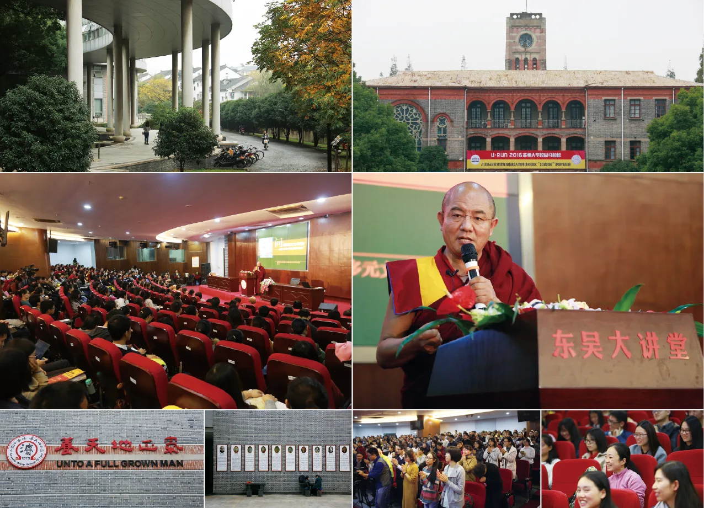
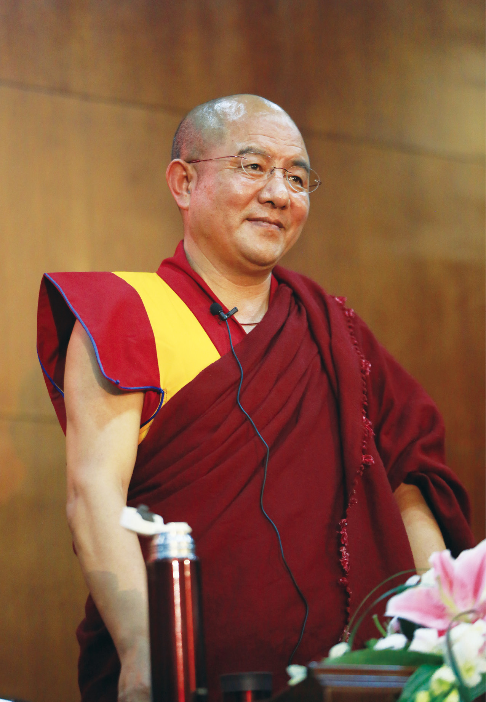
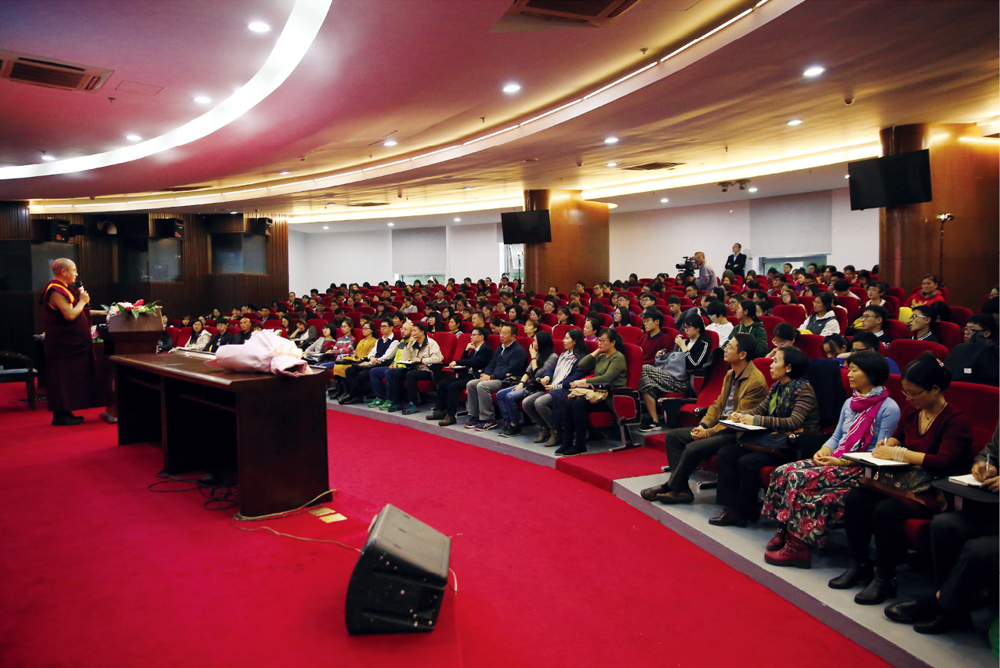
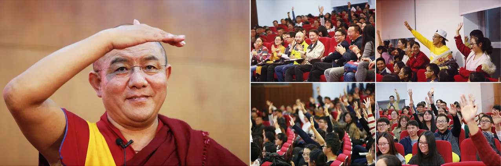
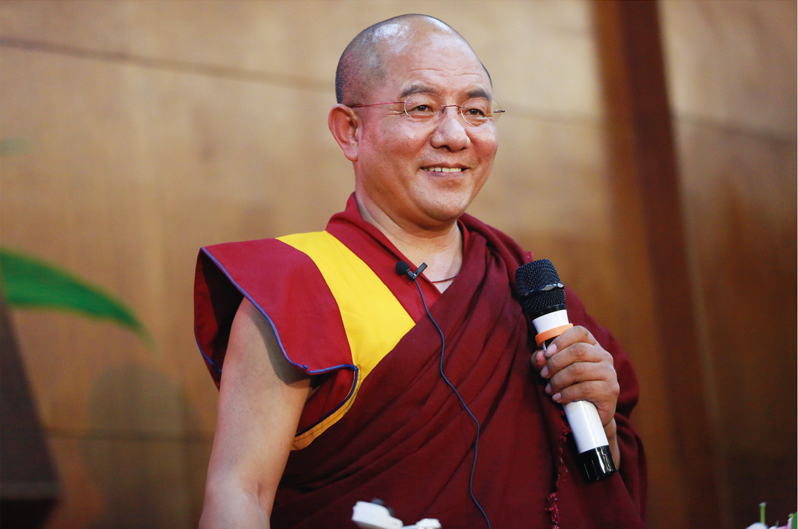
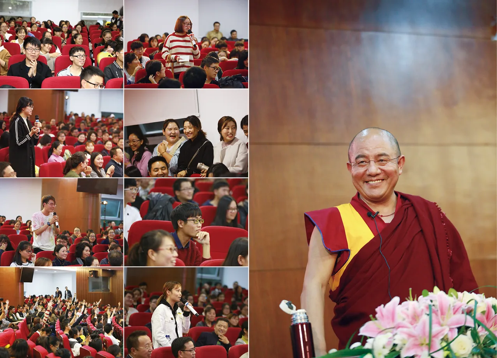

戒律不仅仅能对自他提供种种保护，

还能在很大程度上将人们心中的恶念转化为善念，

从根本上杜绝恶行。

第143场

苏州大学

Suzhou University

中国·苏州

2016 / 11 / 20

## 问佛陀法为何物

——戒律与法律之异同

## What Did the Buddha Say About The Law?

Similarities and Differences between Precepts and the Law

主持人：

请大家全体起立，欢迎今天的主讲嘉宾——四川甘孜喇荣寺的索达吉堪布！让我们用热烈的掌声，有请堪布为我们讲一讲，“法”到底是什么。

很高兴来到苏州大学法学院跟大家交流戒律与法律的异同。我不是学法律的，从非专业的角度谈法律，很可能会有不准确的地方，但我可以从佛教层面，跟大家聊一聊佛教对“法”的阐述。

## 什么是“法”？

在佛教中，“法”有很多定义，有时候指一种道理，有时候是一种规则，有时候又指代宇宙中的万事万物，正如我们常说的“万法由心生”“诸法因缘生，诸法因缘灭”，甚至连情绪也可以称作“法”。

按照古印度世亲论师的观点来看，“法”有十种含义，包括知识、修行的道路以及修行的结果——涅槃寂静，等等。我们常说皈依三宝，也就是皈依佛、皈依法、皈依僧，其中，“皈依法”中的“法”，英文是Dharma，指的就是佛陀所宣说的，能帮助我们从苦难当中获得解脱的方法与道理。此外，我们常说一个人的行为是否“如法”，这个“法”一般指戒律，这时它的含义才与“法律”比较接近。

对法律人士而言，“法”包括《宪法》《民法》《婚姻法》《刑事诉讼法》《刑法》《国际法》等等。我在中学的法律课和政治课中学过一些法律知识，但三十多年过去了，现在恐怕只记得一些名词和概念。在我的印象中，法律规定了人们所享有的权利与应履行的义务，它是统治者为了管理社会、处理社会纠纷而制定的一套方法。

## 戒律与法律相同之处——制止恶行

佛教中的戒律与法律有一些相似的地方，总的来讲，它们都能起到“制止恶行”的作用。法律是人们日常行为的底线，跨越它就要受到法律的制裁，因此，人们不敢轻易越雷池一步。而戒律也能达到这样的效果，与此同时，它在这个基础上更进一步，不但能止恶，还能转变内心，让人们主动行善。因此，我觉得法律的主要作用是“止恶”，并能在人们的生命、财产以及权利与义务受到损害时，提供一种公正的解决途径；戒律不仅仅能对自他提供种种保护，而且还能在很大程度上将人们心中的恶念转化为善念，从根本上杜绝恶行。

佛教的戒律有三个层次，最高的戒律是密乘戒，中等的戒律叫菩萨戒，基础的戒律叫别解脱戒。密乘戒有千千万万的戒条，非常难以守持。菩萨戒的戒条也特别多，但最主要的是三条：严禁恶行戒，指断除一切恶行的戒律，这跟法律和别解脱戒比较相似；摄集善法戒，是摄集一切行善事业的戒律；饶益有情戒，就是要帮助所有生命的戒律，这里不仅仅指帮助人类，还要尽全力去帮助动物。你们看，戒律不仅仅能制止作恶，还能指导人们行善，帮助众生。

佛教的别解脱戒包括了出家人的戒律和在家人的戒律。对出家人而言，比丘戒有两百五十条，比丘尼戒有三百六十四条，再下来还有沙弥戒和沙弥尼戒。对优婆塞和优婆夷，也就是在家的男女居士而言，一般要守我们常说的“居士五戒”，这也是前面所提到的密乘戒、菩萨戒以及别解脱戒的基础。

我们常说“三皈五戒”和“五戒十善”，其中“三皈”指皈依佛、法、僧，“十善”指佛教徒应当行持的十种善法，而“五戒”指的就是佛教徒应守持的五条基本戒律，即不杀生、不偷盗、不邪淫、不妄语、不饮酒。

当然，佛教徒并非一定要守五戒。在藏地，很多人都皈依三宝，心中十分尊敬佛陀，也能在日常生活中行持一些善法，但并不受持五戒，守戒的都算是比较高层次的佛教徒。好好地皈依三宝也算是一条戒，但并不包括在五戒里面。

可能有些同学最讨厌的就是条条框框，不愿意受任何约束，但这种想法不一定对自己有利。实际上，行为上的约束是对自己的一种保护，有助于减少恶行、指明人生的方向。这就像我们需要红绿灯来保障交通顺畅，如果没有红绿灯，可能很多车就会撞在一起。所以，无论是不是佛教徒，如果能用五戒来约束自己的行为是非常好的。

## 五戒在社会生活中的意义

可能很多人都对戒律的合理性抱有怀疑，我今天就从“五戒”的角度给大家稍微分析一下。

一般来讲，法律专业的同学大多比较严谨，认为事情都应该从理性的法律角度来衡量。但有些年轻人可能还没意识到，当你从学校毕业并参加工作后，有些事情光靠法律是说不通的。虽然法律上有这样或那样的规定，但人们不一定都遵守法律，即使守法，也可以钻法律的漏洞。因此，我们在生活中既要保持理性的智慧，也多少要有一点感性的心态。

刚才讲到，很多人都觉得五戒是一种约束，但我并不这么认为。虽然五戒是佛教的理念，但事实上，它在人们的行为规范上起着不可估量的作用。在东西方的很多国家和地区，例如美国、欧洲以及印度等地，人们对犯五戒的人都没有好印象。

我经常会去监狱讲课，也问过很多人为什么被抓进去，而得到的回答大多和毁犯五戒有关。有人是因为杀人，就是犯了不杀生戒；有人是因为贪污、抢劫、盗窃，犯了不偷盗戒；有人是因为强奸、嫖娼，犯了不邪淫戒；还有人则是因为诈骗，也就是犯了不说妄语戒。五戒中的妄语，指的是说一些超乎想象、不切实际的语言，这与世间的妄语有些差别。但总的来讲，现在不论是在网络上还是现实生活中，处处都充斥着欺骗现象，包括一些产品不切实际的宣传，即便在人与人的交往中也是如此。很多人就是因为这样的行为而沦落到监狱里。

那有没有人是因为饮酒而进监狱的呢？也有。虽然很多国家都没有说饮酒犯法，但从某种意义上讲，饮酒和吸毒没有太大的差别，二者都会让人上瘾、神志不清。很多人就是因为酒后驾车、打架斗殴，甚至导致他人死亡，所以才被判了刑。

由此看来，监狱里的犯人，大都是犯了五戒才被关起来的。倘若人人都守持五戒，可能监狱基本上就空了。在佛教团体当中，“警察”比较少，他基本上也没什么事情可做，因为大多数佛教徒都守五戒。

因此，我认为释迦牟尼佛在两千五百多年前所制定的五戒非常有价值，不论是哪一个国家和民族，都可以把五戒当作基本的行为规范。

## 历史见证了佛教的价值

社会上所制定的种种法律制度，随着时间推移，已经发生了翻天覆地的变化。即便是我们小时候的很多法律，现在都已经弃用了，以前强制执行的一些规定，现在也已经被推翻了，这种事情在很多国家、地方都有发生。五戒却并非如此。从佛陀时代到现在，五戒丝毫没有改变，也无须改变。我们能不能把五戒当作基本的行为准则？在座的老师和同学们可以深入思考一下。

有些同学可能不太相信佛法，这没关系，毕竟每个人都有选择信仰的自由，但有些人认为佛法是迷信，这一点我并不认可。有的人可能是对寺庙里烧香拜佛的行为看不惯，或者一味相信科学，认为只有科学才是权威，并以此为理由，认为传统文化和宗教是古老、陈旧、腐朽的迷信思想。事实上，这种观点有些保守，大家应该擦亮智慧的双眼，客观地观察佛教。

包括佛教在内的几大传统宗教，都已经在人类历史上流传了千百年，表现出了非常强大的生命力和魅力，这恰恰说明它们有不可替代的价值，而反观其他的文化、知识和现象，很难说能存在多久。

## 基督教规范与五戒的相似之处

在座的大多数同学都是学法律的，想必大家也都知道，很多国家的法律都建立在西方的法律框架之上，而西方的法律又在很大程度上源自宗教规范，如《物权法》《侵权责任法》《刑法》等等，很多都源自基督教。基督教中有“十诫”，前面几诫主要是讲如何崇拜基督教的神，而第五条讲孝敬父母，第六条要求不可杀人，第七条规定不可奸淫，第八条是不可偷盗，第九条和第十条分别是不可做假见证陷害人和不可贪恋他人的房屋、妻子、仆婢、牛驴等。这是不是和佛教的五戒有相似之处？

从这个角度来看，法律系的老师和同学们很有必要客观地观察和分析宗教与传统文化，看看其中有没有你们能学习的内容。倘若对传统视而不见，一味采用现代的思维和理念来解决生活中所遇到的种种问题，可能并不是一件轻松的事。

## 儒家规范与五戒的呼应

我刚才讲到，在某种意义上，佛教所提倡的五戒可以跟当代的法律、基督教规范相对应，事实上，它与儒家文化也有呼应之处。

众所周知，儒家提倡的基本行为准则是“仁义礼智信”，而这就可以与五戒一一对应起来。“仁”的精神是慈爱、帮助他人，反对杀人。佛教五戒中的“不杀生”也是指不杀人，虽然杀害动物也有罪业，但从五戒的角度来看，是轻罪而非重罪。因此，“仁”与“不杀生”的精神非常相似。

“义”可以与“不偷盗”相对应。所谓的“义”可以指通过正当的手段和方式去获得财物，而以偷盗等途径获取财物就是“不义”。

“礼”指尊重自己和他人，有不犯淫乱、不败人伦的含义，也就是说，除了自己的配偶，不与其他人交合。从这个角度来看，“礼”与五戒中“不邪淫”的含义相呼应。

“智”可以对应五戒中的“不饮酒”。事实上，当我们饮酒之后，神志不清，所做的一切都可能与平时所秉持的原则背道而驰。而且，在这种迷乱的状态下，其余四戒也都有毁犯的可能。

佛教里就有这样一个故事。原来有一个修行人，清净地守持不杀生、不偷盗、不邪淫、不妄语等戒律。有一天，一个女人找到他，逼迫他在与她发生关系和杀一只羊之间做选择。他说自己是个守持清净戒律的修行人，这两样事情都不会做。后来，这个女人逼他喝掉一瓶酒。他觉得饮酒并不毁犯自己所守持的戒律，于是就答应了。结果，他喝醉了之后，既杀了羊，又和这个女人发生了关系，还偷窃了财物，而且为了掩藏破戒的事实，他还对别人说了妄语。

有很多人认为“无酒不成席”，饮酒能让人快乐，但事实上，饮酒的危害性很大。从东北到江南，人们饮酒的习气非常重。其实喝了酒以后，神智处于迷乱的状态，你所说的话、所做的事，都是清醒的状态下不会说、不会做的。这像不像吸毒后的状态？也正是出于这种考虑，美国曾在20世纪初实施过“禁酒令”。

儒家的“信”可以对应五戒中的“不妄语”，也就是要诚信待人，不论做什么事情，都不会欺惑他人，讲信用，值得信赖。

由此可见，佛教中的五戒与儒家的基本行为准则之间的确有着相似之处，这一点值得大家思考。不知道同学们能不能在以后的生活中守持五戒，如果条件允许，最好能尽量守持，这对大家的成长和发展非常有意义。

不论你以后当领导还是做普通员工，行为上都应该杜绝杀、盗、淫、妄，同时，你肯定还需要一个健康的身体和清醒的头脑，所以，酒最好也别喝了。一般来讲，身处这个时代，不论是老师、公务员还是企业家，很难不喝酒，但同学们还是要尽量避免。

## 佛教戒律的独到之处——劝人向善

以上是佛教五戒与种种社会规范之间的相似之处，希望同学们能对此多加思考。接下来，我想和大家分享它们之间的不同。

与法律不同的是，戒律不仅能约束人们的行为和语言，制止恶行，与此同时，它还涉及内心，能够劝导人们行持善法。虽然法律多多少少也考虑到人的心理活动，比如有故意与过失之分，但它更多的是遵循“外观主义”，也就是通过行为来对事件做出判断。而在佛教当中，大多数情况下，人们会根据内心的动机来判定一件事情，也就是说，如果动机不善，即便做的事情看似善事，也不能算很圆满。正如佛教中所说的：“诸恶莫作，诸善奉行，自净其意，是诸佛教。”这句话非常有启发性，希望大家能深入思考并以此来指导生活。

## 佛教是两千五百多年的智慧积累

社会上还有很多人不知道佛教究竟是什么，误以为佛教就是烧香拜佛，但事实上，佛教是一门非常甚深的知识，甚至可以说是一部百科全书。我这次一路过来，跟不同高校的医学院、经济管理学院、艺术学院的教授和同学们都有交流。大家对不同的话题感兴趣，所以，我在这里谈法律，在其他地方谈精神健康、佛教的管理理念以及佛教艺术等等。一方面来讲，我没学习过这些专业，心里没什么底；但从另一方面来讲，我又有信心能讲好，因为在过去两千五百多年中，佛教一直在发展，并融合了很多世间知识。从戒律的角度而言，佛教中有戒律院，专门学习戒律，专注研究如何让人的身、口、意变调柔，这就像高校中的法学院一样，专门研究法律，旨在让人们约束自己的行为。

就像我在前面所介绍的那样，佛教的戒律和法律有相通之处，而且它在某些方面可能比法律更完善，因为戒律制定于两千五百多年前，在这么久的时间里，它不但不需要修改，而且仍然鲜活、适用。相较而言，现在的法律条文，每隔一段时间就要进行修订，而且改的时候要通过全国人大，有些还批不下来，困难重重，就像《慈善法》已经反反复复在人大和政协上提议过很多次，但进展非常缓慢[^1]。

当你深入了解佛教时才发现，原来佛教和自己所想象的并不一样，不仅仅是老太太们在寺庙里烧香拜佛。我遇到过一些大学生，想法比较幼稚，看到佛教徒就会说：“你还信这个啊，太可笑了，太没有必要了……”我们在面对自己不了解的东西时，想法往往过于简单，眼光也比较短浅。孔子说“五十而知天命，六十而耳顺”，也许只有当你五六十岁时才会发现，原来自己求学时的想法多少有些幼稚。尤其是对于像“前世今生”和“善有善报，恶有恶报”的道理，很多学生根本不认可，不认可也可以，这毕竟是个人的自由，但我们有必要一探究竟。事实上，非常有影响力的法学人士也曾讲述过自己前世的故事。

## 神探带你探索前世今生

著名的华裔神探李昌钰博士，祖籍就是你们江浙一带，我去年有段时间看了很多关于他的视频。他在破案方面非常有成就，参与过很多非常有影响力的案件鉴识工作，例如肯尼迪被杀案、尼克松“水门事件”以及克林顿桃色案等等。他的母亲是一名佛教徒，独自抚养了十三个孩子，并且全部都在美国拿到了博士学位。绝大多数的父母，培养一个博士生已经非常困难了，有的孩子甚至连初中都读不完，而她却独自抚养了十三个博士，非常了不起。

李昌钰博士在北京大学演讲时提到，自己前世可能是一名和尚。当时有人问他，这一生当中最遗憾的是什么？他说，最遗憾的事就是又来到这个世界。他讲道，自己刚出生后天天哭，母亲带他去看了很多医生，但一点效果也没有。后来，有一个和尚来敲门，他母亲以为是来化缘的，于是就拿钱给他，但是这个和尚却说，自己不是来化缘的，而是来见师父的。她说，这里没有你师父。而这位出家人说，你们家是不是刚生了一个小孩，天天哭，他就是我的师父。这个和尚见到襁褓中的李昌钰就拜，拜完就走了。从此以后，李昌钰再也不哭闹了。李昌钰博士还说，因为他当时太小了，自己没有印象，这件事是母亲告诉他的，所以他觉得自己前世是一名出家人。有时候，人生就是这样无奈，原本不想来到这个世间，却又不得不出生。当时，那个和尚给他起了名字叫“解尘”，也就是解开红尘束缚的意思。

我觉得，作为一名国际知名的刑侦专家，李昌钰博士不会骗人的，这应该是一件真实的故事。有些年轻人喜欢把事情想得过于简单，仍觉得这是迷信的说法，是一种所谓的“特异功能”等等，但大家最好能进一步思考一下这其中的奥秘。

## 人人都要有抵挡诱惑的本事

就像我前面提到的，佛教的核心是“诸恶莫作，诸善奉行，自净其意，是诸佛教”，而法律最多能让人们“诸恶莫作”，因为犯法就意味着要接受制裁。那什么是善恶呢？从佛教《毗婆沙论》的角度来讲，对自己和他人带来伤害的行为就是恶，而对自己和他人不会带来伤害、痛苦，甚至能带来快乐的行为就是善。

法律系的同学们将来可能会在不同的岗位上，运用法律帮助他人，造福社会，这和修行人的目标是一致的，因为修行人也是希望能够运用自己的修行去利益他人与社会。但大家也都知道，法律并非十全十美，多少会有一些漏洞，这就要求我们时时刻刻都要秉持良心做事。

我看过一篇文章，叫《良心的价格》，里面提到这样一个故事。有一个法官，手里掌握着一个案子，有理的一方没什么社会资源，甚至连律师也请不起，而没理的一方却很有钱。一开始，没理的一方给这位法官送了十万，但法官没有动摇，于是又加到二十万、三十万……最后加到五十万时，法官崩溃了，他没办法抵挡这种诱惑。后来，法官就利用法律的漏洞，判了无理的一方胜诉。他后来和朋友说，自己的良心卖了五十万。

虽然现在的社会风气和政策与以往有所不同，但当大家以后进入社会，身处复杂的环境中时，还能不能秉持自己的良心呢？希望法律系的同学们能认真思考这个问题。

身处单纯的校园中，你可能还会讲正义、讲义气、讲诚信，还能用智慧分辨正邪，但社会上物欲横流，在这样的“雾霾”之下，时间久了，每个人可能会受到不同程度的染污。首先，有些人的“呼吸”会受到影响，逐渐逐渐，内心的智慧也会因此而发生变化，最终影响到所作所为。虽然大家是法律专业出身，但以后也可能会走在违法的道路上，事实上，我就在监狱里见过很多曾从事法律工作的犯人。

我并不是和大家说不吉祥的话，我只是觉得，大家在抱有美好向往的同时，也应该对丑恶有一些心理准备。虽然是法律专业出身，但如果将来行为不如法，前途也会岌岌可危。修行人也是如此，出家人和在家人都有相应的戒律，但如果没有守好戒律，破戒了，前途也比较惨淡，甚至因此而堕落。因此，在某种意义上来讲，我觉得法律和戒律都可以帮助人们避免因行为不当而堕落，并充当痛苦深渊中的保护网，而法律人士和修行人就是这张网的维护者，大家都有责任和义务去弘扬法律与戒律所传达的正能量。

## 最好的法治手段——调伏自心

我接触了苏州大学的一些教授，我觉得他们就特别有正能量，而且对儒家与道家也很有研究。其实除了佛教的戒律以外，儒家和道家也希望通过种种方式来劝人向善。例如，孔子主张“以德去刑”，也就是通过培养人们心中的崇高思想和道德，改善人们的行为。可见，在孔子看来，刑罚并不是最好的管理手段。此外，老子在《道德经》中提出了“无为而治”的理念，不提倡以强制性的律法来控制人们的行为，相反，应该充分发挥每一个人的自觉性，通过人们的自我完善与自律来治理国家，这与佛教中“自净其意”的理念非常相似。当然，“无为而治”的理念非常高深，在当前的社会环境中可能不太行得通。

荀子曾说“人生不能无群”，也就是说，人要生存在群体当中。古人说“小国寡民”，小国家的民众比较少，但现在恐怕大都是“大国多民”。而在人口众多的社会中，国家要想富强，人民要想富裕，就不得不用法律约束民众的行为，尤其是现在，年轻人特别多，想法和老一辈的人大不一样，很容易发生种种矛盾。希望在今后的生活中，大家都能从内心着手，对自己的行为有一些约束。

## 学法之人应心中有“法”，自净其意

很多学法律的人都觉得自己以后一定会当官，前途一片光明，很少主动思考如何自律。但就像我前面所讲的一样，当我们面对巨大的诱惑，良心受到谴责时，该何去何从？大家应该在求学期间就想一想这个问题。

事实上，很多犯法的人不是不懂法，而是法并没有融入他们的心，没能按照法律规定约束自己的日常行为。修行人也是一样，如果没有把佛法融入自心，没有依教奉行，“正法”也会变为“非法”。总之，如果行为不如理如法，学法的修行人也会变为“非法者”，而学法律的专业人士，也可能会违法，从而不得不在法庭上接受审判，这都是非常可悲的事情。

因此，我们应该养成“自净其意”的习惯，而不是整天盯着别人的过失，动不动就在心里审判别人，觉得自己高人一等。如果没有调伏自心，很可能会让自己陷入危险的处境。因此，希望大家在学习法律的过程当中，让法律的精神融入自心，融入日常的行为，让自己成为一个如理如法的人。这样一来，不论走到哪里，内心也一定会非常快乐。从因果的角度来看，如果大家处于合理合法的环境，从事合理合法的工作，最后必定会获得合理合法的果报。

## 用因果照亮人生的路

大家应该对“因果规律”有一定的认识，正如《大宝积经》中所讲的那样：“此有故彼有，此生故彼生……此无故彼无，此灭故彼灭。”有什么样的因，就会产生什么样的果，倘若因不存在，果也会一并消失。所以，因与果完全是互相对应的。

有人以为“因果”是佛陀制定的，但事实上并不是这样。佛陀不是“因果”的制定者，佛陀只是发现了这个规律，并让大家明白这个道理。《稻秆经》中讲：“如来出现若不出现，法性常住。”不论佛陀是否出现于这个世上，客观事物的自然规律一直存在于世。因此，“前世今生”与“善有善报，恶有恶报”的规律并不会因个人而改变。从法律角度来讲，一个做了坏事的人，躲起来就可能逃脱法律的制裁，但从因果的角度而言，因缘具足时，他一定会感受报应，这是自然规律。

大家有必要将人文理念与因果这样的自然规律结合起来，这也是一种“因缘聚合”。不知道大家是否理解“因缘聚合”，如果能对“因缘”有所研究，相信一定会对自己的人生有莫大的帮助。希望大家都能从佛教等传统文化当中找到自己人生的道路。

我刚才也跟教授们讲，其实佛法很好。当然，我并不是因为自己学佛，所以就向大家强行推荐佛法。佛法好，因为它可以指引人生，毕竟我们每个人都迟早要面对生老病死，也会面对种种无常、诱惑。倘若心中有一种智慧，为你指引人生的方向，助你做出种种正确的抉择，这就会是你人生当中非常宝贵的财富。

在人生的旅途中，每个人都需要一盏智慧的明灯，照亮前行的道路。你也许能从自己的专业中找到，也可以在传统文化中寻得，不论如何，每个人可以做出自己的选择！

现场互动

问：我是法学院大三的学生。在中国古代，佛教对人们的思想有很大影响，因果观念就是规范人们行为的一种有效途径。您觉得法律是否应该借鉴佛教，采用更加柔性的方法来解决纠纷？

堪布：在藏地，法律可以调解一些个人之间的纠纷，但是人群之间的冲突，有时候还依赖佛教人士宣说因果来调解。我听说泰国和缅甸也有这种情况，有些法律没办法解决的事情，人们会请宗教人士出面调解。当然，向不相信佛法的人介绍因果，可能不会有什么效果，但我觉得法律工作者可以因地制宜，在某些场合下，适当地用因果的道理去解决一些问题。

问：您刚才在讲座中说到，戒律流传了千年，不需要改变而且仍具有适用性，相较而言，法律不断地在修改，但还是出现了种种问题。那您觉得法律有哪些地方可以向戒律学习呢？

堪布：我觉得，现行的法律中，与五戒相应的部分不需要改变，但也要因地制宜。拿盗戒来讲，在戒律当中，犯盗戒有几种情况，其中有一种犯戒的标准非常严格，哪怕是拿了一点点不属于自己的东西，就算犯根本戒；而另一种情况是，只有当这个人盗窃的后果要被当地法律判无期徒刑或者死刑的时候，才能算他犯根本戒。这就是因地制宜的一种表现。

当然，法律与每一个国家的政治导向也有关系，当统治者的思想发生变化时，即便从客观事实上来看，某些行为是不合理的，但它也有可能是合法行为。所以，很多时候，“违法”的定义也会随着当权者的想法有所变动，这些也都要考虑进去。

问：您刚刚有说过，“善有善报，恶有恶报”是自然规律，但现在社会中却有很多坏人逍遥法外，而好人却不得安宁。您能不能结合这个情况给我们再进一步阐释一下因果？

堪布：社会上的确有你说的这种现象，因为“善有善报”并不是说我们做了善事，马上就能得到善的报应。《太上感应篇》里面说，如果一个人每天都能做三件善事，包括说善语、行善事、用善的目光看别人，坚持三年，他就能感受到从天而降的福德，相反，倘若一个人每天做三件恶事，持续三年后，就会感受灾祸。当然，这并不完全是佛教的观点。

从佛教观点来看，一般来讲，我们在今生中造因，来世才会感受果报，这就像我们在春天种下种子，秋天才能有收成一样。只有造了一些特殊的善和恶，才会在即生当中成熟。

佛经中云：“欲知前世因，今生受者是。欲知后世果，今生作者是。”如果你想知道自己前世的因缘，就看今生当中所感受的果报，因为今生当中的财富、名声等等在很大程度上取决于前世的因。同样的道理，如果你想知道后世的果报，可以看一下自己今生的所作所为。因此，按照佛教的观点来看，前世是今生的因，今生是前世的果，同时，今生也是后世的因，后世是今生的果。

当我们懂得了这个道理就会明白，有些人无恶不作却仍然享受圆满的财富等，这是因为他正在享受前世行善的果报，而今生作恶的果报，则会在来世感受。这就是前世、今生和后世之间的关系。

可能有人会说，反正我现在也不知道后世会怎么样，根本没必要去关心它。但事实上，这并不是一种明智的想法。按照这种思路，那明天的事情、晚年的事情，我们现在也统统感受不到，是不是就不需要关心，什么都不用做了呢？当然不是。不论是明天的你、明年的你、晚年的你，还是来世的你，实际上就是你，只不过现在没考虑到那么远而已。希望大家能深入思考一下这个问题，非常有意义。

问：我是苏州大学的学生，我相信佛是顿悟了人生、知道了一切真相的人，没有什么欲望，但这样一来，他人生的理想和激情又从何而来呢？他会不会感到孤独？

堪布：佛陀并没有要求所有人都立刻放下理想，而且，如果你已经证悟了人生真相，就绝对不会有孤独感，更不会得抑郁症（众笑）。为什么呢？因为我们之所以有孤独感、寂寞感，恰恰是因为没有证悟人生的真相、万法的真相、世间的真理。

每个人不必害怕孤独，天上的太阳和月亮也独来独去，但有自己的魅力和个性。先不提证悟万法真相，哪怕只是懂得了世俗生活中的一些道理，也不会再有所谓的孤独感。

所谓的“万缘放下”并不是让我们立刻就放下理想和人生追求。很多年轻人对佛教最大的误解之一，就是认为学佛一定要看破、放下，既不劳作也不上班，这其实是上世纪七八十年代的影视剧所带来的误解。

事实上，只有当你证悟到最究竟的境界，发现原来我所执著的一切都是假的，这时才能真正地做到万缘放下。但是，这种境界并不是能轻易达到的。所以，佛教从来不反对我们去追求人生的真理和梦想，而且还十分提倡行持善法，鼓励人们在合理的情况下追求梦想，实现人生的目标和价值。

藏地和印度的佛教徒从来都不认为佛教要求我们立刻放下一切，事实上，在证悟米拉日巴尊者和六祖惠能大师那样的境界前，我们还需要不断地奋斗、不断地弃恶从善，努力实现自己的人生目标和价值。

我们要把过程和结果分清楚，不能混为一谈。法律中也是这样强调的，我们应该分清楚场合、时间、地点，否则，没有细致、客观地分析，以偏概全，便不符合实际情况，是说不过去的。

问：堪布，您自己孤不孤独？

堪布：你觉得我为什么会孤独呢？

问：我觉得一个人是因为有理想要去追求，或者有喜欢的东西、有喜欢的人要去追求，所以才会有激情。可现在我们知道了，原来所有的事情都有一个真相，每件事情都是因果，在一开始的时候，我们已经知道了结局会是如何，这难道不会让人有孤独感吗？

堪布：如果这样思考，那我们也知道，所有人都注定会死亡，那是不是人人都没有激情了呢？

我觉得这个问题很有意义。从我个人来讲，通过佛法明白了一些真相，但世上还有千千万万的人对真相一无所知，每想到这里，我反而更有激情、更有责任感，觉得自己应该帮助大家从徘徊、迷茫中走出来。

我不但不孤独，而且还特别忙碌、充实，每天即便再疲惫，还是尽量讲一堂课。但这并不依赖他人，也不需要别人求着我去讲课。很多人都没有意识到，当我们追求别人，或者需要别人陪伴的时候，虽然暂时有激情，但这是一种自私自利的激情，比较狭隘。而当你把心量扩大，在某种程度上懂得了世间真相，这时候，会产生一种更广义的激情和责任感。

问：佛法中的戒律是对内心的一种约束，这会不会缺少一些强制力？尤其是对那些道德追求不高的人而言，戒律是否有真正的约束力？

堪布：在佛教的戒律中，有些是心上的戒律，如大乘以及密乘的戒律，但别解脱戒是在行为和语言上安立的。

事实上，戒律有一定的约束力。首先，一个人受戒肯定是他自愿守持戒律。其次，对于出家人而言，只有戒律清净的人才可以住在僧团中，一旦破了戒，就不得不离开僧团。被僧团开除，不管是对他的名声，还是来世的果报方面都会有很大压力。

佛陀时代的富楼那尊者精通戒律，他曾问佛陀，有些国家的法律合理，有些却不合理，那当僧团戒律与国家法律冲突时，该怎么办呢？佛陀告诉他，每个国家都有自己的一套管理方法，如果有人严重触犯了法律，就不能接纳他出家。因此，不论是在中国、美国还是欧洲国家，如果一个人严重触犯了当地的法律，僧团便不能接纳他，他也不能与僧众共住。

当然，有些人对法律和戒律都满不在乎，这就没办法了，毕竟每个人的性格、修养都不同。

问：我是苏州大学经济法专业研究生一年级的学生。我们都知道，泰国是一个非常信奉佛教的国家，佛教历史很悠久，但同时，很多人迫于生计，不得不贩卖罂粟等毒品。我觉得，他们很多人心中还是有佛的，很可能在贩卖毒品的同时，他们也很愿意做善事，不愿意触犯五戒。您怎么看待他们的行为和戒律之间的矛盾？

堪布：绝大多数的泰国民众都虔诚地信仰佛教，但除了出家人能在佛学院、寺庙中系统地学习佛教理论，一般民众对佛教的认识都比较简单，大多数人没有接受过系统的佛教教育，对真理也不是特别清楚。事实上，佛教不仅仅是一门宗教，它更是一种引导人们弃恶从善的教育，但如果没有系统地接受过这种教育，对佛教理念不清楚，民众的佛教水平可能不会很高。

贩毒没有包括在五戒当中，五戒中提到的是饮酒，当然，买卖罂粟、海洛因等毒品是非常不好的行为。每个国家对毒品的态度都有差别。例如，在荷兰等一些欧洲国家，人们对大麻的态度就比较宽容，可以公开贩卖，甚至还有专门抽大麻的场所。与此同时，也有些国家甚至明令禁止贩卖和饮用酒。所以，不同的国情会导致各地的法律不同，相信了解各国法律的同学非常清楚这一点。

问：我比较感兴趣的是，您在监狱里会和罪犯们聊些什么，有没有一些比较有意思的故事可以跟我们分享？

堪布：我去监狱主要是对服刑人员做一些思想开导。一般来讲，社会上的人都歧视他们，他们中的大多数也已经成了社会底层，内心十分痛苦。如果佛教徒在力所能及的范围内可以关心一下他们，会对他们非常有意义。

可能大部分人都觉得监狱里的人是坏人，但我觉得，监狱里的不一定全是坏人，没进监狱的也不一定全是好人。有些人虽然生活在社会上，但干的坏事比监狱里的人还多。所以，我觉得应该去关心他们。

说到有代表性的故事，有一个人曾经给我讲过他的经历。他受妻子的教唆，跑去跟别人打架，结果把人打伤了，被判五年。在他还有两年就刑满释放的时候，妻子却跟别人跑了，把孩子丢在家里，不管不问。他告诉我，他现在特别伤心，也特别恨自己的妻子。大家可以思考一下这个故事。

问：因果报应是否有一个界限？比如说，一个人杀了另外一个人，他是否肯定会受到报应？还是说，在某种条件下，他可以不受报？

堪布：从法律的角度来讲，一个人犯了法，如果没有被抓或者案件没有侦破，这个人就可能逍遥法外，免受牢狱之灾。但从因果报应的角度来讲，即使逃脱了法律的制裁，但他在今生或来世也一定会感受报应。

只要造了恶业，业力就会沉积在自己的阿赖耶识上，如影随形，一旦因缘具足，就会开花结果，逃也逃不掉。这也是为什么有些犯人本来已经逃脱了法律制裁，最后却暴露行踪，不得不接受审判。我们很有必要去探索因果的道理，但佛陀也讲过，因果非常深奥、复杂，连一般的阿罗汉和菩萨也很难完全了解其中的奥秘。

总而言之，从佛教观点来讲，也许一个人能逃脱法律的制裁，但绝对不可能逃脱因果。即便今生没有受报，来世也一定会感受。

问：我对婚姻感到十分困惑，因为现在经常爆出明星出轨、离婚的新闻，这一切好像都在告诉我，婚姻中双方的忠诚度越来越低。尤其是在这个物质年代，外界有各种诱惑，我们越来越难以维持对伴侣的忠诚，而且婚姻法也提倡离婚自由，也就是说人们可以出于性格不合等原因而结束一段婚姻。您如何看待这些现象？

堪布：我在网上也看过很多出轨新闻。事实上，以前也存在这个问题，只不过现在的网络太发达，很容易曝光别人的行为，而且媒体也喜欢挖名人的负面消息，这恐怕已经成了这个时代的特征。我觉得没有必要因为这些新闻就产生困惑。

现代人的思想都比较西化，在生活中喜欢保持独立的思考和个人空间，希望得到自由自在的生活，对此，每个人的表现方式也不一样。很多父母和80、90后的观念就像矛和盾一样，而夫妻之间也有各种各样的不信任，这可能都跟信息的传播有关系。

佛教很重视维护家庭，提倡夫妻之间应该彼此尊重，珍惜因缘，这是佛教的根本原则，因此佛教把“不邪淫”列入了五戒。而婚姻法并没有明确说出轨是违法行为，只是离婚时，出轨的一方可能会在财产方面有所损失，这也算是法律跟戒律之间的差别之一。

实际上，现在很多人对未来家庭的设想也跟以往的传统观念不太一样。在这个时代当中，新的社会现象不断涌现，我们也不得不接受这些变化。因为当新的浪潮超过你所能控制的范围时，除了接受也没有其他办法。

问：我是苏州大学的大四学生，从西藏来到苏州学习，但我特别迷茫，不太适应这边的学习环境和压力，我该怎么调整心态呢？

堪布：你都已经大四了，不适应也没办法了。（众笑）

读大学期间的确要面对很大压力，但大家要全力以赴，把全部的时间和精力用在学习上，尽量不要浪费在其他的事情上面。我觉得，暂时来讲，可能创业、家庭、谈恋爱等都不是那么重要。

我参观过一些美国大学，感觉那里的学生把所有的时间和精力都投入到了学业中，中午吃饭也特别简单，就是面包，甚至吃饭时也在看书，而且他们的学习压力也特别大。我觉得这未尝不是件好事，可以教你们应对压力。你们现在所面临的还只是学习的压力，进入社会后，你们还不得不面临家庭、工作、人际关系等更大的压力，如果没有应对的经验，恐怕到时候很多人都受不了。

很多同学在读书的时候，心中充满了梦想，特别有干劲，而进入社会后，就不得不面临各种各样的情况，例如要尊重上级、善待同事、照顾父母、关爱孩子，没准还要自己创业……在种种的压力下，心中原本炽热的梦想也逐渐熄灭了，最后只希望能养家糊口。现在社会竞争这么激烈，经济也不是很景气，养家糊口不是件容易的事，这才是真正的压力。

既然你马上就要毕业了，所以不管适应不适应，都还要再坚持，千万不要半途而废。藏族学生来到汉地求学不容易，要坚持。

还有，我特别希望藏族的同学们不要忘记自己的母语。有些藏族孩子来到汉地后，好像连自己的语言、文字都忘记了，这特别可惜。我们作为藏族人，要尽量继承自己的传统文化，尤其是佛教思想。一般来讲，藏族父母都信仰佛教，但现在80、90后的孩子们，接受了一些其他思想，把本民族的信仰和传统都忘记了，这着实可惜。现在国内外的很多学者都对藏传佛教非常感兴趣，我们藏地的孩子就更要去继承、研究藏传佛教，这一点非常重要。

问：我是法学系的学生，我的外婆、外公和我妈都是佛教徒。我发现，自从我妈接触佛教之后，她就特别注重前世因果，她觉得现在所有的不开心都是因为前世，所以她选择默默地忍受一切。

但我觉得，我们更应该把握当下，因为我们只能感受到当下，根本感受不到前世与后世。我该怎么说服我妈妈，让她把握当下的幸福，而不是为了前世因果生活得不开心？

堪布：实际上，你和你妈妈的想法都有一点偏颇。你妈妈不能认为自己应该默默忍受今生中的所有痛苦。虽然今生的痛苦取决于前世的因，但也受到今生的缘的影响。因缘是可以转变的，因此，命运也可以转变，只要努力，前世的罪业都有清净的机会。

你觉得我们只需要把握当下，不需要关心未来的事，原因是感受不到，这种说法也有点不合理。如果仅仅是因为感受不到未来，所以就不去关心、不去努力，那你能感受到明天的事情吗？如果感受得到，那你现在就有未来的感受，你既然都能感受到明天的事，为什么感受不到更远的未来，乃至下一世？如果感受不到明天的事，那根据你的逻辑，你也不应该关心明天，既然如此，你也就没有必要再努力读书了。我说服你了没有？（众笑）

问：我觉得，在修行中，佛教徒最重要的是一颗佛心。倘若一个人在思想上犯五戒，但行为上非常克制，没有表现出来，那他是否破戒了呢？

堪布：五戒是安立在行为上的，如果他只是在心里想杀人、想偷盗、想邪淫、想说妄语、想饮酒，这样是不犯戒的。毁犯五戒的标准落实在行为上。

问：可他这不算是佛心不诚吗？

堪布：佛心诚不诚跟毁犯五戒没有太大关系。是否毁犯五戒要看他的行为，而不是心理活动。

[^1]: 《慈善法》于2005年提出立法建议，至2016年，全国人大对《慈善法》进行三审，历时11年。
