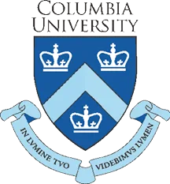
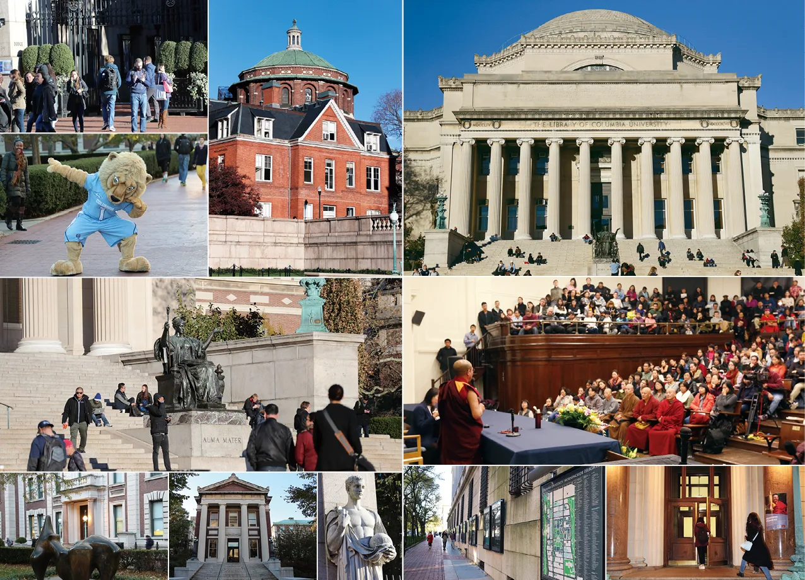
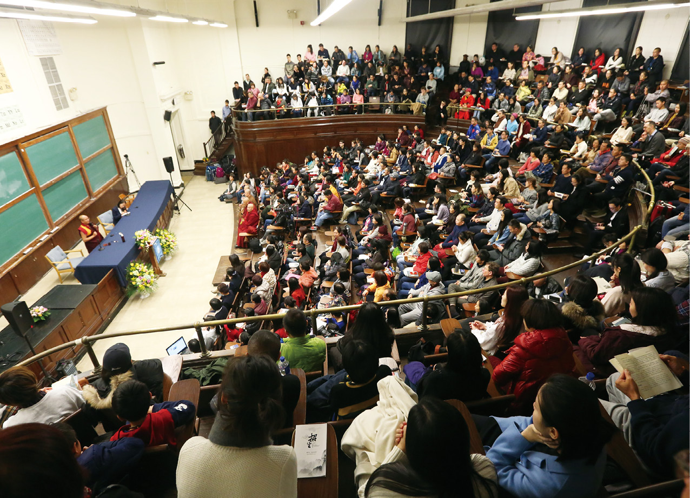
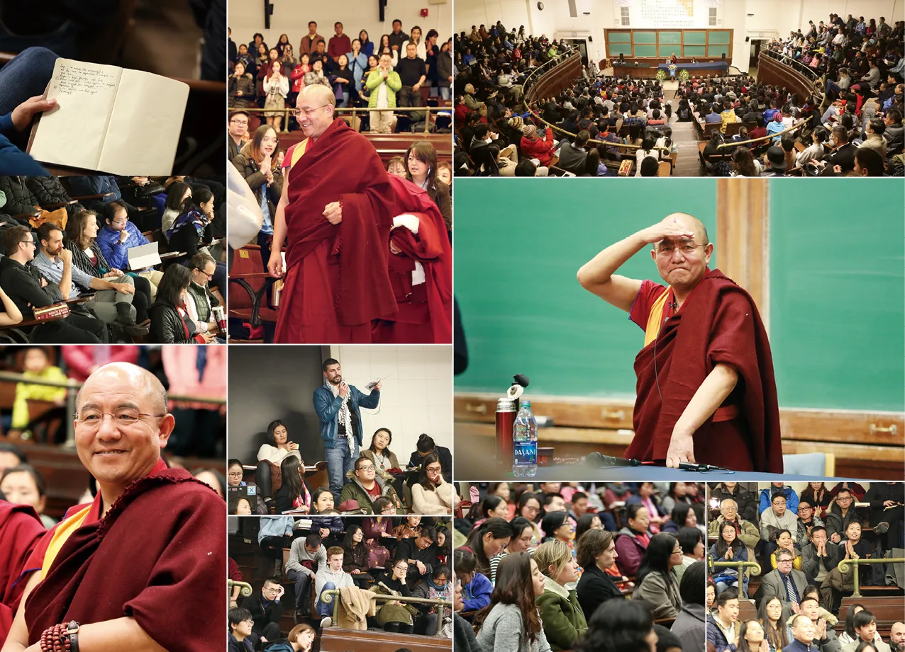
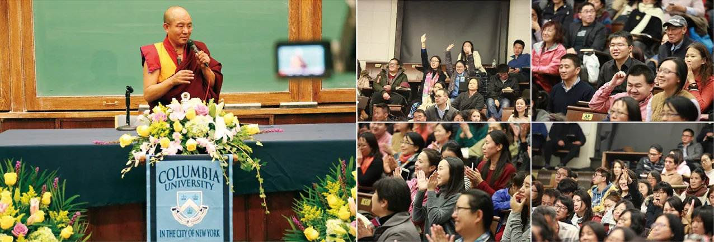
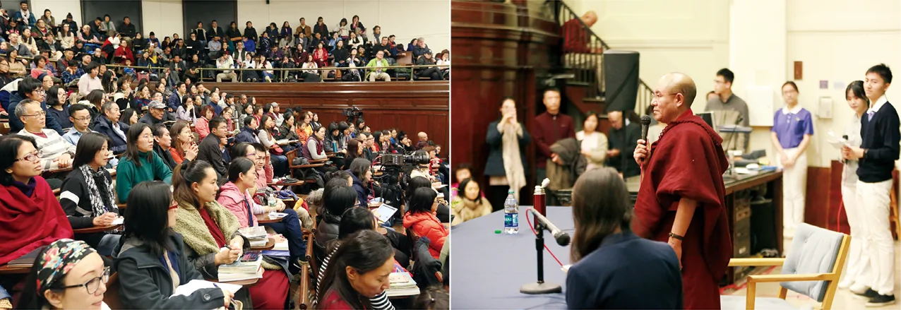

“如果你把每一天都当作生命中最后一天去生活，

那么，有一天你会发现你是正确的。”

第155场

美国哥伦比亚大学

Columbia University

美国·纽约

2017 / 11 / 16

## 体悟无常

## Examine Impermanence

主持人：

大家晚上好！很荣幸由我为大家介绍今天的演讲嘉宾——尊贵的索达吉堪布仁波切。

堪布仁波切来自喇荣，主要为汉族信众传法，至今已整整30年。据不完全统计，堪布在30年中的授课量多达9300节。这是什么概念呢？在美国，一个教授正常状况下一年的满工作量大约是150节课，如果以此为基数，相当于堪布在30年中完成了美国教授60年才达到的教学任务。与此同时，堪布还是一位多产的佛教翻译家和作家。

近年来，堪布组织了七届围绕“佛教与科学”的国际研讨，让人们了解到佛教不仅是信仰，还是教育，是哲学、医学、心理学和认知学，同时也是自然科学、生命科学，佛教囊括了上可阳春白雪、下可下里巴人的人生哲学。

今天堪布演讲的主题是“体悟无常”。在当今社会，新媒体、人工智能等高科技以前所未有的速度更新换代，令人应接不暇，怎样在这个多变的时代中活得洒脱自在？下面就请各位以恭敬心、欢喜心聆听堪布给我们带来的人生智慧——

很高兴有这样的机会跟大家交流。昨天晚上，我跟哥伦比亚大学的部分师生，就“藏传佛教女性”做了小范围讨论。早在2013年，我也曾跟哥伦比亚大学师生有过交流。今天我主要就“体悟无常”这一主题，跟大家分享一些经验和看法。

## 一、直面无常

对于无常，很多人不太愿意提起，认为它是负面和悲观的代名词，他们喜欢谈论的往往是健康、幸福、成功等话题。但是在生活中，无常随时可能降临，逆缘总会不期而至，因此不应仅仅关注正面，更应勇敢地去了解负面的信息，而且不能仅仅停留于字面上知道，更要深入地思维和分析。

据我所知，哥伦比亚大学在深度思维上有独特的优势，因为我一到这里，有很多人就介绍我去参观了一尊“思想者”雕塑。

在人的一生中，深度思维扮演着重要的角色，依靠它，你会发现很多潜藏的人生“珍宝”，比如如果经由深入思考，明白了无常的道理，你的内心会变得坚强。世界上的大多数痛苦是无常所致，所以认识无常很有必要。

放眼这个世间，无常确实随处可见。

1993年，法王如意宝曾带领我们参观了世贸中心，其中的双子塔是两座110层的建筑，高大而威严。前段时间我去了世贸中心遗址，双子塔坍塌后留下的深坑被建成了两个水池。站在池边，我不禁陷入沉思：“曾经闻名于世的两座建筑，用坚固的钢筋支撑，用高超的技术建造，看似坚不可摧、牢不可破，却灰飞烟灭于短暂的瞬间，万法无常确实是不虚的。”在纪念馆里，我看到了2977名遇难者的照片，他们大多看起来非常年轻、富有才华，这也不禁让我感叹：生命真是脆弱，前一秒尚在人间，后一秒就奔赴黄泉。

也许有些人想：“‘9·11’是一个历史性灾难，我现在身体很好，不会遭遇无常的。”这种想法其实不合理，如果用智慧观察人的身体，不过是血肉、骨骼、筋络、脏腑等组合而成，非常危脆——任何一个器官患病或者遭遇外在损伤，都可能让身体陷入危机。

人人都希望身体健健康康、永远不老，即使活到一百岁，身体也不要有一丝皱纹。不过这只是一厢情愿的想法，实际上，从孩提时代到少年、青年、壮年，直至暮年，人的身体都在不断衰老，这在佛教中称之为“无常”。

无常是世间的一种规律，与其消极逃避，不如积极直面。

## 二、宏观无常和微观无常

如果详细观察，无常有两种：宏观无常和微观无常。

### 1．宏观无常

在生活中，人们常常会看到各种变化，“哇，今天发生了什么什么……”这类变化遍及身体、工作、生活、感情等方方面面，并且很容易被察觉，这就是宏观无常。

大家静心想一想，不论物质层面——诸如我们生存的地球，还是社会层面——诸如人类的发展史，是否并不可靠、充满无常？不得不说确实如此。

也许有些人觉得：“这么悲观不好吧？”实际上这并非悲观，思维无常很有必要。如果不明白无常的道理，一旦人生出现变故，我们可能只会手足无措、一筹莫展。

世间之中，有些人通过做生意，积累了一笔财富，但后来因为种种原因，这些财富很短时间中损耗殆尽；有些人努力维护一份感情，但后来这份感情毁于一旦。他们无法接受这些变故，有的甚至走上了绝路。

不仅是财富、感情，世间的一切都不可避免会出现无常，人的生命也不例外。因此每个人都有必要思考：“我现在很健康，但将来会不会死？会以怎样的方式死？”这个世界上，有人死于车祸，有人死于药物，有人自尽而死……各种死法，不一而足。美国一个小说家写了一本书叫《八百万种死法》（Eight Million Ways to Die），其中搜集了人的各种不同死亡方法。

也许有人想：“我还年轻，暂时不会死，不要说这些不吉利的话。”实际上，年轻不代表不会面临死亡，生命本身就是无常的，佛经也说“生命在呼吸间”。

对于这些道理，在座有些人也许从未思考过。不过我希望大家对自己的生命，既要从正面了解，同时也不回避反面的事实。

### 2．微观无常

宏观无常建立在微观无常（或者说细无常）的基础上。所谓微观无常，是说万事万物都在刹那刹那地变化。对于这种无常，一般人的肉眼无法看到，心也无法感知。

早在两千多年前，佛陀就在经典中说：万法都是刹那无常的。但是当时的很多人难以接受。当然，这也情有可原，因为对于粗大无常，诸如春夏秋冬的更替、生老死病的变迁等等，人们的肉眼可以清楚看到；而对于微观无常，肉眼是无法见到的。不过随着科学的发展，一些人也慢慢认识到微观无常的道理，比如在物理学领域，经典物理学认为万物中的一部分是静止的，但量子力学认为万物都在运动。

昨天和今天存在差别，今天和明天也不尽相同，这属于宏观无常；而站在微观角度，不仅昨天和今天不同，走进教室的你、现在的你、离开教室的你，也不是同一个人；而且前一分钟的你、这一分钟的你、后一分钟的你，也不相同；乃至前一秒的你、这一秒的你和后一秒的你，也不是同一个；这一秒，又可以分成很多刹那，这其中每一刹那的你，都是独一无二的。

佛教的《仁王护国经》中说：人的一个念头可分成九十刹那，一刹那有九百生灭。一般人只能察觉粗大的心念，比如一念愤怒或一念贪欲；实际上一念可分九十刹那，一刹那又有九百生灭，可见生灭是非常微细的。

不过这种观察方法也不难理解。物理学中把一秒分成很多毫秒、微秒、纳秒，乃至普朗克时间。据说普朗克时间（10的负43次方秒）是可知的最小时间单位。佛教中也有类似的概念，也就是把一念一直分，分到无法再分，就是无分刹那，这是佛教中的时间最小单位。

如果通达了细无常，就接近于认识了空性，对解决烦恼很有帮助。比如遭遇生活的不顺，心中起现烦恼时，此时不妨思维细无常，如果认识了念头的虚妄，烦恼和痛苦都会销声匿迹。

以此类推，思维细无常还有很多作用，比如减轻压力、平和心态，乃至改变相貌——如果心态平和，自然会经常微笑，相貌也会变得庄严。当然，也没有什么好笑的，一切都是无常的。

无常观是一种很有意义的东方思想，跟西方的有些理念不太一样，但确实有它独特的价值。

以上是思维细无常的方法。

一般人对事物的认知，往往流于表面，由此产生不正确的知见：本是无常的东西，一直认为它恒常；本是痛苦的事情，一直认为它快乐；本是空无自性的法，一直认为它实有存在。与此同时，各种电影、电视等媒体，以及消费主义等各种思想，也常常推波助澜，加强人们的错误认知，掩盖事实真相。

因此，大家有必要运用自己的智慧去观察这个世界，去认识真理。

## 三、观修无常的意义

也许有些人会有这种疑问：“如果观无常，我会不会变得消极？”

其实不会的。以我为例，观修无常是我的重要修行之一，不过跟很多同龄人相比，我似乎更加积极、乐观，他们并不观无常，反而经常悲观、忧愁。

乔布斯（Steve Jobs 1955-2011）的传记中记载，他17岁时读到一句话：“如果你把每一天都当作生命中最后一天去生活的话，那么有一天你会发现你是正确的。”这句话给他留下很深的印象。从那时起，乔布斯每天早晨都会对着镜子问自己：“如果今天是我生命中的最后一天，我会不会完成今天想做的事情呢？”当答案连续多天是“No”的时候，他知道自己需要改变某些事情了。

“把每天当作最后一天”，是乔布斯一生的箴言，这种无常观念指导着他的人生方向。乔布斯能够创造人生的辉煌，改变世界，改变很多人的生活，这跟他常常忆念无常有很大关系。

概括地说，思维无常有两方面的意义：一、你不会懈怠、懒散，会积极地做重要的事；二、一旦出现无常，你内心早有准备，不至于惊慌失措。

我家乡的寺院里有一位老修行人，已经92岁高龄，他对包括修行在内的很多事都一丝不苟，超过了很多年轻人。每次到我们佛学院参加法会，他都会说：“我今年是最后一次，最后一次了。”他心中的无常观念十分坚固，不过这丝毫没有阻碍修行，反而促使他取得了卓越的成就。

不过，对于生活，不少人不愿谈及负面，一味吹捧阳光的一面。其实人生有乐也有苦，有兴盛也有衰败，如同白昼必然与黑夜相伴一样，如果只谈论其中一面，而对另一面刻意遮掩，这并不好，作为智者应当面对真相。

佛经中说：“如诸迹中，象迹为胜；于诸想中，无常想为胜。”在印度的某些传统中，人们认为一切动物的足迹中，大象的足迹最庄严；同样，一切思想中，思维寿命无常、万法刹那变化，这对人生最有帮助。

## 结语

人的一生中有很多无常，身体会衰老，工作会改变，命运会逆转……有的人想永远待在美国，但这是不一定的；有的人想永远住在阿拉伯国家，这也不一定。每个人的人生道路都并非一成不变，而是充满变化。

正因为如此，佛教中讲到“无常四际”。一、“高际必堕”，一个人有位高权重之时，就必然有堕下的一天。二、“生际必死”，一个人有出生就必定有死亡，死亡很残酷，但每个人都无法逃避。有些人说：“不要讲这些，我不相信！”这其实叫掩耳盗铃。三、“聚际必散”，不论家人还是朋友，有相聚之日，就难免有离别之时。四、“积际必尽”，人们积累的财产总会消尽，有些是自己受用的，有些是朋友享用的，有些可能是怨敌使用的。

诸如此类，人生的剧场中不断上演无常的剧目，因此大家有必要通过各种方法认识无常。如果能了悟无常，就已经得到很好的修行境界。

现场互动

问：佛教讲到的“空”，能不能从时间的角度证实？

堪布：时间无外乎过去、现在和未来。过去已经灭尽；未来尚未产生；如果寻找现在，它其实很微细，微细到无法得到——既然过去、未来和现在都不存在，那依于它们的事物也难以立足。

比如这个手表，表面看是存在的，我们也可以触碰，然而这些实际都是严重的错觉，真正用智慧观察时，手表了不可得。为什么呢？因为时间中的现在得不到，所以存在于现在的手表也得不到。

正因为如此，佛教中说：万法的本体是空的。

进一步观察时，“空”也只是一个概念，并没有实体。因此，万法的实相不是有，不是无，不是亦有亦无，也不是非有非无，而是远离四边八戏的。

上面是从时间角度证实万法的空性。如果站在物质角度，也有相应的方法来证明空性，比如“六尘绕中尘”的观察方式。

对于世间林林总总的事物，人们认为它们存在，但是如果运用逻辑去分析，根本无法自圆其说。实际上人们的见闻觉知只是假象，如同佛经所说：眼睛见到的不一定存在，耳朵听到的不一定存在，六根所感知的都不一定存在。

如果你想进一步了解空性，还可以阅读《中观根本慧论》和《中观庄严论》，其中有细致的分析。

问：在座很多同学对将来从事什么工作感到迷茫，您求学时有这种困惑吗？您当年为何选择做一名堪布？

堪布：堪布也叫老师，我教书已经三十多年了。我一开始放弃了老师的职业，最后，又成为另一种老师。

出家前，我就读于一所师范学校，毕业后会成为一名老师。不过我放弃了这份“未来职业”，剃掉头发，换上了一身红僧衣，但没想到不知不觉间还是变成了老师。

不过当时的年代，找工作没有那么激烈的竞争。我的工作就是这样来的。

现在的年轻人选择职业时，应当依靠智慧观察，这一点很重要。

问：如今很多年轻人容易焦虑，有些甚至患上抑郁症，在非常多的高校中自杀率呈不同程度的增长。在您看来，各种精神疾病的根源在哪里？我们应该如何运用佛法的智慧让内心回归平静？

堪布：心灵疾病，在如今的社会中确实越来越严重，患上抑郁症、孤独症的人不断增多。不过在藏地，目前为止很多人都不知道抑郁症。我所在的佛学院，也有很多学员，我在那里待了32年，迄今也没有听说有人因心理问题而自杀。

我想很多年轻人有必要学习心灵的知识，因为人生的快乐不仅仅依赖于物质，更需要精神营养的滋润。如何汲取精神养分呢？这在佛教等宗教和文化中有很多叙述，因此大家不妨看一看佛教书籍。

另外，我建议年轻人学会放松，让心安住下来，生活与学习中不要把心绷得太紧，不要把目标设定得太高。追求的目标越高，意味着要背负的压力越大，内心也就越容易出问题。我们要努力做事，但是也要学会放松。如果经常用这种方法调心，生活会变得快乐，工作效率也会提升。

不管怎样，心是很重要的。佛教《法句经》中说：“心为法本，心尊心使。”心是一切法的根本，心是统帅与主使。因此，希望大家经常观心，学会调心。若能如此，最后一定会找到快乐。

问：生命的意义是什么？

堪布：对于生命的意义，不同的人有不同的认知：有些人认为生命的意义是获得很多钱财；有些人认为生命的意义是拥有美丽的容颜；有些人认为生命的意义是保持身体的健康；有些人认为生命的意义是获得竞技冠军。工人、农民、运动员、演艺明星……不同人心中的生命意义都不同。

不过我认为，用一颗利他心去帮助需要帮助的人，这才是生命的真正意义。

有些人觉得自己最重要，从未考虑过帮助他人。当然自己也重要，但在这个基础上，如果能帮助他人，就非常可贵了。尤其在如今的社会，非常需要利他心。

总之，按照大乘佛教的观点，利他是生命中最有价值的事，而害他则是最无意义的。

问：我是一名穆斯林，伊斯兰教认为虽然周遭的事物是无常的，但是人可以追求永生，在以后的永生中得到回报。按照佛教的观点，人的生命是无常的，那如何得到回报呢？

堪布：其实伊斯兰教所说的“恒常生命”，是指一个相似相续的生命。

我们都知道，一个人从出生到长大，乃至衰老，直至最后离开世间，这期间有一个比较类似的相续。这个相续不断的生命，如果用智慧观察时，并不成立，但在假立的名言中可以承认。

佛教中讲人并非只有一世，即生中造了善业或恶业，下一世就需要感受相应的果报。生命就这样一世一世地延续，但它并非常有——常有跟延续有一定差别。

因此，不论伊斯兰教、佛教还是基督教等很多宗教，虽然对生命的分析方式、所用术语有所不同，但实际内涵不会相差太大。

问：我是哥伦比亚大学人文专业的研究生。我认为作为一个成年人，应当经济独立，给父母和自己未来的家庭争取一份经济安全感；但是其他很多同学都觉得二十多岁时依靠父母的经济资助来完成学业也是可以的，他们认为价值不能完全通过金钱来衡量。请问您怎么看待这个问题？

堪布：我对你的具体情况不是很了解。一般亚洲学生到了西方后，虽然已经过了18岁，经济上仍然会依赖父母，但思想上却不愿受父母的约束，而西方很多年轻人不是这样的情形。

你可以根据自己的情况来抉择。不过一般来讲，如果离开父母的资助，年轻人也许连实现梦想都成问题，因此暂时还是依靠父母，未来再通过其他方式回报他们。

问：生命中出现一些悲剧时，如何通过观无常来应对呢？

堪布：遭遇生命中的重大变故时，确实可以依靠观无常而渡过难关。这又有观粗无常和观细无常两种方法。

一、观粗无常：你首先对人生无常、寿命无常，乃至万物无常，有了一些概念，在遭遇变故时，心中自然会出现无常的观念，那时不会特别难以接受。

以我个人为例，面对家人的离世，或自己患上疾病，我都会马上忆念粗无常，这样确实能减少伤心和忧虑。

二、观细无常：如果平时你通过观察细无常，对空性有了一定认识，那么在面对悲剧时，可以安住在自己的境界中，这时痛苦就会烟消云散。

问：我是一个9个月大宝宝的妈妈。刚刚怀孕时，宝宝不是特别好，那时我经常去念经，现在宝宝出生9个月了，很活泼、健康。

我希望这个宝宝以后能接近佛法、学习佛法，这方面可以怎么做呢？

堪布：可以经常让这个孩子学着念经、磕头，还可以念咒，比如念嗡玛呢巴美吽（观音心咒）、嗡阿Ra巴匝那德（文殊心咒），这样就会熏下佛法的善根。

问：我有时明明知道自己做错了，但是因为过于执著，会一直想，一定要想到我的做法确实是对的，心里才舒服。每天七八个小时我都不断沉溺在这种思维模式中，导致无法集中精神读书、念经。实际上这是一种强迫症，我知道这是业障病，那么如何去除呢？

堪布：如果你信仰佛教，可以多念些忏悔的咒语，同时通过修行尽量放松内心，不要紧盯着一件事，否则压力会越来越大。

至于修行的方法，可以选择禅修，以此来打开心结。如果每天早上起来，或者晚上睡觉前，能够禅修一会儿，这样坚持一段时间后，你所说的状况就会好转。

问：我是纽约州长岛慈济人文学校的一名老师。对于无常，我感觉不一定是死亡、疾病的表征，也可以代表希望和醒悟，比如佛家讲大悲大喜、大彻大悟。我想知道是什么因缘让您大彻大悟，然后普度众生的？

堪布：我没有大彻，也没有大悟，但确实对无常有一定的定解。不论做什么事，我都会常常忆念无常，比如在一些佛教道场跟别人合作弘法时，我会想“这件事会不会出现无常？”

以前我讲过很多无常的道理，很多人通过观修，确实获益匪浅。今年年初，我翻译了法王晋美彭措的一首无常道歌《瀑布妙音》。那是藏地曾经发生巨大变化时，法王写下的一首32个颂词的道歌，其中有个颂词说：若能善加思索，则内外器情的一切法，都是开示寿命无常的教科书。这个道歌有藏文、汉文和英文版本。

我希望在座很多人不要仅仅成为能说会道者，而要成为脚踏实地的践行者，对人生有真实的觉悟。

所谓觉悟人生，不是今天看到光，明天见到佛菩萨，而是树立完善的人格，知晓为人处事的道理，乃至认识自己的心。

让人感受地狱痛苦的，是这颗心；让人享受天堂快乐的，也是这颗心。如果对心有所了悟，即使坐上国王的宝座，也不会很傲慢；如果对心有所了悟，即使沦落为卑贱的乞丐，也不会很脆弱。因此，每个人都应该洞察内心、认识内心。这非常有意义！
