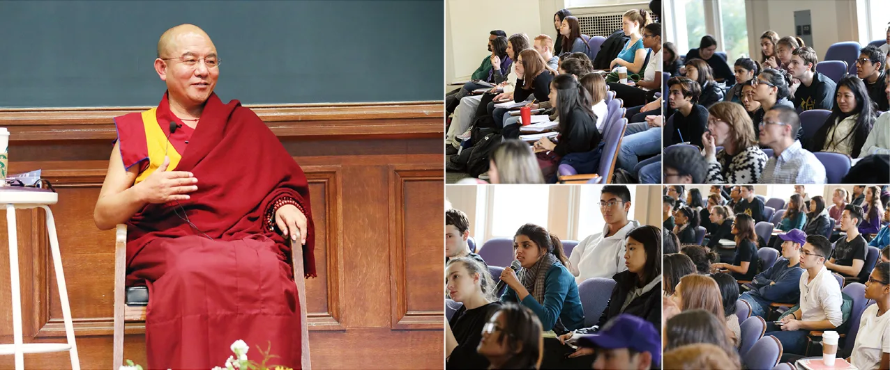
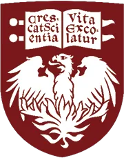
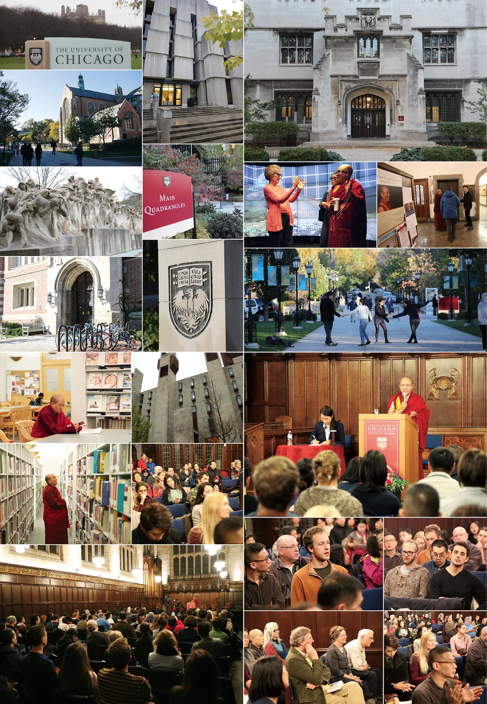
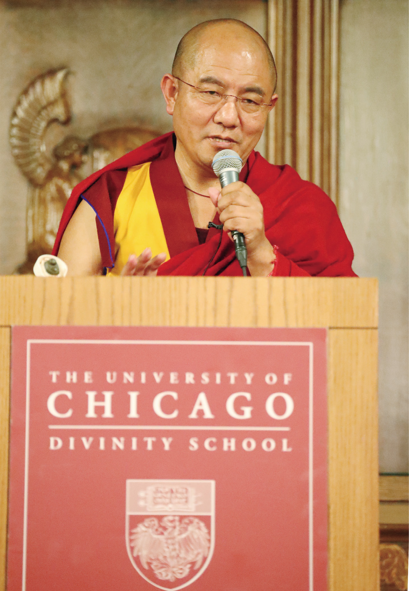
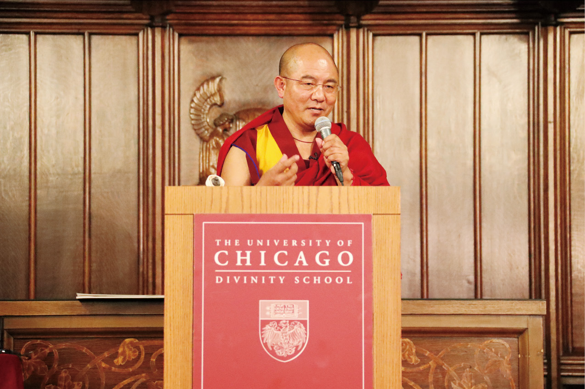
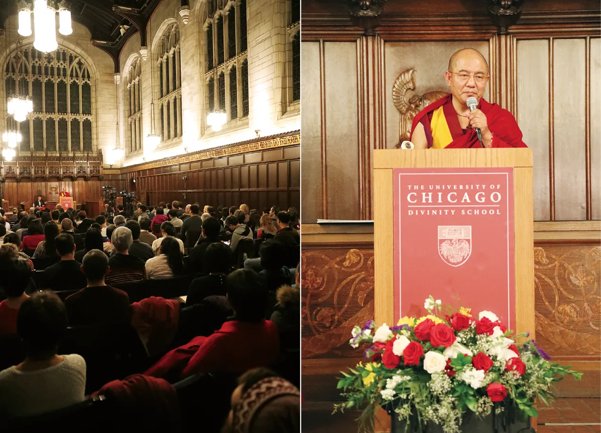
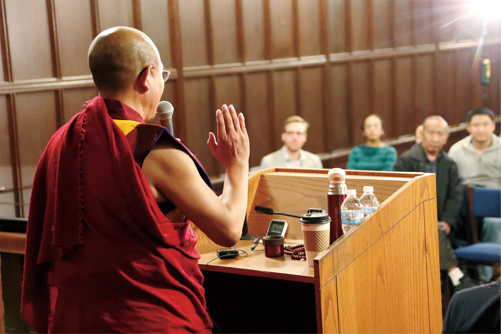

“影响我们人生的绝不是环境，

也不是遭遇，

而是我们持有什么样的心态。”

第151场

美国芝加哥大学

The University of Chicago

美国·芝加哥

2017 / 11 / 1

## 动荡时代的心态

## A Calm Mind in Times of Turbulence

主持人：

大家晚上好！我是芝加哥大学神学院宗教哲学专业的博士生萨夫·奥斯德·荣森，在此我代表芝加哥大学佛教会和佛教学习俱乐部，欢迎各位参加索达吉堪布在芝大的第二场演讲。

堪布在周一的演讲中，分享了他的老师——20世纪著名的藏传佛教大师晋美彭措仁波切的生平和事业。今晚堪布将给我们介绍佛教如何看待当今世界，演讲题目是“动荡时代的心态”。

感谢维德迈尔教授。

教堂很庄严。能够在这样的教堂里，轻松、开放地与大家交流，我很欢喜。听说这里时常接纳不同宗教或文化背景的人士前来分享他们的思想理念，对此我非常欣赏，也感觉意义非凡。

刚才聊天时，教授说，虽然已经是21世纪了，但是他觉得，人类的传统宗教和传统文化依然有着举足轻重的意义，不能丢弃，这一点我很赞同；而与此同时我们也都认为，现代科技也值得学习和掌握。所以，对今日社会而言，传统与现代的融合才是可取的中道。

也许有人对此持有异议，但是，不论纵观历史每一次的进步经验，还是放眼现实的趋势，都不难看出：东方与西方的融汇，宗教与科学的结合，传统文化与时代理念的调和，是至关重要的。

今天的主题是“动荡时代的心态”。这个题目是去年确定的，去年年底美国总统大选结束没多久，芝大校方考虑到局势可能引发人心的不稳定，希望我站在佛教立场谈一谈“动荡的形势下，如何调整心态”。演讲原定于今年2月，但因为种种原因没能实现，一直推迟到今天。虽然间隔了半年多时间，这个话题依然值得我们思考和分析。

## 一、动荡的时代

一般而言，一个国家中政治、经济以及其他领域的变化，都可能引发国民心态的波动。去年年底，美国国内政党经过激烈的角逐，选出了总统。这一事件的前后牵动着每个美国人的心。今年世界上又发生了很多大事，比如英国启动脱欧进程，这也让很多人陷入迷茫。

再以科技为例，如今的时代已是今非昔比，科技进步可谓日新月异，以前几百年甚至几千年才出现一次革新，如今一年、半年，甚至一个月就会实现一个飞跃，陈旧的技术被淘汰，传统的观念被取代。这种情形一方面有其利益，另一方面也带来一些苦恼——人们熟练掌握的技能很快就失去用武之地，尤其人工智能的出现会导致很多人丢掉工作。

据花旗银行与牛津大学的一份联合调查报告预测：将来美国47%的就业岗位可能被机器人代替；在英国，这个比例是35%；在中国，该比例高达77%。最近有本书这样来描述未来：大多数人没有工作，无事可做，大量资源被拥有技术的个别人掌控。

这些都表明，人类将面临前所未有的挑战。

历史上，工业革命曾导致世界出现巨变——很多蓝领工人被机器取代；现如今，脑力劳动者，诸如老师、律师、翻译人员等，也可能遭遇类似的命运。前段时间有人跟我说：“你很喜欢翻译，不过现在翻译工具越来越先进，你可能要‘下岗’了。”

做了几十年的工作一旦面临变化，那么不论东方人还是西方人，都会产生恐惧与不安。

科学家霍金（Stephen Hawking, 1942-2018）对这个时代忧心忡忡，他觉得：人工智能、人口爆炸、气候变化和疾病，让人类处于历史中最危险的时刻。

另一方面，恐怖组织的活动也更为频繁，危害愈发严重。我年轻时从没听过“恐怖分子”的说法，而这几年各类恐怖事件充斥耳畔，比如ISIS组织制造的各种枪击案、撞车事件等。

不仅是有组织的恐怖行为，一些个人也可能做出偏激行为。昨天我走在芝加哥的路上，很多人提醒我：“不要多看路边的乞丐，否则他们一不高兴就会开枪打死你。”所以我一路上都忐忑不安。

今年10月1号晚，在拉斯维加斯，一个64岁的人，从32层楼上对着楼下观看演唱会的观众开枪扫射，当时有多名乡村音乐歌手和约3万名观众在现场，事件导致59人死亡，527人受伤。这成为美国历史上最为惨烈的枪击案。据调查，枪击犯很有钱，也很有能力，但不知为什么做出这种杀伤行为，他的心态也不得而知。

诸如此类的恐怖事件，以前很少发生，而在科技发达的今天却频频出现，而且规模和危害都不断升级。

出现恐怖事件时，宗教徒一般通过祈祷的方法面对；世间人往往求救于有能力的人，就像很多国家陷入困境时会寄希望于美国——“美国能不能救我们？”

在我的印象中，美国是一个倡导自由、和平与平等的国家，对整个世界都有很强的责任感，帮助了许许多多弱小国家。不过现在美国国内也常常面临各种挑战和危机。当然，我相信美国依然有力量去援助其他国家。

总之，大家不妨思考：在这样一个时代中，人们虽然拥有的财富更多，发明的技术更先进，但内心真的安宁吗？

## 二、失控的情绪

对于大格局层面的事，我今天不想过多谈论，主要讲讲作为普通人，如何面对生命中的危机，诸如疾病的侵袭、衰老的威胁、家人感情的破裂等等。

每个人的生活都难免出现逆境，很多人在遭遇不顺时，往往心生烦恼，陷入痛苦。其实不必要这样，应当运用智慧去面对，这样逆境会得以化解，甚至让人收获快乐和智慧；如果实在无法扭转，也可以用恰当的方法接受它、认识它。佛教中说万法唯心所造，这并非不承认外境，而是说万法跟自己的心密切关联。

不过在没有接受心灵训练之前，一般人往往无法控制负面情绪。所谓负面情绪，主要就是佛教中说的贪心、嗔心和痴心。

所谓贪心，是指过度的欲望。比如iPhone Ⅹ一推出，很多人争相订购，认为得到这款手机就有了一切希望。据报道，在中国，iPhone Ⅹ一开售，就被抢购一空。这类现象是欲望膨胀的表现。当然，对于理想等的适当追求，无可厚非，并不是此处所讲的贪心。

所谓嗔心，是想损害某个对境的心。比如对于一件小事，夫妻俩意见相左，这本身并不是大事，但是双方的分别念却可以把它不断扩大，由此引发争吵，最终演变到抛弃甚至杀害对方的地步。这是人被嗔心所左右的可怕后果。

如果追究贪心、嗔心的根源，则不外乎痴心——没有认识自心的真相。实际上如果能认识自心，就可以平静、智慧地去解决任何事。

世界著名潜能学大师安东尼·罗宾（Anthony Robbins, 1960-）说：“影响我们人生的绝不是环境，也不是遭遇，而是我们持有什么样的心态。”这段话很有道理，不论遇到什么不顺心的事，我们都不应责怪外境、抱怨他人，而要观察自心，对心中的痛苦进行剖析，认识它。

## 三、三个应对之策

如何调整自心，从而更好地应对生活呢？这其中有几个要点可以把握：一、淡定；二、识破；三、随缘与接受。

### 1．保持淡定

不论面对国际大事，还是个人的小事，保持淡定的心态都非常重要。

去年我的母亲去世了，她生前特别关心我，所以她的离去让我心绪难平。后来我想，不管怎样，母亲的去世已无法改变，所以我还是要淡定。

禅宗里有这样一个故事：一个女人有一个可爱的女儿，不过很不幸，这个女儿活到11岁就夭折了。面对女儿的死亡，女人痛不欲生，她到一位法师那里哭诉：“我的女儿死了，怎么办？”

法师开导她：“你要放下。”

她说：“我怎么放得下呢，我的女儿那么可爱。”她无法抑制地痛哭。

法师跟她说：“你这样一直哭泣，即使哭三天、三个月，甚至三年，都于事无补，只会让负面情绪不断增加，从而要面对更多问题；不如淡定下来，这才是理智的。”

面对逆境，如果你无法改变这件事，就改变自己的心吧——尝试着让心静下来，避免负面情绪滋长。

对于负面情绪，我们一定要认识其危害性，它不但无法解决问题，还会制造新问题。比如，有的人失业了，如果从此灰心丧志，牢骚满腹，那么他的下一份工作也会受到影响；有的人失恋了，如果从此以泪洗面，忧伤悲叹，那么他的下一份感情也会蒙上阴影。与其灰心，与其流泪，不如让心淡定下来，放下痛苦的念头，去寻找新的生活。

不论面对任何事，内心淡定都很重要，这是佛教中特别强调的。

### 2．学会识破

#### 1）识破外境

一棵大树，并非凭空而生，而是种子、水分、阳光等许多因缘和合才逐渐而有；同样的，世间的任何事，当它们发生时，我们当下只能看到结果，但其实它们都有各自的因和缘。像刚才提及的枪击案，如果很简单地看结果，就会迷惑和抱怨，“为什么这样？”实际上这一事件的背后有很多因缘：枪击犯也许是受人控制，也许是心情不好，也许跟社会、教育等有关，甚至还有一些深层、久远的因缘。

总之，遇到不如意之事，抱怨不是明智之举，我们应冷静地观察它的因缘。

佛教中说“诸法因缘生，因缘尽故灭”，意思是：如果因缘具足，诸法一定会产生，谁也无法阻止；如果因缘灭尽，诸法必定会消失，谁也无法挽留。以及“此有故彼有，此生故彼生”，也是类似的道理。

总之，不论遇到生活中的逆境、人生中的不平，都不应怨天尤人，或者大发嗔心，而要尝试着观察这些事的背后因缘。

#### 2）识破内心

如果遇到恐怖之事，一方面从外境层面识破，另一方面也要识破内心，因为一件事情的好坏、利弊，根本上端赖人心。

佛教有“一水异见”的例子：一碗水，人看到的是清澈的水，饿鬼看到的是污秽的脓血，地狱众生看到燃烧的铁水，鱼类看成住处，天人则看到是甘露。同样一碗水，六道众生的所见各不相同。不仅是一碗水，类似的例子还有很多。

世界上不存在实有的法，因此即使面对同一事物，不同人的看法也会截然不同。比如一个领导，支持他的人认为他好，反对他的人认为他坏，如果这个领导实有，周围人不会产生不同看法。再比如，一个女子，他的爱人一开始感觉她不可方物，但是相处久了之后，又觉得她相貌平平，甚至可能因为一言不合而觉得她面目可憎。

任何事物都不实有，是好是坏，是美是丑，并非绝对，主要观待看者的心。

因此如果我们保持放松的心态，恐怖之事也不一定那么可怕，不幸之事也不一定那么痛苦。

### 3．随缘与接受

生活的变故，似乎总会不期而至，学会随缘和接受就显得非常重要，因为有些事情是我们无法改变的。不过发生一些事时，悲观的人习惯用痛苦的心态面对，乐观的人则会用开朗的心态迎接，不论怎样，学会接受，心里做好准备，都是第一位的。

曾经有一位禅师，他的院子里种了很多花，到了秋季，有些花盛放了，而有些在凋落。禅师的一个学生喜欢花枯萎的样子，另一个学生则欣赏花绽放的情景，还有一个学生认为：枯萎也好，盛开也罢，怎样都很好。对于第三个学生的态度，禅师大为赞叹。为什么呢？如果一味觉得花盛开好，就会伤感于花的枯萎；如果一味认为花枯萎才有趣，就会排斥花的绽放。这样都不合理，因为花的枯萎在所难免，而花的开放也是正常现象。

在现实生活中，也许今天的你青春靓丽、才华横溢，而且拥有万贯家财，人人都投来赞赏的目光，但是将来的某一天，年轻、美貌、才华和财富可能都会离你而去，那时你该如何面对？能否保持一颗平和的心？

实际上日常生活中处处充满变化，因此我们要学会接受，以平静、随缘的心态接纳它们。

民间有句话说：三十年河东，三十年河西。这是在形容世间的沧桑变迁。一个国家现在繁荣兴盛，但不久的将来，可能走向衰落；一个家庭现在幸福美满，但不久的将来，可能四分五裂；一个人现在功成名就，但不久的将来，可能从巅峰跌落。如此种种，在佛教里称之为“无常”。

无常是不可避免的，那么是否我们只能消极地等待？不是的，我们可以勇敢地、智慧地去面对。佛教中提到的“菩萨”，是菩提萨埵的简称，指内心勇敢的人。不论遇到什么事，菩萨不会脆弱、不会封闭、不会伤心，会坚强地接受，并运用智慧去解决。菩萨是我们学习的榜样。

以上所说的三个特质——淡定、识破、随缘和接受，是很宝贵的心态。不论在生活中还是修行中，如果你遇到了困境，首先告诫自己淡定，然后试着去认识事情背后的因缘，不论这件事是什么，都接受它，之后用智慧去处理。如果能做到这样，任何事都不会让你烦恼，反而可能带来机遇和帮助。

## 结语

今天在座的，有些有信仰，有些没有，不管怎样，我都将自己多年所得的心灵秘诀奉献出来，希望你们在动荡的时代里守护好心灵的安宁。

现场互动

问：我的母亲常常内心莫名地恐惧，请问如何消除这种恐惧？

堪布：按照佛教的观点，一个人常常内心恐惧，很可能是前世杀害或殴打其他众生，让它们产生恐惧和痛苦，这种恶业的种子留在阿赖耶中，由此导致的果报。

要消除这种恐惧，可以忏悔，还可以念药师琉璃光佛的名号；另外，也可以用智慧剖析恐惧，一旦认识了它的本质，它就不那么让人畏惧，甚至可以被接纳了。美国前总统罗斯福曾说：“真正让我们感到恐惧的，只是‘恐惧’本身。”如果你认识它，它并不是很恐怖。

说到这里，我想起法王晋美彭措的一段往事。有一次法王带着我们去康定，途经道孚县，翻越一个山坡时，法王突然说心里很害怕，接着就想起了前世：在大约九百多年前的格萨尔王时代，法王是一位叫丹哲意吾布美的大臣，他的父亲叫丹玛，也是一位大臣，丹玛在那个山坡打仗时受了伤。法王一边讲述当时的情景，一边哭得很伤心。后来我们特意在那个地方建了一座佛塔。

问：我是一名天主教徒，如果想学习佛教的“观心”教言，可以阅读哪些书呢？

堪布：在佛教里，有关“观心”的教言比比皆是，像寂天菩萨的《入菩萨行论》，共有十章，其中讲了很多这方面的内容。

刚才维德迈尔教授说最近在研究《密集金刚》。这是一部很殊胜的论著，里面也讲了观心的窍诀，比如如何以心观心——表面看来，以心观心时，分为能观和所观，但实际上这样去观时，可以认识心的本面，此时烦恼和痛苦不仅不再有害，甚至会给修行和生活带来帮助。

问：我是芝加哥大学的一名新生，如今的信息时代，很多人花大量时间玩手机，但手机上的内容有多大意义呢？作为一名学生，我实在不愿浪费一个小时玩手机。对于这方面，您有什么看法？

堪布：我感觉在美国，玩手机的现象并不那么严重，比中国好很多。在中国，即使在藏地，很多年轻人不论听讲座还是念佛，都会不时地玩玩手机。

不过你说的问题很现实。现在科技飞速发展，信息高度发达，人们每天都会接收很多信息，但其中有一部分不一定对生活有益。因此每个人有必要合理安排时间，将之用于更有意义的事，比如看书学习。

我最近参观了几位教授的办公室和家，发现都摆放了很多书，这一点让人赞叹。以前我去过其他地方的个别教授的办公室，几乎看不到一本书，他们说资料都存电脑了，不过这样也不一定很好。

我觉得不论在哪个时代，看书都是很快乐、很有意义的事。因此，与其把时间耗费在玩手机上，不如静下心多看看书。

问：作为大学生，如果有了个人信仰，应该如何分配专业学习和修行的时间？

堪布：这个问题是很多有信仰的大学生要面对的，一方面需要修行，另一方面又不能放弃专业学习。两者间如果没有平衡好，可能就会陷入迷茫，如同走到十字路口般。

我的建议是，大学生在校期间，应以学业为主，一定要把学业完成，因为修行等其他事在人生中还有很多机会，而且完成学业只需短短几年时间。

我以前读书时，也是把大部分时间花在功课上，与此同时，也没有放弃个人信仰，会抽出部分时间用于修行。这样的做法，对于应对未来的人生非常有帮助。

另外，一个人如果善于安排时间，就可以完成很多事。有句名言也说：“时间就像海绵里的水，只要愿意挤，总还是有的。”这一点我自己也深有体会。

但是如果没有安排好时间，心里又特别着急，可能压力会越来越大，最后什么都做不好，陷入一片混乱。

总之，分清阶段很重要，上学期间应以学业为主。

主持人：

我代表芝加哥大学神学院感谢堪布的到来，感谢您给我们带来的精彩演讲，也期待您能再次给我们授课。
