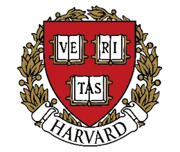
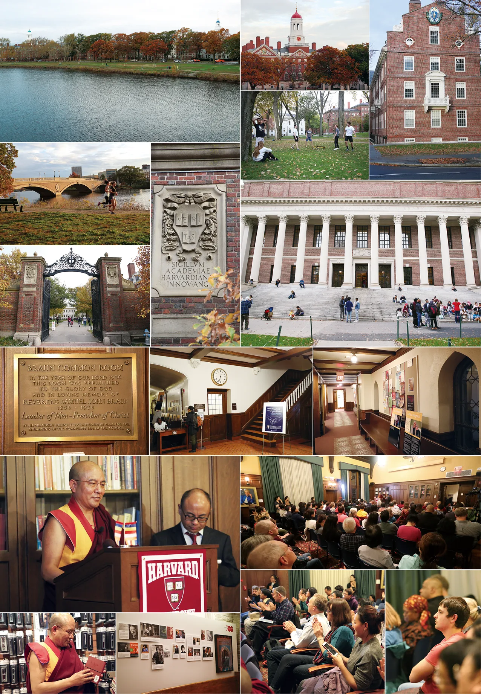
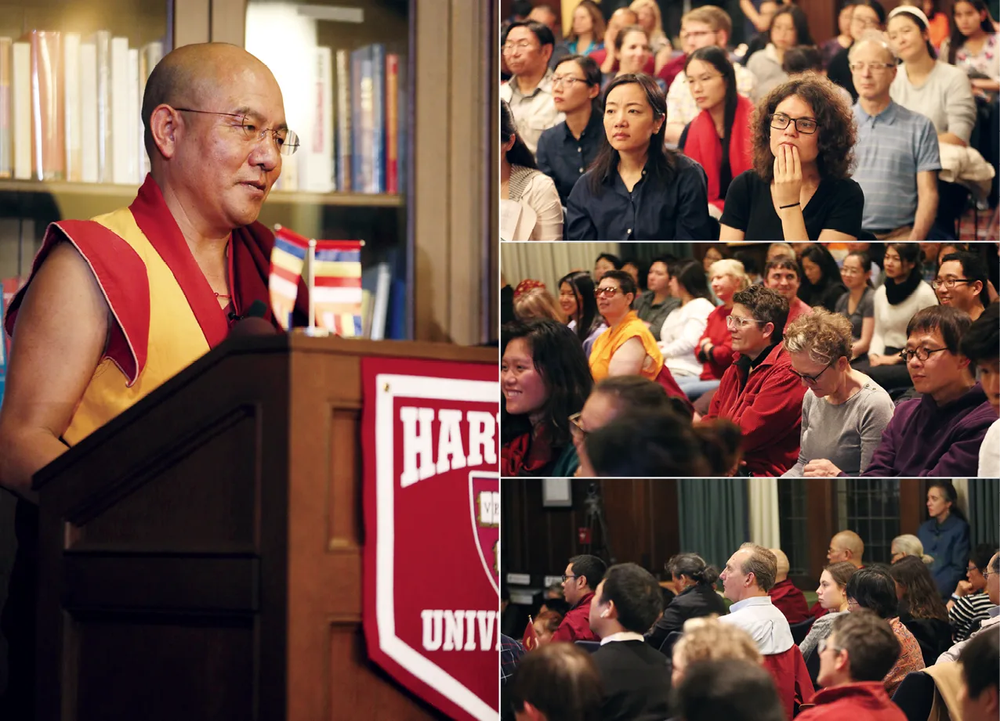
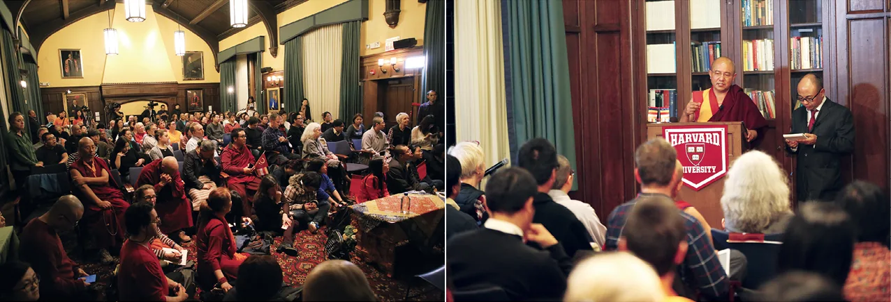
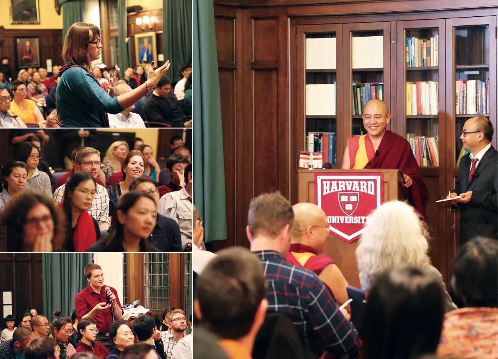
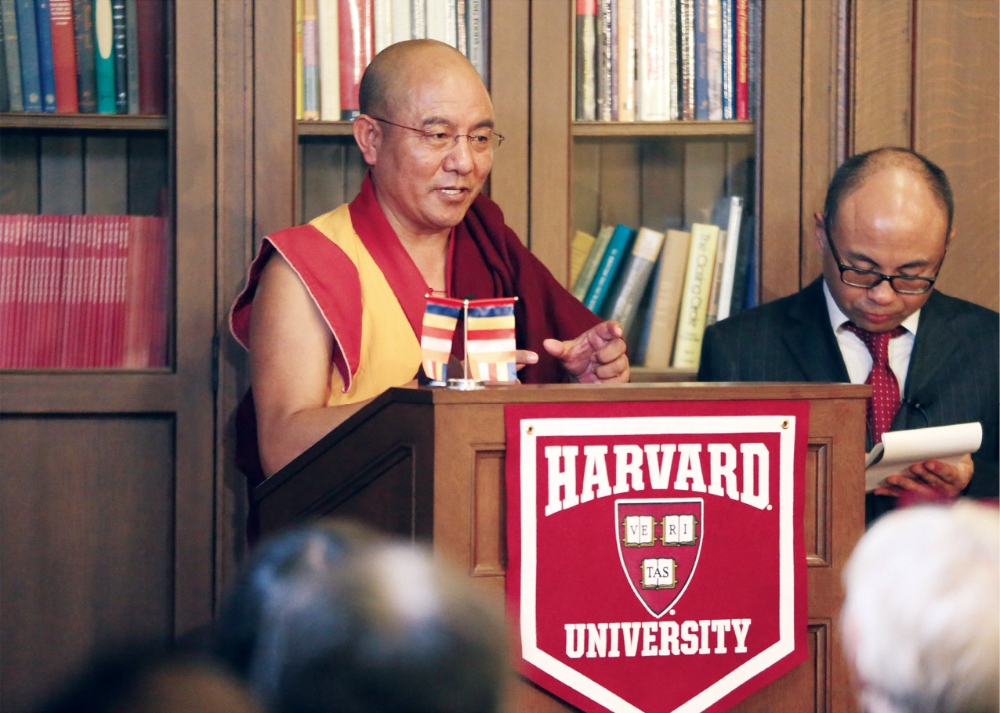

在物质和心灵当中，

心灵更为主要，

它决定了一个人能否真正快乐。

第152场

美国哈佛大学

Harvard University

美国·波士顿

2017 / 11 / 6

## 向内看 向外走

——如何在现代生活中保持内心平静

## Look Inward, Walk Forward -Living with Inner Peace in the Modern World

主持人：

大家晚上好！我叫珍妮·嘉措，是哈佛大学佛教研究专业的教授。今晚我们非常荣幸地邀请到索达吉堪布为我们做演讲。堪布曾于2013年来过哈佛，转眼四年过去了，非常高兴再次见到堪布！

这里请允许我介绍一下堪布，以方便新朋友进行了解。

堪布1962年生于康区，1985年前往色达喇荣五明佛学院出家，之后一直常住那里。喇荣五明佛学院由晋美彭措法王于20世纪80年代创办，晋美彭措法王是一位不可思议的上师，但是很遗憾，他已经示现圆寂了。喇荣五明佛学院虽然成立的时间不算很长，但是却迅速声名远播，吸引了来自四面八方的修行者，他们到了那里会接受系统的佛学教授。除了传统佛法教育，佛学院还开展很多慈善事业，诸如保护动物运动、劝导藏族人不穿皮草等等。

堪布精通佛学理论，翻译和出版了很多佛学著作，内容涉及佛教哲学、僧伽制度、佛教因明以及甚深密续等。堪布的一些著作还发行了英文译本，这使得他的追随者遍及全世界。今晚我们能聆听堪布的开示，非常值得高兴！

担任今晚翻译的是一名专业翻译人员，他任职于纽约的利众基金会，谢谢！

现在有请堪布——

如同珍妮·嘉措教授所说，我在2013年来过哈佛大学，而且在这里听了一堂课，当时我想：“这辈子虽然没机会长期在哈佛学习，但是当两个小时的学生也是很好的缘起。”

对于那堂课的内容，我至今记忆犹新。授课教授传讲的是《益西措嘉空行母传》，听课的有十四五名学生。教授讲完，学生们就益西措嘉空行母遭人非礼一事展开了讨论。有的学生说以前尼泊尔有个女生有过类似的遭遇，又有学生说美国有个女生也有相似的经历，这些女生遭遇不幸后，都非常痛苦，心中留下很深的创伤，然而益西措嘉的表现却与她们不同。

教授和学生们最后这样总结：益西措嘉空行母因为往昔的业缘而遭人侮辱，这虽然让她的内心发生了巨大变化，但并没有给她的生活蒙上阴影，也没有把她抛入痛苦的深渊，此后她鼓起勇气，一如既往地致力于弘扬佛法——她不愧是一位了不起的女性。

那堂课只有两小时，却让我受益匪浅，我主要有两个收获：第一，我在东方当了一辈子老师，讲过很多次课，不过还是第一次见到师生围坐圆桌研讨的形式，老师讲的时间很短，之后的很长时间供大家讨论，这样确实效果非常好，后来我也让我们佛学院的学生尝试了这种方式；第二，藏地等很多地方的不少人对前辈大德和智者们的传记不够重视，实际上认真研读这些传记会大有收获，这方面我有了新的体会。

今天的主题是“向内看，向外走”，我会就心灵的奥秘以及研究宗教的方法，谈一些自己的理解。

## 一、心灵与物质的失衡

纵观人类历史，之前很长一段时间中，科技发展都十分缓慢，物质生活也较为贫乏，不过人的内心却比较淳朴，人与人之间没什么戒备，这样的生活延续了几千年。但是近几十年，世界发生了翻天覆地的变化，人们的生活、学习方式跟以往大为不同，心态也起了很大变化，有些人常常恐惧不安，有些人对自己失去信心，有些人患上抑郁症……各种状况层出不穷。

就我个人而言，23岁出家，之后大部分时间待在佛学院，对在家人的生活不是很了解。不过这几年逐渐接触在家人，我发现他们中许多人都不快乐，内心的痛苦一天比一天沉重，不论东方人还是西方人。

虽然科技越来越发达，物质越来越丰裕，这些是以往无法相比的，但人的心灵却没有跟上，不但没有越来越幸福，反而深陷在痛苦中。

在这个特殊的时代里，如何才能活得快乐？我个人觉得禅修是很好的方法，念咒也有不共的力量，串习佛教的空性见也不失为良策——通过观修空性可以认识心的本体，那时痛苦自会冰消瓦解。

在一些东方寺院，修行人的物质条件很简单，但内心的快乐却远胜一般人，这一点现量可见。在座的老师和学生，你们如果有机会，可以对这些修行人的内心进行研究，这也很有意义。

如今有句话叫“超越舒适区”，是什么意思呢？比如有的人平常只去某家饭店吃饭，而且只吃一种菜，平时只跟一两个朋友来往，不敢接触自己圈子以外的人和事物，而现在他鼓起勇气走出来，到新环境中历练，开启新生活，这就是“超越舒适区”。这也是提高心力的一种方便。

在物质和心灵之中，心灵更为主要，它决定了一个人能否真正快乐，因此大家有必要关注心灵、提升心灵。

## 二、如何研究宗教

### 1．应避免的歧途

#### 1）盲目批判

不论东方人还是西方人，在遭遇痛苦或者享受快乐时，内在的感受没有多大差别，但东西方的文化却不尽相同——东方文化讲求上进，西方文化强调批判。如今中国汉地、藏地的很多学生来到西方读书，再回家乡时，他们往往对上上下下充满不满，性格也跟周围的人格格不入。

我认识的一些中国父母想把孩子送到西方，但是又怕孩子到了那里就把传统文化和道德全部抛弃，不再孝顺父母、尊重老师，“这么聪明的孩子，如果去西方学习，回来后对家乡的寺院和传统进行批判，会不会有大麻烦？”很多人有这种顾虑。

与此不同，一些西方人把孩子送到藏地寺院或学校学习，这些孩子的心态发生很大改变，变得遵规守纪了。

如今在全球教育领域，西方教育可以说是领头羊，尤其美式教育，被很多国家所推崇。一方面，西方的教育模式确实有可取之处，比如教材中编入动物故事，这在以往的汉语教材中不多见。不过，随着西方教育的盛行，批判主义思想也随之泛滥起来。

在美国，不论老师还是学生，都竭尽所能地发表批判的论调。但是作为大学教授或者大学生，你的一句话也许将来会给世界带来很大影响，因此应该有充分的研究，力求言之有据，不能毫无理由地诋毁或指责。现在很多年轻人的智慧并未成熟，理解问题有失偏颇，做出的批判也就不一定符合事实。不过要改变这种状况，也非常困难。

在藏地，有些年轻人不是很懂英语，但是懂一些汉语，于是运用有限的汉语模仿西方的观点，对于传统习俗和佛教信仰横加指责和挑剔。其实如果运用智慧观察，就会发现他们的说法不符合真相。

当然，批判主义也并非一无是处，历史上人类也曾借助这种方法推出新思想，淘汰迷信的观念。但是如今有些人对于藏传佛教的伏藏法、清净观，以及其他大乘法门，从各个方面进行批判，说某个伏藏法是假的，说某部大乘经并非佛说。这些批判如果正确，我们也愿意接受，但如果批判者对于藏传佛教知之甚少，只是随心所欲地指责、毁损，那确实不合理，这样不仅对人类没有什么利益，还会带来损害。

#### 2）望文生义

曾经有一名西方博士研究章嘉国师的《正见歌知母》，并以此作为自己博士论文的主题。《正见歌知母》中有段话说：如今我们中的个别聪明人，耽著坚固成实等法，将朗朗的外境置之一旁，去寻找一个有角的所破，而无障佛母的容颜，从来不曾漂浮过杂染的斑点，不切实际的言辞讲得再多，恐怕本性的老母只会逃离我们的认识。

对于这段教言中“一个有角的所破”，这个西方学生误解为杀害带角的山羊、牛等，于是在论文里写道：章嘉·若必多吉出生于公元1716年，住世到70岁，他的著作中说，那个时代有些年轻人去寻找并杀害了很多动物，章嘉的母亲于心不忍，由此引起家庭不和，他的母亲准备逃弃。

其实《正见歌知母》的那段话是在讲述空性：抉择空性时，如果只是破斥一个“实有”，就会与般若佛母失之交臂。然而个别人的解释已经离题万里。

未来最让人担忧的是什么呢？就是一些老师和学生研究藏传佛教时曲解其义，这会给东西方文化都造成很大损失。

#### 3）不守秘密

昨天在芝加哥大学，我了解到有些教授在研究色拉空行母（也即卫萨空行母）的传记，这部传记很好；珍妮教授也在研究《晋美朗巴自传》，这也非常好。另外，对于其他佛教内容，诸如中观、因明、俱舍、密法总续部等，如果去研究，也很有意义。不过对藏密中的直指引导和修行窍诀，如果想研究，必须首先得到灌顶和引导。

以前西方有的老师看到密续后，认为公开宣说也没什么，于是跟我说：“密续不用保密。”我当时以开玩笑的方式说：“你们一些老师对于家中存款、个人年龄都讳莫如深，那藏密中的甚深法理更应秘而不宣。”

如果密法著作中附有“萨玛雅，密密密”字样，即便是出于对作者的尊重，大家也应谨守秘密，否则可能会导致佛教走向衰落。

一般在藏地也是这样，寻思者和实修者完全不同：寻思者喜欢用分别心思维、辨别，常常驳斥他人；实修者喜欢实际修持，注重培养信心和清净心。这两种人常常发生“碰撞”，实修者非常害怕寻思者，把他们当成鬼一样。

### 2．用尊重的心去研究

在座的如果要研究宗教，首先要了解这个宗教，学会尊重它的教义和习俗。

有些研究基督教的学者说：“我们研究基督教时，一定要承认上帝存在，否则我们的研究就失去意义了。”伊斯兰教《古兰经》的第二章和第九章中说：对伊斯兰教持有邪见、进行诋毁的人，即使杀害他也无妨。他们的典籍里确实有这种观点。因为这个原因，研究伊斯兰教的学者对这个教法往往不敢口出冒犯之辞。印度教认为：一个人只要出生在印度，就是印度教徒，而其他人则是异类。所以研究印度教的只能是印度人，其他民族或其他地方的人是不被允许的。藏族有上万人去了印度，但是他们和印度教几乎没有联系，印度教中除了极少数藏人外，其他都是印度人。

不过还是有很多研究者缺乏尊重心，比如一些大学生以宗教为主题撰写论文时：伊斯兰教不吃猪肉，但他们说“吃猪肉没有罪过”；印度教不吃牛肉，也不杀牛，但他们说“杀牛可以，吃牛肉也无所谓”。这样信口开河不是很好。

希望在座的老师和同学以后研究宗教时，应该清楚了解它的历史、背景和教义，并学会尊重其传统，这非常重要。

不仅是研究宗教，如果要学习某个宗教，也需要细致观察和了解。佛陀曾在经典中教诫：不论出家的比丘，还是在家的智者，对于我的教言，都应像冶炼黄金一样，首先仔细观察，如果觉得合理就接受，如果觉得不合理就舍弃，不要因为是佛的教言就恭敬遵从。

以前有位智者说：“通达了义教证、理证的人，与具有经验的瑜伽士，最后观察和修行的密意是一致的。”如果精通了义的教理，同时也有修行的经验，那么在他心中所有意义都不相违。否则，如果认为处处矛盾，到处都是敌人，不仅自己不快乐，对世界也不可能做出什么贡献。

另外，研究宗教的过程中，怀着一种利益全人类的心，也是非常重要的。

## 结语

最后，希望大家常常让心寂静下来，对各种遭遇不要太执著，不要心随境转，而应探寻内心、调伏内心。佛经中说：“自为自依怙，他人何可依？”确实如此，如果能把握自心，就能驾驭生活，找到幸福。

现场互动

问：我从小学习藏传佛教，至今已经20多年了，我学习的目的仅仅是想内心平静。如果想让修行有进一步的突破，该如何做？

堪布：虽然修学佛法也能让内心达到平静的状态，但按照大乘佛法的观点，修行人不应只想着自己，而要想到所有众生，要让他们都获得暂时和究竟的安乐——如果能经常这样发愿，心态会有所不同，修行也会迈上新的台阶。与此同时，这样也能让自己越来越快乐，为什么呢？因为人的痛苦主要是执著自我而致。

也许这跟西方的有些理念不同，不过我执确实是一切痛苦之源，如果能串习利他心，不仅对个人修行有帮助，而且自己的潜力也能最大限度被激发，逐渐就可以给他人带来利益。

问：在演讲的开始，您提到科技发展非常迅速，但是现在成千上万的学生跟随您学习藏传佛教，他们为什么愿意将现代科技舍置一边，而去学习佛法？

堪布：学习佛法，并不等于舍弃现代科技。以我们佛学院为例，那里的修行人也学习电脑、网络等技术，我自己也采取网络直播的方式传法，也有Facebook和Twitter等。

不过作为修行人，虽然学习和利用科技，但并不盲目崇拜科技，因为科技无法解决人类的所有问题。放眼这个时代，科技越来越发达，物质越来越丰富，但人心却越来越混乱、痛苦。这种情况下，只有从佛法中汲取营养，才能慢慢找回心灵的快乐。

问：我是一名在读博士生，学的是肝硬化专业，这个专业常常需要做动物实验，但我也是一名佛教徒，所以每次做实验都非常痛苦。我是否应该换个专业？

堪布：是否换专业，还是你自己用智慧抉择。不过杀害众生确实有恶业，如果无法换专业，就最好常常忏悔，多念一些咒语等；如果你觉得换专业更合适，这样也是可以的。

问：佛教能给每个人带来快乐吗？

堪布：不同的人有不同的业感，因此对同一事物的感受不尽相同。以地位为例，有的人拥有了地位乐不可支，而有的人获得高位也闷闷不乐；财富也是同样，有的人有了钱财就笑逐颜开，而有的人得到很多钱也无动于衷。

与此类似，不同的人对佛教的感受也不同，要求佛教给所有人带来快乐，也有一定困难。不过，大多数人可以从佛教中得到快乐。比如在中国汉地，很多年轻人承受着工作、生活的巨大压力，常常苦不堪言，甚至想要自杀；他们如果能学习佛法，心胸就会变得开阔，心态也会变得放松，可以淡定地面对很多事。这一点并非口上说说，的确有很多人通过学习佛法而受益，这其中有东方人，也有西方人。

因此，我觉得佛教能给大多数人带来快乐。

问：照顾正在感受痛苦的人时，如何才能让自己不被他们的痛苦影响？

堪布：帮助别人的过程中，我有时也会产生一些痛苦，但大乘佛法里有一种自他交换的修法——将自己的快乐给予别人，同时代受别人的痛苦，如果能这样修持，不仅自己没有痛苦，也可以减轻甚至消除别人的痛苦。一般而言，如果具有大悲心，那么帮助他人时很少会产生痛苦的。

问：实际上我正在照顾我的父亲，他病得很重，心情也不好。我已经很尽力想让他的身体好一些，但他的状况并没有好转，这时我会感觉很痛苦，没办法高兴起来。相信很多人也有类似的体会。

堪布：每个人都不可避免要经历生老病死，这是轮回的自然规律。所以面对亲人生病，你不用过于难过，主要还是尽力照顾他，如果没去照顾，只是兀自痛苦，对亲人也没什么帮助。

从另一个角度而言，如果是一个很好的修行人，可以将所有痛苦转为道用。因为痛苦的本性就是菩提。

问：佛教起源于印度，但如今印度原有的佛教几乎消失了，佛教还有可能在印度复兴吗？

堪布：佛教确实起源于印度，并传播到世界很多地方。后来随着时间的推移，印度境内的佛教因为种种原因被破坏了，如今印度的佛教是其他地方传播过去的，以藏传佛教为主，还有斯里兰卡佛教（南传佛教），以及汉传佛教（北传佛教）。

虽然印度本有的佛教近乎销声匿迹，但是我相信藏传、南传以及北传佛教，未来会在印度兴盛起来。

问：我是一名理疗师，有些人认为理疗只跟身体有关，其实根据我多年的经验，与其说是理疗身体，不如说更多的是抚慰心灵。所以，从事这个行业也是一种持续的修行，是这样吗？

堪布：理疗师属于医生的一种。按照大乘佛教的观点，医生这种职业很有意义，可以帮助很多众生。

今天这里有不同职业的人，不论你从事何种职业，也不论你是否是佛教徒，你的工作最好能帮助众生，即便不能这样，也至少不要伤害众生。帮助别人的就是佛法，伤害别人的则是非法。

一般西方社会比较倡导“自我中心”的理念，这跟佛教思想有所不同。当然，从某个角度而言，“自我中心”也有必要，一个人如果连自己都不重视，也就不可能帮助别人。不过在利益自己的基础上，如果能进一步将利他放在心上，自己也会获得很大利益。

总之，不论从事什么职业，能够帮助到众生是最重要的。希望你也将这种理念不断运用在你的工作中，这对你和你的病人都有利益。

问：学习佛法能靠自学吗？还是最好依止一位上师？

堪布：你的问题很好。在世间，读小学、中学、大学乃至研究生，不论处在哪个学习阶段，不依靠老师，只是自己看书，都不可能很好地理解所学的知识，这是一种规律。再比如行医、开车等等，最初如果离开老师的指点，也无法入门。

跟世间知识相比，佛法更为深奥广博，尤其需要善知识的指导，如果仅仅自己看看书，也许只能了知皮毛，比如现在很多佛教研究者，他们对佛法的理解，常常停留于字面，没有深入甚深层面。

显宗中的了义、不了义，秘密、意趣，密宗里的六边四理等等，如果没有依止善知识，仅仅凭借自己的力量，很难真实理解；尤其修行方面的引导和窍诀，离开了善知识的讲解，更是无法契入。即便是研究佛教，如果能依止一位具有传承的善知识，也会带来非常大的帮助。
