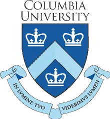
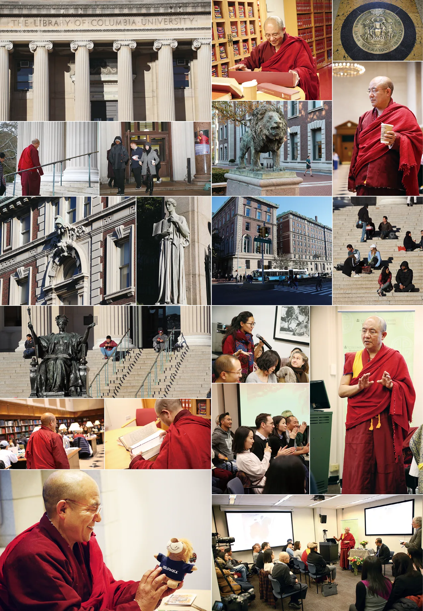

藏传佛教的密宗对女性的态度更为积极，

认为女性代表智慧和空性。

第154场

美国哥伦比亚大学

Columbia University

美国·纽约

2017 / 11 / 15

## 女性在藏传 佛教群体中的角色

## The Role of Women in Tibetan Buddhist Community

主持人：

大家晚上好！我是哥伦比亚大学现代藏学研究项目的主任。我们非常荣幸能够邀请到索达吉堪布再次莅临本校，和我们探讨“女性在藏传佛教群体中的角色”这一主题。

堪布，欢迎您来到哥伦比亚！

我和在座的各位老师大多是第一次见面，也有部分老师是第二次见面，比如罗宾老师。

今天能有机会在一起互相讨论和学习，我内心充满感激。正如刚才老师所讲的那样，今天的主题是“女性在藏传佛教群体中的角色”。我将为大家简单介绍藏族女性的生活、地位和她们在藏传佛教里的学习情况等。

## 历史上，都曾重男轻女

我在藏地出生，在藏地生活，在藏地成长，在藏地学校完成学业。出家以后，也主要在藏地寺院讲法。虽然有时候也会去汉地和国外，但从小到现在，最主要的生活场所还是在藏地，所以不管是学习，还是讲法，都是按照藏族的传统进行的。

现在很多学者对藏地女性的社会地位比较重视，从各方面进行研究。在我看来，女性的权利和地位问题，不是只有藏族人才需要面对，如今在全世界都是一个特殊的话题。对这个问题的聚焦，已经成为现代社会的一种趋势。

从政治、历史和宗教的角度综合来看，在20世纪之前，人类基本上是持重男轻女观点的。这是一个历史事实。不管东方还是西方，重男轻女都曾是一个比较普遍的社会现象。

我们藏族的传统与此并没有太大差别。在藏地，女性的地位与男性相比，同样也是比较低的。在一个藏族家庭里，像做饭、洗衣服、挤牛奶等家务事，大多由女性主动承担，男性主要在外面做一些事情。

这种现象的背后，可能牵涉到三个方面的原因：一是社会传统，二是女性自身的特点，三是女性共有的业力感召。

当然也可以从权利的角度去寻找原因，但另一方面，也可以说是女性本身的生理和心理特点起了决定性的作用。女性从小心思就比较细密，做事情时也对细活更为上心，这使得她们更倾向于在家里处理琐碎的家务。

我们生活中的很多事情，其实是由各自的业力感召，仅仅从权利上作解释可能比较困难。

## 两千多年前的男女平等

男女平等的观点，佛教在2500多年前就已经提出了。根据佛经所讲，男女在初入佛门所需要的条件、中间需要守护的戒律和最后修行获得的果位上，都是平等的，没有什么差别。

大乘佛教在利益众生方面，更是倡导男女平等。在大乘广大行派的传统里，男女平等修菩提心，平等行菩萨道，平等获得无上佛果，没什么优劣尊卑之别。在这方面，我们多年来做过很多学习和研究，对相关情况还是比较了解的。

藏传佛教的密宗对女性的态度更为积极，认为女性代表着智慧和空性，反对对女性进行诋毁和歧视。在佛陀亲自宣讲的密宗经典中，密宗的十四条根本戒最后一条，要求对所有的女性都不能诋毁。如果侮辱和诋毁女性，则失坏密宗的根本誓言和戒律，后果非常严重。

藏地有不少前辈大德对这些戒律做了详细的讲解。比如，夏达瓦论师就在自己的注释中讲到，在五浊恶世，如果要广大地开展摄受众生的事业，就需要幻化为女身。也就是说，在末法时代，诸佛菩萨经常幻化为女身来摄受众生。如果诋毁女性，就是诋毁所有的佛菩萨。所以，千万不能违犯这个戒条。

不过，佛陀在显宗经典里，的确肯定了男身具有种种功德，而贬抑女身具有五种过患。这样的说法，是不是与密宗的观点相互矛盾呢？不是的，密宗不能诋毁女性的根本戒条是从另外一个层面来解释的，有其他的必要和密意。

而显宗扬男抑女的观点，多是站在男性修行人角度说的，目的在于减少他们对女性的关注，专心于法道；若是女性修行人，完全可以观察男性的过患，以达到同样坚固道心的目的。

## 在藏地，女性的地位并不低

现在有些研究藏学的学者认为，藏地男女的地位悬殊，女性如同牲畜一般没有自由，受轻视的程度相当严重，并以此为题材写了一些书。

我的看法是什么呢？像我刚才讲到的那样，我从小在藏地生活，对这个问题应该有一点点发言权。就我自己的家庭而言，我小的时候，父亲在家里的权力要大一些，而母亲的权力要小一些，但母亲在生活中特别受父亲轻视的现象，我一生都没见过。

我的爷爷奶奶那一辈，还有亲戚和邻居，都和我的家庭一样，也和现在的大多数普通家庭一样，过着比较平和的日子。男的特别有权力，对女的非常轻视，一点儿都不给她们自由，这种事情从来没有在我身边发生过。

也许，现在的研究者写书喜欢结合自己的主观心态，弄出一些新的看法和新的观点吧。

我前几天看到一本书，叫《人生的智慧》（The Wisdom of Life），叔本华（Arthur Schopenhauer, 1788-1860）写的。他小的时候由于受到来自母亲的伤害[^1]，对所有女性都持轻视和偏见的态度。他的学生尼采也是一个非常有影响力的学者，西方很多学校都在学习他的思想。然而，由于受到老师的影响，尼采也着重宣扬女性的过患，写了很多这方面的书。

但类似的情况，在我们藏族的学者中，极为少见。反正我是没有见过。

也有一些研究者认为，在藏地，女性没有受教育的权利和机会，只有男性才有，所以藏族人识字的都是男性，绝大多数女性基本上不识字。这主要是由历史原因造成的愚昧无知所导致的。他们有这样的说法。

要说历史原因，可能也有一些。在我们藏族的历史上，个人教育基本上是在寺院完成的，而寺院的教育通常只针对出家人，不会对世间的普通老百姓开放。由于历史上藏地为老百姓提供教育的学校很少，所以不管是男性还是女性，如果他们没有选择出家，接受教育的机会几乎是没有的。

就藏地的历史和传统而言，仅仅因为是女性，就不能学习，不让学习，这样的情况不能说完全没有，但确实很少。我们所接触到的人群中，不管是男性，还是女性，大家的学习机会都是平等的，宗教信仰也是平等的，家里的任何事情也是平等的，甚至有些特殊的家庭，女性的权利还要大一些——这样的家庭其实还不少。

而在藏传佛教历史上，涌现了一大批拥有圆满教法和甚深证量的伟大的女性成就者，像益西措嘉[^2]、玛吉拉准[^3]、色拉康卓[^4]、达热拉姆[^5]等，她们以无量的智慧与悲心，利益众生，弘扬佛法，令后学的男女弟子景仰、忆念和追随。

这一代又一代的女性成就者群体，是历史上藏地女性地位的最好佐证。

## 21世纪，仍没有绝对的男女平等

虽然现在已经是21世纪，但是世界上还有很多地方对女性特别歧视，将种种打压、侮辱和惩罚，施加在她们身上。

我以前看过一本书，叫《天空的另一半》（Half the Sky），作者曾亲自去到南非和亚洲的很多国家进行实地考察。这些国家至今也没有实现男女平等，女性非常受歧视，没有一点自由。这种现象在目前世界上的很多民族和国家都存在。

我们藏传佛教内部，跟世界的发展基本同步，对女性的关注度也不如男性。其中比较突出的一个现象是，关于女性修行人的书非常稀少。我们喇荣五明佛学院有个“度母丛书编辑部”，这个编辑部用了五六年的时间，专门搜集女性成就者的著作和传记。目前已经整理出版的有53本书。

53本，听起来好像也不少了，但跟男性成就者的藏文著书和传记相比的话，真的就不算什么了——男性成就者的著作和传记非常多。而与女性成就者相关的书，即使再怎么努力搜集、整理和编辑，最后的成书也不是很多。

另外，男女修行人的寺院在数量上也有差别。根据一些研究者的数据，藏地的喇嘛寺院，可以说数不胜数，密度非常高，而把藏地所有的觉姆寺院加在一起，一共也才300多座。在我出生的地方——炉霍县，人口有五六万人，喇嘛的寺院有20多座，而觉姆的寺院只有区区3座。

有人说藏地的女性根本没有权利，即使提出男女平等，整体情况也不会有太大的改变。这个问题本来应该引起社会的关注——在西方，人们会把很多问题提出来，大家一起开会讨论，寻找解决的办法，但是藏族人似乎没有这样的机会。

这也算是一方面的原因吧，因为藏族没有西方人那样的社会传统。

## 藏地女性现代地位的提升

但是另一方面，藏地毕竟没有与世隔绝，自然会与时代相应，和全人类一起进步。男女平等方面也不例外。

现在的藏地女性，也会写很多论文，开很多会议，成立很多团体，而且这样的情况正渐渐地变得越来越普遍。

在我们喇荣五明佛学院，有一本专门针对女性的杂志，叫《雪域天女》，只编辑和刊发女性修行人撰写的论文。而现代社会宣传女性健康和卫生意识的相关团体，也在我们学院慢慢地酝酿，成立，发展。

更值得一提的是，我们在佛教学位上针对女性进行的改革。

在藏传佛教的历史上，一般只有喇嘛的寺院可以评选堪布和格西，这是专属于男性的学位，女众是没有学位的。但现在女性也有学位了，它有一个新名称，叫格西玛或堪姆。

喇荣五明佛学院第一次评选堪姆学位，是法王晋美彭措在1988年推行的，当时选定了6位堪姆。后来在1992年，又进行了第二次堪姆学位评选活动，有两位汉族比丘尼当选，其他的都是藏族觉姆。汉地来的这两位比丘尼，我是比较了解的，她们两位同时获得了堪姆学位。后来又逐渐有了第三次、第四次评选。

在第四次评选活动中，学院为选出的堪姆颁发了学位证书。以前的几次评选，都没有发过证书。给女性修行人正式颁发堪姆证书，这在我们康区应该算是第一次。安多和卫藏地区的情况怎么样，我没有详细研究，所以不太清楚。

出家众中，喇嘛和觉姆在人数上的差距也有一些新的变化。就我们喇荣佛学院而言，觉姆的人数比较多，占了学院总人数的三分之二，喇嘛只有三分之一。亚青寺[^6]的情况跟我们佛学院基本相同，也是觉姆比喇嘛多。

不过，在整个藏地，由于喇嘛的寺院数量多一些，觉姆寺院相对较少，所以总体来看，喇嘛的人数还是多于觉姆的。大概是这样的情况。

## 女性，先天的局限决定后天的发展

有些人认为，现在入佛门的女性多于男性，是因为她们遇到的痛苦比男性多。

对这个问题，我想应该这样分析：在生理和心态方面，男性和女性天生就是有差别的。一般来说，女性的心比较敏感，不管是学习佛教还是世间生活，皆是如此。在快乐和痛苦面前，男性的感受往往不如女性敏锐细腻。所以，女性感受到的痛苦比男性多，这是可能的，但这并不代表女性遇到的痛苦真的比男性多。

研究人类学的很多学者说，女性不管进入哪个宗教，都有非常明显的感受或感应。一些研究员的统计也显示，不仅仅是佛教，信仰其他宗教的也大多数是女性。

还有一种观点认为，女性不可能建立丰功伟绩，不管是身份还是地位，都无法到达男性那样的高度。这可能也有两方面的原因，一个是成长环境，一个是自身局限。

成长环境方面，在家庭生活中，女性从很小的时候开始，就被父母教导和训练，要好好做家务；长大后找了丈夫，有了自己的家庭，还得延续以前的家庭角色，继续做家务。这似乎已成为一种传统和习俗。

第二个方面，由于受自身心理和生理特点的影响，女性在感情方面具有非常强烈的执著，这一点与男性有很大的不同。虽然在本质上，感情经不起观察，易变易坏，但很多女性却对其充满幻想，一味地依赖感情、执著家庭，从而失去远大的理想和目标。很多年轻女性，往往会因为感情上的一些特殊感受，给自己的学业与事业招来违缘，以致中途夭折。非常可惜。

## 东西方对男女平等的不同理解

虽然东西方的女性，都有一颗追求快乐的心，但是西方女性由于受女权主义的影响，更强调自身的权利。我曾经在美国的一所学校，遇到一位“女权主义”老师。她跟我讲：“一定要男女平等，而且要在短时间内实现。如果不能实现，活在世上也没有什么意义。你们回到学院之后，一定要马上恢复比丘尼的戒律[^7]。”

她的心情我能够理解，但做任何事情都需要一个过程。从制定目标，到付出努力，再到最后实现，整个过程涉及许多非常具体的细节，只能一步一步地逐渐推进。一蹴而就的想法听起来不错，实施起来却缺乏现实基础。

再说，佛教所有的戒律都是佛陀制定的，在藏地恢复比丘尼戒的传承不是一件简单的事。找几位高僧大德碰个头，开几场会是不是就能决定呢？恐怕不行。

在我们藏地，女性对个人价值的实现，表现没有那么强烈。无论是在学校就读的女生，还是成年女性的群体，或是我们喇荣寺的觉姆们，都比较平和，不会特别去争取什么权利。

也有人认为，即使藏族女性想争取自由和权利，也找不到说话的机会，而如果连话都说不上，还能指望什么结果呢？说这种话的人，现在比较多，以前很少。在很多女性团体，或者女性内部，都有持这种观点的人。

通常而言，藏族的女性比起其他民族的女性来，更容易害羞。比如，她们提问题的时候很少。昨天我去给一些藏族人讲法，在后面的互动环节，提问的都是男性，没有一个女性。我们藏族的传统里，女性也不是没有提问的权利，可能是因为她们比较胆小，不敢提问吧。

所以，藏族女性似乎是一个沉默的群体，缺乏说话的主动性，也没有说话的平台。

当然也有例外。我家乡有一所扎嘎仁波切的寺院，这座寺院的觉姆非常精通辩论，喇嘛们来回路过的时候，觉姆们都会拦着他们，跟他们进行辩论，吓得一些喇嘛都不敢从她们面前过。所以，在藏传佛教的历史上，也曾经出现过非常精通辩论的觉姆。

在我们佛学院，法王如意宝晋美彭措很早就提出了新的平等观点，比如喇嘛和觉姆权利平等、收入平等、座位平等——不管是新来的，还是待很长时间的，先到先坐，就像现在的大学一样。这样的规定，在37年[^8]前佛学院刚成立时就制定了。

总体上看，藏地的男女平等，显得比较自然、包容，不会特别强调女权，也不会刻意压制女性的发展。现在我们佛学院的藏族堪姆有107位，汉族堪姆有21位，喇嘛中也有很多堪布。男女众在共同的学修领域，凭借各自的特长，都有很好的发展空间。

在我看来，许多女众在讲法和修行等方面，更精进，更努力，信心也非常大；在学习方面，女性的智慧有时也比男性的更加敏锐。

这也算是我的男女平等观吧。

## 结语

东方的生活深受佛教传统的影响，而西方可能受科学的影响比较大。但无论怎样，男女所需求的平等，第一个是宗教的，第二个是艺术的，第三个是科学的。如果没有这三者，不管男女老少，大家的生活可能都会有点艰辛。

爱因斯坦曾经讲过，人类追求的科学、宗教和艺术三者，如同一棵树上的三支树枝，虽然各自的领域不相同，但是三者互相依存，缺一不可。我自己来讲，对这三样都有学习的兴趣。

希望在人类未来的发展道路上，男性和女性都能平等地涉入这三个领域，平等地展现各自不同的风采，平等地实现各自的梦想，得到最圆满的幸福和快乐！

现场互动

问：我先提问吧，也给咱们女性带个好头。

《佛说无量寿经》讲了阿弥陀佛48大愿，其中第35愿是这样的：“其有女人，闻我名字，欢喜信乐，发菩提心，厌恶女身，寿终之后，复为女像者，不取正觉。”经中明确提到，女身是令人厌恶的。另外，在戒律方面，比丘尼的戒条比比丘的戒条也要多很多。

这些内容都来自可靠的佛经。我们是应该根据历史背景去寻找经文背后隐藏的意义，还是按照文字本身进行理解，认为佛教对待男性和女性方面有本质的差别？

堪布：同样是佛经，《维摩诘经》和《胜月女经》也讲了女性成佛的道理。

特别是在密宗里，女性通过修行，可以和男性一样获得成就，并没有说一定要先转为男身才可以修密法。密宗讲了很多即身获得成就的法门，女性通过修持这些法门获得成就的机会，和男性是相同的。

戒律方面，在居士戒的戒条数量上，女性和男性完全相同。出家戒中，比丘尼的戒条的确要比比丘戒多一些，不过这是因为女性守戒的违缘比男性大，为了保护女性，所以佛陀为比丘尼制定了更多的戒条。

比如，男性要到某个地方办事，自己一个人去就可以，不必非要找个人陪着，但是女性就不同，如果没有同伴，一个人前去的话，可能遇到一些坏人。为了防范比丘尼单独出行在守戒方面可能遇到的危险，佛陀制戒时就规定，比丘尼出门不能一个人独行，必须要有同伴。

佛陀对女性特别制定的一些戒条，是根据女性的特殊情况而制定的，并不是出于歧视。

再比如，哥伦比亚大学的学生最初是以男生为主，那时的管理制度相对较少。发展到后来，女生越来越多，制度就比以前多了一些。这样的变化，并不是什么平不平等的问题，而是视男女各自不同的性别特点而定的。

问：佛教有个说法，女性是证悟或者涅槃的障碍，并且从某种意义上导致了人类的堕落；而同时又认为女性也有好的特质，她们是慈悲的来源。这两种看似矛盾的观点该如何平衡？

（堪布：你是藏族的吧？那可以讲藏语。）

我想请教的是，我们佛教在女性获得佛果方面，有很多反对的意见，但是女性作为母亲，又是慈悲的来源。对女性的这两种看法，有一点相违和抵触，该如何进行圆融？

堪布：其实不仅仅是我们佛教，其他宗教对女性也有看似矛盾的两种观点。

比如，汉地的道教也讲了很多女性的过患，但是玉皇大帝和王母娘娘却是道教的根本。基督教也讲了很多女性的过患，但是圣母玛利亚却被认为具有很大的功德。

佛教既讲了女性相对于男性的一些不同之处，比如女性的嫉妒心比较强，而且敏感脆弱——这些过患是大家有目共睹的；又讲了女性是四圣之母、慈悲之源，如果没有女性我们都不能成佛——这些功德也是不可否认的。

不说宗教，即便是世间人，也知道男女有别，而且女性既有缺点，又有优点。

所以不能只说佛教怎么怎么样。其实不管是佛教，还是世间，都认为女性有很多过患——男性也一样，而男性和女性同时又具备各自不同的功德。

对佛教的研究，如果没有全方位的视角，只拘泥于某一个方面，要得出全面而合理的结论恐怕比较困难。

问：堪布安康！堪布您刚才讲到，藏族的女性比较容易害羞，我的问题是，她们的这个特点主要是什么原因造成的？怎样用教育来避免和对治？在社会当中我们该怎么做？

（以下改用藏语提问）堪布您提到，在藏地，普遍来讲，女性都非常腼腆。我想知道，是什么社会因素导致了她们这样的天性？您觉得在整体教育以及社会意识方面，有没有什么改善措施？

堪布：你提的问题很好。

在我看来，藏族女性由于生活的地域比较偏僻，所以会相对腼腆，很难在短时间内完全融入陌生的人群。但是现在的情况有所改变，一些在校学习的女生，我们喇荣寺和其他寺院的觉姆，都有积极参加研讨会的。

“雪域尼众研讨会”现在大概是第五届。正像我刚才讲到的那些擅长辩论的觉姆一样，研讨会上的女性表现得也非常出色。不管是说话的艺术，还是阐述的内容，包括做事的发心等，各方面都与男性不相上下，而且她们的发言很有力度和远见。

藏族女性腼腆的主要原因，也许要从我们藏族的传统上去寻找答案。以前有学者说，藏族的女性之所以腼腆，是因为她们比较保守，知惭有愧。不过，现在藏地有些地方的女性也比较大胆，表里都没什么害羞的，这种情况也很多——这样说是不是太极端了？其实也不全是这样。

这可能只是东方人特有的文化传统和心理习惯而已，不一定就是缺点。在西方，一个学者如果很优秀，通常会广而告之，以此提升自己的身价。而东方人比较谦虚，即使有文化，也会谦虚地说：“我的文化不高。”

我昨天刚到美国时，很多人都给我提建议：“您太谦虚了，一定要表扬自己，要显得高傲一些。”在东方，谦虚是一种美德，而到了西方，这不算什么美德，也许还是懦弱无能和不自信的表现。所以在西方，人不能太谦虚了，一定要高傲一些，以显示自己很不错，有过人之处。

对于他们善意的提醒，我后来想了想：自己本来就没有什么可高傲的，为什么要表现得高傲呢？这不过是另一种文化传统罢了。

现在的世界比较崇尚西方文化，我们东方的有些美德，在西方人眼中可能就变成了缺点——这也只是一部分人眼中的缺点而已，其实也没什么。

问：非常感谢堪布的到来！最近我了解到一位名叫秋吉卓玛的历史人物，她是藏传佛教中非常著名的一位女性大德。

（堪布：我知道秋吉卓玛，金刚瑜伽母。）

我想知道这些女性大德的情况，包括她们的转世系统、在藏传佛教中占据怎样的地位、在当今藏地又有多大分量？

堪布：像秋吉卓玛金刚瑜伽母等，在历史上是真实有过的，但是她们的事迹在藏地流传得不是特别广泛。

至于与她们类似的色拉空行母或者说卫萨空行母，现在美国的一些教授也在研究。在智慧和文化传播上，她们在藏地颇有名望，留下了四五部著作。现在藏地也有一些研究她们的学者。

除此之外的秋吉卓玛的生平事迹，我没有详细地研究过，不是很清楚。

问：这类话题的演讲，您一般多久讲一次？在藏汉两地，您会做这样的演讲吗？

此外，您回国后，是否打算就女性的话题开展一些探讨？因为大家都比较关心这个话题，您也说这个话题很重要，不知道您是否有此打算？

堪布：一直以来，藏地女性的教育和健康，都是我非常关注的。

我虽然是一个出家人，但出家人有出家人的关注方式，没有什么不方便的，身份不会成为我关心女性的阻碍。

我现在办的学校，不论小学，还是中学，都是男生和女生平等入学的。对藏族觉姆的教育和健康问题，我也花费了一些心思，比如，为她们安排一些相关的讲座等。以后我会一如既往地在这方面努力，力所能及地做一些实事。

以前的藏地，由于各种条件的限制，卫生情况一直不太好，加上卫生意识比较弱，不知如何保护自己，很多中年和老年女性，都会患上各种妇科病。即便是现在，藏地一些比较偏僻的地方，仍有不少女性饱受疾病的煎熬。

之前，我在自己的家乡做了很多有关健康和卫生常识的普及工作，让藏族老乡们一起来学习。我觉得男性和女性没有什么差别，共同的目标都是想获得快乐、远离痛苦。能为众生做一点事，让众生离苦得乐，是我最开心的——其实，不止我一个人如此，在藏族修行人的传统里，这类问题都会受到关注。

而女性有特殊需求的一些知识和习惯，我觉得在她们小的时候就要学习并养成。但我们那里有些学校，除了教科书之外，这方面的知识传授完全没有。这对女生的健康成长特别不利。所以，我以前常到一些中小学去，建议女老师们专门为女生讲一些生理卫生方面的知识。

除了学校以外，我还会去其他一些地方，为普及女性健康知识做各种倡导，并尽可能为她们提供一些教学资源。对她们而言，如果这方面的知识学习得早一点，知道得多一些，我想，她们的一生都会从中得到很大的利益。

总之，一直以来，我都在努力地做相关的工作。以后，还会继续做下去。

问：许多译成藏文的历史文本，多数是从男性的角度出发，所以在这些文献中，我们看到了男女不平等。现在，是不是有必要回溯历史，澄清这些问题呢？因为如今有很多人在学习这些著作，这可能会造成一些误解，毕竟现在是浊世。不知道您怎么看？

堪布：我就是一个男性的翻译，我讲的内容不知道你是否能接受？

目前我们藏族的翻译不多。年轻的女性如果要学习翻译，有很多人觉得不合理。现在，一味提反对意见的人很多，而敢于放下自己、真正动手做事的人是很少的。所以我想，每个人都有必要先从自身做起。

在我看来，写文章方面，男女没有什么差别。男的能准确地写出内容，女的同样也可以。尤其对我们做翻译的人来讲，更是如此。

之前有一位学者讲过，不管是男的还是女的，也许在文化水平的高低上，个人之间会有一些差异，但单从性别来看，差别不是很大。

主持人：

现在时间有点晚了，堪布也需要放松和休息。堪布，能见到您很高兴，感恩！

今天就到这里，谢谢各位！

[^1]: 叔本华的母亲约翰娜是一位才女，是德国第一个用真名出版了26卷作品的女性，格林兄弟和歌德等德国文化名人都是她沙龙的座上宾。孤僻寡言的叔本华从小就不讨母亲欢喜，母亲也不认为叔本华会有成功的一天。当叔本华博士毕业时，母亲不但不表示祝贺，反而对他的论文大肆嘲讽，让敏感自尊的叔本华深受伤害。母子间的矛盾积蓄多年后，最终彻底决裂。叔本华读大学离家后二十多年间，直至母亲过世，一直不与母亲和解，也不与她相见。
[^2]: 益西措嘉（公元8-9世纪），莲花生大士的主要弟子和法侣。获得与莲花生大士无别的成就与功德，她协助莲花生大士建立了宁玛派的伏藏系统，在宁玛派与龙钦宁提的传承中有重要地位。她是雪域教法的开启者和重要传播者，也是女性修行者的楷模。
[^3]: 玛吉拉准（公元11-12世纪），印度大成就者帕当巴桑杰的传承弟子，开创藏传佛教中的觉域派，以强制断除我执的施身法闻名于世。
[^4]: 色拉康卓（1899-1952或1892-1940或1899-1940），一世敦珠法王之子智美俄色的法侣，伟大的女性伏藏师，大圆满成就者夏扎仁波切的重要上师。
[^5]: 达热拉姆（1938-2002），伟大的女性伏藏师，与年龙寺大圆满成就者邬金晋美南卡朗巴共同开启十五函伏藏教法，被尊称为年龙佛母，圆寂时示现虹光身。
[^6]: 亚青寺，全名为亚青邬金禅修圣处，位于四川甘孜州白玉县。由大圆满成就者喇嘛阿秋仁波切建立于1985年，主传宁玛巴大圆满实修教法耳传窍诀——极密心滴部之车确（直断）、脱嘎（顿超），并严格要求弟子闭关实修。
[^7]: 藏传佛教比丘尼戒的传承已经失传，女众出家人的戒律只有沙弥尼戒。近年虽有许多高僧大德商议恢复比丘尼戒传承之事，但均未有实质性进展。
[^8]: 喇荣五明佛学院由法王晋美彭措开创于1980年。
