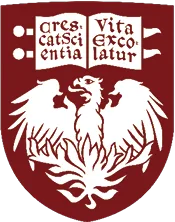
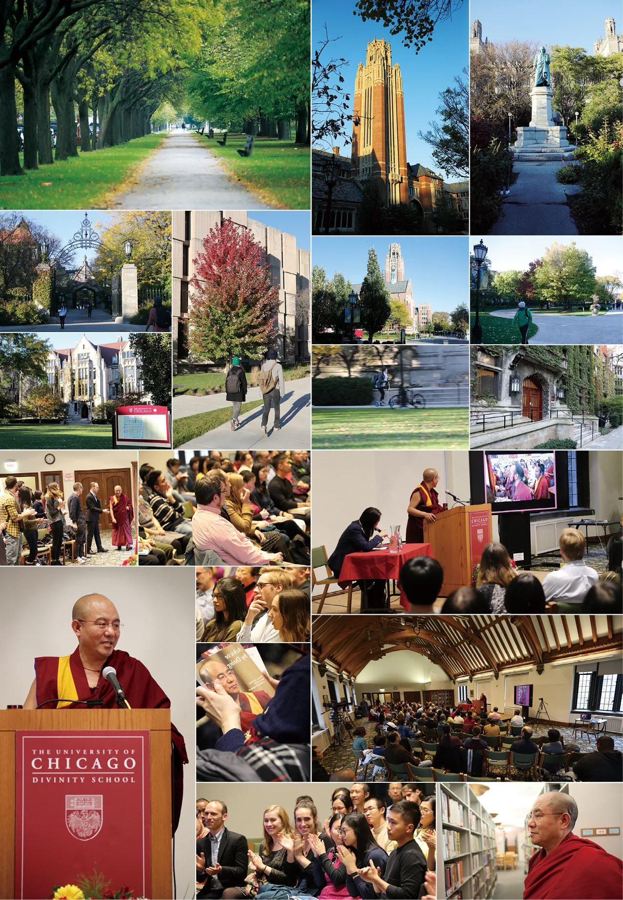
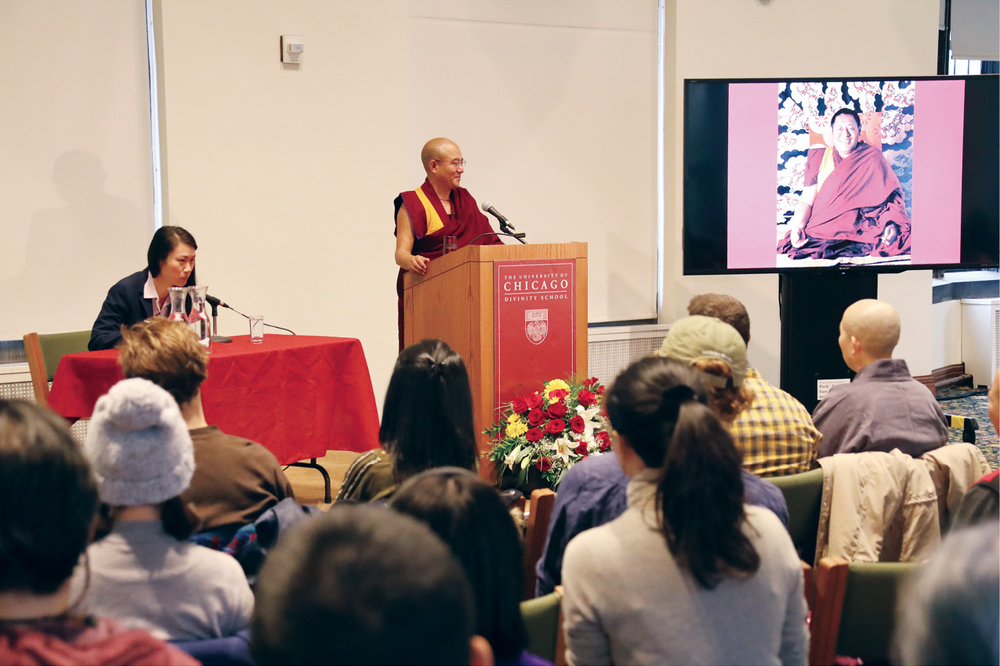
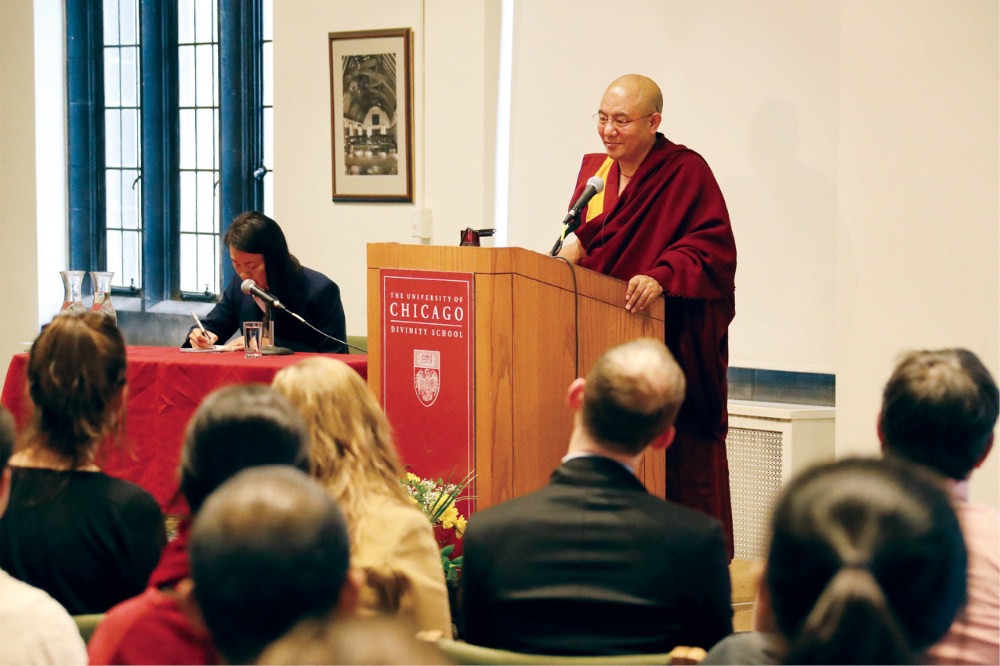
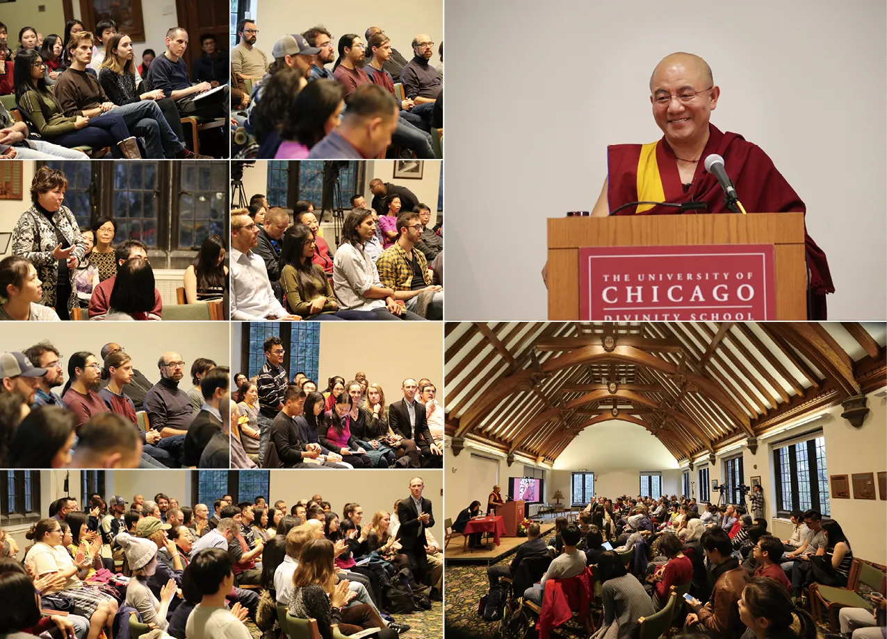

单坚阿拉木天喇荣沟，

邬金莲师化身名晋美。

彼于菩萨四众眷属中，

广弘显密教法如明日。

第149场

美国芝加哥大学

The University of Chicago

美国·芝加哥

2017 / 10 / 30

## 现代藏传佛教大德

——法王晋美彭措的生平和著作

## The Life and Works of H.H. Jigme Phuntsok Rinpoche: A Tibetan Buddhist Master in Modern China

主持人：

非常感谢大家参加今天这场非常特别的演讲。堪布索达吉是喇荣五明佛学院的高僧之一，他不远万里来到这里，给予我们今天以及周三的演讲。堪布是佛学院的开创者法王晋美彭措仁波切最亲近的弟子之一。不过，与其由我介绍堪布索达吉，不如请芝加哥大学神学院宗教哲学教授任博克（Brook A. Ziporyn）来进行。

任博克教授：

非常感谢，非常高兴，非常荣幸，能欢迎我们的演讲者堪布索达吉。正如主持人所说，他不远万里来到这里——非常荣幸今天他能来这里。

话不多说，有请堪布索达吉——

首先说明一下，由于找不到适合的藏英翻译，加上现场有部分汉族听众，所以我今天用汉语演讲。一般而言，我在藏地传法时，会用藏语；在汉地传法，则用汉语；但到了西方，由于自己不会英语，常常需要依靠翻译的帮助才能完成演讲，这是一个比较大的困难。若现在开始学英语，自己年龄已高，恐怕来不及了，比较矛盾。

20世纪90年代，确切地说，是在1993年，我跟随法王到过美国、加拿大和欧洲。那个时候我曾发愿，回去以后一定要好好学英语。当时我比较年轻，认真学的话，应该还可以，但回去之后，由于种种因缘，英语最终还是没有学好。

今天给大家介绍我的上师法王晋美彭措。这次演讲的缘起是这样的：弗吉尼亚大学以前有一位教授，名叫大卫。这位教授大概在1992年来过我们佛学院，后来他在自己的书稿里提到了法王晋美彭措。芝加哥大学的教授们在编辑这本书的过程中，很多教授和学生对法王晋美彭措都比较感兴趣。所以，这次特意让我为大家简单介绍一下他的生平事迹。

## 熟悉

法王身上发生的很多事情都很神奇，他整个一生都充满传奇。我接下来要讲的部分内容，有信仰的人，比如佛教徒或其他宗教人士，也许在某种程度上能够接受；不过，没有任何信仰的学术界人士，就不一定了。不管怎么样，希望我所讲的事情能引起大家的思考。

在法王的学生当中，我不是最熟悉他的，也不是最不熟悉他的。我出家的时间是1985年——已经是上个世纪的事了。那个时候，我23岁，他53岁。自从依止了他，我就一直跟随，直到他71岁圆寂为止。

我的人生，大概有19年时间一直追随法王，从未离开。

## 真实

为什么说法王的一生都充满神奇呢？因为用学术界人士的眼光来看，他对佛法的研究、学修和弘扬，尤其是他向世界传递真理的方式和过程，远远超出了普通人的逻辑和想象，甚至与之相违背，相抵触。

在某些东方宗教人士的身上，的确存在着一些世人难以想象的特质。就我个人而言，绝不会对事实进行任何形式的加工与编造，唯有用真实的语言向大家讲述法王晋美彭措的生平事迹。对于他身上表现出来的不可思议的地方，你们可以再三观察和思考。

法王还没有圆寂的时候，我跟佛学院的慈诚罗珠堪布和丹增嘉措活佛，曾为他写过一部传记。写那部传记的时候，我们三个人定了一个原则：所有听起来像神话的原始材料，一律放弃，只记录我们认为非常真实的事迹。为此，我们走访了很多的证人，力求所写的内容全部符合事实。当时是用藏语写的，后来好像被译成了英文和汉文。

那部传记的部分内容，也是我今天将要讲述的。

## 授记

其实，法王晋美彭措的一生，历史上早就有授记。两百多年前，藏地有一位非常了不起的修行人，名叫菩提金刚，藏语叫香秋多吉，他在一个授记里面提道：

“单坚阿拉木天喇荣沟，

邬金莲师化身名晋美。

彼于菩萨四众眷属中，

广弘显密教法如明日……”

这是一个比较长的授记，将法王晋美彭措的名字、此生摄受的眷属、弘法的范围和地点等，全部授记得清清楚楚。

在藏传佛教的传承里，本来是没有比丘尼的，但法王在20世纪80年代摄受了汉地的弟子后，由于汉地比丘尼的加入，他的眷属就圆满具足了四众弟子，也就是比丘、比丘尼、男居士和女居士。关于这一点，授记中也明确提到了。

两百多年前的这些预言，令每一个有缘亲自读到的人惊讶万分，因为实在太准确了。

法王的前一世是伏藏大师列绕朗巴。列绕朗巴曾在所著的一本书里说到他自己未来的转世，讲到他未来的父亲叫什么、母亲叫什么、降生在哪里，等等，很多情况都描述得非常细致，非常准确[^1]，让人不得不惊讶。

## 降生

关于他降生时的情景，我们也采访过很多人。

一般来讲，婴儿的降生总是伴随着啼哭，因为要经历难忍的痛苦，但法王降生时却截然不同。

他降生的时间是1933年，降生的地方叫多科[^2]——后来我们在那里修了一座佛塔。法王降生的时候，身边围了很多人，这些人在世的时候我们都曾采访过。她们都说，法王生下来时，没有像普通婴儿那样啼哭，不但没哭，口里还念诵着文殊菩萨的心咒 “嗡阿Ra巴匝那德”，连续念了几遍。这跟我们普通人的降生确实有很大的差别。

这是他神奇的降生。

## 识字

法王在成长过程中，也没有像我们一样受过小学、中学、大学的系统教育。

大概6岁的时候，他遇到了一件很神奇的事。那一天，他在一堆石头里捡到了一个纸团，上面写着一段藏文。那时他还不认识藏文，就请懂藏文的人帮他读。原来这张纸上写的是“文殊语狮子”的一个修法，修法的后面还写了一句话：“印度圣境一老人，高龄已至九十九，不识文字勤修持，一日得见文殊尊。”意思是说，印度一个老人，99岁了，一个字也不认识，但他只修了一天，就见到了文殊菩萨，从此以后，所有的文字全部精通。

法王知道纸团的内容之后，就想：99岁的人都能学得那么好，我现在才6岁，如果好好地修文殊菩萨，应该也会精通一切。于是，他自己开始念文殊菩萨的心咒。后来，他虽然没有经过精勤苦学，但对于很多文字自然而然就通达了。

我们写传记的时候，就这件事采访过相关的很多人，包括法王原来所在的洛若寺的一些老人。这些老人都一一地向我们证实：法王小时候的学习过程确实如此。

他们还说，法王小的时候特别调皮，经常捉弄身边的人，做出很多意想不到的事情——虽然不会真的伤害大家，但的确太调皮了。他口才特别好，再加上身份比较特殊，有一些事情他们确实没办法应付，所以这些老人当年的回忆里都有这样一条：只要他一来，大家就特别害怕——虽然他人很小，却有很多人怕他。

## 造论

大概在15岁的时候，他造了很多论典，包括《直指心性注疏》和麦彭仁波切的一些修法。这些了不起的论著，都是他15岁时造的。《直指心性注疏》篇幅比较长，我曾经把它翻译成了汉语，当时翻译的风格比较古，文字极为简省，即便如此，也有大概两三百页的内容。

每当我翻阅他15岁造的这些论典时，发自内心地感到稀有。

学习和研究藏传佛教的人可能都知道，藏传佛教历史上还有一位非常著名的大德叫麦彭仁波切[^3]，他所造的《定解宝灯论》，也是在很小的时候完成的。当时的麦彭仁波切只有7岁，一边玩耍，一边随口就唱出了。一位名为仁钦衮波的上师替他记录和誊写下来。

那是一部伟大的论典，被誉为总集显密精要之窍诀藏。我以前学习和翻译过。

不得不承认，有些人的学习和智慧，走的并不是我们普通人的路。在普通人的这条路上，7岁或15岁的年龄，还在学校里迷迷糊糊地混日子，怎么可能造得出论典？即便是造出了，也不一定有学习的价值，后人不一定会看。

## 求学

法王晋美彭措在18岁的时候，前往石渠依止了宁玛巴的一位大师。

这位大师叫托嘎如意宝，法王依止并跟随他学习了6年。法王的住处是一个很小的地方，我以前去过。当时的条件特别特别差，法王每天除了喝一点酸奶以外，基本上就没有其他的饮食了。

求学时期的法王，显现上就是苦行，就是学习，除此之外没有别的活动。

法王在托嘎如意宝那里得到了密法的很多传承，他非常崇拜和感恩他的上师，经常赞叹上师是非常了不起的证悟者、成就者。

东方人依止上师或老师的风格，跟西方人不一定相同。我们东方人，尤其是佛教徒，如果年轻时依止了某位上师，从上师那里得到了真正的利益，那么，他对上师恩德的忆念将是终身不变的。即便到了老年，一提起上师的名字，他还是会流下很多眼泪。

佛教的很多传承都是这样的。

不过，芝加哥大学的同学，年轻时若跟着某个老师学习，得到了老师的悉心指点，多年后回忆往事时，会不会因为感念这位老师的恩德而一直哭呢？我不太清楚。

听说非常出名的顶果钦哲仁波切，到了六七十岁，想起上师时还会经常流泪。法王如意宝也是如此。在他六七十岁的时候，经常想起年轻时依止上师的经历。每次给我们讲述他二十几岁与上师在一起的美好时光，法王总会泪流满面。

也许，东方的很多上师和老师显现上都比较感性吧。

我自己也是如此。父亲和母亲去世的时候，我都没有哭，但是上师如意宝离开之后，在很多场合想起他老人家，我常常会控制不住内心的伤感。

在东方人的观念里，老师和父母对我们的恩德最为深厚，是一个人生命中最值得恭敬的人。中国有一句俗话：“一日为师，终身为父。”意思是说，即使一个人只当过你一天的老师，你在他面前只听过一天的课，那么你这辈子也应该像恭敬自己的父亲那样来恭敬他。

这样的道理，不知在座的各位怎么看？也许你们觉得有理，也许觉得没有理吧。

## 坚持传法

法王晋美彭措在托嘎如意宝那里求学的6年时间里，整个中国大地发生了一些变化。佛教和寺院的情况变得跟以往有点不同，而这时托嘎如意宝又圆寂了，于是法王就回到了自己的故乡。

那是上个世纪50年代末。

后来，在寺院里讲经说法变得不那么方便，寺院的出家人被迫纷纷还俗。一个比较特殊的年代来临了，“文化大革命”即将爆发。

在那样的特殊时期，法王也从没放弃自己的修行和讲经说法。他在一个叫狮堡山的地方，秘密地给弟子们传授龙钦巴[^4]的《七宝藏》[^5]。

有一次，有人好像发现了他们，子弹打到周围的树木上，树叶一片一片掉下来，哗啦啦地落到大家的头上，但法王依然如如不动地讲法。弟子们有些吓跑了，有些胆战心惊地坐着继续听。

在硝烟弥漫中，他们把龙钦《七宝藏》一部一部全部讲闻圆满。

那个时候，身穿出家衣服是不被允许的，法王就把袈裟穿在里面，外面套着在家人的衣服。现在喇荣附近有一个山洞，我曾经跟一位叫绕桑的老堪布一起去过。绕桑堪布告诉我，当年他们几个人出去放牛的时候，法王就会叫他们过去，然后大家躲进一个山洞，静静地聆听法王讲法。为了安全，每次会留一个人在外面放哨，剩下的都在山洞里听法，每天都是如此。表面上看，大家是穿着不同衣服的牧民，实际上一有机会就都聚在山洞里学习佛法。

在这个山洞里，法王给他们讲完了龙钦巴造的《大圆满心性休息大车疏》[^6]。那是很大的一部书，大概有三四百页吧。整个夏天，他们都以这样的方式在山洞里进行学习。

当时，他们的经济条件都不太好。出去放牛的时候，经常只能带一点点酸奶和糌粑。到了中午，每个人都只吃早上带的那一点点东西。下午结束后，就各自把牦牛赶回去。回去的路上还要特别小心，不能让别人发现他们有什么异样的行为，否则的话，个人的处境会非常危险。在如此艰难的环境下，他们完成了一部又一部论典的学习。

其实，诸如此类的故事还有很多很多。在上个世纪80年代到来之前，法王一直没有放弃讲经说法。要么凌晨两三点起来给弟子们讲课，要么白天躲在某个地方，偷偷带领大家一起学习。日复一日，从未中断。

这是一种什么样的日子？没有亲历过的人，恐怕不会真正知道它的含义。而法王把他最年轻最美好的岁月，全部献给了弘法利生事业，坚持了将近20年。

我经常忆念起老一辈修行人的精神——纯净，热情，坚忍，精勤。而自己呢，如今环境如此优越，学习却不够精进，偶尔还会小小地偷一下懒；意志也不够坚定，做事遇到一点困难就想放弃。跟前辈们坚强的意志比较起来，自己真是差了十万八千里！

## 建立佛学院

20世纪80年代初，宗教政策稍微有所开放。喇荣五明佛学院就是在那个时候建立起来的。刚开始只有大约32个人。法王带着这最初的三十几个学生，在佛学院悄悄启动了培养人才的艰巨工程。

当时，佛学院跟藏地其他地方的某些寺院还是有所不同。除了法王以外，还有很多老一辈的高僧大德——现在，他们有的已经圆寂，有的还健在。来自四面八方的人都集聚到这里，和法王一起抓教学，培养后学弟子。

接下来的20多年，依然有各种各样的困难，而大家精勤的学习却未被任何障碍所中断。一大批高素质的佛法人才，包括堪布和堪姆，就这样，在以法王为主的大德们的培育下，渐渐成长起来。

后来，当整个社会的宗教氛围稍微好转之时，喇荣五明佛学院为藏区大量培养并输送僧才的条件已经圆满具备。

## 整顿与改革

在先前的特殊年代，藏地的很多大德，有一部分出国了，去到尼泊尔、锡金和印度等国家；有一部分虽然留下来了，但圆寂的圆寂，还俗的还俗；加上当时很多寺院被一些戒律不清净的人把持着，整个藏传佛教面临着传承断层的危机。

在这样的形势下，法王力挽狂澜，开始在藏地推行大规模的佛教整顿和改革。

整顿进行得并不顺利。由于利益受到损害，很多人纷纷表达对法王的强烈不满，但是法王没有一丝动摇，依然坚定地推进改革。他多次和第十世班禅会面、商量，最终定下藏传佛教尤其是寺院的根本原则：必须守持清净戒律，坚持闻思修行。

这样的倡导，推动藏地许多寺院发生了重大的转变。其转变范围之广，影响之大，就某种程度而言，挽救了整个藏传佛教的命运。

后来，法王的事业越来越大，每次开法会，前来参加的人都特别多。1993年我们来美国之前，在藏地开了一次法会。据相关部门统计，那次法会最多的一场有45万人。后来的好几场，有时候30万，有时候20万。

由于来自藏地各个地方的信众越来越多，法王的影响力也越来越大，越来越深远。

## 观察缘起

早年的时候，有一次，法王对弟子们说：“我的晚年，要么闭关好好修行，要么出去好好弘法。今天就来观察一个缘起。”说完，他开始念很多咒语。然后，他拿起一个什么东西，并告诉大众，如果这个东西落在坐垫上，说明他晚年需要安住，那就一个人好好修行；如果掉在马鞍上，预示着要骑马远走，就是出去弘法的缘起。

最后，他抽到的是马鞍。

于是，从1987年起，法王开始了他的弘法利生事业。先是中国内地，然后是印度、尼泊尔和西方一些国家。从此以后，法王在很多方面和众生广结善缘，事业逐渐广大，直到圆寂。

法王当年如果选择了独自坐禅修行，也许会像现在藏传佛教的一些大德那样，自己虽然有很深的证悟，但绝大多数众生基本上无缘相见。幸运的是，从1986年观察缘起以后，他广弘佛法的因缘逐渐成熟，最终开创了伟大的事业。

## 爱狗的修行人

在我的眼里，法王神奇得好像不是“人”，但他跟我们这些“人”又有一些相同之处。比如，很多芝加哥人喜欢养狗，而法王呢，也喜欢养狗。

在我的记忆里，法王一辈子都特别喜欢养狗。

我刚到学院时，他养的狗叫列维雷，大家都说它像土拨鼠，特别可爱。后来去印度的时候，他带着一只叫布廓的小狗——天天都带着。到美国的时候，也有一只小狗天天跟着。

每次出去坐飞机的时候，我们这些随从最苦恼的是什么呢？害怕他的小狗过不了安检。那时需要办各种各样的手续，很麻烦。而法王在显现上也非常执著这些小狗。所以我们最担心的就是这件事。每当法王接见一些来自宗教、学术等各界的重要人士时，我们又担心这些小狗在显现上不听话，闯下什么祸事。

法王就是这样一个爱狗的修行人。这为他传奇的一生，增添了许多温暖、平易与亲和的色彩。

## 忆念法王

下面我们花两分钟时间，看一下法王的小短片。都是一些简单的场面，有藏地的，也有国外的。这是他们昨天从法王的传记中下载的。希望给大家留下一个大概的印象。

看完短片以后，我再讲一下法王圆寂的过程和他留下的著作。因为时间关系，我会用简略的语言来结尾，最后跟大家进行简单的互动。

（播放法王在国内外的一些场景……）

## 圆寂

2004年1月7日，法王在成都一家医院示现圆寂。

大家都知道，一个人如果在医院死去，一般会比较痛苦和惨烈，但法王在医院圆寂的时候却非常安详。

以前，法王每次出国的时候，我都跟在他身边，但他圆寂的时候，我却不在。我自己也觉得，上师圆寂的时候，自己最好不在。这样的话，心里也许会好受一点。

法王每天早上都要念诵功课，一辈子从来没有间断过。那是一本很厚的念诵文。听说那天早上，法王把厚厚的念诵文念完以后，要求身边的人扶他坐起来，然后就那么坐着，坐着，安详地离开了这个世界。

那一年，他71岁。

他整个的一生，就这样以非常传奇的方式圆满了。

去年，我们写了一本纪念法王圆寂13周年的书，内容分成71个章节，代表他71年的弘法历程。我把这本书翻成汉语的时候，取名叫《不忘》，好像现在也有英文版的，或许以后你们也能看到法王的这些教言。

## 珍贵的遗产

我自己认为，法王虽然离开了，但他为我们留下了非常珍贵的两件遗产：一个是喇荣五明佛学院——现在可能是世界上比较大的一个佛学院。那天我刚到芝加哥的时候说，我们佛学院的夜景跟芝加哥有点像，只不过没有芝加哥夜景绚丽幻彩的高科技味道。

我们那里，漫山遍野都是小木屋，每一个房子都非常小，非常小。以后有机会的话，你们可以去我们佛学院看一看，也许你们会觉得那些小小的红房子比较好看，但不一定能在那里住下来，光是看一看还可以。

法王给我们留下的第二件遗产，是他写下的厚厚的四本著作。这四本著作里，都是特别具有窍诀性的教言。比如：他把藏传佛教所有大圆满的窍诀用简单的语言描述出来，叫《文殊大圆满》；他在尼泊尔取出了篇幅比较简略的一个伏藏法门，叫《项袋金刚橛》，堪称所有伏藏法门中的极简修法；他把《菩提道次第论》和《普贤上师言教》等诸多论典的教言精华进行浓缩，用23分钟写下来，叫《忠言心之明点》。

现在这个时代，人们的身体都特别特别忙碌，心灵也特别特别浮躁。法王的著作里面，有很多简短的快餐式的甚深窍诀，特别适合这个时代的我们。

如果有机缘，希望大家都能去品尝、去享受。

现场互动

主持人：

还有一些时间可以用于提问，这太好了！堪布欢迎你以自己喜欢的方式称呼他。当然，请大声说出你的提问，语言尽量简单明了。

问：请问佛教能为科学带来什么？

堪布：佛教实际上就是一门心灵的科学、认知的科学。

现在的很多科学研究着力于物质，或者说着力于外在的事物，而对人类内心的研究，现代科学不管是仪器设备，还是理论探索，都显得有些力不从心。但是，对我们人类而言，内在的心灵科学和外面的物质科学同样都是需要的，而前者从某种意义上讲更为重要。

因此，我认为，佛教在心灵科学的研究和探索方面对人类有很大的贡献。

问：法王晋美彭措仁波切不仅是一位伟大的学者，就修行而言，也可以说是一位令人尊敬的伟大的成就者。我的问题是，在他的一生中，这两者之间有过区别吗？

堪布：这二者分开来讲也可以。

首先，从学者的角度来看，法王如意宝非常精通因明的辩论，有很多辩论方面的窍诀和知识。他对天文学的研究非常深入，著作里也有关于天文学的内容。今天我们参观的“VR虚拟世界”所涉及的领域，以及银河系和宇宙中一些特殊世界的构成，他都有很深的研究。

此外，他平时摄受弟子的时候，常常轻松自如地和不同领域的弟子谈论他们熟悉的学术话题。从这里也可以看出，法王的学者素养是非常深厚而广博的。

伏藏方面，他还有一些比较特殊的伏藏品，而且数量比较多，包括宝箧、海螺和法本，等等。

至于他的修行成就，这是大家都比较公认的，我就不用再提了。

问：上师您好！现在中国国内不管是藏传佛教，还是汉传佛教，都盛行做祈福法会。您作为佛教的领袖级人物，是否可以在力所能及的范围内，让佛教表面化的趋势有所调整和改变？

堪布：你说得很对。现在很多佛教徒的确特别喜欢灌顶、祈福之类外相上的佛事。

比如说，我们要在一个地方宣讲佛教的道理，不一定有人来听；然而，一听说某个地方要进行灌顶或祈福，大家都奔走相告，特别积极地参与。目前大多数信众的爱好就是如此。

参加法会当然很重要，但多年以来，我不单要求大家参加法会，更要求大家系统地闻思修行，这更为重要。作为一个佛教徒，对佛教的教理和修行的道次第必须清清楚楚，了然于胸，否则的话，我们的信仰只会流于感性，表面上有一点暂时的作用，实际上随时都可能发生改变。

所以，我历来强调，佛教徒必须首先经过长期、牢固的闻思和学习。有了这样的基础，再去参加各种法会，这才是比较合理的学佛次第，大家一定要有清楚的认识。三十多年来，我个人一直在这方面努力，应该说，某些地方还是起到了一些作用。

作为佛教徒，如果完全用个人化的迷信或者冲动来解决问题，可能会导致一些不如法的行为。不过，若是太理性了，一切都用学术研究的方式来处理，也不太合理。

最好是走中道，把二者结合起来。

问：我想知道，您从晋美彭措仁波切那里学到的最重要的东西是什么？

堪布：大圆满。这是我一生最重要的收获。

问：佛法现在已经来到西方。西方的学生有一个共同的困惑：我们想拥有正见和正行，但这必须依靠传承和上师，我们应该怎样建立与传承之间的连接，以及对上师的信心？

堪布：你问了一个非常重要的问题。

东方人跟西方人的思维方式有时完全不同，导致彼此的观念差别很大。佛教强调的信心、传承和上师，也在这个范围内。

我今天上午在“虚拟世界”的时候，有位老师问我：“您为什么看这个？”我说：“诸法都是如梦如幻的，要懂得‘无我’。”另外一位教授说：“‘无我’是不可能的。我们西方不承认这个。”而在东方，一说“无我”，大家都很容易接受。

东方的大乘佛教和密法，都建立在信心和正知正念上面。作为西方的学生，如果你想接这个传承，信心还是很重要的。有了信心，你才可能重视这个法，才可能重视这位上师。如果没有信心，只把上师看作普通的老师，把法看作普通的知识，你的追求心便不会那么强烈，投入的精力也不会那么充足。

我觉得作为一个佛教信仰者，不管是东方人还是西方人，拥有虔诚的信心都是很重要的。我们藏地非常著名的《大圆满前行引导文》——我听说你们芝加哥大学也在讲这部法，刚才有位老师也提到过，这本书里说：有上等的信心便有上等的收获，有中等的信心便有中等的收获，有下等的信心便有下等的收获；如果没有一点信心，便什么都得不到。

所以，不管什么样的人，东方的也好，西方的也好，信心对一个人的修行而言，都是不可缺少的，而且至关重要。

主持人：

堪布的演讲谈到了他和上师的个人关系，我喜欢他的上师晋美彭措仁波切。

谨代表芝加哥大学佛教研究俱乐部以及芝加哥佛教协会：很高兴来自学生自治会的部分赞助，非常感谢！很高兴仁波切能够到来并且给予今天的演讲，让我们向他表示感谢！

[^1]: 列绕朗巴尊者晚年写下了《洛若寺未来授记》，清楚地列出了七项“不变”的标志，以指示人们辨认自己的后世。藏历水鸡年（公元1933年），法王晋美彭措完全遵照这“不变”的预言，诞生在正月初三。父亲叫班德，母亲叫玉措。自降生之日起，法王就具有无伪的菩提心，并圆满具足前世修行大乘道的标志。
[^2]: 即青海省班玛县境内的多科智美曲列。
[^3]: 即全知麦彭降央南迦嘉措仁波切（1846-1912），宁玛巴大师，是藏传佛教历史上的大班智达之一。他以宁玛派的观点诠释佛法，为后人留下了千余种殊胜的法宝著述，在大圆满与中观方面极大地影响了近代以来的宁玛派学者与修行人。
[^4]: 龙钦巴尊者（1308-1364），即全知无垢光尊者。藏传佛教宁玛派最重要的大师之一，被称为雪域三大文殊之一。他系统整理了宁玛派的教法，是大圆满教法的集大成者和厘定者。几个世纪后他以智慧身的方式把龙钦宁提传授给吉美林巴，由此龙钦宁提成为近代弘扬最广泛的大圆满宁提法门。
[^5]: 《七宝藏》是龙钦巴尊者撰写的关于宁玛派教义的七部著作，最早分别写作，后被集结为《七宝藏》。《七宝藏》与《三自解脱论》是龙钦巴尊者以广大班智达派风格写作的重要著作。“龙钦七宝藏”将深广的宁玛派教义作了全面系统的整理和归纳，使其更加系统、更为完备，后成为宁玛派教义的教科书。
[^6]: 《大圆满心性休息大车疏》，龙钦巴尊者所造的“三大休息”之一，乃显密教法之总纲，宁玛巴的菩提道次第论。
