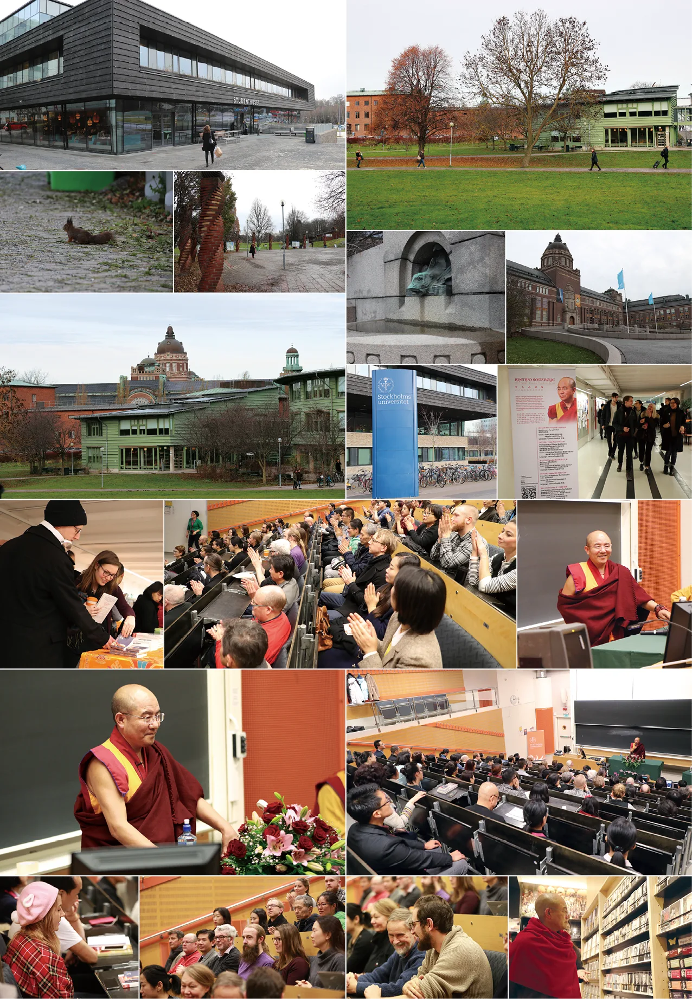
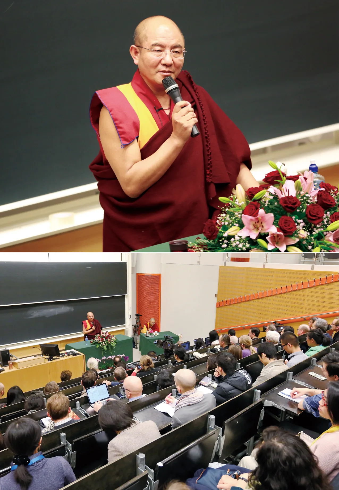

释迦牟尼佛最吸引人的地方，

是他非但不要求追随者因信仰而崇拜他，

反而希望对他所说的话进行观察、思考、鉴别。

第156场

瑞典斯德哥尔摩大学

Stockholm University

瑞典·斯德哥尔摩

2017 / 11 / 24

## 藏传佛教 在当今东西方国家的流行

## The Popularity of Tibetan Buddhism in Present-Day China and in the West

主持人：

我谨代表人类文化、宗教、历史以及性别研究系，欢迎索达吉堪布莅临斯德哥尔摩大学。索达吉堪布于1962年出生于四川藏区。他在系统学修显密佛法后，获得了堪布学位，这是藏传佛教的最高学位之一。我们非常荣幸能邀请到这样一位杰出的嘉宾来到斯德哥尔摩大学。

鉴于堪布对东西方人都有传讲藏传佛教教义的经验，我们非常希望堪布能讲一下藏传佛教在东方和西方的流行有哪些相似和不同之处，尤其是藏传佛教为什么在汉地如此受欢迎。现在有请索达吉堪布上台！

感谢史蒂文森教授和贝特教授为我们创造了这样的交流机会。听说史蒂文森教授在研究《米拉日巴传》的作者——黑日嘎尊者，还在学藏语，这让我很感兴趣，多少有点意外。刚才有幸得到了他的一本著作，很开心。

第一次来瑞典，很美丽的北欧国度。昨天我去Kumla监狱跟他们聊了一会儿，很有收获，今天又有机会跟在座的以及网络上的佛友们交流佛法，很欢喜。刚才几位教授说，看到藏传佛教如今在东西方都很流行，有很多人感兴趣，所以想让我讲点什么。那我就分享一些个人的观点。

我们知道，作为佛教三大语系的传承之一，藏传佛教起源于公元4世纪，吐蕃王拉托托日执政时期，佛像、佛经、佛塔的出现，标志着佛幢的建立。汉传佛教早一些，大约是公元1世纪，以汉明帝建立第一座寺院白马寺为标志。前后差了两三百年。而南传佛教的起源并没有特别明确的记载，几乎可以说，从原始佛教开始，斯里兰卡等地的佛法传承便没有间断。这就是佛教三大传承起源的大致时间点。

那么，按佛历来算，今年是多少年呢？

佛陀在公元前543年圆寂，佛历始于当年（佛历1年）。今年是2017年，543加2017再加1，是2561，也就是说，今年是佛历的2561年。释迦牟尼佛涅槃后，他的教法便逐渐形成了三大传承。到今天为止，佛法不但没有衰亡，而且几乎遍布世界的各个角落，不断有人在学习和修证。

## 西方社会对西藏的早期印象

针对“藏传佛教在东西方的流行”这一主题，我们可以从西方社会对西藏的认识过程开始了解。

有学者认为，西方人对西藏的早期认识较为妖魔化。古希腊历史学家希罗多德（Herodotus，约前480-前425）所著的《历史》（Histories）中讲到了印度北方的“蚂蚁淘金”，而后来的学者们认为，这是对西藏最早的描述，于是便在此基础上研究藏传佛教。但这种观点并不合理，因为《历史》出现于公元前5世纪左右，那时藏传佛教还没出现。

还有些学者说，1世纪的地理学家托勒密（Claudius Ptolemaeus，约90-168）在《地理》（Geography）中提到了西藏，还提到了一座铜色的山，而学者们便认为这座山应该就是莲花生大士所居住的“铜色吉祥山”。这一理论也有待观察，因为1世纪时，藏传佛教也还没有出现，而莲花生大士应该是在8世纪时，受藏王赤松德赞的邀请，才前往藏地弘扬佛法，而且，托勒密所提到的“铜色山”也不一定是“铜色吉祥山”。

《马可·波罗游记》（The Travels of Marco Polo）也在西方人对西藏的印象上造成了一些负面影响。马可·波罗是13世纪的一名意大利商人，17岁时跟着父亲来中国做生意，之后还在忽必烈的统治下担任了一些官职。他的游记写得很好玩，比如说，他提到了会飞的酒杯等。当然，这些也许只是传说。虽然他可能去过西藏，但对佛教的了解还是不太够。总的来说，学者们还是比较严谨的，而马可·波罗的游记只是游记，而且还是他在狱中口述，让别人代笔的。所以，用商人的游记来说明甚至研究藏传佛教思想，恐怕是不妥当的。

## 西方社会与藏传佛教的早期接触

到了18、19世纪，一些西方学者开始了解藏传佛教，这其中也包括了黑格尔、康德（Immanuel Kant, 1724-1804）、尼采等等。但因为西藏地处偏僻，相对来讲比较封闭，而当时的西方学者中，懂藏语的人又非常少，所以，他们对藏传佛教的了解主要是来自印度教和其他宗教人士。因此，恐怕他们大部分都没有真正理解藏传佛教的核心。从17世纪初至18世纪中叶，也曾有很多传教士来到藏地，但他们对佛教教义的理解比较局限，所留下的资料也不是特别可信。

英国作家詹姆斯·希尔顿（James Hilton，1900-1954）在《消失的地平线》（Lost Horizon）一书中也讲了很多西藏的景色和人文，比如碧蓝的天空、山谷、湖泊，草原上的牛、羊、马等等。书里还提到，西藏人非常热情好客，会用最好的食品款待远方而来的客人，而且在金碧辉煌的寺院里，有很多出家人用洪亮的声音来诵经文，等等。虽然很多人在读过这本书后都觉得西藏是一片人间净土，特别向往藏地，但这也只是一种描写，并不能代表藏传佛教的思想。

## 西方开始深入藏传佛教

我认为西方人第一次真正了解藏传佛教的教义和理论是通过《西藏度亡经》（The Tibetan Book of the Dead）。这部经翻译于1919年，并于1927年在牛津大学出版。随后，在20世纪五六十年代，藏地的很多高僧大德纷纷前往美国、英国、法国等国家，也是从这个时候开始，藏传佛教修行人开始与西方人面对面交流，西方大学中逐渐开设了很多藏传佛教的研究机构，也有大学教授前往藏传佛教的寺院实地交流。从那以后，西方学者们为了保护藏传佛教文化，开展了很多学术工作。

与此同时，西方的嬉皮士们也开始对藏传佛教感兴趣，这一点从十六世噶玛巴和创巴仁波切的传记中都能看得出来。

我们在1993年去过创巴仁波切（Chögyam Trungpa Rinpoche, 1939-1987）在北美创建的香巴拉中心，那里有很多人曾是彻头彻尾的嬉皮士，但后来都成了非常虔诚的佛教徒。后来我去英国的时候，也听说了很多类似的故事。即便已经过去了很多年，他们都还能回忆起与创巴仁波切相处的美好时光。

很多西方学者、佛教徒特别热爱西藏文化，尤其是对藏传佛教的教义非常感兴趣，于是积极致力于藏传佛教的保护；有些人以前信仰其他宗教，现在却倾尽全力收集面临失传的藏传佛教文献。

虽然有很多人在不断研究和弘扬藏传佛教，但相当一部分西方学者对藏语以及藏文化还不是特别精通，因此，在研究和保护工作中受到了种种限制，甚至产生误解。所以，我希望大家能学习藏地寺庙里的传统，系统学习藏传佛教甚深的教义，并经常与修行人沟通、交流、互相学习，这将对大家的研究工作非常有帮助。

## 藏传佛教在汉地的弘传

接下来我再分享一下藏传佛教在汉地的传播情况。

实际上，汉地跟其他地方有些不同，他的文化底蕴中本身就有着儒、释、道的信仰。此外，唐朝以来，历朝历代的社会上层、名流中都有人接触过藏传佛教，尤其在元、明、清这三个朝代中，藏传佛教在汉地非常兴盛。

但从上世纪二三十年代开始，汉族人才开始真正从理论上系统了解藏传佛教。当时汉传佛教的能海、法尊等很多了不起的高僧大德入藏求学，并将藏传佛教的许多显密经论译成汉语。

从20世纪七八十年代开始，藏传佛教再次在汉地弘扬，而当前学习藏传佛教的汉人，不管是寺院中的出家人，还是在家居士，都跟以往有着很大的不同。他们对藏传佛教的教义有了更系统、全面的理解。有些学者认为，藏传佛教已经迎来了市场化的新时代，正在成为一门世界性的宗教。我觉得这种观点还有待商榷，但现在信仰藏传佛教的人的确比较多。

而与此同时，汉地也出现了越来越多的假活佛、假上师，乱象丛生。在过去的三十多年中，除了外出期间，我基本上每天都用汉语讲课，没有中断，所以对汉地的情况比较了解。我觉得，现在大部分佛教徒对经论都比以往更加了解，这是一种很好的进步；但有时候看到社会上的各种现象，心里也很不是滋味。

## 在藏传佛教中寻找内心的安乐

在如今复杂、浮躁的社会环境中，有很多年轻人，包括知识分子、演艺明星等，都对佛教非常感兴趣，这是有原因的。总的来讲，不论是佛教还是其他宗教，都有其魅力，而在人心格外迷茫的当今年代，佛教能够帮助人们认识自我，获得内心的安乐，这就是佛教独特的魅力所在。

对很多人而言，一生都在寻找生命的意义，但大部分人却认为，生命的意义在于房子、车子、家庭、感情以及地位、权力、名声……心中充满了对这些事物的向往。而当自己真正获得这一切时，又发现不过如此。世间有许许多多的妙欲，当我们没有享受到时，内心便会有痛苦、烦恼，而享受到之后，又会不满足于此，再次陷入种种负面情绪之中。事实上，这都是心的问题。大家要清楚，我们无法依靠外境来解决心的问题。

有些人似乎拥有一切，而内心并不快乐；有些人虽然生活简单、朴素，内心却十分阳光。法国曾有一位科学家，出生在一个知识分子家庭，家里经常出入一些哲学家、诗人、艺术家、探险家等社会名流。他觉得，这些人表面上是社会上的成功人士，但人性不一定完美，私下里也许是骗子，或者内心充满傲慢、痛苦、绝望。后来，他决定从宗教当中寻找令内心完美的方法。于是，他放弃了科学研究，并依止一位藏传佛教上师。他刚开始依止上师的时候，因为语言不通，三个星期当中都没有和上师有任何语言上的沟通，但他只是看着上师的行为，就被深深地感动了，产生了虔诚的信心。后来，他逐渐对人生有了深刻的认识。

我并非刻意赞叹藏传佛教，只是站在公正的立场上作评价。斯德哥尔摩大学的教授也说，释迦牟尼佛最吸引人的地方，就是他非但不要求追随者因信仰而崇拜他，反而希望对他所说的话进行观察、思考、鉴别。实际上，佛教最大的特点之一，就是以客观事实说服人。

## “理论与修持相结合”是它最大的魅力

我去过很多地方，遇到过很多国家的人，经常会有人问我，藏传佛教为什么有这么大的吸引力？我认为，藏传佛教最大的魅力之一，就是它的理论能够与实际修行相结合。如果你们去了藏地，与修行人接触后就会发现，不管这个人的水平怎么样，他一定会依据理论指导修行。如果信仰仅仅停留在口头上、学术上，恐怕这并不能算是真正的信仰。

佛教徒经常祈求佛陀保佑、观世音菩萨保佑，其他宗教的追随者也经常祈祷上帝保佑……不论你信仰哪一宗教，都要扪心自问一下：“我是智信还是迷信？”倘若没有真正的信仰，那再怎么祈求保佑，也无非是自欺欺人。

藏传佛教中次第的修行、严密的逻辑、清净的传承等，是很多人追随藏传佛教的原因，而相当一部分人都是被藏传佛教中理论与修行相结合，或者说言行一致、知行合一的闻思修体系所吸引。倘若没有扎实的理论基础，只凭借单纯的信心和对西藏的向往而信仰藏传佛教，恐怕这颗“心”不会很稳固。

## 除了远方的景色，精神的富足更加重要

可能是受到各种关于西藏的书籍和影视作品的影响，很多人都特别向往西藏。中国科技大学的一位校长也曾经说，每个人都应该在有生之年去一趟西藏。他还说，西藏的牛羊并没有像在汉地一样被围在院子里，这是藏族人慈悲、关爱动物的体现。

这次在纽约飞往斯德哥尔摩的飞机上，我遇到一个芬兰人。她说，她的梦想就是去一趟西藏。的确，到藏地拍几张照片，看看山水，感受一下藏地纯净的空气和湛蓝的天空，是一种享受，但更重要的是，大家最好能了解一下藏传佛教的禅修以及慈悲的精神。如果能将这些理念带入到自己的生活，前程应该会更加美好。

除了藏传佛教，我也接触过其他宗教、科学等不同领域。我认为，在当今时代，学术理论很有必要与实践相结合，否则，只是站在讲台上玩一些文字游戏，即便语言再优美，自己的心也不一定很堪能，生活也不一定会幸福。

总而言之，我觉得东西方人之所以对藏传佛教感兴趣，大都是被理论与实际相结合的这种净化自心的力量所吸引。当然，很多人也因为其他的原因而来到西藏、信仰藏传佛教，比如有些人喜欢吃糌粑，有些人喜欢喝牦牛奶，还有些人特别喜欢看格桑花……（众笑）

一生当中，最重要的事情是认识生命，这需要智慧的抉择。而智慧，需要通过不断的学习和修持才能获得！

现场互动

问：在您看来，西方人对藏传佛教有哪些误解需要纠正？

堪布：我在演讲中提到了，有些西方人确实对藏传佛教有误解，例如，有人认为藏传佛教中的伏藏是骗人的把戏，西藏人非常野蛮，等等。

有些书中讲了很多关于西藏的负面内容，但了解西藏传统、藏传佛教传统的人都清楚，一些内容根本没有任何根据，许多误解都是道听途说。如果大家能亲自去一趟西藏，相信一定能感觉到，原来，真正的西藏和书中描写有很大不同。

西方有很多人，包括一些研究藏传佛教经论的教授，从没去过西藏，只是从书本里对西藏产生了某种大致的认识，就通过各种方法来批判藏传佛教。这也未免有失偏颇。

问：我觉得藏传佛教离瑞典太远了，我们日常生活中该如何学习呢？

堪布：藏传佛教与瑞典的距离，说远，的确很远，但说近的话，也很近。

今天这场交流，我们藏地的佛学院就在直播。此外，佛学院的有些课程，也有很多瑞典的佛教徒在学习。所以，如果信仰虔诚，距离不是问题。

问：我不是Vegetarian（素食主义者），可不可以信仰藏传佛教呢？

堪布：皈依后不吃肉的观点，主要来自汉传佛教的部分信众。藏传佛教非常赞叹吃素，但并没有强制要求学了藏传佛教就不能吃肉。是否吃肉可根据自己的情况决定。

瑞典的素食主义者特别多，这一点出乎我的意料。我以前在一些资料上看到，很多瑞典人为了健康、环保、保护动物，从而选择成为素食主义者，来到这里后，我对这一点有了切身的感受。既然你生活在瑞典，做一个素食主义者应该是很方便的。如果实在忍不住，也可以偶尔偷偷地吃一点。（众笑）

问：我从事明朝儒学方面的研究，主要关注与王阳明和泰州学派相关的问题。我发现，儒教里有一种仪式叫做“七日闭关”，也就是连续七日里隐居、闭关。我感觉他们应该是受佛教，也许是受藏传佛教的影响。请问在16世纪，藏传佛教中是否有这个传统？

堪布：我对王阳明的著作很感兴趣，他很有智慧。其实，七天的闭关，或者说七天的连续念佛等等，在佛教中比较常见。比如《佛说阿弥陀经》当中就提道：“若有善男子、善女人，闻说阿弥陀佛，执持名号，若一日、若二日、若三日、若四日、若五日、若六日、若七日，一心不乱……”

事实上，“七天”不仅仅是佛教的说法，它更是一种天地运行的规律。基督教也是将七天划分为一个时间单位，也就是一个礼拜。在藏传佛教的密宗中，以七天作为一个修行的节点，在此基础上可以将七天、十四天、二十一天作为修行阶段。释迦牟尼佛降生后也是在大地上迈了七步，说：“天上天下，唯我独尊。”在天文学（星宿）当中也会把七颗星星作为一个单位。此外，世间还有“轮王七宝”，全部聚集后就能对天下人的福运非常有帮助。而人死之后，也会在七七四十九天中处于中阴身状态，然后才转生于下一世。

问：我在博士研究中注意到，很多西方学者都把佛教中“正念”这一概念传播到西方，用于提高专注程度，以及不带评判地保持觉察等等。此外，还有很多其他的佛教概念被引入到医学、经济、商业等诸多领域。可以说，佛教概念在当下生活的方方面面都非常流行。您觉得，我们怎么样借助佛教理念，帮助人们在繁忙的生活状态当中调心，开启内心的智慧呢？

堪布：能够在博士研究期间对“正念”有所分析，这一点非常好！

佛教中有一部特别重要的经典叫《正法念处经》，其中讲到了“四念处”的道理，也就是身念处、受念处、心念处、法念处。“四念处”能帮我们了悟“无我空性”的万法实相。

你刚刚提到了专注力，这是指我们的心专注于某个地方。其实，不管是科学研究中还是日常生活里，我们都应该让心静下来。不知道瑞典有没有经常禅修的人？其实禅修真的很重要，如果大家有一些这方面的境界，生活会很有营养、有价值。

现在iPhone X卖得特别火。很多人认为，乔布斯最初能开发出苹果手机，与他禅修的习惯密不可分。所以，大家最好能在生活中试一下禅修。

问：我个人曾经学过一些佛经，还有《圣经》。在佛经中提到“末法时期”，而现在的人越来越自私、暴力，恐怖袭击也到处都在发生，我们对此还需要再忍耐多久呢？此外，最终是神厉害，还是魔厉害？

堪布：所谓的“末法时期”，指的是佛法隐没的阶段。释迦牟尼佛的佛法住世期，可分为果法期、证法期、教法期以及像法期。现在果法期和证法期已经过了，我们正处于教法期，而之后的像法期还要持续五百年。因此，按照大乘佛教的观点，我们距离真正的“末法”还有一段时间。

只不过人们经常在形容众生业力深重、烦恼深重、难以度化时，喜欢用“末法时期”来表示，似乎佛法趋于隐没，就像下午的太阳。但有时它是一种略微夸张的说法，实际上法还没有“末”，还有希望。

关于神厉害还是魔厉害，事实上，如果你的内心经常处于快乐、调柔、幸福中，说明神更厉害；但如果你的心中经常充满嫉妒、愤怒等情绪，甚至伤害其他人或动物，那对你而言，魔就比较厉害了。
