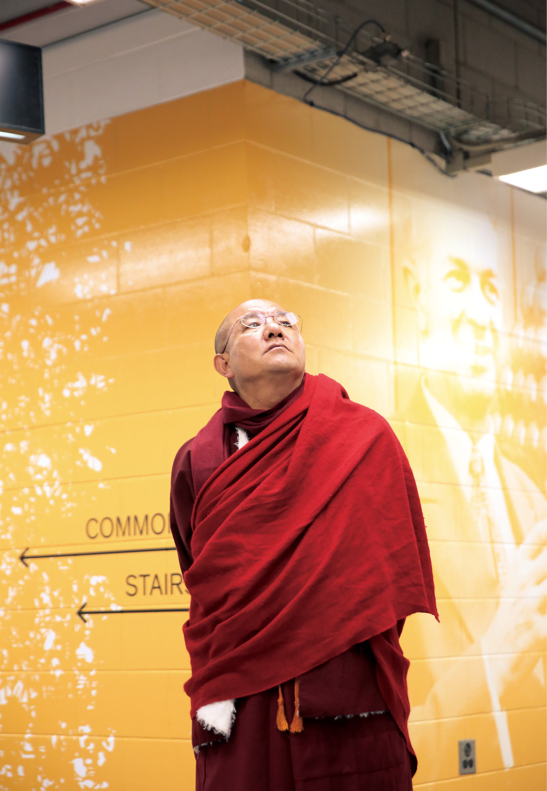
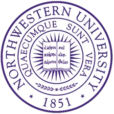
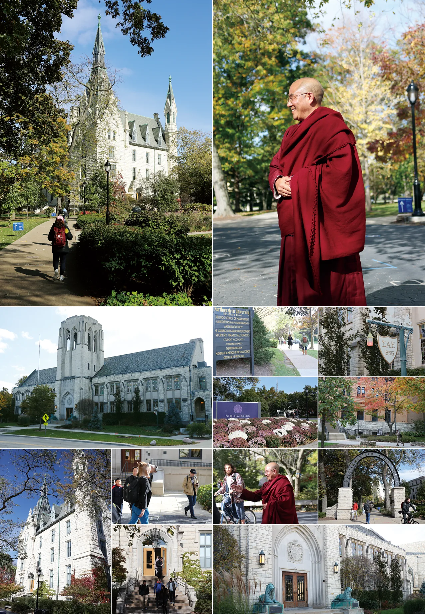
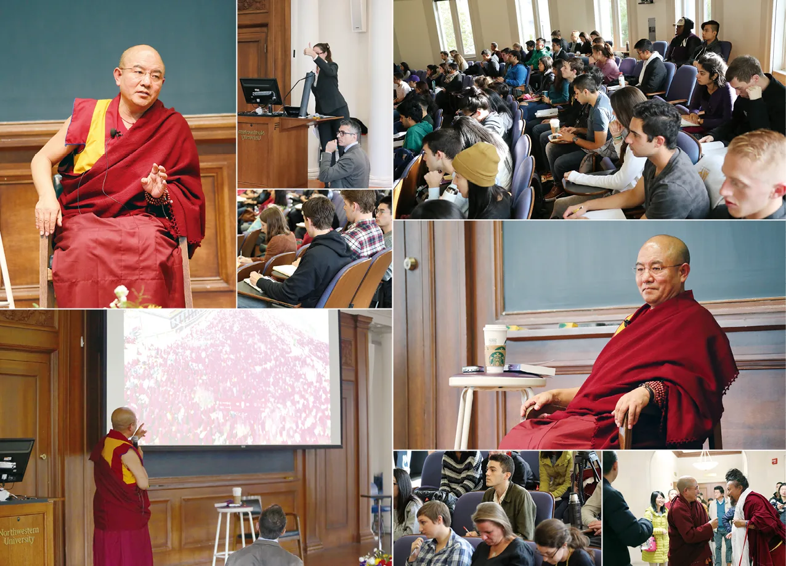
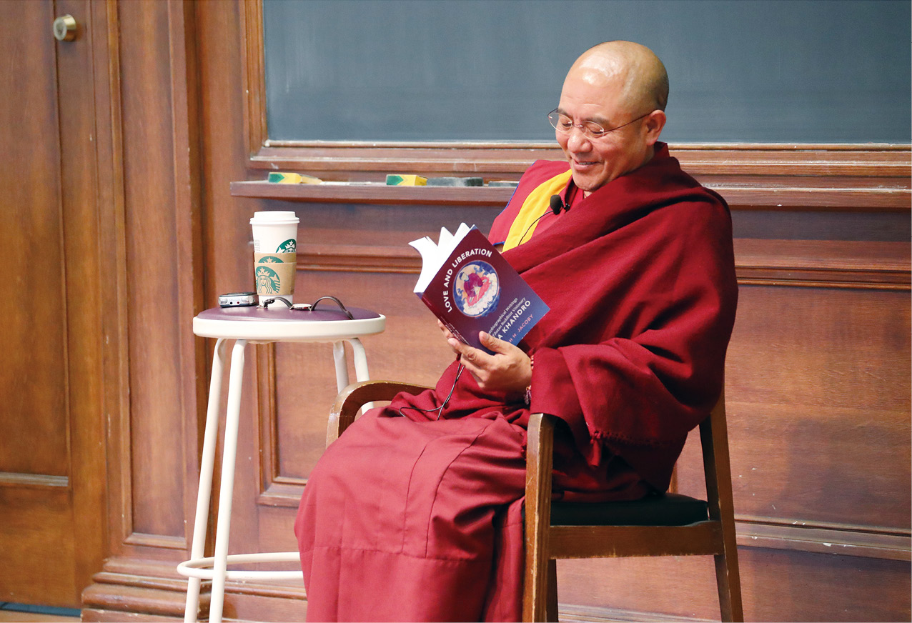
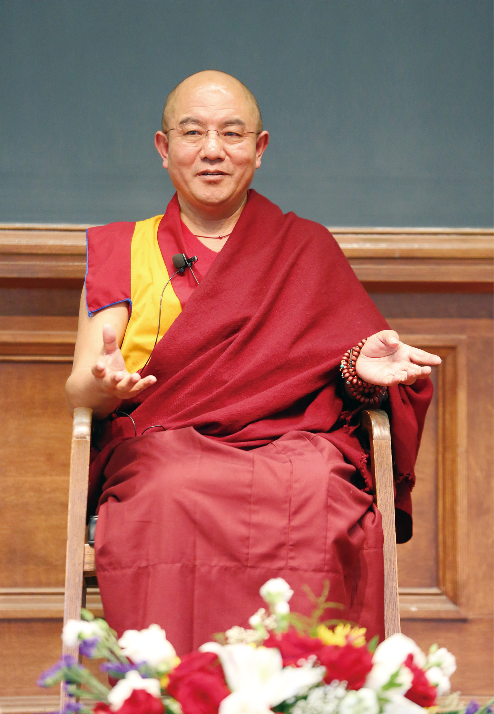
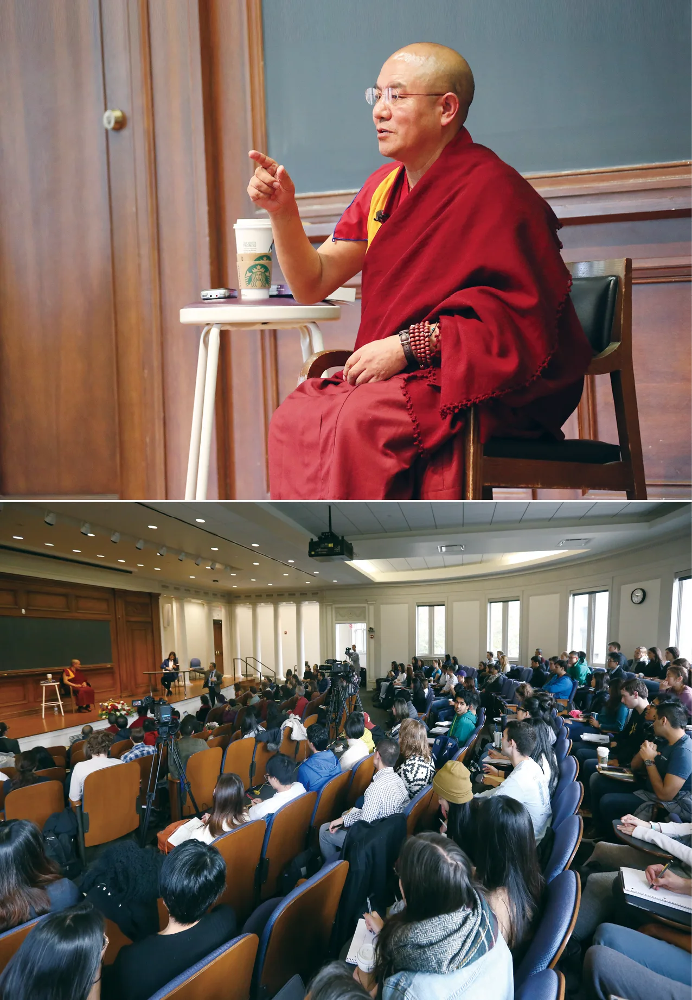

宗教的有些内容非常奇妙，

一定要在有了实修实证以后才能感受到。

第150场

美国西北大学

Northwestern University

美国·芝加哥

2017 / 10 / 31

## 藏传佛教的现代性

## Modernity of Tibetan Buddhism

主持人：

今天，我们很荣幸地邀请到一位特殊的客人，来给我们做关于藏传佛教现代性的讲座。之所以特殊，是因为我们的客人索达吉堪布是中国当代藏传佛教最杰出的大师。请大家把自己的笔记本电脑关上，收起手机。

让我们一起欢迎索达吉堪布——

今天我用汉语演讲，因为要找一个既懂藏语又懂英语的翻译有点困难。

首先感谢莎拉教授。刚才她给了我一本卫萨空行母[^1]的传记，那是她的著作。作为一个西方学者，她能写出藏传佛教女性大德的传记故事，我发自内心地欢喜，同时也感到非常惊讶。

听说我们西北大学有好多老师和同学在研究藏传佛教，对米拉日巴尊者的传记很感兴趣，想要学习，希望我以米拉日巴尊者为代表，分享一下藏传佛教的现代性。今天的时间很短，我就简单地以米拉日巴尊者的传记为线索，结合自己的所知、所想，跟大家分享一下这个话题。

## 是历史，而非神话

很多年前，我在中学的时候，就读过米拉日巴尊者的传记。当时非常感动，经常流泪。在座的很多同学在学习这部传记的时候不一定会流泪，因为你们的学习方法，跟我们藏传佛教的“学术研究”方法可能有点不同。

在藏传佛教历史上，米拉日巴尊者是一位非常特殊的人物。《米拉日巴传》写的并不是神话，而是一个真实的历史人物身上发生的真实故事。我看亚洲有些学者在研究柏拉图或者亚里士多德时，经常把他们传记中与现代人的思维方式、生活经验及习惯不太相符的内容看作神话故事。这样的研究方式可能不太合理；如果把这种研究方式用到米拉日巴尊者身上，恐怕也不太合适。

因此，我在这里特别强调一下，大家在学习过程中一定要明确，米拉日巴尊者是一个真实的历史人物，而不是神话人物。他在世的时间大概是1052年到1135年[^2]，距现在九百多年。尊者曾经修行过的一些山洞和他跟玛尔巴罗扎上师[^3]共同生活过的地方，现今依然留存在那片土地上。以后如果有机会，你们可以去拜访一下，也应该去拜访一下。

## 为了证悟，所以苦行

读了米拉日巴尊者的传记，我个人受到的启发非常大。

尊者原来显现上是一个很坏的人，曾杀死了村里几十个人，还把整个村子的庄稼全部毁坏。后来，因为遇到了玛尔巴罗扎，经受住了各种各样的考验，得到了玛尔巴罗扎全心全意的指导。之后，他回到自己的家乡，非常刻苦地修了9年，终于获得成就，证悟了宇宙人生的真相。

米拉日巴尊者的苦行在藏地非常出名，连老人和小孩都知道。他自己曾说：“如果能像我这么努力，即使是一般的世间凡夫，即生也有觉悟的机会。”

他的老师玛尔巴罗扎后来也告诫他：“你是一个特殊的人，我也是一个特殊的人。以后的时代，像我这样开悟的好老师不一定找得到，像你这样能苦行的好弟子也不一定找得到。你以后摄受弟子、传授教法的时候，不能再沿用我们师徒之间的方式。”

米拉日巴尊者依止上师的方法的确比较特殊。不过，在藏传佛教历史上，还有很多这样的例子，比如说龙钦巴依止革玛燃匝[^4]，我的上师晋美彭措法王依止托嘎如意宝。虽然他们没有经过米拉日巴尊者那样的苦行，但是在现在的师生关系中，要找出和他们具有同等求学精神的学生，还是很困难的。现在的一些学生们，刻苦精神和他们当年示现出来的苦行相比，差别还是比较大的。

龙钦巴当年依止上师时，很长时间都没有东西吃，仅靠每天的一颗小丸子维持生命。他全部的财产只有一个牛毛袋子，下雪时就钻进袋子取暖，平时这个袋子既是衣服又是坐垫。正是通过这样的苦行，他最后获得了开悟。

而我的上师晋美彭措法王——好多老师都见过他，他年轻求学时的条件也非常艰苦，常常好几天都得不到食物，但他在饥饿的状态下却取得了特别惊人的学习效果。

其实，在藏传佛教的传统中，一直都比较崇尚为修道而苦行的精神，这跟现代人希求知识的态度有所不同。

我之所以说这些，不是为了宣传藏传佛教，而是因为今天的主题与这个有关，有必要简单提一下。

## 藏传佛教现代性的五大特点

可以这么说，21世纪的今天，就是所谓的“末法时代”，佛教在总体上是比较衰败的。但藏传佛教却似乎不在此列，即使在世界范围内，它也是比较兴盛的，普遍受到东西方人的共同青睐。无论是年轻的大学生，还是年长的老师和学者，如今对藏传佛教特别感兴趣的都大有人在。

为什么会这样呢？原因当然很多，下面我就为各位稍微展开讲一下。

佛教最初诞生于印度，后来逐渐传入不同的国家和地区，目前大体上分为三个传承：一个是南传佛教，从印度本土向东南传入斯里兰卡、缅甸和泰国等地；一个是北传佛教，即向北传至中国汉地、韩国和日本等地；藏传佛教涵盖的地域除了西藏，还有蒙古，以及东南亚和印度。佛教虽然起源于印度，但现在印度的佛教基本上以藏传佛教为主，闻思修行均承袭了藏地的传统模式。

藏地处于青藏高原，那里人烟稀少、空气稀薄、气候恶劣。这样的生存环境让人望而生畏，但是它的文化——藏传佛教，如今却在全世界受到普遍的欢迎。

如此强大的生命力，它的源头在哪里呢？我认为有以下几个方面：

### 1．恭敬老师

藏传佛教在修行上最强调什么？学生要恭敬自己的老师。

当年米拉日巴尊者依止玛尔巴时，不管老师叫他做什么，他都老老实实去做，而且毫无怨言。玛尔巴总是让他修房子，修到一半又让他拆。于是，他修了很多房子，也拆了很多房子，一次又一次地白辛苦，却依然对老师保持着恭敬和顺从的态度。

现在的学生，恐怕对老师很难有这样的诚服心和恭敬心。也许，老师对他只是稍加惩罚，他就立刻跑得无影无踪了。

对老师保持彻底的恭敬心，并不是藏传佛教独有的思想，在佛陀亲口宣说的经典中，也有“视师如佛”的教言，强调把佛法老师当作佛一样来恭敬。

这种说法，与你们西方的观念有所不同。但是和你们有所不同，也不一定不正确。我那天看到媒体的一篇报道，说现在美国的很多大学教授都认为，学生应该对老师有恭敬心，不应该因为学生交了学费，就把师生关系定位为“互相交易”。你们西方也有这样的呼声。

其实，对老师保持真诚的恭敬，学生自己的利益会得到最大化。这是藏传佛教在某些方面更具与众不同魅力的重要原因，因为学生从老师那里得到的越多，就越能保证整个传承的优秀。

在其他领域，也有类似的情况。

我们昨天去芝加哥大学的时候，了解了一位名叫费米[^5]的物理学家，他的徒弟就是杨振宁，师徒二人都是诺贝尔奖的获得者。杨振宁每次谈起他的这位老师时，都会流露出深厚的恭敬与感恩之情。

如果能建立一种独传的师徒关系，学生从老师那里得到的知识势必会更多。这样的例子在西方也有，像苏格拉底教出了柏拉图，柏拉图又培养了亚里士多德。德国的很多哲学家，包括尼采（Friedrich Nietzsche, 1844-1900）和弗洛伊德（Sigmund Freud, 1856-1939），都有各自权威的老师，都是站在老师们的肩膀上，为自己开拓出更为广阔的学术领域的。

这一点，可能需要引起大家的思考。

佛教认为，老师比本尊和佛还重要。“修十万本尊，刹那念师胜”，意思是说，我们修十万个本尊，不如一刹那间忆念上师的功德大。

所以，如果我们想学习佛法，就应该把上师放在非常重要的位置。

这个道理其实很简单。不管学哪一门知识，如果把老师放在重要的位置，认为他德才兼备，能力超群，我们从他那里获取的知识和学问肯定非常多；相反，如果把老师看成特别低劣的人，认为他说的全是骗人的假话，那么，不管他给我们讲什么课，我们都一定不会有什么收获。

在老师面前，学生的心有多开放，收获就有多丰厚。

### 2．逻辑性强

藏传佛教具有非常严密的逻辑性。

佛教博大精深，涵盖了所有的知识领域，包括21世纪的人文科学、自然科学和社会科学，等等。对现代科学涉及的人与人之间的关系、人与动物之间的关系以及人类内心世界的方方面面，都阐述得非常清楚。可以这么说，上至天文，下至地理，佛教无所不包。

摄集了这么多的现代科学，佛教的逻辑性与科学性就成了一件必然的事。具体来说，佛教的逻辑性与科学性重点体现在研究方法和求证过程的极为精严与缜密。在座的各位有很多在研究佛教，对这一点应该有所体会。

佛教内部有一句名言：“不站在佛陀这边，也不站在别人那边，谁说的是真理，就站在谁那一边。”这是佛弟子选择导师的标准。对此，佛陀怎么说呢？他这样告诫弟子：“对我的教言，你们要像锤炼金子一样反复观察。如果发现了错误，就不要接受。”在佛教群体内，无论是老师还是学生，都一致强调智慧的抉择，反对盲目的膜拜式接受。

藏传佛教的寺院有很多日常的辩论，鼓励僧人们从各个角度来破斥别人的观点。这是一个充满思辨的环节，目的就是要让大家以理性的方式来锤炼佛陀的教理。在这个过程中，如果你觉得佛陀的教法不合理，过不了你的智慧关，你完全有权利放弃，不必因为他是佛陀或上师就全盘接受。

我希望大家有机会的时候，亲自到藏传佛教的辩论现场去看看。那里总是非常热闹，非常激烈，又非常精彩。辩论双方都毫不客气，专挑对方观点的毛病，以敏锐的智慧直接攻击；如果对方答辩不上，说明观点立足不稳，自己这一方就获胜。这样的辩论，能消除大家对正理的种种怀疑，树立对佛理的坚定信心，所以非常重要。

为什么现在有这么多人喜欢藏传佛教，尤其是中国汉地和西方的学生与学者？以上是我讲的第二个原因，藏传佛教的逻辑性比较强。

这一点，我认为，也值得西方学者用自己的智慧去好好观察。

### 3．具有系统性与次第性

具有系统性和次第性的闻思修行，可能是藏传佛教的一大特点。

大家都知道，佛教经论数量极多，数不胜数。藏传佛教中，光是《大藏经》就有一百多函，论典还有两百多函，各教派高僧大德留下的著作更是浩如烟海。昨天我去了芝加哥大学的东亚图书馆，发现里面藏传佛教的图书也特别丰富。这么多的经论注疏，以我们短短的一生，根本没办法学完。

世间知识也有“百科”的说法，数量极多，但只要把小学、中学和大学的课程完整地学一遍，生存所需的基本知识差不多就掌握了。就像每一所学校都有相对完整的知识体系一样，藏传佛教的各个教派也都有自己独特的学修体系，每一所寺院都有完整的学修课程。从加行的次第到正行的次第，从显宗的教法到密宗的教法，从初学的修法到成佛的修法，全部浓缩在几本书里，一步一步地学上去，步步都很扎实。

举个例子。不知道你们学习过《大圆满前行引导文》没有？这本书看起来非常简单，却涵盖了整个修行的系统和次第。只要学了这样一本书，就知道修行的次第大概是怎么回事了。

藏传佛教的教育，还会分别针对高等、中等和初等层次的学生，实施不同的教学内容和方法。这一点，与现代教育推崇的因材施教的教学风格非常吻合，很好地顺应了当今世界的教育模式。

系统完备、次第分明，这是藏传佛教长久兴盛的第三个原因。

### 4．注重实修和实证

下面讲第四个原因：藏传佛教特别强调实修实证。

这个怎么理解呢？我们的很多老师和同学，对藏传佛教也好，对其他宗教也好，开展的都只是学术性的精神活动，完全是在理论研究的层面上走。

其实，在理论研究的背后还有一条路，也许是大家没有走过的。那就是，对已经通达的理论实地去修持，实地去体验，努力把理论上的境界在自己的心中修出来。这是更为重要的一条路。

藏传佛教的很多僧人每年都会闭关，通过长时间的实修，用自己的心来验证佛陀的法道。我现在所在的佛学院，每年都会全体闭关15天。在这期间，大家都不出门，也不跟任何人说话，坐在各自的禅房里，每天除了吃点东西外，一直坚持修行。在这15天内，每个人都是这样。

不仅我们佛学院如此，藏地各个寺院都非常注重实地修持。好多寺院都分为两个部分，一个是讲学院，相当于我们的大学，主要学理论知识；寺院的旁边一般会有修行院，是专门实修的地方。一个寺院如果有两百个人，那专门修行的修行院一般会有20个人左右。这基本上是藏地每一座寺院的“标准配置”。

不知道你们的学习方式是怎么样的。对于藏传佛教修行人而言，完成理论学习以后，还要进一步修炼，通过禅修观察自己的心，或者让自己的心安住下来，什么都不想。经常进行这样的修行，我们心里的各种痛苦和烦恼都可以遣除，也许还能成为“第二个米拉日巴”。

我们藏地有一位被誉为“近代米拉日巴”的大成就者。他叫白玛邓灯，是1812年出生的，住世72岁。他最初的经历跟米拉日巴的遭遇比较相同，也是原先很富裕，后来父亲和弟弟相继去世，家道衰落，他和母亲沦为乞丐。

一般而言，人都是这样：各方面比较兴盛的时候，大家都恭敬；而在比较衰败的时候，众人都嫌弃。白玛邓灯的家道败落以后，他和母亲受到周围的种种歧视。母子二人过着四处乞讨的生活，非常痛苦。

大概15岁的时候，他遇到一位很好的老师，在他那里求学佛法的真理。后来，他到一座名叫雅拉神山的地方实修了9年。这期间，他的食物跟米拉日巴尊者一样，基本上什么都没有，只能采食山洞外的野菜和青草。经过9年的苦修，他最后真正开悟。

圆寂的时候，他的身体变成光，好像只留下了头发和指甲。他是藏地历史上著名的虹身成就者。当时有很多人不相信，后来藏地非常了不起的学者、高僧全知麦彭仁波切站出来作证：白玛邓灯是真正的虹身成就者。

关于白玛邓灯的事迹，你们可能也有必要去研究一下。

总而言之，对于佛法，仅仅搞好学术研究还不够，一定要自己实地去体验，实地去触证。宗教的有些内容非常奇妙，一定要在自己有了实修实证以后才能真正感受到。

### 5．实用性强

藏传佛教兴盛的第五个原因是什么呢？实用性比较强。

今天这个时代，所有人的生活都非常忙，工作压力都非常大，光靠科学技术解决不了太多的问题。尤其是内在精神世界的问题，很多时候还需要依靠信仰，依靠自己的心灵体验才能解决。

按理说，在人工智能时代，每个人都被日新月异的科学技术包围着，享受着便捷的科技产品，哪有时间去接受佛教？可既然如此，为什么又有那么多的年轻人喜欢藏传佛教？

我认为，再发达的物质文明也不能解决精神层面的问题，所以有机会接触佛法的年轻人，才会放下手中的高科技产品，向佛法寻求打开心灵之门的钥匙。大家都并不笨，非常清楚自己想要什么。如果不能给自己的生活带来利益，谁会平白无故去接受一个陌生的事物呢？

人类精神层面的问题，通过行善，通过禅修，通过念咒……总之，通过佛教的种种方法，会得到很好的解决。而藏传佛教已有一千四百多年的历史，有着非常丰富而实用的调心方法，可以很好地满足现代人的精神需求。

佛教认为，快乐和痛苦，都在于我们的心。如果我们的心变得比较坚强，就可以非常轻松地面对世界，面对生活和工作的任何问题。

现在的年轻人，因为感情的纠缠，因为赚钱的压力，很多都得了抑郁症，非常痛苦。在这个时候，我觉得——我个人的感受你们不一定接受，但这是事实——运用佛教的方法认识自己的心特别关键，特别重要。

一旦认识了自己的心，也就认识了痛苦，而痛苦一定会在你认识它的当下立刻消失。

昨天莎拉教授也问我，为什么我们喇荣佛学院能吸引这么多人？是因为它做慈善、提倡素食或者其他的入世观念，还是另有其因？

我个人认为，这其中的原因，应该与我刚才所分析的藏传佛教的五大特点有关。这五大特点，令藏传佛教在人类的各个历史阶段，都顺应着当时的时代潮流和价值取向，散发出独特的魅力，绽放着夺目的光彩。

在当今这个时代，也是如此。

## 寂静的佛教圣地

接下来，我给大家放一个两分钟左右的PPT。主要是我们佛学院的一些场景，也有其他一些地方的照片。也许大家没有去过藏地，那么就借此机会大概感受一下。

（播放佛学院的PPT，里面有红色小木屋、僧众灌顶场面、大幻化网坛城、极乐法会、辩经现场、听课场面、供灯法会……）

现场互动

问：当今时代，最好的禅修方法是什么？

堪布：这个问题，我从姿势和内容两个方面简单说一下。佛教的禅修姿势，主要是毗卢七法[^6]，也就是七种姿势。

至于禅修的内容，刚开始可以观释迦牟尼佛的像，或者什么都不想，直接安住。这叫做寂止，是佛教最基本的禅修，重点是让心安住下来。寂止修好以后，再慢慢认识自己心的本性，这叫做胜观。

寂止和胜观，是佛教所有禅修中最为重要的内容。

问：佛教常常有一些有利于环境方面的行为，比如拯救动物，然后放到大自然中去。对于一些特殊的物种，这样做会带来更多的生态问题。您是如何协调这个问题的？

堪布：你问的问题很好。

有些佛教徒只凭虔诚心做事，没有关注到每个物种的生存环境，也没有关注到自然保护的问题。以一颗感性而激动的心，不顾放生物种的生活习性而随便乱放，确实会造成不良的生态问题和社会影响。

所以，我在不同的场合，都认真地规劝大家：放生前应该好好地研究一下，看所放的物类到底能不能存活？存活方式对当地环境有没有损害？虽然保护动物是佛教的一个重要理念，但在当前的形势下，保护自然和生态环境却更为重要。我们要以非常理性的科学思维，对每次放生涉及的具体问题进行具体的分析，不能笼统地一刀切。

总体而言，现在很多人的放生行为非常圆满，不过也有极少数人放生的方式不太如法。存在的这些问题，我们需要改正，需要引入新的环保理念和解决方案。

问：佛教对现代科技持什么观点？您觉得它们相互冲突吗？

堪布：现代科技为佛教的传播提供了非常便捷的途径和平台。

在这个充满变迁和可能的时代，我认为佛教应该多运用现代的科技手段，包括各种电子产品和网络技术，让佛教的传播事业不断地发展，不断地提升。

但不管传播方法怎么变化，佛教本身的内容不必改变。我们佛学院学习的课程，一直是佛陀的经论和前辈大德们留下的教义。对一个佛教学生而言，学好这些内容已经足够了。

总之，在现代社会，佛教的传播方法可以采用一些高科技手段，但它的内容应该不必更新。

问：站在西方社会看东方文化，看佛教，看中国，有一种特别的感觉和收获。您觉得我们应该怎样进行互相间的学习？

堪布：21世纪的人类，已经进入了网络化、全球化和多元化时代。

作为一个西方人，很有必要去学习东方的思想。而且现在的学习途径比较多，使用起来也比较方便，因为很多东方的大师在不同的媒体上都有各自的思想传播平台。同样，东方人也有必要学习西方的一些理念。

现在，东方的学生会到西方留学，西方的学生也会到东方留学，东西方的相互学习已经成为一种潮流和趋势。

其实，东方也好，西方也好，佛教也好，其他宗教也好，都应该互相学习。彼此了解以后，大家会找到一个共同的点。围绕这个点，我们也许可以找到一条让所有人都满意的路。

在这条路的尽头，是我们全人类共同向往的和谐、自由和安乐。

## 结语

最后，我还有一句话奉献给大家。

这是米拉日巴尊者留给我们的一句话——不知道你们西方人听了会有什么感觉：

我没有其他的亲人，

内心的觉悟是我唯一的亲人；

我没有其他的敌人，

内心的无明烦恼是我唯一的敌人。

这是一位东方智者的智慧，也是一种非常高深的境界。我希望在座的各位最后都能达到这种境界。谢谢大家！

[^1]: 卫萨空行母（1892-1940），名叫色拉康卓，是西藏历史上罕见的女性大伏藏师，在当代开启了所有女伏藏师所取伏藏中最为著名、传播最广的伏藏集。
[^2]: 关于尊者生卒年份，佛教大百科和日巴百科（Rigpa Wiki）里是1040-1123，噶玛巴网站和维基百科是1052-1135。
[^3]: 玛尔巴罗扎（1012-1097），本名却吉罗追，一生三赴印度，四赴尼泊尔，经历无数艰难，先后依止112位上师，广求佛法，成就巨大。是藏传佛教噶举派的创始人，古代西藏著名的七大译师之一。
[^4]: 革玛燃匝（1266-1343），大圆满成就者，布玛莫扎的化身，龙钦巴尊者的根本上师。而布玛莫扎是大圆满的重要传承祖师，在藏区翻译并传法13年，是布玛宁提在藏区的第一位祖师。大圆满的心部和界部主要由布玛莫扎和贝若扎那传入西藏。
[^5]: 恩利克·费米（Enrico Fermi, 1901-1954），美籍意大利著名物理学家、美国芝加哥大学物理学教授，1938年诺贝尔物理学奖得主，“原子能之父”。
[^6]: 毗卢七法，佛教所传的一套静坐姿势：两足跏趺、手结定印、脊椎正直、颈部微俯、肩臂后张、眼觑鼻尖、舌尖抵上腭。
