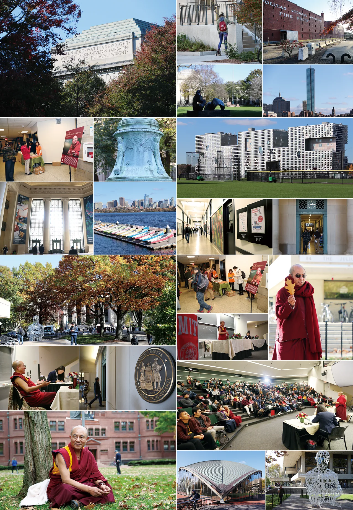
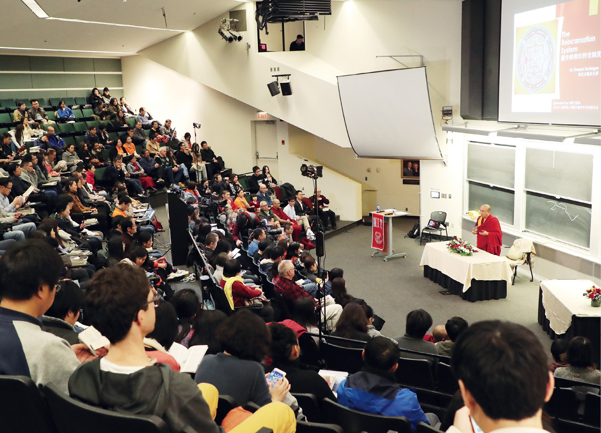
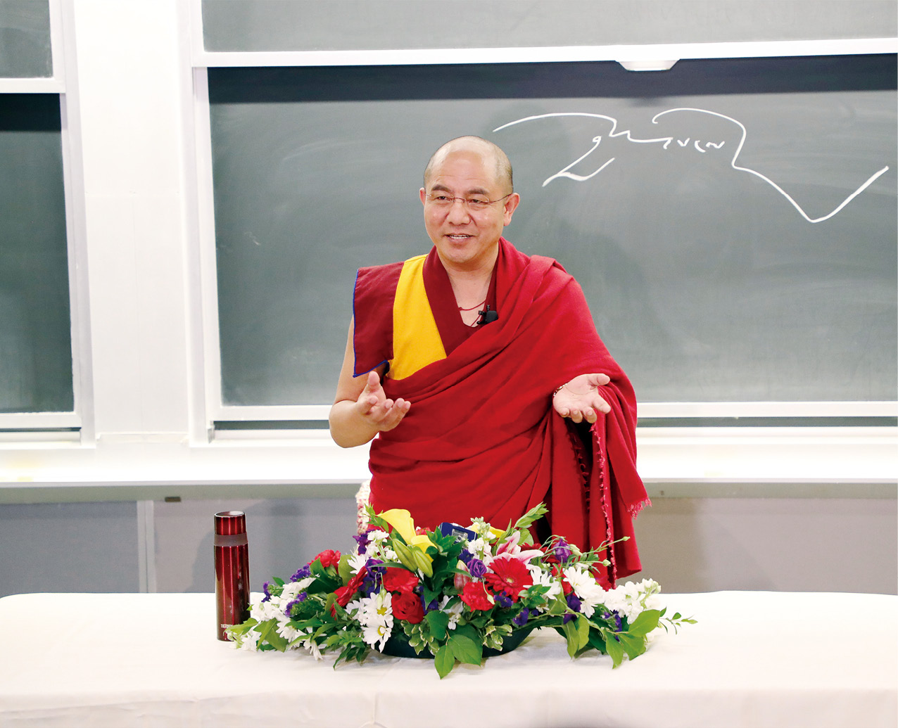

真正的不执著，

是懂得在因上努力，

在果上随缘。

第153场

美国麻省理工学院

Massachusetts Institute of Technology

美国·波士顿

2017 / 11 / 9

## 藏传佛教的转世制度

## The Reincarnation System of Tibetan Buddhism

主持人：

由于在演讲大厅里有中文听众，也有英文听众，因此将会用中英文双语同时发言。

大家晚上好，感谢各位的到来。很高兴今天有这么多的听众。我是麻省理工学院中国学生学者联合会的成员，欢迎大家来到我们的系列演讲“麻省理工说”。在这个演讲系列中，我们会邀请来自世界各地持不同观点的卓越嘉宾们，来为理工学院和波士顿地区的青年才俊们分享他们的想法和智慧，提供思想碰撞的舞台。

今天非常荣幸邀请到了我们非常特别的嘉宾索达吉堪布。索达吉堪布是当代藏地最杰出的佛教上师之一。今晚，他将为我们做关于藏传佛教的，也许是最神秘、最激动人心的演讲，题目是“藏传佛教的转世制度”。

话不多说，让我们欢迎上师索达吉堪布——

很高兴今天能有这样一个机会，跟麻省理工学院的老师和同学相见，就“藏传佛教的转世制度”的话题做一个简单的交流和解读。

我23岁就出家了，从此一直穿着这身衣服。除了晚上睡觉以外，这红色的僧衣从未离开过我的身体。我就是以这样的身份，在海拔4000米的高原，不断地学习、研究和修行藏传佛教。

我人生的大多数日子，都是在那片雪域高原度过的。

这几年，虽然偶尔会走出高原，到外面的世界进行学习和交流，但以后的岁月，可能还是要彻底回归，回到那个海拔4000米的地方，以隐居的方式走完人生最后的路。

这是我的梦想——不是踏遍世界，而是安住静处。

你们是理工学院。我以前也去过一些理工学校。这类学校给我的感觉似乎是实用主义的气息比较浓，对佛学或带有神秘感的知识不那么有兴趣。但我刚才小范围地遇到了你们学院的一些同学，才知道这里也有人以开放而特殊的心态研习宗教。这出乎我的意料，也令我感到高兴。

## 转世：幻化的身体

今天晚上的话题是“藏传佛教的转世制度”。下面我就跟大家分享一下这方面的内容。

其实藏传佛教本身没什么神秘的，世界上却有很多人把它当作特别神秘的知识；藏传佛教的修行人原本也没什么神秘的，也有很多人把他们当作特别神秘的人物。

正因为这样，我不管去哪里，心里都会想：别人肯定把我当作一个“怪物”。时时有这样的压迫感。实际上，我说话也好，吃饭也好，学习也好，很多方面和大家都是一模一样的，并没有什么特别和怪异之处。

大多数人认为，我们现在提到的转世，就是汉地经常讲的转世活佛。其实，“活佛”是后来有些人加上去的，最初这两个词并没有合用。

转世的真正意义是化身，即幻化的身体。

一些台湾人或西方人把转世叫做“祖古”，“祖古”是转世的藏文音译。在英文和汉文里，经常用“祖古”来代替“转世”，把转世的人叫祖古或者活佛。

去年有一段时间，流传着一种比较夸张的说法，说是北京某个地方有30万活佛。这的确有些夸张，但有些媒体的确是这样爆料的：藏传佛教的很多转世“祖古”都纷纷到了汉地。

也许在座的很多学生比较好奇：关于转世，我的口中会说出什么样的话来——你们藏族人的祖古到底是什么？活佛到底是什么？

我也比较好奇：关于转世制度，你们究竟想知道些什么？

刚才就这个问题问学生联合会的主席，他说大家可能对藏传佛教的神秘比较感兴趣，而转世制度似乎最能代表这种神秘。

昨天，我们在哈佛大学听到一位教授说：在西方，非常规矩的修行人不一定特别受欢迎。不过，只要宣传做得好，大家也会对他产生好奇心。看来神秘有时也是一件好事，可以提升关注度。

藏传佛教的转世制度确实有着非常悠久的历史。在这种制度下所产生的转世现象，有着非常好的一面，这是不可否认的。事实并不像某些人认为的那样：“所有的转世制度都应该被废掉，因为它是专门欺骗老百姓的政治手段。”这一类说法，我觉得有点儿过度批判的味道。

但也有些人认为，只要得到了祖古证书，或者说只要被寺院认定，举行了坐床仪式的，以及经常被人们称赞的活佛或祖古，就一定是真正的化身。这也是不一定的，也许有证书、坐过床、被称赞的并不是真正的化身，真正的化身反倒是深藏在寻常百姓中的某个普通人，我们不一定看得出来。

转世是一种非常奇特的现象，很值得我们通过学术或宗教的方法进行深入的研究。

从广义上讲，祖古或者活佛有四种：

一、殊胜化身，特指为利益众生，以佛的身份出现于世的化身，比如释迦牟尼佛。

二、工巧化身，比如我们造作的佛像、唐卡和佛塔等三宝所依。

三、种种化身，可以是各种各样的人，各种各样的动物，甚至可能是桥梁、医药等，凡是对众生有利的事物和现象都可以归于此类。

四、调众化身，也就是佛在六道利益众生的各种幻化形象，比如在动物界化为动物的形象，在饿鬼道化为饿鬼的形象，在地狱化为地狱众生的形象，在天界化为天人的形象。包括在我们人道，化为国王的身份、大臣的身份、军人的身份等，各种各样的身份都有。只要能利益众生，佛可以变成六道中任何一个有情众生的形象。

从这个意义上讲，所谓的活佛或祖古，谁都可以自冠其名，每一个人都可以去办一个“活佛证”。

## 转世的存在，由来已久

现在很多人认为祖古是藏地的“特产”，是藏传佛教特有的现象和制度。实际上，根据佛教的教义，并非只有藏传佛教才有转世之说。

释迦牟尼佛在世时，身边有一个离车子家族的童子，佛陀亲自授记说：“我涅槃后四百年，你将在印度南方转世为一位名叫龙猛菩萨的比丘。”“南方碑达国，有吉祥比丘，其名呼曰龙，能破有无边。于世弘我教，善说无上乘，证得欢喜地，往生极乐国。”这个授记的原文载于《楞伽经》。

此外，佛陀在《大法鼓经》[^1]《文殊根本续》[^2]等经典中也说过：佛陀圆寂四百年后，这个童子将会在印度南方碑达国，转世成一个叫龙猛的比丘；当佛陀的教法在世间出现各种争论时，将依靠他的智慧来破除邪见，他自己最后会往生极乐世界。

可见，佛陀在世时就有“四百年后转世”的案例。不止是龙猛菩萨，佛教历史上还有很多很多这样的转世认定和预言。

转世的道理，在南传佛教中也可以找到依据。当年佛陀接近圆寂的时候，阿难尊者还没证得阿罗汉果，所以特别痛苦，哭得特别伤心：“佛陀要是走了，我们怎么办——以后怎么办？将来怎么办？”

于是佛陀在大众中讲道：“阿难莫哀伤，阿难莫哭泣，我于未来时，化为善知识，利益汝等众。”[^3]意思是说：阿难啊，你不要伤心，也不要哭泣，我会在未来的时代变成善知识，以各种各样的身份和形象，给你们讲经说法，引导你们，利益你们。

这个公案在佛经中有明确的记载，每个人都可以去查证。

到了莲花生大士时代，藏地也出现了很多转世的公案。国王赤松德赞的女儿莲明公主十几岁时，本来已经死了，莲花生大士通过加持让她复活，然后给她讲经说法，在她的心中埋下伏藏法门[^4]，并授记她将来会转生为龙钦巴[^5]。

大概五百多年以后，从第三世噶玛巴开始，藏地建立了比较完备的转世活佛制度[^6]。新制度下的转世认定方法跟以往有所不同，尤其是高层的活佛，需要经由一套特殊的制度和程序来认定。

藏传佛教所谓的转世，不一定都是佛，也不一定都有很高的境界。一个人如果通过长期禅修获得了一定的境界，由于此生事业未竟，下一世依靠自己的修行能力转生为原来的身份，继续完成未完成的事业，这个人就可以称为祖古。

也就是说，凡是前世修行有所成就，今生乘愿再来，在人间行持善法、普度众生的修行者，都可以叫转世。

平心而论，藏地的转世是不是每一个都千真万确、纯洁无瑕，我不敢断定；尤其是现在，有些所谓的转世，背后可能会有地位的交易，也可能牵涉到金钱和财富。

大家都知道，人一旦有了地位和金钱，他能染指的很多制度就有可能变得复杂。所谓的民主制度在某些时候也会变味——某个人本来是不该上来的，但结果还是上来了。实际操作中，各种情况都会发生。

转世制度也同样如此。

## 转世活佛身上的奇迹

然而，站在公正的立场看，藏传佛教的一些转世活佛身上，确实有许多不可思议的奇迹。他们对自己前世的智慧、悲心、性格以及事业，自然而然就能回忆、苏醒。这种现象不但存在，而且比较普遍。

我自己就亲眼见到过我的老师——堪布晋美彭措身上的很多神奇之事。

需要特别说明一下，我本人绝对不会用谎言来赞叹自己的老师。我们佛教内部有句非常深刻的教言：对自己的老师以谎言进行赞叹，无异于诽谤。

1990年我们去尼泊尔的时候，在一个山洞里，老师前世的伏藏法门——以智慧留下来的著作，自然而然就从心里显现出来。于是他滔滔不绝地宣说，我们就在旁边拼命记录。他的著作中有很多就是这样即兴口述而成的。

我们去五台山的时候，当时的灌顶仪轨和文殊菩萨的修法仪轨，他也是一气呵成，超速完成的，根本不用打草稿。而且他一旦写出，终生都不会忘记。他给我们留下的伏藏和作品中，有些跟他前世的著作有关，有些是他即生从证悟智慧中直接流露出来的[^7]。

所有这些，都是我们常人难以想象的。

没有亲眼见到的人，可能会觉得不可思议。一些没有信仰的人，甚至还可能认为我在撒谎，所以我没法解释。解释也没用，他们不一定会相信的。

我看到过一位名叫马修[^8]的生物学家和哲学家所讲述的关于转世的事情。你们有些人可能也见过他，我是去年在法国见的。他曾经是非常厉害的生物科学家，出版的《动物的迁移》（Animal Migration）一书，至今是这个领域的重要书籍。

马修在自己的一本书里说：顶果钦哲仁波切的转世在3岁时，大家为他举行了特别的认定仪式。他非常惊讶地发现，这个3岁的转世确实是前世的顶果钦哲仁波切，因为他在分发加持品时，能一个一个地叫出从不丹赶来的所有弟子的名字！

我不知道这位小小的转世活佛将来会变成什么样，我提这些也不是为了赞叹他。但马修在书里的确是这样写的，而他是一个科学家。

藏传佛教的转世活佛，从寻找、认定灵童开始的整个过程，有时会非常奇妙，非常特别，非常稀有。这些都是事实，恐怕谁也没有办法否认。

我并不是要在这里建立所有转世制度的合理性，但也不会否认这一切。我们应该站在公正的事实立场进行评判。

## 批判，不能只有态度

我知道你们西方很多年轻人是所谓的批判主义者。所谓的批判主义，我也了解过，有时候好像比较反感——因为什么都要批，有道理也批，没道理也批。

我赞叹真正的批判精神，因为真正的批判需要创意，需要智慧，需要丰富的想象力。在封闭和观摩式教育下成长的孩子，是没法拥有批判精神的。

但我不赞叹没有道理的批判主义，因为没有道理的批判是不合理的，不合理的批判就是天大的错误。如果没有任何道理，只是一味地用强烈的态度表示反对，那算什么批判？恐怕只能算“批斗”。

我知道，从上个世纪七八十年代起，美国的很多学校开始奉行批判主义的思想。很多华人和其他国家的学生到这里学了两三年之后，回去就对所有的传统文化，甚至对父母的很多行为都看不惯，一直批判，批判。

这种否定一切的批判到底合不合理？可能还需要观察。

我也看过一些西方学者的批判。他们都有一个共同的原则，是什么呢？作为一个批判者，自己的智慧必须非常成熟。只有这样，发出的批判才能真正做到有理有据，合情合理，让人心服口服。相反，如果缺乏相关的知识背景，阐述的观点没有任何道理，破又破不了，立也立不起，这种情况下，真正的智者是不会站出来“批判”的。

有些学校的老师一直鼓励学生，只要你会说“不”，敢说“不”，批判的能力就会慢慢得到提升。但这是不一定的。批判的能力可不是光会说“不”就能提升的，还需要长时间的智慧积累和沉淀。

西方的批判主义跟东方的辩论思想有很多地方不同。藏传佛教的寺院每天都有辩论形式的佛法交流活动。僧人们在互相辩论时，必须要有说服对方的底气才可以开口，否则的话，光是在那里强调自己的观点和立场，却拿不出任何真实的理由，一定会受到辩论规则的惩罚。

以上说法可能也带有一点批判性。你们如果认为我说的不正确，欢迎在后面的互动环节狠狠地对我进行批评和“批斗”。

## 黑格尔和尼采，都误读了佛教

关于藏传佛教的转世制度，黑格尔（Georg Hegel, 1770-1831）在有些文章里认为“不合理”。他的理由是，既然是某个人或某个喇嘛的“转世”，那就应当是神，而神与人不可能合而为一，因为这两者是互相矛盾的，所以，转世只是一种欺骗的手段而已。这个言论的提出，大概是在十八、十九世纪。

黑格尔本人的思想，对佛教有“合理”的理解和赞叹，也有“不合理”的批判。那他对转世的批判到底符不符合事实呢？

实际上，佛教所谓的转世并不是基督教所讲的那样，原来是一个“神”，后来变成了“人”。不是这样的。我刚才已经讲过，转世的意思是化身，幻化的身体，并不是简单的神或人的概念可以界定的。

虽然这些哲学家非常了不起，为人类社会做出了极大贡献，但由于对相关历史背景和宗教背景缺乏足够的了解，所下的结论可能还需要进一步论证。

尼采的有些书里，也提到过基督教和佛教。比较而言，他把佛教的位置放得高一点[^9]。不过他对佛教也不是很了解，经常把佛教当作悲观厌世、逃避主义和单空[^10]的学说来认定。

其实，如果你真正了解佛教的教义，会发现事实并非他所讲的那样。

当然，我也理解，那时不像现在，想翻译什么东西，马上就可以在手机上完成，当时的翻译达不到这样的速度与效率。再加上当时整个欧洲文化对佛教的理解受到印度教的影响——我看过他们的传记，他们受到的很多教育来自印度教的老师，基于这些原因，他们对佛教产生误解在所难免。

印度教跟佛教虽然来自同一个地方，但却是两个完全不同的宗教——印度教的人对佛教并不是很了解的。由于受到印度教老师的影响，他们在书中关于佛教教义的描述，以我们比较专业的佛教人士的眼光来看，都不是太准确。有时候，一个非常非常简单的佛教道理，他们都没有弄清楚。

我不知道你们这里有没有宗教研究，如果有这方面的研究，大家一定要深入学习。比如说你要了解印度教，一定要知道印度教产生的历史背景、修行方法和教徒的生活习惯等。研究佛教也是同样的，对它的背景和教义一定要清楚。否则很难称得上是真正的研究。

现在很多学术界的人，闭门参阅几本书，在文字上下下功夫，甚至有些时候连文字也没搞明白，就自认为是在做研究，这可能不太合理。其实，佛教的教义也好，其他宗教的教义也好，文字的背后都有难以触及的深层内容，如果没有专业老师的亲自指导，即使看过很多书，得到的结果也不一定很理想。一个缺乏专业水准的作品，对人类社会不会有太大的贡献。这恐怕是我们需要极力避免的陷阱。

## 看清自己立于何枝

刚才看到你们学校的标志是科学与艺术[^11]，让我想起爱因斯坦（Albert Einstein, 1879-1955）那本名为《道德的衰败》（Moral Decay）的书。书中讲到，所有的宗教、艺术和科学，其实是一棵树上的三大支分。我们人类之所以追求这三样东西，实际上都是为了让单纯的物质世界变得更有意义，实现自由的目标[^12]。

按照爱因斯坦的观点，人类社会相当于一棵树，上面有最重要的三根树枝：一枝是科学，一枝是艺术，还有一枝是宗教。这三支树枝，虽然根是相同的，但枝叶却是迥然相异。

我经常想，在这个世界上，能圆满通达这三枝的人是很少的。一个人往往终其一身，也只能在一根树枝上站稳脚跟。如果他站在科学这一枝上，对科学固然很精通，对宗教和艺术两支往往比较陌生；如果他站于宗教这一枝，对艺术和科学就很难通达；如果他站的是艺术这一枝，对宗教和科学则多半是一知半解。

而我们对世界抱着什么样的见解和认知，完全取决于我们站的是哪一根树枝。

既然这样，那除了自己所立之枝以外的其他两枝的陌生领域，我们应该保持什么样的态度呢？是评头论足，还是谦逊恭敬？

我觉得，这个问题值得很多年轻人去思考。

## 符合实用主义的几条建议

当然，在这个实用主义盛行的时代，要大家去学习宗教和艺术这类看上去似乎跟生存没有直接关系的知识，可能有一定困难。

但不管我们如何努力追求优越的生存条件，生活总是不可避免地充满了各种各样的不确定因素、防不胜防的突发情况和意外事件。远的不说，甚至就连下一个小时、下一秒将要发生什么，我们也无法预测。

总之，该发生的总会发生，要么是现在，要么是将来，人生不可能一帆风顺。而学会调整自己的心态，是从容面对这一切的唯一办法。

先从理论上学习调心的方法，再运用到生活的点点滴滴中去，也就是学校里常讲的知行合一。这非常关键，非常“实用主义”。

围绕这个问题，我在这里给大家提几个建议，希望对大家有所帮助。

### 1．保持坚强和刻苦的精神

我先讲一个故事。我们藏地有一个名叫平措汪杰[^13]的人，他以前是给中央领导和高僧大德做翻译的，后来因为某种原因被关进监狱，在里面度过了18年。

出狱后，他在一本书里写到了自己的监狱生活。他说，这18年，他的眼睛每天都只能看到四周灰色的墙壁，从没看到过外面世界的春夏秋冬，根本不知道岁月变迁。

在这样的环境下，他也没有放弃自己的追求，一直坚定而努力地学习。监狱里没有墨和笔，他就用口水打湿蓝色的囚衣，把上面的蓝色染料挤出来，用草尖蘸着，在厚一点的卫生纸上书写，记下研究过程中得到的某些灵感。

有时候脑子里迸出一个很好的灵感，写得非常精彩，他既开心又激动，就在牢房里手舞足蹈起来。每当这时，管监狱的狱卒总会走下来，对他一顿暴打——对方认为他精神有问题。

到后来，记得好像有9年——这本书我是很早以前看过的，有9年时间他一直装哑巴，没有说过一句话。等到被释放的时候，他真的不会说话了，用了很长时间才恢复正常。

真正坚强的人，任何艰苦卓绝的环境也不能迫使他放弃学习。

今天我去了哈佛大学的一座图书馆，那里藏书特别丰富，有很多人在里面学习。我觉得非常好。现在大家各方面的因缘都具足，一定要努力学习，精勤学习，甚至以苦行的方式来学习，它必将在你们漫长的人生中发挥非常重要的作用。

不过，现在很多年轻人，虽然具足各方面的条件，却似乎不懂得珍惜，真让人感到遗憾！希望大家不要变成这样的人。

这是我想说的第一点。

### 2．关注转世的真相

藏传佛教的转世合理也好，不合理也好，事实上已经成为延续几百年的一种制度。不管将来带给我们的是利益，还是损害，它都可能在很长时间内一直存在，就像民主制度一样。

但对我们个人而言，转世的概念是否成立却至关重要。

到底有没有转世？我们是不是从前世转生而来的？今天我们以人的身份坐在这里，而没有变成动物——海洋里有那么多动物，我们为什么没有变成其中一员？在人类群体中，为什么有些人富贵，有些人贫穷，有些人充满智慧，有些人却愚笨不堪？是真的像“进化论”所说的那样，只是缘于基因或者一种偶然的因缘吗？

我觉得，不管有没有信仰，都应该关注这些问题，努力寻找答案，因为这关系到我们每个人的生死大事。如果人死真的就像灯灭，一了百了，那就无所谓了；但如果真的存在前生后世，我们该怎么办？

人类跟其他动物不同，人类可以有特别深邃的智慧。这种智慧应该用于反观自己的内心，去破译生命的密码。

其实，存在前生后世是一件很幸运的事，这意味着我们的生命会一直延续下去。如果生命不能延续，我们将多么悲惨——只有几十年的生命，有的人甚至连几十年也不能圆满。

现在的科技是如此发达。三十多年来，人工智能的研究与发展在全世界，尤其是在美国轰轰烈烈地进行着，面向外在物质的科研和技术可以说是到达了顶峰。但我们内心的快乐是否也到达了顶峰？事实上，在高科技的推动下，人类内心的问题反倒越来越多了。这是什么原因？

工业革命的时候，很多蓝领的工作被机器代替。那么现在，轮到铺天盖地的人工智能抢夺白领的工作了。我曾看到一些短片，不知道是不是真的，说是将来建筑和设计类工作将被机器代替，其他职业像医生、律师、警察等，也全都如此。

如果真的变成这样，世界上将会有很多人非常非常闲，因为没有工作可以做。到了那个时候，可能只有内心具备坚定信念的人才能安宁度日，而且这种坚定不是装出来的，而是认识自心、了知生命真相后自然显发出来的。

关于这一点，也许在东方的智慧中能够寻找得到。

### 3．学会调整自己的心

世界上的每一个人，不管做什么工作，也不管身份、职业和爱好如何，都喜欢快乐，不喜欢痛苦。但是，不同的人，避苦趋乐的方式和能力却有着天壤之别。

这其中的关键，就是看我们能不能调整自己的心。

会调心的人，遇到天大的事情，也可以快乐地唱歌；而不会调心的人，也许一件很小的事，就成了致命伤。我们要学会调整自己的心，做快乐的主人，不做痛苦的奴隶。

调整自心的关要在哪里呢？放下执著，随缘而安。

人一辈子，不可能永远都平平安安，就像一条路，总会有坎坷和弯曲的那一段。遇到弯道时，该放下的要放下，不能太执著。

但不执著并不意味着消极面对生活，以随缘为借口而放弃努力，而是应该迎着困难而上，坚持到最后。即便有些事情一波三折，看似不能成功，也要继续努力，坚定地走下去。也许这一段的坎坷和痛苦，对你的人生而言，恰恰是最有价值、最有利益、最有代表性的一段经历。

真正的不执著，是懂得在因上努力，在果上随缘。我们的痛苦往往与因上的努力无关，而是在果上强求。

孩提时代，我们执著每一个玩具，为此哭过不知多少次；青春年少时，我们执著每一段感情，也曾无数次地挣扎、流泪；成家立业后，我们执著财富和地位，为此熬过夜，流过汗，不惜以健康为代价；到了晚年，我们又执著健康和饮食，时时惦记着该怎么吃饭、怎么走路……

我们总是这样，在人生的每个阶段，都会执著某一样东西。而当这一页翻过去，回忆曾经的种种眼泪，自己也会觉得可笑。

其实，对每一个阶段的执著，如果懂得努力和随缘的分寸，它们都能给我们带来身心的享受，而不是痛苦。

像我自己，这几年身体稍微好一点，前几年每年都有两三个月在医院度过。每次入院时，我就想：又要在医院待一两个月，得好好准备一下。怎么准备呢？我会带上一本藏文书，一边输液治疗，一边伏案翻译。有时还没出院，一本书就已经翻译完了。

我的部分中国学生可能知道，我的好几本书都是前几年在医院里翻译的。对我来讲，住院就是助缘。别人眼里的住院苦熬，恰恰是我静心翻译的好机会。

总之，在不同的人生阶段，我们都要懂得珍惜。人们常说，好机缘来了要珍惜；其实不好的违缘、痛苦和障碍来了，也要珍惜。只要有一颗坚忍的心，绝处也可以逢生，障碍也可以变成好机缘，有什么理由不珍惜呢？

在座的每一位，都是一个独特的生命，都有自己与众不同的生命延续，只要不断努力，都可以在生命的长河中，抓住每一个阶段的机会，演绎出属于你自己的精彩人生。

现场互动

问：非常感谢您的演讲。我是来自波士顿的前世回溯催眠师。我工作的部分内容是帮助人们回忆他们在过去世拥有的技能。您的演讲也提到，您的上师回忆起过去世的知识的情况。

我的问题是，我可以通过这种方式帮助人们记起他们在过去世曾做过什么吗？因为这样他们可以将其用于这一世。如果可以，这种方式能够通过外在帮助而唤醒具有过去世技能的大多数人吗？

堪布：催眠是一个很好的工作，你应该继续做下去。

我看过早期的一本书，是海伦·瓦默巴赫[^14]写的，中文译名叫《前世》（Life Before Life）。她在书里介绍说，在上个世纪七八十年代，她通过问卷方式对一千多人进行过催眠——这应该是在美国催眠科技发展的早期[^15]，涉及的人有警察、科学家和平民，包括当时非常著名的一些人物。

这些人都很虔诚，在催眠状态中，清楚地描述自己的前世如何如何，包括一些具有真实感的生活细节，没有一个人说自己是柏拉图或苏格拉底之类的话。而且他们提到的前世的建筑与服饰风格，以及使用的货币等，都与考古学家所提供的历史资料一致。

我看到另外一份资料说，在美国，能通过催眠回到自己前世的，现在大概有1300万人。这个资料是否可靠我不太清楚，但确实曾经看到过。这是很有意思的一件事。

我自己给自己做过一次催眠。当时没有其他人在场，我一个人听了一段音频，据说这段音频具有催眠作用。听着，听着，我睡着了，后来也没有想起自己的前世。整个过程很舒服，尤其到了最深层的时候，很舒服。这是我被催眠的一次体会。

我相信，在帮助人们舒缓压力、找回健康方面，催眠是一种很好的方法。这些科学家是不会骗人的。

问：您好，上师，非常感谢您的演讲。我的问题是关于转世的。

前两年我接触了汉传佛教，也认识了一些活佛，能够帮人看过去和今生的一些事情。但他们不叫转世，而是说，是药师佛等的力量加持在他们身上，让他们看到过去和未来。

今年我随学佛的朋友去了五台山，当时我正经历人生的低谷，对宗教有一些向往，但还没有概念，也不太理解，更谈不上参悟。在五台山待了一段时间，在回去的飞机上，我听到了佛音。朋友告诉我，我的前世曾经历过什么，现在我身上可能有什么力量在加持。但是他们说得含糊，理由是时间还没有到。

出于好奇心，我一直不停地思索：我到底是谁？我前世到底发生过什么？现在加持我的到底是谁？

上师，这种我执对现在的我到底好不好？我是应该静静地等待未来某一个时刻时机成熟，所有的答案自然而然水落石出，还是应该去不断地突破，不停地寻找？

堪布：一般来说，当人处于低谷或遇到困难时，会想到向宗教寻求护佑。不仅我们普通人，很多大人物、科学家也会这样。

汉传佛教中，确实也有不少具有加持力的高僧大德——我认识很多，一些寺院也有不可思议的加持力和加持物。你刚才说得很对。

对于这些，纯粹的科学工作者不一定理解。但一个亲身经历过的人会知道，这的确是不可否认的。

前世是一个很神秘的领域。虽然存在前世，但是我们在入胎的时候，会有一个“干扰器”同时运作，我们称之为烦恼障。它会在我们入胎时干扰我们的记忆，让我们忘掉前世的一切经历。因此，除了极个别人以外，绝大多数人根本想不起自己的前世是什么样子。

史蒂文森[^16]曾研究过三千多个能回忆前世的案例，其中有个7岁的女孩子[^17]，缅甸的，前世说过的语言，唱过的所有歌曲，跳过的所有舞蹈，今生全都无师自通。不过这些只是个别的案例，我们绝大多数是回忆不起来的。

我希望你不断地学习，对生命真相的追寻不叫我执。多学一些这方面的知识，弄清楚前生后世的道理，对你的人生来讲，正如我刚才所说，会很有意思。

问：我的问题是关于选择与时间的：一个人放弃世间的一切，专心致力于佛法的最佳时间是什么时候？

我正在学习人工智能里面的Python或者是一些算法，它们可能很快就会被更有用的新算法或语言所取代。如果所学的技术几年后就成了无用之物，这样的学习还有什么意义呢？如果用这些时间学习一些能真正提升自己精神境界的佛教知识，从某些角度来说，也许更有价值。

我之所以现在还留在这里，是因为老师用他有力的理由劝阻了我：如果你没有真正经历过通常人们在生活中会经历的所有痛苦，那你是不会真正懂得自己在放弃什么的，既然如此，又怎么能理解佛教宏论背后真正的内涵呢？

我真的很困惑，因为这些观点似乎很复杂，并且互相矛盾。我想知道，对一个人来说，要选择另一种生活方式，做决定的最佳时机是在什么时候？

堪布：你现在还留在这里的选择很正确，在这里学习的机会非常难得，不能放弃。不过也不要忘记自己的信仰和内在生命的提升，这方面以后会有机缘的。

其实，我们所有的人，不管有钱还是没钱，年轻还是衰老，最后都会离开人间。如果“善有善报、恶有恶报”的因果法则真的存在，那么，当我们站在人生的终点时，也许修行才是最最重要的。

不过，现在这个时代，大数据也好，其他新知识也好，虽然都是无常的，都是坏灭性的，但暂时来讲还是非常重要的，因为我们首先要生存下去。

你的问题和前面那个人的一样，所以我给你的建议也一样：把握当下，好好学习。至于信仰，等以后各方面因缘成熟时再说吧。

问：之前跟几位朋友聊天时，我持这样的观点：人来到世上是为修行，因此每个人都得背负自己修行所需要的东西。但很多时候，这些东西的压力太大，有些人会承受不住，不得不以“解脱”的方式结束生命。

我自己曾经在“解脱”边缘走过，现在有些朋友也困扰在“解脱”的边缘。我的问题是，有没有办法帮助他们渡过难关，或者说，帮助他们承受这样的业？还有，当感觉无力承受时，有什么办法可以让我们依靠自己的力量来渡过难关？

堪布：对任何一个因痛苦不堪而寻求“解脱”的人，我们都应该努力劝他不要“解脱”。因为这样做，根本解脱不了。

不过，虽然我们特别努力地去劝，但有些人因为业力现前，可能很难劝回来。而有些人是可以劝回来的，因为人生的痛苦多半是阶段性的，根本不存在什么永远的痛苦。我们帮他把那个痛苦的阶段度过了，就没事了，他以后不会再去“解脱”。

总之，我们应当积极努力地面对人生的各种境遇。不要一到痛苦的边缘，就选择最不能解脱的方式去“解脱”。

问：我是波士顿大学的学生，在公共卫生和佛学研究双专业学习。

刚才您先说，要有一定修行才能转世，后来又说，所有人都可以转世。照您后面的说法，没有修行和有修行的人，在家人或是不信佛的人，都可以转世。但是在大乘佛教里，在家人或不信佛的人，是依靠他们自己在“业力盘”上的业力来决定下辈子生在六道里哪一道的。

我的问题是：第一，在藏传佛教里，是不是不修行或者不信佛的人也可以转世？第二，汉传佛教认为，一个人身有残疾是以业力而感得的自然结果。如果按照您的观点，转世的说法成立，那他们是不是因为自己想要变成残疾人，所以才转世成这个样子的？

堪布：刚才我说所有的人都可以转世，是从广义上讲的。广义上，每个众生都有转世的机会，包括所谓断了善根的人、持邪见的人和残疾人。这个观点不是我个人的，而是出自相关的佛教经论，是有依据的。所以我最后说，我们都可以有转世。

而我说的转世制度，是从狭义上讲的。我们藏传佛教所谓的祖古、活佛，一般都是寺院的住持、教派的大德。这样的转世活佛到底存不存在，这样的转世制度到底合不合理，我们今天在这里讨论的是这个问题。这些都是从狭义上安立的。

所谓的转世活佛，是特意幻化到这个世界来度化众生的。这个幻化身体的来源，有的是佛，有的是菩萨，还有的是修行境界高一点的修行人。不管怎么样，每个人都有解脱和转世的机会。

我在这里说的解脱，不是上一个回答中提到的那个“解脱”。

问：我是学习宗教的，我的问题是关于终极存在的。宗教里谈到的终极存在，和基督教的上帝与伊斯兰教的安拉一样吗？

堪布：对证悟了最高境界的人来讲，上帝和安拉是一样的；对没有证悟的人而言，则不一样，他们各有不同的精神内涵和角色定位。

问：我是替一个中国朋友问的。他说，通过学习《入菩萨行论》，能够更了彻人生的目标，生起菩提心，愿众生离苦得乐。在学修过程中，时刻提醒自己保持这样的正念；而当烦恼生起时，则以第三者的角度去观照。请问上师，这种方法对吗？

堪布：这种学习的方法应该是对的，但利益众生不那么容易，还要继续努力。

[^1]: 《大法鼓经》云：“举世见而生喜之离车子童子，于大师灭度后，人寿八十岁，教法衰微时，转生为名含大师德号之比丘，广弘圣教，满百岁后往生极乐世界。”
[^2]: 《文殊根本续》云：“于吾灭度后，四百年之时，比丘龙出世，于教信且利，证得欢喜地，住世六百年。彼圣者修成，孔雀佛母咒，且通诸经论，无实甚深义。弃身离世后，往生极乐刹。最终决定得，正等觉果位。”
[^3]: 详见《大鼓经》。
[^4]: 伏藏法门：莲花生大士离开西藏前，将自己的很多教法、佛像、法药埋于不同的领域，如瀑流、山岩、虚空，甚至圣者的甚深禅定之中，授记未来因缘成熟时由具缘者取出，利益众生。后世出现了以“百位伏藏师”为代表的许多伏藏师，开取莲师留下的各种伏藏法门。
[^5]: 龙钦巴尊者示现圆寂时说：“我莲明公主如今不再住留娑婆世界，就要去往那无死的大乐永地，我的寿命、事业、愿力均已圆满。”
[^6]: 第三世噶玛巴让迥多吉（1284-1339），5岁时被认定为第二世噶玛巴噶玛拔希的转世，这是藏传佛教寻找和认定活佛转世灵童的第一人，开了藏传佛教活佛转世之先河。这不仅是活佛转世制的滥觞，而且对让迥多吉的确认和培养等作法，因行之有效被其他教派借鉴后，形成了各教派自己的转世制度。
[^7]: 法王如意宝晚年曾对大众说：“我写作时不需要查阅典籍，也不用思前想后、东拼西凑，而是直接在境界中自然显现。写完后也不必校对，甚至不用管错别字。现在翻阅早年的著作，不论是词句、文法还是意义，都没有什么问题。”
[^8]: 马修·李卡德（Matthieu Ricard），1946年生于法国。毕业于著名的巴黎巴斯特学院，1972年获得生物博士学位。后剃度出家，成为顶果钦哲仁波切的弟子和外文翻译，与仁波切朝夕相处长达12年。
[^9]: 尼采在《反基督教者》（The Antichrist）中写道：“我反复说过，佛教具有百倍的冷静、诚实和客观性。佛教已经不需要把自己的痛苦、自己的受苦能力通过对罪的解释使之成为一种礼仪说法——佛教直率地说出自己的所想：‘我苦。’”
[^10]: 尼采在其《权力意志》（The Will To Power）中认为：“佛教的特点就是崇尚虚无。”
[^11]: 麻省理工学院校徽上有三本书，上面写着“SCIENCE AND ARTS”。
[^12]: 爱因斯坦在《道德的衰败》中写道：“一切宗教、艺术和科学都是同一棵树上的不同分支。其目的都是为了让人类的生活趋于高尚，使它从单纯的生理存在中升华，并把个人引向自由。我们较为古老的大学都是从教会学校发展而来的，这绝非偶然。”
[^13]: 葛然朗巴·平措汪杰（1921-2014），四川甘孜州巴塘县人。曾任滇西北解放区行署边务专员、康藏边地工委书记、西南军政委员会委员、西南民族事务委员会委员、西藏工委委员、西藏和平解放谈判列席代表兼政治翻译、民族出版社副总编辑、第一届全国人大代表等职。1960年起被错误关押审查18年。1978年平反后重返政治舞台，1999年退休。
[^14]: 海伦·瓦默巴赫（Helen Wambach，1932-1985），美国心理学医生，曾在十年里用深度催眠法研究了1000个对前世有记忆的人，写出《前世》一书。
[^15]: 20世纪后期，实验心理学家们的介入，使得对催眠术的研究与探索步入了一个新的层次，英国、美国医生催眠家协会陆续建立，并出版了各自的科学杂志。如美国临床催眠学会创立于1957年，美国催眠机理学院创立于1968年。
[^16]: 伊安·普雷蒂曼·史蒂文森（Ian Pretyman Stevenson，1918-2007），美国精神病学家，医学博士，“前世记忆”现象研究先驱。
[^17]: 缅甸有一7岁的女孩，知道自己前生是一男人，并结过四次婚。第三个妻子性情粗暴，曾用刀刺伤自己的肩膀，如今伤痕隐约可见。她前世以开设傀儡戏院为生，今生能娴熟地掌握操纵傀儡的全套技术，戏中的歌词，不经学习即能完整背诵和演唱。 英国灵魂学权威菲尔丁·荷尔为此亲赴缅甸进行调查，确认此事真实不虚，并将其写进了《人的灵魂》一书。
