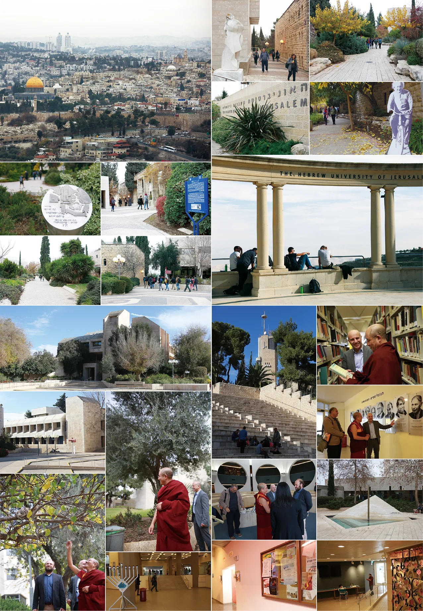
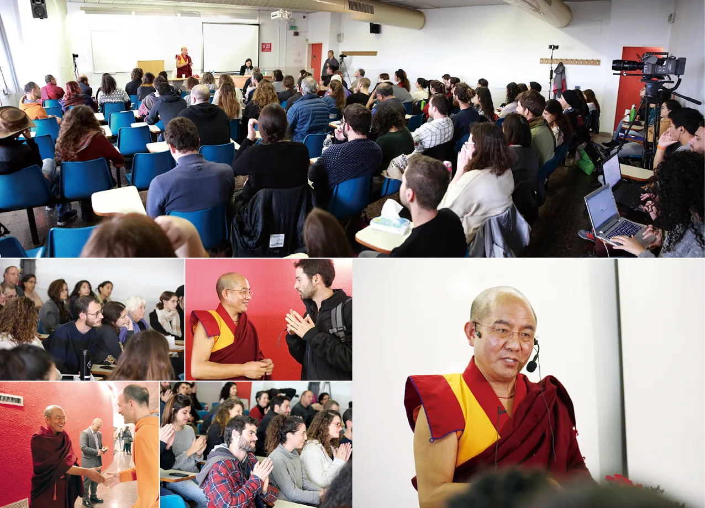
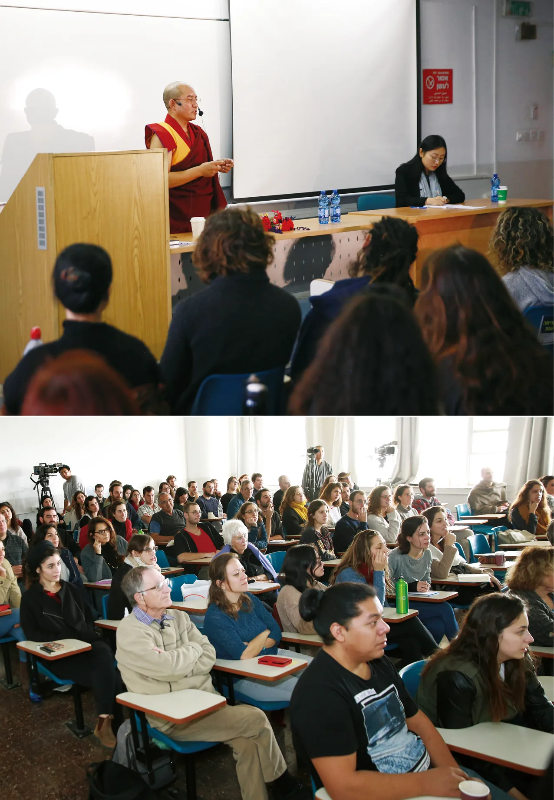

“欲知前世因，

今生受者是；

欲知来世果，

今生作者是。”

第161场

以色列希伯来大学

The Hebrew University of Jerusalem

以色列·耶路撒冷

2017 / 12 / 18

## 业因果定律下的生命流转

## Reincarnation and the Law of Causality

舒尔曼教授：

早上好，感谢大家的到来！今天非常荣幸由我为各位介绍堪布。

索达吉堪布是喇荣五明佛学院的负责人之一。能够邀请到这么伟大的藏传佛教上师，对我们来说是很难得的机会。堪布今天演讲的主题是“业因果定律下的生命流转”，它涉及非常甚深的佛教教义，阐述了佛教对现实世界及人类生命的理解。

我们请堪布做这个开示，是想抓住这次难得的机会，请这样受人敬仰的大德有针对性地解答这些问题。问题涉及对生命的理解，这正是以色列乃至西方社会，与亚洲文化——尤其是佛教——存在明显差异的地方，值得我们去探讨。

堪布是喇荣五明佛学院的主要负责人之一，这所学院由藏传佛教宁玛巴的著名上师——法王晋美彭措仁波切于1980年创办。法王是一位声名远扬、受人敬仰的大德，众所周知，他的前世是伟大的伏藏大师列绕朗巴——以“十三世达赖喇嘛的老师”著称。而这一世的法王晋美彭措，是索达吉堪布的老师。堪布是法王的心子，延续着法王的佛法教育事业，但这仅是堪布事业中的一个方面。

今天的演讲嘉宾，的确是一位有很高造诣的修行人，他正在传承诸多前辈大德的言教。这些大德已经有过多次转世，希望他们的教言能带来一些启示，为我们揭示出生命真正的存在方式。

虽然我还不清楚堪布会如何诠释这个主题，但暂且以这样的方式来介绍堪布和他的演讲，应该是恰当的。再次感谢堪布的到来，这对我们来说是莫大的荣幸。

接下来有请堪布——

感谢马金教授、舒尔曼教授，以及亚洲文化研究系的邀请，让我有了这次与大家交流的机会。

这是我第一次来耶路撒冷和以色列。小时候，我就对耶路撒冷很感兴趣，很想了解它，因为这里是许多宗教的圣地，我也听过一些关于它的故事。

之前就安排好了这边的行程，但最近从新闻里看到这里有突发事件，很多朋友都劝我把行程取消。但我的性格是，若没有特殊原因，讲好的事情不会改变，所以我还是来了。来了一看，好像也没有想象中那么严重。

今天很荣幸借这个机会，给大家简单讲一下因果轮回、生命流转的道理，并分享一些自己的所见所闻，同时抛砖引玉地提出一些观点，之后我们还可以在互动环节进行讨论。我会先讲一些业因果的知识，再讲讲刚才舒尔曼教授提到的法王晋美彭措的事迹，以及喇荣沟的一些故事。我还准备了一个简短的PPT，到时可以给大家播一下。

## 简述业因果

我去过很多地方，也遇到过很多有信仰或没有信仰的人，其中有些人对前世今世、生命轮回有一些研究。在我看来，所谓的业因果、前后世，其实并不是宗教性的。如果它是宗教性的，比如具有宗教的仪式、仪轨，或者借助祷告、祈祷、禅修等形式，那么它只需要被一部分人所行持，而不需要被全人类乃至动物在内的所有生命所关注。

一个真实的生命，是各种复杂因缘聚合的结果，具有多种层次，是多样性的，人类应该重视这样的因果关系，但这也需要一定的智慧。从历史的记载中，我们可以了解到，以色列人民是非常有智慧的。

关于业因果，佛教中讲了六个因、四个缘以及五个果。听说这边也学习过四谛、十二缘起等南传佛教的教言。能够得到人身、成为不同身份的人，其中的因缘很复杂，现在很多人把它归结为“善有善报，恶有恶报”，但其实这只是用简单的道理来进行概括，实际上其中的因缘非常复杂。比如其中的同类因是指：前之心识不断产生同类心识。还有一种叫异熟因，指的是个人所做的善事、恶事，虽然与其行为有一定的关系，但除此之外，还需要其他的助缘，也就是说，果的形成，既需要有自己的内因，也要有外在的助缘。

因缘不仅仅存在于外在的事物中，也存在于每个人的内心中，它与心灵有着非常密切的关系。但现在人类的大多数研究，都是基于物质方面的，对物质世界中的因缘，观察得比较多，而对内心的因缘却观察得比较少，也很少去认识自己。也许等大家学习了十二缘起之后，对有关因缘的道理就会非常明白了。

因缘是非常重要的。虽然从表面上看来，很多事情好像与因缘没有太大关系，比如，有些人长得好看、有些人长得不好看，有些人富贵、有些人贫穷，但实际上，这些均与因缘有关。在业果形成之前，一定先有业力的种子，如果能够如此承认，对业力的道理也就非常清楚了。譬如有一对双胞胎，他们的DNA基本上是一样的，父母、家庭背景乃至父母的教育都一样，从小学到大学的学校环境也是一样的，但长大之后，他们两个人的心态却完全不同，有可能一个人会选择自杀，而另一个人则非常成功。从人类学、环境学、生理学等方面，很难分析出造成这种差别的原因，因此，唯有去分析业的差别——我们不得不寻找他们前世的一些因缘。

佛教有一部论典叫做《瑜伽师地论》，其中有云：“已作不失，未作不得。”意思是说已经造下的业力，不会无因无缘消失，而如果没有造业，相应的业果也不可能会落到自己头上。在因果规律中，这一点非常重要，而且，它的运作是很细微的。研究佛教的人，大多都知道“因果不虚”这一说法，它并不是一个“传说”，也不是某个宗教制定的规则，而是每个众生生命中的一种因缘关系：无论是谁，只要造了业，业果就一定会现前。

我本人对业因果研究了很多年，刚开始时也有很多怀疑，对其中一些内容也不是特别懂，因此翻阅了大量佛教以及心灵科学方面的书籍。同时，也确实感觉到包括科学家在内的大多数人，对心识方面的问题关注得比较少。当代科学对心灵的研究，大多基于与大脑及神经有关的学科，而对心识本身的研究比较少，甚至可以说几近空白。但按照宗教的观点，心识本身即具有延续性等特征。

我之前去挪威一所大学时，跟那里的教授探讨过：“如果可以为神经学、脑科学未参与其中的心理学，单独设立一个像诺贝尔奖的奖项，那么，学术界对心理的认识与研究也许将与以往不同。”但就像宇宙中暗物质是大多数的，常规物质是极少数的，涉及心理研究时，除极个别宗教外，大多数学科都主张以物质或客观事物为主导。而实际上，心理研究是比较抽象的，因此在这个时代，可能只有借助宗教研究或信仰去认识人类的内在世界及主观意识了。

犹太教所提倡的“十诫”与佛教所提倡的“十戒”，在内容上有很多相似之处，比如不能杀人、不能说大妄语、不能偷盗等等。这些戒条是人类行为的一种共同规范。另外，个人行为的善恶与其命运有直接关系，对于这一点，从宗教的角度出发，会看得比较透彻。每个人即生中，在人类社会中所扮演的角色，所感受的快乐与痛苦，按照宗教的说法，皆与今生或前世的行为有着密切的关系。

## 从法王的事迹谈生命的延续性

刚才也提到过，我跟随了堪布晋美彭措法王将近二十年，今年是法王圆寂的第十四年，在与他的接触中，在我的所见所闻中，非常鲜活地感受到生命是有延续性的。法王的确很有名，但他不仅有名声，他的修为与智慧，在我所见过的大德之中，都是比较特殊的。

刚才舒尔曼教授也提到了，法王的前世是十三世达赖喇嘛的经师——伏藏大师列绕朗巴。藏传佛教中的伏藏法，对你们来说，应该是一个新的概念，可能需要单独去研究。伏藏法的确非常稀有，英国、美国等地的许多科学家也是这样认为的，而且研究伏藏法的人也非常多。在与一些科学家进行交流时，有些人觉得伏藏法不可能存在，而有些人不仅承认它的存在，还赞叹它极为神妙，有各种各样的说法。由于时间关系，今天就不再展开讲了，这里想表达的意思就是：堪布晋美彭措法王曾是一位在整个藏地家喻户晓的伏藏大师，是十三世达赖喇嘛的导师。

再往前追溯，堪布晋美彭措法王的另一世，是莲花生大士的弟子，名叫多杰登炯，也是一位伏藏大师。法王的转世一直很殊胜，对此我刚开始也有怀疑，但后来通过跟他多年的接触，确实感觉他的事迹都非常奇妙。我可以简单给大家讲一下。法王曾取出许多莲花生大士的伏藏品，同时也能回忆起当时的场景、唱过的道歌。当他亲临前世与莲花生大士去过的圣地，比如桑耶青朴等一些地方，便能回忆起当时的情景，但去别的地方时就没有这样的显现。

通常法王去藏地神山时，随行人员都会一直带着一个小小的录音机，因为法王随时都可能会用唱道歌的形式回忆起一些往事，这时我们就把这些歌录下来并立成文字。我也跟他去过很多科学比较先进的国家，比如美国、新加坡等，但那时他就没有忆起往事。

每当他想起莲花生大士，想起自己前世的事情，即使已经六十岁的法王，仍会哭得像小孩一样，弟子们都不知所措，甚至有时会感觉到些许尴尬，因为无法知道法王忆起的内容以及他哭泣的原因。

我们跟法王一起去尼泊尔时，他在莲花生大士的山洞里取出了一个金刚橛的伏藏品，当时有很多印度的高僧都祈请法王传授这个法要。法王还有很多其他的功德，但我暂时不讲太多，先给大家看一个短视频，是二十年前跟他一起去鸡足山时拍摄的，大概一分多钟的时间，大家可以看一看晋美彭措堪布到底是什么样的。

（播放视频……）

二十年前的时候，我还比较年轻，那时是1997年的10月份，地点在汉地的鸡足山。这就是二十年前的我。法王当时用藏语开示，我用汉语翻译给听众，虽然我也会说藏语，但我主要负责的是汉族的教学。藏地有一个说法叫做“转世”，这就是一位转世的小活佛，现在他已经长大了，个子比我高。当时拍摄的视频质量不是太好。

## 从普通人的角度看生命延续

每个人在轮回之中，在生命的流转中，都有非常多的前世，刚才讲的堪布晋美彭措，就是能回忆起前世的人。现在也有科学家等普通人，同样能回忆起前世。今年在泰国举办了世界青年佛学研讨会，其中有一位参会的科学家就能回忆前世，他对Google非常有贡献，他的研究跟阿尔法狗有关，我不提他的名字，因为没来得及问他是否允许我说。

他在回忆前世的时候，能想起很多当人类时的情景，比如在某个地方当大臣，跟某个人的关系如何，等等。还有一个很有意思的事，他不但能想起当人类时的过往，也能忆起变成动物时的经历，比如其中有一世，他是狼群的主要领导，他现在还能想起当时某个场景中风的方向与气味，也能回忆起组织狼群的整个过程。他还提到说，当时在领导狼群时，由于自己的傲慢，对一些情况没有注意，所以做错了一个决策，结果导致狼群中的很多狼因此而死。以至于到现在变成人的时候，他也不愿意当领导，因为他觉得当领导是很危险的，如果做错了决策，对群体将产生危害，他现在的工作方式也确实体现了他的这一观点。

是否可以忆起前世，不取决于地处东南西北的哪一方，因为每个人的生命都有这样的延续性。暂时无法回忆起来的原因，就像宗教中所讲的一样，只不过是因为被入胎时的障碍干扰了记忆。但对于有特殊因缘的人来说，即便如此也可以回忆起前世。不过不知道是什么原因，在某些地方确实会有很多人都可以想起前世，比如，在中国有一个侗族，这个民族所生活的村落中，大多数人都能回忆起前世。

一千多年前，在月称论师所造的《中观四百论》注疏中有一个记载：在前世，一个孩子的耳朵上被盖上了印章，而在这一世，印章的印记又出现在了他的耳朵上。听说你们在这里也学中观，这很好。在这部注疏里，对因缘有一个比喻：鸽子在茅棚之上，但茅棚下面的酸奶也能印上鸽子的脚印——虽然鸽子与酸奶之间隔着茅棚，但依靠一种缘起力，鸽子也能在酸奶上留下脚印。

同样，与前世身体有关的个别因缘，也能映射到今生的身体上，比如说前世是兔唇，今生嘴巴上可能也会出现伤痕。虽然前世的身体已经被舍弃了，这些事例看起来不太可能，但确实是有一些因缘，会在下一世留下痕迹。这是一件很奇妙的事情，你们不一定能完全信，但确实有这样的情况，所以说现在有很多科学没办法解释的神秘现象，在世间不断地出现。

关于生命延续方面的研究，弗吉尼亚大学有一位史蒂文森博士（Ian Stevenson，1918-2007），他一辈子都在研究这个课题，他在全世界找到了两千多个案例，并据此专门写了两本书。这项研究的追随者，是一位名叫塔克的博士，他也一直在做此类研究。他的研究很有意思，我看过他写的一本书，书的内容很有研究价值。

也许，每个人对自己的生命是很熟悉的，但又是很陌生的，所以很有必要对生命进行探索。

## 介绍佛学院概况

我所在的佛学院，应该算世界上规模比较大的佛学院，那里的大多数人都相信业因果的存在，也相信前后世的存在。这所佛学院是堪布晋美彭措创建的，虽然他老人家圆寂了，但他的佛学院还存在着，我也还在那里学习。我们可以看一看佛学院现在的状况。

（播放视频……）

喇荣沟是我出家的地方，1985年出家后，我已经在那里待了三十几年了。这个场景是冬天的时候，画面里的这些是小房子，每个人住在自己的小房子里。学院在一个山沟里面。这是学院的标志性建筑。这个画面是春天的时候，这些红色的，每一个都是小房子，现在学院里大概有上万个小房子。我的小房子也在其中，房子的面积很小，只有二十平方米左右，我在这个房子里待了三十年。现在画面里出现的是很多老百姓转绕的地方……

## 两个希望

最后，我提出两个希望，第一个是希望宗教信仰与学术研究达成共识。虽然这两个领域是不同的，但都要“诸恶莫作，诸善奉行”，尽量地行持善法，断除所有有害的、不和平的行为，这是每一个人要坚守的准则。第二个希望是，无论发明什么，还是研究任何事情，都要心地善良，要有慈悲的心，这样做出的结果也将会是非常美好的。谢谢大家！

现场互动

问：基因以及父母的业力，对一个人的出生是不是有一定的影响？

堪布：按照佛教的观点，众生有一个识叫做阿赖耶，阿赖耶上有前世的习气，就像前世喜欢跳舞的话，可能今生刚生下来就喜欢跳舞，阿赖耶上喜爱跳舞的种子便开始逐渐成熟，这与他自己的业有关。而来自父母的因素叫做外缘，父母与他也有关系，因为是父母给了他肉身，就像对同一食物添加不同佐料，味道也就不同一样。虽然一个人的出生与父母有关系，但最根本的因素还是他自己的业力。比如，一个人可能从小就很爱跳舞，但他的父母却一点都不会。因此，自己的心还是最主要的因素，而父母的存在与身体的产生只是外在的关系，只有外在的作用。

问：您是如何理解“自由意志”的，“自由意志”是否存在呢？

堪布：我不是特别明白你所说的“自由意志”的含义，也许你的问题是说：如果人有宿命，今世完全由前世决定，那我们是否还有可能选择现在的行为？在每个宗教最究竟的观点中，会有一些是一致的，但暂时来讲，不同宗教的观点又是不同的。

按佛教的观点来看，每个众生的业力就像一条延续的线，很难去改变，但依靠一些特殊的因缘也可以发生转变。因此，佛教并不等同于宿命论，到一定时候，依靠特殊因缘，命运可以被改变，所以与宿命论有所不同。就像一个已经被判了死刑的人，后来也可能因为各种因缘，被取消了死刑，改判无期徒刑，等等。又比如一个人造了很重的业，本来后世要下地狱，但以忏悔等因缘清净了罪业，不再受地狱之苦。所以，今世的境遇并不完全是命中注定的，但过去的业力确实有一定的主导作用。

问：是否存在国家的业力、民族的业力？还是只有个人的业力？

堪布：国家的业力、民族的业力是存在的，这在佛教中叫做共业。刚才我也提到了一个有很多人都能忆起前世的地方，听说泰国也有这样一个地方。在一些民族或国家的命运中，许多人会经常感受类似的痛苦或快乐，这就是佛教所讲的共业。比如，他们往昔共同造了某个业，后来就要共同感果。藏地的人经常会说“我们的共业”，当年玉树地震后我也去过那里，当时死了很多人，大多数藏族人是有信仰的，所以他们会觉得地震是共业所致，这就是他们很多人的心态。

问：非常感谢您的到来！我想请问的是：我们应该如何积累善业，是否通过书本的学习就能明白，还是必须要通过内观、自省，才能够有所领悟？

堪布：其实可以做的善业有很多，一个是发善心，另一个是行持善法，比如说供灯、做慈善、内观等等。胜义的善是安住在实相当中，世俗的善是做这些好事，这些善业都是要慢慢积累的。

问：如今，西方社会从佛教中学到了很多，比如正念禅等各种禅修。因此，我想请教的第一个问题是：您如何看待这种现象？第二个问题是：您认为佛教中的哪一点是最值得西方国家借鉴并运用到生活中的？

堪布：关于第一个问题，我觉得禅修是很好的，在宗教中也经常用到。在西方，有很多人的压力比较大，就可以用得到禅修。虽然西方有很多禅修是比较简单的，但也能起到缓解压力的作用，帮助人们更易于接纳痛苦。

现在的科学发展很迅速，但与此同时，人们的心理问题也日渐增多，如果不进行心理疏导，人们可能很难忍受这样的痛苦。在西方，禅修的流行也许跟苹果公司的乔布斯有一定的关系，因为他很爱禅修，所以很多人也效仿他喜欢上了禅修。

关于第二个问题，佛教不仅具有宗教的一些特性，它同时也具有科学思维的严谨性。释迦牟尼佛曾说过一句话：“你们不要因为我是佛陀就信仰我。无论是出家人还是在家人，都要像锤炼金子一样，用理性的思维进行观察：如果佛说的有道理，可以去接受；如果没有道理，就不用接受。”我觉得佛教中的这种哲学，可能最适合西方去借鉴，当然也适合其他地方，因为对于所有地方来说，科学的严谨性、思维的逻辑性，都是很重要的。

问：我的问题是关于转世轮回的。我感觉尤其是对于西方人来说，要单纯地相信某件事是非常困难的，西方人总想找到证据去证明它的真实性。当您谈到转世、死亡以及此生之后还有来世的话题时，要找到令人信服的证据是非常困难的，所以我想知道您起初是怎么解决这些疑惑的？

堪布：人们都非常害怕死亡，所以会尽量避免谈论这个话题，因为死亡给人的感觉就像是到达了尽头。一个生命的内心现象，并不像世间的物质一样，用科学的方法就能马上进行测试。

我刚才也讲到，内心世界是隐秘的，并非即时可见的，但也有很多确凿的证据可以证明前后世的存在，这一点是科学很难解释的。实际上，依靠科学或者西方的思维方式，并没有确凿的证据可以证明前后世是绝对不存在的。既然有很多证据可以证明前后世的存在，如果还不承认的话，那就没办法了，这个道理也就说不下去了。

所以，对于这个问题，我刚才也讲了，一定要进行研究，通过研究之后才能发现真理。如果你没有研究过，肯定是有怀疑、不太相信的，这也属于正常现象。至于死亡的问题，其内容所涉及的范围非常广大，依靠宗教的方式来研究是最好的。

问：刚刚您谈到了轮回和前世的话题，我想知道佛教是怎么看待来世的？如果我们能知道自己的前生，是不是也能看得到来世？或者说，当能够了知来世的时候，是不是就再也不用轮回了？

堪布：我以前翻译过一本书，名叫《轮回的故事》，也叫做《前世今生论》，其中对你提的这些问题做了解答。实际上，有很多人会关心自己的来世，尤其是临终的时候，会关心自己的来世是什么样的。在藏传佛教中也有很多转世的实例。

对于这些问题，一是可以通过实例来了解，比如现在有很多转世者，在他前世的时候就已经被授记今生的转世，之后在今生得到了认证。第二，可以阅读我翻译的一本书，叫做《前世今生论》，英语、汉语、藏语的版本都有，这部论中讲了很多这方面的道理。

问：请问您是怎么定义“真理”的？

堪布：关于真理，可以讲的内容比较多。心的真相到最后不是有，也不是无，虽然可以说它是像虚空一样的“空”，但这个“空”是带着光明的。一旦认识了这样的境界，就可以叫做见到了真相。当真正去观察万事万物的时候，就像现在物理学家所讲的一样，可以观察到的是一种能量场，但最后连能量场也将不复存在，也就是说，这种所谓的“空”也并不是真相。

所以，真相其实是有很多层次的，到最后可以说是不可思议、不可言说的，按照佛教的观点，这可以叫做真相。而何时通达了这样的真相，就叫做开悟。

主持人：

堪布刚才的回答为今天的演讲画上了圆满的句号。让我们一起感谢堪布仁波切！如果各位还想再和堪布一聚的话，接下来我们将于下午四点零五分，在古莎瓦大厅举行光明节点灯仪式，欢迎各位来参加。大家可以尽情地享用甜甜圈。
