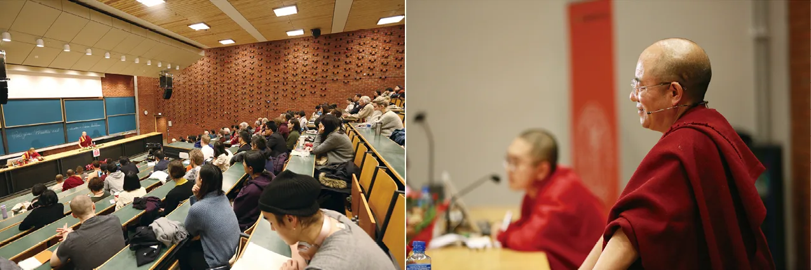
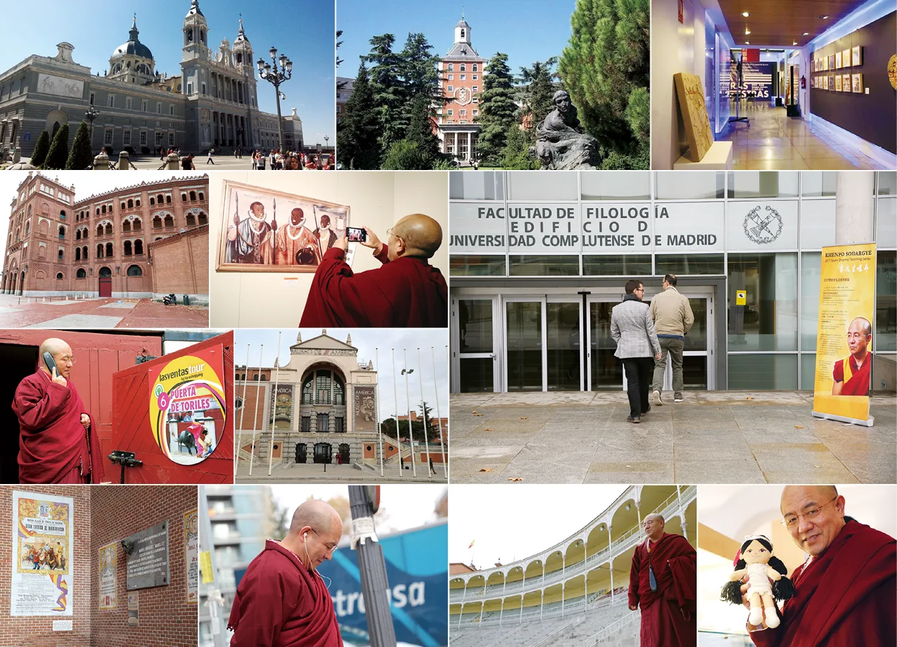
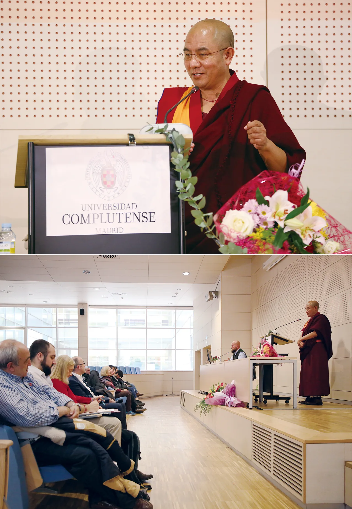
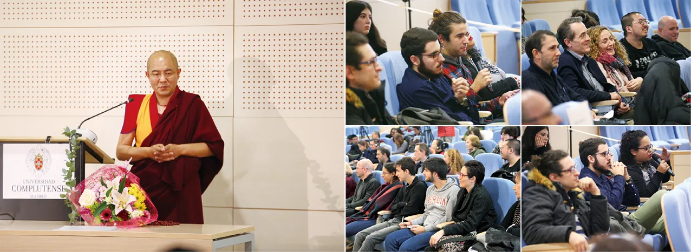
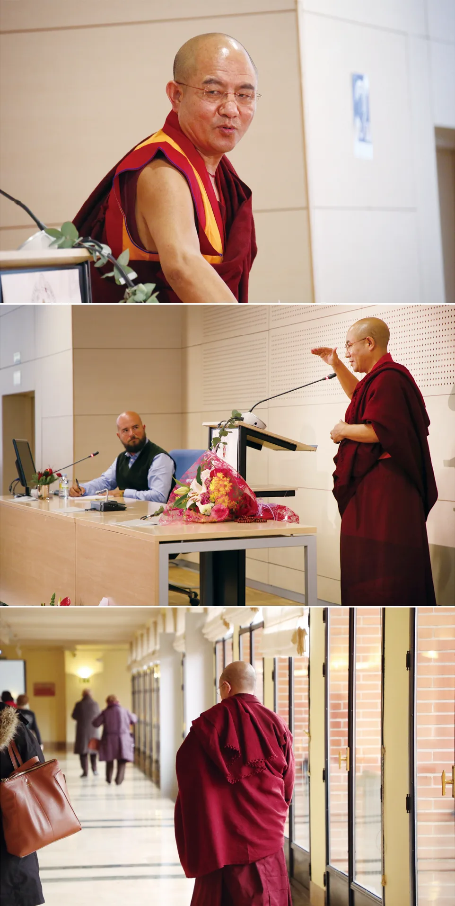

慈悲心就像摇篮，

能保护我们，

让我们逐渐获得面对生活的力量。

第159场

西班牙康普顿斯大学

Complutense University of Madrid

西班牙·马德里

2017 / 12 / 14

## 佛教如何理解自我慈悲

## A Buddhist Understanding of Self-Compassion

主持人：

大家早上好。非常感谢各位的到来，我是宗教研究系的教务秘书。我非常荣幸地向大家介绍著名的佛教学者索达吉堪布，今天是堪布首次到访西班牙及本校。

众所周知，堪布是当今藏传佛教界非常著名的导师，他目前正在进行巡回演讲，其中包括加拿大、美国和欧洲的多所大学。他今天能来到康普顿斯大学，真是我们莫大的荣幸！

下面，有请堪布演讲“佛教如何理解自我慈悲”——

首先向老师和同学们献上我的问候：扎西德勒！

第一次来西班牙，昨天到的，本来我想在附近逛一逛，了解了解，但时间太紧，所以就把这场交流安排在今天早上了。今天的主题是“佛教如何理解自我慈悲”。说到自我慈悲，我感觉如今有很多西方高校都比较重视，所以我想从一个佛教徒的角度，就我学修佛法三十多年的浅显理解，辩证地谈谈这个问题。等我讲完以后，你们可以提问题，我们一起探讨，或者辩论。

辩论是藏传佛教的特色，其他宗教里好像不多见。我们学习佛法，讲闻之外，主要依靠的就是辩论，有很多辩论。比如学习因明基础理论——摄类学的时候，不论广、中、略的教学，都有广泛的辩论训练。例如，对我们眼睛所见的红色、白色是否为真实而进行辩论。我们今天的西班牙语翻译，之前就学过因明的摄类学和逻辑学，早上我们辩论了一会儿，谁输谁赢就我们两个自己知道——不能说得太清楚。（众笑）

辩论主要围绕破斥他宗、建立自宗、遣除诤论三大部分，其实科学实践里也有这个，因为科学也要破斥不符合真理的思想或见解，建立真理，并就是否符合真理的各种争论进行细致探讨。所以，辩论是佛法教学与科学研究的通用手段。

回到主题。早在两千五百年前，佛陀就曾在《法句经》里讲过：“自为自依怙，他人何可依，自己善调御，证难得所依。”意思是，修行人啊，你要成为你自己的怙主，你怎么能依靠其他人呢？你要善于调伏自心，证悟难得的实相，让它成为你的真实依处和救护。所以，自我慈悲是需要的，但我们也不能简单地把它理解为只关心和爱护自己。佛陀的话其实有深意。

## 自我慈悲不是自我主义

如今很多人在自我慈悲方面有一点极端，几乎人人都崇尚以自我为中心，受到西方价值观影响的人尤为突出。西方的很多书籍都宣扬“以自我为中心”的价值观，也就是自我主义，着重强调以自我为根本。于是每个人都想与众不同，都想比别人优秀，拼命朝着这个方向努力。但随着对生活水平的要求越来越高，一旦没达到自己的期待，就痛苦万分。在学校里学习时，班级里的前三名只是少数人，但如果没有得到这个名次，有些学生就会陷入自我怀疑与自我否定之中。此外，经济上比较富有的人，觉得必须要有豪车、富丽堂皇的房子等等，一旦达不到这种标准，就会觉得自己是个失败者，丧失自信，诋毁自己。事实上，这样的人越来越多。

在生活中遇到困苦时，有些人的反应过于极端，放任自己随深重的烦恼而转，行为不加以节制，一味地在散乱和懈怠当中度日，甚至酗酒、吸毒。还有一些人，对生活和人生失去了信心，觉得自己任何事情都做不好，每天沉浸在种种痛苦之中，从而逐渐引发抑郁症等心理疾病。心理疾病在年轻人中越来越常见，尤其是长期心情抑郁的人，很容易患上心理疾病。每个人前世的业力不同，今生的能力也不同，所以，不论是在学习上还是生活中，都应该接受自己，保持对生活的热情和信心，这样一来，生活中就会充满欢喜。而那些不接受自己的人，一旦没有如愿以偿地实现某些目标，心中就会产生各种痛苦，从而自残，甚至自杀。在当今时代，我们不再缺乏食物和衣服，但由于心情不好，通过割腕、服毒等种种方式而自杀的人却越来越多。还有些人，虽然不会伤害自己的身体，但经常辱骂自己，认为自己愚蠢、低劣。

## 佛教徒的“自我否定”

佛教当中也有一些修行人会诋毁自己。例如，有些人认为自己晚上睡得太久，觉得这样不太好，会影响修学佛法。还有些人觉得自己功课念得不够，觉得自己的烦恼深重、心地不够善良……这样轻毁自己很不好。其实，晚上能好好地睡七八个小时也不错。睡觉是我们生命中不可缺少的一部分，人生中有一半的时间都需要在睡眠中度过。正如藏地的大智者萨迦班智达在《格言宝藏论》中所说：“诸人寿短其一半，夜间入眠如死亡。”人的寿命很短，而在短暂的人生中，一半的时间都用在了睡觉这件事上。假如你能活一百岁，那大概有五十年的时间都在睡眠中度过。有些人总觉得睡得太多了、自己太笨了，但不论是佛教徒还是非佛教徒，都没必要这样轻视自己。

## 强调自我需求的弊端

一般来讲，大乘佛教的观点与西方的传统观点有所不同。大乘佛教虽然也提倡保护和慈爱自己，但更重要的是利益众生。而西方人更强调关爱自己，为了自己的发展，激励自己学习、提高能力。总的来讲，现在社会上有这两种不同的价值观，也就是利益他人和利益自己。

自我慈悲确实很重要，像之前讲的，如果对自己没有慈悲心、不接受自己，很难在世间生存下去。慈悲心就像摇篮，能保护我们，让我们逐渐获得面对生活的力量。但如果我们从小就一直强调“我、我、我”，只知道一味地保护自己，丝毫不懂得顾及同学、同事、朋友乃至其他民族、国家的感受，这样一来，那我们所期望的邻里和睦、民族团结、世界和平又从何实现？在人生中，我们难免需要和别人一起生活、相处、共事，但如果不懂得顾及他人感受，恐怕想在世间生存下去还是很困难的。

我很喜欢学习西方先进的科学思想和教育理念，但以自我为中心的观念，会让私欲变得越来越强烈。比如说一个人凡事以自己的看法为主，就很容易引起夫妻、朋友之间的不合，更不会尊敬父母和老师。总有一天，身边的人都会离他而去。

## 自我慈悲，推己及物

不论是人类还是其他众生，希求快乐和远离痛苦的心愿都一样，但现在对这方面有所思考的人越来越少，大多数人都只顾自己的感受，完全不顾及他人，这势必会令自他都感受种种痛苦。所以说，西方价值观不一定百分之百正确。

反观大乘佛法的修行人，从一开始就发心为人类和其他众生暂时的利益与究竟的安乐而做事，不论在任何情况下，都发自内心地利益他人，大乘佛教徒接受的就是这样的教育。《大般涅槃经》中讲：“恕己可为喻，勿杀勿行杖。”我们应该像珍惜、爱护自己的身体一样，爱护其他所有的众生，不能伤害它们。这主要是在自我慈悲的基础上，进一步保证非但不伤害其他众生，而且还要利益他们。

为什么大乘佛教徒会遵循这样的发心？因为既然自己希望获得快乐、远离痛苦，那么其他众生也是如此。对佛教徒而言，这不仅仅是一种传统或习惯，而是彻彻底底地理解、接受这种精神，这就是佛教徒学习的方向。

## 要保持心的平衡

东西方价值观的最大不同就是“以自我为中心”还是“以他人为中心”。现在很多学校也提倡以自我为中心，导致同学们要么因内心过紧而内收，要么因过于放松没有任何身语意的护持，恣意放纵，从而在生活和学习上感受很多痛苦。过紧而内收是堕一边，放松而放纵也是堕一边，我们应该适当地调节自心，避免堕于这两种极端。例如，如果我们心中特别执著男女情感或金钱，基于这种执著，就会产生很多的痛苦。藏地的智者玛吉拉准曾说过：“不紧亦不松，彼具正见要。”内心既不能太紧，也不能太松，松紧适度才是正确的。现代人的很多痛苦都是由过度紧张、过分执著所引起的，以此慢慢就会形成心理疾病。这样一来，不论我们在生活中做任何事情，都会困难重重。

## 不幸福的根源

有些人在生活中遭遇了不幸，就希望其他人能像自己一样，也感受同样的痛苦。例如，有些人患了艾滋病，内心十分绝望、憎恶社会，于是故意把自己的病传染给其他人，让自己的心理平衡一些。

还有一些人，把幸福和快乐建立在房子、汽车、财富、男女情感之上，但这些究竟能不能带来快乐呢？也会有一点，但这些外在条件所带来的快乐很快就会消失。如果对自心没有正确的认识，一旦这些快乐消失时，自己不仅会感受不悦，还会陷入痛苦当中，甚至受到很大的打击。现在有很多年轻人认为有钱就会快乐，但当他们真正拥有财富时，却闷闷不乐；还有人认为，有一座好一点的房子就会幸福，当他们真正拥有房子时，也许刚开始的确挺快乐，但这种感觉逐渐就会转变，并很快消失。为什么会这样呢？有为法的法相就是如此。

## 幸福源于心

如果仅仅将幸福寄托于外在的种种条件，结果就会是这样，相反，如果我们能从内心寻找幸福，幸福就会稳固一些，不会轻易改变。如果我们还能通过禅修让心静下来，并逐渐认识心的本性，这不但会为自己带来稳固的幸福感，还会对其他众生自然生起悲心和利他心。《法集经》中讲：“得三昧故得如实知，以如实知故，菩萨于一切众生生大慈悲。”我们平时禅修的时候，先让自己的心安住下来，然后通过观察自心就能认识它的本来面目，也能够通达外在世界的本质。这样一来，我们就会逐渐对自他产生悲心。

如果大家能在平日里修禅定，虽然也会生起贪心、嗔心、嫉妒心、傲慢等等，也依然会有一些痛苦，但当我们观察产生痛苦的这颗心时，就会发现，心的本性很稀奇、很稀有。因为过去的心如同地里的坏种，还没有生长就已经坏灭了；未来的心如兔角和石女儿，根本无从产生；现在的心如虚空，自性本就不存在。当我们观察自心时，很容易就能发现，它的确就是这样。正如佛经中所说：“无可言思般若度，不生不灭虚空体。”佛法里最甚深的“般若”智慧是什么？就是心的本性无法言说、无法思维，它不生不灭，就像虚空一样。如果能经常观察自心，就会了知它是空性的。

## 真相就是这样

除了空性以外，虚空没有其他特质，然而心还有一种光明。心理学对心也有很多描述，但心理学并没有诞生很长时间，而有着两千五百多年历史的佛法对心的描述更完善。这不是佛教徒自说自话，如果用智慧观察，相信大家都会认可这一点。佛法中所讲的“心性”，可以说是心理学的最高境界。

大家最好能禅修，禅修时不缘任何法，你逐渐就会发现，原来一切都是空性的，连自心也是空性，真相就是这样。就像《般若八千颂》中所讲：“修虚空，是修般若波罗蜜……不修一切法，是修般若波罗蜜。”所以，我们在禅修时，不起任何分别念，如同虚空一样，对自心有非常大的利益，心就会越来越清净。心清净的时候，我们的痛苦就会自然消失，也会获得不共的力量。又如《般若摄颂》中云：“有情声称见虚空，虚空岂见观此义，佛说见法亦复然，见以他喻不能诠。”虽然很多人会说能见到虚空，但虚空的自性并不存在，又怎么能看见呢？而我们说眼睛能见到色法，但是真正用智慧去观察的时候，我们所看到的色法，其自性都是不存在的。同样的道理，人人都希求世间八法，如名声、财富，但真正从意义上去思考，它们的自性也不存在。稍微懂一点佛法的人，对这一点会比较容易理解。人们特别希求名声、财富、快乐等等，费尽一生去追求，但到了人生的终点才发现，原来这一切都像水泡般不可靠。事实上，如果我们能在当下的生活中好好观察，就会发现，我们所追求的这些东西，自性丝毫也不存在。

## 努力生活，慈悲自他

即便如此，我们仍要在生活中努力、精进。就拿学习来讲，萨迦班智达曾说：“自己所需诸论典，每日之中记一句，如同蜂蜜及蚁窝，不久即将成智者。”在学习时，每天记住一点，不用很长时间，自己就会变成智者，正如蜜蜂一点一滴地积累蜂蜜，蚂蚁一点一点地建造蚁穴，总有一天会达成所愿。因此，我们在人生当中也要恒常学习，这很重要。

此外，我们还应该在生活中尽量帮助别人。我们身边可能有很多人都处在各种困难当中，不仅仅是亲戚朋友，还有很多陌生人也是如此。有些人在生活方面有困难，有些人在智慧方面有障碍，还有一些人身体不是很健康。因此，希望大家能在自我慈悲的基础上，力所能及地去帮助其他人，这也是我们受教育的目的与成果。

## 保护自己，认识自心，轻松生活

最后，我做个总结。我们平时要保持心态乐观、放松，当生活中发生一些事情时，不要太执著，要保持心情愉快，坦然面对。生活中所需要面对的种种困难，有些人能接受，有些人却不能接受，但我们要学会接受生活的方方面面，并把它当成学习、提升的机会。这样一来，你会发现，原来生活还是很美好的。

很多人都说，挪威的幸福指数世界第一，但很奇怪的是，我也听说，挪威的自杀率欧洲第一。据说这是因为挪威日照时间短，经常看不到太阳，所以人们的心情不是很愉快，有些人因此而吸毒、抑郁，甚至自杀。我听说斯里兰卡这个国家虽然很小，但自杀率也是全球最高的国家之一，而挪威的幸福指数虽然很高，但人们的心理问题却不容小觑。西班牙的幸福指数也很高，但会不会也有很多心情不好的人选择自杀？我觉得，活在这个世界上，即使做不了很大的贡献，也应该好好地保护自己。我前段时间在挪威和瑞士，那里的物价都很高，所以，可能生活环境再好，人们也没那么快乐，但西班牙不一样，物价很低，人们应该会更快乐一些吧。（众笑）

最后，希望大家能学习一下西班牙语版的《入菩萨行论》，此外，《般若八千颂》虽然没有翻译成西班牙语，但有英文版，大家也可以学习。相信这两部经论会对大家的生活有很大帮助。

现场互动

问：心灵空间由心所造，那从心灵的层面来说，“我”是什么？

堪布：《佛说大迦叶问大宝积正法经》中记载，佛告迦叶：“此心法非在内，非在外，亦非中间。”所谓的心就是这样，它不在外面的事物上，也不在身体里，更不在内外中间。从胜义来讲，心没有形状、颜色，身体里外都找不到它的本体。但是在世俗中，心的名相是存在的，不管是“我”还是心，都是这样。

问：在自己获得幸福之前，还要为他人谋取幸福，是不是有点危险？因为既要隐藏自己的不幸，同时还要给他人带来幸福。

堪布：我们在行持利他的时候，会有保护自己的想法，这也可以理解。从全球来讲，不论是世界和平还是其他方面，能利益他人当然是最好的。相反，不论是领导还是佛教徒，如果不但不提供帮助，反而还去伤害别人，这可以说是很坏的人，世界各地的人都这样认为。所以，替他人的幸福着想，我不认为会有坏处。

问：如果伴侣之间的关系很糟糕，当一方想结束这段关系时，也许会给对方带来痛苦或伤害。在这种情况下应当怎样理解痛苦？痛苦和伤害又是什么呢？

堪布：从胜义的角度来讲，快乐和痛苦的自性都不成立。如果自性成立，那情侣之间执著快乐或痛苦也可以，但事实上，它们并不成立。从世俗名言的角度来讲，痛苦和快乐是存在的。因此，当感情破裂时，虽然你已经对对方没有感情了，但如果对方的感情还没有断，的确会很痛苦。

总而言之，世间的男女情感会产生痛苦和快乐，但这两者的自相是不成立的。

问：我听说在佛教里有“相对空间”和“绝对空间”。“相对空间”就是有各种现象在不断地生生灭灭，那请问“绝对空间”是什么？是“空性”的同义词吗？

堪布：一般来讲，无为法包括虚空、抉择灭和非抉择灭。其中，抉择灭指的是无分别智慧，非抉择灭就如同雪山上不长草一样，虚空也不是有为法。《量理宝藏论》中讲：“庄严孔隙之虚空，非为虚空之能立。”比如，瓶子里的虚空和屋子里的虚空，都不是虚空的法相，它只是无阻碍的孔隙而已。蓝蓝的天空，也不能成立为虚空。为什么呢？因为它不是现量的对境，也不是比量的对境，现量和比量二者都无法成立虚空的自性。所以，虚空是无阻碍的无为法。虚空和空性的意义，在无为法方面是相同的，但是空性的意义不是虚空，而是超越虚空，有一种不可言思的本体，它是可以证悟的。

问：堪布说学习对修心很有必要，那在不断的轮回中，我们学习到的种种概念性的知识，是否会保留在我们的相续中？

堪布：怙主龙树菩萨讲道：“无见堕恶趣，有见趋善趣，如实知真义，不依二解脱。”在名言谛中，将一切法执著为“无”的断见者，行持杀生、偷盗、邪淫等不善业，最终会导致自己堕入地狱、饿鬼、旁生等三恶趣中。而将一切法执著为“有”的人，承认因果不虚，好好地行持善法，后世就会趣入善趣。同样的道理，现在好好闻思、学习知识，也会对后世有所帮助。

问：我在网上看到了一些有关时轮金刚的内容，还发现您出版过关于二十一度母的书，我对此非常感兴趣。我曾经得过时轮金刚的灌顶，但没有学习过相关的理论，我能读相关的书籍吗？

堪布：得到过《时轮金刚》的灌顶后，再翻阅相关内容是很好的。《二十一度母赞》没有灌顶也可以念诵。这本书已经翻译成了英文，可以阅读。

问：出家人是不是一定要剃头发和胡子？

堪布：出家人要剃头发和胡子，但最主要的是心要出家，内心要生起出离心，并能行持出家人的善法。所以，最主要的还是内心。

现在出家人越来越少，还俗的越来越多，这可能与大环境有关。

问：我曾对比过佛教和其他神秘主义教派，他们所追求的是人神合一，甚至会为此而放弃物质生活。那从佛教角度出发，当我们到达涅槃时，也就是当我们证悟万法实相的时刻，到底会发生什么？涅槃中的快乐又是什么？是逃避还是虚无？

堪布：涅槃分很多种。声闻、缘觉、阿罗汉的涅槃，是安住于灭尽定；菩萨的涅槃是一缘专注于自心的本体，没有任何执著；遍知佛陀的涅槃是如实通达一切法的实相——无为的自性，这也是大乘最究竟的涅槃。

大乘的涅槃是恒常、周遍、任运自成的。我们在生活中所感受到的快乐是会变化的，而涅槃的安乐无有迁变，并周遍于整个身心。同时，这种安乐无须勤作，它是任运自成、自然形成的。

如果菩萨获得了涅槃的无上安乐，利益众生的事业就会非常迅速地成办。也就是说，获得涅槃后，还要继续利益众生。获得佛陀的涅槃果位也是一样，不是为了自己的快乐，更不是逃避，而是不停地利益众生，哪怕在睡眠中也是如此。

《大乘无上续论》、《现观庄严论》以及《大乘经庄严论》这三部论典对“涅槃”讲得很清楚，感兴趣的朋友可以学习一下。
