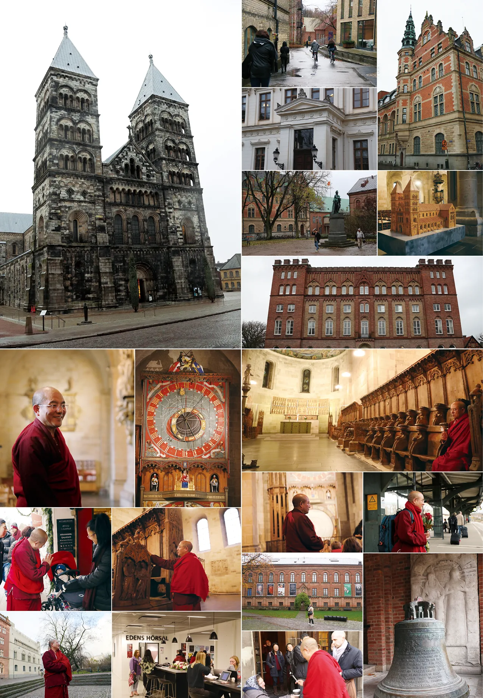
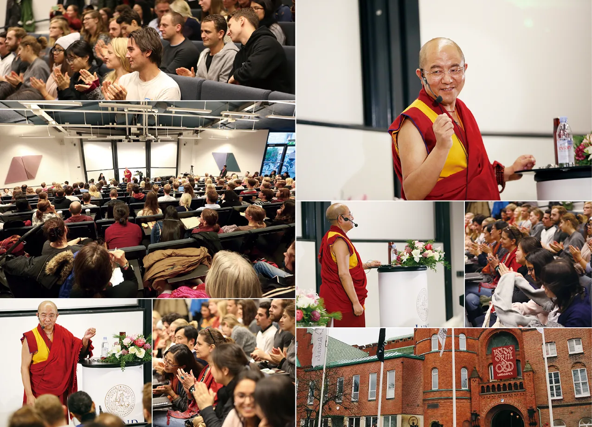
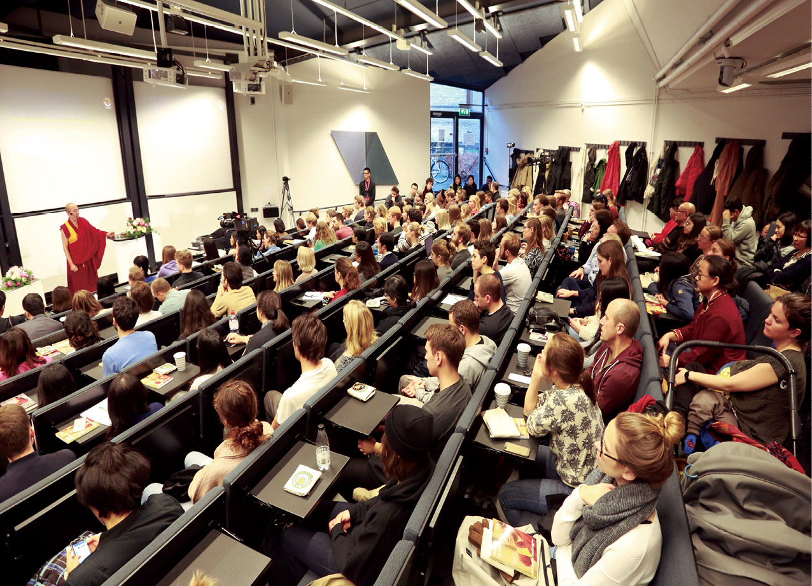
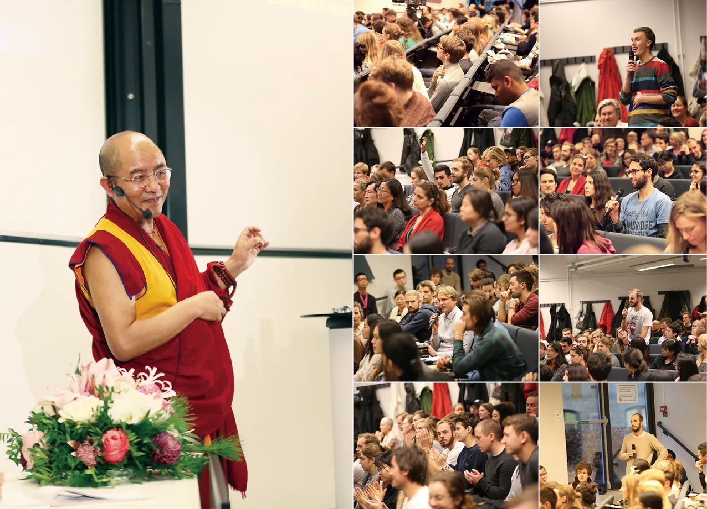

与身体相关的快乐，

无论来自眼耳鼻舌身中哪一个，

在因缘发生变化后，

很快便会消失。

第157场

瑞典隆德大学

Lund University

瑞典·隆德

2017 / 11 / 28

## 佛教思想对于主观幸福感心理学研究的启示

## How Buddhism Would Inspire Psychological Research of Subjective Well-Being

主持人：

欢迎大家前来聆听此次演讲！

下面我很荣幸地为大家介绍尊贵的索达吉堪布。堪布于1985年在喇荣五明佛学院出家，并依止当代著名的佛教大德晋美彭措法王，期间不仅系统学习了藏传佛教的传统经论，还获得了藏传佛教甚深密法的圆满传承。后来，他被任命为佛学院的管理者，同时也是主要的授课堪布之一，在晋美彭措法王为汉族弟子传法期间，堪布还担任了法王的汉语翻译。

堪布是一位藏传佛教上师、佛教学者、老师、著作等身的译者，也是一位当代的佛学思想家。堪布在弘法时，注重将传统佛教理论与现代生活及全球问题相结合，因此在东西方广受欢迎。

堪布讲经说法已三十三年有余，堪称佛法教育的专家。堪布也是当代中国最具影响力和最受认可的藏传佛教上师之一，这主要是源于他对佛教经典的翻译与宣说，以及创办慈善组织、利益大众等诸多善举。

今天堪布演讲的主题是“佛教思想对于主观幸福感心理学研究的启示”，我想这也是大家都在关注的一个话题。我们的研究小组发现，在提升人们的幸福感方面，似乎东方文化中的和谐观比西方公认的满足感更为有用，所以我们都很期待去了解佛教如何影响人们的主观幸福感，以及如何改善情绪，促使人们更加乐观向上。因此，我们很荣幸今天能邀请到堪布来做分享，也相信这个分享一定会对大家有所启发。

有请堪布——

今天很高兴能与在座的各位教授和同学，进行一次关于佛教思想与主观幸福感的交流。我的专业不是心理学，作为一名非专业人士，却敢于在诸位心理学专家、学者们面前讲心理学，唯一说得通的理由，可能就是我对心理学的兴趣了。

记得三十多年前，还没出家时，我在一所师范学校学习，当时学校里开设了心理学课程，所以我也算学过一些心理学。但学得不是很理想，因为当时跟老师的关系不太好——我总是提出各种问题，老师不太喜欢我。不过后来我出家的时候，他还是很高兴，之后我们也有一些联系。直到现在，我还保存着那时上课用的书本，虽然我并不是很认可其中的一些内容。

出家的生活，与在座各位的生活有一些不同，但在求学、探讨、追求真理方面，应该没有太大差别。我个人也一直以学生的身份自处，刚才还问教授下午有没有课，很想去听。这是我发自内心的想法，因为人活在这个世界上，就要不断地学习，不断地充实自己，这样的人生才有意义。在座的年轻人，在这么美丽的大学城里求学，又有机会学习心理科学，应该说是很幸运的。

至于佛教的心理学，它的内容非常广泛，在今天短短的时间当中，可能没办法全部分享。相信在座各位所研究的，无论是主观心理学、享乐型心理学还是分析心理学，内容也非常广，不可能用短短一两节课就让他人通达其甚深意义。

但今天既然有这个因缘，我们也要交流一下，如果一会儿有什么问题，可以辩论、互动。我个人认为心理学是非常重要的，因为这个世界是由心灵世界和物质世界构成的，二者兼具才有了人们现在所拥有的世界。但如今放眼全球，大多数的研究主题和追求目标，都主要关注物质世界，人们对物质世界非常重视，而重视心灵科学或者心灵宗教的人，却不是特别多。

## 研究心理学的重要性

人们在生活中所遇到的事情，有一部分跟物质世界相关，还有相当大一部分与内心世界相关。如果不了解内心世界，活在这个世界上也不一定会快乐。纵观历史，可能也是如此。

我前两天参观了斯德哥尔摩的诺贝尔蓝色厅。听了介绍之后，我有一个想法——如果诺贝尔奖可以设立一个心理学奖，应该是很好的。其实在之前的获奖者中，好像是有心理学家的，但奖项中没有直接设立心理学奖。诺贝尔奖设立的奖项，包括生理学或医学奖、物理学奖、化学奖、文学奖、和平奖以及经济学奖。当时介绍的人说，诺贝尔奖没有设立数学奖的原因是，诺贝尔喜爱的女子跟一个数学家跑了，所以诺贝尔特别恨数学。不太清楚这是不是真的，介绍的人是这样说的。暂且不讨论没有设立数学奖的原因，其实我特别希望的是心灵科学能够得到重视，这样一来，人们内心的幸福感会随之提升。

我本人虽然不太懂心理学的知识，但对此非常有兴趣，所以在出家以后，也通过各种途径在全世界范围内，购买了很多心理学方面的书籍。在我的书房里，心理学的书籍非常多。在心理学的知识储备方面，我无法与各位专家相比，但在心理学的藏书量上，应该比得上你们中的一些人。

当然，只收藏却不看的话，也没有什么实际作用，正如藏传佛教中有一句话说：“知识若只存于书本上，则无法用得上。若要运用知识，就要把它放在心里，这才是智者的选择。”

## 心理学研究概况

我不太清楚目前心理学的研究状况。前两年，新闻媒体采访过一位权威的心理学教授，由于时间关系，记者请教授用一个字概括心理学的研究状况，教授回答：“好。”记者说，一个字可能不够，要用两个字。教授回答：“不好。”记者又说，两个字不能概括这些内容，用三个字吧。教授说：“不够好。”

这时记者就问：“您一开始说‘好’，然后又说‘不好’，最后说‘不够好’，这三种说法不矛盾吗？”教授回答说：“不矛盾。我说‘好’，是比十年前好。十年前，心理学的研究人员认为自己只是治疗心理疾病的人，而现在比十年前有进步，所以说好。至于‘不好’的原因，是十年来整个心理学的研究没有什么明显的突破，也没有很大发展。说‘不够好’，是因为在当今世界，如果结合科学理念，心理学还有不断发展、提升的空间与机遇。”

我觉得他的观点挺有意思。从某种意义上讲，当代心理学也许已经把一些领域的规律揭示出来了，但由此也可以发现，它并没有从心的层面去研究，最多是从生物学或者神经学的层面进行了探索。其实，如果从意识这个层面单独研究，也许心理学的研究可以更加深入。

我个人比较推崇分析心理学家荣格（Carl Jung, 1875-1961）的观点。荣格生活的年代距今百余年，1918年，荣格开始以全新的角度研究意识心理学；当《西藏度亡经》（The Tibetan Book of the Dead）在1927年被翻译成英文后，他依此经对心理学进行了更深入的研究。正如你们所知，荣格后来的研究也遇到了各种阻碍，因为他与当时心理学界的权威学者弗洛伊德（Sigmund Freud, 1856-1939）的观点相左。起初，荣格与弗洛伊德是很好的朋友，后来却因各自对心理学的观点不同而分道扬镳。这给荣格的研究带来了很多负面影响，当时学术界也出现了一些声音：说得好听一点，认为荣格是神秘主义者，研究带有宗教性；至于难听的话，那就更多了。

如果要追溯佛教思想对西方更早期的有力影响，可能要回到黑格尔（Georg Wilhelm Friedrich Hegel, 1770-1831）那里。我以前看过荣格的一些书，他的心理学观点，比如对无意识观点的建立与分析，很多都受黑格尔以及印度佛教、大乘佛教等思想的影响。但荣格与其他心理学家的不同点在于，他的研究主要是从意识层面深入的。荣格的个体无意识观点，与黑格尔的观点非常相似，后来，荣格又提出集体无意识的观点。从佛教的角度分析，集体无意识相当于众生的共业所感，或者说是法界如来藏的自现，这种观点与佛教有很多相似之处。而个体无意识的观点，与佛教所讲的阿赖耶识在解释方法上也有相同的地方。

你们在研究过程中可能也会发现，佛教对一些领域的观点与认知科学比较相近。关于这一点，我自己进行了多年的分析，你们的教授也予以了证实。在研究心识的时候，如果将心理学的观点与佛教教义进行对比，也许心理学的研究会取得一些突破，甚至会有前所未有的发现。这是因为，无论是行为心理学还是认知心理学，这些心理学领域的一些观点及分析方法，实际上早已存在于佛教两千五百多年前的智慧中了。

不知道你们有没有研究过佛教对意识的独有分析？我曾听说，包括美国心理学家在内的很多专家，一谈到意识，就认为它是自古以来人们没有了解过的、特别简单又不可言说的事物。但事实并不是这样。

现在的心理学认为，意识层出不穷，具有相续不间断的特性，所以把它比喻成河流。在一些心理学著作中，还有把意识比作猴子的，因为猴子一会儿跳到这里，一会儿跳到那里，就像人们的意识，一会儿觉得这个人好看，一会儿觉得特别难看，一会儿执著这个，一会儿执著那个，变化得特别快。有时心识又被比喻成闪电——闪电转瞬即逝，而人心的各种分别念，比如贪心、嗔心，也是生起即逝，最终了无痕迹。

关于心的这些现相及其背后的实相，乃至它的本体、分类、作用、因缘等，在佛教中都有特别详细的描述。荣格也提到所谓意识是持续不断出现的，但他还认为，意识有个光明部分，一直深藏在内心底层，每个人都可以发现它并将其展现出来，这种光明如同充满希望的未来种子。这个观点，接近于佛教所讲——众生发了菩提心后，最终可以达到一种最高的觉悟境界。

当前，人们认识心的途径，主要是通过量子力学、神经学等等。但这些都是间接途径，不能作为直接认识的方法。我看到现在很多专家在研究心理学时，不是从意识层面来研究的，而是从神经学的角度出发的。那么，神经系统与意识是否有关系呢？确实有很大关系。神经系统由中枢神经系统和周围神经系统组成，而大脑是中枢神经系统中结构最复杂的部分，有许多神经细胞。现在无论是在中国、美国还是欧洲等地，科学界的人士都非常重视神经学的研究，各国政府也为此提供了大量资金支持。

今天如果讲佛教心理学的话，可能太专业，但不管怎么样，我还是要把所想的讲下去，因为要将佛教思想与心理学结合来讲，可能需要深层次的讲解，否则也很难讲出什么。我刚才也说了，身体的神经系统与意识是有间接关系的，现在科学界也发现：人类的神经系统，在一秒钟的时间里，可以从外界获得一千一百万字节的信息，而当人们去使用这些信息时，则是有选择性的，可能最后真正被使用的信息只占所获信息的40%左右。关于这个道理，佛教中有明确的说明。

## 佛教中关于心识的观点

佛教中说，人类具有五根识——眼识、耳识、鼻识、舌识、身识，这些根识所获取的信息是没有经过意识分别的，只不过收集了对境的所有信息而已，并没有选择信息的权力，只有意识才有选择权。意识又可以分为无分别的意识状态以及有分别的意识状态，在无分别的意识状态下，没办法进行选择，只有在有分别的意识状态下，才能从已收集的信息中选择出自己认为有用的部分。

一个人在花园里听音乐，他的嘴里吃着糖，眼睛看着花园里的美景，身上感受着习习凉风，鼻前闻着芬芳的花香，在这个场景中，他的五根可以分别收集来自外界的信息。而佛教因明学中说，当他要对这些信息进行判断时，在同一时间中，只能有一个选择，要么想到景色是好看的，要么想到声音是动听的，不可能同时产生两个判断。也许我们之前没有这样观察过，但如果去观察就会发现，佛教的这些观点与心理学家所说的不谋而合。

眼耳鼻舌身这五种根识可以收集到很多信息，但无法对信息进行分析，也无法判断出是苦是乐。比如眼睛可以看到一个事物，但无法判断出这个事物是否好看，这是因为筛选和判断来自意识，之后我们才会认为这个事物是好看的，或者是不好看的，进而产生幸福或痛苦的感受。

因此，人们的价值观以及幸福与否等各种感受均来自心，所以说心是非常关键的。人们所执著的好与坏、苦与乐，虽然与外境也有一些关系，但更为重要的是心的主观作用。如果仅仅从生理学或神经学的角度出发，通过实验去获得一些结论，那么对自己内在层面具有主观性的感受，不一定能分析得非常透彻。

## 幸福的两种来源

在座的人也都知道，现在有很多所谓幸福的来源，按照西方心理学的观点来看，其中有一种属于享乐型的来源——认为幸福来自五根带来的感官上的享乐。虽然感官本身不能进行分别，但感官的作用与意识配合以后，就可以判断出：我今天看到了很美的东西，吃了很甜的糖。但这种类型的幸福，一般只有在第一次享用时才会有快感，比如说爱吃糖的人，在吃第一口的时候，感觉到糖特别甜美，等吃到第六口时，就会觉得糖吃起来也就仅此而已，甚至会觉得不好吃，产生厌烦心。

现在令很多人沉迷于其中的快乐，其实都是感官享乐型的快乐。比如说，当你刚看到一个非常美的地方时，你会感叹：“哇，好幸福，真好看！”但等过了一会儿，就没有这种感觉了。包括对感情也是如此，在刚开始的时候，很多人都会觉得拥有一段感情很甜蜜，但等自己真正拥有了以后，就会发现也并不是那么快乐。任何跟身体相关的快乐，无论来自眼耳鼻舌身中的哪一个，在因缘发生变化后，很快便会消失。

另一种幸福的来源，就像亚里士多德（Aristotle, 公元前384-前322）所提倡的生命意义一样，是一种生命意义型的来源。比如，文学家的作品受到了关注，或者研究人员的研究得到了社会认可，当个人价值得到体现时，他们自然而然会获得一种快乐，这种快乐也会延续得比较久。这样的快乐就像我刚才讲的，是佛教中所说的从意识层面产生的一种快乐，可以通过体现个人价值来获得。如果明白了这个道理，进而去获得这样的快乐，它持续的时间也比较长。

而在当代社会，很多人需求的快乐是比较直接的，就像吃快餐，希望马上得到快乐，并且永远不会消失。在追求快乐的过程中，我认为很多人的选择并不太好。比如有些人通过碎片文化来获得快乐——听说美国有三分之二的人，依靠媒体的短新闻来充实自己，从中获得快乐；还有一部分人，沉迷在游戏的虚拟世界当中，整天通过虚幻的快乐来填充生活。

当现实生活出现问题的时候，很多人会很不满，又不愿意去面对，一直都是一种逃避的心态。其实这是一种病态，现在对这种人有一个称呼，叫做“懒癌患者”。这种状态非常可怕，明明是自己需要面对的问题，却不敢面对，一直在逃避。

最近我遇到的一些教授，对现在年轻人的状况也表示担忧。他们说：“现在一些年轻人不好好学习，每天除了享乐以外，没有崇高的理想，也不想担负起家庭与社会的责任，整天都浑浑噩噩、醉生梦死……”他们因此对人类的未来感到担忧。

所以，在座的各位应该经常思考生命的意义，以获得真正的幸福感。幸福是每个人追求的目标，藏地一位著名的旅行家曾说过：“所有的人类，从早到晚，都在追求自己的幸福。乃至微小如蚂蚁与蚯蚓，也是如此。”不知道蚂蚁为什么每天忙忙碌碌，应该是在追求幸福吧。你们当中有没有人研究蚂蚁呢？也不知道蚯蚓是否很忙，至少它看起来很平静，但应该也需要一些幸福吧。（众笑）

## 幸福依靠心来安立

对于人类来说，幸福是依靠心来安立的，否则，想依靠外境安立的话，有一定的困难。为什么呢？比如你特别喜欢一个人，如果他身上真有能带来幸福的特质，那么无论非洲人、亚洲人还是美洲人，不管谁见到他都应该感到快乐。但事实并非如此，每个人对他的印象、感受各不相同。

所以说，你所认为的幸福，主要跟你的心有关。

就像有些人觉得可以从爱情中得到幸福，而有些人认为可以从事业成功中得到幸福，还有些人觉得拥有孩子、为家庭付出一切是最幸福的……每个人所定义的幸福都具有主观性，和自己的价值观与心态有非常直接的关系。

因此，当我们在生活中，遇到某个行为或某件事情给自己带来不幸福感时，要学会观一观自己的心。

## 对提升主观幸福感提出的三点建议

佛教对主观幸福感有比较独特的观点，据此我再提出三个建议：

第一，佛教经常会观生死，由此来提升幸福感。有些人可能问：观生死怎么会幸福呢？死亡是很可怕的，最好不要提。但据我所知，有些学校里已经开设了“生死课”，选修这门课的学生也越来越多。他们通过探讨，去了解生命的真相，其中有很多人因此学会了珍惜现在所拥有的快乐。其实每个人都无法逃脱死亡，通过这样的课程，可以提升我们的幸福感。

像在藏地，基本上90%以上的人，都会经常观自己什么时候死，死后会怎样，对死亡的话题非常关注。而这种关注，不但没有给他们的生活带来负面情绪，反而每个人因此对生活有着更积极的态度，对时光更珍惜，对现有的一切也更珍视。

第二，通过知足少欲提升自己的幸福感。有些佛教徒可能认为，学佛以后一定要过贫穷的生活，出家人的生活是非常节俭的……实际上也不一定，因为出家人常念的一个发愿文中是这样说的：“不生富贵家，不生贫穷家，唯生中等家，恒常得出家。”它的意思是：愿我不要转生在特别富裕的家庭，也不要转生在特别贫穷的家庭，而要转生在中等家庭中去修行佛法。为什么呢？太富裕了会有压力，生活也可能不愉快；太贫穷了则会衣食不足，有生活上的烦恼。因此，如果能生在一个中等家庭里，那就知足了。

知足的观念很重要。就像现在的我们，拥有健康，具足饮食，应该知足。世界上大概还有8.4亿人过着贫穷、饥饿的生活，而我们饮食不愁，所以要有满足感。瑞典人经常说“lagom”，意思是“刚刚好”，作为修行人也应该有这种知足的心态。听说你们这边的人银行存款不是很多，卡上的钱也不多，这种生活方式体现了佛教所说的中道。当然，也可能是这里地处北欧，经济条件等各方面都比较好，生活压力不是很大的缘故。

不过，听说你们这里与其他地方也有相似之处。像在斯德哥尔摩，发工资的当天，各大餐厅的生意非常好，开餐厅的人也特别开心，所以在这一天，大家的幸福感都会提升。我居住的地方是一所佛教大学，那里的情况同样如此，每到月底给僧人发念经钱时，很多年少的僧人就会下饭馆，他们的幸福感也会随之提升。所以有时候，幸福感跟金钱有一定的关系。当然，这也并不绝对，我也遇到过很多人，非常有钱却非常痛苦。

第三，要通过观心性提升幸福感。佛教里有句话是： “三界之中，以心为主。能观心者，究竟解脱；不能观者，究竟沉沦。”因此，佛教中获得永恒快乐的方法是：认识自心的本性。若能如此，就会现前超越快乐与痛苦的不变大乐，使本有的觉悟完全绽放。

一旦达到这种境界，即使你成为世界上最有名、最富有、最有权的人，对这一切也会看得很淡。纵然你人生跌至低谷，甚至沦为乞丐，锒铛入狱，被判无期徒刑，也不一定会感到绝望。无论外境发生了什么，都不会影响你的快乐。而这种快乐，是通过禅修等修行获得的，在东方文化中，不可胜数的成就者与证悟者已经证明了这一点。

其实，无论从佛教的幸福观出发，还是从心理学的角度去研究，最终，当学术达到最高峰时，每个人都需要认识心的本性。现在也有许多认识心性的方法，而且它们都非常直接。希望大家通过这些方法，认识隐藏在内心深处的光明。

在佛教当中，认识了这种光明就叫做大乐智慧。目前，世界上有多少人拥有这样的智慧和幸福呢？我看过世界各国的全民幸福指数排名，今年你们国家排在第十位。我还对比过亚洲国家及其他国家的排名，总体而言，北欧国家的排名位于前列。过段时间我会去以色列、瑞士，那里的幸福指数比较高，想去感受一下。今年排名最高的是挪威，明天我也准备去，看看那里的人是不是真的幸福。

现场互动

问：您认为获得内心的宁静是所有宗教的共同目的吗？

堪布：是的，我觉得基本上每个宗教都有相同的目标，至少每一个宗教都提倡爱，提倡心灵的快乐，以及世界的和平与和谐。

问：我是一名大学生。我有个问题：您刚才说，在当今时代，我们都沉溺于虚拟世界之中，那么您如何看待在线禅修、在线做礼拜等这些在网络上的活动？

堪布：按照佛教的观点，这个世界实际上是一个虚幻的世界，我们在虚幻的世界中，做虚幻的事情，获得虚幻的结果。佛教中特别著名的寂天菩萨，在他所著的《入菩萨行论》第九品中也是这样讲的。可能人们认为网络是现实中的虚幻，其实它是虚幻当中的虚幻，但如果我们有善心，依靠虚幻的方式来做虚幻的善事，会产生善果，而依靠虚幻的方式来作恶，也会有恶果。

为什么这么讲呢？美国有一个统计显示：在美国，每天都有非常多的孩子通过虚幻的游戏熏习暴力，很多专家认为这些孩子长大后，可能会成为社会安全的巨大隐患，所以，一些虚拟游戏的确会带来非常不安全的因素。

问：您好，请您谈一谈强烈的正面及负面情绪与和谐、平和之间的关系。

堪布：其实，我的负面情绪是比较少的。有些人可能在负面情绪爆发时，比如说生起嗔恨心时，会非常愤怒，跟周围的关系也不和谐。不知道你们这边的人有没有这个习惯——有些人跟家人吵架的时候，不管面前放了什么东西，都会把它们摔在地上，最后等事情过去之后，自己也特别后悔。因此，当产生了负面情绪的时候，心应该要平稳下来。

佛教中也提到过很多负面的情绪，比如说嫉妒、傲慢、嗔恨过度、过多的贪欲等，还有狡诈的心、忧郁的心等各种各样的负面心态。当这些负面心态产生的时候，至少要用正念来观察它们的本体，这样一来，负面心态就会慢慢消失，和谐才会产生。实际上，社会的和谐依靠的是家庭的和谐、个人的和谐，而要实现个人的和谐，就要观自己的心。一个内心平和的人，不管到了哪里，他的生活都会是非常平静的。所以说心是一切的造作者。

我看到有一些老师，特别喜欢讲一些负面的事情，大多数学生就会学他，也变成带有负面情绪的人。还有一些人特别喜欢看一些带有负面情绪的书，然后自己的情绪就随之改变了。除此之外，情绪与教育环境也有关系。

问：如果所有人都乐于当乞丐，那么我们该向谁乞讨呢？

堪布：如果所有人都变成非常痛苦的国王，那我们将会过怎样的生活？你说呢？

但这两者都是不可能的，我们不会都成为乞丐，也不会都变成国王。

问：我以前看过一个尼泊尔佛教的纪录片，其中有一句记者的旁白说：“在越发达的国家，离科学越近，离佛教越远；反之，在越贫穷的国家，离佛教越近，离科学越远。”您是怎么看待这句话的？

堪布：我并不这么认为。所谓的科学应该包括内心的科学以及外在的物质与技术方面的科学，如果外在物质方面的科学非常发达，但内在的科学非常落后的话，也许这个国家不一定能称得上是发达国家。

问：尊敬的堪布，心理学中的内省法，在20世纪时就已经不被提倡使用了。那么请问：如何看待内观在现代心理学中的作用？有没有一种科学的方法来观察心？

堪布：20世纪以来，心理科学确实有突飞猛进、前所未有的发展。至于说以科学的方法来观察心，我不知道你所谓的科学方法，是不是现在很多学校所提倡的、通过工具不断进行实验的这种方法？虽然通过实验的方法，也能对内心进行一定程度的观察，但心本来是没有颜色也没有形状的，因此，只通过仪器、实验来观察的话，还是有一定的困难。

其实，通过禅修直接观察心，是非常有必要的。从全世界来看，现在在不同的国家、企业、学校当中，大家都在进行正念禅修，效果相当好。当每个人按照禅修的方式静坐并观察自心，就会发现自己的心就像佛教所讲的一样，并不是那么复杂。如果以自心观自心，是能够看到心到底是什么样的。

如果想要参加禅修，刚开始时最好是有一些有经验、有体验的老师或善知识进行指导。当然，禅修是有不同层次的，如果进行最高层次的禅修，就需要由已经开悟的人来指导；如果对禅修层次的要求不那么高，只是为了缓解压力、疏解心情，或者排遣日常生活中的负面情绪，那么一般的指导者也可以胜任。

每天早上起床后，可以打坐十分钟到半个小时，晚上睡觉之前也坐这么长时间，甚至五分钟也可以。如果每天都能不间断地禅修，生活质量一定会提高。

在禅修的时候，最好能够发现自己的心到底是什么样的。其实，这不一定要有宗教标签，但一定要通过自心来观察自心。一旦你认识了自己的心，在生活中对别人来说非常麻烦的事情，对你来讲也会是非常容易的。

问：对于“证悟”这个词，心理学上有没有对应的术语来解释？

堪布：心理学中好像没有“证悟”这个词，最多只有“了解”“通达”这一类词汇。根据古代和现代的很多事例来看，当一个人证悟后，应该会有一些表现。我看到过一个证悟者，他住在监狱里，把所有狱警都看作最好的朋友，即使被殴打，身上也没有痛苦的感受，不仅如此，他对打他的人仍无比慈爱；当缺少饮食的时候，仍如同具足饮食一般，处于无比享受的状态。

认识心性之后，如果用语言去描述那种状态，其实比较苍白——无论是心理学还是宗教的语言，都没有足够的能力。只有当自己真正证悟了，才能了知它是什么。中国有句话非常著名，“如人饮水，冷暖自知”，当一个人证悟后，就像喝水的人对水的冷热清清楚楚一样，对自己的境界也可以如实了知。另外，还有一些比喻可以描述这样的状态，比如哑巴吃糖。但无论如何，用语言去形容证悟的境界，真的很难。

我曾依止过一位老师——法王晋美彭措，他是我在生活中亲身接触的开悟者。且不说他的其他境界，单单是造论、写书，从不需要绞尽脑汁，而是如涌泉般自然流露。在他的课上，我们记笔记相当困难，很难把他讲的内容全部记录下来，因为证悟者自然流露的智慧，确实很难形容。这也是我亲身经历过的。

接下来，请你们以最快的速度提问，一人问一个，然后我以最快的速度回答。因为时间只剩下十分钟了。

问：我对堪布介绍的心性光明很感兴趣。我想知道，当我们证得心性光明时，是一次性全部证得，还是需要一层一层不断深入，次第提升对心性光明的证悟？

堪布：是一层一层地证悟。就像我们看月亮，离得越近，看得越清楚。

问：请您分享一下佛教僧侣的生活是什么样的。僧侣的生活方式、精神状态与一般人有什么不同呢？

堪布：出家后的生活就是没有头发了，然后身上穿着比较特殊——某些人觉得看上去有点怪怪的衣服，但内心基本上跟其他人一样。以后有时间再单独跟你聊。

问：瑞典是全球幸福指数最高的国家之一，但是仍然有很多人自杀。现在瑞典有一个非常大的问题就是焦虑，所以我的问题是关于焦虑的。您认为什么是焦虑？我们如何摆脱这种情绪？是不是我们做错了什么，以致焦虑几乎成了每一个瑞典人的代名词？

堪布：其实我对这个话题很感兴趣，但因为时间关系，要细讲有一定的困难。听很多人说，焦虑现象跟瑞典的阴霾气候有关，但我并不这么认为，因为在西方，比如瑞典等欧洲国家，哲学家和思想家是非常多的。如果我们能很好地去把握，对心的状态也能很好地去了解和调整，我觉得任何一个地方都不会有自杀的现象，也不会有心理疾病。比如我所在的地方，就有成千上万的学佛人，但几乎看不到自杀的现象。

问：今年我的很多梦想都实现了。我想知道：业是什么意思？您能否简单地解释一下。

堪布：比如一对双胞胎，虽然两个人的生活环境不同，但幸福感都比较高，这是为什么呢？很多科学家和医学家认为这与他们的基因有关，但也有科学家并不认同这种观点。而佛教认为这与他们的Karma——也就是业——有关。因此，快乐并不是当前才产生的，而应该跟之前的因有一定的关系，这就叫做Karma。

问：请问您个人是如何禅修的？是否可以稍微介绍一下。

堪布：我出门在外的时候，基本上很少禅修，因为比较累，有时候还要倒时差。但我在佛学院的时候，一般早上起来之后，禅修大概半个小时，晚上睡觉之前也是这样，但白天我特别忙，所以禅修就比较少。三十多年以来，早上短短的禅修我几乎没有间断过，但外出时就很难有时间禅修了，有时想修也没办法修，也有时修着修着就睡着了。

问：您是怎么看待理性和浪漫的？

堪布：现在有很多年轻人，口头上经常说要过浪漫的生活，但实际上他们自己也不知道所谓的浪漫到底是什么。有些人晚上点个蜡烛，听个歌，跳个舞，喝个酒，就觉得是浪漫了。但真正的浪漫，从传统意义上讲，应该是用一种特殊的文化方式表达内心的感受。比如你亲自到了法国巴黎也好、英国也好，这些世界公认的非常浪漫的地方时，对于浪漫的意义，就会非常清楚了。

我觉得生活是不离理性也不离浪漫的。应该说，每个人的生活都挺浪漫，只不过平时没有去观察而已。在我们寺庙，冬天经常没有电。在没电的晚上，就点一根蜡烛，吃一点简单的食物，夜里还可以听到唱诵的声音。我经常跟我的一些同学说，这种生活方式对其他民族的人来说，应该是很浪漫的了。

去巴黎的时候，我会特意到街上问路过的行人：“浪漫是什么？”但并没有得到令人满意的答案。中国有一个地方叫丽江，人们说那是个很浪漫的城市，前段时间我去那里翻译佛典时也观察了一下，但没有感觉特别浪漫，只是音乐声非常嘈杂。也许我是出家人，没办法感受浪漫吧。

主持人：

感谢大家的参与，也感谢堪布精彩的演讲，谢谢！

堪布：

非常感谢。我去过很多学校，但这所学校的学习气氛很好，特别感谢大家！
