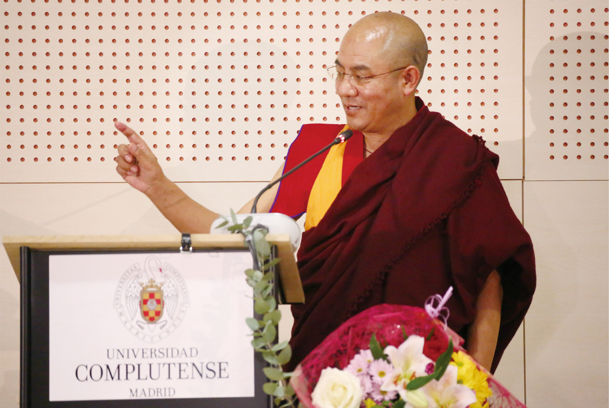
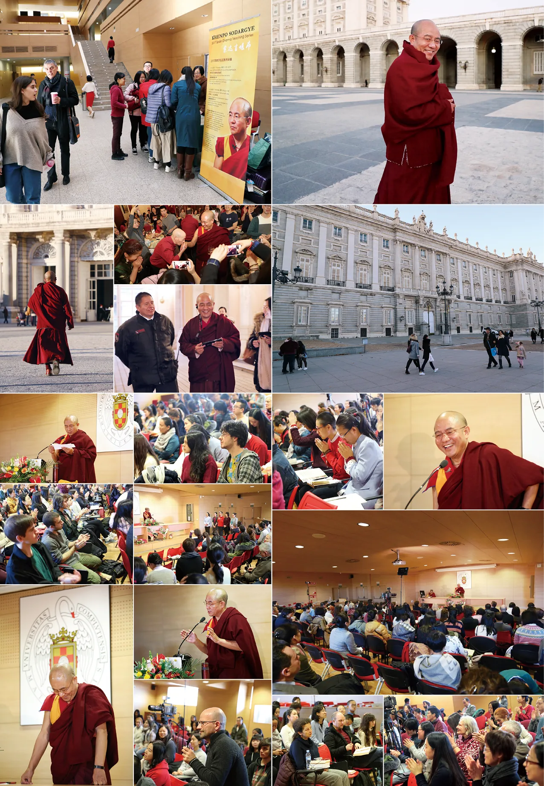
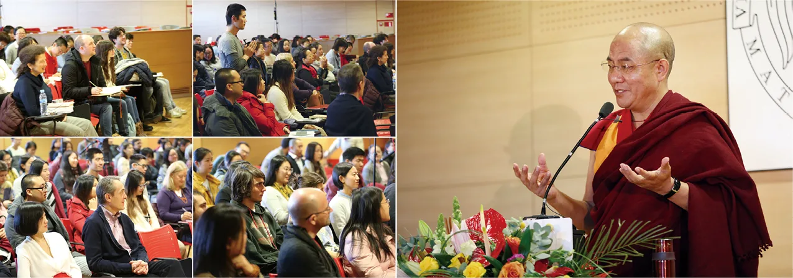
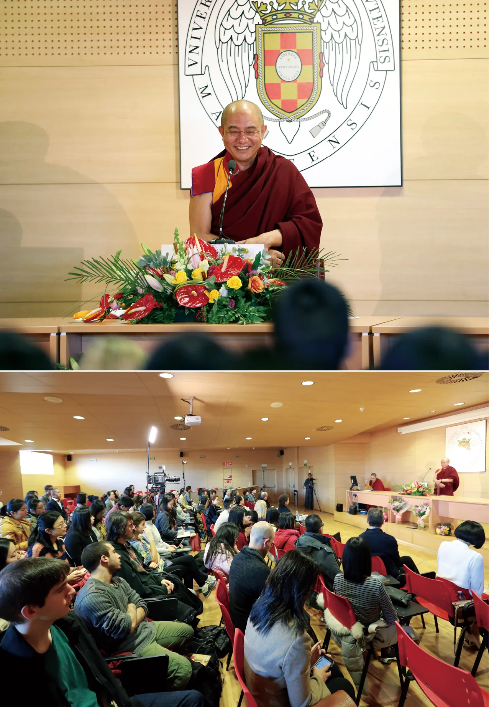

一天坐禅几个小时，

不起任何分别念，

这不一定好。

第160场

西班牙康普顿斯大学

Complutense University of Madrid

西班牙·马德里

2017 / 12 / 16

## 动中禅·与生活共舞

## Meditation in Action: Dance with Life

主持人：

尊敬的索达吉堪布仁波切，尊敬的各位来宾，亲爱的朋友们，感谢您的光临。今天我们有幸邀请到了一位公认的藏传佛教大师——索达吉堪布仁波切，这是堪布第一次来到西班牙。感恩您不辞劳苦、长途跋涉，来到这里为我们开示。

今天堪布为我们带来的讲座主题是“动中禅：与生活共舞”，这个主题非常契合现代人的精神需求，在快速发展的现代社会，禅修是一种能够让人内心保持快乐的方法。很多时候，人们往往是在安静的地方，得以寻觅到令心获得平和、喜悦的方法，但一旦回到现实与工作中，烦恼又会再度产生。而今天“动中禅：与生活共舞”讲座中的内容，就可以很好地解决这个问题。

请大家做好准备，与动中禅共舞。现在有请索达吉堪布仁波切为我们开示——

今天很欢喜能与现场的老师、同学以及电脑屏幕前的各位进行交流。现在这个活动正在直播，这边是早上9点。作为参与者，大家来自各个地方，有些人有信仰，有些人没有信仰，而且各地的时间也都不同，所以，我们能在同一时刻汇聚于此，交流佛法，是一件很难得也很让人欢喜的事。

昨天我在康普顿斯大学讲了一堂课，是用藏语讲的，有西班牙语翻译，当时考虑到听众对这两种语言都不太熟悉，可能听的人不多，所以就没有直播。而今天我讲汉语，有英语翻译。

这是我第一次来马德里，昨天有人跟我讲了马德里地名的由来：一个调皮的孩子出去玩时，被一头棕熊追赶，他就爬到树上躲避。这时听到母亲喊他回家的声音，他怕母亲被棕熊伤害，所以用西班牙语大叫“马德里”，也就是“妈妈快走”，后来“马德里”就成了这里的地名。当然，对于马德里的地名由来，历史上也有不同的说法。

今天，我就是在这样一个地方与大家进行交流。来到这里以后，感受到西班牙人的性格的确异于我刚去过的北欧国家的人，这里的人们更加热情、奔放。昨天跟人打招呼时，好几个人要亲我，但被人制止了——我倒是没有制止，但他们不让别人亲我，也不让我亲别人。据说在这里是亲两下，在法国是亲三下。每个地方都有自己的习俗，每个人也都有自己的爱好，这些爱好跟个人受到的教育、文化的传统，以及环境等因素有关。所以要学会入乡随俗，理解各个地方、国家、民族的不同行为，接纳不同习俗，这是我学到的一点。

## 两种禅修的状态

今天交流的主题是“动中禅：与生活共舞”。说起禅修，很多人都特别感兴趣，有信仰或没有信仰的人都是如此。但大多数人的禅修状态，只是将身体安住在一个地方，心如如不动，把禅修作为一种比较特殊的仪式或行为，却很少在行住坐卧等不同状态中观察自己的心。而今天要讲的是：不仅仅在安住时禅修，还要更多地在生活中，在茶余饭后，在所有行为当中进行禅修，把禅修用到实际生活中来。

无论以安坐的方式禅修，还是在行动当中禅修，都非常难得，因为21世纪的人们特别忙碌，有各种各样的压力，还会遇到许多影响心理健康的因素。因此，用自心观自心，其实是一个心灵层面的奢侈品。

## 动中禅背景源流

动中禅在佛教当中很普遍，南传、汉传、藏传佛教中都有。比如在南传佛教的经典中有记载：佛陀告诉比丘，要在行走的时候观自己的心，知道自己正在行走；同样，住的时候要了知自己在住，坐的时候要了知自己在坐，卧的时候也要了知自己在卧。因此，在行住坐卧等所有行为中都要观察自己的心，了知我正在说话、我正在做事情等，这就叫做正念觉知。

现在，在南传佛教的很多寺院中，都有这样的引导。今年，在泰国的时候，我们一起去寺院参加了禅修，有位九十多岁的禅师为大家做引导，比如将自己的心观想在左脚上、右脚上，并在行动时观察自己的心，等等，对这些行为一一教授。这其实是一种很好的调心方法，这样一来，世间的许多烦恼将自然而然消失。

汉传佛教也讲动中禅，古代著名的永嘉大师曾说过：“行也禅，坐也禅，语默动静体安然。”意思是：无论在行时也好、坐时也好，都应处于禅的境界中，说话、止语、行动、安坐、处于寂静之时，亦是如此。

而在藏传佛教中，有一句话是这样说的：所有的分别念，实际上都是内心的一种幻化，所以，无论生起贪嗔痴等任何分别念时，安住于它，它将自然解脱。在任何行动之中，都可以安住在当下的心态中，按照藏传佛教的观点，一切行为都是禅，都不离开禅修，但还未达到一定境界前，很难真正做到这一点。

## 动中禅引导

现在社会上流行的很多行为，也能让整个身心放松下来，比如通过画画、喝茶、唱歌、跳舞以及很多自然的动作，都可以助益内心的提升。如果大家还没有获得入定与出定不相分离的境界，就可以在平时通过比较放松的行为来观自己的心。

今天跟大家讲的动中禅比较简单，多人聚集在一起修，或是极少数人修都可以。在一个特定的环境、特定的时间当中，大家可以随心所欲地随着音乐或自己的想象来观自己的心。

禅修之前，可以发愿为了自己的身心健康或世界和平而禅修，要发这样一种善心，然后大家可以唱歌、跳舞，做一些可以放松身心的行为。刚开始禅修时，动作要缓慢，中间时可以剧烈一些，到最后再慢慢放缓。这种禅修，有助于疏解日常生活中的压力与负面情绪。

## 认识内心的重要性

可能有些人在日常生活中没有什么执著，生活节奏不快不慢，心态不乐不苦，什么都不太想管，这是现在比较流行的“佛系人生”。虽然这表面上看起来比较洒脱，但实际上是对生活没有信心，不愿意去面对很多问题，这样的心态不一定是积极的。其实在面对人生各种困难的时候，需要有一种积极、坚定、充满活力的心态。这样才是对自己真正的磨砺，才能激发出个人的潜力。

另外，有很多人把人生中所有的快乐与收获，都寄托在外在的物质上，认为它们能给予一切，并满足生活中的一切所需。但实际上，外在的物质只能帮助人们提升少许的幸福感，而真正去观察时就会发现，如果没有一个平静的心态，即使外在物质再丰富，也无法解决所有的问题。因此，通过禅修等方式来认识自己的心，对每个人来说都极为重要。

其实，即使外在的物质再多，人们能享受的也是有限的。比如说餐厅里有很多特别好吃的食物，但一个人能享用的饭菜是有限的，如果吃的量太多或种类太杂，身体不一定能适应。听声音时也是如此，外界有各种各样的声音，但人们能用耳根接收到的声音是有限的，如果声音过大、过小或者距离过远的话，都不在听力适应的范围内，所以说耳根只能接收声音中的一小部分。另外，如果一个人有很多财富，无论是钱还是金银财宝，在生活中真正能用到的也并不多。所以在生活中，人们从外境接受的物质，实际上是有限的。

这时，大家就比较容易认识到内心的重要性，如果没有去认识、了解它，也许永远都不会感到满足，反而会有很多压力和痛苦。因此，大家偶尔可以做一些动中禅的禅修，也就是刚才提到过的——在特定的时间和场所中，随心所欲地唱歌、跳舞，或做其他行为，于此期间观一观自己的心到底是什么样的。比如对于你刚刚所做的事情，当去思考它们的本体怎么得到、因缘如何显示等此类问题时，也许在不经意间，就会产生一些感受。

## 大乘的动中禅

现在西方也有很多动中禅，比如将禅与舞蹈结合起来用于观自心等。其实，将禅修用在生活中是很好的，令心放松下来后，再将善根回向给天下所有众生。通过禅修来利益众生，是大乘佛教最究竟、最精华的意义。佛经中有这样一句话：心入定于正行当中，则能了知一切实相；若能了知一切实相，则能于一切众生生起大悲菩提心。意思是：如果很好地去禅修，便能见到一切实相，进而能对其他众生生起悲心——很多众生由于没有认识到真相，仍然沉迷在轮回之中，他们一直漂泊，一直有所执著，非常可怜，所以对这些众生会自然而然生起大悲心。

在大乘佛教中，对动中禅讲得更为细致，其内容与南传佛教有些不同。南传佛教中主要是用觉知来了知自己的身口意，而大乘佛教中还讲到修行者的一切所作所为都是为了众生。譬如在《华严经》的《净行品》中讲，早上醒来时心里要想，为了众生，自己从无明的睡眠当中醒过来，吃饭的时候要想为众生而食用禅定之食，开门的时候想到开解脱之门，关门时则想到关闭地狱等恶趣之门……在做这些行为时，要将自己的行为与众生的利益关联起来。

所以这里所说的禅修，与很多人所认为的禅修有些不同。因为禅修不仅仅是要觉知到我在吃饭、我在走路，还要想到“众生”，这是大乘佛教的理念。

## 禅修困境的开解

很多人可能是喜欢修行的。但他们喜欢的，只是安住于不产生任何念头的状态，一旦产生了分别念，他们便难以应对，对所产生的贪心、嗔心等烦恼束手无策。其实，有分别念对凡夫来说非常正常，我在上一节课“佛教如何理解自我慈悲”中也讲过：修行人精进不起来或产生烦恼时，千万不要自暴自弃，应该对自己有信心，因为在修行中有一些不足属于正常现象。

有些人在禅修的过程中，如果仅从表面上看，似乎没有什么进步，但实际上，通过经常观察认识自己的心，的确会发生很大变化。虽然这种改变不一定能马上被发现，但只要坚持修行，总会有进步。反之，一旦你对人生或修行失去了兴趣，甚至产生厌世心，则说明你的修行不到位。这时也不要放弃，要坚持观修，尤其当产生不好的分别念时，要用殊胜窍诀去认识它，接纳它。产生任何负面或正面情绪时，都要这样做。

一本叫《修行次第》的书中提到，心的本体实际上是空性的，为什么呢？因为从未来、过去、现在三时去观察，心的本体都不存在。所以，心就像虚空一样，本体并不成立。

你们在禅修时，不能只是让心安住就可以了，更重要的是，无论安住还是起心动念时，都要认识心的本体，这是至关重要的。很多人认为：“我的心安住下来了，好长时间都如如不动，哇！这很好！”还有些人认为：“我现在随时随地都可以觉察到我的心到底在做什么，很开心！”但实际上，这些都不是很高的境界。

藏传佛教中有一句名言，很多修行人也经常引用，“虽然知道修行，但不知道何谓解脱”。尽管你懂得修行，但若只知道让心安住，却不知道心的本体空性、自然解脱，那这种禅修就与四禅天或四无色界的禅修没有什么差别。在这个问题上，很多修行人容易误入歧途。

有些人一天坐禅几个小时，可以不起任何分别念，但这不一定好。藏地有种动物叫旱獭，又名雪猪子，冬天时，它也可以三个月都不出来，处于“入定”状态，但这种境界并不高。西班牙有没有groundhog或marmot？有的，是吧？像在藏地，冬天非常寒冷，所以它在三个月里冬眠就很舒服，等醒来的时候，天气也转暖了。

## 禅修最终的目的——认识心的本体

我们的心无论动摇还是安住，认识它的本体都很重要。藏地有一位著名的修行者叫华智仁波切，他说：“认识了心之本体后，尽管分别念仍如昨日般显现，但认出它的本性时，它就已经解脱了。”所以，即使在现实生活中有很多烦恼，但只要认识了它，烦恼就会得到解脱。比如，当你特别愤怒、痛苦的时候，应该当下看看这个痛苦的心在什么地方。心实际上是不会被烦恼所束缚的，因为“烦恼即菩提”，观察这些负面情绪，并不能得到一个真正的本体。比如，当我们产生嗔恨心的时候，过去的嗔恨心已经不存在了；未来的嗔恨心还没有产生，就像石女的儿子；而现在的嗔恨心，正如我刚才所讲，也如虚空一样了不可得。

在观察自心的时候，会发现它很奇妙。尽管人们有很多烦恼，天天痛苦，但若真正剖析这些烦恼，很容易认识它的本性。

所以《般若八千颂》中讲，菩萨应该经常观修禅定，什么样的禅定呢？观心如虚空，修持像虚空一样的禅定。即先观自己的心像虚空，之后逐渐趋向更高的境界，最后，在认识自心的时候，所有烦恼都将自然解脱。到那时，即使你的行为在显现上没有任何约束也可以。

以前有位非常有名的大德，他在七十岁的时候，经常去妓院，也常常喝酒，做出各种世人无法接受的行为。有人指责他，他说：“我自调心，关汝何事？”他通过这种方式增加个人的修行体验，根本不会有任何束缚。对于这样的行为，多数人只能以自己的分别念去衡量，但实际上，当修行者达到一定境界时，就会超越所谓传统的束缚与戒律的界限。

总之，无论动中禅还是静中禅，只要是真正的禅定，就远离了有无等执著相，这一点很重要。一位了不起的大德曾说：“外离相名叫禅，内不乱名叫定。”获得真正的禅定时，有、无、是、非等一切相都会消失，并能在行住坐卧中，时时保持这种境界，完全安住在这种状态中，一心不乱。

当观自心时，其实可以发现心一刹那也不停留，就像一个三四岁的孩童一样，特别顽皮，这时才知道原来心的本体是那么简单。禅修归根结底就是要认识自己的心，不管你是什么身份的人，都要认识自心。可能人们习惯于观察外在的法，但看外面的世界一百次，都不如内观一次更殊胜。

在生活当中，人们经常观察这个产品的质量好不好，这个人的人格好不好，这个人长得好不好看，这个食物好不好吃……有很多这样的分别念，但从来都没有想过自心之本体到底是什么样的，它有没有颜色、形状？是什么状态？所以说很多人都没有观察过自己的心。其实大家应该要学会观心、修心，并以广闻博学作为其基础，否则，没有听闻就开始修行，是不可能成功的。

## 闻思基础对于实修的重要性

这次我看到很多西方道场里的修行人，修行还是比较不错，但对听闻显密教法的基础理论并不是特别感兴趣。如果你对佛教不感兴趣，当然另当别论，如果感兴趣，那么学术方面的内容也需要听闻。就像一个想研究物理、化学、生物学的人，首先应该去相关的专家和老师那里听闻，否则就会与专业的学习方式背道而驰。因此，大家对某一种学问，在学术上应该先做了解，然后再在修行上去实践。

著名的萨迦班智达也说过：“在闻思修行当中，如果没有听闻就去修行，即使暂时获得一些成就，这些成就也将很快消失。”我看到有很多人，甚至包括一些大德，都没有特别强调以闻思为基础，只是让你直接修行。这样的话，即使你暂时有一些验相，最后也可能由于闻思基础不稳固，致使验相很快消失，最终修行毁于一旦。

按照藏传佛教中揭示的禅修规律，如果要进行标准比较高的禅修，就一定要先听闻，再思考，之后在此基础上去修行，这样会非常保险。有一位著名的大德说：“先要广闻博学，再认真地思维，最后，日日夜夜进行实修。”在实修的时候，无论在禅房中打坐禅修，还是在行动中修动中禅，都可以，因为修行比较好的时候，任何行为都会成为一种修行。

不过，我个人是听闻比较多，思考也比较多，但是修行比较少；你们很多人可能听闻得不多，但修行比较多。其实我也很想实修，但是一直忙于各种各样的事情，所以闭关式的修行并不多。但我有很多关于闭关的想法，也在家乡的一个小寺院附近，建造了一个小小的木头闭关房，但之前最多在里面闭关过两三天，修行得很少。最近，我在一个学校的附近也建了一个小小的木头房，想在里面禅修，但是不知道以后能不能实现。

这种实修的想法，不是现在才有的，其实大概在十多年前就有了，我跟佛学院的慈诚罗珠堪布在电话里交流过这件事。那时候，学院里没有手机，只有座机电话，在座机里聊的时候，我曾说：我们马上要四十岁了，现在该闭关修行了，因为已经在上师面前听了这么多法，也给别人讲了这么多年，再不修就来不及了，所以一定要修一个闭关房，闭关房可以修在佛学院北面的空地。当时我们决定通完电话就去看场地。

看了场地后，我们准备建两个小闭关禅房，他说：“我们不要太靠近，你会影响我，我的房子修在这里，我们之间的距离隔得远一些。”他把要修房子的地方堆上石头、打了记号，我也把要修房子的地方堆了石头、打了记号。这是在我们还没到四十岁时去看的，而现在已经五十多岁了，这个闭关的禅房还没有修，可能这个修行后来就变成“动中禅”了吧。（众笑）

## 趋入实修的意义

其实很多人应该去修行，也很有必要在寂静的地方观自己的心，远离散乱。因为在人世间，如果无法掌握自己生命的本质，就会像我们两个一样，可能一辈子都不会有修行的机会。其实我很想修行，但同时也想让更多的人了解一些佛法。如果佛法不是正确的，不是对人生有指导作用的教育、知识、科学，那谁也不会愿意去强调它；但在当今时代中，佛法的确是对心灵非常有用的教育。

如果人们的生活没有信仰，没有任何方向，整天只是吃吃喝喝、追求名闻利养，人生不一定会非常有价值。从大乘佛教的角度来看，倘若一个人没有利他的思想，没有认识自心的本性，虽然这样的人生表面看来比较自由，但其价值恐怕就需要再观察了。

如果你通过学习认识了心的本体，认识了人生的真相，那么在生活当中，无论是快乐、成功，还是痛苦、失败，无论是美名远扬，还是声名狼藉，面对生活中的任何事情，你都会非常坦然，乐于接受。同时，你也能帮助到很多无法走出心灵困境的人。因此，在当今时代中，对自己内心的疏导与净化至关重要。

我经常在想，对于认识了心性或对心性有一些了知的人，即使在生活中有特别不好的遭遇，处于人生的低谷，甚至沦落为乞丐或身陷囹圄，他们也会非常开心，活得自由自在。而不认识心性或生命状态的人，即使表面看来非常阳光、成功，但他的内心也许非常灰暗。

## 展望及结语

以前我是用汉语讲法的，所以懂汉语的人比较能接受。从今年开始，如果各方面的因缘具足，讲《维摩诘经》时将会用英语进行同传翻译，因为我也希望对佛教感兴趣的西方人，可以打好闻思基础。总的来说，西方人是很稳重的，比如一些西方佛教中心的修行人，有些已经修行十年、二十年乃至四十年了，他们自从学了佛法以后，人一直很稳重。虽然有些地方已经有了一些闻思基础，但还是有提升的空间。

而包括我在内的很多东方佛教徒，则需要在禅修方面下功夫。不然，听闻了一辈子，最后离开人间时，什么都没有修的话，也很可惜。

很多西方佛教徒应该在闻思方面再下功夫，因为这里很难找到对五部大论听闻圆满，或者修了好几遍五十万加行的人，所以在打基础方面不是特别令人满意。我今天很直接地把问题说了出来，希望东西方的佛教徒，包括我在内，在闻思修行中，对于不足的地方要去提升，不要过于自信。

在西方，除了一些学术界的人以外，许多佛教徒的缺点是不爱广闻博学。虽然很多人也有满腹怀疑，但并没有系统闻思，也不愿意下功夫，因为他们过于理性，很难接受佛教的一些理念，所以就没有进行次第性的系统闻思。在世间教育之外，佛教其实有一套殊胜的闻思系统，所以西方人学佛时，也要接纳一些东方思想，不要过于理性甚至特别顽固。

而一些东方佛教徒的不足，在于刚开始特别容易产生信心、特别热情，对一些道理马上就能接受，但随后变得比较快，所以很少有人能在一位上师面前，在一个道场当中，十年、二十年乃至三十年地一直安住，像西方人这样稳重的很少。因此，他们需要有一个长期的修行机制，否则今天去一个道场，明天去另一个道场，今天依止一位上师，明天依止另一位上师，在短暂的人生中换来换去，这没有多大必要。

总之，东西方的佛教徒应该互相了解一下，要以一种包容的心态来接受这些不同。至于接受的方法，需要以智慧善加辨别。

我的欧洲之行到此就圆满了。特别感谢道友们的发心，包括美国的道友这次也特别辛苦。我去了欧洲的几个地方，感谢许多佛教徒、非佛教徒以及我的朋友们，感谢你们在整个过程中给我的有形和无形的支持，特别感恩大家！

现场互动

问：我有一个问题是帮朋友问的。她是一位母亲，孩子天生残疾，如果她将所有的念咒功德只回向给孩子，这与利益众生相违背吗？

堪布：她的孩子也是众生之一。在修行大乘佛法时，首先是以一个众生为所缘，进而再扩展至无量众生，所以，要从身边的众生开始修。

其实，修慈无量心、悲无量心，都是从自己的父母、孩子开始的，进一步观想至所有众生。因此，这与利益众生不相违。她可以这样观想，也可以这样回向。

问：我跟别人有一段缘分，但因为自己的一些贪嗔痴欲望，以及很多执念，通过算命、占卜的方式，知道了很多现阶段不该知道的事，也就是未来会发生的一些事情，由此改变了我与那个人之间的一些命运。我现在处在比较困难的境地，有些人说，这是提前了知未来之事的反噬。不知道有没有这样的事情？如果有，应该怎样去化解？

堪布：你这种做法，其实不是很好。虽然打卦、占卜、算命是古老的文化，通过这种观察可以解答一部分问题，但一个人的行为以及未来的事情不能完全以此断定，它不可能百分之百准确。

而且，以这种方式来观察别人，也不是太合理。这种行为只是在单方面地处理问题，有今天这样的结果，也许是你的错误。我也不敢说打卦可以百分之百知道他会做什么，虽然有时打卦可以观察一些事情，但不能绝对地依赖它。

明天我要去以色列，最近那里比较乱。我也懂得打卦，昨天还在想要不要打卦，但后来没有这么做，因为是自己决定要去的。

问：我的问题是关于正念的。我知道念头有强大的威力，那么在日常生活中，我们该如何观照念头？因为我们总有事情需要考虑，除此之外，该如何掌控自己的心念？是安住在空性状态中，还是什么都不想，或者应该念些咒语，比如佛陀的名号等？

堪布：一般人若想经常处于正念中，或时时刻刻都知道自己的心态，是很困难的，很少有人能做到。

唯有两种人可以。一是他前世的修行比较好，与生俱来心很寂静，不容易妄念纷飞；还有一种是依靠长期的后天教育来好好禅修，最终认识心性得到究竟。

除了这两种人，通常来讲，大多数人很难掌控自己的心。

问：念诵与自己有缘的经文，是否可以消除往昔多世累积的难以销毁的罪业？

堪布：这要看你念的是什么经。

若想忏悔，一般可以念《三十五佛忏悔文》或《八十八佛忏悔文》，这在藏传佛教和汉传佛教当中都有。

藏传佛教中，还比较提倡念诵“百字明”，唐密称其为“百字赞”；或者念金刚萨埵的名号、咒语也可以。通过这些方式，都可以清净无始以来的罪业。

我不知道你所说的有缘经文是什么，这个经文的名字是不是不能说？或者，它是你特别喜欢的一些经典？而大家公认的这些经文，一般都能忏净罪业。

其实，每个人都会多多少少做过一些不合理的事，所以我也常劝大家通过这样的方式忏悔，这是很重要的。像基督教，对忏悔也很重视，但佛教与基督教的忏悔方式有些差别。但不管怎么样，毕竟大家都知道自己在人世间还是做过一些坏事，所以忏悔非常有必要。

问：您刚才在直播中提到，有一位七十多岁的成就者，他出入不清净的场所，显现了一些行为。像这样的修行者，对众生要不要承担相应的责任，他的行为会不会断众生的法身慧命？

堪布：刚才提到的这位成就者，就是禅宗二祖。虽然不同历史中所记载的内容不尽相同，但他在年老时，确实在众生面前显现各种行为，就像密宗中的禁行。

大成就者的这些行为，尽管无法让他人完全理解，但无论从直接还是间接的角度观察，都不会断众生的慧命。相反，他会通过一些善巧方便，逐渐让很多众生获得利益。

但如果他不是成就者，就有可能断众生的慧命。

问：您能否解释什么是根本上师？如果一个人有几位上师，是应该把他们看作一位根本上师的化现，还是不同的几位根本上师呢？

堪布：所谓的上师就是老师。大家在学文化知识时，也有物理老师、化学老师、生物老师、武术老师、艺术老师等各种老师。我们对待每一位老师有所不同，对于重要的老师，比如班主任，关系就比较特殊了。同样，佛教中也有很多上师，对待不同的上师可以有所不同。

所谓的上师，是因为给你讲过法而与你结成了师徒关系，因此也要像对老师一样对待他。而有些比较关键的上师，比如为你直指过心性，帮你认识了心性的上师，这些上师就是根本上师，有一位、两位、三位或几位都可以。

对待根本上师要更加不同，因为他对你有更大的恩德，所以，要对他更加特殊。

问：我正在做老年痴呆症的研究。老年痴呆症并没有特效药来治疗，所以很多机构都尝试用禅修治疗早期的病人。我的问题是：您认为禅修对这种病人有效吗？如果有效，什么样的禅修模式适合他们？而且，有些病人没有信仰，要怎么去引导他们？

堪布：老年痴呆症最好的“药”，确实是禅修。像在日本，很多老人一边禅修一边抄写《心经》。

至于没有信仰的病人，可以让他们在规定时间内，比如五分钟、十分钟，随着音乐进行动中禅的禅修，这可能会比较不错。

问：刚才您讲到了观察自心、认识心的本性。但由于我是刚开始学佛，想知道这种方法具体是怎么样的？尤其对一个初学者而言。

堪布：佛教有一部经典叫《宝云经》，里面讲到了自心安住叫寂止，认识其本性叫胜观。

作为初学者，应该像经中所讲的，首先找一个寂静的地方，尽量观自己的心，让心安住下来，然后再去认识这颗心的本性。这是比较合适的修行方法。

问：我的问题是关于五戒中的邪淫戒。此戒规定，婚前性行为也属于邪淫，但现在这种现象非常普遍。我有一位西班牙朋友对佛教非常感兴趣，他也知道邪淫戒，但他认为不邪淫是婚后不可以与非伴侣发生性关系。我想告诉他，其实不只是这样，但又不敢说，怕他知道后就不想学佛了。我跟其他朋友交流时也有这样的顾虑，所以不知道怎样做才是最好的。

堪布：关于邪淫，佛经中讲得比较多，这个问题也比较复杂。作为在家人，有些行为很难避免，因此在给别人讲相关内容时，需要善巧方便。我也看到过一些西方人因为跟家人说得太直接，家庭出现了各种问题，所以有时候需要一些善巧。

当然，这并不是隐瞒或狡猾。对于实际情况中的某些问题，可以根据邪淫的分类、本体等进行分析，同时也要根据个人的性格、爱好以及戒律的开遮持犯等方面，善巧地去处理。

问：当我了知心的本体是空性时，为什么还会生起分别念呢？

堪布：即使你有所了悟，但了悟如果没有达到究竟，还是会生起分别念。不过，即便暂时还有分别念，这种分别念也是自解脱的。

对于证悟者来说，就像波浪在大海中自起自灭一样，尽管会生起分别念，但它也将自然消失。虽然显现上是分别念，实际上它是智慧的游舞。
