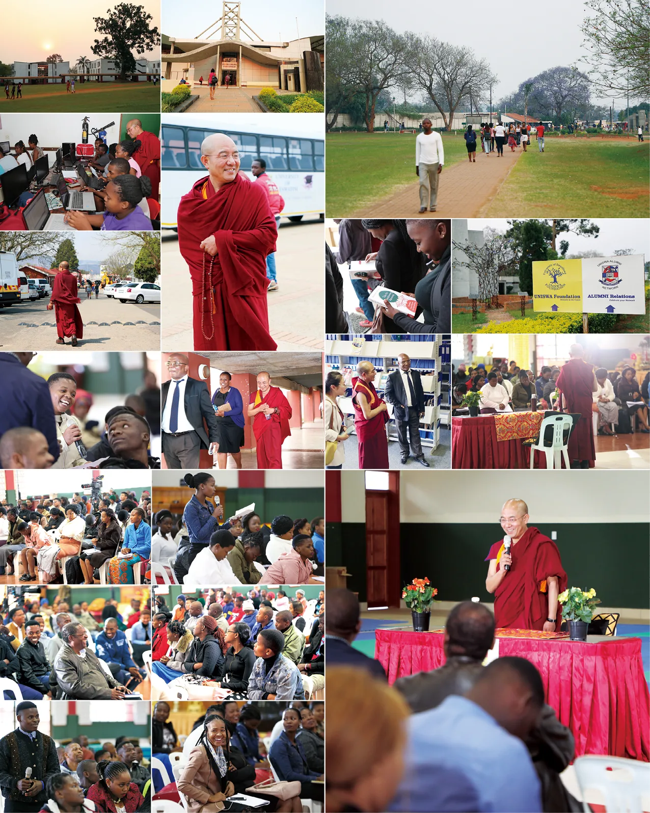
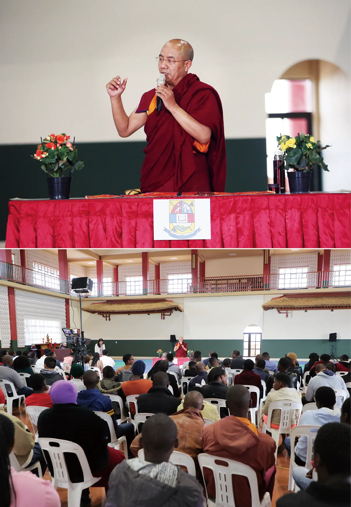

不管你原来的信仰是什么，

我都不建议改变。

第162场

斯威士兰大学

University of Eswatini

斯威士兰

2018 / 9 / 20

## 如何实现生命的意义

## How to Realize the Meaning of Life

主持人：

各位上午好！

首先，我介绍一下今天的演讲嘉宾索达吉堪布。他身着红色的僧袍，正微笑着向我们走来。堪布能莅临我校，我们深感荣幸！很快，大家就可以听到他的演讲。演讲之后，是我们的提问环节。堪布慈悲而有智慧，喜欢和听众沟通，尤其喜欢和大学生交流。希望大家到时不要拘束，踊跃发言，轻松参与。

非常感谢宗教系的史菲尔教授以及在座的各位同学！今天的演讲时间安排得比较特殊，午饭可能会晚一点吃，希望大家坚持一下。我个人比较喜欢在空腹的时候学习，因为吃得太饱容易昏沉、瞌睡。大家听完课再吃饭，可能效果会最好。

昨天我去了你们学校的物理实验室、化学实验室，与科学和管理相关的各个系，以及你们的图书馆。这些地方给我的感觉各不相同，但印象最深的是图书馆——里面收藏了所有斯威士兰人所造的著作。据介绍人讲，你们民族和国家的任何一位作者所造的任何一部著作，在图书馆都可以找到，它们全部陈列在一个专门的馆室内。这一点，跟世界上很多图书馆有极大的差别。

我今天跟大家分享的话题是“如何实现生命的意义”。我们每一个人，都比较关注自己的人生价值和生命的意义。那么，如何才能实现生命的意义？进行怎样的思考和探索，才能把握自己独特的生命价值和究竟意义？

## 站在金字塔顶，可以看见真相

据说，今天在座的全是宗教系的同学。我相信和其他系的同学相比，大家一定会有更多的空间和方法来思维人生的暂时价值和究竟意义，因为对宗教的研究和探索，本身就属于人类生命最高层次的精神活动。

曾经有位学者把人类的生命状态比喻成一个三层建筑，像金字塔一样，底层比较宽，越向上越窄，最后是一个尖尖的顶。处于第一层的人，比较关心物质，依靠以物质为核心的种种理念来经营人生。他们认为，生命的意义就是为了生存和生活，需要依靠外在的物质实力来体现。第二层的人主要是创作型、学习型和研究型的。他们的人生价值在于对文化艺术的追求，或获得丰富的专业知识。第三层的人是各类宗教人士。他们舍弃自我，超越自我，以宗教的思想来体悟人生的价值和意义。

刚才听这里的教授说，你们绝大多数是宗教系的，我的心情一下子变得有点特别，充满了温暖和感动。我去过全世界的很多学校，在这个时代，选择宗教专业的人相对而言不是太多。站在金字塔顶尖上的人，一般来说是比较少的。从某种意义上讲，人类心灵最深层的宝藏，依靠宗教的理念完全可以开发和挖掘出来。换句话说，通过宗教的理念和方法，人类完全可以通达宇宙人生的真相。

## 人生应避免的三种歧途

其实，不管是非洲人、亚洲人，还是欧美人，每个人的人生目标都有所不同。一个非常贫穷的人，最关心的是一天的温饱，他的人生意义是能不能找到食物，能不能活下去。一个正在牙痛或头痛的人，最关心的是如何尽快治好身上的疾病。而在校的大学生，最主要的人生目标是顺利完成学业，日后找到满意的工作。

尽管每一种人生目标都值得尊重，但以下三种人生歧途，却是我们应该竭力避免的。

### 1．人生目标不明确

我们活在这个世界上，需要想清楚一个问题：为什么而活？现实生活中，很多人因为没有明确的人生目标，一旦跌入人生的低谷，就草率地做出错误选择。比如，因为失业，因为失恋，因为破产，因为丑闻导致的身败名裂，总之，因为各种各样的不如意，便选择自杀。一个没有生活目标的人，一旦人生灾难突然降临，没办法继续过正常的生活时，他就觉得无路可走了，只有去跳崖、跳楼、跳海……非常可惜。

我们的人生，是一条没法回头的单行道。在这条长长的单行道上，会有非常美好的景色，也会有特别不悦意的场景。不管怎么样，我们都不可能回头，也不需要回头——只要勇敢迈步，总会有路可走。无论什么样的经历，苦也好，乐也好，对自己的人生而言，都是一种历练，都是一种财富，都需要我们用心去体悟。

所以，在座的各位同学，即使以后你们的人生遇到了最大的麻烦，跌入了最深的谷底，也千万不要结束自己的生命；即使你感觉精神崩溃，勇气殆尽，再也无法站起来，也不要用最不明智、最不理性的方式对待自己的人生。

乌云密布的时候，虽然会打雷下雨、降冰雹，但阳光明媚的晴天很快就会出现。人生也同样如此。遇到麻烦时，如果我们表现得勇敢一点，坚强一点，很快就可以走出困境。任何一个人，都不可能永远痛苦，永远处于阴暗之中，总有苦尽甘来的一天。

我们要经常串习这样的勇气。否则，一旦人生的不幸突然降临，即便自己很想表现得坚强一点，事实上也很难做到。按照佛教的理念，平时就要懂得修心，不断训练自己。这颗心如果串习得好，那不管遇到什么样的痛苦和麻烦，自己都能轻松应对。

### 2．不健康的生活方式

在生活中，有一部分人经常抽烟、酗酒、吸毒以及淫乱，以种种不健康的生活方式损害自他。我们的人生需要身体的健康，也需要心灵的健康。而这些人不愿意洁身自好，只想放任自流，一旦染上了身体的各种重症，比如艾滋病，或者患上了心理的各种疾病，比如抑郁症，就很难治愈了，也很难拥有幸福的人生。所以，我们一定要学会保护自己的身心健康，也要懂得保护别人的身心健康。

当前的人类社会，东西方许多国家都比较混乱。在这样混乱的社会里，我们尤其应该保持清醒的头脑，选择健康的生活方式，走一条充满光明和智慧的人生之路。

### 3．不尊重其他生命

在这个世界上，每一个生命都值得我们尊重。可是，却有一部分人，经常捕鱼、打猎、虐待动物，甚至虐待自己的亲朋好友。不尊重别人的生命，无视别人的生命价值，以玩耍、嬉戏或者好奇的心理，无情地戏弄甚至伤害别人宝贵的生命，这样的行为非常恶劣，我们坚决不能学。

我们每一个人最珍爱的，就是自己的生命。世上所有的生灵，甚至一只小小的蚂蚁，也非常怕死，也喜欢在这个美好的世界好好活着。因此，我们应该爱护所有的生命——像爱护自己的生命那样去爱护其他的生命。

## 如何实现生命的意义

接下来，我想问一下在座的同学：你们在生活中最关心什么？我想，很多人可能会关心WIFI信号，渴望得到一部好的手机、电脑或其他电子产品……这些想法当然无可厚非。因为，有了上网的条件，我们可以掌握来自世界各个角落和领域的新知识，学识会更加渊博；网络上丰富的信息让我们变得见多识广，充满包容，不再那么保守狭隘。这是互联网给我们带来的便利，当然是很好的。

我最近了解到，不论东方还是西方，现在都有很多国家在关注非洲这块古老而肥沃的宝地，都想来开发，都想来挖宝。照这样发展下去，将来你们非洲国家的物质水平会越来越高，会拥有越来越多新奇便捷的电子产品。

不过，这究竟是一件好事还是坏事，真的很难说。随着科技力量的不断提升和全球经济的不断发展，世界上许多古老而独特的文明都在逐渐消失。这是现代社会给我们带来的损失，当然是不好的。

在这个好与不好混杂不清的时代，我们应该如何实现自己生命的意义呢？

### 1．认清“需要”和“想要”

我出生在藏地。这块土地上的民风过去非常淳朴，人们心地善良，性格单纯，喜欢载歌载舞，对自己的传统和文化特别热爱。然而，随着西方文化的渗入和泛滥，这种简单快乐的生活已渐渐离我们远去。物质生活越来越丰富的同时，大家的生活节奏也越来越紧张，精神生活也越来越匮乏，心灵智慧也越来越迟钝，幸福指数更是越来越下降……

当物质财富变得越来越多时，内心的幸福感和满足感会不可避免地越来越少，这似乎已成为一种规律。

我年轻的时候，哪怕只穿上一件新衣服，也会非常开心，非常快乐。要是从别人那里得到一颗糖，更是特别满足。然而，与我当年同龄的现在的年轻人，不管得到多少件新衣服，恐怕也不会满足。不但不满足，还会变得更加贪婪，生起更强烈的欲望。

现在的网络，不断推出五花八门的广告，各种高档的名牌衣服不断刺激人们的欲望，诱惑人们的心灵。很多人特别想要，却因为太贵买不起，备受求不得苦的折磨。

以前在我们村里，谁要是买了一辆摩托车或者自行车，会觉得非常方便，非常满足。而现在呢，即使已经买了一辆小汽车，但一看外面有人开着更好的汽车，显得更有身份，心里就不满足了。于是想办法拼命挣钱，也要买一辆这样的好车，以提升自己的身价。在一个小村里获得的成就感，满足不了他的欲望了。

听说你们这个地方的人，心态都很好，很容易满足，哪怕只是得到一块很小的食物或一个很小的东西，也会特别开心。但是，将来物质财富越来越丰富时，现在感受到的这种幸福，可能会永远消失，再也找不回来。

现在这个时代，人们看到的非常多，想要的也非常多，可自己的能力往往又够不着，需求和欲望之间的距离非常大。人活在这个世界上，真正需要的东西其实并不多，但心里想要的却远远超过了这个量。有统计结果显示，一个人在生活中拥有的物质，想要的占了70%，真正需要的却只有30%。事实上，人的欲望恐怕还不止于此。假如我有3件衣服就够穿了，但只要条件允许，我可能想得到20件。

在这个全球化、大众化的网络时代、信息时代，任何人想要“退群”恐怕都不太可能。21世纪的全球化风潮，把世界上所有的人都挟卷在一起，没有谁能够置身“群”外。

但越是这样，越要保持清醒的头脑。大家在满足自己的需要时，应该以宁静的心灵和深度的智慧去观察：到底有没有这样的能力和因缘？如果明知命里没有，还要特别强求，只会增加自己的麻烦和痛苦。

### 2．学会独立

而且，如果我们真的很想得到某个东西，一定要通过自己的努力去争取。不应该将人生的所有愿望都寄托在父母、亲戚或者朋友身上，理直气壮地一直等待。任何一种生命意义，都应该建立在人格独立和经济独立的基础上。没有这个基础，其他的都是空谈。

在西方很多国家，孩子到了16岁或18岁，父母会给孩子充分的自由和压力，帮助他们不断地成长。生活中的很多事情，孩子都必须依靠自己的勤奋和努力去完成，包括挣钱养活自己。

我不知道在你们这里，年轻人的经济独立和就业情况怎么样。不过我觉得，你们作为大学生，如果家里的经济条件不太好，自己还是应该去努力挣点学费。可以利用放假或者其他闲暇时间，到图书馆、小餐厅等有短时服务工作的地方，去当钟点工或服务员。

大家一定要学会自己挣钱，千万不能从小养成懒惰或者指望别人的习惯和心理。在美国，有一些大学生非常能干，白天和同学们一起准时到学校上课，认真完成自己的学业，晚上就去地铁站、小餐馆或有夜市的地方打工挣学费。作为一个人，我们一定要有坚不可摧的意志，也要有勤奋努力的勇气。

### 3．追求真理

在座的各位同学，要理解生命的价值，一定要通过学习来认识自己，认识世界，认识真相。生而为人，如果糊里糊涂地来到这个世界，又迷迷糊糊地离开，这是很不成功的人生。只有利用自己宝贵的生命，不断学习，不断探求宇宙和生命的真相，才最能体现生命的意义。

大家能考上这样的大学，非常不简单。我看过一个报道，你们国家的小学教育普及率是百分之百，初中的普及率有百分之四五十，而大学的普及率只有4.4%。可见在你们这里，能上大学的人是不多的。而你们能读这样的大学，肯定具有很好的能力和智慧潜力。

大学时代是一个人追求真理的最好时光，而我们只有一次读大学的机会。所以大家在大学期间，千万不能懒惰、散乱，以无知和无聊打发时间，一定要进行有深度的学习和钻研。不管你所学的专业是历史也好，宗教也好，政治也好，凡是学业涉及的学科都应该下功夫学好。

你们学校开设的综合性课程所含摄的知识非常丰富。你们能在这里把自己的青春用于学习知识和探求真理，是一件非常有福报的事，也是一件非常快乐的事。美国物理学家富兰克林曾说过：学习真理的人，上帝也会保护 [^1]。

按照佛教的教义，人生最有意义的事就是勤奋学习。而且每一门知识都不能肤浅地草草带过，应该进行深入的研究和探讨。还应该以一颗开放包容的心，互相提问，互相辩论，培养自己的批判思想，开发自己的智慧潜力。

### 4．学习宗教

你们学的是宗教专业，所以我建议你们在保持自己原有信仰——比如基督教或者伊斯兰教——不变的基础上，以开放的心态学习一下其他宗教。不要把自己局限在一个固有的圈子里：“哦，我是基督教徒，除了《圣经》什么都不看。”这是一种错误的观点。

其实，佛教也好，印度教也好，犹太教也好，都有上千年的历史，都在人类文明的历史上书写过美好的篇章，都对各个社会、各个层次的人类心灵起到过非常重要的安抚与引导作用，都值得我们学习和研究。

可现在有些宗教研究者对其他宗教根本不了解，却轻率地进行反驳和排斥。这并不是追求真理的态度。任何一个宗教，如果深入地去了解，可能都不是我们想象的那样简单。佛教里有一种观点——因为无知，会犯很多错误。

所以，不管你原来的信仰是什么，我都不建议改变，但是我建议你认真学习一下其他宗教的思想。也许，你的人生将由此而获得非同一般的意义。

其实，包括科技知识在内的很多世间知识所无法解决的各种心理问题，在宗教内部都有很好的解决方法。我希望你们经常运用宗教的方法，比如禅修、冥想以及各种仪轨，来认识自己的内心。一旦认识了自己的心，世间万物的一切现象和变化，个人生活的一切烦恼和痛苦，都将变得非常简单，不足挂齿。你将轻轻松松认识它们的本来面目，并将它们化繁为简，化有为无。

我的演讲还需要一些时间。你们现在饿不饿？饿也没办法，因为你们有点小小的迟到，不能怪我（众笑）。看嘛，有些人现在才到。不过也挺好，大家都比较随意，这跟我们藏地的节奏比较合拍。但西方人不一样，西方人比较守时，说好10点15分到，他们一定会在10点15分准时出现。不过今天情况比较特殊，因为交通工具等原因吧，没关系。

### 5．有一颗善良的心

其实，生命的意义归根结底是拥有一颗善良的心。你们有没有听说过莎士比亚？这位非常著名的英国作家，曾说过一句名言：“善良的心，就是黄金。”

我的老师堪布晋美彭措，是20世纪上半叶到21世纪初一位非常伟大的学者和修行人——他已经过世了。他曾说过，他一生最珍贵的教言如果归纳起来，就是要有一颗善良的心和种种善妙的行为。

金子和钻石在任何国家、任何时代都是有价值的，都非常珍贵。如果我们有一颗善良的心、不害众生的心、一心一意帮助别人的心，不管是待在亚洲、非洲，还是其他大洲，对所有不同肤色的人来讲，我们都会像金子和钻石一样珍贵。

这个时代，特别需要心存善良的人。一个人如果心存善良，不管是国家元首、部落酋长，还是大学老师，甚至只是一个小小的班干部，他都能让与他有缘的群体获得快乐。

人的一生，会发生许许多多的事情，人们的追求也各种各样，但不管怎样，始终保持一颗善良的心，才是最有意义的人生。对于这一点，我们用智慧稍做观察就会知道。

我记得上个世纪八九十年代，有一部浪漫主义的电影，叫《走出非洲》（Out of Africa）。不知道在座的同学有没有看过。我以前看过，现在还有一些印象。讲的是一个丹麦女性对人生的回忆和总结：

刚开始，她想当男爵夫人，于是想尽一切办法，嫁给了非洲东部的一个男爵。然而，他们婚后的感情并不甜蜜，她没有得到梦寐以求的幸福生活，反而感染了男爵的传染病。后来，她和另外一个白人发生了婚外恋，算是拥有了一段美好的爱情。但后来出现无常，这个白人因飞机失事，离开了人间。她原来在非洲经营农场和咖啡馆，赚了很多钱，生活很富裕，然而一场火灾把这一切变成了灰烬。最后，她没办法在非洲待下去，一无所有地回到了自己的国家……

这部电影给我们的启示是什么呢？最初，她追求男爵夫人的名声和地位，但短短的时间内便失去了；后来，她追求感情，也很快没有了；她追求的金钱和物质生活，到最后也化为乌有……等她两手空空地回到欧洲，才发现她和非洲土著居民的真诚交往，才是她人生最有意义的东西。其中有个阿非利加人，因为他的淳朴善良和无私精神，令她非常感动。这部电影上映以后，获得了很多世界大奖。当然，它得奖的原因，可能并不是因为表现了利他或者善良的主题。

我对这部电影的解读是：每一个人年轻时追求的金钱也好、名声也好、感情也好、地位也好，不一定能如愿以偿——但这并不重要。最重要的是什么？在自己的生命中，曾经用一颗善良的心，一颗淳朴的心，去真诚地帮助过别人，温暖过别人。

在非洲本土，有很多热情而富有爱心的人，这是千金难买的。但是，随着社会经济的变化和发展，这种善良淳朴的心将来可能会受到冲击。所以我希望各位同学好好保护你们国家的文化，努力把这份善良淳朴保留下去。在座的各位都有这个责任。

作为一个人，你成不成功，出不出名，有没有财富，都没有关系。我记得美国有一位名叫马娅·安杰卢[^2]的学者，她得过三十多个荣誉博士学位，跟马丁·路德·金[^3]曾有过一段合作，在当时非常出名。她说过一句话，给我的印象比较深刻：“你说过的话，别人不一定记得住；你做过的事情，别人不一定记得住；但你给别人留下的感受，他们永远不会忘记[^4]。”

来到这个世界，每一个人都是出色的演员，但扮演什么样的角色，需要自己决定。你是愿意扮演坏人，给别人留下野蛮暴躁、恶口谩骂的恶劣印象呢，还是愿意扮演好人，给别人留下温柔善良、和蔼可亲的美好印象？

### 6．给世界留下价值

我们藏传佛教里有一位名叫南秋弥举多杰[^5]的伏藏大师——我前两天坐飞机的时候一直看他的传记，他在世的时间并不长，从1645年到1667年，只活了22岁，但他却对整个藏传佛教做出了巨大的贡献。所以我认为，一个人的生命长短并不重要，只要能给这个世界留下有价值的东西，就是对社会有利的，也是对自己负责的。相反，如果对社会和家庭没有什么贡献，即使活到一百岁，也没有什么意思。

为了实现这个目标，我们需要把学到的教言落实到行动上。否则，一切都停留在口头上，即便我们有美好的愿望，也没有什么用。我们藏地历史上有一位非常著名的智者，名叫贡塘丹毕准美。他写了一本叫《水木格言》的书，里面有一句话：“多闻若未实修，则于自心无益，百年住于水中，石性干燥而存。”就是说，一个人如果不把学习的道理用于实践，即使活一百岁，也不会有任何进步，就像在水里泡了一百年的石头，本性还是干燥的，不会被浸湿。

我是这么认为的：这一生如果没有学习，没有对社会做贡献，即使活得再久也没有价值。我不知道自己能活多长时间，但活着的时候，哪怕能让一个人的身心得到一丝一毫的快乐，我也觉得是有价值的，有意义的。

最后，是我今天演讲的总结。希望在座的各位年轻人，一定要热爱学习，一定要勤奋工作，一定要有善良的心。做到这三个“一定”，不管你是什么样的人，都能体现生命的价值，都能实现生命的意义。

现场互动

问：佛教怎么看待前后世？

堪布：前生今世并不是只有佛教才承认。在非洲也好，美洲也好，世界上很多地方都有回忆前世的真实案例。一位美国学者[^6]在这个领域研究了一辈子，找出了前生后世存在的很多证据。佛教也同样承认这一点。

问：受科技化和现代化冲击而失去传统价值观的国家，还有希望吗？还能重新回归原有的价值体系吗？

堪布：你说的这种现象确实比较可怕。虽然在我们藏地等个别地方，现在还保存着比较传统的佛教，但在其他地方，佛教正在不断地被物质化、世俗化。其实不仅仅是佛教，包括天主教、伊斯兰教在内的其他宗教，也都在经历庸俗化和世俗化的变异。这就是现代科技给我们带来的负面作用。不仅仅是宗教，整个人类的传统文化都受到了不同程度的打击，所有的传统文化都需要拯救。

问：佛学家和哲学家有什么区别？像孔子这样的哲学家，也教导人们要追求生命的意义。请问，哲学家的教授和佛教教义有什么不同呢？佛教是归属于哲学，还是宗教呢？

堪布：孔子确实讲了一些人生哲理，但这些哲理只是对自己家庭和种族的一种关心和爱护，没有遍于所有众生。西方哲学也同样如此。而佛教关心的是人们的今生来世及一切万法暂时和究竟的实相。刚才发言的教授说得对，佛教并不是虚无主义，也不是现实主义。不管是表面的现象，还是深层的奥义，佛教都会关心。关于这一点，佛教的经论中有明确的阐述。

严格意义上讲，佛教既不是哲学，也不是宗教，而是一门关于宇宙人生真相的教育。在这个教育体系内，目前流传下来的由佛陀亲自宣讲的佛经大概有一百多本，印度大德的著述大概有两百多本，藏地、汉地和其他地方的大德们的论述就更多了。所有这些经论著疏加起来有好几千本。

我从各方面研究过，佛教应该是一门综合性的学科。不论是天文、地理和哲学，还是科学、人文和法律，佛教中都有详细的阐述。佛教是一门古代和现代相结合、永远不会过时的综合性教育。

问：我一直都在看这些图片，图片上的这些塑像有名称吗？各自有什么含义？

堪布：你们是宗教系的学生，应该对此有所研究。这个问题我不回答，你们自己慢慢去探索。

问：您刚才提到，佛教和当今这个科技全球化的世界是脱离的，那么佛教徒是否都过着出家人的生活？

堪布：正如大家所知道的那样，基督教徒不可能全都去当牧师，全都在教堂里待着，很多基督教徒其实是在各个不同的地方做慈善，比如建医院、建孤儿院，等等。

佛教徒也是一样的，并不全都住在寺院里。佛教徒分为两部分，一部分是在家的，另一部分是出家的。在家的这一部分，有的在乡村，有的在城市，从事农业、牧业、商业、工业、科技等，总之各行各业的人都有。至于出家的，当然会有一部分待在寺院里面，另一部分也会到全国乃至世界各地去，讲一些真理，做一些慈善。

问：作为佛教徒，在维护佛教传统的过程中，要承受多大压力？

堪布：这个问题问得非常好。

今天的讲座，大家都听得很认真，气氛非常好。现在已经是下午了，不知道大家饿了没有，从你们的表情也看不出来。我觉得在座的各位老师和同学都在认真地探索生命的意义。

我们作为佛教徒，对佛教传统的维护义不容辞。事实上，大家对此十分担忧。随着现代科技的迅猛发展，日新月异，不仅仅是佛教，人类许多古老的非常有意义的传统文化也不断受到侵蚀，不断消亡。处在这样的时代，你们年轻人可能需要负起责任来。如果现在没有认识到这件事的紧迫性和重要性，多年以后你们也许会发现，很多非常有价值的宗教和传统，已在这个地球上消失不见了。

我今天在这里呼吁，大家要一起努力，保护宗教，保护传统。我们佛教徒要努力，在座的各位也要努力。现在很多人觉得传统意味着陈旧，意味着落后，没有必要保存下来。事实并不是这样。比如说，我们人类的起源在非洲大陆，非洲有着非常古老的文化。对这些古老而珍贵的文化，我们每一个人都有责任去保护，去弘扬。

[^1]: 富兰克林（Benjamin Franklin, 1706-1790）：信奉真理的人，必受天佑。
[^2]: 马娅·安杰卢（Maya Angelou，1928-2014），美国作家和诗人。出版了６本自传，５本散文，数部诗集，写作生涯超过50年，获得了众多奖项和超过30个荣誉博士学位。
[^3]: 马丁·路德·金（Martin Luther King Jr. , 1929-1968），美国牧师、社会活动家、黑人民权运动领袖。毕生致力于以非暴力手段追求种族平等，1964年获得诺贝尔和平奖。1968年遇刺身亡。
[^4]: 原句为：I've learned that people will forget what you said，people will forget what you did，but people will never forget how you made them feel．
[^5]: 南秋弥举多杰（1645-1667），大伏藏师，开启了伏藏南却（天法），在白玉寺得到传承。其上师是撰著《极乐愿文》的乔美仁波切。
[^6]: 即史蒂文森博士（Ian Stevenson，1918-2007），美国弗吉尼亚大学的生物化学和精神病学教授，国际著名的轮回研究专家。他毕其一生，从印度、斯里兰卡、巴西、黎巴嫩和一些欧洲国家，搜集了数千个轮回转世案例，并进行深入研究。1966年，他选取了最有说服力的20个案例，出版了一本书，叫《二十案例示轮回》（Twenty Cases Suggestive of Reincarnation），在美国引起极大轰动。2004年，他写了人生的最后一本书，即《欧洲典型的转世案例》（European Cases of the Reincarnation Type）。
