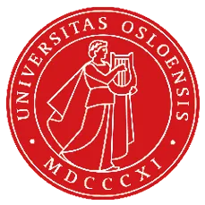
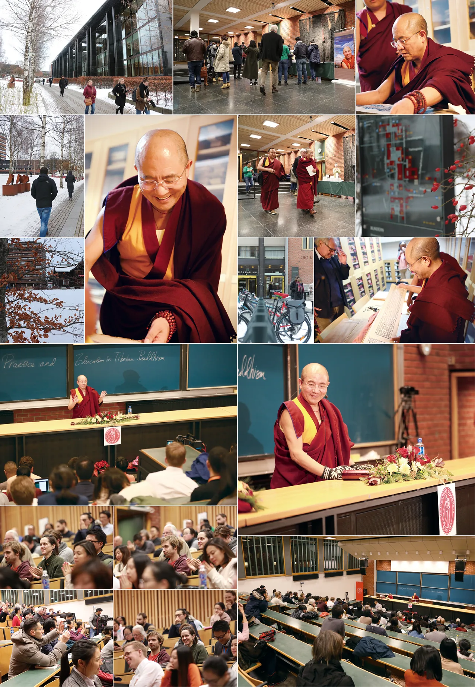
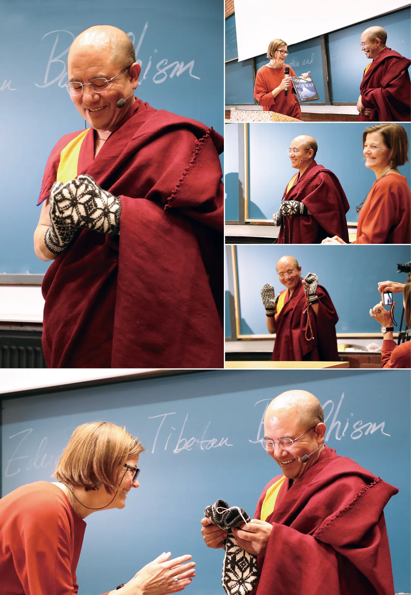
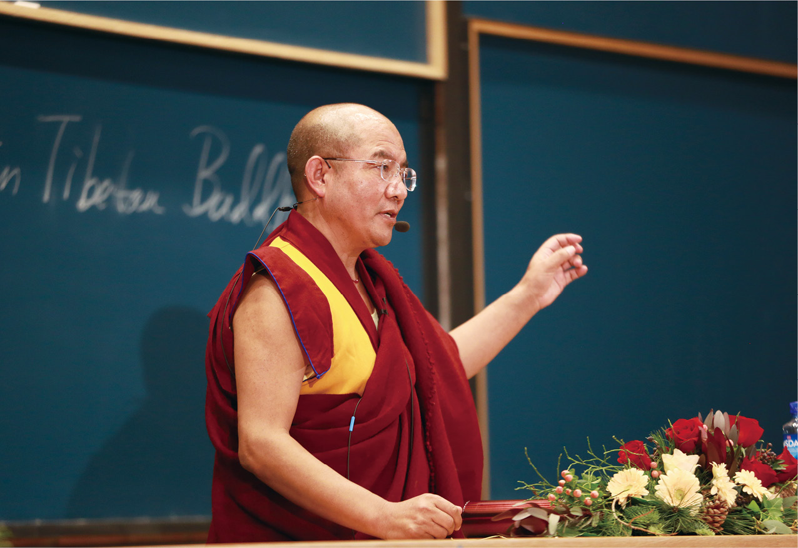
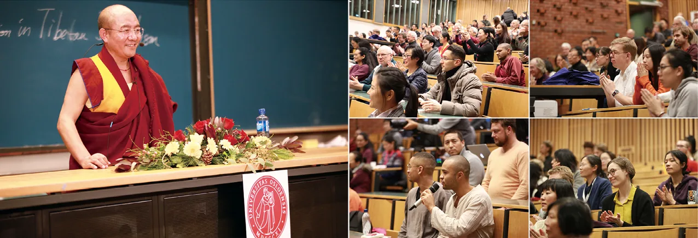

追求智慧的过程

往往比较艰苦、漫长，

我们一定要保持热情。

第158场

挪威奥斯陆大学

University of Oslo

挪威·奥斯陆

2017 / 11 / 30

## 藏传佛教的修行和学习

## Religious Practice and Education in Tibetan Buddhism

汉娜·哈夫内维克教授：

非常荣幸能为大家介绍来自喇荣五明佛学院的索达吉堪布仁波切。这几年来，我们一直希望堪布能来奥斯陆大学交流。去年堪布的来访计划因故不得不取消，但今年很幸运，他终于来了！

堪布是一位公认的极具影响力的藏传佛教上师。堪布于1985年出家，依止著名的法王如意宝晋美彭措仁波切修学佛法。基于佛教当中的五门学科，法王如意宝创建了喇荣五明佛学院。而为了延续法王如意宝的传承，堪布肩负起护持学院的重任。

在获得堪布学位之后，堪布开始参与佛学院的管理工作，并担任法王如意宝的汉语翻译，将大量的藏传佛教经论译成汉语，并在过去的三十多年中坚持讲经说法。近年来，堪布受邀到海内外的高等学府演讲，并针对当今时代的重要问题开展学术交流。到目前为止，堪布的足迹已经遍布亚洲、欧洲和北美。

堪布与法王如意宝一样，非常重视跨文化和跨宗教交流，这使喇荣成为不分教派的佛学院，而不仅仅是宁玛派的佛学院，供四众弟子闻思修行。大家都知道，藏传佛教最初主要在中国的藏区弘扬，然而，在过去的半个多世纪中，藏传佛教广泛传播于整个中国以及东西方的很多国家。在社交媒体上，堪布拥有上百万的粉丝，你甚至可以在北京首都机场看到堪布的畅销书。

我们为堪布准备了一些礼物，现在就请奥斯陆佛学研究论坛的教授，将礼物赠送给堪布。

佛学研究论坛的教授：

您能莅临奥斯陆大学，我们深感荣幸，也非常高兴！相信您的到访能让我们的佛学研究更上一层楼。

汉娜·哈夫内维克教授：

宗教研究系也准备了一份礼物，是一本挪威的风景书，因为我们非常希望堪布能够再次来挪威，最好明年就来。

此外，在过去的二十多年中，我们一直和中国的大学有学术合作，主要是少数民族大学，这其中也包括西藏大学。现在有一百多位藏族学者在挪威学习，他们的研究涉及多个领域，其中的一些学者制作了这本精美的《城市地图集》。这本书是汉藏双语的，也送给堪布。

最后，我自己还有一份小礼物要送给堪布。喇荣跟挪威一样，天气非常寒冷，它的海拔很高，位于青藏高原的牧区，有时候温度会达到零下20摄氏度，冬天的时候会更冷。所以，堪布需要保暖。这是一副我妈妈亲手织的手套，上面有挪威特有的八瓣玫瑰图案，希望堪布会喜欢。

今天堪布演讲的题目是“藏传佛教的修行和学习”，有请堪布——

很感谢教授以及在座的老师们，为大家创造了这一平台，让我们有机会一起学习！同时也非常感谢大家送我这么多的礼物，感激之情无以言表！

我在几年前就收到过奥斯陆大学的邀请，本来今年年初就要来的，但因为种种原因，不得不暂时取消行程。当时给很多人带来诸多不便，非常抱歉！

对我而言，昨天比较特殊，因为我早饭是在瑞典吃的，午饭在丹麦，晚饭在挪威。第一次来北欧，就享受到了这种穿越的待遇，感觉很新鲜。不过大家可能早已习以为常了。

刚才，我和几位教授和研究生聊了一下藏传佛教，又去图书馆参观了一下，发现那里的藏文书籍特别多，有些在我们传统寺院里都难得一见。这让我觉得，保护文化遗产真的非常重要。

今天的主题是“藏传佛教的修行和学习”，题目有点大，你们也知道，藏传佛教又深又广，短短一堂课肯定说不清楚。我年轻时开始学藏传佛教，日日夜夜地修行和学习，但说来惭愧，至今也是所得甚少，不过沧海一粟而已。所以，今天跟大家分享这个主题，不知道有没有实质性意义。

我听说你们宗教系有很多人从事“宗教对比”研究，所以我就把藏传佛教传承过程中沿用至今的一些主要做法，简单介绍一下，供诸位比较和参考。

## 经得起观察的佛教教育

总的来讲，我希望大家把佛教理解为一种教育。事实也是如此，藏地各个寺院当中，都设有佛教课程，传授佛教知识。虽然这些知识都是佛陀的教义，但我们并不会因为佛陀本人的权威性而直接接纳它，信仰它，我们对每一条教义都要做最细致的分析、最深入的抉择乃至最广泛的比较，在遣除了各种怀疑并认识到真理之后，我们才会生起定解，进而趋入。

我知道世界上所有伟大的宗教都很优秀，它们赐予世间无尽的饶益，在伴随人类向前的漫长历史中，自身也经历了各种风雨和坎坷，并生存至今，可以说不可思议。但最近人们也发现，在这些宗教当中，佛教尤其是藏传佛教，因为它不把佛陀当作神、更强调智慧而非信仰的属性，让它在一代一代的传递中，渐渐养成理性观察和思辨的模式，进而得到了现代人的普遍认同。尤其是在心灵科学和认知科学领域，有些学者在借鉴后获得了突破性成果。比如昨天我在隆德大学遇到一位心理学教授，他研究心理学二十多年，他毫不隐讳地告诉我，在他所给出的科学解答中，很多都源于佛教的启示。

在座也有一些心理学以及科技领域的学者，有多年的研究经验，也获得了很多研究成果。大家也可以观察一下，看看佛教是否能够为我们的研究带来启发。也许会的，因为人类的很多发展，往往就是从开放的学习中获得的。

## 完备的佛法教育体系——闻思修

回到主题。下面我介绍一下藏传佛教的“闻思修”，这是我们最主要的研究和教学体系：首先是听闻，了解法义；听闻之后进行思辨，生起定解；最后在定解的摄持下修行。藏传佛教的所有教育都不离开这个体系。

我们若想听闻佛法，首先就要找一位非常合格、具有法相的老师。当然，关于老师的标准和资格，声闻乘、大乘以及密乘中都有所不同，但不管怎样，哪怕学习世间的一门学科，如果没有好老师的指导，自己再聪明，看的书再多，也很难掌握它的精髓。同样，对佛法而言，如果没有在一位具相善知识面前好好听闻、学习，也很难掌握其真正的内涵。

如今，不论是在东方还是西方，有很多人对藏传佛教感兴趣。有些人可能只是盲目地追随潮流，但还有很多人的确是通过学习藏传佛教教义，增长了智慧，验证了真理，从而对其产生信心。

藏传佛教中有非常完整的依止老师的体系，不知道去过藏地的人有没有同感？西方高等大学中的导师制度和藏传佛教中依止老师的方法也有相似之处。为什么这样讲呢？因为藏传佛教非常重视传承，一位老师首先要有某部法的传承，才有资格给别人传授，否则，仅凭口才出众是没有资格给别人传法的。而高校中的导师也需要达到一定标准，并非谁都可以担任。

## 什么是传承？

下面，再跟大家分享一下藏传佛教中的“传承”。大家也可以对比看看：它与高校的学习方式是否有相似之处？

所谓的“传承”，实际上是由佛陀本人传给弟子，再传到历代祖师，并一直延续到现在。此外，对每一部论著而言，完整的传承是从作者本人持续到后代，没有间断。有传承的人可以给别人传，将这部法延续下去，相反，如果没有这个传承，就不能传授。从古至今，藏传佛教中一直遵循着这样严格的规矩。

在诸多的传承方式当中，最常见的是“陇称”，也就是说，不论是佛陀所讲的大藏经，还是后来历代大德们所撰写的论著，有传承的人要在你的耳边念诵一遍，以这样的口耳相传来获得传承。现在藏传佛教中依然秉持着这样的传统。一般来讲，听一部短的经论很简单，但若要听整部《大藏经》，恐怕需要六个月的时间。这种传承方式能传递一种加持力。

按传统来讲，如果你要学习、研究某一部经论，最好先去有传承的上师处得一个传承，这意味着你将获得学习、研究这部法的授权。很多人为了得一个传承，翻山越岭也在所不惜。大约在2011年，我跟另外一位堪布，每个周末都要从佛学院乘车到另外一个地方听传承，路程大概有两百公里，而且路也不好走。每次驱车过去，在那里听两个小时的传承，然后再赶回佛学院，就这样坚持一年听完了两部法的传承。这只是听传承而已，老师对教义并没有做过多解释。但藏传佛教的修行人对传承十分重视，我们聊天时也经常会聊到跟传承有关的话题，例如这人有某某法的传承，那人有某某经典的传承……

我建议奥斯陆大学的老师和同学们，不论研究哪一部法，最好先在有传承的人那里听一遍。从我自身的感受来讲，传承有非常强大的加持力，当然，这也许只是我的心理作用，但的确感觉非常不一样。

第二种传承方式叫“旺称”，也就是灌顶。自己得过某部法的灌顶，然后具足了某些特定的条件，比如圆满需要念诵的咒语等，这样就获得了给别人传授的资格。

灌顶分大众灌顶，也叫“重旺”，以及秘密灌顶，也就是“桑旺”。大众灌顶指的是可以给很多人灌顶，它的要求不是很高，像某些长寿佛灌顶等。而秘密灌顶就比较特殊，要求也比较高，比如说，只有修过加行，或者满足听闻密法条件的人，才允许在秘密的条件下接受灌顶。

第三种传承方式是“恰称”，也就是讲传。比如说，老师给你逐句逐句地讲解《入菩萨行论》，讲传圆满以后，你就有资格给别人传讲。所以，仅仅得到口传还不是非常圆满，最好是能得到讲传传承，这样一来，你以后也方便给别人传讲。

现在有很多人既没得过口传，也没得过讲传，自己随便看看书就给别人讲，这种做法并不一定非常合理。一般来讲，藏传佛教的每座寺院中，老师在传任何法前都要先得到传承。我觉得学术研究领域也应该遵循这样的传统，研究任何经论之前，先得到一个讲传传承，这样一来，对经论中的内容会更容易掌握。

第四种叫“门称”，也就是熟传。在密宗中，有些金刚上师会向弟子讲一些比较有针对性的引导，比如先讲解前行，再宣讲正行，之后再一步一步地讲解甚深密法。可能西方有很多上师给大家做熟传，以非公开的方式，为内部的弟子做一些实修引导。

第五个叫“绕称”，也就是深传。它指的是传授密法的上师，通过一些直指心性的方法，或者特殊的比喻等手段，让弟子当下认识自己的心。有些老师可能会讲一些密法中比较甚深的教言，但并非一定要依靠最深邃、最究竟的教言才能认识自心。有时候，老师仅仅用一些非常普通的语言就能直指你的心性。

最高的传承方式是“切称”，也就是独传。一般来讲，在非常甚深的密法后面会有传法的要求，有时候最多只允许七个人、三个人，甚至一个人听法。上师们在传法的时候，会通过种种方法来选择，最后确定只给极少数的人传法，甚至很多时候基本上是独传。

我的一座寺院曾经组织过“十七大续部”的一个灌顶，有三十多个人参加，但这个灌顶要求每次只能传给三个人，所以，当时只能是三个三个地来听受。此外，我有一位上师叫德巴堪布，我曾在他座下得到过堪布阿琼的一部密法。这部法要求最多两个人听，于是，我就跟另外一个人一起，用了大概半个月的时间听闻。原本还有一个人想要得到这部法的传承，但是没办法，最多只能同时传给两个人。

也许你们觉得独传没有必要，大家应该一起得受，没什么可保密的。但实际上不是这样。就像世间的研究生与导师互选一样，虽然有些导师不一定有特别多的学生，但导师与学生互相都有观察，具足一定的条件才会建立关系，而闻法的过程中也有很多要求和方法。

## 佛教中的逻辑思辨

下面讲一下“闻思修”当中的“思”。

藏传佛教很重视“思所生慧”，也就是当你听到一部法后，通过反反复复思维而生出的深刻智慧。如何思维呢？就是通过辩论、探讨等方式，加深对法义的理解。事实上，大学教育也比较重视“思所生慧”。例如，考试、辩论等学习方式在东西方的大学中都不可缺少，而这就是要训练同学们对每一个知识点进行思考和剖析的能力，从而遣除疑惑。

刚才有老师问我，到底什么是因明学？其实，因明学与西方的逻辑学比较相似，都是通过逻辑思辨理清问题，遣除疑惑。在学习藏传佛教的过程中，人们会互相辩论，用最尖锐的问题来攻击对方的观点。当然，即便如此，对方也不会生气，更不会耿耿于怀或互相吵架。我们在佛学院和寺院当中每天都有辩经，这种方式对自身真的非常有帮助。

我年轻时也特别喜欢辩论，这里有一段二十多年前的辩经视频，可能比较模糊，大家可以看一下当年的场景。我很喜欢学因明，刚才还跟这里的老师说，通过因明中的现量和比量可以了知一切法的真相，这对我们每个人的人生都十分重要。（播放视频……）

这段视频拍摄于二十多年前，当年佛学院的条件比较差，所以视频比较模糊。那个时候我还比较年轻，但人到了五十岁左右，一般就很少再去辩论场了。藏传佛教中有这样一种说法：年轻时好好学习、辩论，年老时精进修行。当然，也有一些例外。有些修行人即便已经白发苍苍，却依然活跃在辩论场里。

讲到闻思，不得不提藏传佛教的“五部大论”——戒律、俱舍、因明、中观、般若。

### 1．戒律

不管出家人还是在家人，都需要规范行为，而这种规范准则就叫“戒律”。有些人觉得佛教有太多戒律，条条框框的，不愿意接受这些约束，更向往自由。但这种想法不太合理。每个人固然喜欢自由，但行为上如果没有丝毫约束，从长远来讲，最自由的人恐怕会变成最不自由的人。

很多人对佛教戒律抱有种种误解，但事实上，戒律能让我们获得安乐。佛经中讲到，戒律是让身心得到安乐的手段，就像清凉的水和芬芳的旃檀。《正法念处经》中也说，戒律能保护别人的信心，也就是说，不令他人生烦恼的行为就是戒律。总而言之，在佛教中，戒律是所有功德和行为的基础。

### 2．俱舍

五部大论中的俱舍，也是非常重要的。它把宇宙万物的构成，包括人体的结构、生命的起源、临终时所要经历的现象以及内心世界的种种活动等，全部都讲得非常清楚。

### 3．中观

还有一门非常重要的课程就是中观。中观把我们所看到的种种现象的本质分析得十分透彻。在学习中观的过程中，我们主要讨论现象是不是空性，如果是空性，那它是“单空”还是远离四边八戏的“离戏空”等问题。

龙猛菩萨的《中观根本慧论》以及月称论师的《入中论》都是非常重要的中观论典。我在奥斯陆大学的图书馆里还看到了巴谢大师所造的《中观精华论》，不知道你们有没有研究过？这里有很多中观和般若的论典，但只是收藏还不够，大家一定要把其中的中观思想融入自心。学习了中观以后，我们就会发现，原来日常所看到的种种现象并非真实，不管是眼睛所见、耳朵所闻、双手所触……都不过是一些错误的信号。事实上，我们从未认识过事物的本来面目。

### 4．般若

五部大论中的般若，其代表作是《现观庄严论》，主要是讲，刚才提到的空性境界，可以通过修行在自相续中证悟，但证悟层次有所不同。这种证悟是循序渐进的，最终会获得至高无上的境界。而这其中所要经历的阶段，在《现观庄严论》里讲得一清二楚。

### 5．因明

因明主要是讲，佛教的种种道理，不是因为“佛认为如此”就必须接受，一定要通过真正的逻辑推理来证明。如果没有确凿的依据，只是自认为如此，这是说不过去的。

在座诸位学者都是追求真理的人，所以，因明中的逻辑推理非常重要，也非常有吸引力。如果因明不过关，很可能在人生中误解乃至诽谤真理。

一位奥斯陆大学的教授对我说，他研究《无尽意菩萨经》已经十多年了，但仍没有完全理解其中意义。对此，我非常认同。我们的智慧非常有限，有很多知识有待去学习、研究。虽然我很喜欢因明，对印藏两地的论典、注释几乎都看过，也传讲过一些，但不得不承认，自己的智慧在因明领域远远不够。我深深认识到，在求学的过程当中，应该要用公正、客观的智慧去衡量一切，否则很容易高估自己——因为自己读某个专业，或者看过某个领域的几本书，便自认为对这一领域了如指掌。事实上，还有很多未知的领域有待学习与探索。

有部电影叫《超体》（Lucy），里面也提到我们的大脑并没有被完全开发，因此对世界的了解极其有限。虽然这只是一部虚构的电影，情节也不是很完美——因为精神活动若想超越物质的限制，需要经历漫长的过程。但是，从某个角度仍可以说明一些道理。

不管怎样，追求智慧的过程往往比较艰苦、漫长，我们一定要保持热情。

## 最根本的修行方法——慈悲菩提心

我再简单介绍一下藏传佛教“闻思修”中的“修”。

藏传佛教中有显宗、密宗等众多的修行方法，但最根本、最主要的，就是修慈悲菩提心。慈悲菩提心是要让天下所有众生获得最高觉悟的一种发愿。可能有人认为，这个发心太大了，不现实。如果你这样认为，那也可以只关爱人类。

其实，这种爱是可以培养出来的。要想培养慈悲菩提心，不妨从热爱自己开始。现在有很多人不爱自己，甚至自虐、自残，乃至通过种种方式结束生命，这是非常愚痴的做法。现在各个国家有很多人心理失衡，患上抑郁症等种种心理疾病的人也越来越多。这是什么原因导致的呢？如今科技十分发达，人们将所有的精力都放在外境上，对自心的认识少之又少，正是因为这样，越来越多的人出现心理问题。如果我们经常通过禅修、修慈悲菩提心等手段来训练，就会逐渐认识自心，也会越来越爱自己，乃至爱身边的人。我们不一定能做出什么非常伟大的事业，但可以在内心培养伟大的爱，用这种爱对待身边的人，为他们带来快乐。

我们可以从发愿开始，逐渐实现这样的目标。比如，大家可以现在就发愿：一个月当中跟任何人都不发脾气。在这趟旅行中，我也是这样发愿的，希望自己对任何人都不发脾气。到目前已经出来一个多月了，基本上达到了这一目标。发脾气真的很没必要，每当遇到看不惯的事情时，我就闭着眼睛坐一会儿，过一会儿就不生气了。（众笑）

## 爱自己，爱他人

爱他人，不能只停留在口头上，应该发自内心地去爱，而且，并不是只爱自己的家人和好友，连那些对自己不好的人，我们也要去爱。这是藏传佛教当中最重要的修法。正如佛经中说，菩萨不需要修很多法，只修一法就可以了，这一法就是大悲心。也就是说，我们要先学会爱自己，然后扩展到爱别人。如果大家能经常禅修，修习慈悲菩提心，就能培养出这样的心态。

藏地历史上有一位非常伟大的人叫华智仁波切，他就像菩萨一样了不起。他曾说，如果一个人可以好好地修慈悲菩提心，即便一生中没有做其他的善事，仍然会得到解脱。所以，我们最好能通过禅修训练对自己的慈悲和爱，再将这种爱延伸出去——爱他人，这样的心态非常重要。

希望大家今天尽量能发一个愿：在以后的生活中尽量不发脾气，努力修慈悲心。如果能经常调整心态，让内心处于慈悲中，那无论身处何地，都会非常快乐。相反，如果我们整天抱怨，什么都看不惯，无论走到哪里，都会非常痛苦。

## 神奇的伏藏

听说奥斯陆大学很多人在研究伏藏，所以，接下来我简单讲一下伏藏。

伏藏是藏传佛教当中特别神秘的部分。到目前为止，藏传佛教中大概有两千五百多部伏藏法，每一部都有一段神奇的故事。我以前在西方的一些高校中也讲过与伏藏有关的内容，今天主要是和大家分享两个有代表性的伏藏大师的事例。

1993年，我去美国时见过秋阳·创巴仁波切在不丹的虎穴中所取的一个伏藏法，据说目前有两百多个道场都在修这个法。他当时开取的这一部忿怒莲师多吉卓罗的猛修法是意伏藏。意伏藏跟其他伏藏之间有一些差别，但这比较专业，此处暂且不讲，也算是引发大家的好奇心吧。

我们一起看一段创巴仁波切的纪录片，大概需要一分钟左右。（播放视频……）

片中的这位先生当时跟随创巴仁波切去了不丹。创巴仁波切来到虎穴后说：“将来堪布晋美彭措也会在这里取伏藏。”的确，后来法王如意宝1990年在那里取过一部莲师猛修的伏藏法。

第二个例子就是法王如意宝晋美彭措。法王虽然并非以取伏藏闻名，但一生中确实留下了很多伏藏品。

可能有些人不太相信伏藏，不相信莲花生大士能像在U盘中存储数据一样，把经续隐藏在虚空、湖水等地方，而一旦时机成熟，伏藏大师来到这里取到伏藏，依靠特殊的方法就能解开伏藏的密码，将其转变成文字。

下面跟大家分享一下1994年时法王如意宝在青海年保湖取金刚萨埵修法伏藏的视频片段。现在世界各地很多人都在修这个法，也多少知道法王这一修法的来源，接下来让我们一起看看当时的情况。（播放视频……）

当时法王从湖中取出了一个小宝箧，像海螺一样。回来以后就放在这边，然后大家通过念经，慢慢解开了它的“密码”。于是出现了我们现在念诵的藏文仪轨。

事实上，伏藏并非只存在于藏传佛教，汉传佛教中也有，甚至释迦牟尼佛在世时，印度也有很多伏藏。此外，伏藏也并非只存在于密宗当中，显宗中也有伏藏品。伏藏对佛法的延续起到了非常大的作用，真正的伏藏品，对遣除世界上种种天灾人祸也有很大的帮助。

很多西方学者对伏藏非常感兴趣，但我建议大家在研究时一定要深入探索。要知道，在我们的心灵世界中，仍存在着很多奥秘，等待我们去探索。从宇宙学来讲，世界上存在非常多的暗物质——据说宇宙中的可见物质，也就是我们熟知的气体、固体、液体等，仅仅占宇宙成分的4.9%，暗物质占26.8%，暗能量占68.3%。因此，我们人类目前对宇宙的发现非常有限，而对内心的认知和研究，也许比对宇宙的了解还要有限。因此，我们应该对真理保持求知欲。

## 如欧石楠一样坚定地绽放

最后，我提两个小小的希望来作结尾。

第一个希望：现在北欧的天黑得比较早，我在街上经常能看到点燃的蜡烛，每当这时，我都会在心里发愿，愿我能像蜡烛一样给人们带来光亮，以爱的光遣除自他生命中的黑暗。当很多灯火积聚在一起时，就能给整个世界带来光明。所以，希望大家都能做一支“蜡烛”，为自他带来光明。

第二个希望：大家在生活中不论遇到什么事情，都能够坚强地面对，不轻言放弃。这也是一种缘起。说来很奇妙，我家养了一盆欧石楠，有人告诉我，这是挪威的国花。这种花在寒冷的藏地和挪威都能生长，即便天气再寒冷，也不像其他花，稍微遭受一些风吹雨打就马上凋谢了。所以，希望大家都能像欧石楠一样，坚定地绽放在这个世界，为他人增添快乐！

现场互动

问：究竟什么才是开悟？

堪布：晚上睡觉，早上忽然醒过来，这就是小开悟。（众笑）

确实是这样的。著名的月称论师也说过，我们的人生就像睡觉时所做的梦。做梦时，梦者、梦境以及梦中各种经历，三者都存在，而醒来时一切都化为乌有。开悟就像是从梦中醒过来，发现原来这三者都是虚幻的。到那时候，你的心与世界完全融为一体，就像《超体》中所呈现的那样。我们用语言很难表达开悟后的感受，但如果你坚持观察自己的心性，最后就会完全明白心的真相。

从开悟的速度上，我们可以把人分为利根者和钝根者。根基特别利的人，依靠上师讲的一个比喻或某种表示，比如给他看个玻璃杯，他就能认识自己的心性，在很短的时间内开悟，这也叫顿悟。历史上有一个故事，有个人听到上师打碎玻璃杯，就在杯子落在地上，听到“啪”的一声时，他突然开悟了。当然，这种根基的人比较少，大多数人都要通过一步一步地修行才能逐渐开悟。藏传佛教当中有诸如闭关三年零三个月的传统，挪威也有人这样闭关过。

其实，一步一步地修行，最后即便没有大开悟，也会有一些小开悟。你想开悟吗？

问：扎西德勒，堪布仁波切。首先，我对堪布仁波切所做的研究以及弘法利生事业表示由衷的感谢！尤其是堪布仁波切以及喇荣的很多堪布们，无论是在藏汉两地，还是在很多地方的利生事业，都让我心生极大的欢喜。

我是一名藏族的研究员，去年在奥斯陆大学完成了博士论文，主题是关于藏地的经济发展。藏传佛教于在家人当中弘扬得很广，当经济条件达到一定程度时，很多商人都会转向佛法修行，但这会不会不利于西藏的经济发展？

堪布：一般来讲，我们佛学院的堪布们，无论是在藏民族的语言，还是在佛法的延续上，都做出了一些努力，但很难说在各个方面都起到了很大的作用。无论如何，大家都根据各自的能力在努力做事。这主要是因为法王如意宝在世时，曾向大众反复强调教育的重要性。他老人家在世时虽然显现上身体不太好，有很严重的疾病，但仍不辞辛劳地去各地弘法，教诫大家要重视民族的语言和文字。受他老人家的影响，我们佛学院的上上下下，虽然没有很大的能力，但每个人都在做一些力所能及的事。

对于你的问题，藏族中现在生意做得很大、富有且又有名气的人还是比较少。在我接触的人里面，做虫草、房地产以及汽车生意的人算是做得比较大的，尤其是玉树、拉萨和青海一带的人，生意做得不错，但和其他民族比较起来，经济上并没有那么富裕。

在藏族佛教徒中，农民与牧民的信心相对比较稳定，他们中很多人都是受持居士戒的修行人。除此之外，生意人、大学老师以及生活在城市里的大多数藏族人，在我看来，对佛法的信心比较薄弱。要说放弃生意去修持佛法，我觉得这样的人是非常少的，很多人倒可能是生意亏本，束手无策才去修持佛法，城市里的很多人都是这样。

藏族是信仰佛教的民族，但修持佛法和做生意并非不能兼具。佛陀讲过，在家人可以从事商业、农业、畜牧等职业。可见，经济发展与修持佛法并不矛盾。从传统上讲，藏族与其他民族不同，本来是不会舍弃佛法的，但现在很多生活在城市里面的生意人，有些也慢慢舍弃了对佛教的信仰。

问：西方的佛教研究领域可以大致分为两种，有一种不怎么研究佛教教义，而是研究佛教的制度，从而给出一些定论。另外一种是针对佛教的教义进行研究，但感觉这样的研究者非常少。就像堪布仁波切您所提到的，西方大学中很少有人真正是以修行的方式研究、弘扬佛法，我自己也有这样的感觉。我虽然不是专门研究佛教的，但从爱好和信仰出发，身为藏族人自然也会对此有所关注。不知道堪布对此有什么看法？

堪布：确实，西方的很多老师多以研究的态度对待佛法，同时他们对藏传佛教进行了保护和修行，真的非常随喜！但我认为，研究和实修是两个不同的方面。

在藏传佛教的实修中，比如密法，如果只以研究的方式来修行，恐怕不容易行得通，因为它很多内容和境界都是保密的。

现在，很多西方学者在努力学习藏文，致力于保护藏传佛教书籍等，对此，我特别感谢大家所做出的努力。希望今后还能有这样相互学习的机会，共同研究、发展、保护有价值的文化。非常感谢！
