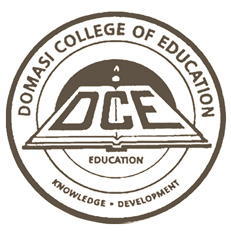
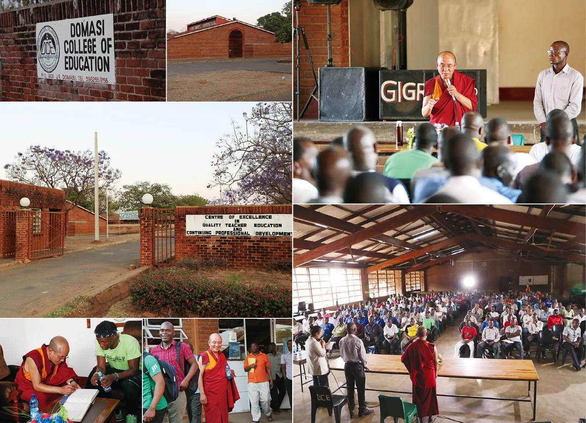
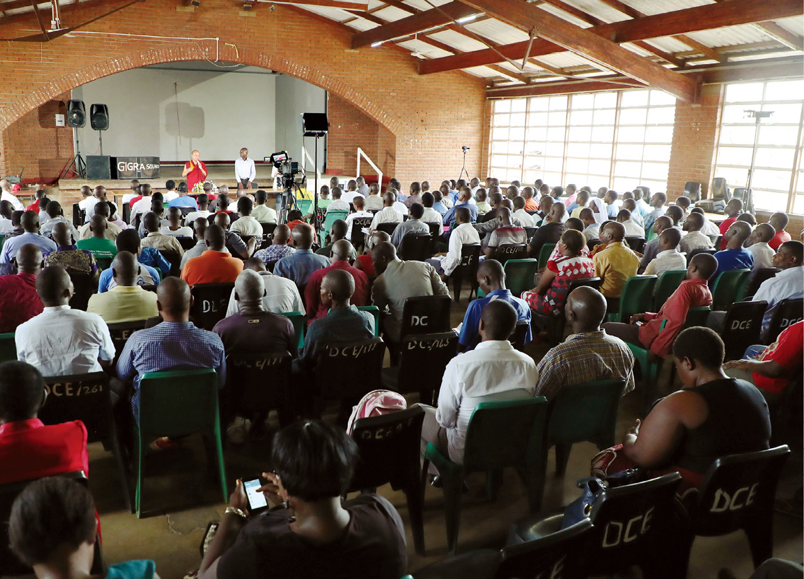
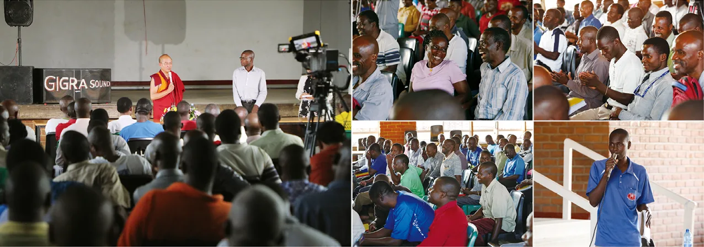
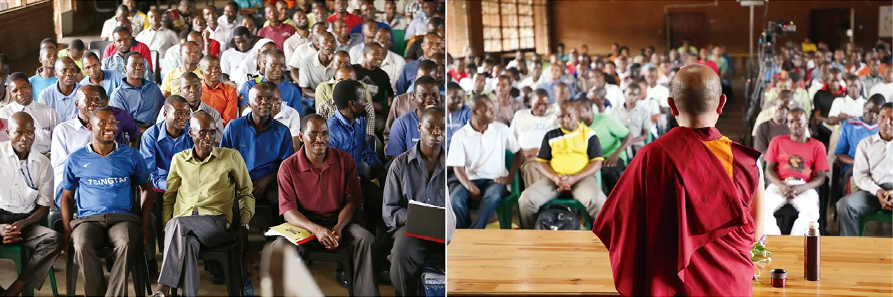
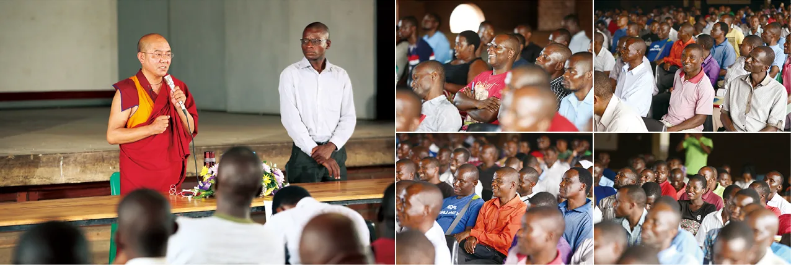

人类为了快乐而发展经济，

但经济发展了，

却失去了快乐。

第164场

马拉维多马西教育学院

Domasi College of Education

马拉维·多马西

2018 / 9 / 25

## 你的快乐 从何而来

## Happiness and Go Beyond

副校长：

女士们、先生们，下午好！欢迎大家！

今天的演讲嘉宾是索达吉堪布。堪布1962年出生于中国四川藏区，年幼时是放牛的牧童，如今是色达喇荣五明佛学院的著名学者。堪布经常在全球大学巡讲，而此时此刻，他正和我们相聚一堂。大家掌声欢迎堪布！

堪布对教学怀有极大热情，他的演讲总会探讨一些教育领域的问题。正因如此，我们邀请堪布来多马西教育学院和大家交流。他今天的演讲主题是“你的快乐，从何而来”。让我们再次欢迎索达吉堪布——

感谢副校长的致辞，也感谢各位抽出自己宝贵的时间来到今天的课堂，我们大家一起共同学习。在座各位都是老师——现任的或将来的，所以不管从哪方面来衡量，你们都是非常优秀的。我今天讲得不一定好，但你们的学习态度的确令人赞叹。

我是第一次来马拉维。在座的很多是男老师，在我们那里，女老师比较多，但你们却有一位女校长——看来，你们这里的教育和我们那里还是有一些差别。

## 快乐之源：物质，还是心灵？

我小时候因为家里贫困，16岁才读小学。我在23岁出家之前，还读过中学和师范学校，但师范学校没有毕业，因为出家的缘故。

今天的演讲不得不用这样的方式，因为麦克风只有一个[^1]。刚才校长先生说，这里的物质条件跟日本等发达国家没法比。我也有同感，在物质方面，不用说跟日本比，即便是和藏地比，也有一定的差距。

但你们这里的人热情善良，天真纯洁，心灵没有任何污染，我非常羡慕。外在的物质条件和科学技术虽然不够发达，但你们内在的精神财富却非常丰富。这种内在的财富，将会给人类的未来增添美好的色彩。大家只要保护好自己原有的人格魅力，就是对世界的贡献。

斯威士兰宗教系一位教授说：“西方科学给人类带来的是新技术，东方神秘主义给人类带来的是超我精神，而非洲这块大陆带给人类的是做人的方法。”我觉得言之有理。

阿非利加[^2]有54个国家，现在全世界的发达国家都在关注这块风水宝地。我相信，未来你们这里的科学技术会越来越发达，物质水平会越来越提高。不过，大家为此付出的代价，可能也是巨大的。

什么样的代价呢？人心将不再天真纯洁，不再清净无染，相反，会变得越来越狡诈，越来越复杂，越来越没有良心。外在的环境也不再美好，青山绿水不复存在，矿产资源越挖越空……这是目前人类在地球上面临的最大挑战。

人类为了快乐而发展经济，但经济发展了，却失去了快乐……今天不准备讲这么大的话题，还是围绕“如何让心灵获得快乐”来展开吧。

## 一位东方老师的心灵分享

在座各位都是非常优秀的老师。我自己读师范学校虽然没有毕业，但出家之后一直在佛学院当老师，到现在有34个年头了。我希望把东方老师的一些理念和经验，和各位非洲老师简单分享一下。

### 1．多变的梦想

刚开始，我并没有想当老师——我的人生梦想一直在变。

在草原上放牛的时候，隔壁一些人放牛比较厉害，我很羡慕。那时的梦想是当一个会放牛的草原牧人。

小学时接触到一位医生，医术和人品都很好，我的梦想变成了当一名好医生。

读中学的时候，一位木匠给我留下了很好的印象。于是我在很长一段时间内，想的都是当木匠。

后来我考上了师范学校，在那里遇到了一位教书三十多年的老师，我在他身上学到了很多东西。之后，当老师才真正成为我的梦想。

我昨天到这里的时候，也听到一些类似的故事。刚开始，学校周围有一些工地，看见施工人员赚的钱比较多，很多同学就想将来做这个；后来发现老师的工资还要高一些，又想当老师；后来又发现，老师居然还可以出国，能挣更多的钱，大家便希望自己将来也能出国。可见，同学们的梦想也在不断地变化。

我们每一个人，不管什么肤色，什么种姓，什么宗教，由于受周围环境的影响，受金钱的诱惑，或受不同价值观的引导，梦想经常会发生变化——（突然停电。稍后，发电机开始运行，噪音很大。）也许你们只听得到发电机的声音，听不到我的声音。不管怎么样，时间很珍贵，我坚持讲下去，希望你们也坚持听下去。

### 2．为师之乐

作为一名老师，三十多年来，我一直免费给学生上课，从来没有领过工资。课多的时候，有时候一天讲三四堂——像今天，上午去监狱讲课，下午在这里，晚上去孤儿院，有时一天甚至会上五六堂课。除了出门在外，我在佛学院基本上每天会不间断地讲一堂课——这是三十多年来，我一直坚持的基本原则。

我认为，当一名老师，无条件地将自己懂得的知识传递给学生，这是最好的人生选择。老师是“人类灵魂的工程师”，可以带领千千万万的人到达智慧、慈悲和道德的宝洲。每一位老师都肩负着非常重大的责任，这是一件非常光荣的事。

### 3．若为金钱，千万别当老师

可是，我们那里很多老师却纷纷转行。为什么呢？为了金钱。如果公务员的工资高一点，他们就去考公务员；如果企业聘请的薪水多一些，他们就到公司上班。因为生活的逼迫，或者受金钱主义的影响——如今金钱主义盛行，没有钱寸步难行，很多人都没有兴趣当老师。只要有机会转行，宁可放弃可爱的学生和美好的校园，而选择有金钱、有地位、有各种待遇的工作。

有些老师虽然没有离开学校，但也是“身在曹营心在汉”，对教育事业没有热情，对教学活动没有兴趣，对孩子的关心和热爱更是微乎其微。只是为了一份工资，消极地待在学校里面。

我们都知道，一个医生若不好好治病，会对一些病人的康复有损害；一个单位的职工不好好工作，会给单位的经济效益造成一定的损失；而一个老师如果不好好教书，他班级里的六七十甚至上百个学生的一生都将遭到损毁，因为他们只有一次青春。所以，教师这个职业，如果做不好，会非常危险。

老师对教书没有热情，讲课就不会有感染力，学生听起来就觉得枯燥，没有学习兴趣。这样一来，即便在这个老师座下听过很多年的课，也学不到什么知识。现在很多学生成绩不好的原因就在这里。我们做任何一件事情，都不可能在缺乏热情的情况下，还可以保持主动性和积极性。如果所作所为都只是为了工资，满足于表面应付，工作效果肯定不好。

我在自己的家乡建了一些学校，一共有两三千个学生。这些学校中，有些老师非常优秀，甘愿放弃自己的一切，一心为学生付出；也有些老师则非常非常差劲，什么课都教不好。

我经常跟他们讲：如果你们对上课没有兴趣，最好不要来这里当老师，去当个木工、电工都可以。可是他们却跟我说：如果不当老师，就没有薪水；没有薪水，就没办法生活。很多人当老师只是为了一份工资。

### 4．优秀老师的窍诀：爱与热情

你们如果愿意当老师，我建议大家看一下《马文·柯林斯的教育之道》（Marva Collins' Way）这本书，它是关于如何做好教育的，里面有很多引导学生的方法。作者马文·柯林斯[^3]是美国非常著名的教育家，她1936年出生，2015年离世。里根（Ronald Reagan, 1911-2004）与老布什（George H. W. Bush, 1924-2018）两任总统都曾亲自请她当美国教育部的部长，但她不愿意，理由是她热爱教育，只想一心一意地当老师——她对当官和挣钱都没兴趣。

她的教育窍诀只有一个：用心接纳每一个学生。因为她相信每一个学生都有发展的潜力。不像我们有些老师，成绩好的喜欢，成绩不好的就不喜欢。她有一句名言：“所有的孩子生来都是成功者。他们需要的是，有一个特别的人相信他们，激发出他们最好的一面。”

这本书很有启发性和参考价值。我建议在座的每一位老师都看一看，学习一下她的教育思想和教育理念。

我的家乡也有一位优秀的老师。他虽然没有马文·柯林斯那么伟大，只是一个普通的中学老师，但他的精神却同样可贵，同样令人钦佩。在过去的20年时间里，他每个礼拜六和礼拜天都坚持给学生补课，从来没有间断过。

由于他工作认真，教学成绩很优秀，被提拔为副校长。后来，他却亲自到教育部门恳求，撤销他副校长的职位。领导刚开始不同意，他恳请了两三个小时，终于如愿以偿。后来，我邀请他到我的学校当校长，他也同样不愿意。他说，他只想当一个平凡普通的老师，引导学生健康成长。

我想说的是，在任何一个地方，都有优秀的老师在发光。希望你们也能成为这样优秀的老师。

## 快乐从何而来

以上讲的是如何当一名好老师，接下来讲“我们的心如何获得快乐”。

### 1．老师的人生最快乐

其实就我个人而言，当老师是最快乐的。我的人生本来有更多的选择，但我都没有兴趣。我觉得老师可以用自己的智慧之光，遣除孩子心灵的黑暗，这是特别有意义的事。老师就像一盏灯，而且这盏灯能够传递。从时间上讲，可以是千秋万代；从空间上讲，可以遍及十方——一位好老师能够桃李满天下。

在这个世界上，有人认为有钱很快乐，有人认为相貌端严很快乐，有些人认为拥有爱情很快乐，但是我觉得，喜欢学习、喜欢教书，这样的人生才是最快乐的。我想，在座的各位对老师这个职业也应该充满兴趣和热情吧。

### 2．快乐的名字叫知足

人人都在追求快乐，追求幸福。实际上，幸福是一种心灵的状态，它的名字叫知足。可惜很多人不懂这个道理。

当一个人有10万元时，会觉得有20万更快乐；开上普通汽车时，会认为开高级汽车更快乐；没有伴侣时，会认为拥有甜蜜的爱情最快乐。可是，一旦真正拥有这些东西，却不一定真的能快乐，因为人心是很难满足的：20万前面还有30万，高级车上面还有更高级的车，爱情的甜蜜期一过，也就不甜蜜了。

我在非洲很多地方，都能看到人们在快乐地跳舞，听到人们发自内心的笑声，感受到人们真正的欢喜心。这些快乐，都跟物质无关，而是因为有一颗知足的心。将来大家有了更好的物质条件时，内心的这些快乐也许会逐渐消失。

### 3．平静的心灵，藏着快乐

我想问一下在座的各位老师，你觉得最幸福的事是什么？你们怎么想，就怎么说，任何答案都可以。

（堪布与现场互动……）

刚才，有两位老师回答了我的问题。一位老师说“赚钱”，另一位认为是“心灵平静”。我比较赞同第二位老师的答案。

心灵的平静，我们每个人都可以拥有。你在世界的任何一个角落，不管是非洲、美洲，还是亚洲，都可以找到内心的宁静，感受由内而外的快乐。这是最容易得到的快乐，因为我们大家都有一颗心。

### 4．钱越多，离快乐越远

那么，有钱人会不会快乐呢？我这一生，遇到过很多非常有钱的人，但这些人里面几乎没有一个是真正快乐的。

维持基本生活确实需要金钱，但金钱并不是越多越好。随着金钱越来越多，压力会不可避免地越来越大，痛苦也会变得越来越深。如果认为金钱是一切幸福的根源，那你可能很难得到幸福，因为这个观点根本就是错误的。

佛教里有一个很好的故事。一天，三个年轻人去见著名的无德禅师。禅师问他们，世界上最让人快乐的是什么。一个人认为是金钱，另一个认为是名声，还有一个认为是爱情。无德禅师反问：“这个世界上，有人同时拥有金钱、名声和爱情，可依然闷闷不乐。这是为什么？”三个年轻人无言以对。

当我们贫穷的时候，会希望拥有更多的物质财富，因为我们发展教育、加强环保以及提升各方面的理念，都必须以相应的物质条件为基础。但是，追求物质要有一个度。过了这个度，物质带给我们的，就不再是快乐，而是痛苦。

### 5．人生，因意义而快乐

在座的各位老师，一定要有坚定的信心、满腔的热情和强烈的责任感。跟其他一些地方比起来，你们这里经济比较落后。而发展经济最主要的因素是人才，人才的根源则在教育。你们肩负着重大的责任，每天都要面对那么多学生，一定要用正确的理念和方法，把每一个学生的潜力都开发出来，努力为国家培养人才。

当然，作为一名老师，日日夜夜为学生操劳，默默无闻，工资又低，的确非常不容易。但我刚才讲了，对一个国家，对一个民族，甚至对整个人类的未来而言，老师这个角色都具有非常重要的意义。所以，当一名老师是最好的人生选择。这样的人生，会因为有意义而变得精彩，并充满快乐。

### 6．苦难的价值

从某种意义上讲，经济落后、资源匮乏、卫生条件不佳等困难和障碍，对我们的人生具有一种特殊的意义。

美国一位联邦法院的官员，在他16岁儿子的中学毕业典礼上，应邀以家长身份发言。他的发言很耐人寻味，因为在他的发言中，没有“愿你们将来工作顺利、财源滚滚”之类的美好祝词，而是祝孩子们在人生旅途中多经历一些不幸、障碍和痛苦。[^4]这样的观念，一般人很难接受，但的确很有深意。

大多数人都认为，所谓的幸福人生也好，优质教育也好，一定意味着占有更多的资源，拥有更多的钱财和更高级的物质享受。似乎只有具足这些条件，人生才会过得更好，教育才能做得更成功。

实际上，这是一种错误的认知，幸福的人生和成功的教育不一定来自优越的物质条件和享受。也许，在人生最贫寒的时候，学习效果反倒是最好的。

我以前在世间学校读书也好，在佛学院读书也好，学习条件都特别差。早期的佛学院没有电，也没有公路，晚上看书全部是在月光下——因为没有点灯的钱，只有借月亮的光。我们那一批学生，生活都非常贫寒，但大家的学习成绩都不错。当时的环境如果像现在一样，电视、电脑、手机样样俱全，各种社交媒体狂轰滥炸，我们的学习可能也搞不好——就像现在很多国家的“富二代”那样。

我是一个经常周游世界、走访各国大学的“云游僧”。我看到，不管是在澳洲也好，美国、英国也好，大学里都有一些经济条件特别好的学生，开豪华轿车，穿名牌衣服，经常在酒吧、网吧流连忘返。对于一个学生来讲，这些行为不一定合适，他们的学习成绩也可想而知——并不优秀。虽然我看到的不是全部，但这种现象的确比较常见。

相反，从贫穷家庭走出来的学生，因为懂得刻苦学习，学业往往非常非常棒。人类历史上很多伟大的人物，都是经过了诸多苦难和磨练才变得伟大而耀眼的。很多高端的科技成果，也是科学家们经过长时间的刻苦钻研，饱受艰辛和煎熬之后才逐渐获得的。

因此，当大家把所有的目光都放在金钱上的时候，我们如果懂得独辟蹊径，到金钱的背后去努力挖掘，会找到更有价值的文化、智慧和幸福。

## 终生为师，终身快乐

非常荣幸今天能跟这么多老师一起交流，最后我想和大家分享一下我自己的人生目标——成为我老师那样的人。

我的老师叫晋美彭措法王，是一位非常伟大的老师。他从十五六岁开始给学生上课，一直到71岁示现圆寂，一生都在兢兢业业地教书育人。

他离开我们已经15年了。在他生命的最后十几年时间里，虽然眼睛已经看不见，但仍然坚持讲课。他提前让人把要讲的课录下来，课堂上放一段录音，然后他讲一段；再放一段录音，再讲一段。他一生讲了五十多年的课，不管遇到什么困难，一直没有间断过。

一生讲五十多年的课，这是非常伟大的成绩。我能不能做到这一点？很难说。不过我自己在心里制定计划：讲不了五十多年，能不能争取讲四十多年？

作为老师，我们没有其他的目标，就是一心一意让所有学生都学好，因为每一个学生都有学习的潜力。遗憾的是，很多老师没有认识到这一点，更没有很好地利用这一点。

在学校里表现一般的学生，将来的人生也许会非常成功。乔布斯[^5]、美国总统罗斯福[^6]等，在学校里的成绩都是不及格的，在常人眼里是“非常不成材”的一类学生，但后来他们的潜力逐渐开发出来，成就了非常优秀的人生。

我个人在教学方面最主要的特点，一是对每一个学生都有信心，二是对教育非常感兴趣。因为我对教育感兴趣，所以讲的课有一定的感染力，能让很多学生听明白。现在很多老师缺乏激情，缺乏感染力，缺乏主动性和积极性，所以教学效果不太理想。

从开始当老师到现在，我的身体虽然越来越老，但自己对教育事业的信心和兴趣，却越来越大，越来越浓。我对自己的要求是：这一生，只要没有闭上眼睛，就要坚持把老师当下去，最后以老师的身份离开这个世界。

希望在座的老师们也对教育充满信心，立志终生当老师——这是我唯一的希望，也是各位快乐人生的源泉。

现场互动

问：您一开始想成为一名医生，后来想当一名木匠，最后您想成为一名老师。难道前两个职业不能带给您幸福感吗？

堪布：老师是改变人类心灵的人，而木匠改变的只是物质，注重的是技术。当然，当木匠或其他技术工，也很重要。所以我也曾想过：这里要是有一所技术学校，对促进社会经济的发展、提高人们的物质收益，会有非常重要的意义。

每个人的兴趣其实都不相同。我不否认，有人觉得当医生快乐，有人觉得当军人快乐，也有人觉得当木匠快乐。我以前也做过一些木匠活儿，但做得不是很好，没有成就感。所以从我自身而言，不愿意当木匠，只想当老师——当心灵的老师。我觉得当心灵的老师最快乐，最有幸福感。

问：您在演讲中提到，您工作了30年，却没有任何薪水，那您生活中的物质需求如何解决呢？

堪布：如果物质太缺乏，确实很难维持生活。不过，如果只需要吃饱穿暖，这个问题其实很容易解决。

实际上，所有的物质都可以用心来把握和操控。你们这里资源非常丰富，可是，如果你们不知道用自己的智慧和勤劳去开发利用，别的民族和国家很有可能会伸出手来，“帮”你们开发，“帮”你们利用。所以，在座的老师一定要教年轻人学会技术，让他们懂得开发资源，利用资源。否则，当地人一直懒惰，却让别的国家和民族过来利用你们的资源，非常可惜。我们要发展经济，满足物质需求，必须依靠自己的智慧和勤劳。

问：为什么佛教会和功夫之类的暴力行为有联系呢？

堪布：佛教有很多分支，比如汉传佛教、藏传佛教和南传佛教等。你提到的功夫，一般是汉传佛教某个支派的部分修行人所行持的一种修行方法。

佛教有寂静和忿怒两种修行。寂静的修行，表面上看起来特别温和柔顺，就像大家看到的佛菩萨像那样。而忿怒的修行呢，会拿着棍棒、刀枪等各种各样的兵器。但修行人不会真的拿这些兵器去害人，只是通过这种方式让那些性情野蛮者的心得到平静。这是一种降伏方法，也就是修行人以自己外在的恐怖形象，去降伏某些野蛮粗暴的人，平息他们内在的烦恼。

大家学了佛教寂静和忿怒两种修行的道理后会明白，不管外相上是寂静还是忿怒，修行人内心的慈悲和寂静，从来没有离开过，一直都在。

其实佛教里面的忿怒相有点类似于非洲的舞蹈面具。非洲的原始民族非常善良，但大家在跳舞的时候，会按传统戴上各种动物的头像，有的甚至非常恐怖。人们在观看这些舞蹈表演的时候，有时候感到恐怖，有时候心生欢喜，有时候产生各种各样的念头。但不管怎么样，这些面具改变不了跳舞者善良的本性。

所以，每一个民族的传统也好，每一个宗教的历史也好，它们呈现出来的舞蹈或形象跟我们平时的心态不一定完全相应。为了吸引眼球，提高关注度，它们在舞蹈动作或形象装扮上，有时会显得夸张或特别，但这并不代表表演者内心的真实状况。

问：非常荣幸邀请到您这样的大德。请问，佛教的基本准则有哪些？

堪布：佛经中有一句话：“诸恶莫作，诸善奉行，自净其意，是诸佛教。”这是佛教最重要的教理。

意思是说，我们作为一个人，最重要的是“诸恶莫作”。不能干坏事，包括不能杀人、偷盗、邪淫以及说大的欺骗别人的狡诈之语等。总之，凡是伤害别人的事，都不能做。

其次是“诸善奉行”。我们要积极地做善事，包括行持十种善法，努力地奉献自己，去帮助所有的人类，乃至所有的有情众生。

第三个是“自净其意”。我们不要经常被欲望、嗔怒和愚痴等各种负面情绪搅乱内心的平静，而应该时常保持简单快乐的心态。这是佛教的三个基本准则。

佛教跟其他宗教一样，都提倡爱和慈悲。但除此之外，佛教还强调内心的平静。这就是我所认为的佛教，也是佛陀亲自定义的佛教。

问：我对您的穿着很感兴趣。之前听说您要来马拉维，我还以为您会穿西装呢。我想问的是，在马拉维怎样加入佛教？如果有兴趣，怎样才能出家？

堪布：我不建议看到出家人穿的衣服好看就马上出家。

出家是一个人一生中的大事。真正的出家是因为看破了世间的很多事情，然后才去一心一意地修行，一心一意地饶益众生。不经过深思熟虑就出家是一种草率的行为，我不建议大家这样做。

如果你经过思考，真的打算出家，阿弥陀佛中心的慧礼法师经常到这里来，到时可以去找他。汉传佛教跟藏传佛教虽然穿的衣服不太一样，但出家的仪式和方法基本相同。你可以去慧礼法师和其他几位师父那里剃度。

副校长：

我代表校长对堪布表示衷心的感谢！感谢今天下午他带给我们引人深思的演讲。

堪布在演讲中提到，老师是人类灵魂的工程师，肩负着巨大的责任和这份责任带来的荣耀；老师是光，可以照耀学生的心灵；老师是灯，可以代代相传，也可以学生满天下；老师必须对学生充满信心，对教学充满热情……

所以，作为老师，我们要满怀热情，因为我们的热情会传递到每一个学生。而且，只有我们满怀热情，学生才会享受课堂，享受知识。这一点，我们需要时刻提醒自己。

同时，我们还要保持平和的心态和清醒的头脑。金钱确实是生活的必需品，这一点我们无法反驳，但金钱不能成为我们人生唯一的目标。因为，作为老师，我们承担着比挣钱更为重要的责任！

真心感谢现场的每一位老师和同学！也再次感谢您，索达吉堪布！

[^1]: 指堪布和翻译轮流使用话筒。
[^2]: 非洲的英文为Africa，全称阿非利加洲，位于东半球西部，欧洲以南，亚洲之西，东濒印度洋，西临大西洋，纵跨赤道南北，面积大约为3020万平方公里，占全球总陆地面积的20.4%，是世界第二大洲，也是人口第二大洲。
[^3]: 马文·柯林斯（Marva Collins, 1936-2015）是美国最为成功的教育家之一。1936年生于美国阿拉巴马州一个黑人聚居小镇，从小饱受种族歧视。在父亲的鼓励下，她通过努力，成为芝加哥一所公立学校的老师。1975年，她在芝加哥创建了一所学校，收了4个“问题孩子”。在她的努力下，学生越来越多，分校遍布美国各地，无数“问题孩子”以优异的成绩考上大学。2004年，布什总统为她颁发国家级荣誉的“国家人文勋章”，并对她说：“你作为一名黑人女性，生长在种族主义最严重的时代，却变得如此明亮。”
[^4]: 2019年7月，美国首席大法官约翰·罗伯茨，以家长的身份应邀在卡迪根山中学的毕业典礼上致辞。他对孩子们说：“我希望你能时不时遭受点不公平对待，只有这样，你才能体会到公平的价值所在；我希望你能品尝几次遭背叛的滋味，只有这样，你才能领悟到忠诚的重要；我希望你时常体会到孤独，只有这样，你才能知道，朋友对你好，并不是理所应当的；我希望你能倒霉几次，只有这样，你才能知道，自己的成功或许只是运气，别人的失败也不是活该；我希望当你失败的时候，你的对手能冷嘲热讽、幸灾乐祸，只有这样，你才能知道，有风度的竞争是多么重要；我希望你偶尔被人忽视，只有这样，你才能知道，学会尊重、倾听是多么重要。我说的这些事情，其实早晚会在你的生活中发生，能不能从中吸取教训、有所收获，就看你有没有听懂我在说什么。”
[^5]: 史蒂夫·乔布斯（Steve Jobs，1955-2011），美国发明家、企业家、苹果公司联合创始人。上小学时，乔布斯曾是全校闻名的捣蛋大王。他厌恶学习，喜欢搞各种复杂的恶作剧，比如在教室里放蛇，在老师桌子下燃鞭炮，等等。伊莫金·希尔夫人在四年级接手他所在的班级，成为他人生的转折点，他从此奋发图强。在一次采访中，他说：“如果没有四年级的希尔夫人和其他几个人，我到头来都有进监狱的可能。”
[^6]: 西奥多·罗斯福（Theodore Roosevelt，1858-1919）小时候患有哮喘病，视力也欠佳，身体虚弱，动作笨拙，对自己毫无信心，但他依靠坚强的意志和精神，重新塑造了自己，成为美国历史上著名的军事家、政治家、外交家和第26任总统。
