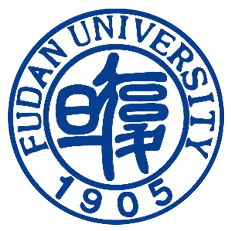
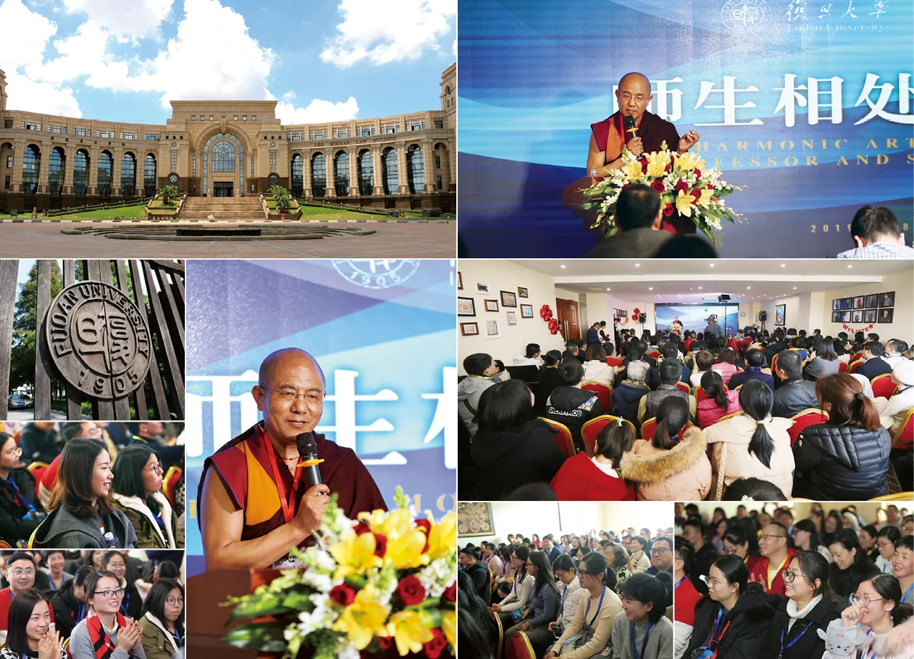
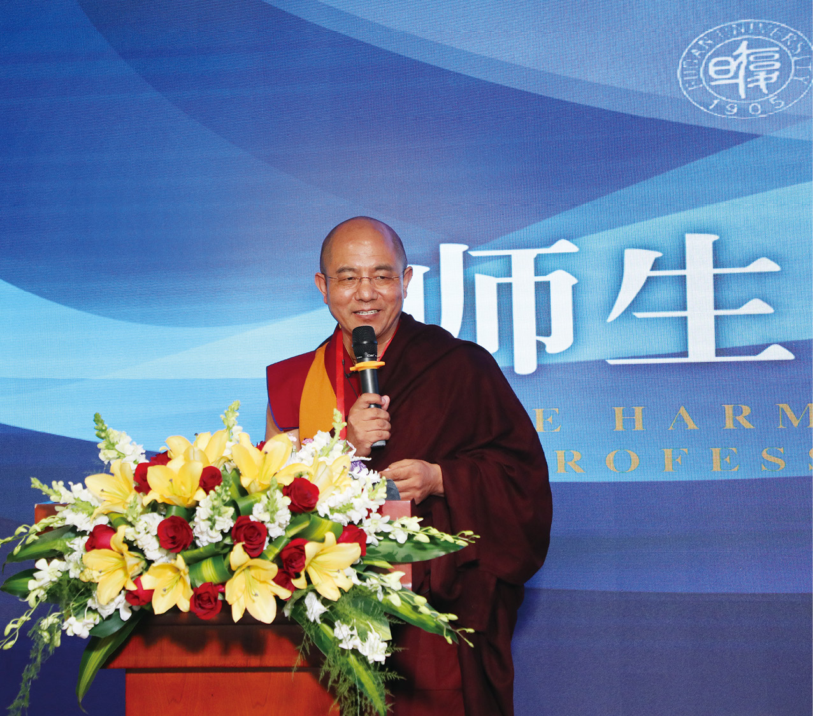
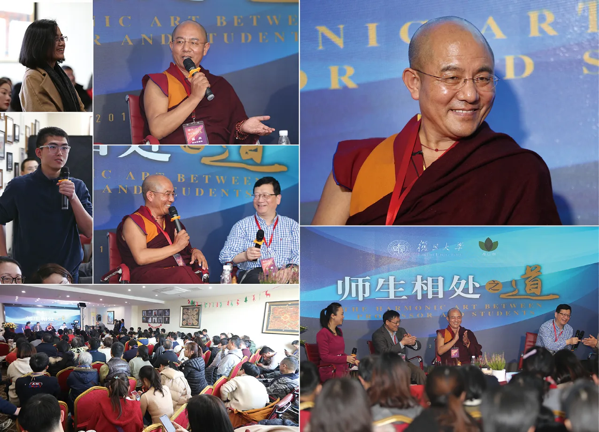

“如果我们没有爱心，

就等于没有受过教育。”

第167场

复旦大学

Fudan University

中国·上海

2019 / 1 / 18

## 师生相处之道

## Student and Teacher Relationship

主持人：

亲爱的各位领导、老师、同学：

大家下午好！非常欢迎大家来参加“师生相处之道”讲座暨访谈会。

中华民族是一个有几千年历史的礼仪之邦，在中国传统的伦理关系中有“天地君亲师”之说，意思是说，师可以与天地君亲并称——这给予了老师如父亲般的权力和地位，因而“一日为师，终身为父”的观念也逐渐根深蒂固。可以说，在古代中国，老师的地位是非常崇高的。然而，随着时代的变迁与社会的演变，师生关系可能已经发生了一些变化，其中有可喜的一面，也有令人担忧的一面。例如，处于物欲横流的世界中，受追求物质享受等价值观的影响，有一部分师生关系伦理丧失，突破了道德底线。

在国内外的一些新闻报道中，经常会看到一些令人深感痛心的事件，因此，是时候认真地思考一下：我们的师生之道到底怎么了？如何构建适应当今社会发展的新型师生之道？这也正是今天研讨会的主题——“师生相处之道”的由来。希望通过今天的演讲和讨论，能够有助于构建和谐向善的校园氛围，并有利于未来对人才的培养。

接下来，要进入的是主题演讲环节，演讲嘉宾是尊贵的索达吉堪布，演讲主题为“师生相处之道”，掌声有请堪布——

各位论坛的嘉宾，以及各位老师、同学：

大家好！今天下午是一个很好的机会，可以在这里跟大家聊一聊“师生相处之道”。我之前没有在这么多教授、大学生面前讲过所谓的师生之道，所以接下来要讲的内容不一定包含甚深的道理。我也没有上过像复旦大学这么大的学校，之前只是读过我们当地一个小小的学校。我的人生也很简单，23岁就出家了，出家之后成为了一个普普通通的老师，一直到今天。所以，也许我谈不出什么所谓的师生之道，但我对这个主题很感兴趣，一会儿几位教授也会跟大家一起分享，我很想听一下他们心目中的师生之道。

## 对师生关系现状的反思

在当今社会，有时候的确会看到一些前所未有的情况，这一点与任何时代都不同。如今，虽然在信息、交通等各方面都有一定的发展，但在某种意义上，却看到人心在不断退步，会有这样一种感觉。因此在这样的背景之下，大家有必要探讨、分析师生之间的一些问题。为什么这样讲呢？因为在某种意义上，师生关系已经变成了一个敏感话题，就像医患关系一样。这是什么原因呢？在座的各位可能比较清楚，现在全世界的通信技术十分发达，在世界任何一个角落发生的事情，在很短的时间中就可以呈现在我们眼前。也许受这种大环境的影响，近年来好像学生不太像学生，而老师在某种意义上，也不太像老师。

出现这样的局面，也反映出大众价值观发生的一些变化——也许我们更倾向于关注和展现不太好的一面，因为现在有很多媒体人乐于把吸引眼球的内容放到网上——我们常常看到某个学生杀老师，某个老师打学生等等。前一段时间，我就看到一个这样的内容，有一个学校的某个班级大概有70个学生，老师心情不好的时候，就痛打学生。之前我甚至还看到过学生用刀捅老师的新闻，最后老师倒在了血泊当中……

现在这样的现象越来越多，原因是什么呢？我也思考过，现在的社会确实与以往是完全不同的，包括生活方式、理念等等。虽然有些人认为现在的生活方式跟以往一样，但实际上确实是不同的，我们的生活可以说正处于日新月异的变化之中，这些变化有比较好的，也有不太乐观的。哪些方面不太乐观呢？无论是在学校、企业，还是一些其他团体，道德底线皆已逐渐下移。在这样的大环境中，师生之间的关系自然而然会发生一些变化。

那么，变化产生的具体原因是什么呢？我在分析的过程中发现：有一部分的原因，可能来自于西方国家价值观的影响。在座的各位也许比较清楚，在西方，老师与学生之间相当于是朋友关系，老师在讲课的时候，学生可以有各种不同的态度，可以听课，可以不听课，甚至可以对老师怒目而视，也可以用各种方式批驳老师的观点。在很多西方国家的教育理念中，认为这对孩子的成长是非常有利的，可以培养学生的创造性、想象力，树立创新的理念，所以他们认为这样的行为是值得赞扬和培养的。因此，学生们的“野性”就逐渐被培养起来了，甚至在一些学生提出并不合理的问题时，老师也不得不安慰、赞叹。对于这种理念以及它所带来的问题，很多人也都比较了解。

师生之道发生变化的另一个原因，也许是由于各个家庭给学校交了学费，有些老师以此作为获得收入的一种方式；而学生则认为，不管怎么样，我家里已经交了学费了，这样一来，老师和学生之间的关系，相当于一种商业关系，甚至是一种交易。如果学生秉持这样的观念，在他对待老师的时候，就很难有真正的恭敬心。

还有一种原因，在我们平时开展教育工作的过程中，不像古人那样重视师生间的尊重之道。现在的老师，更多是一种知识的传播者，甚至对于某些领域的知识，学生比老师更为精通。而在古代，老师可以说是智慧的权威，有大量的知识储备，学生没有其他途径去了解这些知识。可是现在的情况则完全不同，每一个学生，尤其是中学以上的，几乎每个人都有自己的上网工具，不管是用电脑还是手机，他想学的这些知识，在最短的时间当中都可以获得，因此在一些知识领域中，他所了解的内容也许比老师了解的还丰富。在这种情况下，如果老师不爱学习，或者要花大量时间专注在其他事情上的话，学生就有可能会越来越不信服老师。

这样一来，也许老师在他的岗位上，在一些专业领域当中，就无法满足学生的要求。因此，老师会觉得学生不听话，比如老师在讲课的时候，学生在下面玩手机或者做其他事情，根本没有听课的兴趣和意乐。在这种情况下，老师会觉得无论再怎么苦口婆心地讲，学生也不想接受。而学生则会觉得老师就像保姆一样，因而会产生疑问：自己应该给的费用都已经给了，老师为什么不给我传授我想学的知识？也有一些学生会认为老师讲的某些内容，与自己从其他途径学到的完全不同，甚至会因此以敌对的方式对待老师，这样的话，师生之间的关系自然不会太好。

诸如此类，对我们的整个传统以及各个知识领域——不管是儒家也好，佛教也好，甚至传统的其他各个思想流派的师生关系会产生不好的影响，致使师生之道逐渐背离原本的样子。对此，尤其是像你们这种高等学府中的老师和学生，应该会有一些不同的思考。

## 对比佛教与西方思想中的师生之道

我去过一些西方的学校，我个人认为西方学校的优点是什么呢？他们一般不盲目相信老师或者所谓的权威，除了真理以外，没有其他真正需要尊重的，人与人之间是可以平起平坐的，对父母或老师也是如此。他们有很多响亮的口号——平等、自由、民主等，尽管这些口号有时候也会用于掩盖一些真相。

亚里士多德（Aristotle, 公元前384-前322）曾说：“我爱我的老师，但我更爱真理。”他虽然爱他的老师，但是他更喜欢的是什么呢？老师所宣说的万事万物的真相。这样的说法在佛教中也有，释迦牟尼佛曾说：“无论是出家人还是在家人，你们可以像提炼黄金一样，反反复复观察我的语言，不要因为我是权威就恭敬我。如果我所讲的是合理的，你们可以接受；如果我说的是不合理的，你们就不用接受。”这个教言与亚里士多德的理念有相似之处。

佛教承认老师、善知识、上师是非常伟大的心灵工程师，但更加注重的是，老师所讲的是否符合实相。如果符合实际道理，可以承认；如果讲得不太合理，讲者不要说是一般的普通老师，甚至是佛教中最权威的释迦牟尼佛，也可以不承认。不需要因为讲者是释迦牟尼佛，就认定他所讲的百分之百正确。所以，我想在某种意义上，在追求真理的时候，也许并不用完全遵循老师。

佛法中有一种说法叫做“依法不依人”，这样的理念确实适用于这种情况——只要我们能够求得真理，不一定需要相信某一位所谓的权威。当然这是一个很高的层次，当你到了一定层次的时候，可以这样去理解，但如果还没有到这种层次的时候，我认为还是要恭敬老师，因为很多人的智慧、爱心、能力、道德等，还无法与老师相提并论。在这个阶段，你的信心、恭敬心、欢喜心，全部可以用来承侍你的老师或者上师，这是佛教当中的基本观点。

## 对重塑和谐师生关系的倡导

当今校园中的师生关系值得大家去分析，在分析的过程中，很希望所有的学生，哪怕蒙受了老师的点滴恩德，获得了些许知识，都能尽量做到“一日为师，终身为父”。也就是说，即使这位老师只为你讲过一堂课，也应该终生把他当作自己的老师。在我小学三年级的时候，有一天数学老师没有来，有位老师为我上过一节数学课，我记得很清楚，他讲的内容是无限循环小数。从那时到现在，已经有30年了，老师一直认为我是他的学生，我也认为他是我的老师。其实我只是听了他的一堂数学课而已。

佛教中也有这样的说法：“闻一偈颂者，若不当作师，百世转为狗，成为具痣者。”如果听闻过四句的偈颂，却没有把传授者当作老师，将来所感的果报会非常可怕。所以在佛教中，无论你的老师是什么样的，无论他传授给你的是什么知识，都要把他当作一位真正的老师，这一点很重要。在儒家传统文化中也有类似的观点，在座的各位应该非常清楚。《论语》中讲过，老师应该像老师，学生也应该像学生，老师应当诲人不倦，而且教诲的目的不是为了地位、财产等，应该以爱心来培养学生。这样的老师，也许在现在这个社会越来越少了，很多老师因为生存、工作、家庭等各方面的原因很难这样去做，但真正的老师的确应该无条件地帮助学生，自愿而主动地将自己的智慧、知识一代代地传递下去，这样的人才真正有资格被称为“老师”。

我经常给一些学校里的老师提建议，因为老师这个岗位跟其他岗位是不同的，老师是人类心灵的工程师，如果老师做得好，会对人类社会的发展有巨大的贡献；如果老师做得不好，则会对社会产生一定的危害。为什么呢？如果老师做得不好，就会耽误成百上千个学生，不仅无法让他们学到知识，还会对他们的行为等各方面起到反作用，甚至他们的所作所为对整个历史也会产生负面影响。因此，这样的老师相当于对人类的内心起到了破坏作用，甚至会引发一些严重的不良后果。

对此，藏传佛教中有一个相关的教言：“前辈老师的故事是晚辈学生的修行。”这句话很有意思，作为前辈的老师，如果是有爱心的人，那么他培养出来的学生也会是有爱心的人；如果老师是有智慧的人，那么作为晚辈的学生也会有智慧；如果老师有创新的意识或特殊的专业知识，学生也会有这样的能力，获得这样的功德。

在现在的社会中，有非常多的好老师以及非常优秀的学生。我们应该看到，他们对教育事业以及其他领域，乃至整个人类社会所做出的贡献。可是，在当今的网络时代，尤其是在人工智能不断发展的时代背景下，对于积极正面的一百件大事，也许人们不一定能注意到，但只要有一件不好的小事，可能全世界的人都会在很短的时间内便开始评论、转发。这可能是因为很多人本身就比较喜欢讲别人的过失，比如说，一个人有一百个功德，别人可能连一个功德也不会提起，但如果这个人有了一个过失，人们就会吹毛求疵地讲出来。又比如说，一位老师一辈子教书育人，假如他上了一百堂课，人们可能不太愿意讲这一百堂课的功德，但却会指出其中的一堂课非常糟糕，于是就开始揭露他的短处和过失。这可能是人的一种习惯。

我们应该一分为二地去分析当下的情况，不能完全断定现在的社会没有希望了，一切都已经变成如今这般模样——实际上并非如此。但我们也要意识到，老师的确承担了一定的责任，如果老师的心专注于商业或其他一些领域，而不重视教育事业，不重视传承人类的智慧和培养人才，那么可能会有一些不同的声音对此提出质疑——这是非常有必要的。因为得到一些负面的反馈后，很多人的行为就会有得到纠正的机会，所以说网络时代也有好的一面。为什么这样说呢？人在没有细致取舍时会犯很多错误，如果通过录音或视频将错误展现给他人，则有可能会增强个人的自我约束力，会更加深入地观察自己，也因他人的关注而有了警惕感，所以这是非常好的事情。

我还想说的是，从佛教的角度来讲，老师和学生之间应该有一种尊重心，这个很重要。我最近在将汉文《大藏经》中的《杂阿含经》翻译成藏语。《杂阿含经》中所讲到的师生关系的有些内容，在汉文版和藏文版《大藏经》中都有，另外有一些师生关系的内容，则在藏文版中有，汉文版中没有，有这样的情况。

在汉传佛教中，有一位非常著名的译师名叫安世高，他住世的年代距今大约有1800年。在他翻译的经典中，有一部经叫做《阿难问事佛吉凶经》。可能有些人对佛教中的师生关系比较感兴趣，那这种关系是什么样的呢？在这部经中就有所体现。当时，阿难问佛陀：“师生之间的关系应该怎么样来处理？”虽然这已经是两千五百多年前的对话了，被翻译成中文也已有1800年左右，但应该仍适用于当下，因为其思想具有一种鲜活性。此经中的观点对于老师和学生来说，应该都是有帮助的。按照经中观点，老师应该把学生当作自己的亲生子女一样来对待。每一个有孩子的父母应该比较清楚，应该以什么样的态度和方式关爱自己的子女。而学生对待老师，应该像对待佛法僧三宝或自己的父母一样，这样的话，即使老师像父母一样对学生运用打、骂、批评等方式来进行教导，学生从某种意义上来说也不会心生恨意，不会像刚才所讲到的那样，用刀或棍棒打骂老师。

我前段时间看到一个视频：在一个学校里，考完试后学生不愿意交卷子，于是跟老师发生了冲突，一群学生一起打老师，老师被打得很可怜。这个视频在网上被大量转发，不知道大家有没有看过？如果学生真正把老师当作自己的父母，那么师生之间的关系会变得与其他人的关系完全不同。师生之间的关系应该是什么样的呢？老师不能恶意打骂或惩罚学生，这是佛陀所说的“万万不可”，就像一个佛教徒，是万万不可恶意诽谤佛、法、僧以及父母的，师生之间也是如此。“己所不欲，勿施于人”，自己不愿意经历的事情也不要施加给别人，在安世高所翻译的这部经典中，有这样一种理念，这种理念既盛行于孔孟之道中，也存在于佛教当中。

老师如果真正要培养学生，他对所有的学生，应该有对自己子女那样一种爱心，这才真正具备了当老师的资格。相反，如果他对学生没有爱心，甚至怀有恨意，就不具备当老师的条件。因为无论是在传统文化中，还是在现代的教育理念中，老师都必须具备爱心。前苏联的一位科学家曾说：“如果我们没有爱心，就等于没有受过教育。”因为教育并不只是让人获得书本上的知识，也不只是以一些条条框框的内容来定义的。

在教育理念中，必须要培养人的一种爱心，如果人不具备爱心的话，最终很有可能导致整个社会的动荡不安。如果每一个人都自私自利，那么最终社会将如何演变，大家也应该非常清楚。佛教的基本理念，与西方的一些教育理念，确实不尽相同。佛教的理念之一，是要有一颗包容的心。而西方的教育思想也有自己的特点，它有好处，也有坏处。好处是什么呢？思想比较开放，具有包容性，与观摩式的教育完全不同，所以西方在研发和创新等很多方面有不同的见解。

东方的思想相对而言比较传统，由于遵循此种传统，学生对老师有一种感恩之心，老师所传授的知识与智慧，学生不会忘记，会永远铭记于心。在这种情况下，可能对学生来说，老师所传授的知识会让自己受益终生，这样的老师才能称为一位真正的老师。因此，我们要依止这样的老师，或者自己也成为这样的老师。我的老师法王晋美彭措，就是这样一位老师，在大约20年的时间里，我依止他并在他座下听课。这期间我恭恭敬敬地听从他的教导，获益良多，他的教导对我一生的帮助，是难以用语言来描述的。其实，在每一个人的心里，也许都有一位对自己影响最深的老师，在你的一生中，会经常想起他的音容笑貌，忆起他所讲的教言，思索他为自己开显的人生真理，而这些真理，还会帮助到我们的社会以及社会中的各个群体。

如果你对老师的所作所为，经常有许多成见和邪见，甚至把老师作为仇视的对象，这是非常可悲的事情。我以前听说，一所非常著名的学校做过一个调查统计，调查结果显示：很多学生最恨的就是老师、知识和书本。现在很多学生也有这种倾向，如果一个学生特别恨老师，特别恨知识，特别恨书本，那么即使他还待在学校里，也没有多大意义。

一些老师曾跟我反映过，他们对学校五千名学生进行调查，其中大概20%的人有过自杀的念头，还有一些学生有抑郁症，这样的情况越来越严重。所以，老师在传授知识的同时，也应该讲一些为人处世的道理，这就要求老师自己首先应该像一个老师，需要在道德、智慧、爱心等各方面都比较优秀，这样他带出来的学生才会是非常优秀的。

## 寄语

我由衷地希望，老师们都非常优秀，学生们也都十分优秀，师生之间的关系越来越好。由此，或许我们的社会也会变得越来越好。

对话

主持人：首先我来给大家介绍一下，四位将参加我们论坛的嘉宾。

蒯本科老师，蒯老师是复旦大学教授，英国威尔士大学生物工程学博士，复旦大学生命科学学院教授和博士生导师。欢迎蒯老师！

我们也很高兴地邀请到了周宁一老师。周老师是上海交通大学特聘教授、生命学院微生物科学系系主任，获武汉大学微生物学专业学士和英国伦敦帝国理工学院微生物学专业博士学位。欢迎周老师！

我们也非常高兴地邀请到了王应祥老师。王老师是博士生导师，上海市青年科技启明星，教育部青年长江学者，2007年获得华南农业大学植物营养学博士学位，2007年至2011年分别在华南农业大学和复旦大学从事博士后研究，现任复旦大学生命科学学院研究员。欢迎王老师！

此外，我们还非常荣幸地邀请到了索达吉堪布。堪布是全世界具有影响力的藏传佛教大德，人们总能在堪布的言语间感受到安闲自在——一种禅修者独有的睿智和温文尔雅的气度与慈悲。因为堪布的所作所为是为了利益他人，是为了给这个世界带来一份心灵的富足。

以上四位是我们的访谈嘉宾。接下来进入论坛环节，希望您们的真知灼见，能够为我们指点迷津，谢谢各位老师。

主持人：各位教授和堪布都有非常丰富的人生阅历，我们非常好奇，在你们的学生时代，与老师相处时，有什么有趣的、令人印象深刻的事情发生，使你们至今难以忘怀或者难以释怀？而在成为老师以后，在和学生交往的过程当中，有什么有意思的事情愿意与大家分享？周老师请——

周老师：蒯老师指导学生比我还早一点，参加工作比我早，您先讲。

蒯老师：周老师是交大的老师，我们复大尽地主之谊，请交大老师先讲，欢迎交大的老师。

周老师：我从上海西南角的一所大学来到东北角的一所大学，非常高兴，我先表达一下我的感情，上一次来复旦可能是在1984年。

蒯老师：那个时候我们还没有来复旦。

周老师：当时我在国内工作，参加了一个复旦大学举办的微生物教师训练班，后来1986年又来过一次，到微生物学系。现场微生物学系的同学来得比较多，我感到非常亲切，为什么呢？因为我父亲就是从这里毕业的。刚才堪布讲得很好，讲到了以儒家思想为代表的中国社会对师生关系的看法。我对于师生关系的理解，总体上与堪布的观念一致，要以爱心为主，这是毫无疑问的。

我觉得西方思想与东方思想有一致性。为什么基督教的思想能够在这么长的时间里，作为一种文化、一种精神延续不断？社区文化作为核心，对营造社会环境起到了重要的作用。相对而言，佛教没有像基督教一样，从社区关系展开，但我们也知道，佛教有其他方法来维系人与人之间的关系。

讲到师生关系，我的观点可能跟在座的有点不一样，我们可以讨论。首先，我的观点是，在当代，师生关系是职业关系，但在职业关系中，也要有爱心，这是毫无疑问的事情。现在的教学跟以前的私塾教育完全不一样了，现代教育是一种职业化的教学。在中国，各个年级的授课者都叫做“老师”，对此我也有一些思考。

举个例子，我出去办事碰到一位先生，他看上去像当官的，但又很客气，所以我就推测他是一位老师，什么老师呢？好像不像中学老师，因为中学老师没有那么幽默。我觉得自己是表里一致的人，因此我所说的就是我心中所想的。为什么需要推测呢？因为在中国人对老师的概念里，无论是小学、中学老师，还是大学老师，都统称为“老师”，所以从字面上区分不出来。但在英文中，对于不同的老师，会用不同的词汇去表达。比如，你平时会叫张老师“teacher”吗？张老师不承认他是teacher，他叫做大学讲师，是大学员工职称中的一种。在英语里，大学老师统称为lecturer，所以在英文中，大学老师与中学老师用的是两个不同的词汇，所以一听到这个词，就可以确定他的职位了。

作为中小学的老师，是以现有的知识来教学生，并进行引导和启发。而大学老师，也就是讲师或者教授，主要是去启发学生的思考，乃至引导他发现新的科学；或者作为人生导师，激励学生们追求人生的真理。所以我觉得这个问题的关键，在于不同老师之间的差别。

不仅老师的名称不一样，学校的名称也不一样，中文中叫小学、中学、大学，直译过来就是small school、middle school、high big school，总的来说应该叫做schools and universities。这样就定义了不同的学校和老师，从形式上体现了它们之间的差别。

主持人：师生相处之道，不仅适用于大学，它也存在于中学、小学，甚至幼儿园之中。在中国人的概念里，汉语中的师生之道，“师”包括了所有老师，就像堪布刚刚说的，给我上了一堂45分钟的课，或者教授了四句偈，都算我的老师——今天咱们谈的正是这样的师生之道。

周老师：在座的都是研究生，我们现在主要讲的是教授和他们的学生。就像我刚才提到的，对于学校和老师的名称来说，它们的英文名称比同义的中文名称更加具体。比如，中文里的“学校”，指的可以是小学、中学或者大学等，需要根据一些条件进一步推测，才能判断出要说的其实是大学。

主持人：您刚刚说到当前的师生关系，您把它定义得更加职业化了，那请问这样的定义，您认为是什么性质的？它带有褒义、贬义，还是中道义呢？如果和过去相比的话。

周老师：我讲的应该说是一种专业的表达，体现了它的职业性，比如教授必须叫做教授，因为相符于“教授”的定义，这样的话，教授也会努力把教授该做的事情做好。我从来不把我的学生当作我的子女来看，因为这样很有可能会导致我的研究陷入歧途，因为我觉得我教我的学生们比教我的子女好得多。我夫人经常因为这件事抱怨我：“如果你对你的孩子跟对你的学生一样有耐心就好了。”这说明了什么问题呢？说明你是把教导学生当作一种职业的职责来做的，因为你觉得需要去培养这个学生。中学生跟大学生的差别还是很大的，跟研究生的差别就更大了，所以带研究生用的是一对一的定制化管理，是一种量体裁衣式的培养方式——a tailor made。现在tailor很少见了，很多人都是在淘宝里买衣服了，一般哪有定制裁缝，对不对？

主持人：周老师，打断您一下，我觉得今天咱们讨论到这里，已经有第一个火花迸发出来了，为什么呢？因为刚才堪布说：老师要像对孩子一样对学生，学生要像对父母一样对老师。

周老师：对，这一点没有错，从我心里来说，也必须这样做，但从工作角度来看，你不能这样做。

主持人：好的，现在我们想听听堪布的想法。堪布，周老师说他没有办法像对孩子那样对学生，您是怎么看的？

索达吉堪布：我觉得这个方法也是对的，因为他是从职业的角度来讲的，对学生比自己的孩子更重视、更爱护，这应该与我说的没有矛盾。

周老师：谢谢夸奖。

主持人：堪布特别圆融。

周老师：对孩子可以说：“哎呀，爸爸没时间，明天再弄吧！”而学生找你有事情，我很难推辞。对孩子可以推一推，有时候说来不及或者怎么样，今天不能陪你。“爸爸，今天晚上吃饭啊！”我说“不行啊，晚上大兵老师叫我去参加这个会”或者“我今天有什么事”，可以这样说。所以从我的感觉来说，可能既要给学生职业化的东西，但心里也要爱他们，爱护、帮助他们，做好这个工作。而且每个学生的性格、脾气都不一样，他们之间的差异远比自己孩子之间的差异大得多，因为学生们的基因基本不同，而自己家里孩子的基因总有一部分是一样的。学生之间的差异很大，他们的家庭背景不一样，来的学校层次不一样，学的专业也不一样，所以必须要对每位学生进行定制化的教育，根据他们的个人情况来布置课题。可能这个情况与教育自己的孩子比起来，既复杂又简单，是很不一样的，这是我的看法。

我没带笔，所以在手机上记笔记。对不起，我不是在用手机做别的事情，而是在做我的笔记。我写了四五条，如果你让我讲半小时，我也能讲出来，你看我写的：大学、中学老师的称呼问题，学校名称的问题，研究生的多种培养方式问题，职业底线与崇高道德标准问题。

我在这里讲一下职业标准问题，因为在大学里，我们强调道德标准强调得太多了，所以我觉得应该先强调底线——什么不能做，而不是先鼓励大家要做什么。在每个教授可以做到底线要求之后，再谈道德标准，这是我的观点。

主持人：好的，时间有限，咱们进入下一个问题。就目前而言，教师和学生之间应该说是一个比较职业化的关系，毕竟学生进入学校的目的就是向老师学习知识。老师的责任是传道、授业、解惑，而一般来说学生要做的是得道、觉悟和继承。我想请问蒯老师的是，当今社会的师生关系是不是出了问题？从您个人的观察中，如果您觉得的确是出现了一些比较严重的问题，那么请问它背后的原因是什么？请帮我们分析一下。

蒯老师：首先我要感谢周老师，因为周老师第一次代表交大的教授，认可复旦也是一所一流的大学。以前我很少从交大教授的口中，听到他们对复旦的认可。对于师生关系的话题，大兵老师两个多月前就表示希望我们来进行这样一个讨论。其实，今天在到现场之前，我也没有完全弄清楚究竟从哪个角度去讨论它。今天堪布讲得比较广。

当时大兵老师跟我说起这个主题时，我给了他一个反馈意见，我说师生关系，跟人与人之间的其他关系比起来，并没有什么特殊之处，我觉得师生的相处可以归摄到人与人之间的相处。如果说一定要去界定师生间的关系，刚才周老师也谈到了教授与学生的关系，我觉得这个关系很具体，因为他主要讲的是教授和大学生之间的关系，没有强调教授与研究生之间的关系。但事实上，我们与研究生相处得更多。

可能每个时代的师生关系都会不一样，因为当今时代瞬息万变，过去的二三十年里，社会变化得太快了。我觉得不仅仅是老师与学生之间的关系变得很微妙，甚至有时候有些紧张，实际上，人与人之间的关系都变得微妙起来，比如，我年轻时与伙伴的关系就不同于现在与同事的关系。所以，不仅是同学们对此有困惑，我们也都很困惑。社会变化得很快，财富积累得很多，而在文化层面上，我们却失去了很多认同感，在不同文化相互冲突时，不知道去认同什么价值。我也接触过很多不同文化背景的人，教授、学生都有，我觉得所有优秀文化对师生以及同学关系的理念都是相通的，这是我想强调的一点。

我将刚才堪布提到的师生关系，按照所学专业的习惯来进行分解——师生之间的关系其实有三层关系。第一层是人与人之间的关系，我觉得人与人之间，首先应该是互相尊重的关系。在现在这个强调自由与个性的时代里，人与人之间的尊重较少受到关注，不仅老师与学生之间需要尊重，社会上各种身份的人都应该尊重彼此。因此，从互相尊重的层面上来说，并不一定要强调是老师还是学生，是搞卫生的阿姨还是著名的教授。就我个人而言，我认识我们院里所有的秘书，但对于院领导，我可能不一定认得全。这是第一层关系。

师生关系的第二层，一般存在着长和幼的关系，相对来说，老师是比较年长的，学生是比较年幼的。对于长幼关系，在中国传统文化中，有非常值得借鉴之处——“老吾老以及人之老，幼吾幼以及人之幼”。老师需要关心年轻的学生，学生需要尊重年长的老师，这是第二层关系。

第三层关系，老师与学生更为直接的关系是与探索、求知、获得学位相关的。我们接受过西方教育，之后在国内工作了很多年，也受到了一些传统文化的影响，我觉得在求知的层面上，大家应该尽量平等，这样有助于发掘创新的能力，并传扬老师与同学们的优秀思想。就像刚才周老师说的，我做老师比较早一点，我的学生们有一部分已经做了教授和博导，如果让他们总结蒯老师的优点的话，应该就是在他们的求学生涯中，没有给他们更多的限制，而给了他们更多的自由。就像刚才堪布讲的一样，我在二十多年做老师的过程中，如果有什么成绩的话，那应该就是没有误人子弟，这是我能做到的事情。

主持人：感恩您，您功德很大，听了蒯老师的分析真的是耳目一新。老师说了三层关系，一个是人与人的关系，一个是长幼的关系，还有一个就是求知的关系。我们想请教堪布的是：您觉得在这三层关系当中，老师和学生的哪一层关系发生了问题？

索达吉堪布：在刚才分析的三层关系当中，我觉得首先应该是人与人之间的尊重方面出现了问题。现在整个价值体系，说受到了西方文化的冲击也好、影响也好，子女对父母孝顺的理念越来越淡化了，学生对老师或长辈的尊重心也越来越淡化。所以在某种意义上，就像刚才周老师讲的一样，学生与老师之间是一种职业关系。但仅以我个人的人生经验来看，在求知的领域当中，如果对老师有一颗尊重心，也许从长远来看，老师所赋予的智慧，在人生中是最有意义的。

如果在尊重方面出现了一些问题，我们与老师之间的关系，就是非常普通的关系了。如果我对老师没有一种感恩心，与老师完全是一种职业关系的话，他为我传授知识，也只不过是一般的商品交易，这样的知识传授，对我内心的影响就不会那么大。比如说一个中医，如果他对他的中医老师怀有感恩之心的话，那么老师对他的教言，一定会给他带来很大的助益，但如果他对老师的感情非常普通，没有感恩之心，也许他的受益程度也是一般般的。

主持人：堪布，我想请问一下，您刚刚说到对老师的尊重程度，也会影响学生对知识的吸收程度，而有的学生或家长就认为，现在考试压力很大，我到学校去求学的目的太简单了，就是想把书读好，把试考好，然后不断考取学校，就像攀登人生中一级又一级的阶梯一样。就我个人而言，曾经教过我的老师，好像对我也没有特别照顾，因为老师要照顾那么多学生，所以他也没办法特别地照顾我，所以虽然我想有感恩之心，但还是难以让自己生出由衷的、浓厚的感恩之心。

索达吉堪布：也许这是因为每个人的价值观不同，比如说我在某个学校里读书的时候，这位老师所传授的知识令我受益终生，那么即使这位老师没有对我进行特殊的教导，我还是会很感恩他。这样的价值观与其他一些价值观相比，是有所不同的。

主持人：周老师举手了。

周老师：我们来看一下这个话题，我举个例子，我有两位导师，一位是在帝国理工读博时的导师，另一位是在班戈大学做博士后时的导师，一个跟我个人关系非常好，是我的博士生导师，另一个跟我在职业关系上非常好，但现在几乎没联系了。两个人从不同方面帮助了我，博士后导师的学术水平非常高，我还因为做过他的博士后，收到了加入编委会做编辑的邀请。所以不能以与导师关系的亲疏，来判断导师对个人职业的影响，千万别这样做。在读大学或研究所时，可能某个老师对你非常严格，跟你个人关系很一般，从来不跟你拉家常、开玩笑，但是他对你职业发展的影响是无限深远的——当下的你可能无法想象，在今后十年二十年之中将受到的影响。

我现在体会到，我做博士后时的老师，对我的职业影响要大得多，他使我更有能力、更有机会来帮助更年轻的学子。因为他的缘故，我现在在美国微生物学会的环境应用微生物AEM杂志做编辑，在中国的编辑只有两位，在日本的也有两位，大部分编辑都在美国。因为我以前给导师当过编辑，所以有这层关系。我的例子说明什么呢？不要认为跟导师越亲近他对你的帮助就越多，关键是导师教给了你什么知识，带给你什么样的影响。正像堪布刚刚说的，不要以亲疏好恶来判断知识和老师，佛教中是这样讲的，我的观点也是这样——不要以亲疏好恶来判断老师对你帮助的多少。

我还要问一下堪布，您刚才讲到了关于家长的问题，就我个人而言，我最不喜欢听大学生的家长对孩子有什么要求，虽然从学校的角度去考虑，有要求也是合理的，但对于老师来说，几乎每位学生进入大学时都已经超过18岁了，是成年人了，特别是研究生，一般是22岁以上，所以我把学生看作是与我平等的个体。我觉得人与人之间的关系必须是平等的，所以不能把学生当小孩子来看，要当作成人来看，这一点很重要。让他们感觉到自己已经是成年人了，应该对自己的言行负责任。

本科生一般很少出现状况，如果有状况一般都是考试挂科了，打游戏引起的。那研究生出现的状况一般是什么？跟老师关系紧张。造成关系紧张的原因有很多，但时间有限，我不可能专门做一个报告——研究生与导师关系紧张之分析。如果要讲的话，我可以讲20分钟，但今天不讲了，时间不够。

主持人：堪布请您补充。

索达吉堪布：我想问一下老师：如果从您的职业角度来讲，您是同等地对待您的学生和您的教授吗？

周老师：我会尽量同等对待，虽然不能保证百分之百地做到，但我会尽力的。我可以比较客观地说，我必须要同等对待。

索达吉堪布：如果您的学生给您提出一个要求，您的教授也同样提出一个要求，您会完全同等来对待吗？

周老师：是的，这一点在一个组里是非常重要的，否则会引起组里同学之间的矛盾。

索达吉堪布：虽然职业要求是这样的，但从内心当中您会不会差别对待？

周老师：其实从内心来讲，我感觉可能会有不同的处理方式，但我表面做出来的行为应该是一样的，这是职业教授在职业工作中所需要的。

索达吉堪布：我想问的不是表面的行为，或者说不是心口不一的，应该是真正发自内心的行动。

周老师：当我的学生和我的教授对我提出要求时，我内心的想法应该会有一定的差别，但在我的行动中，只要这个要求不违反法律，尊重科学事实，我觉得我应该都不会拒绝。

索达吉堪布：现在西方很多文化影响着我们的内心，比如在西方文化中，人们更倾向遵循一个法律的框架。我知道您的这种观点，比较接近于西方的思想，这是很好的，但其中也有一些问题值得我们分析。

蒯老师：我知道周宁一老师和堪布年纪一样大，他们两个人要是辩论起来，可能很难分出高下，我的年龄比他们要大，我说一下我的观点。首先，我接受宁一老师关于职业心理的观点，因为作为一名职业教师，必须要考虑平等对待所有学生的问题，但在实际操作层面，我也同意堪布所说的，很难完全做到。

那我自己是怎么做的呢？我尽量对我的所有学生表明：我对你们都是平等的，但我也有可能在某一个时间段，在某一件事情上，选择的处理方式不一样。不过我会让学生知道，我对某一件事情采取不同处理方式的理由。

周老师：所以本质上还是平等的，因为你有理由，对不对？比如，无理由地热爱一个小孩，或者恨一个小孩，这是不平等的。但有了足以成立的理由就可以算是平等的了，对不对？我觉得非常热，空调能够关一下吗？

主持人：咱们尊重老师，关一下空调。接下来一个问题，我想请问一下王老师。习近平总书记曾提出：教师是立教之本，兴教之源，承担着让每一个孩子健康成长以及办好让人民满意的教育的重任。作为老师，您认为我们应该怎么做，才能做到让全民或者更多的人来尊师重教，让包括您在内的更多的老师，享有应有的社会声望，让老师们更有地位，更有尊严，更有工作热情，更有成就感和获得感？

王老师：首先，谢谢主持人的提问，谢谢大兵老师的邀请，让我有机会，来参加这个对当前社会非常有意义的活动。

在座的都是我的老师，我相对比较年轻一点，带学生的时间也不是那么久，所以对于自己是否做到了为人师表、教书育人，我想留给我的学生们去评价。我现在是一个老师，而我是怎样从学生时代一路走来的，我想说一下这个问题。

我先把要讲的内容套一个帽子，叫做“以身作则”，好不好？这个问题是习主席提出来的，如果请教育部的陈部长来回答，可能更合适。我只能说我自己是怎么做的——以身作则。我现在坐不了了，因为椎间盘突出，所以我站着说吧。

主持人：老师工作特别辛苦，坐的时间很久。

周老师：这跟工作表现突出是正相关的。

王老师：不好意思，我站着说吧，我坐着确实有点难受，压着左腿神经。刚才堪布、周老师都提到了跟导师之间的关系，所以借这个机会，我也跟大家分享一下，我与我的博士生导师之间的关系。很遗憾的是，我的导师在很年轻的时候就去世了，48岁。

其他老师：他叫什么名字？

王老师：严小龙，是国内植物营养学界比较顶尖的学者，在国内还是非常有影响力的。在他生病期间，我以身作则地去照顾他，所以我从自身感受跟大家讲一讲，我与导师之间的关系，我与他是如何相处的。

我对他的照料始于他被检查出是直肠癌晚期，他原本要去新疆石河子大学做一个报告，但他要住院接受治疗，所以我需要代他去做这个报告。那时，又正好赶上我妻子临产，我就送她到青岛胶南人民医院，接着第二天我就要赶去新疆做报告。虽然当天是预产期，但我妻子没有生，我就很着急，找医生说能不能打一个催产针，帮助她快点生，因为如果看不到孩子就走了也不行。医生进去帮她看看情况，过了很长时间之后出来了，没打催产针，医生说她的条件很好，小孩又比较小，所以不需要打，让我再等一等，第二天肯定可以生。所以我一晚上也没有睡着觉，等到第二天中午的时候，确实顺利生产了。我看到小孩之后，就立刻赶飞机到石河子去帮我导师做这个报告，做完后我又赶回广州照顾他，当时他住在中山医院肿瘤医院里，已经是很严重的晚期了。

我没办法再回去看我的小孩和妻子，因为导师住院期间确实需要人照顾，他的太太每天晚上在医院陪他。我到了以后，就跟他的太太两个人，一人一晚轮流在医院照顾他。他非常希望我晚上去陪他，为什么呢？因为大家可能知道，肿瘤到晚期的时候，胸腔、腹腔等处的积液都很严重，所以胀得很难受，他就希望有人帮他揉。因为肠子有病变，如果不顺着肠子蠕动的方向去揉，他就会感觉更不舒服，所以我就去查资料，看肠子是怎样蠕动的。肠子不是所有部位一直向一个方向运动，我那时一直在琢磨肠子蠕动的方向，然后坐在那里给他揉一夜。每隔一天我都会帮他揉一次。

我照顾了我导师一个月，跟他太太一人一晚轮流陪他，这样走过了这一个月，到奥运会开幕式的那一天，8月9日，他去世了。刚才堪布也讲到“一日为师，终身为父”，这应该是中国的传统美德，古书中对此也有讲述。虽然现在想真正做到“一日为师，终身为父”确实很难了，但我觉得导师对我的影响真的很大。从他去世至今，每年只要我有机会去广州，我都会到他的墓前，为他烧炷香、献束花。今年教师节的时候，我还特地去了广州，从某种意义上，这样的付出可能超过了对我自己父亲的付出。因为我的父亲，在我七岁的时候就过世了，所以可能我对父亲的感情还没有这么深，这或许是因为当时年纪小，记忆比较模糊了吧，所以没有这么亲的关系，我父亲是哪一天去世的，我现在已经记不清了。但导师的祭日我记得非常清楚，而且在每年的这一天，我都会在群里，为他说一些话，作为对他的纪念，或者为他做祝愿，虽然我没有信佛，但我确实希望他的在天之灵，或者在另外一个世界的他，可以过得更好。

既然“一日为师，终身为父”，那说到我自己的父亲，我来自很贫穷的农村，因为那里的风俗，我每年到小年的时候，都要去给父亲上坟。虽然我不知道有没有另外一个世界，但也许在这个世界过年的时候，已故的人也在过年，所以按照农村的风俗，我就去给父亲烧一点纸钱。所以大家也可以看到，每年小年的时候，如果我不出国出差，留在国内的话，我一定就跑掉了，跑回家给我父亲上坟——我不管赚多赚少都会去烧一点纸钱，不过纸钱好像更便宜，这样也许我父亲可以在那边过得更好。

从很小的时候我就意识到，这一生中没有机会再跟我的父亲相处了，但我觉得我与导师之间的关系，胜过了父子之间的关系。刚才周老师说得非常好，现在我跟家人、小孩的相处时间，远远少于跟自己学生相处的时间，我的学生全在这里，那一排都是。谢谢，先讲到这里。

主持人：谢谢王老师的分享。王老师讲了自己的故事，我相信这个故事，一定会被很多人久久地记在心中。我们也能够感受到，王老师是一个好学生，也是一位好老师。而且他也提醒了我们，等再过年的时候，为导师们送一束花，不要等到有一天他们永远地离开了，再去后悔。这个问题我想请问堪布，刚才王老师说到，导师的离世给他带来了很大的伤痛，那么请问堪布，您有没有经历过老师去世这样的事情？

索达吉堪布：刚才王老师说的时候，我就深有同感，因为我的老师也已经去世了。虽然我的老师不同于大学的导师，但实际上也可以称为老师，他就是我刚才讲的，依止了19年的那位老师，叫堪布晋美彭措。今年是他圆寂的15周年，我们每年都在他圆寂的日子纪念他。像刚才王老师说的一样，我父亲已离开将近17年了，我有时也会忘记他的祭日。相比较而言，我老师对我一生的影响，的确非常深远。

我很敬佩王老师对导师的这种感恩之心，虽然今天讲座的时间有限，但我相信这样的理念，值得让在座的很多人，包括他的学生，现场的老师们，去进一步思考。

主持人：我想请问一下，各位老师都有在海外留学和教书的经验，您们在海外时，有没有观察过海外的师生关系，是否有值得借鉴的地方，或者说值得探讨的方面？

周老师：我来讲吧，我在国外待的时间比较长，在英国待了很多年。据我观察，我个人的导师以及其他组的导师，在关系上更加职业化，如果跟某个学生关系非常好，就可以交朋友，如果只是师生关系，一般学生毕业以后，就没有来往了。

我在国内博士毕业之后，应该带过30个博士了，其中一直有来往的也不是很多，跟一些要申请青年千人计划的学生，自然来往得很多，也有些是因为同事关系，来往得比较多。总之，来往比较密切的一般是因为职业和工作的关系。

在西方，有些师生关系被传为佳话，导师和学生两代人都获得了诺贝尔奖，但这种情况毕竟很少。总的来说，大部分师生之间来往得并不多。实际上，西方人的师生关系更加职业化，我觉得是这样的。我现在也跟学生讲，虽然我自己在做研究工作，但学生以后要选择什么职业，其实跟我没关系，比如他以后可能到堪布那边去做事也说不定，或者做销售、教授、中学老师，等等。

主持人：堪布，您欢迎周老师的学生到您那里去做事吗？

索达吉堪布：这要问周老师。

周老师：这是学生自己的选择。

索达吉堪布：不知道周老师觉得到我那里好不好？

周老师：我举个例子，比如要到上海交通大学做博士、硕士，一定要达到学校的标准，符合我的期盼，在校期间要做好研究工作，至于毕业以后做什么，那是学生个人的选择。在西方就是这样的，导师认为学生毕业以后，选择做什么跟他没关系，如果你想做教授，或者跟他的职业相关的工作，他会帮助你，但你不这样选择，他也不会觉得有什么问题。我也是这种心态，如果学生不愿意在这个领域，就没有必要继续带他，而且学生遍布各行各业是很正常的，在国内博士越来越多的大环境下，职业选择的多样化已经成为常态。

索达吉堪布：今天我们这种思想碰撞很好，有周老师说的西方的方式，有我讲的佛教习气比较浓一点的理念，还有王老师分享的相合于儒家传统的师生相处之道，而蒯老师的观点比较包容，海纳百川。

可能每个人的心态不同，所以可以有自己的选择，看哪些方式适合自己。现在的社会大环境也是这样，不可能用一种理念来涵盖所有知识，而且每个人所受的教育也不一样，所以应该有一种包容心。比如我自己，受佛教教育的时间长一点，如果让我现在马上改变观点，有一定的困难。而假如我在西方读书的话，相信今天我也会跟随周老师的说法；如果周老师在佛学领域受过教育，他也可能会认同佛教的理念。所以，很多人的观点，会受到环境以及老师的影响。

周老师：完全同意。

主持人：还有一个问题想请问堪布，刚刚几位老师也谈了对国外师生关系的一些见解。堪布，您也在世界各地做过演讲，去了很多大学，据您在国外所观察到的师生之道，有什么可以跟我们分享的吗？

索达吉堪布：其实在国外，也不是所有国家的传统都相同。比如美国、英国、澳大利亚，每个国家都有自己的传统，尽管都采用西方的教育模式，但其中也有不同之处。现在中国大多数人也受到了西方教育的影响，但我对其中的一些方式并不是完全认同，比如说老师和学生之间应该完全平等的观点。以前，在我上课的时候，如果学生不老老实实地听课，我就接受不了，但现在我也完全可以接受了，因为现在的学生，他们的思想是很开放、很多元化的。

但我也有一种想法是，如果想在老师的教学中获得真正的智慧，还是需要有耐心和恭敬心。即使老师讲得不是特别好，但如果你用恭敬心和欢喜心去听受，也会有所收获；如果你心里对老师有排斥，即使老师传递的思想是正确的，你也不一定有收获。所以，在师生相处方面，我还是要保留传统中的一些思想。

在国外，也有很多优秀的、开放的思想，比如对老师做评价，在一些时候是有必要的。虽然如此，但仍然要保留对老师的尊重心，这样自己也会很有收获。王老师所讲的一些理念也是如此，所以我觉得在以后的时间里，应该可以看到，他培养出来的学生，也会像他一样身体力行。

主持人：堪布刚刚在演讲的时候谈到，西方文化对我们的影响和冲击还是比较大的，而中国的国力在不断提升，文化事业越来越兴盛，所以中国人也在影响外国人。而且现在特别强调，要对中华传统文化进行学习，并进一步实现其复兴。请问堪布，在这样的大环境下，您认为中国的师生之道会有改善的趋势吗？

索达吉堪布：从目前的状况来看，暂时还没有看到这样的趋势，因为确实有很多领域受到了西方文化的影响，比如影视文化领域、人文领域等，无论在大学里，还是在其他地方，好像都能感受到。虽然在国外也有一些孔子学院，但是否真正能给西方学校带来特别大的转变，从目前来看，形势还不是很明朗。

佛教在西方世界的传播也是如此，为西方人传授佛法时，必须要将理论建立在他们的思想基础之上，他们才愿意接受。如果以其他方式为西方人传授，比如直接给他们讲印度思想、中国思想，他们一般都不愿意接受，也不容易被改变。

也许等将来中国更加强大的时候，我们的文化会对他们有更深的影响，但就目前而言，感觉各方面的文化暂时还没有特别大的影响，这是我去过许多地方之后观察到的。但要看看将来怎么样，可能会有更进一步的影响。

主持人：让我们心怀美好的愿望。

蒯老师：我可以补充一点吗？

主持人：蒯老师久等了。

周老师：您这是小学生的行为，做小学生的心态要有。

蒯老师：我补充说一下，大兵老师一开始就问过我，主持人后来也跟我探讨说，将国外导师与学生的关系与中国的作对比，有没有什么特别之处？其实一开始我没觉得有很特别的地方。现在的大学老师，有很大一部分都在国外待过，在他们的思想中，或多或少，都有西方的理性成分，也有中国传统文化的成分。

作为一个大学老师，我个人认为做好这个职业是非常难的。如果要为处理好与学生的关系做些什么的话，我觉得大学老师要经常从多维度去考虑一些问题。周老师刚才强调职业的理性，以此作为与学生相处的准则，确实是非常理性的一种做法，对一部分同学可能比较适合。但学生群体是多样性的，借用生命科学中的理念来说，生命最重要的一个特征就是多样性，因此，学生中有很理性的同学，也有比较感性的同学，比如一些女生——但我也没有说女生都感性的意思。作为一个老师，如果想要做得好一点，对自己要求高一些，可以以多样化的方式与学生相处。

当然周老师已经做得非常好了，平等而理性地对待学生们。但我觉得一定会有一部分同学是比较感性的，可能会希望老师从人文的角度去关心他，哪怕是通过认同他的一些好的价值理念，关心他的业余爱好或家里的一些事情。这些行动都有可能会有助于化解师生之间的矛盾，改善师生之间的问题。我讲的这一点，可能对老师来说是个比较高的要求，这是我的补充。

主持人：蒯老师刚才在讲的时候，周老师喃喃地说了一句：“我不了解。”

周老师：我不关心，也不是我真的不关心。我确实不了解学生的家庭情况，父母做什么工作的，家里是贫穷还是富有，这些我都不知道，为什么呢？我是怕了解后控制不住自己，引生对一些学生的歧视，这是我的观点。但是万一学生出现了什么问题，我会去了解，在有一点苗头的时候，我会去做思想工作，跟他谈话，也可以谈这些事情。但在没必要去了解时，为了避免我自己有歧视的想法，也不会特意去了解，我不能保证自己像神一样没有这些想法，所以我觉得这一点是很重要的，这是我的观点。

这个事情要分别对待，学生万一有要出问题的苗头，我会跟他们谈话。我觉得一个教授如何对待研究生，如何能够做好研究生的工作，让他们不出意外，是很关键的，要身体力行地帮助同学解决实际问题。所有我带过的硕士、博士生，很少自己出题，难得自己出过一两个题目，几乎都是我自己出题目。我的博士生全部是我自己带，我回国后带的学生，他们一共有将近100篇文章，每篇文章我都自己帮他们改，而且我是当着学生的面改，所以如果你说我很职业化，也确实是这样。

学生坐在我边上，我面对着他，就可以帮他改文章了，我会逐字逐句地改，哪里有看不懂的地方，就让学生用中文给我讲出来，我再全部帮他改出来。我改文章是这样改的，我不要求其他老师也这样去做，但我确实能做到这一点，因为我的英文水平还可以。学生坐在旁边拿本子给我看，我直接就改给他，这样做是表达了什么意思呢？是让学生一进来就知道，只要自己写出文章来，周老师就会帮你改出来，这可以给学生非常大的心理安慰，我是用这样的措施来保障我的职业化的。谢谢。

主持人：我觉得蒯老师和周老师，两位的风格有些不一样，对于教学的工作，对学生的培养，各自都有自己的方法，也有各自的人格魅力。周老师特别坦诚、实在，可以看出您对工作的兢兢业业，如果老师能够一字一句地帮学生把文章改出来，我相信这是对学生最好的指导，学生能够从中学到很多，比起只注重文章能获得的结果，或者让学生自己改文章，我们非常敬佩您的做法。

周老师：等学生们毕业以后，自己做老板的时候，他会回过头来看周老师曾经帮他改了几篇文章，一篇文章改了五六个版本，每一版本的修订模式他都能再看，我改成了什么样，再跟最后发表的文章相比较，他们会从中获益，每当他们能思考到这一步的时候，其实与博士的标准就很接近了。我会给他们一个心理暗示，或者说是一种保证，在制度上最后是可以保证他们能完成学业的，实际上，这应该也是给他们的一个心理安慰。当然，我还有很多不足，所以我要向蒯老师学习，怎样更加关心不同背景的学生。

主持人：周老师，您的敬业精神，已经让学生很尊敬和爱戴您了。接下来，我要分享一下在网上看到过的两段描述。第一段是说在韩国大学校园里，如果学生和教授同行，需要稍微靠后保持一段距离，而且在礼节上，学生万万不能踩到教授的影子，否则就是对教授大不敬的表现。

而在第二段描述中，一位作者说，他出访斯里兰卡的时候，当地的学生在上学之前，都要给父母跪下来磕头，放学回来后也要给父母磕头，每天至少要磕这两次头。他说看到这种情景后，自感脸上无光，非常惭愧。

另外，让我个人印象非常深刻的是，在去年高考结束的时候，网上有一组照片，是位藏地的毕业生，面对着母校的大门，敬献哈达，跪谢母校。这组照片在当时引起了轰动，成为了网红照片，令人非常地感动、震惊。我想请问一下堪布，您对于刚刚我说的，韩国、斯里兰卡以及藏地学生的这些表现，有什么样的评价？

索达吉堪布：孔子曾说过，在任何礼仪的背后，有相应的文化背景。无论是在韩国、日本，还是在其他地方，存在的这些礼仪，在现在的一些人看来，就比如刚才周老师所讲的，从比较职业化的西方传统，或者西方教育模式来看，这些礼仪可能是比较稀有的行为。或许这是因为不了解仪式背后的作用，我相信像韩国这样的礼仪，在它的背后，有更为重要的意义。

我也看到过，藏地有一些学生，他们拿着哈达，对母校进行顶礼。其实，在佛教等传统文化当中，虽然有对老师顶礼的说法，但并没有讲过要对学校顶礼。而在现实中，作为非常优秀的毕业生，当要离开母校的时候，会有非常深的感恩之情，只不过每个人表达的方式不同。我觉得任何人，如果要评价一个不同民族、不同人文背景中的仪式，或者一些行为的时候，最好先了解它背后的历史文化，这样才有可能会懂得它的价值。因为人文背景不同，价值观也会有所不同，所以不能仅从自己的角度去评价某种行为。

主持人：蒯老师请讲。

蒯老师：总的来说，敬畏知识，尊重老师，这是所有文明社会都必须要提倡的。但实际上，现在也的确存在非常严重的问题，尤其是中小学、幼儿园的老师，可能在个人行为规范方面，训练得不够。

我在英国的时候，有一件事在当时被讨论得非常激烈，查尔斯王子跟戴安娜王妃离婚了，这在正统的基督教里是不被允许的。查尔斯应该是教会的最高领袖，对吧？

周老师：应该是他的母亲，英国女王。英国的元首是英国教会的最高领袖。

蒯老师：对。这个问题是什么呢，英联邦国家能够认可英国皇家，皇家得以存在，都要靠纳税人的供养，后来普通公民就觉得，皇家的示范作用已经变得很微弱了，所以还要不要继续在英国供养这样的皇家？民众争论了很久之后，还是觉得要供养皇家，因为从行为规范甚至到语言，都需要有一个示范的群体。

回到师生关系的主题来说，从幼儿园、小学开始，老师就是一个非常重要的示范群体，所以如果对老师从精神、物质等各方面都有足够的尊重，这对未来教育事业的发展是非常关键的。我现在在复旦五浦汇实验中学开了一门课，讲素质教育。实验中学的校长黄玉峰老师，在提倡现代君子的培养，学生既要学习传统文化，也要学习现代科学，所以他有四个方面的培养标准，现在暂不展开讲。

刚才讲到仪式的问题，每个民族都有自己独特的地方，但共同宗旨都是要尊重知识、尊重老师。至于是不是要有非常强烈的仪式感，我觉得在这个社会群体当中，可以分为两个层面。第一个层面，对于非常理性的人，即使在仪式感上做得不是非常标准，但在他的内心中还是会尊师重道。另一个层面是，对于整个社会的教育管理来说，有一定的仪式感还是会有促进作用。我个人是这样理解的，有时候仪式和内心，真的能够起到互相促进的作用。

主持人：接下来，有请四位嘉宾，每人就今天探讨的主题“师生相处之道”，用一两句话做一个总结概括。先从王老师开始。

王老师：现在我就坐着说吧，因为用一两句话总结我能做得到。今天非常高兴和荣幸来参加这个活动，如果用一两句话来概括，我想说，无论是堪布，还是各位老师提出的不同观点，我觉得存在就是合理的。因为我们都来自于生命学院，我本身是做生命科学研究的，在生命科学的理念中，大千世界无奇不有，正是因为遗传的多样性而造成的，我自己研究的就是遗传多样性。

而在人类社会中，人作为高等动物，在动物中是最高等的，因而主宰了一切，有自己的思想，所以人存在的多样性，应该是更加广泛的。我们不能因为一点点负面的事件，就否定社会美好的一面，我觉得我们的中国梦一定能够实现。

主持人：谢谢老师，大学老师可能对“一两句话”的理解不一样。周老师，一会儿请您用半句话来概括就可以了。堪布请您先说。

索达吉堪布：我可能没有更多的观点了。所谓的客观，东方有东方的客观，西方有西方的客观，传统文化有传统文化的客观，现代文化有现代文化的客观。所以，对于所谓的客观，我们应该站在不同维度、不同角度来分析，而不能因为我是东方人，就以我的主观见解来判断所有事情的合理与不合理，这本身就是不合理的。包括现在的人站在现在人的维度，判断过去是落后还是先进，在我看来也是不合理的。在每一个时代当中，在当时看来是客观、合理的事物，之后再去看时，就不一定合理了。就像对于当今的教育与师生之道，也许过20年、100年再去观察的时候，看法不一定像现在一样。因此，无论从客观还是主观出发，都可以有不同维度的观察。

主持人：不同维度，与时俱进。周老师请讲。

周老师：主持人让我讲“半句话”来概括，所以我下面讲的话，中间都是逗号，最后也没有句号。今天我们为什么会探讨“师生相处之道”，它的背景是人心不古，世风日下，主要是由于这个原因。一讨论就说现在的学生变得不尊重老师了，但大家是否有想过，围绕着我们今天所讨论的问题，或者问题产生的原因，用几千年前诞生的孔孟之道的思想，来评价今天的社会关系，能够完全成立吗？能够部分成立，我认为，这是我想说的第一点。第二点，自清朝灭亡以后，中国引进了西方的小学、中学、大学及科研体制，那么中国古代一脉相承的文化，都能适合现在的体系吗？请大家思考，谢谢。

主持人：谢谢周老师。有请蒯老师。

蒯老师：我这句话里有两个逗号，一个括号。第一点，在师生关系的处理上，我强调需要理性，理性后面有一个括号，包括了尊重、规范等，这些大家需要遵守的准则，如若不然，则难以找到边界。第二点，逗号后面的是要坦诚，我觉得大家现在缺少信任，所以师生之间需要坦诚。第三点，即使做到前面两点，如果不强调包容与牺牲，可能也很难把所有的关系梳理好。这是我总结的三点，谢谢。

主持人：理性、规范、坦诚、包容还有牺牲。

现场互动

主持人：接下来要进入的是问答环节，为时半小时左右，请这位红衣服的女生提问。

提问者：先自我介绍一下，我是南京农业大学经管学院的老师，非常感谢主办方给我提供了这样一个参会机会，我感觉很受益，也很受启发。

我有两个问题，第一个问题与刚才各位教授和堪布仁波切讨论的师生之道有关，我有一个想法，作为老师，应该传道、授业、解惑，但我觉得现在的教育可能出现了一些问题，它更注重的是专业或技术的培训，而忽视了贤善人格的培养。师生关系出现问题，可能也有这样一个原因，不知道说得对不对？

第二个问题：我发现在现在的高等学校中，男女的比例是失调的，也就是所谓的阴盛阳衰。比如在南京农业大学就是这样，女生非常多，男生非常少，不仅本科生是如此，博士生也是如此，这个现象非常严重。但是在社会上，可能对女性的职业，或多或少在某种程度上存在着歧视。所以作为女性，我对此很困惑，不知道各位老师是怎么看这个问题的。

主持人：请问，您的问题是问哪位嘉宾的？

提问者：我很好奇，在堪布的佛学院里，男众和女众的比例，是不是也存在着这样一个问题？

主持人：敬请堪布回答。

提问者：感恩堪布。

索达吉堪布：这位老师问的问题比较直接。其实在我们佛学院，也是女性比较多，男性比较少，所以这个问题我也不知道问谁。

主持人：请问哪位老师能够回答？

蒯老师：如果没人回答这个问题，我就回答。

虽然我没有专门研究过这个问题，但每年招生时都会遇到这样一个现实的情况，我和王老师都遇到过。如果从本质上讲的话，这可能与教育的考核方式有关，因为我发现在大学和研究生的考试中，总体来说成绩好的都是女生，所以有时候男生和女生划的分数线不一样。虽然对男生的分数要求可能更低，但男生可选择的余地也相应地更少。也就是说，包括博士生考试在内，总体来说女生可能考得比男生要好，或许这是其中一个原因。

主持人：谢谢。下一个问题，这位请——

提问者：尊敬的各位老师，尊敬的索达吉堪布，我是中国科学院毕业的一位博士生，是通过社会渠道报名参加今天这个讨论会的。书读了很多年，和很多同学一样一直被一个问题困惑着：对于所遇到的老师，学生在很多情况下是没有选择权的——当然，到了研究生与博士生阶段，可以有选择，但在这之前，一般都是无法选择的。如果遇到了好的老师，专业技术很强，品德很高尚，那自然很好，但很不幸的是，我们偶尔也会遇到一些不那么优秀的老师，当遇到这样的老师的时候，学生心里是很困惑的。怎样面对这样的对境，怎样来调柔我们的心？我想请教一下索达吉堪布上师，谢谢。

索达吉堪布：其实，这是我们在人生中经常会遇到的事情。对遇到的老师无法选择，包括现在很多人成家的时候也是如此，刚开始觉得比较合适，但到了最后，也会觉得自己的选择不合理。在我们的人生当中，有很多这样令人疑惑的地方，这也是一种因缘，佛教里讲：“诸法因缘生，诸法因缘灭。”

主持人：所以您认为只能凑合，不是吗？

王老师：我稍微补充一两句，我觉得可能有一部分学生，会有刚才你说的这种观点，觉得无法选择老师，而其实作为老师，可能也有同样的想法，觉得没办法选择学生。所以，我觉得大家应该换位思考。你选择来到一所学校之后，实际上很难有一个统一的标准去比较老师，比如我跟蒯老师比，也就只能比较出他比我帅一点——其实不好去比较的，因为每位老师都有自己的特长，也有自己的不足。所以我觉得大家要像刚才蒯老师所说的，要宽容地去看待这件事。

周老师：你讲的是大学还是研究生期间的问题？

提问者：本科之前的。

周老师：包括本科是吧？

提问者：包括本科。

周老师：你考上好大学，遇到好老师的概率更大，这是我给你的忠告，也是给你的学弟学妹或子女的忠告，因为好大学的平均水平高，导师水平高的概率就大。这也是学生自己有本事，因为志愿是自己报的。

主持人：周老师，谢谢您。

周老师：第二点，等读到研究生要选导师的时候，比如要报周宁一，因为其他老师不要我，所以我报周老师，但其实你有没有下狠心，想过我明年再考一次？一般没想过，对不对？所以从某种意义上，我推翻了这个问题，我只是实话实说。对于老师其实是有选择的，但这个选择的力量，对个人来说可能非常小，因为周围人的看法可能还是比较世俗的，所以自己就会考虑“考不上怎么办？现在能读交大就很不错了，虽然周宁一在交大里的水平稍微差点，但其他人的又考不上，就考周宁一吧”。

以上我讲了两个无法选择好老师的原因，可能大部分人是因为这些原因。或者你选老师的时候没有提前做功课，之后才发现周宁一对学生很差，学生毕不了业，但你还是要去读，因为没其他地方能去了就只好去。所以要自己找找原因。

主持人：蒯老师您看，其实周老师给出的方案是增加压力，为了找一个好老师，在考学上面下功夫，您有什么建议？

蒯老师：我记得在今天收到的题目当中，好像有一个是要探讨心理层面的问题。如果一个人对周围总是有抱怨，我觉得他多多少少都存在一些心理上的问题。所谓的选择，事实上都基于有限的范围内，永远也不可能有一个所谓的最好的选择。当同学们进入到一个中学或者大学，我的一个建议是，如果你只想成为一个普普通通的学生，按部就班上课就可以了，学校开什么课，哪个老师讲课，你就去听，最后只要考试通过，拿到毕业证，就可以离开了。而如果你想成为一位优秀的人才，就需要你充分利用学校所有老师的资源，创造性地为自己建立一个学习环境。你可以让好的老师欣赏你，跟好的老师做更多交流。

我觉得如果一个学生在大学里只是听课、考试，那么基本上，他最后也不会有太大的突破，而一个好学生，应该创造性地利用老师的资源。比如我们的王老师很优秀，而且长得也帅——他刚才谦虚了，在上他的课之前，你就必须要想好，围绕他的课程可以提出什么好问题，因为除了听课之外，课后还要跟王老师交流。如果周老师或者堪布，有你非常欣赏的地方，你也要主动地创造机会跟他们沟通，而不是说堪布上完课，你就走了。所以我觉得有一点很重要，真正的人才，不是在现在这个体制里按部就班培养出来的，而是自己培养出来的。

周老师：关于这一点我补充一句，也是给这位同学的一点忠告，也许有些功利，但西方的同学比中国同学做得好。因为我是AEM的编辑，各个学校里做微生物研究的同学，有很多请我写推荐信来申请博士、博士后，但是他们平常不做功课。我跟他们说，我还不认识你，你得告诉我让我怎么认识你，他也讲不出来什么，就说听过我的两次报告，他们组里的人也都基本参加了报告会，我说这样不行。所以说你们如果哪天想去国外读博士、做博士后，要多去认识几个教授，多跟他们谈谈，上课多问几个问题，让他们对你有个印象。要努力提前做功课，时常在他周围跟他聊聊，这样一来，找三个推荐人很容易吧，而且这也是一个认识老师、跟老师学习的方式。

主持人：这位同学您很幸运，因为两位老师通过您的问题，帮我们打开了格局。当我们因为在同一个环境里待得比较久，而感到局限时，如果可以换位思考，多找一些方法，或许就能够在有限的条件里，得到一个最好的解决方案。其实，优秀的学生在哪里都可以学好，一个性格好的人，在很多地方都可以活得自在，拥有好人缘。谢谢您的问题。下一个问题，这位同学请——

提问者：我是人力资源部的，在公司里负责变革管理。现在几乎所有公司的人力资源部，都面临着一个很大的挑战——我们发觉90后和00后逐渐进入职场，但他们的需求和适用的管理方式与70后和80后完全不一样。举个例子来说，前段时间，我们有个面试考官是70后的经理，他抱怨说，刚才有一个被他面试的人，在面试过程中跟他说“请你说人话”。当问面试者什么情况下可以激励他更好地工作，买房买车是否可以起到激励作用时，对方说：“你在跟我开玩笑吗？车子、房子我们家都有，为什么能够激励我？”再举个例子，比如你问他：“请你告诉我什么叫腔调？”他会说：“你问我的这个问题，就一点都没有腔调。”所以你会发现，这样的90后、00后是很难被管理、被激励的。所以我想请问各位老师：在你们管理90后、00后学生的过程中，有什么经验可以与我们分享吗？谢谢。

主持人：我们先听听出家修行人堪布的想法，如果遇到这样的孩子，您建议我们怎样去管理他们呢？

索达吉堪布：这个问题确实比较特殊，因为现在年轻人的价值观，包括平时用的网络术语，我们都听不懂，所以如果对他们进行管理，可能更困难。这一代人有自己的特点，作为前辈的我们，可能在分析能力、适应社会的能力上不及他们，因为现在的社会跟以往的社会完全不同，没有经验的人可能会经常认错路。

对于00后和90后，要懂得他们的语言和思维，无论是老师，还是管理人员，可能更需要与时俱进，因为我们这个时代变化太快了。

主持人：请问王老师，如果您碰到这样的学生，跟您说“老师请您说人话”等这样的话，您会怎样去引导他？您可以站起来发言，因为我知道王老师的腰有点不太舒服。

王老师：没关系。首先，我没有碰到过这种学生，在本科生和研究生里都没碰到过，但从学校的整体发展趋势来看，这种比较难管理、个性比较强的学生确实越来越多，学校也面临着很大的压力与挑战。复旦大学生命学院的本科生管理，是以导师与学生一对一的方式进行的，在一定程度上，这也是为了适应90后、00后学生的出现。虽然一部分学生可能存在一些问题，但观察问题的根源，我认为它应该是社会发展的一个产物。有时候我们也要思考，为什么要管着他，为什么要让每一个学生都服从这些条条框框？虽然有些学生不循规蹈矩，但从科学创新的角度来看，这或许也是一件好事，说不定他哪天就能创造出一个可以获得诺贝尔奖的东西。所以，从我跟研究生相处的经验来看，学生可以不修边幅，可以有奇异的想法，只要不犯一些原则性的错误，不突破道德的底线，我觉得在我这里是可以被允许的。

主持人：王老师还是非常包容、宽容的。

周老师：我讲两句。第一点，我们这一代也曾被上一辈人认为是不可救药的，但我们都活过来了，而且活得很好，对不对？第二点，我也碰到过00后、90后，我的研究生有一位是1996年出生的，去年入学，我觉得他挺好讲话的，跟其他人没什么不同，而且在科学研究领域，他的表现也与其他人没太大区别。

我给一年级的本科生上课，去年开始有00后入学，今年会有更多00后进来。虽然00后会稍微有点不一样，但也没有说跟1999年出生的有多么不一样，我觉得这算不上一个变化。我举一个例子，学生期末的开卷考试要交一个作业，他们跟我说“周老师我来不及做”，所以我就提前布置作业，规定十周之后交。我跟他们说，每个人可能都有自己要迟交的原因，迟交也可以，但必须承担相应的惩罚，每晚交24小时按5%扣分，最后没有一个人晚交。所以说必须要建立一个制度，我把制度排第一位，先讲制度，再讲道德。如果先讲道德，再讲制度，这个国家很可能会没有道德。

主持人：接下来还有两个问题，时间有限。

提问者：三位教授、索达吉堪布上师，您们好，我是加拿大阿尔伯塔大学刚毕业的学生。

周老师：那边很冷啊。

提问者：对。我在那边读大学，帮教授做过实验，也了解过一些教授，感觉教授不会跟学生很亲，会有一些隔阂，就像隔着一堵墙，也不会让学生来做私人的事情。但刚才听王教授讲，在中国有一种现象，就是教授和学生走得比较近，会让学生走进自己的家庭生活，为什么会有这样的现象？

第二个问题是问索达吉堪布上师的。在佛教中有不同的宗派，因为释迦牟尼佛在传法时传了很多法门，现在也有不同的上师、不同的学派。我想请问一下，不同学派的学生之间应该如何交流会比较好？感恩。

主持人：好，先请王老师回答第一个问题。

王老师：我讲的这个事情是发生在我身上的，但其实即便是在国内，可能也不是所有教授都这样。我的这位老师，非常喜欢科学，在他生病住院期间，如果请一般义工陪护，他的生活可能会非常无聊，因为他也不能用电脑。出于对此的考虑，课题组的学生就轮流值班，一方面是照顾他，另外一方面也可以跟老师在科研上进行沟通交流，想以此减轻疾病带给他的折磨和痛苦，因此他也同意了。刚开始我们是轮流值班，但有的学生睡觉打呼噜，会吵到老师。所以用心还是很重要，一定要用心去做。一个星期之后，老师就留下了我一个陪护人员。也不是说我做得多么好，应该有一个重要原因是因为我太太是他太太的学生，所以有这样一层关系在，我们之间不仅是师生关系，要比师生关系更亲一些。

提问者：不是很多教授都像您这样。

王老师：你看我现在腿不行，我也不会让学生来扶我一把。

提问者：我以为是好使唤。

王老师：我觉得我还行。

周老师：我补充一下，我讲个例子。我在国外时，有次看到我们老板，自己爬到一个台子上去摘窗帘，其实他年纪不小了，但还是自己上去弄。如果在中国一般不会这样，可能会喊“小王你帮我去弄弄”，这在中国很正常吧，但国外的学生可能会觉得不习惯。

主持人：在中国，孩子会感到很开心，老师叫我去弄窗帘。

周老师：当时我看他要摘窗帘，本来想主动帮他一下，但又觉得不对，在他们的文化背景下不能这样做，如果他不叫我帮忙，是不应该帮他的，这是文化背景的差异。但其实我觉得帮与不帮，只要你认为合理，认为行得通，都是可以的。

主持人：合情合理。请堪布回答第二个问题。

索达吉堪布：佛教当中确实有不同的学派。这些学派有些是从时间角度划分的，比如藏传佛教中的宁玛派和格鲁派，宁玛巴是旧派，传播的时间比较久，而公元1000年左右之后的派别叫做新派，所以是以时间划分的。有些学派是以大乘、小乘划分的，在教义思想上，以自我解脱为主的是小乘，以其他众生解脱为主的是大乘，是这样来分的。还有一些学派是以地域来分的，比如南传佛教、北传佛教、藏传佛教等，也就是说，佛教从印度传入斯里兰卡、汉地、藏地等地，根据传播的区域而有了各自的名称。

佛教各个学派的教义，基本没有太大差别，虽然当佛教融入其他民族或国家的文化当中时，可能会有一些演变，但总的思想是没有什么变化的。其他的一些学科，比如物理学、心理学，以及一些思想流派，都是在历史演变的过程中，逐渐形成不同学派的。

主持人：谢谢堪布的解答。下面是最后一个问题，请那位女生——

提问者：各位老师好，我是复旦大学的学生，在听的过程中，我特别赞同周老师的一个说法，就是逆向思维——不是去要求老师做什么来让师生之间的关系变好，而是守住一个底线不去做什么。特别想听周老师讲一下这个内容，这里的底线到底是什么？谢谢。

周老师：这个底线还是职业道德的问题，比如一开始就要知道导师要通过完成各项工作来帮助学生拿到学位，这个底线要很清楚，是要帮助学生拿到学位。我个人觉得老师与同学之间是平等的，因为我把学生当作大人来看待，我很不赞同网络上的一些说法，比如把学生当孩子看，这是不对的。如果你把他当孩子看，一方面你是爱护他，但另外一方面你会使唤他，这是一把双刃剑。虽然说是“爱生如子”，但这确实是把双刃剑，不要忘记这一点，所以我觉得必须从人格上尊重学生们。

在休息时间里，比如晚上或周末，我基本上没给学生打过电话，如果有很急的事，我会先发个微信给他，问他可以接电话吗，如果可以，我再打电话过去。其他组的情况我不了解，但在我们组里，在法定节假日、周末和晚上，我从来没有要求他们到过实验室，我也不会在周末和晚上开会。其他实验室的学生来我这里读博士、硕士，他会问：“周老师，国庆放几天假？”我说：“国家规定放几天，我们组就放几天。”其实他们也算是工作人员，所以也应该按照法定节假日放假，我觉得这些都是底线。

已经规划好工作以后，在没有让学生多干活的基础上，可以鼓励说：“这里试验条件这么好，我又买了一个新仪器，不用挺浪费的，你们可以周末来。”这个意思是说，学生一年可以有法定假期，周末也不用上班，但如果你觉得多做一些也挺好，或者觉得自己做的还有欠缺，当然欢迎你来上班。而且我跟组里也讲清楚了，特别是女生，晚上一个人在实验室的话，必须要有另外一个人知道你在实验室，这是规定，因为怕晚上在实验室回宿舍的路上出事情。有诸如此类的规定，因为我很关心学生，所以会讲清楚的。

所以说这个底线的其中一点就是，非工作时间不能经常打扰学生。我的学生也不会经常打扰我，有事情会先给我发个微信。我也很清楚地知道，对工作人员和非工作人员要讲清楚的事情。不过，对于具有“中国特色”的周末开会，我也适应了，有时候周末我也去开会，这在国外是不可能的，但不能把这种思想强加给学生，不能说“作为老板，我周末都可以开会，你周末为什么不能干活”。我在英国的时候，我们老板讲过一句话：“老板不能要求学生跟他一样努力。”为什么？因为学生的目的是拿学位，而老板做的是自己的职业，所有学生都为你干活，所以作为老板理应更努力。

举个例子来说。之前有一段时间，我先回国了，那时我妻子还在国外，有一次在地铁上，我老板碰到了我妻子，他就问：“宁一最近怎么样？”她说：“宁一现在很忙，一天到晚在做事情。”我老板就说：“当然，他在为自己干活。”所以我觉得这个底线要弄清楚，也就是说要把这个关系给理顺了，这是我的观点。

主持人：好，谢谢周老师。那也请堪布来给我们划划底线，老师和学生两方有哪些不要做的？

索达吉堪布：对于很多事情，我觉得需要有底线、有规则，但可能有时候也要有一种灵活性，就像刚才蒯老师讲的一样，有些学生需要感性的关怀，有些学生需要理性的引导，所以佛教里讲应机施教，因为每个众生的性格和爱好都不同。如果想真正帮助所有学生，也应该应机施教。当然，每个老师的风格都不同，有些以理性为主，有些以感性为主，有些是感性和理性兼而有之。就我个人而言，既不是特别感性，也不是特别理性，我是比较复杂的人。（众笑）

主持人：好，谢谢堪布。今天我们探讨了一些关于师生之道的问题，大家也感到担忧，急于寻找答案。其实，师生关系在社会上也呈现出了好的一面，就比如在今天这个小小的会场中的老师们，他们都德高望重，备受学生们的爱戴，很多学生都是跟着自己的老师一起来的，可见师生之间，也有非常美好的情感，非常融洽的关系。

在我小时候受到的教育当中，每当说起老师，就会用“春蚕到死丝方尽，蜡炬成灰泪始干”“桃李不言，下自成蹊”等语句来进行赞颂。让我们衷心地感谢，老师们培养出一代又一代的栋梁之材，授人以渔，言传身教，启人心智，培德铸魂。

关于老师和学生的相处之道，今天我们在研讨中所涉及的内容非常广泛，大家的收获肯定还是很多的。希望在未来，于新型师生关系的构建当中，我们能够做到以尊重和关爱为基础，平等和民主为核心，在不失公正和信任的前提下，共同促进教学愿景的实施，构建和谐的校园与社会环境。

亲爱的来宾朋友们，由复旦大学和学仁社共同主办的“师生相处之道”研讨会，到此告一段落。
