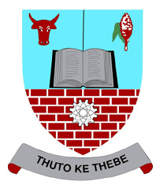
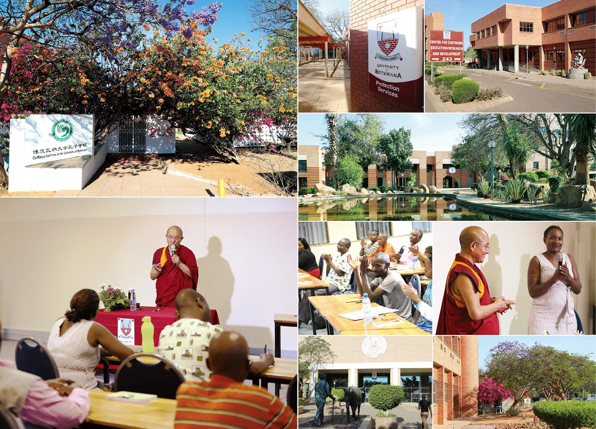
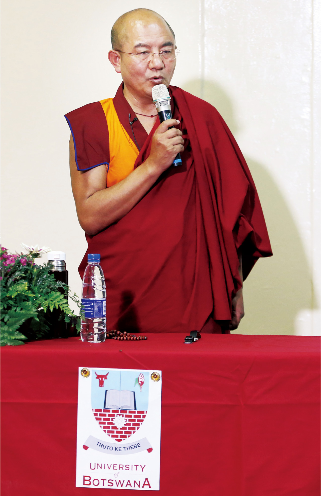
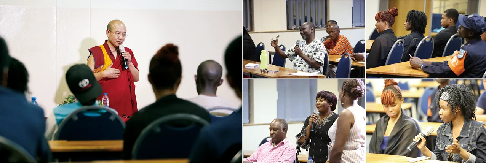

人类所有的痛苦，

都源于对自己的执著和对他人的冷漠。

第166场

博茨瓦纳大学

University of Botswana

博茨瓦纳·哈博罗内

2018 / 10 / 2

## 物质主义时代的佛教观

## The Buddhist Perspective in the Era of Materialism

主持人：

女士们、先生们，下午好！我很荣幸能代表神学和宗教研究系致欢迎辞。今天我们齐聚一堂，聆听索达吉堪布的演讲，欢迎并感谢各位的出席！下面，有请马索伯博士为我们进一步介绍索达吉堪布！

布兰·马索伯博士：

欢迎大家参加今天的佛教演讲！我叫布兰·马索伯，接下来由我向大家简单介绍一下堪布。索达吉堪布是藏传佛教宁玛派的一位伟大上师。藏语“堪布”的意思是教授，“仁波切”是堪布的另一个称呼。近些年来，堪布在全球上百所大学进行了演讲，与大众分享了他的智慧、佛法和佛陀的教言，其中有牛津大学、剑桥大学、莱索托大学、开普敦大学、纳米比亚大学、马拉维多马西教育学院、斯威士兰大学等。

很荣幸，今天堪布能做客我校。众所周知，现在的世界充斥着贪腐等各种问题，人与人之间因贪婪而互相残害，没有宽容，没有慈悲。所以，我们非常期待堪布接下来的演讲——有关佛教对物质主义的看法。

女士们、先生们，让我们欢迎仁波切的到来！愿三宝保佑您！

首先，感谢宗教系的老师请我过来讲课。我以前没有到过博茨瓦纳，只通过各种资料了解过，也听别人介绍过。听说这里的经济条件比较好，带有小康社会的味道，是一个比较特殊的非洲国家。有因缘来到这里，我充满感激，也非常开心。

## 非洲的贫富差距

这次我从香港出发来到非洲，一共安排了15天的行程。今天是最后一天，也是最后一站，也是我讲的最后一节课。在这半个月里，我去过孤儿院，到过几所大学，走了几家监狱，还去了一些部落，跟各个不同的群体都做了交流。总体而言，这次的行程非常放松，包容性也比较大——去了很多不同的地方。

而我去过的这些地方，贫富差距非常明显。为此，我心里极不平静，很长时间都恢复不过来。在马拉维，很多地方连水都没得喝，孩子们上不起学，生了病也没法去医院——好多地方都没有医院。看到这样的现状，我特别特别难受。

前两天在开普敦和约翰内斯堡，有人请我吃饭。都是在海边，吃得非常丰盛。一边吃，我心里一边想：这样的一顿饭，对马拉维的贫民而言，这辈子不要说真正吃上，甚至连看一眼都不太可能……

虽然我们共同拥有广阔的蓝天和广袤的大地，但是大家的贫富差距却如此之大。不要说全世界，光是非洲的几个国家之间，差距就这么明显。这真的非常让人难过。

## 世界的贫富差距

那么，世界范围内的贫富差距又是怎样的情况呢？和过去相比，差距进一步拉大，越来越让人难以接受。

### 1．82%的财富，在1%的人手里

我曾看过这样的资料：大概是在20世纪初，一位意大利经济学家经过长期的研究之后，提出了著名的“80/20定律”[^1]。这个规则的应用范围非常广，在经济领域则是指全球80%的财富掌握在20%的人手里。这说明什么？说明这个世界的经济分配从来就是不均衡的。而如今，这种分化趋势越来越令人感到悲观。

乐施会[^2]是一家国际慈善组织，由英国、美国等14个成员联合运作。这个慈善机构不分宗教，不分国家，不分肤色和政治差别，一心一意帮助世界上的穷人。我今年初看到过他们的一份报告：2017年，全球82%的财富流到了1%的人手里，有50%的人基本上颗粒无收[^3]。也就是说，绝大多数普通人的经济层次相当低下，甚至连上层人的千分之一都不到，世界经济命脉掌握在极少数人手中。

现在全球的某些状况真的不太乐观。各个国家，各个地区，甚至各个小地方，有能力、有智慧、有资源的人，都在竭力垄断经济命脉，牢牢掌控各种资源。照这样发展下去，穷人只会越来越穷，富人则会越来越富。

这个报道还说，2017年全球每两天就产生一个亿万富翁，而普通人的收入每年只增长2%。全球就这么一点资源，都被富人垄断了，穷人真的很难翻身。

我不是经济学家，也不是学经济的专业人士——我的专业是佛学，但我对经济、科学和管理方面的知识、信息以及发展动态都比较关心。在这个过程当中，我越来越感觉到：未来的时代，绝大多数普通人将活得非常艰难，而极少数富人会过得越来越奢侈。

过多的财富会导致道德败坏，富人们尽管生活奢华，心态却不一定健康，不一定快乐。而另一方面，世界各国的政治体制和管理方式虽然有所不同，但富豪们大都会得到本国政府合理或不合理的很多支持。这种现象让贫穷者心里产生各种恐惧和不安全感，甚至对富人群体产生极大的不满情绪。所以将来的世界，各种社会问题可能会不断出现，社会稳定将很成问题。

### 2．稀缺资源——乐善好施的富人

这些拥有大量财富的人，虽然自己付出了勤奋和努力，加上前世所造善业的因缘，即生现前了巨大的福报，但我们也不难看出，他们大多数还是以狂妄自大、贪得无厌的手段，将众多资源掌握在自己手里的。这些人对所有的竞争对手都非常残酷：小一点的，彻底摧毁；大一点的，收购吞并。在他们的世界里，除了自己以外，不愿意其他任何人成功。这些大企业和大财团的运作方式，不论东方西方，都是如此。这一点，人们非常关注，可以说有目共睹。

这些世界级的大富翁们，如果能有一点佛教的慈悲观和平等观，把自己手中的财富稍微分配一些给周围的穷苦人，我们“地球村”里的70亿人都可以过上快乐的生活，因为地球给人类提供的生存资源是完全足够的。

可实际上，这些既富且贵的人只关心自己和亲朋好友，基本上不关注其他人的生存状态。虽然个别富翁因为各种原因也做了一些慈善，比如建了一些福利医院和福利学校，但这些支出相对于他个人的总财产而言，万分之一都不到。

其实基督教也好，佛教也好，都提倡布施，并乐于布施，因为布施对自己的今生来世都非常有利。所以，当我有机会遇到这些富翁的时候，总会建议他们多做布施。

我会真诚地告诉他们：“人的生命非常有限，而且充满无常。现在你的手里虽然有大量财富，一旦你离开世间，连一分一厘都带不走。所以，最好趁现在还有权处理，尽量把它们分配给有缘的人。否则，你可能会成为社会的罪人。”虽然经常给他们讲这些道理，但据我观察，他们几乎不会考虑我的建议。

这些大老板、大富翁们，舍不得把自己的财产布施给有需要的人，却时常来问我：“您有没有什么事情需要我做？”我一个出家人，生活非常简单，能有什么事情需要他们做呢？有时想一想，真的很颠倒！

我曾看过一份世界富豪排行榜，上面列出了全世界最富裕的8个人的财富[^4]。这8个人里，有微软的比尔·盖茨（Bill Gates, 1955-），财产750亿美元；“股神”巴菲特（Warren Buffett, 1930-），财产有608亿美元；还有亚马逊的创始人贝索斯（Jeff Bezos, 1964-），Facebook的创始者扎克伯格（Mark Zuckerberg, 1984-）以及甲骨文的创始人埃利森（Larry Ellison, 1944-），等等。8个富豪中，有6个是美国人，2个是其他国家的。

乐施会根据这个排行榜的资料进行了分析，结果发现：这些人的财富加起来，等于世界上36亿贫穷者的财富总数[^5]。8个人的财富相当于全球一半的人共有的财富，这真是一件很可怕的事——整个非洲一共才54个国家、十多亿人！

不过，事情也好像变得简单了：只要这区区的8个人，把自己的资产分一部分给世间的贫穷者，全人类就可以过上非常幸福的生活。可惜，事实让我们有点失望，因为事情没那么简单。

### 3．自私与冷漠

我们处在一个极不公平的时代。富裕的人，财富多得没法安排——自己享受不了，也发挥不了什么社会作用，只由他个人掌控而已；而艰难的人需要钱，却怎么努力也得不到，活得特别辛苦。

我以前去马拉维和纳米比亚的时候，那里很多地方特别贫穷，给我留下了很深的印象。所以这次我又特意来到非洲，也特意去了一些孤儿院。我在非洲这片土地上，深深感到财富对人类的重要性。如果没有金钱，所谓的艺术、宗教、文化，所谓的价值观、审美观，都根本无从说起。然而，钱从哪里来？在这样的财富格局下，很多人的贫穷已经变成一种很难突破的状态。

尽管我们有不同的肤色，也有不同的价值观，但总体看来还是相同的——都属于人类。既然如此，我们应该拥有大体相当的生存资源和生活水平才对。可实际上呢，每个人、每个国家、每个地区的命运都完全不同，甚至差异巨大。

佛教认为，世界的不公平源于人们各自的业力不同——其他宗教可能有另外的说法。那所有这些全部是由业力造成的吗？也不是。现在世界的贫富悬殊也好，历史上发生的很多不愉快的事情也好，最关键、最主要的原因有两个：一是人类过于自私自利，二是不愿意关注他人的痛苦。

换句话说，人们太强调自我主义，导致除了自己和家人以外，其他所有人都不放在眼里——人类所有的痛苦都是源于对自己的执著和对他人的冷漠。

## 追溯历史根源：西方人的弯路

### 1．错误的幸福灯塔：物质主义

我喜欢看一些历史书。几百年前的人类，虽然没有今天这样发达的科技，没有现在这样丰富的资源和财富，但各个国家和民族都自由自在地生存着。历史上交通和科技的不发达，反而给人类的合理生存提供了保障。

然而，14世纪以来，西方的新思想逐渐打破了这个保障。七八百年前发展起来的科学主义其实就是一个幌子，表面上好看、动听，“地球人”都已全盘接受，实际上却是人类心灵走向衰毁的根源。东方的神秘主义虽然对人的内心真正有帮助，却抵挡不了物质主义的诱惑和冲击。

科学主义以物竞天择的达尔文精神为主，通过各种方式将人类久存于心的宗教信仰和传统文化全部抹杀。离开了心灵的宁静，人们的目光便唯一专注于物质财富。正是这样的价值观导致世界走向分裂和冲突。人类和平如今已是危机四伏，动荡飘摇。稍懂历史的人都明白这个道理和现实。

消费主义让大多数西方人认为拥有金钱和物质才是完美的幸福，而西方科技的发展为他们抢夺各种资源和财富提供了便捷的工具。从14世纪开始，人们就在这条路上奔跑，而且越来越疯狂，一直到今天。

我这样回顾和剖析历史，有些人可能不太愿意听。前一段时间我去了开普敦大学。这所大学里本来有很多标志性的历史建筑，但在2015年的学生运动中，很多都被毁坏了。为什么会这样呢？因为学生们不愿意面对过去的历史……

然而，历史是不应该被遗忘的。很多时候，我们需要通过历史来反省现在，思考未来。人类历史上发生的很多血腥故事，尤其是近几百年来频频发生、规模巨大的冲突与战争，都是因为我们过多地依赖了物质。

### 2．电影世界的控诉：血与泪

我以前看过一部非洲的电影，名叫《血钻》（Blood Diamond）。这部电影讲述的事情很有代表性：有一个非洲小国，象牙、石油、黄金、钻石等资源非常丰富。然而，战争却染红了这片土地，因为强大的西方同类需要物质财富。为了抢夺钻石，人与人之间的关系变得非常复杂，充满阴谋与争斗……

世界上的每一个人都想获得幸福，遗憾的是，却错误地将幸福定义为金钱和财富。为了这样的“幸福”，人们不断地抢占弱小国家的财富，把别人的东西占为己有。大家都只希望自己的民族、自己的国家拥有更多财富，以便子孙后代都过得幸福，却不把别人的感受、别人的贫穷和别人的痛苦当一回事。

其实，不管哪一个国家，哪一个民族，在这个地球上都只有生存权，只有享用权，没有霸占的权利。前一段时间我在开普敦天体科学馆了解到：人类现在所能观察到的星球有无数个，包括行星和恒星。但到目前为止，科学家还没有发现其他任何星球上有生命存在的迹象。离我们最近的月球，上面连一滴水也没有。我们人类赖以生存的星球只有一个，那就是地球。

这个唯一的地球，应该属于所有的生命。我们需要生存，动物也需要生存。西方人需要生存，东方人也需要生存。东南西北，各个国家，各个民族，都要在这个星球上出生，在这个星球上成长、生活，最后从这个星球离开人世。

地球上的生存资源是所有众生共同拥有的，任何一分子想要抢占、独霸，都不可以。不管是哪一个国家，不管它有多么强大，都没有这个权利。

### 3．现实世界的行动：战争与掠夺

可是，几个世纪以来，很多没有同情心的人却肆意抢占人类共有的资源……这是非常令人悲伤的事情。

我经常去世界各个国家。到了加拿大和美国，印第安人曾在这片土地上被欧洲人赶走、杀掉；到了澳洲和新西兰，那里的土著居民被西方人全部杀光；到了非洲大陆，也是如此——非洲的历史，你们应该非常清楚；在亚洲的很多地方，也充斥着人类内部的战争和冲突，血腥的历史不断重演……

所以，不管我去到哪里，心情都非常复杂。一方面，对最早的古人十分钦佩，因为他们的生活充满了勤劳和智慧；另一方面，为后来的西方殖民者感到悲哀，因为他们受欲望的驱使，用血腥的手段去控制其他国家和民族。

发生在20世纪的第一次世界大战，伤亡达3000万人左右，参战者约15亿——具体数据有不同的说法；第二次世界大战的死亡人数有5500万到6000万人，伤者约1.3亿，参战者约有20亿。如此巨大的伤亡数字，真的令人触目惊心。

为什么会发生这样的战争？为什么？无非是有人想要抢占别人的领土。极少数人的贪婪和愤怒，让如此多的众生付出了鲜血和生命。

历史上发生的贩卖黑人也是如此。大概从1441年开始，很多非洲人就被欧洲人当作奴隶买卖。1978年，联合国教科文组织做了一个统计[^6]，在欧洲人贩卖黑人的400年时间里，整个非洲的死亡人数是2亿1000万——也有说1个多亿的。虽然具体数字说法不同，但可以确定的是，至少有1到2亿的黑人死去。这也是由人类的欲望和贪婪所导致的。

我在这里提起这些事情，列出这些数据，并不是为了表达心中的仇恨。曼德拉从监狱出来的时候，都不恨折磨他的狱警们，我作为一个佛教的出家人，更不会仇恨这些人。

我想表达的是什么呢？回顾这些历史，人类所有的痛苦都是由三种烦恼导致的：要么是欲望，要么是愤怒，要么是愚痴。这三种烦恼在佛教里叫做贪嗔痴三毒。也就是说，贪嗔痴三毒让人类在历史上留下了很多不好看的脚印。

## 佛教的幸福观：快乐由心

刚才讲了过去发生的许多事情，视野可能拓展得有点宽了。下面我就从一个佛教徒的角度，以佛教思想来分析一下，物质时代的人类应该如何获取真正的幸福。

佛教认为，人的快乐有两个方面，一个是感官的快乐，一个是心灵的快乐，而痛苦也分为感官的痛苦和心灵的痛苦。层次比较高的人会更多地感受内心的痛苦，层次一般的普通人则多关注身体上的痛苦。

身体上的痛苦可以依靠感官的快乐来对治。当一个人听到好听的声音，看到美好的事物，品尝到可口的美食，或者身体接触到柔软舒适的东西，他会觉得非常快乐，身体上原有的痛苦当下就可以遣除或减轻。

而内心的痛苦可以通过禅修，或通过宗教方法认识自己的内心来压服或遣除。一旦认识了自己的内心世界，所有的痛苦都会消失，唯一只感受快乐。

感官上的痛苦，人类跟动物是相同的。动物的身体被刀割的时候，也会非常痛苦；当它看到不悦意的伙伴，也会产生愤怒的情绪。但意识或心灵的痛苦，人类跟动物则完全不同。一个被判死刑的人和一个即将被杀的动物，二者的心理感受是不一样的。判死刑的人心里会有恐惧，害怕马上被杀掉；而一些待宰的动物根本不知道害怕，只有当利刀宰割它的身体时，它才会产生感官的痛苦。

有些人只关注金钱和物质带来的感官快乐，这种想法实际上跟动物差别不大——这话说得也许有点过激，但事实就是如此。如果我们没有能力享受内心的快乐，只能把所有的幸福寄托于外在的财富和物质，这跟动物的想法真的没多大差别。

动物因为非常愚痴，所以有时候做的事情有可原。比如有些猛兽只吃异类动物的肉，除此之外不会吃其他任何东西，如果找不到这类食物，它就会饿死。而人类如果不杀害动物或者自己的同类，还可以有其他的生存方式。

在动物界，杀害异类的情况比较多，杀害同类的比较少见。可是人类呢，为了抢夺资源和金钱，杀害了无数的同类，有时甚至连自己的亲朋好友都不放过。因为财富而遭到杀害的现象，在人类身上发生得太多太多。这真的很不美好，很令人遗憾。

人类之所以有别于动物，最重要的是这一颗心。来自心灵的苦乐会影响感官对苦乐的感受，使苦更“苦”、乐更“乐”，或者令苦变得“不苦”、乐变得“不乐”。所以佛教认为，真正的快乐，只在我们的内心。学会调伏自己的心，让这颗心自己去遣除痛苦，寻找快乐，才能得到真正的快乐。

## 佛教的财富观：走中道

佛教的财富观强调中道，不会堕于富裕奢华，也不会堕于贫寒困顿，因为这两个“边”对正常生活都有影响。佛教对财富本身并没有不好的看法，但特别警惕过于贪著财富给自己带来的巨大祸害。

活在这个世界上，如果太贫穷，经常感受饥饿、寒冷，搞得身心疲惫，苦恼不堪，就没办法正常生活；如果太富裕，占有很多不合理的财富，欲望会越来越大，很多行为也会变得非常不如法。这两种情况，都会让我们远离快乐。所以，佛教特别赞叹中道的财富观。这跟基督教的某些财富观比较接近。

而且，佛陀要求弟子们合理分配拥有的财富：一部分自己享用；一部分保存，以备饥荒或者有其他需要时使用；一部分布施给可怜的乞丐或有需要的人；还有一部分拿来供养思想境界比较高的上层人物——类似于现在受过高等教育的人士。这样的财富观在《阿含经》《涅槃经》等相关的佛经中，都有非常清楚的阐述。

很多人认为，佛教提倡苦行，为什么有的佛教徒不过苦行的生活？对于这个问题，佛教在《毗奈耶经》中说得很清楚：如果一个人没有贪欲心，也没有付出特别大的勤作与痛苦的代价，那他即使住着非常好的房子，穿着特别好的衣服，享用各种美味佳肴，也是可以的，因为不会形成罪业。

当然，也有个别佛教徒认为财富对自己的修行没什么帮助，愿意过苦行僧的生活，愿意以苦行的方式来修行，这也是佛教开许的。

不过佛教徒每天做早晚功课的时候，都会发愿：不要转生到太富裕的家庭，也不要转生到太贫穷的家庭，而要转生到中等的家庭，以保证将来可以如理如法地修行。我自己每天念诵的功课当中，也有“不生富贵家，不生贫穷家，唯生中等家，恒常得出家”的发愿文。这是我们对待财富和修行的一种态度。

## 佛教的知足观：不被欲望所牵

佛教最看重的是心灵的自由和快乐，不会将幸福完全建立在外在的财富上。因为建立在财富上的快乐非常不稳定，当你有钱的时候，也许快乐——实际上，真正有钱的时候，也不能保证天天快乐、时时快乐，而一旦没钱了，就很难快乐起来。相反，幸福的“脚”如果落在内心，即使财富不多，也依然可以享受快乐的生活。

佛陀接近涅槃的时候，给弟子们留下最后的教言，叫做《佛遗教经》。这部经中说：“行少欲者，心则坦然，无所忧畏……知足之人，虽卧地上，犹为安乐。”意思是，欲望少的人，内心会时时处于坦然的状态，没有担忧，没有恐惧……知足的人，即使身体躺卧在地上，心里也可以很快乐。这样一种境界，可能值得我们去思考和追求。

如果自身没有这样的境界，也不努力追求这样的境界，却把全部希望寄托于外境，要么是金钱，要么是伴侣，要么是房子、车子，那可能很难得到真正的幸福。因为即便达到了期望的目标，心里很快又会有更高的要求。我们的欲望是永远也填不满的坑，只要这颗心被欲望所牵，就不可能感受到真正的快乐。

## 西方人的醒悟

其实这样的道理，西方的很多学者现在已经慢慢认识到了。美国有一位历史学家，叫达林，多年来一直研究“幸福”，后来写了一本这方面的专著，叫《幸福的历史》[^7]。他在书末总结的时候说：人类再怎么追求，也不可能得到真正的幸福。

我觉得，他的意思并不是说所有的幸福都不存在，而是说，依靠物质得到的所谓“永恒的幸福”在这个世界上根本不存在。的确是这样，不管人们如何追求物质，也不可能得到真正的幸福。

阿非利加和藏地的人，因为经济发展得比较慢，目前可能还没有把幸福完全寄托在物质上。西方人最初不但没有意识到这一点，反而错误地认为拥有金钱就拥有一切，所以几百年来，发动了各种战争，对许多古老的人类文明和文化做了各种反人类、反道德的事情。直到今天，他们才醒悟过来：幸福的宝藏，只能在自己的内心去挖掘。而内心的幸福方法，也许只有在宗教中可以找到。

在北欧，包括瑞典、瑞士等很多国家，医疗条件、社会保险以及各种社会福利制度非常完善，几乎所有人都过着衣食无虞的生活。然而，这些国家得抑郁症的人，现在却越来越多。

美国的情况也是如此。现在美国的经济不行——以前美国经济好的时候，人们的幸福指数随着经济指数的上升，反而越来越下降。当代西方的种种社会问题，让西方人逐渐意识到：物质主义的幸福观完全是错误的。

所以，我们现在真的应该好好反省一下：真正的幸福到底在哪里？

## 让心灵的钻石，照亮幸福的路

最后我总结一下今天的演讲。一方面，我们可以享受感官的快乐；另一方面，更要懂得追寻内心的快乐。当你通过某种方法观照自己的心，认识了心的本来面目，你会发现，真正的快乐原来就在自己的心里！

内心要得到真正的满足或者幸福，可能需要宗教的指引。你们这里有基督教，有佛教，还有其他宗教，非常方便。通过宗教的方式找到内心的幸福，我觉得这是最好的幸福之道。

大家可以通过对比，选择自己最有信心的宗教。每一个宗教都有认识真相的方法和窍诀，而且这些窍诀都非常理性，并非迷信。我们在物质上、科技上或文化上得不到的幸福，依靠宗教的理性智慧和窍诀，也许可以轻而易举地获得。

听说你们这里的钻石资源非常丰富，全世界三分之一的钻石都产自你们国家[^8]。其实，找到内心的快乐，才是真正的富翁，这是再多钻石也比不上的；相反，如果没有找到内心的快乐，即使拥有无数钻石，也可能依然贫穷。

所以，我希望大家都能拥有内心的钻石——这才是真正的财富和幸福！

现场互动

问：怎样才能克服愤怒的情绪，从而获得快乐呢？愤怒的原因，是因为现实生活中有些人如此富有，如此快乐，而自己却很穷——一个穷人怎么快乐呢？

堪布：对别人的富有和快乐感到愤怒，好像没有什么用。

由于教育的原因、腐败的原因，以及不良财富观的影响，现在很多人对社会财富分配不均都有怨气。但是，任何一种负面的怨气或愤怒，都不能给我们带来理想的结果。以理性的思维和途径来解决问题，可能才是最好的。

现在有些人因为贫穷，不管做什么事，空间都很小，很难成功，而有些人虽然没什么能力，但由于资源丰富，轻易就成功了。这不只是哪一个国家或者哪一个地区存在的问题，而是全球性的问题。而且，将来这种趋势还会越来越明显。解决这样的共性问题，更需要理性的智慧，而不是简单的愤怒。这是第一个方面。

第二个方面，我们自己也要学会慈悲，对他人多一点关心与同情。比如说，我虽然不是特别富裕，但一定还有比我更穷的人。在这些人的眼里，我的很多行为会不会也非常过分？要经常反思自己。

前段时间，我在马拉维喝了一瓶汽水，喝完以后，瓶子里还剩一点点，很多孩子都跑过来抢。后来，一个身材比较高、力气比较大的孩子抢到了。其他孩子都特别恨他，但也没办法，因为身体和力气都比他弱，抢不过他。

对任何一种社会现象，都需要客观地进行分析。我们目前拥有的这些东西，在这个国家或其他地方的其他身份的人看来，可能也有很多不公平的地方。所以，我们需要进行多方面的比较，才能得出全面而客观的结论。

问：这个世界充斥着各种不平等，权力的滥用与不公正在撕裂人类社会。我们是该继续睡在地板上，一边自我满足一边沮丧呢，还是奋起反抗？

堪布：你提的问题很好。在我去过的很多地方，上至国家高层，下至平民百姓，人与人之间都有很多不满的情绪。只要有人类存在的地方，也许就会有复杂的人际矛盾或者不满情绪。

严重的贪婪或腐败问题，时候到了，肯定会溢出来，大白于天下。这是一个自然规律，不管在哪个地方，都是如此。不过在此之前，我们是该乖乖地等着水落石出的那一天呢，还是主动出击，争取自己的权利？这需要用智慧观察。如果自己的实力超过对方，而且的确发现了问题，当然可以站起来对抗，但如果对方的实力非常强大，你根本无法反抗，那只能认输。

佛教有一个观点：在别人手下做事，就一定要听人家的话。这是最明智的选择。如果你的能力超过对方，那怎么样做都可以，只要不造成伤害就行。

社会的不公平不是现在才有的，在人类历史上，这个问题一直存在。所以不要愤怒，一切要根据自己的能力和智慧而定。佛教认为“自由是快乐，他控是痛苦”。虽然天底下有很多事情让我们不能接受，让我们觉得不乐观，但至少我们的身心是自由的，可以说自己的语言，可以过自己的生活，可以有自己的空间。这也是一件非常快乐的事情。

问：当代很多人对性取向问题缺乏正确的认知，我的很多同事都支持同性恋合法化。佛教是如何看待此类问题的？

堪布：对同性的贪执属于贪心的一种。佛教对此没有特别否定，也没有特别肯定。

人类的贪心是各种各样的，这在佛经里有明确的记载：有些人贪著与自己年纪相仿的人，有些贪著年龄比自己大的人，有些贪著年龄比自己小的人，有些只贪著年轻人；还有些贪著同性——刚才说的是异性；甚至还有一些人贪著动物——对动物产生贪心……这些情况，早在2560多年前，佛教就已经清楚地描述了。

这几年来，仍有很多国家对同性恋非常排斥——历史上甚至有因此而判死刑的，只有少部分国家特别支持，目前好像只有26个国家承认同性恋合法。以前，同性恋在澳大利亚是非法的，而他的邻居新西兰则认为是合法的，如今在这两个国家都已经合法化。总体看来，同性恋的合法地位正逐渐得到更多国家的承认。

佛经里讲，有些人喜欢年轻人，有些人喜欢老年人，这让我想起中国的物理学家杨振宁。前些年，他已经82岁了，却娶了一个28岁的姑娘——现在他应该有90多岁了。28岁，82岁——这是一个比较特别的例子，我经常会想起来。他和妻子，一个喜欢比自己年轻的，另一个喜欢年老的。美国总统特朗普[^9]和法国总统马克龙[^10]的家庭，也都比较特别。

我1993年去美国的时候，一位男士带来另一位男士，向我介绍道：“这是我的男朋友。”当时我刚去西方，简直太惊讶了。后来慢慢接触得多了，现在不仅是所谓的“男朋友”，即便他把这个同性的“丈夫”带来，我也能平静地接受。这可能是一个观念的问题。

总之，人类社会总会有各种超越传统和想象的事情发生，同性恋只是其中的一种。佛经对此早有说法：既不排斥，也不赞叹，跟其他贪欲是相等的。

布兰·马索伯博士：

提问环节到此为止。大家再次将掌声送给堪布，好吗？非常感谢您，堪布！今天确实收获颇多。

在最后，我想重申知足在当今社会的重要性。没有哪个社会能避免问题。比如，博茨瓦纳被公认为和平的国度，也被认为是非洲最好的国家之一，但据另一项国际研究表明，博茨瓦纳同时是非洲国民压力最大的国家之一。这结果十分意外。

虽然我们很富有，但正如仁波切所说，社会依然存在很多不平等，比如钻石的分配等。尽管这样，我还是选择相信博茨瓦纳。因为很多事情我们分辨不清，而且我们似乎也没有办法，甚至没有反抗的力量来改变现状。根据仁波切的建议，我们应该对现状知足，因为目前我们改变不了现状。

但如果可以，我们也需要尽一切办法去改变现状。因为当我去马拉维的时候——堪布刚刚也提到了马拉维，那是一个极其贫穷的国家，我惊讶地发现，那里的人居然非常平和，并不奸诈，也不贪婪——他们不会觊觎你的手机。他们宁可坦率地向你索要，也不会偷你的任何东西。

而我们有钻石，是富有的国度，被公认为是好的国度，可是一踏出房门，不安感随之而来。因为人们都很贪婪，什么都想据为己有。太多的物质主义和竞争主义滋生了这种贪婪。此外，还有诸多问题，但这里不多说。

所以，我不相信任何能快速解决不平等的办法。因此，堪布的话语是我们的福音，我们要将这些话放在心里。非常感谢！

[^1]: “80/20定律”由意大利经济学家维弗利度·帕累托（Vilfredo Pareto，1848-1923）所提出。是指世界上充满了不平衡性，比如20%的人口拥有80%的财富，20%的员工创造了80%的价值，80%的利润来自20%的顾客，等等。该法则认为，资源总会自我调整，以求将工作量减到最少。抓好起主要作用的20%的问题，其他80%的问题就迎刃而解了。因此，这种法则又叫省力法则。
[^2]: 乐施会（Oxfam）最早于1942年在英国牛津郡成立，后来逐渐发展成一个具有国际影响力的发展和救援组织联盟。目前由14个独立运作的成员组成，即英国、爱尔兰、加拿大、美国、加拿大魁北克、新西兰、澳大利亚、荷兰、比利时、法国、德国、丹麦、中国香港和印度。
[^3]: 2018年1月，乐施会（Oxfam）发布报告《请回报劳动，不要酬谢财富》：2017年全球贫富差距进一步扩大。其中，全球最富有的42人所掌握的财富总额等于全球最贫困的37亿人所拥有的财富。与此同时，全球82%的财富都流向了最富有的1%的群体。
[^4]: 根据《福布斯》的亿万富翁排行榜，2016年全球最富有的8个人指的是微软始创人比尔·盖茨（美国，净资产750亿美元）、Zara创始人奥尔特加（西班牙，670亿美元）、“股神”巴菲特（美国，608亿美元）、电讯大亨卡洛斯·斯利姆（墨西哥，500亿美元）、亚马逊始创人贝索斯（美国，452亿美元）、“脸书”共同始创人扎克伯格（美国，446亿美元）、甲骨文主席埃利森（美国，436亿美元）和彭博社始创人布隆伯格（美国，400亿美元）。
[^5]: 乐施会（Oxfam）2017年1月发布题为《99%民众的经济》的报告：全球8个超级富豪拥有的财富，相当于全球较贫穷的一半人口（36亿人）的财富总和。富人和穷人之间的鸿沟比我们之前所担心的还要更大。财富聚集在富人手中，而付出代价的正是社会上最贫穷的人，大部分是女性。如果富人的财富继续以目前的速度增长，25年后，世界上将出现第一个“万亿富翁”，这意味着一个人即使每天花100万美元，也需要2738年才能花完这笔钱。
[^6]: 1978年，联合国教科文组织在海地召开了非洲奴隶贸易讨论会。会上一些学者认为，16-19世纪，从非洲运往各地区的奴隶总数应在1500～3000万人之间。另一些学者主张计算时要考虑到捕捉、陆上运送和海上航行中的死亡数字。他们估计非洲在400年三角贸易中总共损失了2.1亿人。
[^7]: 《幸福的历史》（Happiness: A History），1997年出版，作者达林·麦克马洪（Darrin McMahon, 1963-）。此书阐述西方产生出“幸福”信念的历史过程，内容涉及艺术与建筑、诗词与经书、音乐与神学、宗教、文学、神话等，为一部智识史，也是一本探讨哲学、宗教、人类思想的著作。
[^8]: 博茨瓦纳盛产优质钻石，宝石级占50%，其产值居世界首位。目前是世界第二大钻石生产国。
[^9]: 特朗普有三任妻子，现任妻子小他24岁。
[^10]: 马克龙的妻子是他的中学老师，比他大24岁。
