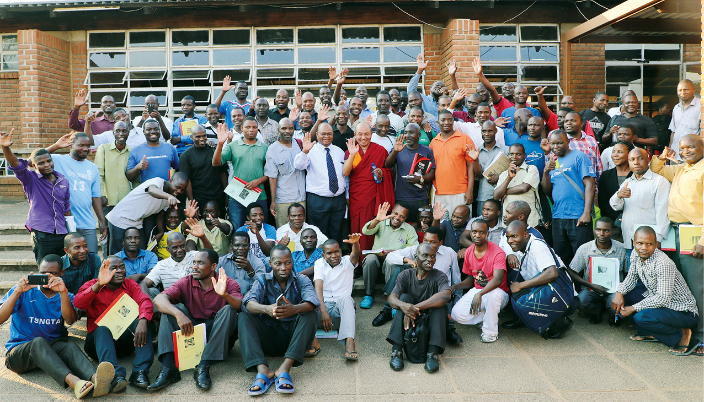
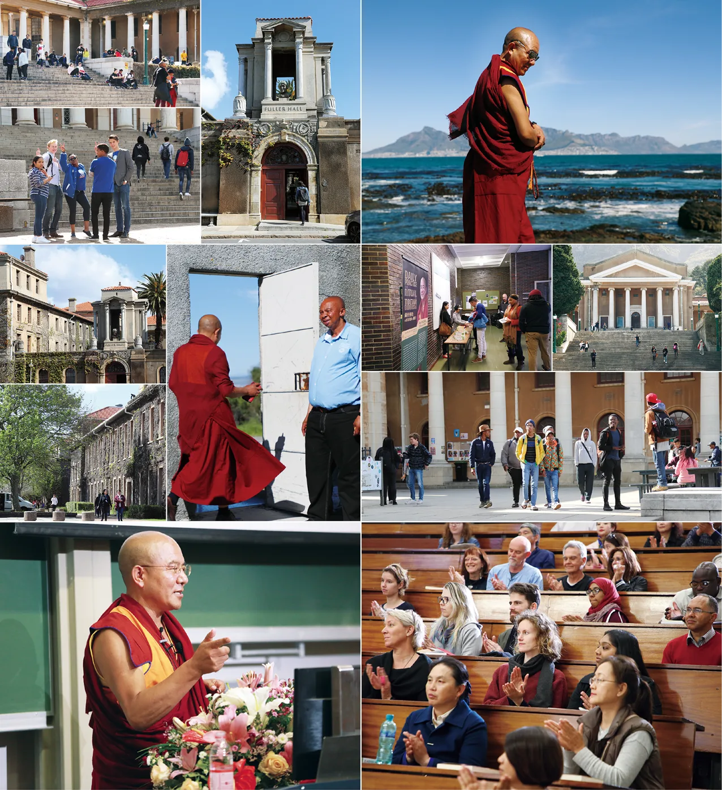
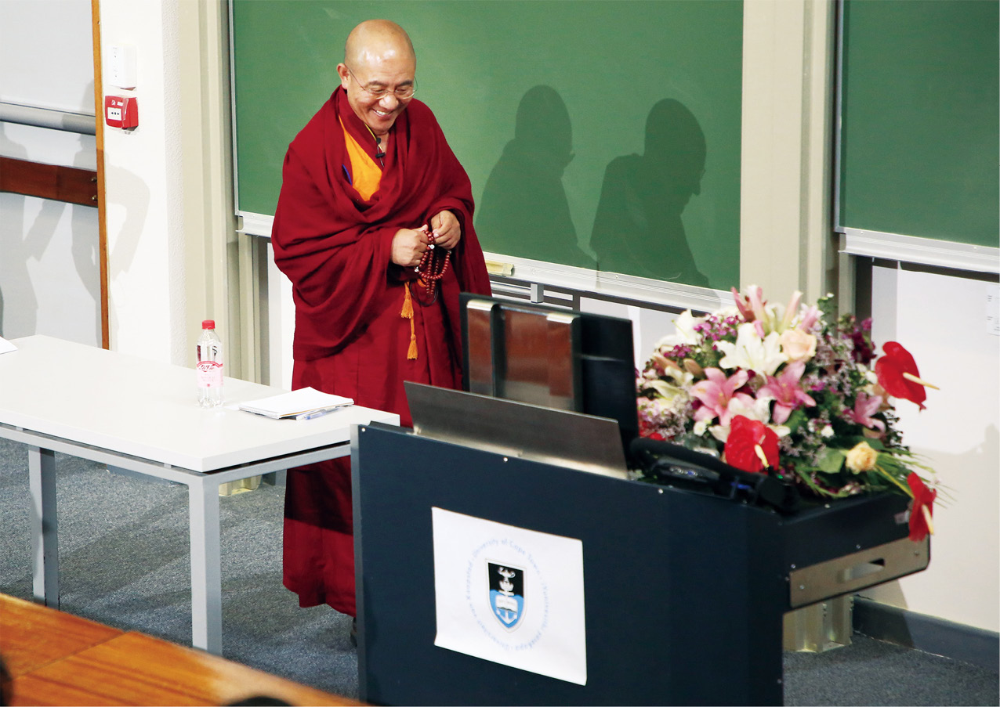
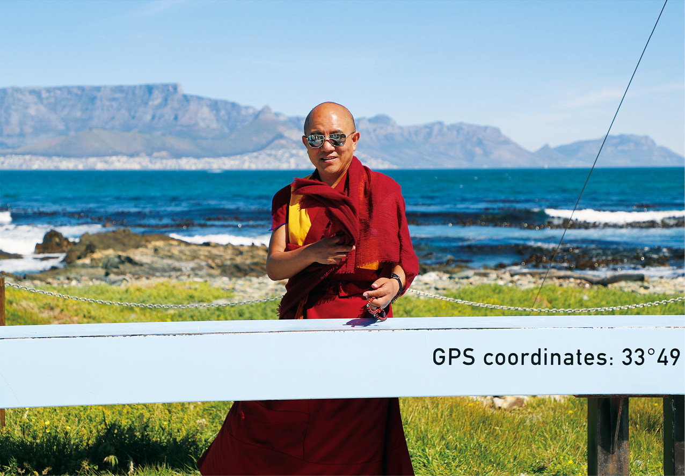

把自己当作别人，

把别人当作自己，

把别人当作别人，

把自己当作自己。

第165场

南非开普敦大学

University of Cape Town

南非·开普敦

2018 / 9 / 28

## 藏传佛教的日常修行和仪式

## Daily Practices and Rituals on Tibetan Buddhism

伊丽莎白·普库博士：

欢迎大家的到来！今天我们相聚在此，共同聆听索达吉堪布的演讲。这是堪布第二次到访南非。第一次是在三年前，当时堪布已为我们准备了一场演讲，但就在演讲的前一天，学校因为示威游行暂时封校，演讲不得不取消。

今天，我们再次邀请到堪布，和他一同游览了校园。在这里，我要感谢我的学生凯琳和梅丽莎。在四十分钟的校园游中，她们一直陪伴，并带给我们发人深思的解说。

言归正传。堪布此次到来，将和我们共同探讨当代社会如何将藏传佛教的修行和仪式融入日常生活。基于此，他今天将为我们介绍藏传佛教的一些基本概念及日常修持。有请索达吉堪布！

首先，感谢宗教系的教授和在座的各位同学！今天有这么一个因缘，跟大家一起交流“藏传佛教的日常修行和仪式”，真的很难得。

## 因缘与无常

就像刚才教授所介绍的那样，2015年我来非洲的时候，本来是在你们系安排了一场讲座，但因为当时的一场示威游行，没有讲成。三年后的今天，才因缘和合，与大家重聚于此。

刚才我们参观了学校的图书馆、纪念堂、科学系和其他系的一些建筑。教授的两位学生解说得特别细致，给我留下了非常深刻的印象，我回去想写在日记里。最近两三年以来，我坚持记录每天的事情，一天都没有落下。不管这个日记将来有没有意义，我都会每天做做记录、写写日记，这已成为我的习惯。

刚才参观校园的时候，我非常深刻地感受到了佛教所讲的无常变化，或者说历史的变革，或者说人类从古到今的不断进步和发展。过去在这里发生的很多事情，都让我对生活、对人生，有了更深层的了悟。

## 佛陀·佛法·佛教

藏传佛教其实是佛教的一个分支。在座的各位应该非常清楚，当今世界主要有五大宗教，分别是基督教、伊斯兰教、佛教、印度教和犹太教。当然，对此也有不同的说法。

作为五大宗教之一的佛教，现在已经有2561年[^1]的历史。佛教的创始者是释迦牟尼佛。他是一个真实的历史人物，在这个世界有过鲜活的生命历程，公元前623年在印度出生，公元前543年于印度涅槃。从释迦牟尼佛时期到现在，佛教一直存留于这个世界。

佛陀所宣说的法，全部包含在三转法轮当中。如果细分，可以有八万四千法门。就立成的文字而言，藏文的《大藏经》有108函，汉文、巴利文跟其他文字的《大藏经》，因为翻译的原因，数目有所不同。但不管怎么样，佛陀当年亲口宣说的所有的法，确确实实已立成了文字。这个我不用多讲，你们是学宗教的，应该非常清楚。

佛陀降生，苦行，成道，三次给众生转法轮，最后所有的事业圆满，在80岁示现圆寂……一生的事迹与足迹，大家去一趟印度就非常清楚了，在这里不广说。

如果把佛陀所说的法全部归纳起来，就是：“诸恶莫作，诸善奉行，自净其意，是诸佛教。”意思是说，作为佛教徒，对人类社会有害的所有事情都不能做，对众生有利的所有事情都要去做，而最重要的是调伏自己的心，让内心得到平静。这个偈颂涵盖了佛教全部的教义。

从大的语系方面分[^2]，佛教有三个流派。南传佛教主要兴盛在缅甸、泰国、斯里兰卡等东南亚各国，北传佛教主要在汉地、日本和韩国兴盛，藏传佛教主要流布于藏地、蒙古以及现在的很多欧美国家。

## 藏传佛教的日常修行与仪式

### 1．兴起与发展

藏传佛教迄今已有一千六百多年的历史。公元333年，第28代藏王拉托托日年赞统治时期，藏传佛教便开始在西藏这块土地上慢慢兴起，不断发展。虽然中间经历了一些风风雨雨，但到今天为止，依然完好无损地保留着，并分布于世界很多国家。

我在十多年前看到过一个报道，说藏传佛教已流传到全球八十多个国家。现在的情况如何，我不是特别清楚，应该比那个时候有所增加。刚才教授也讲了，现在学藏传佛教的人，不管是在汉地，还是在西方国家，都越来越多。

我不管去哪个西方国家，在大学里被问得最多的就是：为什么现在有那么多年轻人学藏传佛教？究竟有多少人在学藏传佛教？我没有具体的统计数字，但藏传佛教如今在很多地方确实比较受欢迎，大家都比较感兴趣，纷纷投以青睐的目光。

### 2．特殊的日常修行与仪式

藏传佛教内部虽然分为宁玛派、格鲁派、萨迦派、噶举派和觉囊派等好多不同的支派，但各派在基本的修法和修行次第上却大同小异，没什么大的差别。而且，汉地等弘扬较广的北传佛教的许多显宗经典，比如《金刚经》《阿弥陀经》等，南传佛教比较重视的《法句经》《阿含经》《毗奈耶经》等经典，藏传佛教都在学习。由此可见，藏传佛教不仅内部教派相互学习，修行一致，更重要的是，对其他宗派的教义也兼容并蓄，认真学习。

那藏传佛教是不是跟佛教的其他宗派完全相同呢？并不是。最主要的不同在于修行的次第性。在佛教内部非常著名，被人们称为“第二大佛陀”的世亲论师在《俱舍论》中有这么一句话：“守戒具足闻思慧，极为精勤而修行。”结合这句话，可以从四个方面描述藏传佛教特殊的日常修行和仪式。

#### 1）守持戒律

不管是出家人还是在家人，凡是修学佛法的，都必须遵守在家或者出家的基本的道德和行为规则——藏传佛教对戒律的要求非常严格。当然，也有极个别人守戒不太如法，但这只是个人行为。各教派都要求出家人必须守出家人的沙弥戒或比丘戒，在家人必须守在家人的三皈五戒。藏传佛教认为，戒律是所有修行的根本，就像大地之于万物：离开了大地，万物没办法生存；离开了戒律，修行的功德则无法生起。

#### 2）听闻佛法

听闻佛法是修行的基础，非常重要。如果不依止善知识听闻佛陀的教言，再有智慧的人也没法趋入真正的修行。藏传佛教非常重视教法的传承，上师传给弟子的所有教法，都是由佛陀亲口宣说，并经由历代善知识们口耳相传传下来的。这种传承承载的力量真的是代代相传，中间没有任何中断，一直延续到今天。藏传佛教对传承的态度非常严谨，如果没有教法的传承，即使你再有智慧，再能讲辩，也不允许给别人传法，而其他教派则没那么重视传承的力量。

而且，即使是具有教法传承的上师，要给别人讲显宗、密宗的法，或是给别人传戒、灌顶等，还得有其他方面的资格要求。如果不具足相应的资格，原则上是不能给别人传讲佛法的。虽然在实际行持中，还是会出现极个别修行人不如法的行为，不能完全排除鱼龙混杂的现象，不过从大的方面看，直到今天为止，藏传佛教的讲闻传承依然是纯洁的。

现在的世间教育，一个没有教师资格证的人，不允许站上讲台给学生讲课。很多正规的教育场合，没有教师资格的人也不允许参加。这跟藏传佛教寺院对传法者的要求完全相同。而且，藏传寺院对传法者的要求并不是从现在才开始的，而是延续了一千多年的历史传统。你们要是有时间，最好具体了解一下藏地的佛法传承，很有意思的。

刚才讲的是闻所生慧。要掌握断除愚昧的方法，听闻佛法很重要，所以藏传佛教对此历来极为重视。

#### 3）思维法义

现在讲的是思所生慧。上师给大家传讲了佛法之后，我们还要通过自己的思维，认真抉择听闻到的这些知识，以达到进一步巩固的目的。在这个过程当中，大家会以各种各样的方法互相研讨，彼此辩论。每个人都会认真思考，提出疑问，然后到老师或者同学面前释放，或者拿到辩论场上辩个明白。所有的疑问都可以拿出来，甚至包括对佛教和其他宗教的质疑。

佛教的辩论很有意思，也很有价值。我现在所在的寺院经常进行辩论。在辩论场上，大家会释放出各种各样的问题，辩论的话题层出不穷，充满了各种挑战。如果你接受了别人的问难，自己又不善于答辩，当对方从各个角度攻击你的观点时，你恐怕只有举手言败。藏传佛教非常欢迎公开辩论，以此遣除学习过程中的一切疑惑。

下面给大家简单分享一段短片。

（播放幻灯片，内容包括喇嘛辩论现场、学院夜景、僧众、坛城、法会共修、法王如意宝照片、学院早期照片、修行时的法器使用、堪布上课以及供灯的场景等。）

以上是我给大家的简单分享。藏传佛教的出家人都有辩论的传统。其实西方也好，非洲也好，都有一些批判主义思想，藏传佛教也非常欢迎批判思想。我们那里的僧人不怕别人批判，只要别人说得有道理，他们都能接受。

#### 4）修行

修行是远离烦恼的因。所谓的修行，就是把在上师那里听闻或者自己思考后得出的东西，全部用到日常生活中去，利益社会，利益国家，造福全人类。总而言之，将佛法的理论付诸行动，就是修行。

佛教修行的方法很多，比如禅修、修菩提心、修空性，等等。其中最根本的是修菩提心，因为藏传佛教属于大乘佛教。曾经有一位印度班智达，叫阿底峡尊者，他说：佛教大乘跟声闻乘的差别就在于是否发菩提心，是否为了利益一切众生。

你们看到的藏传佛教的各种仪式、行为和法会等，如果不具足让所有众生获得快乐的利他心，就不是真正的大乘佛教。所以，藏传佛教不管哪一个教派的哪一种修行，都一定要求用利他的菩提心来摄持。所有的修法，刚开始都要皈依和发菩提心，中间可以修空性法门、无常法门等正行修法，最后结尾做回向时也要发愿，愿自己当天的善行能利益天下无边的众生。藏传佛教所有教义的精华，都归于一颗利他的菩提心。

一般的佛教寺院中，都会有很多共同的法会和修行，但是在其他某些地方，很少有像藏传佛教那样，整个过程都用利他心来摄持的。

再给大家分享一段视频。这个才是真正的辩经现场，刚才放的只是照片。

（播放视频……）

大家看到，在正式的辩经场上，双方好像打架一样，行为看起来很粗暴。提问者把自己的疑问全部释放出来，逼对方回答，对方开动脑筋，奋起反击，大家的情绪都比较激动。其实这是很有意思的。参加辩论的人，晚上回去一般都不休息，会一直想：“明天怎么样才能取胜？”有时还会查阅资料，做好各方面的准备。但也不能太自我，因为佛教徒要破除自我，帮助别人，所以有时候也比较矛盾。

### 3．空性见与菩提心

你们如果想了解藏传佛教，可以从藏传佛教比较有特点的两个方面入手。一个是修大乘菩提心：对三千大千世界的所有众生，不但不害他们，还要想尽一切办法帮助他们。菩提心的具体修法，在藏传佛教中非常有次第性和逻辑性。

还有一个重要特点是，通过与他人的辩论或者自己的分析来了达诸法的实相。我们现在感知到的这个世界全是假象，包括眼睛看到的、耳朵听到的，都不是真实的。我们需要懂得一切万法究竟而言是空性、显现上如梦如幻的道理。而藏传佛教中观体系对“万法皆空”的剖析非常尖锐，能让我们彻底明白这个道理。

因此，当很多人问我：“为什么现在很多知识分子、年轻人对藏传佛教感兴趣？”我经常这样回答：“藏传佛教在树立空性见解方面，观察得非常细致，这是一个吸引点；第二个吸引点是利他的菩提心。在藏地广弘的《入菩萨行论》等论典，对菩提心的阐述是比较有特色的。”

所以我认为，见解空性和行为利他，是藏传佛教最精要的两个特点。这可能也是现在很多人关注藏传佛教的重要原因。

### 4．形象标志

至于其他一些修行，包括磕头、念咒和刻玛尼石等，虽然不是藏传佛教主要的体系，只是支分，但现在的人们也比较关注，它们同样是藏传佛教里很有象征意义的标志。

#### 1）磕头

一般来说，磕头在藏地是比较流行的。有些人一磕就是好几千公里，从安多一直磕到拉萨。当然，这并不是藏传佛教独有的。汉传佛教的虚云老和尚也曾三步一拜，从浙江磕到五台山。

很多人并不知道磕头的意义是什么。其实，每个人都有傲慢心，而磕头正是为了断除我们相续中的傲慢。在藏地广阔的大自然中，三步一拜地走，将自己的四肢和额头全部接触地面，让整个大地赐予自己力量，彻底摧毁我执，遣除我慢，让这颗心学会接纳一切……当然，顶礼还有其他的功德，在这里是以大家公认的意义来解释的。

#### 2）念珠

藏传佛教中的念珠也比较特殊。一串念珠中，最大的这一颗叫做佛头，代表佛。其他一颗一颗的小珠子代表僧宝，也就是僧众；中间的这根线代表法宝。藏地修行人手里经常拿着念珠，这是对三宝的一种敬仰，也是提醒自己修行的一种方式。

我这串念珠，是在1997年花3块钱买的，一直用到现在，我很喜欢它。这代表自己的信仰，也代表自己的爱好。

#### 3）玛尼石

玛尼石堆在藏族人的生活中很重要。在藏地，处处都能看见刻在石头上的观音心咒——嗡玛呢巴美吽。玛尼石历史悠久，应该有上千年了。公元641年文成公主进藏的时候，在玉树停留了比较长的时间，据说当时玉树就有玛尼石[^3]了。另外，石渠还有一个世界最长的玛尼石堆[^4]，绵延约两公里，高两三米。我以前去过，非常壮观。

我小的时候经常刻玛尼。那时没有读书，有时间就刻。现在我也特别喜欢刻。在我的家乡，从2008年开始，有六十多个人常年在朵芒刻玛尼石，到现在已经有10年了。

为什么要刻玛尼石呢？因为它能为我们消除一些凶险或不吉祥的事。在翻车的地方，风水不好的地方，如果刻上这样的玛尼，对亡者或活人都会有非常大的利益。如果我们为死去的亲人刻玛尼，也非常有价值。有些病人，包括有些癌症晚期的重症者，因为转绕了玛尼石堆，后来确实痊愈了。玛尼石的力量真的非常神奇。也许有些人不一定相信，不相信也没事，我们活在这个世界上，不相信的东西太多了。

刚才我用了比较长的篇幅来讲玛尼石堆。藏传佛教还有其他一些与众不同的仪式和修行，因为时间关系，我就不多说了。

## 学习宗教，探索奥秘

最后，我希望今天在座的各位，不管老师还是学生，都尽量去了解世界上的各个宗教。如果不懂得宗教，这个世界的很多奥秘可能就没办法解开。

每个人的因缘都不相同，也许你有宗教信仰，也许没有宗教信仰。如果你有宗教信仰，应该学会对其他宗教保持一分尊重。同时，如果有兴趣，可以去学习其他宗教，这对自己会有很大的帮助。在我们这个世界，任何排斥外界的心态都会成为不进步的因、不发展的因。在“地球村”的小小空间里，我们大家应该学会互相学习。

尤其你们宗教系的师生，对各大宗教的历史也好，源流也好，所讲的道理也好，都应该去认真学习。这非常有意思，也非常有意义。

现场互动

问：非常感谢您的精彩演讲，我听得非常认真。在我看来，藏传佛教似乎有性别歧视的问题，相较于女性，男性更具有优势。您对此有什么看法？

堪布：藏传佛教对男性和女性是平等对待的。在显宗部分，男性的戒律和女性的戒律都是为了断除各自的烦恼平等受持的。但在密宗部分有一条特殊的戒律：对女性不能诽谤和侮辱。除此之外，我好像没有看到男性地位比女性高的现象，藏传佛教不存在重男轻女的观点。

但是在历史上有没有呢？民间可能是有的。整个世界，不论东方也好，西方也好，包括非洲在内，20世纪之前的人类历史上，都有很多不平等的现象。

问：藏传佛教是怎样看待同性恋的？

堪布：就贪欲本身而言，不管是对异性的贪欲也好，对同性的贪欲也好，显宗经典都认为是一种不合理的烦恼。佛陀在佛经中，比如《正法念处经》，对这种不合理的作意——不论对境是同性还是异性，都有遮止。然而，到了密宗的最高境界，贪心就成了妙观察智，它的本性是智慧，不需要断除。

所以，藏传佛教对同性恋并没有特别排斥。但是在藏地的传统中，一般很难接受同性恋。因为历史和生活习惯的原因，藏族人以前不接受，现在也不能接受。如果向他们提起现在国际上同性恋结婚、同性恋合法的事，大家都会觉得非常稀有，因为与藏地的传统太不相符了。

我曾经跟有些藏族人说过：现在有些国家承认同性恋结婚是合法的。他们觉得非常不可思议：“啊？不可能！不可能！”怎么样也没办法让他们相信——藏地是比较封闭的一个世界。

问：请问道教和佛教是否相差无几？

堪布：道教跟佛教有相通的地方。《道德经》里面有一句话，“一生二，二生三，三生万物”，跟佛教关于空性产生万法的道理是相通的。还有，道教所讲的阴阳结合，与佛教的教义也有相通之处。

不同之处是什么呢？可能佛教涉及的范围更广一些。按照现在的教育系统来衡量，佛教应该不仅仅归属于宗教。佛教里面讲的五部大论，其实涉及到心理学、法律学、宏观世界、微观世界等很多领域的道理。关于这方面，我们只有学习以后才知道。

我本人对道教的很多修行人在深山里闭关修行非常随喜。不过，我自己学了三十多年佛教，在这个过程中深深感受到，佛教跟现在很多科学都能找到结合点。你们以后如果有兴趣专门研究佛教，会知道我说的不假。

比如说，佛教的《俱舍论》对整个宇宙的描述非常细致，佛教的医学知识与现代生理学和人体学的内容比较一致，佛教的中观理论与量子力学有非常相似的地方，佛教《时轮金刚》讲的天体运行规律与现代天文学的数据惊人地相似，佛教对前世今生的存在进行了深入的论证，极富逻辑性与思辨性……从这些方面可以看出，佛教的思想并不是一部经典或论典所能概括的。根据不同的教理，佛教有不同的经论，它所涉及的内容比较复杂，也比较深广——在深度与广度方面，道教与佛教还是有一些差别。

问：在南非这个多元化的环境中，有着不同的语言，不同的种族，不同的文化背景。您能否给我们提供一些日常生活中行之有效的处世之道？

堪布：回顾人类在这个世界的生存史：有宗教冲突给我们留下的伤痕，有肤色差异给我们留下的伤悲，也有国籍不同给我们留下的伤痛……

纵观人类的历史，真的非常血腥。为了资源，为了权力，为了自身的各种利益，相互之间不断进行残杀、虐待和抢夺。不论东方西方，皆是如此。虽然作为人，我们是非常有智慧的生命，但却因为一颗颗自私自利的心，写下了一段段并不光彩的历史。

我给大家的建议是这样的：“把自己当作别人，把别人当作自己；把别人当作别人，把自己当作自己。”

“把自己当作别人”，虚荣心或者自高自大的傲慢心会减少，其他烦恼也会减少。

“把别人当作自己”，设身处地为别人着想，这叫做自他交换，由此我们能了解和体谅别人的痛苦和感受。

“把别人当作别人”，要懂得给别人留下空间——不管家人也好，外人也好，别人都有自己的空间。不要总想着“你是我的”，否则，即使是一家人也会很痛苦。

“把自己当作自己”，自己该做的事情自己要去做，自己该承担的责任自己要承担，不能总是依赖别人。

我们如果能以这种方式彼此相待，即使在不同宗教、不同肤色的人之间，也会产生共鸣，产生同情心。再逐渐推而广之，对世界和平也将产生极大的利益。

问：佛教的某些宗派会让我们念佛、修佛，最后往生极乐世界而成佛。藏传佛教作为佛教的一个重要宗派，是为了成佛的最终结果，还是为了过程？

堪布：不管是佛教，还是其他宗教，不同学派的存在都非常有必要。不仅我们宗教，现在的心理学、哲学、人类学等，每一个领域和学科都有很多不同的流派，每一个流派都有不同的思想，每一种思想最初都有不同的根源，中间有不同的过程，最后有不同的结果。

不仅佛教有不同的宗派，我们藏传佛教内部也有不同的支派。但不管哪个教派，我觉得都既要重视修行的过程，又要重视修行的结果。大乘佛教都要先发菩提心，然后获得菩萨的果位，最后成佛。“菩萨”的意思是勇敢地利益众生，“佛”的意思是觉悟——这是人生最高境界的觉悟，叫做Buddha。觉悟以后做什么？利益众生。所以，修行的整个过程可能没办法用一句话来概括。

也就是说，不管佛教的哪一个教派，归根结底都要为人类和所有的众生创造利益。这是佛教最终极的目标，各教派最后都会殊途同归。究竟而言，各派都是先追求真理，最后实现理想——为人类和众生带来幸福和快乐。

我希望年轻人对不同的宗派，不管是宗教的宗派，还是其他学科的宗派，都尽可能地去了解。这种心态很重要。我以前对佛教以外的其他宗教不太敢接触，但后来渐渐接触了很多人士以后——包括其他宗教的，科学界的，没有信仰的，最后发现，他们说的有些话非常有道理。

因此，我自己的体会是：开阔自己的眼界，充实自己的人生，也许我们会活得更加自由，前路也会更加广阔。

[^1]: 即从佛陀涅槃的公元前543年到2018年。
[^2]: 佛教主要分为巴利语系、汉语系和藏语系三大系统。
[^3]: 如今，玉树境内有世界上最大的玛尼石堆——新寨玛尼石堆，东西长283米，南北宽74米，高2.5米，由20多亿块玛尼石堆成。
[^4]: 即巴格玛尼石经墙。它位于石渠县长沙贡马乡扎溪卡大草原上，有300年历史。是世界上最长的玛尼石堆，全长1.9公里，墙体厚2～3米，最高处约3米，已载入了吉尼斯世界纪录。
