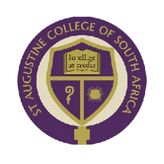
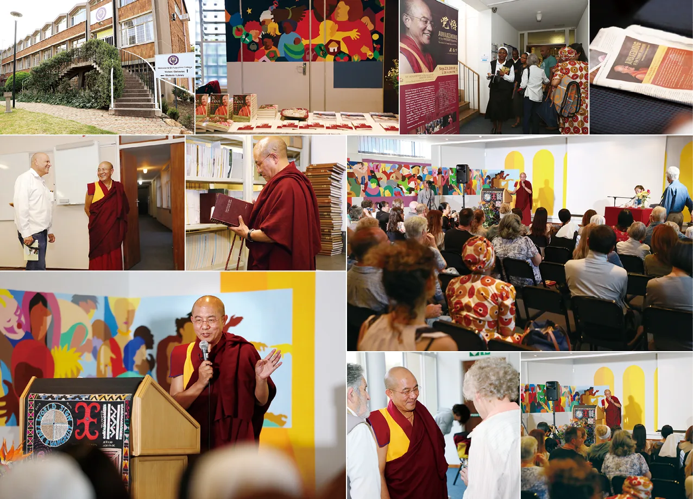
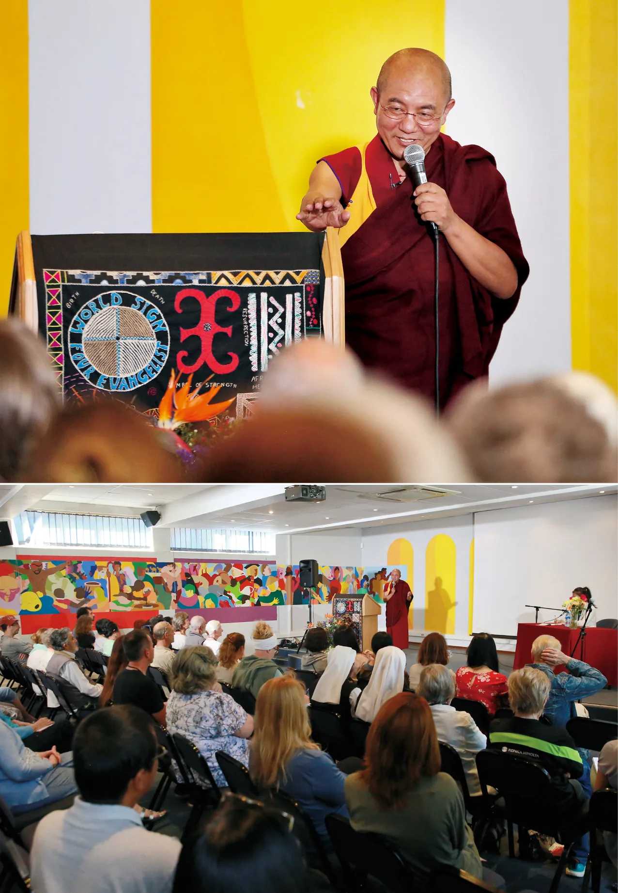

“贪婪者，永远不会满足；

嗔恨者，跟谁也合不拢；

愚痴者，做事难以成办；

嫉妒者，心里不会快乐；

傲慢者，看不到别人的功德；

怀疑者，见不到事物的真相。”

第163场

南非圣奥古斯汀学院

St. Augustine College of South Africa

南非·约翰内斯堡

2018 / 9 / 23

## 觉悟在当下

## Awakening at the Present Moment

主持人：

欢迎各位参加今天的演讲。我首先介绍一下今天的演讲嘉宾索达吉堪布。堪布是法王晋美彭措仁波切的心子、藏传佛教宁玛派的上师，也是学识渊博、著作颇丰的学者和作家。他已在哈佛、耶鲁、斯坦福、牛津、剑桥等一百多所世界名校分享了他的智慧，其演讲主题涵盖了幸福、慈悲、禅修、佛教哲学以及现代社会与佛教等，范围非常广泛。下面有请堪布——

能站在这里和大家交流，我非常开心。感谢主办方为大家创造这次演讲的因缘，也感谢圣奥古斯汀学院为这次演讲提供平台。

## 保持心态的健康

今天的演讲主题是“觉悟在当下”。要觉悟当下，首先要认清自己的心态是否健康，是不是保持了这颗心本自具足的开放、包容、公正等特质。接下来，我结合自己的情况与当前一些社会现象，和大家探讨一下这个话题。

### 1．开放

这是我第二次来非洲，对这里的文化以及人们的心态不是特别了解，但非常感兴趣。三年前我来过这里，当时还去了附近的纳米比亚、莱索托等几个国家。这次的安排也比较满，昨天在斯威士兰，明天去马拉维。一方面，我自己特别想了解非洲的文化；另一方面，我也希望和思想观念与思维方式不同的人进行交流。

我自己是一名佛教徒，主要学习藏传佛教。不过，我不但能接受南传佛教和汉传佛教的思想，参加过他们组织的活动，还对基督教、天主教、犹太教、印度教以及伊斯兰教的思想特别感兴趣。此外，我也非常愿意与无任何信仰的自由思想者交流。

这样的交流和沟通，并不是为了达到某种目的故意装出来的，而是我发自内心地认为：如今这个时代，人们虽然有不同的文化背景、宗教信仰，甚至有不愿意信仰任何宗教的选择，但我们既然同为人类，又在同一个地球上生存，彼此的心一定是可以沟通的，一定有很多普世的价值观，是值得我们共同学习、互相参考的。

所以，多年以来，我一直向外敞开自己的心，我愿意跟不同宗教信仰、不同文化背景、不同地域和肤色的朋友真诚地交流。这是我的肺腑之言。我希望用一颗开放的心，去接纳全世界。

### 2．包容

现在的人类，同在一个“地球村”，不管东方西方，不同国家的人之间，距离都越来越近。如果我们依然故步自封，独守一隅，把与自己的传统、观念和信仰不同的人，全部排斥在外，另眼相看，自己的生存空间会越来越小，活得非常痛苦。相反，如果我们拥有开放和包容的心态，个人的世界将变得非常广大，生命也将更有活力。

一个人如果能暂时放下自己宗教的视角或主观见解，以一颗客观、公正、包容的心，去学习别人的优点和长处，一定会得到很多意想不到的真理。如果我们紧紧抓住原来的东西不放，全凭自己的主观行事，一味排斥与自己想象不符的其他学派或群体，也许这一生会犯下很多令人遗憾的错误。我们佛教有一句话说：人类的很多错误，都是在无知的情况下犯下的。

所以，我每到一个陌生环境之前，都先把自己的民族、信仰等各种标签全部取下，尽量放空自己，真诚地随顺当地的思想与风俗，或者进入他们的世界去学习。

当然，这个世界上，总有一些人会坚持自己固有的想法，保护自己的传统，坚守自己的原则。这样的做法，也自有他的道理，我们应该包容，不能否定和排斥。

### 3．快乐

世界上的每个人都在希求快乐，不想感受痛苦。然而，生活中所有的快乐，最终都来自一颗快乐的心。因为所谓的快乐也好，痛苦也好，美也好，丑也好，优也好，劣也好，所有这些主观感受，都跟自己的心态有非常直接的关系。

我们的心可以转化为心态，心态可以转化为行为，行为可以转化为生活习惯，生活习惯可以慢慢转化为我们的人格，而人格会决定我们今生和来世的命运。保持健康的心态，可以让我们在面临任何不平凡甚至痛苦、难堪的境遇时，都能用快乐的方式全盘接受。

我记得德国哲学家叔本华（Arthur Schopenhauer, 1788-1860）说过一句很有道理的话：“一个心理健康的乞丐，幸福感远远超过一个疾病缠身的国王。”国王虽然拥有享不尽的荣华富贵，但如果身心不健康，仍然会整天痛苦；乞丐虽然一无所有，如果心理健康，也会天天在街头唱出美妙的歌。

### 4．远离偏见

#### 1）偏见障蔽真相

虽然生存在同一个地球上，但人们的认知却有很大差别。这很正常，世界本来就是丰富多彩的。我们应该接纳差别，尊重差别。遗憾的是，我们很多时候不愿意这么做，总要在自他之间分个高下，于是从差别中衍生了偏见。

回顾我们人类的历史，不管是从政治角度，还是经济角度，或是文化角度，无论从以上哪个角度去看，都混杂着理性与非理性的选择。而非理性的那部分，根源都在于偏见。所以说，偏见会障蔽真相，障蔽我们对当下的觉知。

#### 2）偏见源于我执

绝大多数人会认为自己的思想是最正确的，自己所受的教育是最完美的。但在真理的正量面前，我们认为正确的也许是错误的，我们认为完美的也可能是残缺的，因为井底的青蛙也会认为自己看到的天空是最广阔的。

我有时会想：自己之所以成为一个佛教徒，是因为出生在佛教家庭；如果当初出生在基督教家庭，现在很可能是一个基督徒；如果一直生长在没有任何信仰的环境中，现在也可能没有任何信仰。为什么？因为无论出生在怎样的家庭，我都会认为父母和老师给我灌输的东西是正确的，而且只有这些东西是正确的，除此之外的其他教言都是错误的。

在我们那里，每年都要举办一些跨宗教的交流会，邀请世界上不同宗教的领袖、专家和学者来参加，请他们用自己的方式解读当今社会的一些热点话题，比如和平、幸福或社会责任等。我们发现，应邀参会的每一位宗教人士或学者，基本上都认为自己的观点正确。

这个世界，有很多人都说自己在宣扬真理，到底谁的“真理”才是正确的？很难判断。因为每一个人看起来都是那么理直气壮：因为他的父母是这样说的，因为他的学校教育是这样讲的，因为他的政府文件是这样规定的……总之，因为各种各样的原因，他的脑子里就长出了根深蒂固的思想大树。

其实，这所有的原因，哪一样经得起真正的观察呢？许多都不过是自以为是而已。

#### 3）历史上，那些被过滤的真相

回顾人类的历史，不敢说它是一部偏见史，但的确也充满了各种偏见。

有些政治家为了达到自己的目的，凡是和他政治理念相反的各种思想，一定会通过各种渠道，使用各种语言，想方设法丑化、扭曲。最后，当人们听到这些思想和主张时，要么生恐惧感，要么生厌离心。这是历史上各国政权掌握者常用的一种手段——与自方主张相左的所有理念，他都会蔑视和攻击。

经济学家为了所谓的经济效益，为了刺激消费，默许甚至支持商家通过各种渠道和手段推销产品，凡是与经济效益相违的观点和策略，则通过媒体或政策手段，百般阻挠，无情打压。

而宗教人士——当然，并不是所有的宗教都如此，但历史上的确有个别宗教为了建立自己的正面形象，达到自己的某种目的，大肆宣扬自己的宗教是唯一的，是最完美的，是最有利于人类发展的。与此同时，大力驳斥、否定、丑化和排挤其他宗教或思想流派。

现在有些科学家也是如此。一般情况下，人们会认为科学家是一个明智、正直和公正的群体，不会存在什么偏见。事实上，科学家在研究和探索真理的过程中，也会受主观思想的影响。他会偏向于符合自己意趣的研究成果，与他主观思想相左的成果和结论，不一定能得到他的承认。这种现象在科学界确实存在，只不过很多人不知道而已。

#### 4）消除偏见

我们要认识真相，觉悟当下，一定要尽量消除偏见。

这个世界上有白人，有黑人，每个国家内部也有不同的民族。从历史上看，这些不同民族和肤色的人之间，多多少少都有一些冲突和排斥，也发生过各种各样不愉快的事情。

在20世纪90年代之前，黑人跟白人之间发生的种族冲突，是大家有目共睹的。不仅仅是在非洲，也包括美国，甚至对全世界的人而言，这都是一段值得回顾和反思的历史。

我曾看过一个关于偏见的故事，印象非常深刻。讲的是一位在读的博士生，在纽约到波士顿的火车上，遇到了一位年老的盲人先生。两人在交谈中，聊起了不久前发生在洛杉矶的种族冲突事件——当时种族隔阂在美国非常严重。

老先生告诉年轻的博士，他以前生活在美国南方，由于家里的佣人是黑人，他从小就歧视黑人，认为黑人天生低人一等。长大后，他到北方去读书。北方比较开放，对黑人的歧视不像南方那么严重，但他依然在同学聚会时拒绝和黑人一起吃饭。买东西时，如果不小心遇到了黑人店员，他会把钱放在柜台上，让店员自己去拿，他忌讳和黑人的手有任何接触。他甚至觉得，跟黑人通婚简直就是父母的耻辱。

后来，他在波士顿读研究生时出了车祸，虽然没死，但双目失明，不得不进入一所盲人重建院学习盲文，并练习依靠手杖走路，培养生活自理能力。在他深感无助的时候，有个人一直在身边陪伴他，开导他，鼓励他，无微不至地关心他，他也从那个人那里学到了很多东西。他心里充满感激，可是，这个人后来却告诉他：“我是一个黑人。”

他十分震惊：过去眼睛健康的时候，他看不起黑人；现在他失明了，遇到困难了，帮助他的却是黑人！他心里积聚多年的种族偏见当下烟消云散。

盲人老先生告诉年轻的博士：“在我看得见光明时，心里的偏见却很深；当我失去光明时，心里却没有了偏见。这多么奇特，又多么幸运！”

火车到站的时候，年轻的博士看到，老先生的太太亲自到站台来迎接了。而这位太太，也是一位黑人。

我读到这里的时候，比较好奇：他和黑人妻子是什么时候相识的呢？应该是失明以后吧。在他失去光明，开始用心去感受这个世界的时候，才触摸到了真相。

每个人可能都有这样的经验：当自己的学识越来越丰富、年龄越来越成熟时，会突然发现，过去一直认为正确的某个观点其实并不正确！这是什么原因？因为我们总是选择相信当下的自己。其实，当下的那双眼睛，看到的不一定是真相；当下的那一分智慧，抉择的也不一定都正确。

## 保持对当下的警觉

为了获取幸福和快乐，我们希望觉悟当下。可是，我们如今面临的“当下”的种种形势，又是怎么样的呢？

### 1．缺乏分量的时代

其实，不管是内在心的奥秘也好，外在世界的奥秘也好，还是人与人之间关系的奥秘也好，都需要有深度的智慧才能探究和触及。可现实是，在网络和信息的狂轰滥炸下，现在的人类变得越来越肤浅，越来越缺乏独立思考的能力，越来越没有深入研究的动力和空间。在如此散乱的心中，生出深度智慧的几率恐怕只会越来越小。

在座有很多不同宗教背景的同学，不知你们的宗教研究是越来越有希望，还是越来越肤浅？反正我们佛教的情况不是很乐观，就像中国一句老话说的那样，“一代不如一代”。西方一些专门的研究机构也许好一点。不过从总体上看，人类对科学的研究也好，对宗教的研究和修行也好，似乎都越来越没有分量了。

### 2．精英的阴谋

我在很早以前看过一篇新闻报道，不知道是不是真的，如果是真的，那这些人的战略思想可以说确实成功了。

据说1995年的时候，全球500个政治和经济精英在美国旧金山开了一个应对全球化浪潮的会议。[^1]参加会议的有英国首相布莱尔（Tony Blair, 1953-）、美国总统小布什（George W. Bush, 1946-）等政界首脑，有世界顶尖级的科学家和经济学家，还有一些具有全球影响力的商业巨擘。

当时经济全球化的趋势刚刚出现，各路精英聚在一起研究人类未来的发展。结论是什么呢？随着全球化的进程不断推进，世界会形成两大经济体：一个是掌握全球经济命脉、仅占世界人口20%的精英群体，一个是人口占世界80%、收入仅占20%的普通人群体。这80%的普通人创造的社会价值很少，属于“没用”的一群，却可能与精英们发生冲突，所以要限制他们的发展。

怎样才能达到这个目的呢？美国一个高级智囊团做了大量的研究和谋划，最后提出了方案：让这80%的人心甘情愿沉溺于各种娱乐散乱，要么在暴力、赌博、毒品、色情中耗尽精力和金钱，要么在唱唱跳跳、哭哭笑笑的各种选秀节目和肥皂剧中丧失崇高的理想和斗志。这就是所谓的“奶嘴策略”：让这80%的人毫无实际利益可得，心里还很快乐。

我们大概可以看到，那次会议以后，以美国为首的世界发展风向标开始有所变化：一些政界高层和财团联合起来，用金钱腐蚀各国的新闻媒体等宣传阵地，大力推广娱乐文化。世界娱乐产业渐渐走上了蓬勃发展的道路。

### 3．娱乐陷阱

不幸的是，面对精英们刻意制造出来的娱乐盛况，80%的普通人毫无察觉，在“娱乐至死”的浪潮里集体麻醉，没有丝毫反抗。

现在国际上大多数上市公司和财团拥有的财富，与普通民众的经济能力相比，真的是天壤之别。这就是当今世界的现状：大多数人过着小康型、温饱型、贫困型、极贫困型的生活，极少数富豪却坐拥子子孙孙都挥霍不尽的金山银山。贫富差距如此之大，已超出我们的想象。

虽然按照佛教的说法，这是每个人的福报不同所致，但是，跟我们自己今生的行为是不是一点关系都没有呢？也不是。现在大多数民众根本不知道自己为什么这么穷，因为他们没有思考的兴趣，也没有思考的时间，整天都忙着玩他的手机，沉迷于色情赌博，沉迷于网络娱乐，在散乱放逸中迷迷糊糊混日子。

这个结论是西方一些顶尖级的经济学家通过研究和分析得出的。仔细想一想，再看一看现在所谓的精英和普通民众的现状，不得不承认，这个结论确实有一定道理。

在铺天盖地的娱乐陷阱里，要保持独立思考或深度思维的习惯和能力，确实有一定困难。但不管怎么样，我们必须依靠自己，奋力向上，突破娱乐陷阱的重重包围。如果连这一点都做不到，还谈什么“觉悟当下”呢？

## 向内寻求，不受外境的束缚

这颗心唯有向内寻求，脱离外境的束缚，才能做到真正的觉知与了悟。我们应该怎么做呢？

### 1．学会独立

佛教有一个甚深的理念：“我自为依怙，亦自为怨家，若作善作恶，我自为证者。”在这个世界上，谁也不可能成为你真正的依怙。这一生，做好事也好，做坏事也好，自己都是唯一的见证者。自己才是自己的怙主，自己才是自己的怨家。没有谁能够真正帮到你，也没有谁能真正打倒你。一切都掌握在自己手里。

人的一生，最上等的活法当然是凡事独立思考，独立探究，活出自己的高度。如果做不到这样，能够坚持做自己生活的主人，不依赖别人，不被别人牵着鼻子走，也值得肯定和赞叹。

但是，我们很多人却有个不好的习惯，总想着把一生的幸福寄托在别人身上。要么依赖父母，要么依赖伴侣，要么依赖朋友，甚至会依赖猫啊狗啊之类的宠物。这样做，无疑是自己把自己逼上独木桥，非常危险。一旦失去这些外在的依靠，自己就觉得没办法再活下去了，只有自杀——没有比这个更愚昧、更可悲的选择了。

当然，生活中与亲朋好友相互依赖没有什么不可以。只是，自己提前要有思想准备，要经常提醒自己：万一这个“依靠处”突然离开了，比如出车祸死了，我该怎么办？现在很多年轻人，依赖心特别强，对自己的伴侣更是如此。一旦对方离开，自己就觉得失恋了，受不了了，自杀了……生活中的很多悲剧，根源就在这里。

所以，我们要经常问自己：“一旦他不在了，我该怎么办？”这一点非常重要。一定要在生活中保持独立思考和自主的能力，以内在的自由和坚强去应对外境的无常。

### 2．学习宗教

此外，我们还要以开放的心态来学习宗教，因为这个时代需要我们敞开胸怀去接受各种不同的思想。比如说，我是一个佛教徒，但我依然可以学习其他宗教，这些宗教所宣说的跟真理相符的某些理念，我同样可以接受。

在座的都是一些年轻的宗教信仰者，对其他宗教不一定很熟悉，但我希望你们去了解一下。比如，以佛教徒的身份去学习基督教和伊斯兰教，或者以伊斯兰教徒的身份去学习佛教和印度教。当然，你自己原有的信仰不用改变，也最好不要改变。

其实，不光是不同宗教之间观念会有不同，每一个宗教的内部也是如此。比如，佛教大体可以分为汉传佛教、藏传佛教和南传佛教。三大传承之间，不论外在的形象，还是内在的教义，都有很多不同的地方。其中藏传佛教又分为格鲁派、宁玛派和萨迦派等八个派别，不同派别在讲法仪轨、本尊修法等很多方面也常常不同。要把佛教内部所有不同的观念全部统一起来，是根本不现实的。至于其他宗教，例如基督教和天主教，它们内部的思想也存在很大的差异。

我们现在的责任，不是强化各自的差异，相互排斥。这样的话，人类不会有进步，宗教不会有和谐。我们当下要做的，是强调彼此共有的理念与目标，寻求合作与互助。

比如，所有的宗教都提倡慈悲和爱，都热心于慈善事业，都在努力为人类的福祉创造条件。在这一点上，各个宗教之间是没有任何冲突的，是可以合作的。虽然个别宗教徒利用宗教的名义，做不如法的事，危害了社会，但这只是宗教徒个人的原因，并不是宗教本身的问题。

我真诚地希望，全世界所有的人，不管是有信仰的，还是没信仰的，大家都彻底抛开包装在外面的层层宗教隔阂，单在人与人之间、心与心之间，寻求共同的思想和目标，为世界的发展，为人类的快乐，做出各自的贡献。

我为什么建议大家学习宗教呢？因为科学、哲学、文学与艺术等没办法解答的人生问题和困惑，宗教却能轻而易举地帮我们解决。

在现代社会，人类面临着各种各样的心灵痛苦，心理疾病层出不穷，除了抑郁症、强迫症，很多新的疾病也在不断出现。这些心理疾病依靠现代医学很难彻底治愈，而借助宗教的禅修或观修方法，却可以从根本上解决，并且花的时间很短。

换句话说，医生可以治疗我们身体的疾病，但对心理的疾病，他们往往束手无策。这个时候，我们也许应该向宗教寻求最好的妙药。

给大家分享一下我最喜欢的一句话：“贪婪者，永远不会满足；嗔恨者，跟谁也合不拢；愚痴者，做事难以成办；嫉妒者，心里不会快乐；傲慢者，看不到别人的功德；怀疑者，见不到事物的真相。”

这句话说明什么？如果我们的心依靠宗教的指导，经过实际修炼，达到了一定的境界，不管遇到什么事情，都会过得非常快乐。相反，如果心里充满贪心、嗔心、嫉妒、傲慢等各种烦恼，再高的医疗科技也没办法让我们快乐起来。换句话说，能引导我们这颗心向内寻求快乐的，唯一只有宗教。

### 3．像苏格拉底那样

我很羡慕苏格拉底（Socrates, 公元前470-前399），不管处于什么样的生活状态，他的心都是自由的，不受外境的影响。

他总是乐呵呵的，没有什么能让他不开心。成家之前，他过着单身汉的生活，觉得很开心，很轻松，因为没有家人的牵绊。成家之后，他的住处经常搬来搬去，有时候在楼上，有时候在楼下，但不管怎么搬，他都觉得快乐。住在楼下，他觉得宽敞，很方便；住在楼上，他觉得阳光好，很寂静。

甚至娶了一个脾气暴躁的妻子，他也非常开心。有一次，苏格拉底正跟学生们一起研究学问，妻子怒气冲冲提来一桶水，倒在他的身上，他顿时成了“落汤鸡”。学生们很惊讶，觉得他肯定要发脾气，他却笑着说：“我就知道，打雷以后肯定会下雨。”

别人问他：“你这样一位著名的哲学家，为什么不娶一位贤良的妻子？”他怎么回答？他说：“善骑者才敢骑野马，野马若能驯服，其它马不在话下。”他认为有这样一位伴侣，是他的荣幸。

我们藏地有一位大德，叫阿底峡尊者，也经常带着一个脾气特别不好的弟子做侍者。他说：“这位侍者对我恩重如山，因为他会惹我生气，让我能好好修安忍。”

所以，如果我们在生活中遭到了坏人的损恼，或家人对自己不好，这是非常有福报的显现，应该好好地珍惜！一旦有了这样的觉悟，你的人生一定会充满快乐和幸福。

现场互动

问：您刚刚提到，可以通过禅修治疗心理疾病，您能否再详细阐述一下，针对不同的心理问题，应该用什么样的禅修方法？我们从哪里能获得这些信息和知识？

堪布：禅修的方法比较多。刚开始禅修时，心里的分别念很多，会有各种散乱的情况。但如果学会了以心观心，将有机会认识心的本性。就像《金刚经》里讲的那样——“应无所住而生其心”。也就是说，当我们观察心的时候，会发现心的本性是空性的，而在空性中，心的妙力可以显现各种各样的法。一旦真正认识了心性，我们在生活中很多与真相不符的分别念都可以消失。这是最好的一种禅修方法。

一般来讲，禅修不可能在短时间内完成。世间任何一件事情都需要下功夫，禅修也不例外。有一本书叫做《一万小时天才理论》[^2]，书里讲到，要成为某个领域的专家，必须用一万小时来刻苦努力，否则很难成功。

所以，要让我们这颗心变得平和、平静、堪能，可能需要比较长的时间。以前，禅宗和藏传佛教的修行人要在森林中修好多年，这颗心才能自在安住。我们刚开始禅修时，心要安住不容易，需要下功夫，需要坚持。

问：在日常生活当中，我们需要培养爱与慈悲，远离偏见，保持单纯。您刚才也讲到了苏格拉底“驯服野马”的故事，以及要感恩生活中难以相处的人。我的问题是：我们需要训练多久，忍受到什么时候？

堪布：忍受的时间越长越好。（众笑）

一个善巧的驯马者一定会有思想准备：驯服野马需要很长的时间。因为野马的身体和心态都很强壮，所以驯马者特别清楚——短时间内它是不会被击垮的。

问：您刚才谈到了抑郁症和焦虑症，这些心理疾病在西藏存在吗？他们用什么方法治疗？导致这类心理疾病的原因是什么？

堪布：在过去的西藏，你要是问谁是不是得了抑郁症，没人知道这是什么病。从去年开始，抑郁症在藏语里有了专门的术语，叫“夺擦”——这是人们新造的名词。“夺”是怀疑的意思，“擦”表示担心，有抑郁之义。藏文的词义翻译过来，是一种具有担忧和怀疑的心理疾病。

藏地历史上没有抑郁症的说法。到目前为止，很多人还是没听说过这个词，只有极少数人知道。前一段时间，我遇到一个藏族学生，他说自己可能得了抑郁症，然后他把自卑、想自杀等抑郁症的症状发给我看，并告诉我，那些症状他都有。所以就目前来看，抑郁症在藏族人中是有的，但不是很普遍。

在藏地得了抑郁症怎么治疗？得病的如果是一个没有信仰的藏族人，治疗方法跟其他抑郁症患者一样，没有特殊的药物和方法。如果是一个有信仰的人，会通过念咒语、禅修或者修一些让人轻松的修法来对治。

英国得抑郁症的人比较多。我曾在英国一所大学里传过不动佛的心咒：“嗡 赞扎玛哈 若卡那 吽啪的。”这个咒语对抑郁症应该很管用。很多人依靠这个咒语的力量，治好了自己的抑郁症。

至于心理疾病的来源，我们藏地的医学界现在没有什么特别的发现。到目前为止，全世界的医学界也没有找到特别明确的病因。抑郁症也好，焦虑症也好，现代医学的很多理论认为是一种综合性的心理疾病，跟现在这个时代有一定关系，算是一种“时代病”。

问：心理疾病的现象在西方社会很严重。您经常访问西方国家，您认为是西方社会的哪些因素导致了这样的结果？

堪布：我去过的国家当中，英国的情况是最严重的。据介绍，英国一共有六千多万人口，大概每六个人中就有一个人患抑郁症。当然，这个数据也有不同的说法，仅供大家参考。

北欧国家也比较严重，比如说挪威。有一种观点认为，北欧国家由于所处的纬度比较高，经常看不到阳光，所以他们得抑郁症的原因是生活缺少阳光。据说现在美国的情况也越来越严重。相对而言，藏地现在得抑郁症的人仍然是非常少的。

问：堪布，您提到的那个咒语，可不可以给我们念一下传承？

堪布：好的。刚才念的是不动佛心咒：“嗡 赞扎玛哈 若卡那 吽啪的。”按照佛教的说法，人类肆意破坏大自然，会让天龙八部特别不高兴。我们念这个咒语可以缓解相互之间的一些争斗。多念“嗡 赞扎玛哈 若卡那 吽啪的”，会有这样一种力量和作用。

问：业力是怎样成熟的？

堪布：业力的成熟相当于我们农民种庄稼的过程。

由于种子类别、耕作方法和土壤特点等各方面的差别，有些种子很快就发芽了，然后慢慢开花结果，而有些种子短时间内却不会发芽，可能要过两年、三年，甚至十几年、二十几年才长出苗芽。像有些莲子，过了千年才发芽。

同样的道理，我们造的善事和恶事，会在我们阿赖耶识中种下相应的种子。这些种子经过时间和其他因缘的相互作用，会慢慢慢慢成熟。“善有善报，恶有恶报。不是不报，时间未到。”并不是说，你做了好事马上就会有幸福到来，干了坏事马上就会遭受痛苦。不会那么快，业力的成熟需要时间。时间没有到，它是不会报的。

因缘的成熟是个复杂的过程。种子发芽只是一种外在世界的缘起，有情生命的内在缘起，也有它自己的因果规律。这些道理在《稻秆经》和《俱舍论》中讲得比较细致。学习一下这些经论，就会知道因缘是怎么成熟的。

问：对亲朋好友发菩提心相对而言比较容易，但是对怨敌和我们不喜欢的人发菩提心非常困难，怎样才能对他们发起菩提心？如何检验自己发的菩提心是真是假？

堪布：菩提心对亲朋好友确实好修一点，而对怨恨的敌人就不那么好修了。但只要坚持修下去，慢慢地，把自己对亲朋好友的爱逐渐逐渐扩展，最后推及每一个众生。当你发现自己对怨恨的敌人也好，陌生的路人也好，其他众生也好，都能做到像对自己的亲朋好友那样疼爱有加时，菩提心就算真正生起来了。

基督教当中也有这样的教导。别人打你左脸的时候，你还要把右脸也伸过去让他打。这是一种忍辱，也是一种爱的修法。

我们佛教也如此，而且佛教倡导的爱更好修——把每一个众生都当作自己的父母来爱。不仅如此，由于每一个众生都爱自己，所以不管是对怨恨的敌人也好，不同宗教的人也好，不同肤色的人也好，都要用爱自己的那颗心去爱他们。所谓修行，就是把这个道理在心上逐渐去扩展，不断延伸，直至圆满。

问：有观点认为，孩子从出生到六岁之间的经历，会对一生的性格形成起到重要作用。我自己在这期间就受到了很不好的影响。我的问题是，如何才能避免给年幼的孩子带来不良影响？

堪布：你提的这个问题非常有意义。1到6岁对于孩子的成长是重要而敏感的时期，这个时期的经历会影响他心灵和人格的发展，对他的一生具有重要的作用。所以，现在很多人都非常重视孩子学前的人格教育。

在我们国家，绝大多数孩子在6岁之前都要读幼儿园，因为6岁之前养成的习惯，会给他的一生播下根深蒂固的种子。我小的时候，没有机会上学读书，所有的教育都来自父母。可以说，父母的言行对我的人格塑造起了主要作用。

如果一个人在童年时代受到了种族歧视或虐待，由此形成的难以改变的行为模式，会影响他的一生。在家庭暴力中长大的孩子，由于深受虐待行为的影响，长大以后很难和人平等交往，要么对他人心怀恐惧，要么看不起他人。

中国古代有一个伟大的学者，叫孟子。他小的时候，为了让他拥有好的成长环境，母亲搬了很多次家。刚开始，为了给孟子的父亲守坟，他们搬到了墓地附近，小孟子就跟人学习哭丧；母亲于是把家搬到集市附近，小孟子就学别人讨价还价；母亲又把家搬到了学校附近，小孟子听到学校朗朗的读书声，背起书包开开心心上学去了。

对这个问题，我现在比较担心。不知道你们这边的情况怎么样，在中国，不管是藏族，还是汉族，或是其他民族，许多五六岁的孩子整天都在玩手机，看《哈利·波特》（Harry Potter），看《狮子王》（The Lion King），各种各样的动画片都看。有些动画片含有暴力、色情等各种不良信息，对孩子们的成长极为不利。

所以，我在这里给大家一个建议。如果父母自己有信仰，在孩子16岁之前，最好经常带他们去教堂，或参加一些慈善公益活动。这对他们的健康成长非常有意义。表面上看，孩子们在这些地方没有直接做什么事，但等他们长大之后，会回忆起妈妈曾带自己去过什么地方。这个时候，曾经种下的美好种子会发芽，而且非常容易成熟。这是把他们的人生导向正轨的最好方式。

[^1]: 1995年9月27日，在美国旧金山曾召开“费尔蒙特饭店会议”。会议认为：由于世界人口的过剩，世界将出现分化为20%的全球精英和80%的人口垃圾。要解决这一问题，一是采用布热津斯基的“喂奶主义”：弃置和隔绝那些无用而贫穷的垃圾人口，不让他们参与地球文明生活的主流，仅由20%的精英将一些消费残渣供给他们苟延残喘。二是设法逐步用“高技术”手段消灭他们。这个会议的参加者有美国总统布什、英国首相布莱尔、微软总裁比尔·盖茨、未来学家奈斯比特和新保守主义大师布热津斯基等。
[^2]: 《一万小时天才理论》（The Talent Code），美国当代畅销书作家丹尼尔·科伊尔（Daniel Coyle）所著，其理论核心是"一万小时定律"，即不管做什么事情，只要坚持一万小时，都可以成为该领域的专家。
