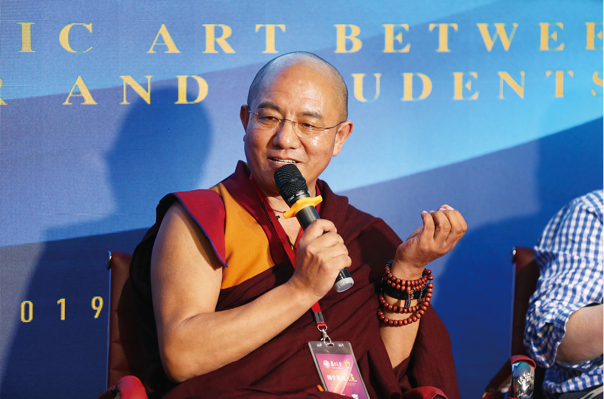
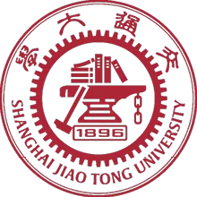
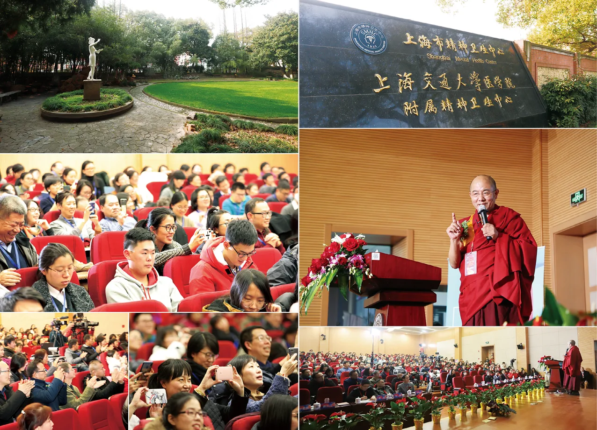
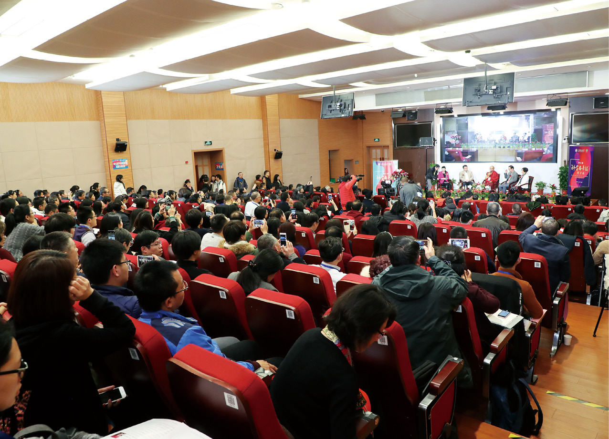
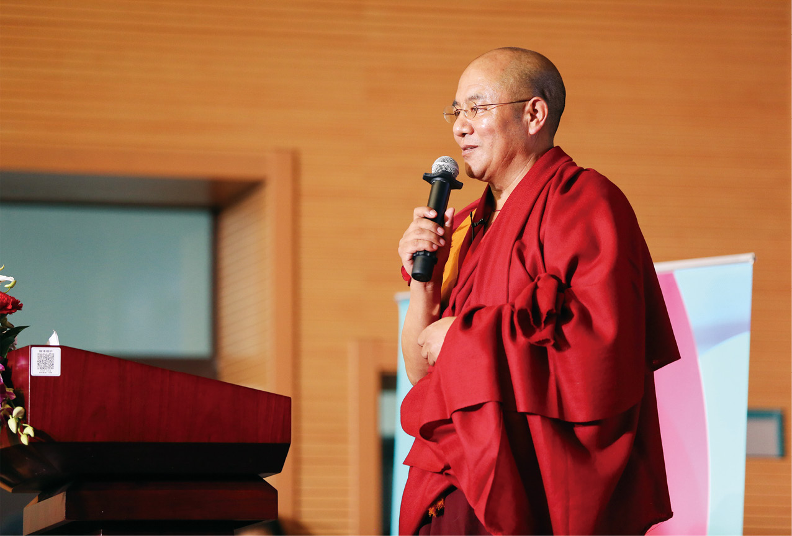
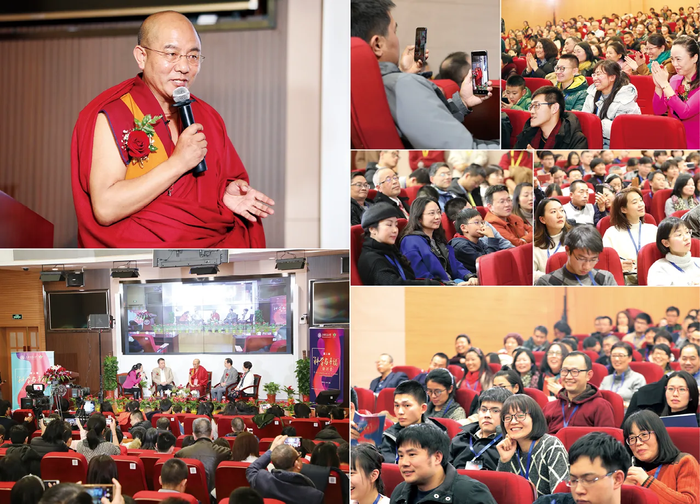

“哪怕只对一个人有利益，

我也要活下去！”

第168场

上海交通大学

Shanghai Jiao Tong University

中国·上海

2019 / 1 / 19

## 追问生命的价值

## Seaching the Value of Life

主持人：

今天，我们非常荣幸地邀请到了在全世界都极具影响力的藏传佛教大德——索达吉堪布。他将从多个维度为我们揭开禅修和冥想的神秘面纱，追问生命的价值。现在，请以热烈的掌声欢迎堪布——

各位教授、各位同学，晚上好！

首先，我要感谢组委会的邀请，让我再次有机会站在这里，与大家一同分享。其实，每一次的研讨论坛都意义非凡，也是一次难得的学习机会。在这样的平台上，各个领域的专家学者可以畅所欲言，发表自己的观点。

今天下午我们所讨论的内容，涉及医学、心理、文化乃至自然科学和人工智能等各个方面。演讲者和发言嘉宾也是风格各异，有些幽默风趣，有些比较理性。在探讨的过程中，我个人受益匪浅，相信大家也都有所收获。

参会者中还有很多重要人物，包括一些领导、科学家以及科学院的院士，他们都对社会有着巨大贡献。当然，其他人也有独特之处，比如我刚刚认识的王鹏同学。虽然他只是简略讲述了自己的人生经历，以及他是如何坚强面对困境的，但我能感受到他的精神力量。如果将来他能更完整地把这些经历，以及修行经验分享出去，相信会帮助许多人走出生活的阴影。澳大利亚有一个演讲家叫尼克·胡哲（Nick Vujicic, 1982-），他天生没有四肢，但为人乐观幽默、坚毅不屈。很多人听了他的演讲后，有了积极面对人生的勇气。我希望王鹏同学也能这样，多和大家分享自己的亲身经历，这种分享比一些理论性的演讲更能深入人心。

## 一、内观禅修，获取幸福

今天，我要讲的主题是“追问生命的价值”。相信在座各位都非常关心“幸福”“生命价值”的话题，个别人也有这方面的专业知识。就我个人而言，虽然算不上专业人士，但长期以来一直很关注这个话题。所以，我想从佛学层面与各位一起探讨。

生命的意义和价值，是一个值得思考的话题。从各方面来看，当今时代的物质生活很丰富。虽然无法满足我们所有的欲望，但总体而言，每一个人的生活质量都得到了提高。可即使是这样，很多人还是觉得不快乐、不幸福，这是为什么呢？我们应该清楚，想要获得真正的幸福，单单只是依靠物质，或者一种外在力量，很有局限性。

依靠物质、感情、名声、地位等，能不能得到幸福呢？一定程度上应该可以。但这种幸福具有变化性，很难长存，甚至有可能让我们更痛苦。大家也都知道，不管从哪个层面讲，实际上幸福就是心的一种感受。当苦难来临时，普通人可能根本无法面对，而会调心的人则能坦然接受。所以，希望大家以后能经常通过内观来提升幸福感。无论你有没有信仰，内观的方法都一样适用，并且事实证明非常有效。

有些科学家刚刚也提到了，可以通过内在的禅修和冥想来调节身心，这是非常明智的选择。有关这个道理，我作为一名出家人，可以引用佛经中的说法做进一步的解释，希望大家以开放的心态去思考。

其他宗教人士在演讲时，我也会平等对待，虚心聆听。在如今这个时代，每个人都需要有一个开放包容的心态，这样才会活得轻松。如果跟自己见解、思想、信仰、行为不同的，全部都要排斥，那你活在这个多元化的世界里，可能会非常累。

我身边一直有着各种各样的人。最初我的心态也没这么开放，后来与其他宗教人士、无神论者和自由主义者接触多了，才发现不同思想的碰撞原来如此有趣。所以，希望大家不要随意排斥别人的观点。

## 二、感悟真谛，解读幸福

佛教中有一句话：世上的一切快乐，都是从利他中产生；世上的一切痛苦，都是由自利而引发。[^1]这话听起来可能让人无法理解，但不管是通过科学观察，还是以生活经验来推测，都确有其道理。怎么讲呢？追求幸福是大多数人从小到大的目标。尤其是近几年，受西方文化的冲击，各种媒体开始引导人们相信幸福是建立在外在物质上的。可事实上，我们拼命地去追求，结果往往适得其反。极力追求幸福的人过得并不快乐，重视生命价值和意义的人，反而获得了幸福，并且真正理解了生命的真谛。

我以前看过一本书，叫《活出生命的意义》[^2]。书中讲到，像美国等西方国家，更强调追求个人幸福；而一些欧洲国家，并不刻意去追求幸福，人生反而获得了很多快乐。在座各位如果去过藏地就会发现，相对物质文明而言，藏族人更看重信仰和来世。虽然现在很多藏族年轻人基本上已经被西化、汉化，丧失了原有的传统价值观，但在一些老年人身上，我们还是能感受到，他们的幸福感来自于对道德的追求，也可以说是对生命意义的追求。

我们可以观察一下，如果想借助外在力量获得幸福，那在追求的过程中，你会一直要求别人给予。比如，想要幸福，在情感上就会依赖于别人，而且带有一种自私浅薄的心；想要名声，那需要别人给予自己赞叹；想要地位，也需要别人来赐予。可是，当你得到这些时，却未必幸福，因为快乐只是一种虚幻的感受。

人类的快乐与动物的快乐是否相同呢？按照佛教教义来讲，动物的苦乐感受与人类略有相似。但动物比较愚笨，不会有特别敏感的乐受，而我们的幸福感则带有一种欲望，并且这种欲望始终不会停，当它得不到满足时，幸福感会大打折扣。动物就不会这样，它们得到异性的爱，或者解决饥渴后，身体会有种幸福感。这种快乐与人类的欲望有一定差别。

昨天我们去了一个企业，他们在高科技领域做得非常成功，但里面80后、90后的年轻人还是认为，幸福就是有家、有房、有车等。我们要思考一下，拥有这些是不是说明幸福已经到位了？其实不然。比如你刚买了一辆车，却看到你朋友的车更好，那你可能马上想换车；假如你买了一个房子，你朋友却换了别墅，或是在别的国家有了更好的房子，那你可能也想换房。

如果幸福完全要依靠外在来获取，我们可能会非常辛苦。其实，按现在的物质条件来讲，人们应该感到幸福才对，但为什么现在的人普遍感觉不幸福呢？有些大学在统计调查时发现，五千多人里，大约有20%的人曾想过自杀；六千多人里，大约有13%的人患有抑郁症或有抑郁倾向。原因是现在的人社会压力大，没有自信，总觉得自己不如别人，对未来看不到希望，继而引发了各种疾病。

## 三、锤炼自我，智慧治心

当我们过度地追求幸福时，反而变得不快乐，无法积极地面对生活、工作和学习。这时应该怎么做呢？这方面可以分几点来谈。

### 1．为他而活

首先，对每一个生命个体而言，他对自己家庭以及整个社会，有种无可取代的责任。这是必须由他来完成的使命，也是生命的价值所在。有的人始终觉得自己活在世界上，一点价值都没有，就像得了空心症一样，有着强烈的虚无感。但实际上，哪怕只是为了一个人而活都很有意义。

我听过一个真实的故事。80年代有一位藏族妇女，她女儿4岁时不幸夭折，没过几天，丈夫也抛弃了她。在极度悲伤下她想到了自杀，并给父亲写了一封遗书。在邮电局寄信时，一位双眼失明的老太太恳请她帮忙缝下包裹，当时她想：“原来这个世界没有抛弃我，还有人需要我。”后来，她把写好的遗书撕了，重新振作起来。

所以，每个人都有自己的社会价值，只不过在人生低谷时，内心没办法强大起来，会觉得全世界的人都舍弃了自己。在这个时候，哪怕只有一个人需要你，因缘具足时，也会有活下去的勇气。

现在很多佛教徒，以前曾得过抑郁症、孤独症等心理疾病，但后来他们通过学佛，自然而然就坚强起来了。如果让我举例子，我可以说出很多这样的真实故事。当然，我并不是为了宣传佛教才这样说，事实上确实有很多人通过学佛改变了自己的人生。

如果我们不明白生命的价值到底是什么，或者觉得人活一世没什么意义，那你可以先从身边人想起，哪怕只能想到一个人。比如，有些人是为了孩子而活，有些是为伴侣而活，有些是为自己的事业而活；目标再大点的，为了自己的民族和国家而活；当然，也有人是为了全人类乃至一切众生而活。每个人的发愿力都有所不同，如果你活着有目标，那应该不会选择自杀，而会选择追求生命的意义。

### 2．利他思维

我觉得刚才那位学者就讲得很不错。现代人用各种方法去追求幸福时，往往很难获得幸福，这是因为每个人对幸福的看法不一样。我们所看到的，无非是各个媒体营造的一种美好假象而已。当你实际去感受时，会发现人生并不像他们说的那么幸福，原因是什么呢？因为我们通常没有利益他人的想法。

为他人而活的过程不一定幸福，可能会感觉很艰难，但这一切最终会让我们明白生命的真谛。就像在学生时代，读书的过程也不一定快乐，但当我们取得成绩，有了知识的积累以后，那和不读书时的吃喝玩乐相比，有着本质上的差别。

佛教中讲，从他人身上得到快乐很容易，但如果带有一种自私心，反而会让快乐离自己越来越远，它会像鲜花一样枯萎，像彩虹一样消失。所以，如果你想获得生命的意义，那就去帮助别人吧。从自己的孩子、父母、亲朋好友开始，逐渐扩大范围，这样的生命才有意义，自己也会变得快乐起来。

当你在做慈善或者其他有意义的事情时，需要付出更多的时间和精力，还有可能会身体不好，遭受各种非议。这时我们要保持欢喜心，应该想：“哪怕只对一个人有利益，我也要活下去！”刚才有人讲到，现在有些佛教徒比没有信仰的人还要痛苦。这个说法也有一些道理，原因是有的人即使有了信仰，自私自利的心依然很强。其实，自私是痛苦之因，利他是快乐之因。爱因斯坦也曾讲过，只有为别人而活，生命才有价值。

有时，自私可能会带来最严重的痛苦。《资治通鉴》中有一个故事：有个商人偶然得到了一颗珍珠，他非常担心会被偷走，就想方设法把它藏好。最后，他把身上的肉剖开，将珍珠藏在里面。结果过了一段时间后，他反而因此丧失了性命。[^3]

其实人在小的时候，就应该接受利他的教育，这一点很重要。如果从小就立志要帮助别人，这是大乘佛教的发心。虽然其他宗教或学派也有提倡利他思想，但范围有一定的局限性；小乘佛教则强调自我解脱；而大乘佛教的伟大在于，先让所有众生获得真正的利益，然后自己再获得快乐和解脱。如果每个人都能早点了解这种大乘见解和行为，那在世间、出世间方面，也许都会有很好的结果。

### 3．改变命运

我最近在把汉文版的《杂阿含经》翻译成藏文。之前上海有些大学教授在十几年间一直研究《杂阿含经》，参考了巴利文、英文、中文等各种语言的版本，后来出了八本书，研究得非常成功。《杂阿含经》应该是法显大师从斯里兰卡请回汉地的，但一直没被翻译成藏文，有些佛教徒也没有学习过，的确非常可惜。

《杂阿含经》的有些内容与世间人的想法特别契合。如果给他们讲大乘显宗或密宗的观点，除了个别见解稳固、有信心、有智慧的人，其他人可能很难理解。但像《杂阿含经》的内容，一般人都可以接受。

这几天我刚翻译了一个故事：一天，佛陀带着阿难去舍卫城化缘，路上看到一对老夫妇，形如乞丐，非常可怜。佛陀问阿难：“你看到这对老夫妇没有？”阿难回答：“看到了。”佛陀说：“这两人在少年时，如果非常努力地赚钱，会成为舍卫城第一大富翁；若选择出家学道，则会成就第一阿罗汉果。在盛年时若非常努力地赚钱，会成为舍卫城第二大富翁；若选择出家学道，则会成就第二阿那含果。在中年时若非常努力地赚钱，会成为舍卫城第三大富翁；若选择出家修道，则会成就第三斯陀含果。在老年时若非常努力地赚钱，会成为舍卫城第四大富翁；若选择出家修道，则会成就第四须陀洹果。只可惜，他们在世间和出世间方面都没努力过，如今才沦落成这个样子。”

通过这则故事可以看出，佛教并不承认一切都是命中注定，是否努力结果都一样。佛陀亲口说了，这对夫妇只要努力，随时可以改变他们的人生。如果不努力，那在世间出世间方面，都不会有什么成就。《了凡四训》也讲到，我们的命运完全可以改变。

人的一生，有时会特别顺，比如拥有地位、名声、财富等，但表面上的顺缘，后来可能成为人生中最大的逆缘。那些被关在监狱里的人，有的也曾风光过，但恰恰是那段日子令他的人生巅峰戛然而止，从此只能在监狱里度过余生。而有些人，依靠一些难以承受的逆缘，反而取得了令人无法想象的成就。

我们的未来还有很多机会，不管是在世间领域，还是出世间领域，大家都应该不断地努力，这样人生才会变得有意义。不管你是什么人，都应该时刻怀抱希望，保持热情，要有跟其他人不同的一种发愿。

### 4．光明人生

我听过一位西方科学家的报告，他说在他年轻时，老师曾经问过他：“什么才是生命的意义？”他回答说：“生命就是燃烧。”但那时的他并不懂这句话的意思。后来随着不断成长，他慢慢意识到，人的生命确实是一个燃烧的过程，这种燃烧应该是自利利他。这是最有意义的事情。

我也是这样认为的。虽然我不知道自己能活多久，但不管多长时间，始终希望能给他人带去快乐。做人没必要天天因为一些小事而伤心苦恼，这样可能也起不到什么作用，并且这些负面情绪会给身边人带来很多烦恼，还不如遇到任何事都开开心心地接受。人一旦学会了接受，很多事情反而会变得轻而易举。如果不懂得如何接受，把简单的事情复杂化，一直带有负面情绪，那自他都会陷入苦恼之中。

龙猛菩萨在《亲友书》中讲[^4]，每个人的今生和来世都有明暗的不同差别：有一种人是“从黑暗到黑暗”，今生本就苦不堪言，还天天做恶事，那前途也是一片黑暗；有一种人是“从黑暗到光明”，今生虽然饱尝痛苦，但通过不断努力做善事，未来可以踏上幸福之路；有一种人是“从光明到光明”，今生的生活幸福美满，令人羡慕，同时还不间断地行善积德，未来也会有美好的前景；还有一种人是“从光明到黑暗”，因为前世造的善业，今生遇到的都是顺缘，本来应该安乐无比，但却无恶不作，最后趋入痛苦当中。

所以说，人有正确的价值观很重要。最好是有一种利他的价值观，这样每天都会活得很快乐。有些人在做慈善时，忙得连吃饭时间都没有，身上也没什么钱，但他们心里始终装着别人，一直想着：“我要帮助别人，我要利益众生……”这样的话，自身的痛苦很快就会消失。

如果带着利他心去做事，或者认识自心的本性，这是最高的觉悟。有了这种觉悟，你会看到整个世界的真相。现在我们一直颠倒执著“常乐我净”，把本来没有我的，执著为有我；本来不清净的，执著为清净；本来无常的，执著为常有；本来是痛苦的，执著为快乐。

《宝性论》中讲，众生都具足如来藏。当我们了知此理后，才会真正懂得人生的价值。为什么这样说呢？有些人认为佛教讲一切皆空，那么众生都空了，对谁发大悲心呢？要救度谁呢？其实这种想法有失偏颇。这个世界就像电影《黑客帝国》（The Matrix）所描述的那样，每个人都活在虚幻的世界里，如果你醒过来了，看到其他人还沉溺其中，不断感受虚幻的苦乐，你自然会产生一种大悲心和责任感：“我要去唤醒这些还在做梦的人！”

### 5．佛法调心

这个道理虽然带有一些佛教专业性，但我相信大家都能明白。我刚听到有些嘉宾在分析问题时，也引用了佛教理论。其实现在很多学者都在研究佛教经论，比如《六祖坛经》，只不过他们研究的时间还不够长，而且没有真正去实修。当然，我个人实修也不足。三十多年来我一直在闻思佛法，还做了些翻译工作，但实修的时间并不多，谈不上有什么境界。不过我们可以通过互相探讨，在佛教中找到一些治疗心理疾病的方法。

我们都遇到过很多活在抑郁世界里的人，包括一些教授和大学生。有些是间歇性发作，有些是长期处在痛苦中。后来通过佛教的空性分析自己所执著的东西，并运用禅修来调心，之前的心理阴影很快就消失了。同时也意识到，自己那段时间的痛苦，只是一种执著罢了，依靠智慧的良药完全可以治愈。

要知道，人的很多痛苦来源于执著“我”，很多幸福来源于利益“他”。但大多数人的眼泪只为自己而流，真正为他人流的少之又少。如果我们经常想到利益别人，人生就会变得很快乐，但若凡事只想自己，慢慢会变得很痛苦。其实，且不说高僧大德，单单是世间伟人，如果是为本民族或全人类而奋斗，很少会顾及自身得失，他们感受的痛苦也很少。

## 结语

最后祝愿“幸福论坛”越办越好！希望大家不管是对自己的家庭，还是自己的单位，乃至对整个社会，都能起到正面的积极作用。希望每个人就像一根蜡烛，散发出温暖的光明，遣除周围的黑暗，引导无数众生从快乐走向快乐。这才是我们最究竟的幸福！

[^1]: 《入行论》：“所有世间乐，悉从利他生；一切世间苦，咸由自利成。”
[^2]: 《活出生命的意义》（Man's Search for Meaning）：作者是维克多·弗兰克尔（Viktor Frankl, 1905-1997），书中主要讲述纳粹时期弗兰克尔开创了意义治疗法的励志故事。
[^3]: 《资治通鉴·唐纪·太宗贞观元年》：“吾闻西域贾胡得美珠，剖身以藏之，有诸？”
[^4]: 《亲友书》：“今明后明至究竟，今暗后暗至最终，今明后暗至终点，今暗后明至圆满。”
