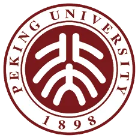
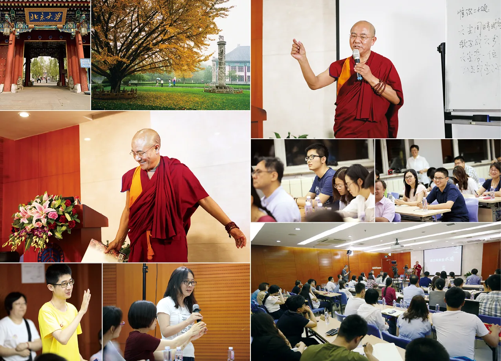
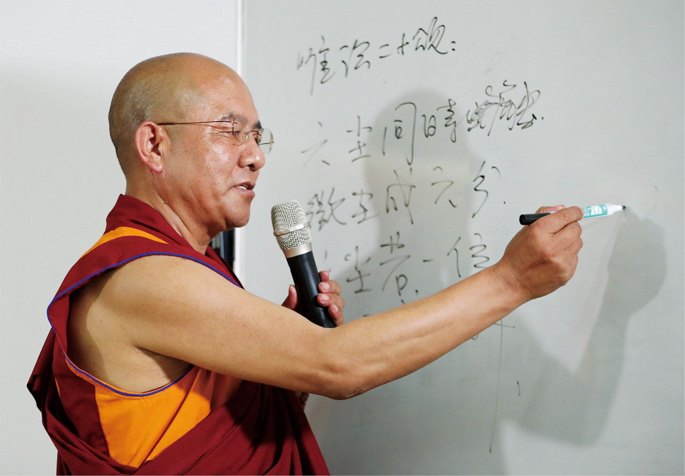
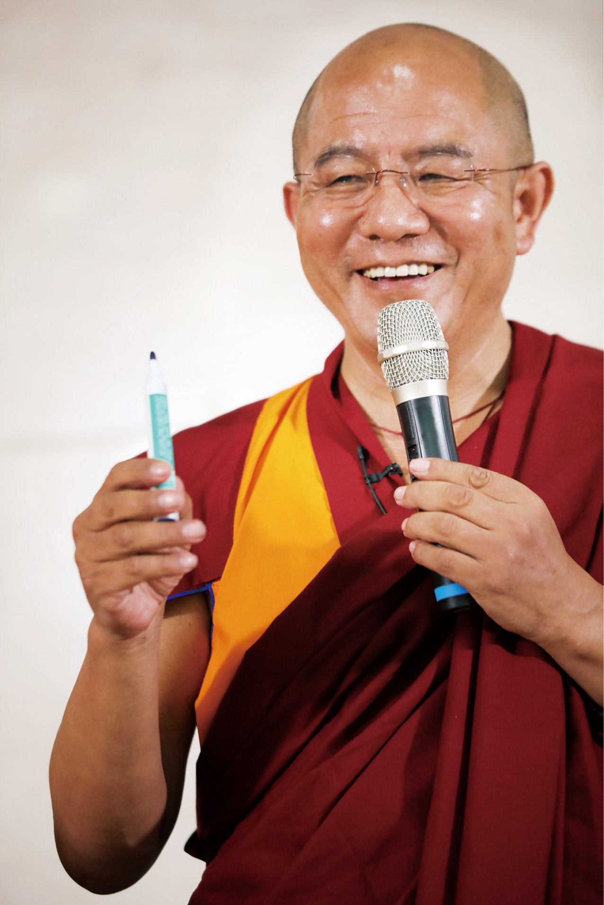
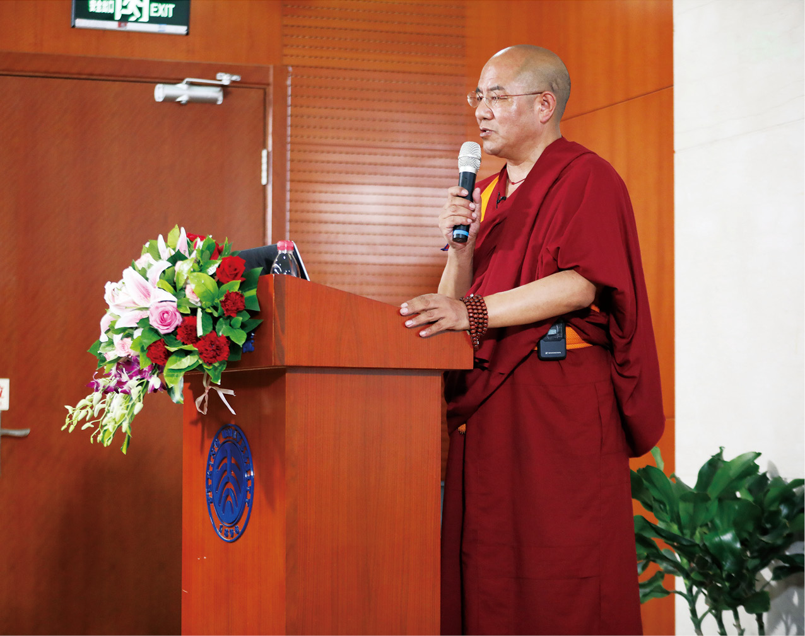
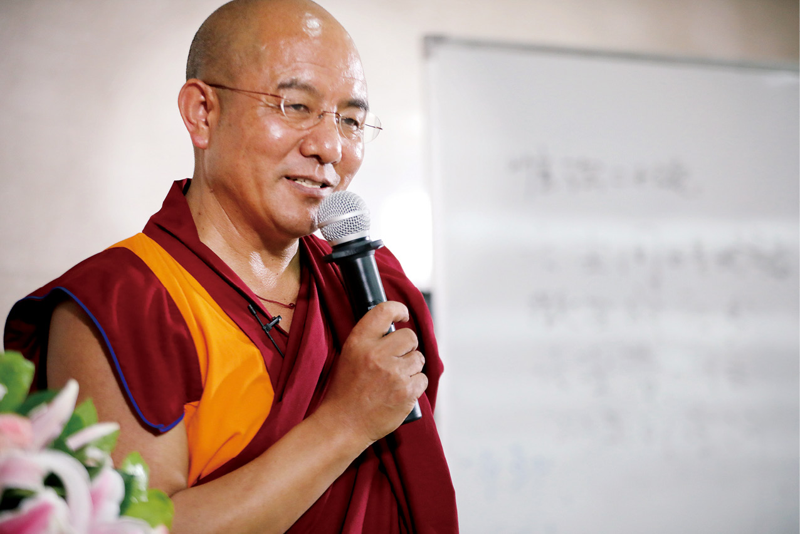

想透过表象看到本质并非易事，

包括人的快乐和痛苦，

有时也很难从表面来判断。

第169场

北京大学

Peking University

中国·北京

2019 / 6 / 18

## 透过现象看本质

## Looking Beyond the Surface

主持人：

尊敬的各位领导、老师和同学们，晚上好！欢迎来到“透过现象看本质”的主题演讲现场。

今天，我们非常荣幸地邀请到了喇荣五明佛学院的高僧大德——索达吉堪布。我相信，大家听完堪布的演讲后一定会收获满满。

接下来，先有请黄富强教授致欢迎辞。

黄教授：

大家好！我现在有点紧张。虽然我是材料化学系的教授，但遇到真正有大智慧的佛学堪布，心里还是有些发虚。作为科研工作者，我们也经常会处于迷茫彷徨之中，然后出现很多问题。更有甚者，还会因为论文等问题而走向极端。现在又到学期末了，在座很多学生即将面临毕业，在此我祝愿同学们学有所成！

本人才疏学浅，多言未必有益。所以，希望堪布老人家能发慈悲心，传授给我们看透人生本质的智慧。

欢迎堪布——

感谢各位的邀请，让我有机会跟大家一起学习交流。其实昨天给了我两个题目，一个是老师们提的“透过现象看本质”，一个是同学们提的“减轻压力和开启智慧”，我选择了前者。他们说这个是老师的题目，很多学生不一定想听，但也只能这样了，世事难两全。我刚跟黄教授也讲了，虽然我没有科研方面的专业知识，但在佛学方面的确花了很多时间，所以我才选了这个题目，希望大家都能透过现象看到本质。

## 一、现象的复杂性

在座各位应该清楚，事物的现象具有复杂性，运用简单的科学研究或佛学推理，实际上很难通过一种表象推断出它的本质，并且往往还会出现差错。比如，火车上有两个人，一个人在玩手机，一个人在看书，我们的第一印象就是玩手机的人可能在打游戏，看书的人可能在认真学习。但事实上却正好相反，玩手机的人在背英语单词，看书的人正在看令人散乱的文章。

要知道，表面现象具有很强的迷惑性。例如，有的人看起来非常富裕，但实际上他特别穷；而有的人看起来非常穷，但实际上他特别富裕。又或者，有的人看起来修行很好，威仪寂静，但实际上他的所作所为根本不如法；而有的人看起来疯疯癫癫，行为不太如法，但实际上他的内心有着超凡境界。

如果想要洞察事物的本质，需要用智慧进行多角度的分析。否则单看某一现象，实际上很难推测出隐藏在事物内部的本质，因为现象不仅具有复杂性，还具有多样性。当我们以不同专业眼光去看同一种现象时，它既可以是物理现象，也可以是宗教、哲学和社会现象。所以，如果有足够的智慧和能力，最好是多学一些知识，这有利于我们更加透彻地解读现象。

## 二、扩展知识领域

在学习的过程中，我们通常都会犯一种毛病：佛教徒往往更专注在佛法方面，而科研人员一辈子都专注在自己的专业领域上，虽然都很有智慧，称得上是权威专家，可一旦遇到超出所学范畴的问题时，可能就会感到迷茫。

就我个人而言，其实也有这种感觉。出家的前十几年里，我一心一意地研究显密佛法，其他世间知识一律不学。但后来我意识到，这种学习方法有些欠妥。虽然以佛学的眼光看这个世界的真相，我可能看得比较准，分析得比较透彻，但实际上还有很多复杂的表面现象，需要多维度的分析。在这个时候，我就不知从何下手了。

所以，在后来的二十年里，除了佛学以外，我还学习了很多世间知识。有些佛教徒可能认为，这些根本没必要去学，但我觉得恰恰相反，在学习、探索、思考这些知识的过程中，对我的佛学研究和修行也有很大帮助。

我们生活的世界包罗万象，无奇不有，所以单从某一个角度去分析的话，很难看到万法的本质。当然，作为科研工作者，需要花大量时间和精力，在自己的专业领域里潜心做研究，但我希望大家不要因此而傲慢，认为自己是这个领域的专家，自我感觉很了不起。

大家可以想一下，要是你一辈子都不离开所擅长的领域，那也还好些，如果以后到了必须离开的时候，需要从事与以往完全不同的行业，这个时候我们要怎么办呢？我有一个朋友，他以前在律师界很有名气，后来由于种种原因，没法再做律师，只能另谋生路，可再找一份其他工作谈何容易。

一般来说，不管是在东方还是在西方，很多人都认为律师和医生这两种职业非常高尚。但也有一些人因为种种原因做不了医生，那所学的专业知识也用不上了，如果其他方面再什么都不会，可能很难找到另一份工作。我们佛教徒也是如此，如果除了闻思修以外，什么都不懂的话，一旦离开了佛学团体，可能在社会上很难立足，与人交往也有一定困难。

我个人非常赞叹在座各位的智慧，以及严谨的学习态度，但同时我也希望大家能多了解一些其他知识。因为我们现在所处的这个时代，有太多的不确定性，而且变化得太快了。现在人们使用的科技设备，比以往任何一个时代都高端，这也是社会进步的一种表现。但从另一方面来看，我们的烦恼并没有因此减少，反而压力越来越大，痛苦越来越多。

在这种情况下，怎么才能解决这些人生难题呢？其实佛学的分析方法与你们的科学研究，既有相同之处，也有不同之处。不管怎样，就像我们刚才所说的，要从多个角度去分析问题。我经常会看查理·芒格[^1]的书，他的一些观点对我触动很大。查理·芒格提倡多元化的思维方式，他认为这样抉择之后，才能真正了知事物的本质。如果按照固有的思维模式去看待问题，很容易让人陷入狭隘之中，无法展现出真正的智慧和创造性思维。查理·芒格已经九十多岁了，但还特别喜欢阅读，他也说自己是个“书虫”。我个人觉得，他的这种思维方式和阅读习惯，非常值得年轻人学习。

在这个多元化的世界里，我们不仅要在自己的专业上下功夫，空闲时还要多学习一下其他知识。这对我们的工作、生活，以及心力提升等方面都有很大帮助。所以，我建议在座各位，偶尔也要打破一下思维模式，除了所学专业以外，还应该关注一下其他方面。当今这个时代，是不同文化相互交融、各种观念相互碰撞的一个特殊时代，这在人类历史上可以说是前所未有。所以，我们有必要对现有的学习方式进行重新定义。

## 三、空性中生妙有

今天我想和大家讲一下，如何从佛学层面分析事物的现象和本质。按照佛教教义来讲，我们的眼根、耳根、鼻根、舌根、身根和意根，叫做六根，是我们能够享受外境的工具，依靠这六种工具，我们可以看到、听到、闻到和感受到。但是，如果单单依靠六根的话，实际上未必能全面了解事物的本质。

我们通常会认为，亲眼所见、亲耳所闻就是真的，但实际上我们看到的、听到的这些对境，都具有很强的模糊性、形象性和概念性。事实上，我们并没有真正地看到，也没有真正地听到。有关这一点，很多人可能觉得这根本不可能，自己确实亲眼看到了，比如我们经常会说“我看到了这个桌子”“我看到了这个电脑”，实际上你所看到的只是一种表象，并没有看到事物的本质。

《三摩地王经》中有一句非常著名的教证：“眼耳鼻非量，舌身意亦非，若诸根为量，圣道复益谁？”意思是，依靠眼耳鼻舌身而得到的色声香味触，其实全部是虚假的，因为六根不是正量，否则圣者之道就没有用了。可能很多人觉得，这种说法很荒谬，持有反对意见。但如果我们用智慧真正去分析，就会发现我们眼睛看到的这些色法，实际上都是由很多微尘组成的。这种微尘，在佛教中被称为无分微尘，在量子物理学中可以细分为分子、原子、原子核、电子、中子、质子和夸克。而在量子场论中，把不存在实有粒子的状态叫做真空，但真空中又存在着一种能量。要知道，这种微观粒子或者能量场，并不是用眼睛能直接看到的对境，即使用世界上最强大的显微镜也无法看到。

所以，最小的物质到底存不存在呢？小乘有部宗和经部宗认为，无分微尘必须存在，因为它是组成粗大物质的基础，所以他们认为无分微尘是无法再分下去的极微。但是，按照大乘唯识宗的观点，这种无分微尘是不能成立的。为什么呢？因为如果再进一步分析，无分微尘也可以再继续分。世亲论师[^2]在《唯识二十论》中讲到：“六尘同时触，微尘成六分，六尘若一位，山王成尘许。”这句话非常重要，它是观察事物本体的一种推理方法。如果我们承认有一个无分微尘的话，那可以在无分微尘的东南西北上下六方，各放一个微尘。假如这六个微尘能与它接触，说明它有方分，那还可以继续再分，这样无分微尘也就不存在了；如果它没有方分，东方的微尘就会融入西方的微尘，这样一来，所有的微尘都将融为一体，那须弥山也变成一个微尘了，会有这种过失。

虽然现在的物理学，以及佛教有部和经部都认为，应该有一个最小的微尘，作为整个世界起现的基础，但实际上并不是这样。那么，以什么因缘来起现整个世界呢？按照佛教教义来讲，空性当中可以产生妙有。月称论师在《入中论》中说：“如是一切法虽空，从空性中亦得生，二谛俱无自性故，彼等非断亦非常。”从大乘角度讲，虽然没有组成物质的无分微尘，但一切法现即是空，空即是现，在空性的基础上，万法可以如是显现。就像老子在《道德经》里说：“道生一，一生二，二生三，三生万物。”这里的“道”与我们所讲的“空”很相似，这种空性也可以叫缘起性空。关于这个道理，刚开始我们可能很难接受，因为和我们的教育理念有所不同，但如果详细观察的话，应该能理解其中的甚深含义。

我们在观察外境的时候，可以先把外境细分为最小的物质单位，然后再将其抉择为空性。但在观察我们的心时，并不是用方位来观察，而是从过去、现在、未来三方面进行观察。《中观根本慧论》中说：“不因过去时，则无未来时，亦无现在时，是故无二时。”意思是，没有未来的心，因为它还没有产生，现在的心也同样没有，为什么呢？所谓的“现在”只是一个虚假概念。从时间上讲，现在是明年和去年中间的今年，是明天和昨天中间的今天，是上午和下午中间的几分钟、几秒钟……再继续分的时候，还有千千万万个更小的单位，所以说现在这颗心也很难得到。

我个人认为，现在的一些分析方法，早在两千多年前的佛教中就已经有了。我刚才讲到的问题就很尖锐，希望大家能用智慧去再三观察。当然，有些人刚开始思考时，可能会有一些不同看法，就像我们佛教中的阿琼堪布一样。阿琼堪布是华智仁波切的大弟子，也是上个世纪公认的佛教证悟者。他写了一本《中观四百论》的注释，书中阐述了很多关于眼耳鼻舌身非量的道理。我以前看过他的自传，其实在他刚开始学习的时候，也曾感到迷茫。

在阿琼堪布的自传中讲道：小时候他曾在别人家里做短工。有一次，主人迎请僧众来家里念诵《心经》。当时，还是小孩的阿琼堪布给一位老喇嘛倒茶时没能倒好，老喇嘛很不高兴地训斥道：“你是没有眼睛吗，为什么不好好倒？”小阿琼辩解说：“对呀，我就是没有眼睛，您刚念的《心经》里说‘无眼耳鼻舌身意’，那我怎么有眼睛呢？”老喇嘛更不高兴了，说：“你怎么没有眼睛？”小阿琼说：“怎么就有眼睛？”他们两个就开始辩论，最后老喇嘛讲不出有眼睛的道理，小阿琼也讲不出没有眼睛的道理。

从那以后，小阿琼时常默默地思考这个问题。有一天，牧场迁移到了另一处地方[^3]。当晚，在放牧回来的路上，他看到山坡上有很多帐篷，还有不少比丘。他走到其中一位比丘跟前，问道：“您是谁？”那人回答说：“我是月称[^4]。”

小阿琼接着说：“我想请教您一个问题。不久前，我和一位老喇嘛辩论起有没有眼睛的问题。结果我俩争论了半天，他没有讲出存在的道理，我也没讲出不存在的道理。您认为这个问题该怎么理解呢？”

听完小阿琼的问话，月称论师给他念了《三摩地王经》中的那个教证，“眼耳鼻非量，舌身意亦非，若诸根为量，圣道复益谁”，并拿出一本经函放在他头顶上做加持，还将一顶古旧的班智达黄帽，以及刚才加持的那本经函送给了他。回去时天色已晚，小阿琼本想把这两件物品带回家，但又担心家人会因过于迷信而阻止他在夜晚将陌生之物带回屋内，于是他便把这两样东西放在一块石头上，然后才返回家中。家人问清他晚归的缘由后，对他说这是非常吉祥的殊胜物，让他明天赶紧取回来。

结果次日去了，发现那里根本没有帐篷，帽子和经函也都不翼而飞。但以此因缘，阿琼堪布无师自通，彻底通达了中观般若空性的道理。

大概在2000年的时候，我在佛学院讲过《中观四百论》。在讲的过程中，参考了月称论师的讲义和阿琼堪布的《中观四百论》注释。也许因为阿琼堪布小时候的奇特经历，我发现他对月称论师的观点非常通达，解释得非常善妙。

## 四、心上安立一切

在生活当中，我们常常相信眼睛所看到的就是真的，但有时候亲眼所见未必是真，其中也有一定的虚假成分。为什么这么讲呢？事实上，我们眼睛看到的美好事物，或者心里所得到的快乐，只是你自己的一种所见所感。有些人可能认为，自己觉得好看的，别人也会觉得好看，这个并不一定。比如，你觉得特别好看的人，别人可能觉得很难看；你觉得特别好吃的东西，别人可能觉得很难吃。尤其是不同国家的人，在认知上也会有很大差异。可见，所谓的好与不好只是众生自己的一种习惯，或者是依分别念而安立的。

我到了非洲之后，对此深有感触。我个人感觉那边的人都长得差不多，所以特意问了下当地人，非洲最帅的小伙子是哪一位？最漂亮的女孩子是哪一位？有没有长得最好看的？他们说有，差别非常大。后来，他们选了两个带过来，我看了一下，确实分不清楚。

所以，想要透过表象看到本质的确不是易事，包括人们内心当中的快乐和痛苦，有时候也很难从表面来判断。现在很多人认为，有了财富、地位和名声以后，人就会越来越快乐，其实这也不一定。如果没有一颗淡定的心，当你真正拥有这些时，也许会有更多的烦恼。其实佛教中有很多解除痛苦的方法。

当然，我不是在劝大家学佛，而是想说在这个浮躁的社会里，我们除了要增加自己的专业知识以外，还应该运用禅修来调整自心，树立正确的价值观。在追寻事物本质的过程中，我们要着重认识心的本来面目，这一点在佛教中也至关重要。如果没有认识到心的本质，那对世间种种事也难以掌握。

## 五、还心本来面目

如何才能认识心的本质呢？首先，我们要经常禅修，以此来观察自己的内心。这样慢慢你会发现，心的本性是一种光明和空性无二无别的状态。虽然这是佛教里的一种修行方法，但我想在这里与大家分享一下。所谓的“光明”不是像灯光般耀眼夺目，所谓的“空性”也不是空空荡荡、一无所有。实际上，当我们以心观心时，会发现它是一种明明清清的状态，并且这种状态我们本自具足。不管是你小的时候，还是长大成人后，它一直都存在。如果没有它，那我们跟无情物就没什么差别了，也不可能有创造力。正因为有此光明自性，我们的心才能如宝库一般应有尽有。

其实，我们的心就是最好的资源。为什么呢？心也叫做如来藏，这种如来藏中具足所有的功德法，只不过有时候我们开发的方式不太对。如果依靠善知识的引导，以及个人因缘的成熟，这样再去深度挖掘时，那如来藏中的生物学、化学，以及佛学、其他宗教学等任何知识都可以开显出来。

这种宝藏般的如来藏，如果我们能很好地去保护它、善用它，完全可以真正认识到心的本来面目。当你认识心性以后，所有的表象都无法再迷惑你。这个时候，即使你遭遇了各种无常，也不会因此而感到苦恼。

我个人觉得，无论你是什么人，是科研工作者、修行者，还是普通人，都应该要认识自己的心，这一点至关重要。如果我们没有认识自心，那活在这个世间当中会有很多烦恼，也无法懂得生命的价值所在。

有哪些方法可以认识自心呢？从佛教的角度来讲，显宗有显宗的方法，密宗有密宗的方法。我听说在座有些老师对此很感兴趣，其实这方面的研究确实很有必要。希望以后有更多的人能通过这些观察方法认识自心，这样我们就不会再感到迷茫，人生也会变得很有意义。

## 六、给心增加营养

最后，我还想补充几点：

第一，处在这个复杂的社会当中，我们的心要淡定。作为一名科研工作者，如果你的心很浮躁，那你的研究可能不会成功。同样，如果佛教徒的心很不淡定，那修行也不会成功。总之，不管做任何事，都需要有一颗淡定的心。

第二，做事情要有激情。如果没有激情，做事很难成功。有人可能觉得，现在很多工作都不需要有激情，只要花时间去钻研就可以了。但事实上，如果你没有一个积极的心态，那你可能只是一个平庸的学术人。

第三，除了要有激情以外，我们还要树立自信心。现在的年轻人普遍缺乏自信，很容易自暴自弃，这是非常可怕的一件事情。

其实，人与人之间，只不过在能力大小方面有些差别而已，实际上每个人都有机缘变得更好。所以，我们要对自己有信心。自信会使人变得强而有力，如果没有自信的话，不管你是大学教授，还是刚工作的学生，在社会上都会举步维艰。

我个人的话，不管是身体不好，还是遇到其他困难，都会以平常心看待一切。如果我们没有面对困难的勇气，那很容易会坚持不下去。所以，我们要学会接纳，更加积极地去面对，不能因此而倒下。谁的人生道路都不可能永远是一条平坦的直线，而是坑坑洼洼、曲曲折折，这也是一种自然规律。

刚才我们一直讲，通过表象去寻找本质时，会发现两者之间存在很大差别，根本不是我们原本设想的那样。当你刚开始规划自己的情感、工作和人生时，可能认为按照某个表象去寻找本质时，最后结果应该不错，实际上并不一定如此。但是不管怎样，如果我们已经做出了选择，那就应该去努力争取，这样的人生才有意义。

第四，能考入这样的高等学府，说明你们的智慧和能力是超越一般人的。如果你们能将这种智慧用在个人修行上，人生应该会变得更加丰富多彩。

其实，现在很多西方学校也在提倡禅修，因为这种禅修对老师和学生们都很有帮助。当我们安静地坐下来时，就是在给心不断地充电、增加营养，让它变得更加强大，这样一切问题都可以迎刃而解。如果心不堪能的话，我们就无法坚定地走下去，做事情也是有气无力。

所以，我们要对自心做一些调整，让它变得强大起来。这些调心方法，在佛教和其他宗教中都有提及，希望各位以后能多多关注。

现场互动

问：我来自清华生命学院，请问如何才能认识自心，让心变得更强大？

堪布：你提到的这个问题很重要。在这个纷繁复杂的社会中，如果能通过一些调心方法来认识自心，可以让我们活得更自在，坦然接受生命中的苦乐。从历史上来看，这样真正认识心性的人有没有呢？确实有的。在藏传、汉传和南传佛教中，有很多这样的证悟者，他们认识心性的方法也是多种多样。

一般来说，三大传承的佛教都修四念处，即身念处、受念处、心念处、法念处。

通过修习身念处，可以认识到我们的身体都是由皮肤、毛发等假合而成。如果从空性角度分析，把我们的手指、脚趾一个个去掉的话，最后根本找不到一个真实的身体。比如一辆车，当把各种零件聚合起来的时候才叫车，如果把车轮、方向盘、车厢等一一拆开，所谓的“车”也就不存在了。既然全部分开时没有的话，聚合时怎么就有了呢？从理论上来讲，这个说法很难成立。

总之，在未经观察时，每个人都认为自己有个身体，但当你真正去观察时，会发现身体只是假合而成的。有关这个道理，佛教中观派分析得非常细致，有些人可能也看过相关资料。

通过修习受念处，可以认识到感受是从六根而来，会产生乐受、苦受和舍受[^5]。

生活中到底有没有快乐呢？如果不仔细观察，我们肯定认为快乐是有的，而且想要追求一个幸福美满的生活。但当我们用心去观察时，会发现快乐实际上只是一种心的感受。有关这种感受，我刚才也讲了，把过去、现在、未来分开观察时，最后根本找不到这种乐受。

有些人认为，依靠物质可以让人获得快乐，那物质与我们的五根有没有接触呢？比如你拥有了一件好看的衣服，让你感觉到很快乐。这样的话，如果衣服与你的身体完全接触，中间没有一点隔阂，最后二者就融为一体了；如果衣服与你的身体没有接触，中间还有一些空隙，说明它们之间还有很多微尘阻隔着，互不干扰，各自独立。

通过以上推理，我们可以清楚地了知，受的本体最后也不成立。当我们去感受外境时，实际上很难得到快乐。

修习心念处，是指观察心的颜色、形状，以及六识等，逐一分析时，它们的本体也不成立。

修习法念处，是通过缘起性空、离一多因等观察方法，以智慧去剖析时，会发现万法的本体除了空性以外一无所有。

以上南传佛教“四念处”的修行方法，可以让我们对空性有个大概的了解，对于调心也非常有利。当然，在大乘显宗和密宗中也有很多观察方法。

我个人认为，且不说修行对于来世的利益，单从当今时代而言，每个人最好也要有一些修行。应该怎么去修呢？我们每天可以用毗卢七法的坐式来禅修，调整自己的内心，而且要养成习惯。早上起床后打一座，晚上睡觉前再打一座，这样慢慢地心会越来越坚强。

另外，我们还要有利他心。现在的大学生普遍缺乏利他的积极性，他们想得最多的就是自己的家庭和亲人，对于全球局势、国家发展和学校建设等方面，则显得漠不关心。其实，不管你是什么身份，是学生、老师，还是科研工作者，都需要有这样一颗利他心：“愿我能令更多人获得利益。”这种虔诚心的力量非常大，也是一种很好的修行。

一般来说，修行可以分为两种：一种是自己不被烦恼扰乱，当烦恼起现时，可以认识到它的本性；一种是我们平时的所作所为，除了想到自己的家庭和个人利益以外，还要想到社会大众，乃至天下所有众生。如果能做到这样，你的工作和生活都会越来越好。

问：我来自北京大学，专业是物理化学。我想请教一个问题：您刚才提到，在智慧方面，我们北大的学生比社会上其他人要稍高一点，但在修行方面，跟有些修行人相比要差一些。但我想人无完人，每个人都有自己的长处和短处。即使是北大的毕业生，到了社会上也会有不如别人的地方，这个时候我们往往会因为这种落差而感到痛苦。请问怎样才能克服这种痛苦？如何透过现象看到本质？

堪布：我并没有说你们的学问比较高，而修行比较差。我的意思是，就国内而言，北大是数一数二的名校，很多人都非常羡慕你们的聪明才智。基本上只要别人听说你考上了北大，都会对你另眼相看。一方面，因为北大的录取分数非常高，没有足够的智慧也考不进来；另一方面，北大是享誉世界的百年名校，历史悠久，各方面条件也处于国内领先地位。

我这次来北大，并没有觉得这边人修行很差，反而觉得这里的老师和同学们心胸都很开阔。这一点，我2010年第一次来北大的时候就深有感触。当时在跟一些师生交流的过程中，我就感觉到北大人的修行很不错。相对其他一些学校而言，你们在宗教和科技研究方面，心态也更为开放。其实修学大乘佛教也需要这种开放的思想。大家都知道，大乘佛教的理念不仅仅是要利益个人，或者自己的民族和国家，更要发愿利益天下所有众生。

当初第一次来北大，对我而言也是一种缘起[^6]。后来，我也有幸参与过北大禅学社的一些活动，不知道禅学社现在怎么样了。据我所知，还是有很多人一直在对宗教方面进行研究。我这次刚到，就有几位老师跟我说，简单的知识无法令他们满足，希望我能讲一下中观空性的甚深道理。其实我不一定讲得了中观，但能有和大家共同学习的机会也很好。所以，今天选了这个主题。

实际上，每个人都需要有一种利他精神。这种利他精神不应该只是在课堂上讲一讲，步入社会后的实际行动也同样重要。如果只是为了维持生计而工作，即使你是北大的毕业生，我个人也不是很赞叹。因为想要养活一家人，并不一定非要是北大毕业的，其他学校的毕业生也可以做到。像清华、北大这类学校的学生，更应该思考一下，如何才能推动社会进步，帮助到所有众生。

当然，最后能不能做到还要看个人的因缘。我们出家人每天早晚都会发愿为了一切众生而修行。但其实不要说利益所有众生，就是饶益少数的众生，在身体力行时也有一定的困难，毕竟事情真正落到自己头上时，做起来并非易事。但我觉得作为一个高等学校，尤其是这里，学生们应该心系天下、造福社会，而不是围绕着家庭琐事打转。这也是高校培养人才的一个目标。

问：我来自中国科学院。我觉得以古圣先贤的智慧应该可以透过现象看到本质，然后《弟子规》中讲到“勿自暴，勿自弃，圣与贤，可驯致”。请问，学习这类简单的启蒙读物，对个人的修行、事业和家庭有帮助吗？可以提升我们透过现象看本质的能力吗？

堪布：这句教言很值得思考，尤其对现在的年轻人来讲，不仅要对自己有信心，还要对古圣先贤的教言有信心，因为从中确实可以得到帮助。

《弟子规》的文字虽然很简单，但意义很深刻，不管对哪个年龄段的人都能有所帮助。因此，我们一定要重视和弘扬传统文化。通过什么方式来弘扬呢？首先，我们自己要有兴趣学习，这样才能带着激情去弘扬。我认识的一位青海老师，他最初对《弟子规》一点都不懂，后来由于某种因缘开始接触，学完之后他就到处去宣传。因为他的推广能力很强，最后很多人都学得相当不错。

我之前曾把《弟子规》翻译成藏文。大家都知道，翻译与讲课的标准不同，需要挖掘出每一个字的甚深含义，所以要更加深入。在翻译的过程中，还需要翻阅很多相关的古人注释，以及一些现代注解。

这次的翻译令我感触很深，比如《弟子规》中讲到，我们应该对父母亲朋有一种感恩、报恩之心。但现在很多从西方国家回来的年轻人，对父母和家人的态度与这里讲的有所不同。其实，在东西方文化、古典文化与人工智能等文明冲突上，我们需要更有担当、更有作为，应该多学习一些知识。如果只是一味地沉湎于新时代当中，与古圣先贤的教言擦肩而过，非常令人惋惜。

问：物质与心是什么关系？二者在本质上有什么区别？

堪布：佛法与辩证唯物主义不同，按照佛教的观点，万事万物都是由心所造，而心的本体是远离四边八戏的大空性。为什么呢？其实这并不难理解，从量子力学的层面讲，也承认这个说法。

法国哲学家、数学家笛卡尔（René Descartes, 1596-1650）在《第一哲学沉思集》（Meditations on First Philosophy）中，就提出过“魔鬼假设”[^7]：是否一切只是魔鬼的捉弄，创造了一个虚幻的梦境世界？他认为，表面上虽然万法无欺而存在，但实际上本体一无所得，让人分不清到底是真是假。

我刚开始还有些不相信，一位如此理性的科学家会说出这样一段话，后来查了下原文，发现他的确说过。由此可见，从某种意义上讲，笛卡尔也认为万事万物都是由心所造。

有些人可能想，如果是心造万物的话，为什么心是有情法，而物质是坚固的无情法呢？这个问题可以用梦的比喻来回答。当我们正在做梦的时候，梦里也有同样的外境，所以说很难分清现在到底是梦还是现实。当我们在说“如梦如幻”的时候，还是有种“好像”的意思，其实如果再深层次去观察，也可以说万法是梦是幻。

在座各位可能对此有些疑惑，这个道理确实很有深度，希望以后有机会，诸位能多学习一下相关的佛教论典。这样慢慢地，你会觉察到人生确实是一种梦幻。对于这种梦幻再去观察时，会发现它的本体也不存在，这就是佛教中讲到的空性。真正的空性，本体一无所成，不是有也不是无，远离四边八戏[^8]，这叫做胜义谛。而在未经观察时，万事万物在我们面前如梦如幻地显现，这叫做世俗谛。在抉择万法时，世俗谛和胜义谛都非常重要。世俗谛又分为假世俗谛和真世俗谛。什么是假世俗谛呢？就是我们平时生活中出现的一些迷乱显现。

我们现在所看到的这些东西，比如这张桌子，实际上它只是一个概念而已。如果详细去分析，除了一些木头碎片以外，根本找不到所谓的桌子。同样的道理，人们经常会说“这是我的身体”，但当我们逐一去分析时，最后根本找不到所谓的身体。如果没有身体的话，那依靠它而产生的执著和分别念也会随之消失。

在座各位虽然都很有智慧，但毕竟不是佛学方面的专业人士，未必能完全明白刚才我所讲的道理。总而言之，物质与心之间有这样的关系，并且在空性的境界当中，两者都是一无所成。

其实这种说法非常合理。爱因斯坦也认为，空间、时间和物质，是人类的错觉。作为一名科学家，难道他也不承认一个真实的现象吗？事实上，他在对时间和空间分析时发现，它们都是比较抽象的概念，是由人的错觉和习惯造成的一种规律，暂时来讲这种规律比较适合我们的生活。

我有时候会想，比如说一个酒吧里有五百个人，每个人都喝了美酒，醉醺醺地在那里摇摇晃晃，过着同一种生活，遵循着同一种规律。同样的道理，这个世界也是这样，众生都有着共同的业力，所以万事万物才可以在我们面前如梦如幻地显现。有些人可能觉得，怎么会有这么愚笨的人？其实如果你仔细去观察，会发现的确如此。

《杂譬喻经》中有一个故事说：从前，有一位丈夫对他的妻子说：“你去厨房取些酒来，我与你共饮。”妻子打开酒瓮时，看见自己的倒影在酒瓮中，以为有个女人藏在那里，非常生气，回去对丈夫说：“你有别的女人，还娶我干什么？”丈夫听了很奇怪，就去酒瓮那里一看，看到了自己的倒影。丈夫大怒，说妻子藏了其他男人。

二人争吵不休，找来一位婆罗门作证。婆罗门到酒瓮那儿一看，看到了自己的倒影，气愤地说：“你既然请了别的婆罗门来调解，现在干嘛又来找我。”然后气呼呼地离开了。

接着他们又请了一位比丘尼，她看到瓮中的倒影后，也生气地走了。后来，有一位修行人听说了此事，不由感叹道：“世人愚昧，以虚为实。”最后他用一块大石头砸烂了酒瓮，打破了这个假象。

虽然这些人看起来都非常愚笨，但其实很多众生也跟故事里的人一样，经常产生虚妄颠倒想。把本来无常的执著为常有，本来不干净的执著为干净，本来没有“我”执著为有“我”，本来空的执著为不空。这四种颠倒的“美酒”让我们整天醉熏熏的。

众生共业的力量非常强大，所以很难说我们不是在做梦，就像庄周梦蝶一样，到底是我们变成了蝴蝶，还是蝴蝶变成了我们？对于一些修行人来讲，真的会觉得人生是一场梦，这并不是一个愚蠢的说法。要知道，昨天的人生是昨天的梦，明天的人生是明天的梦，现在我们正在这里做梦……

问：我来自清华大学物理系，请问按照佛学的观点，人应该选择追求什么，才能让人生更有价值和意义？

堪布：每个人内心追求的价值和意义都不同。作为一名佛教徒，我追求的是佛学的价值和意义，同时我也会用佛法来认识自心，利益众生；如果你是一名科学家、思想家或政治家，那你应该不断充实自己的专业知识，做出一些成绩。

我始终觉得，人活着就要有进步，不要只是停留在一个层面上，应该终生学习。李嘉诚也曾说过，六十多年以来，他从来没有间断过学习。还有一种说法，一旦我们的学习停止了，大脑思维就会明显变慢。所以，无论你是什么身份，都要坚持不懈地学习，这样的人生才有价值。尤其是现在已经进入5G时代，将来还有人工智能时代。如果没有坚持学习，无论你是哪个学校毕业的，都有可能被时代淘汰。所以，学习，对于人生的意义非常重要。

藏传佛教中有一位伟大的学者，叫萨迦班智达。他在《格言宝藏论》中说：“即使明早要死亡，亦应学习诸知识，今生虽不成智者，来世如自取储存。”意思是，即使我们明天就离开这个世界，今天还是要不断地学习，这些知识今生可能用不上，但就像在银行中储存一样，来世可以随时享用。

有的人从小智慧超群，这可能就是他前世智慧的延续。所以，我们应该以萨迦班智达为榜样，哪怕明天死去，今天也要学习。其实很多藏地大德都是这样，即使到了癌症晚期，已经没有康复的希望了，还是会不断学习，直到最后一口气。

如果我们特别爱学习的话，对个人而言，这是一种快乐，是一种享受；对社会而言，也是一件非常有意义的事情。我始终觉得，学习能更好地实现我们的人生价值。另外，平时心态要放松，不要过于紧张。现在年轻人因为工作和生活的压力，心绷得越来越紧，这样做事情不但没有效果，反而容易一败涂地。希望大家在今后的工作和生活中，保持一个良好的心态。

问：我来自中国科学院，专业是环境科学。我有一个问题：生活中往往会遇到一些让人矛盾的情况。比如在面临选择时，一方面，要遵从自己的本心；另一方面，也要考虑亲人的感受和客观条件。当二者发生矛盾时，该如何化解？或者说受到种种干扰时，应该怎么办？

堪布：正如我刚才所说，现象是复杂的，尤其在众多现象中进行选择的时候，要用智慧加以取舍。但是，毕竟我们的智慧有限，实在没办法的话，有些人会打卦或抽签，但这种方法不一定准确。此外，朋友、家人和社会环境有时也会给我们的选择带来一些压力。

按照以前高僧大德的观点，当你对一些事情没有把握的时候，最好找比较有经验的人帮忙分析，这应该对你有帮助。但现在很多年轻人不是这样，自己一个人就把工作、结婚决定了，跟父母只是打个招呼：“我选择了这份工作，我选择了这个朋友，我选择了……”这样不太合理，可能你父母文化水平有限，但毕竟有一定的生活经验。

在这个社会当中，智慧很重要，经验也很重要。所以，当你感到迷茫的时候，可以先跟同龄人聊一聊，再请比自己年长的人，或者不同专业的人帮忙分析一下，然后再做选择会好一点。即使最后没有选对，也好过仓促之下做出的决定。现在很多年轻人喜欢自己做主，其实还是要从多方面去考虑，这样可以少走很多弯路。

问：修加行的时候，按照道次第或九乘次第修的过程中，如果某一个修法需要的周期很长，比如顶礼，可不可以先修后边的，最后再修顶礼，这样有没有过失？

堪布：这个应该可以。按理来说，要先顶礼，然后皈依、发心、忏悔，最后供曼茶罗。但如果条件暂时不具足，也可以变换一下次第，先念诵后面的内容，最后再修顶礼。以前那些有经验的老上师，都有各自不同的修行方法。这个问题不大，大家可以根据自己的具体情况进行调整。

问：您刚才提到，有智慧的人才能透过现象看到本质，请问这是指出世间的智慧吗？然后我们经常会听到一些老人说“我走过的桥比你走过的路都多”，这种所谓的照见本质是否究竟？请堪布推荐一些佛经，帮助我们看到现象的本质。

堪布：如果是解决修行上的问题，的确需要用出世间的智慧，比如涉及到调心方法，或者中观、密宗、禅宗、华严宗，以及戒律等方面的问题，通过佛学可以把这些分析得更加透彻。

另外，有些老人确实像你说的那样，经常会说“我走过的桥比你走过的路都多”，这是一个很有代表性的说法。这句话虽然听起来不那么令人信服，但其实也有些道理。

我一直认为，父母和长辈的有些话很有深度。虽然他们在某些方面可能不如年轻人，有的甚至连大学都没读过，但以他们的人生阅历来看，提出来的建议也很有意义。尤其是在人生的关键时刻，我们需要父母和长辈给予指导和帮助。全知麦彭仁波切在《君规教言论》中也明确提到，依靠世间善良的亲友可以获得安乐。

我个人其实非常尊敬老年人，包括那些没有受过教育的老年人，也会经常和他们一起聊天。藏地的老年人虽然文化水平有限，对于现代的新鲜事物和科技发展一无所知，跟大城市的知识分子相比，他们看起来好像比较愚笨，但是，他们是有信仰的人，过着一种虔诚的生活，这就是他们的人生价值观。在这个方面，我们这里很多人都没法跟他们比，并且他们的内心非常纯净，这种心态在当今社会十分难得。

所以，每次见到老年人，甚至是文化水平不高的乡下人，只要我有时间就会跟他们一起探讨，希望他们可以从信仰、人生经验方面给我一些教言。虽然我在藏地是一位堪布，但也的确深受启发。从他们那里我得到了世间智慧和出世间智慧，甚至有一些是我平时没有想到的。所以说在父母和长辈身上，有很多人生经验值得我们去学习。

问：您刚才提到，我们要进行多维度的学习。但如今这个信息繁杂的时代，各种干扰也多，这样的话，要如何选择学习途径？在面对各种干扰时，如何提升专注力，保持不断学习的能力？

堪布：不仅仅是你，我现在也面临着这个问题。虽然我是一名出家人，但每天也有功课需要完成，包括禅修和一些念诵。如果手机没关机的话，一会儿来一条信息，一会儿来一个电话，这种干扰让人很难专心做事。

现在人的大部分时间，都用在了一些碎片化知识上。虽然在这个信息时代，网上可以查到很多信息，但你也只是泛泛了解，并没有进行深度钻研，算不上真正掌握了专业知识。

就全球范围而言，现在很多国家都有各种短视频APP，仅中国就有四亿多的观看人数，将来还会越来越多。在这个时代，每个人哪怕手机静音或关机一个小时都非常有困难。网上铺天盖地的各种信息，让人们的价值观发生了很大改变，未来可能还会变化更大。

在这个时候，不要说大城市里的人，即使是山沟里的修行人，也无法做到完全专注。去年我们佛学院规定，除了工作人员以外，其他人的手机一律上交。然后每个教室配置一个专门装手机的大保险柜，平时就把手机锁在里面，休息日再发给大家。但是，很多人想出一个对策，他们买两部手机，一个上交，一个放在家里用。所以，去年是我们县城移动公司有史以来生意最好的一年。可见，现在出家人也面临着很大的散乱危机，而且从长期来看，也没有更好的解决办法。非洲那边也是如此。其实那里的信号很差，但只要有信号的地方，你就可以看到很多人在玩手机。

总之，在短短的时间内，互联网的出现，极大地改变了人们的生活方式。

所以，我建议大家在专注做事时，最好不要使用手机或其他电子设备。我个人的话，因为实在没办法断掉所有信息，但为了翻译和备课，一般我会在下午两点到六点之间关机，否则根本没法专心做事。对于现在的社会来讲，这可能也是一种普遍现象吧。

问：我来自北航，请问作为一名理科生，应该如何追求问题的本质，总结背后的机理？我们通过设计各种实验，进行各种理论分析，最后去接近的这个本质是什么？有哪些佛学方法可以让人透过现象看到本质？

堪布：现在很多人会通过实验和推理来寻找事物的本质，这与佛教的修行方法基本一致。但按照大乘佛教来讲，修行是为了最大限度地利益众生，这也是唯一的宗旨。

科研人员会通过反复实验、研究、探讨，最后找到事物的本质。而佛教观察物质本质的方法有两种，第一种方法叫现量[^9]，现量是指通过亲眼看到、亲耳听到的方式认识本性。例如，上师会通过一种指示方法，让你当下认识自己的心；或者直接把你派遣到某个地方，告诉你要利益什么样的众生。

第二种方法，是通过哲学推理方法寻找本质，就像做研究一样。比如，因和果、自性和本性之间，以否定和肯定两种方式来进行推理。也就是说，如果你想要认识自心本性，可以用离一多因[^10]来观察，万法的本体远离一和多，如同空中鲜花般了不可得；也可以用大缘起因来观察，一切万法都是缘起性空，只是如梦如幻的显现，自性并不存在。

这是比较专业的佛教说法，实际上就是通过哲学推理来认识心的本性，并以此逐渐开展利益众生的事业。我个人认为，科学理论研究与佛教因明、中观的推理有很多相似之处，只不过一个是直接的，一个是间接的。当然，这种间接方法需要有一个严密的逻辑体系，如果只是一种揣测、估计，或者伺察意[^11]，那佛教也不会承认这种观点。

在因明[^12]方面，印度有两位非常了不起的论师，一位是陈那论师，一位是法称论师。在藏传佛教中，一直有他们的因明论理传承。在座有的应该看过辩经，它是藏传佛教的一种传统活动，就像大学辩论赛一样，主要是运用逻辑推理来认识事物的本质。这种推理思想比较成熟，所以也具有较高的可靠性。

主持人：

愉快的时间总是过得特别快，在这两个小时里，堪布给我们带来了精彩的演讲，对于大家的提问，也给出了非常有智慧的解答。让我们再次把掌声送给堪布！

今天的“透过现象看本质”主题讲座到这里就圆满结束了，感谢大家的到来！

[^1]: 查理·芒格（Charlie Munger，1924-）美国投资家，沃伦·巴菲特的黄金搭档，伯克希尔·哈撒韦公司的副主席。
[^2]: 世亲论师：佛教中一位伟大的学者，公元4世纪末的印度佛教论师，与其兄无著同为印度佛教大乘瑜伽行派的创立者。
[^3]: 牧民一般会随着不同季节迁徙。
[^4]: 月称（Candrakirti，约600-约650）古印度佛教僧人，佛教大乘中观派的主要代表人物之一。著有《入中论》《显句论》等。
[^5]: 舍受：又作不苦不乐受，即领纳中容之境相，身心无有逼迫，亦无有适悦，故称舍受。
[^6]: 索达吉堪布2010年应邀去北大哲学系演讲，是开始去各个大学演讲的缘起。
[^7]: 《第一哲学沉思集》：“因此我要假定有某一个妖怪，而不是一个真正的上帝，这个妖怪的狡诈和欺骗手段不亚于他本领的强大，他用尽了他的机智来骗我。我要认为天、空气、地、颜色、形状、声音以及我们所看到的一切外界事物都不过是他骗取我轻信的一些假象和骗局。我要把我自己看成是本来没有手、没有眼睛、没有血、没有肉，什么感官都没有，而却错误地相信我有这些东西。”
[^8]: 四边八戏：四边是指执著有边、无边、亦有亦无边、非有非无边；八戏是指执著生、灭、常、断、一、异、来、去八种见。
[^9]: 现量：略说有四种，即色根现量、意受现量、世间现量和清净现量。
[^10]: 中观共同五大因：金刚屑因，破有无生因，破四句生因，离一多因，大缘起因。
[^11]: 伺察意：藏传因明用语。萨迦班智达在《量理宝藏论·自释》中说：“通过观察不能生起定解的估计，智者们称之为伺察意。”
[^12]: 因明是一种佛教逻辑学。
