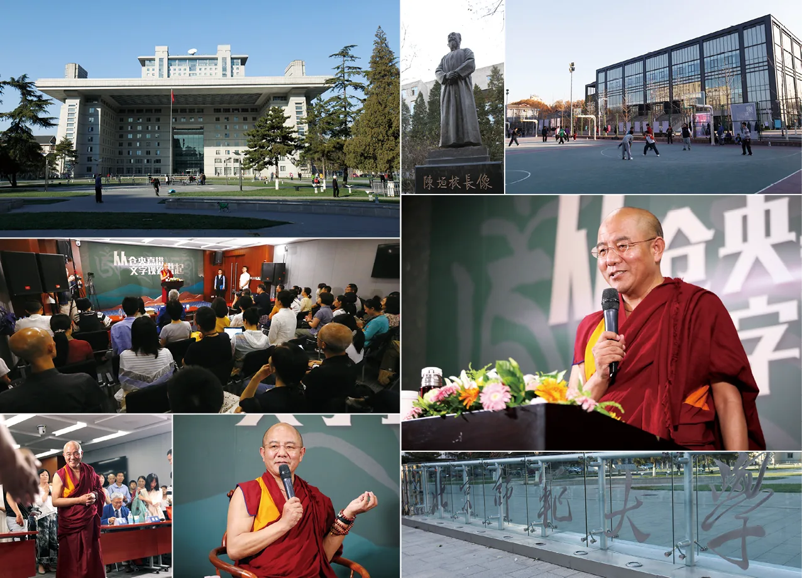
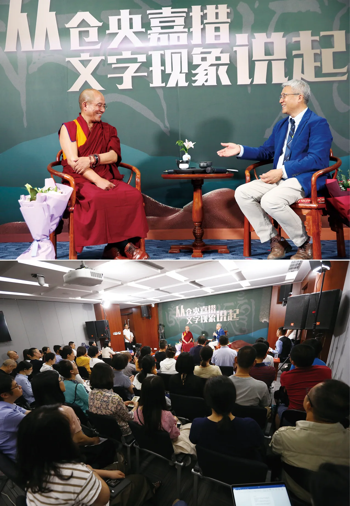
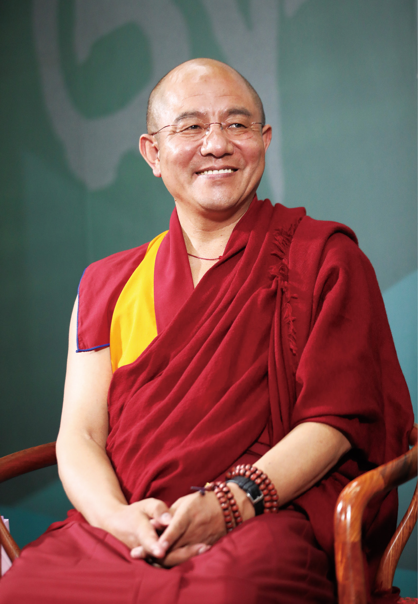
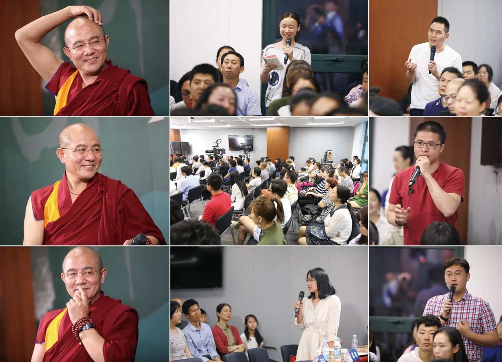

“世上安得两全法，

不负如来不负卿。”

第171场

北京师范大学

Beijing Normal University

中国·北京

2019 / 6 / 25

## 从仓央嘉措文字现象说起

## The Works of Tsangyang Gyatso and Modern Media

主持人：

大家好！欢迎来到今天的演讲现场。

《那一年》是仓央嘉措的经典之作，像这样的情诗在他的作品中还有很多。仓央嘉措是一位诗人、学者，也是一位宗教人士。许多人认为，他的经历神秘而又传奇。

今天，很荣幸邀请到了同样来自雪域高原的索达吉堪布，为我们带来精彩的演讲。

有请堪布——

这次的因缘很好，也很特殊。在座的有研究基督教、佛教等的学者，大家一起共同探讨仓央嘉措神奇的人生旅程。

## 一、跨宗教研讨的意义

当今时代，这种跨文化、跨宗教的研讨，非常有必要。多年以来，我一直很关注宗教之间的和谐。所以，我们举办这次活动的目的，并不是为了迎合大家，而是因为在全球化的背景下，文化多样性问题尤为突出。如果宗教之间互相排斥，互相诋毁，一方面对宗教的发展不利，另一方面对宗教徒的和睦相处不利。所以，当前最重要的是，宗教之间应该互相学习，互相探讨，这样才有利于社会的进步与发展。

有关这方面，我们能做的事情有很多。就我个人而言，在这几年的世界青年佛学研讨会上，举办了多次跨宗教的和谐研讨。参会的有佛教、基督教、伊斯兰教、印度教、耆那教、犹太教，以及儒家、道教等。总的来说，体现出了一种开放融合的精神。

一些宗教人士与无信仰的自由主义者，从不同角度一起探讨人类的未来，或者当前的热点话题，比如对社会的责任、对家庭的责任等。如果把这些话题展开讨论，可以引申出更为深刻的思考，也能促进宗教和谐。

据我所知，包括北师大在内的一些大学老师和同学，花了大量的时间和精力，研究不同的宗教。现在的宗教研究所，也为全世界提供了非常重要的文献，这些珍贵的资料足够我们进行深度钻研。

所以，我特别希望各个宗教、各个领域的学者，能够一起探讨这些甚深的话题。如果能把研究成果落实在文字上，整理成资料，对后人会非常有利。

虽然每个人的生命很无常，但这些资料会一直留在人间，为后人的学习和研究提供方便。

## 二、认识仓央嘉措

今天的主题是“从仓央嘉措文字现象说起”，对这个话题我既熟悉又陌生。

很多人对仓央嘉措进行过不同方面的研究，评价各不相同。宗教人士对他的思想有宗教方面的解读，喜欢诗学和历史的人也有不同看法。世人眼中的仓央嘉措，可能只是一位文学艺术人物，而历史上真实的仓央嘉措，与现在人们的想象有所不同。

一般来说，历史人物与文学艺术人物有着很大差别。比如《西游记》里的唐僧，有人可能认为，虽然他心地善良，严持戒律，头脑却有点呆笨，在孙悟空的帮助下，才完成了西天取经的任务。其实，如果我们翻看《大唐西域记》[^1]，就会发现历史上的唐玄奘与人们所熟悉的唐僧大相径庭。

我以前看过这本书，里面记载了玄奘大师游历西域时的所见所闻，以及一些重要的历史人物和历史事件。后来的人参考它写了一部长篇文艺小说。所以，大多数人眼中的唐僧，并不是历史上真实的唐玄奘。

仓央嘉措也是如此。大概上世纪七八十年代，他的诗歌就已经被翻译成汉文。但大家真正开始关注他，是因为前几年电影《非诚勿扰2》里面的个别台词，“你见，或者不见我，我就在那里，不悲不喜……”或者“那一日，那一月，那一年，那一世……”这些词句，让仓央嘉措再次出现在人们面前。

如果你真正去思考、去研究，或者翻阅一些相关历史资料，会发现网上流传的有些诗根本不是他写的，只是署名为仓央嘉措而已。后来，这些诗火了，一些作者又站出来说，这不是仓央嘉措写的，是他自己写的。

很多读者也不管事实如何，只要能令他们感动，与其心意契合，到底是不是仓央嘉措本人所写，对他们来说根本无所谓。

这个时代确实比较特殊，人们不关心文学作品、艺术作品的真假，只一味追求它是否易于理解，以及能否对心灵有所触动。

仓央嘉措出生于三百多年前，是一位出色的政治家、宗教家，也是著名的诗学家，但关于他的生平事迹，一直众说纷纭。

据记载，五世达赖喇嘛圆寂后，当时的长官德钦桑吉嘉措派人找到了六世达赖喇嘛。但在特殊的历史背景下，直到他十五岁，才在布达拉宫坐床。据说，康熙皇帝对于桑吉嘉措匿丧不报[^2]的行为很不高兴。

西藏当时正处于政治、宗教种种矛盾极其尖锐的时期，仓央嘉措在布达拉宫只住了九年[^3]就被解送北上。绝大多数历史学家认为，他是在北上途中，于青海境内示现圆寂。在历代达赖喇嘛中，圆寂时间都不同，有的是十一岁，有的是十八岁，有的是二十几岁……

关于仓央嘉措后来的命运，大概有两种说法：一种认为他在1706年示现圆寂；一种认为在当时特殊的历史背景下，他不得不藏匿起来。从二十四岁开始，周游四川、西藏、五台山等地，后来到了内蒙古的阿拉善，隐居三十几年，终年六十四岁。

相关资料记载，仓央嘉措只活到二十四岁，有关他的下半生，我们确实无从得知。但我去过距离银川约三十公里的南寺[^4]，寺中供奉着六世达赖喇嘛的灵塔。据说仓央嘉措是在那里圆寂的，这一点至今仍没有确切的说法。

很多人认为，仓央嘉措是一位有情有爱的西藏喇嘛。大家关注的重点只是他的情诗，而不是他的政治生涯，以及特殊的历史背景。按照佛教的传统，出家人应该舍俗割爱，但他却为了追求爱情，不顾一切地从布达拉宫里跑出来，人们认为这种精神非常崇高。

所以，现在一提到仓央嘉措，大多数人就会想到，他有一个特殊而高贵的身份，却为了所爱之人付出一切，这是大家比较关注他的原因。也正因为如此，有些人才把他的诗做了大量修改。现在的电影、电视，或者研究资料里看到的仓央嘉措情歌，与真正的本义有很大出入。

## 三、解读仓央嘉措

事实上在藏文中，所谓的“情歌”应该是“道歌”。在仓央嘉措的道歌集里，确实有一部分涉及了爱情。这是因为在特殊的历史时代和社会环境下，他不方便说出太多事，所以才用隐晦的语言来表达。从宗教方面讲，这些语言有着非常甚深的含义。

比如，有一句是：“从东边的山尖上，白亮的月儿出来了，‘未生娘’的脸儿，在心中已渐渐地显现[^5]。”意思是，每当看到东山上升起皎洁的月亮时，他就会想起一个不是母亲却胜似母亲的人，这个人的脸庞一直浮现在他的心里。表面上看，仓央嘉措好像在思念着一个女人，实际上却是在想从小抚养他、帮助他的德钦桑吉嘉措。

五世达赖喇嘛圆寂后，桑吉嘉措一直在寻找六世达赖喇嘛。找到之后，又由他主要操办仓央嘉措的学习、出家、坐床等事宜。所以，仓央嘉措每次想起这位官员时，不方便直接表达，就会说自己在思念什么。

事实上，东山是指拉萨。每当在拉萨看到皎洁的月亮时，他心里想的并不是他的亲生母亲，而是跟母亲一模一样的桑吉嘉措。他经常会特别想念桑吉嘉措，但只能用诗学的方式来表达。

还有一句是：“住在布达拉时，是瑞晋仓央嘉措；在拉萨下面住时，是浪子宕桑汪波。”意思是：住在布达拉宫时，人们都敬奉他为雪域伟大的六世达赖喇嘛；而流浪在街头时，人们却又都看不起他，对他有其他称呼。

其实，这句话在佛教中的意思是：认识自心本性时，在光明法界宫中，你就是最伟大的觉性国王；没有认识自心本性时，你的心识就会流浪在分别念的街头。或者说，如果对自心有所认识，就会像六世达赖喇嘛一样伟大而了不起；如果没有认识自心，即使是六世达赖喇嘛，也会如街头流浪的浪子般，谁都不认识。

事实上，这是引导人们认识自性的一句偈颂。但很多人都看不出来，反而理解成他为了所爱之人，经常从布达拉宫里偷跑出去。

目前，比较公认的一种说法是，约有六十多首诗是仓央嘉措本人所写。也有些人说是一百多首、两百多首、一千多首，但这里面绝大多数应该是很会写诗的后人以他的名义写的。

这种情况并不少见。现在有些人也会说，这话是马云说的，或者某某人说的；但其实他们根本没有说过，只不过是有些人的别有用心。

我也有过类似的经历。我本人从来没有讲过的一些话，网上经常有人说这是堪布说的。结果一看，那些话我想都没有想过，不知道为什么要写上我的名字。

虽然现在是言论自由的时代，可要是谁都可以这样，那也比较麻烦。尤其5G时代即将来临，在短时间内就可以传播很多条信息，这是谁都无法阻挡的趋势。

在仓央嘉措的道歌集中，还有一首非常著名的诗：“白色的野鹤啊，请将飞的本领借我一用，我不到远处去耽搁，到理塘去一遭就回来。”

有的人可能会唱这首诗，却未必理解其中的含义。直到后来，七世达赖喇嘛转生到了理塘，人们才恍然大悟，原来这首诗的隐含意思是，他的下一世不会去遥远的地方，会在理塘转世。

所以，我们应该多做一些调查研究，通过历史事实来解读仓央嘉措。

阿拉善蒙古族僧人阿旺伦珠达尔吉，写过一本仓央嘉措的传记[^6]。书中讲述了仓央嘉措“圆寂”后四五十年的人生经历。这本书是用藏文写的，后来有些人把它翻译成汉文时，就译为《六世达赖喇嘛传》或《六世达赖喇嘛秘传》，算是比较可靠的参考资料。

事实上，很少有人真正探究过仓央嘉措的一生。所以，仅仅从文字上看，很难说到底哪一首才是他写的。因此，如果有人想模仿他的写作风格，最好是写上自己的名字，不要让人误会是仓央嘉措写的，这种处理方式比较好一点。

## 四、文化低俗现象

如今，文化市场受消费主义的影响，出现了低俗化的倾向。文学的本来面目，应该是优化人性的善和美，提高个人的道德素养。但现在很多人，反而通过文学作品来丑化一些历史人物，网络恶搞现象也日趋严重。

这个时代的低俗化有几个特点：

第一个是浮躁。大多数人没有深度思考的能力，也很难静下心花时间去慢慢钻研。不像一些古人和现代学者，通常会花十几二十年的时间，深入研究某一领域。现在的人们，大多是跟着分别念走，以个人喜好来判定一切。

第二个是恶搞。对于一些甚深的道理，有的人实在无法理解时，会通过网络方式把它变得低俗化，或者直接用各种语言进行诽谤、诋毁，颠覆其本意。

第三个是造假。还有些人，自己没办法接受神秘而深奥的古老文化，就夹杂着一种自私的心态，对其进行大肆修改。比如刚才讲到的《西游记》，包括很多西方小说也是如此。

这个时代正在慢慢地发生变化，各种造假现象层出不穷。曹雪芹也在《红楼梦》中说过“假作真时真亦假”，把假的当作真的时，真的反而成假的了。

另外，还有一个原因是排斥心理在作怪。现在很多人对古老而深厚的优秀文化不屑一顾，认为这约束了人性，妨碍了社会进步。实际上，是我们自己没办法吸收这些有益的知识。

以上这些现象越来越严重。所以，希望大家能多花一些时间，以不同的方式了解、研究仓央嘉措。

从某种角度讲，仓央嘉措的作品确实能给心灵带来快乐。很多年轻人也认为，他的词很美、很浪漫，说出了自己的心里话。这是因为仓央嘉措当时的特殊遭遇，以及所处的特殊环境，导致他的诗歌中出现了特别人性化的一面，并且言辞美妙动听，这也是如今人们喜欢他的一个原因。

## 结语

总之，仓央嘉措是一位非常有修证且能预示未来的修行人。但由于他的多重身份，很多人未必能清楚了解他的一生。所以，如果我们想真正了解仓央嘉措，单从他的诗歌和爱情传说来看，是远远不够的，还要从他的才华、社会地位、政治抉择入手，最后会发现他的思想非常有深度。

当然，通过情歌层面来认识这位三百多年前的特殊西藏喇嘛，也未尝不可。

对话

## 从仓央嘉措文字现象说起

主持人：

首先，请允许我隆重介绍下今晚的两位主讲嘉宾。他们分别是北师大文学院教授、北师大跨文化研究院副院长、北师大基督教文艺研究中心主任、教育部国别和区域研究基地北师大俄罗斯研究中心成员——李正荣教授，以及北师大文学院副教授、北师大基督教文艺研究中心副主任——张欣教授，欢迎两位！

请大家以热烈的掌声有请索达吉堪布和两位主讲嘉宾上台就座。

三位都是在各自专业领域潜心钻研多年的智者，也有很多的学生。我相信是特殊的因缘让我们相聚在此，一起探寻“从仓央嘉措文字现象说起”背后的秘密。

接下来，有请李教授先做发言——

李教授：

我不像堪布那样具有极高的智慧，作为一名老师，我只会照本宣科。所以，我并不想把这个环节叫做“对话”，因为觉得自己没有与堪布对话的资格。

堪布刚才的演讲，实际上已经把我所有的困惑都解答了。仓央嘉措的诗歌哪首是真，哪首是假，真正的解读是什么，这些问题堪布都回答了。

说来也巧，我第一次去西藏是2004年6月25日，参加西藏大学文学院的成立大会，今天又是6月25日。在那里，我认识了许多藏族朋友，也有了一段不寻常的经历。

那天晚上，游客都已散去，路上空旷无人。我走在布达拉宫的外面，突然看到布达拉宫的一扇门打开着。当时，我强烈地意识到那里面有“仓央嘉措”。紧接着，心中就浮现出堪布刚介绍的那首诗：“从东边的山尖上，白亮的月儿出来了。‘未生娘’的脸儿，在心中已渐渐地显现。”

通过堪布的解读，我理解了这首诗的深层含义。“未生娘”其实指的不是一位普通女性，而是从小抚养他长大，不是母亲却胜似母亲的那个人。堪布对这个名称的解释，解开了我心里的很多疑惑。

仓央嘉措最后还说，那个人的影子渐渐出现在他的心里。当我走在街头时，就有这样一种感觉。我猜想这首诗应该与他当时的亲情关系有关，一直想请教堪布的也是这个问题。另外，我觉得“渐渐”这个词用得非常好。那个人的影子一点点地出现，时有时无，时强时弱。

人们之所以认为仓央嘉措的诗歌好，也许就是因为他把自己的真实感受写出来了，让人看了很感动。他思念着那个人，但又不能说出来；他想表达这种情感，却又不能表达得很明显，所以就说那个人的影子在他心里一隐一现。

读到这首诗时，我就在玛吉阿米餐厅里。我始终认为，把“未生娘”[^7]理解成他的情人，有些不太对，但要是不理解成一个真实的人，好像也不对。听了堪布的解读后，我一下子就明白了。仓央嘉措确实在思念着一个人，这个人在他的生命中非常重要。所以，非常感谢堪布的指导！

我研究的方向是西方文学和比较文学，也涉及了基督教文学艺术创作的各种问题。

基督教和佛教一样，也有很多艺术作品，诗歌就是其中重要的一项。在意大利文学史上，有一位诗人与仓央嘉措的写作风格很像。大家应该都知道，他叫但丁[^8]，写了很多宗教题材的诗歌，代表作有《新生》《神曲》《帝制论》等。

但丁是1265年出生，1321年去世，比仓央嘉措早大概400年。他在写《神曲》之前，还写了一本书叫《新生》，内容上与仓央嘉措的诗歌有点像，只不过这部诗集确实是他写给一位姑娘的情歌。

《新生》包括31首抒情诗，其间用散文连成一体，并说明了各首诗的起因和意义。书中讲述了他九岁时初遇一位姑娘，九年后又再次相遇，抑制不住的情愫令他开始写诗歌颂心中的爱情。

如果你认真去读但丁的诗歌，会发现他写着写着就变了。实际上，他的爱情是一种对女性神圣的爱，因为他与那位姑娘并没有过多的接触。这位姑娘叫贝雅特丽齐，后来他还把她写到了《神曲》里。

因为时间有限，在这里就不给大家看原文了。我个人感觉，他的写作主题与今天的主题有一定的可比性。在当时藏、蒙、汉多重交集的特殊历史背景下，仓央嘉措把自己遭遇的家庭变故和政治打击，以及在修行过程中的体验、物质生命之上的精神生命，都用诗歌的方式展示出来。

但丁也是如此，表面上好像在为一位恋人写诗，实际上是把他对艺术和神圣感情的理解注入其中。因此，人们最后也无法说清，这里面的爱情，到底是肉欲的爱还是神圣的爱。事实上，他还是想展示心灵的爱，因为在《神曲》里，他把这位女性当作是引导自己上天堂的力量。

所以，堪布又给我的这个问题做了解答。仓央嘉措也是通过月亮、山等意象，向我们传达了一种特殊的力量，也就是修行的力量。他还有一首诗提到了露水[^9]，写得也非常好。

可以看出，这些伟大的诗人都有一个共同点：他们会把生命中的某一种体验，转化为对世界和真理的认识，最终达到了一定的境界。不知道我这样理解对不对，希望堪布能给予解答。

索达吉堪布：

李教授讲得很有道理，有些宗教诗学家在表达方式上，与仓央嘉措的确有相似之处。

在藏文化中，五明[^10]分为大五明和小五明。小五明中专门有一部从印度传过来的诗歌著作，叫《诗镜》[^11]。书中运用了很多抒情手法来描述爱情，与仓央嘉措的表达方式基本相同。

学五明、十明时，一般都会学到《诗镜》。所以，在西藏历史上，还有很多诗学家，包括出家人和在家人，他们也写了一些特别好的诗。只不过在汉地和西方，仓央嘉措比较出名，这可能跟他的特殊身份，以及他的诗歌很打动人心有关。

李教授刚才讲到，无论是诗歌，还是其他文学作品，都蕴藏着一种真理的力量。别人的作品中，可能也讲了同样的道理，但却不一定火起来，就像现在的影视作品，有的广受欢迎，有的无人问津。

作品的流通也需要一种因缘，在因缘成熟的情况下，人们才能接收到这种力量，佛教中称之为加持力。例如听到某位上师或传承祖师的名字时，有的人会产生一种与众不同的信心，甚至眼泪横流、汗毛耸立，这就是佛法加持力的体现。有时，我们也不得不承认这种无形的、神奇的力量。

李教授：

走在拉萨的街头，堪布说的这两种感觉，我都有体验，热泪盈眶，汗毛耸立。但这并不是因为害怕，而是读了仓央嘉措的诗歌，突然有一种莫名的感动。

在研究基督教文学时，我也有过类似的体验。张欣教授也有研究基督教文学，并且正在做相关课题，不如请她也来说一说自己的感受。

张教授：

很荣幸被邀请在这里讲话，我先简单说一下自己的因缘。

二十多年前，我跟佛教有过短暂的接触。当时，我花了一年的时间，在大学里选修佛学的课程，包括印度佛学史、中国佛学史和藏传佛学史，与佛教徒也有过一些交流。

在我生命的低谷期，曾尝试过信仰佛教，但可能缘分比较浅，后来没有再继续学。

今天的这场对话特别真诚，也非常难得。我现在是一名基督徒，也经常会思考一些问题。比如，为什么世界是这样？面对人世间如此多的苦难，应该怎么做？怎样才能利益他人？如何实现人生价值？人死真的如灯灭吗？

面对诸如此类的问题，我们应该在思想上加深认识，在行动上追问真理，不该让假象蒙蔽自己的双眼。

所以，很感恩堪布的演讲，让我对仓央嘉措有了更多的认识。我始终觉得，这样一位高贵身份的人，怎么可能会那样做。但我也没有能力自己去弄清楚这些问题，依靠网上搜到的那些资料，反而让人更加困惑。所以，非常感谢堪布的解答。

我后面没有再继续学佛，有一个很重要的原因，就是在念《金刚经》时，刚开始念到“一切有为法，如梦幻泡影”，我还很平静，念到第三天就感觉有些不对劲。如果一切真的如梦幻泡影，人为什么还要活下去？也可能是学习方式不得当，总之我有了不想活的念头，最后就放弃了学佛。

因为对我而言，爱和生命同样重要。我不清楚别人怎么看待这个问题，但如果没有爱，我不知道自己为什么要活下去。这可能是我没办法修学《金刚经》的原因，因为我爱这个世界，爱世界上的很多东西，而且我想活着。

今天是谈论诗歌，我也带过来一首诗，是《圣经·旧约·雅歌》[^12]里的一段话：“所罗门的歌，是歌中的雅歌……因为爱情如死之坚强，嫉恨如阴间之残忍。所发的电光，是火焰的电光，是耶和华的烈焰。”所以，在基督教的传统里，爱是从上帝而来。

拿桌上的这朵花来说，我总觉得在读《金刚经》时，好像在否定这朵花的美，可我认为它现在确实很美。在我的生命中，需要欣赏这种美，也需要超越这种美。不为一时开放而欢喜，也不为一时凋谢而悲伤，既欣赏当下的绽放，也接受随后的凋落。

刚刚，堪布从另一个角度解读了仓央嘉措的三首诗。让我们明白了这些诗只是看起来像情诗，就像《雅歌》一样。在基督教的经典里，爱是核心，具有一种神的力量。

主持人：

张欣教授一直有在研究基督教，并取得了一些成果。感谢张教授为我们朗诵了优美的诗歌，真诚地分享了她在读《金刚经》时产生的困惑。对于这个话题，我觉得堪布特别有发言权。

索达吉堪布：

张教授的发言非常好。这场对话最重要的意义就在于，以不同的维度去看待同一件事情。

之前，我们在泰国、香港等地开宗教研讨会时，来自世界各地的学者都很有同感：以前自己思想比较狭隘，现在通过大家一起公平公正、严肃认真地思考，智慧的碰撞，对一些知识自然而然有了新的理解。就像仓央嘉措说的：“第一最好是不相见，如此便可不至相恋。”从不同角度去欣赏这些诗学家的作品，真的可能会爱上“它”。

在23岁时，我选择出家。藏传佛教中有很多派别，我属于宁玛派的一个支派。当时，我一直认为只有宁玛派才是最好的。后来随着视野的开阔，渐渐意识到还需要补充更多的知识。

其实，每一个真理都有不同的认识方法，应该以开放包容的心态进行多角度分析。所以，我发自内心地感谢张教授和李教授。大家在这里可以敞开地交流，而不是把自己困在狭隘的小笼子里，始终爬不出来。

现场互动

主持人：

再次感恩堪布！接下来进入今天的第三个环节——现场互动问答。

问：我是中央财经大学大四学生。从大二开始，我就在思考人活着的意义，后来看了一些佛教学说，比如功名利禄都是过眼云烟，相遇之人终将分离，得到的总会失去……对此我深有同感，却又更加迷茫。请问人活着有没有意义？如果有，意义是什么？如果没有，人还活着干什么？

堪布：现在，越来越多的人开始思考人生的意义，但这个问题比较复杂，应该从多个角度来分析。无论是过眼云烟，还是如梦如幻，其实都是从人生的某种境界来讲。

究竟意义上说，万法确实如梦如幻。为什么呢？因为昨天的人生跟昨天的梦一样，明天跟明天的梦一样，现在跟当下的梦一样。有关这方面，我们自己也可以辨别一下，昨天晚上的梦跟昨天发生的事情有没有区别。

这不只是一种佛教理论，事实上也的确如此。现实中的一切跟做梦差不多，做梦有长有短，梦中有苦有乐，这是谁也无法否认的事实。

有人可能会想，这样的话，努力是不是就没有意义了？我们可以换个角度去思考，虽然一切如梦如幻，但如梦如幻的人生仍有如梦如幻的意义。就像昨晚你做了一个好梦，也知道这是梦，但在做梦时还是很开心。

人生的本质虽然如梦如幻，但也要认真去度过，因为这个梦不会在很快时间内醒过来。有的人是百年梦，有的人是十年梦、二十年梦。所以，认为人生如梦如幻就没有意义，不需要去努力，这是一个错误的信号，也是一种误解。

人生的意义是什么，每个人的答案都不同。如果你的心力足够强大，那我觉得人生的意义就在于奉献社会，多行利他之事。按照大乘佛教的说法，我们要有一颗利他的菩提心；小乘佛教则强调自己从烦恼中获得解脱，利他行为有限。

认为人生没有意义的说法，既不符合佛教道理，也不符合世间道理。按照量子力学的观点，物质可以细分到夸克，再往下分是真空[^13]，除此之外没有一个实有的物质，但显现上仍然存在。物理学家也没有说，万物都是真空，我们的所作所为毫无意义，从而放弃研究。

佛教中讲的空性道理，与现在西方科学的理念是相通的。我们不应该受个别学说的影响，消极看待人生，不愿意努力。其实，人活着就非常有意义，在短暂的人生中，有很多事情可以做。

问：我的哥哥前段时间过世了，我想把自己最喜欢的仓央嘉措诗歌和《金刚经》作为珍贵的礼物陪伴他，希望他能与佛结缘，请问这种行为是否如法？

堪布：《金刚经》的确很殊胜，但不是每个人都这样认为。众生的业力不可思议，同样一部法，对有些人非常有利，对另一些人却未必如此。有的人听了《金刚经》后，反而对空性法门产生了邪见，这样的故事也有很多。

有些人听了个别宗教词语后，一直特别相应；有些人是开始很相应，后来又觉得不相应。这一点，大家应该也能理解。其实，无论学习哪个宗教，都能有所收获，只不过每个人的因缘和根基不同。

对于你哥哥的离世，旁人听起来可能内心触动不大，但从自身来讲，面对亲人的离世，还是很受打击。

我以前讲过《金刚经》的功德。如果在四十九天之内，每天为亡者念诵《金刚经》，或者念些其他佛经和咒语，再做些放生等善事，对亡者会非常有利。因为当我们离开这个世界时，所有的一切，包括名声、财富等等，一样都带不走，这时最有利的就是所修的善根。

在佛教和其他宗教的教义中，都有关于天堂和地狱的描述，只不过佛教讲的是六道轮回。可见，人死并非如灯灭，唯有善法才能帮助亡者的投生，一定要为亡者多做善事。

我个人建议，你可以念诵或助印《金刚经》。这部经的功德不可思议，对亡人的利益非常大，有很多真实的感应故事。

问：我在出版社工作，对佛教很感兴趣，平时出差也会去寺庙转转。我有一个问题：我发现这些主流宗教都有分教派，比如伊斯兰教分什叶派和逊尼派，佛教分大乘和小乘。包括我在寺庙里看到的佛像，他们的形态、法器和建造风格也有很大差别。请问这方面应该如何理解？

堪布：任何宗教都要适应不同的群体和不同的文化。

佛教起源于印度，后来延伸到中国、日本，以及一些西方国家，这导致了佛教文化的多样性。藏传佛教在藏地有不同的派别，汉传佛教在汉地有不同的派别，造像艺术等方面两地也各不相同。伊斯兰教和基督教也有不同的派别。

一方面，这是为了适应当时的社会发展；另一方面，也是为了适应当地的文化习俗。所以，一些传承祖师，或者改革派人物，会根据社会现状建立不同的教派。

不仅宗教分派别，艺术和文学也会有不同的风格和流派，这其中的甚深含义，并没有我们想象的那么简单。每一个教派的创立，背后都有一段历史渊源，值得人们花时间去深度钻研。

任何一个宗教的存在，都有其合理性。伊斯兰教有一千五百年的历史，基督教、佛教各有两千多年的历史。在漫长的历史进程中，它们有着强大的生命力。为了顺应自然规律，各个宗教在支派上会发生一些变化，文化方面也是如此。

问：现在有些人会曲解传统经典，并通过网络进行传播。如何做到辨别真假，以及不作恶、不传播恶？

堪布：与以往的时代完全不同，现在每个人都有自己的传播平台。因此，我们越来越难以控制传播的途径。尤其到了5G时代，几秒钟就可以下载一部高清电影，或者把一个存储空间大、内容丰富的视频传遍全世界，这大大增加了辨别真假的难度。

就今天讲的仓央嘉措诗歌而言，如果你非常了解他的思想和作品，可能会有一定的辨别能力；要是对他毫不了解，的确很难分辨真假。

当今社会有一种现象，有些人经常会恶搞别人的作品，或经改头换面后写上自己的名字，带有目的性地大肆宣扬。有时候看得出来，这个作者根本不会说这么奇怪的话，但网上非说这是他说的。

这种现象在短时间内很难得到解决，唯一的方法就是依靠智慧来辨别，通过各种途径去了解，这样才能探知真相。

到了一定时候，人们的辨别能力应该会有所提升。毕竟现在很多信息在网上是公开的，可以查到这个人是不是真的说过那些话，如果没有可靠的依据，那就有待商榷了。

问：佛教是古老的，但佛教徒都是现代的。如何运用AI技术、短视频等现代化的传播方式，传播善、弘扬善，让每个人都获得佛法的饶益？

堪布：这个世界每天都在发生变化，与以往传统媒体完全不同的新兴媒体开始出现，并且发展迅猛，势不可挡。

将来还会出现更短的视频，以前几分钟，现在十几秒，以后还会更短，因为人们越来越喜欢这种“快餐”短视频。作为一名宗教徒，如果想弘扬自己的宗教，一定要抓住这个机遇，充分利用新媒体的优势。

现在，使用纸媒和电视的人越来越少了，很多传统主流媒体纷纷开始改革，传统企业也在调整自身的经营模式。在中国，每天有四亿多人观看短视频，这说明有三分之一的人正在转移注意力，传统媒体几乎从人们的视野中消失了。这个时候，如果各个宗教没有掌握新媒体的使用方法，很可能会赶不上时代的发展，被社会所淘汰。

宗教的基本教义虽然不需要改变，但方式方法上要做一些调整，契合现代人的心态。否则，在这个新时代里很难得到弘扬。

问：在纪伯伦的《泪与笑》中，我看过一句话：“美是一种你为之倾心的魅力。你见到它时，甘愿为之献身，而不愿向它索取。”我们经常会说到文字美、语言美、行为美、思想美、精神美，诸如此类的美有很多。有些是永恒的美，有些只是一时的美。请问应该如何定义美？如何创造一种和谐美？

堪布：你讲到了很多美，包括语言美、行为美、思想美、精神美等。我个人认为，永恒的美应该是内心美，也就是心地善良，是一种精神美。

这个时代对颜值要求有点高，如果一个人外表美，大家就觉得这是个美人。可外表的美并不能永恒，有的人只是暂时看起来很美，其实在他的表皮下隐藏着丑陋的一面。

所以，无论何时何地，一个人最重要的是内心美，内心美是一切美的根本。

主持人：

今天的因缘非常奇妙，相信大家都收获满满。感谢堪布充满智慧的开示，也感谢仓央嘉措为后人留下如此美好的诗歌，让三百年后的我们能在这里研读和探讨。

另外，还要特别感谢两位教授，谢谢你们的到来，让话题变得丰富而深入。

我相信，今天只是一个缘起，未来还会有更美妙的事情发生！

[^1]: 《大唐西域记》：又称《西域记》，是由唐代玄奘口述、辩机编的地理史籍，成书于唐贞观二十年。
[^2]: 五世达赖喇嘛曾有过“须得守密十二年”的授记。
[^3]: 从15岁到24岁。
[^4]: 南寺：阿拉善八大寺庙之一，建成于1757年，位于贺兰山中，也叫广宗寺。
[^5]: 文中诗歌皆选自《第六代达赖喇嘛仓央嘉措情歌》。
[^6]: 阿拉善蒙古族僧人阿旺伦珠达尔吉，即拉尊达尔吉诺门罕所著的《一切知语自在法称海妙吉祥传记——殊异圣行妙音天界琵琶音》。这部传记1757年成书以后，首先在阿拉善南寺（即广宗寺）刊刻印行，后来在各寺庙间流传开来。1980年，庄晶先生将其译为汉文；1981年，由民族出版社发行，此乃汉文版秘传起源。
[^7]: 于道泉在《第六代达赖喇嘛仓央嘉措情歌》中标注：“未生娘”系直译藏文之ma-skyes-a-ma一词，为“少女”之意。所以相传，玛吉阿米是仓央嘉措情人的名字。
[^8]: 但丁·阿利吉耶里（意大利语：Dante Alighieri，1265－1321），意大利中世纪诗人，现代意大利语的奠基者，欧洲文艺复兴时代的开拓者，以史诗《神曲》留名后世。
[^9]: 洁净的水晶山上的雪水，铃荡子上的露水，加上甘露药的酵“所酿成的美酒”，智慧天女当垆。若用圣洁的誓约去喝，即可不遭灾难。——选自《第六代达赖喇嘛仓央嘉措情歌》 于道泉译。
[^10]: 五明：佛教所称的五类学科，源自古印度，藏传佛教中尤为重视。五明又分大五明、小五明。大五明是指工巧明、医方明、声明、因明、内明；小五明是指修辞学、辞藻学、韵律学、戏剧学、历算学，合称为十明。
[^11]: 《诗镜》是古印度时期一部著名的诗歌理论著作，由7世纪的宫廷诗人、文学评论家檀丁撰写。13世纪初，藏族学者萨迦班智达·贡嘎坚赞率先把它翻译成藏文。
[^12]: 《雅歌》（Song of Songs）是《圣经·旧约》的一卷书，本卷书共8章。书中记载了良人与书拉密女的爱情，预表基督与教会的关系，是神儿女最宝贵的一卷书。
[^13]: 真空：物理学里面的一个概念，最开始反映的是空无一物的状态，类似于“无”。20世纪英国理论物理学家P.A.M.狄拉克提出了所谓量子真空的概念，即真空并不是空无一物，而是时刻有虚粒子与实物粒子转化的，但整体是对外不显物理属性的宏观总体。
