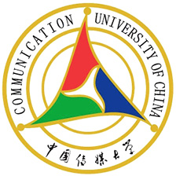
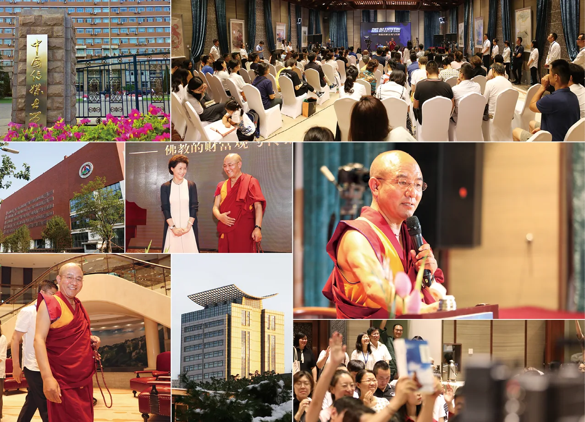
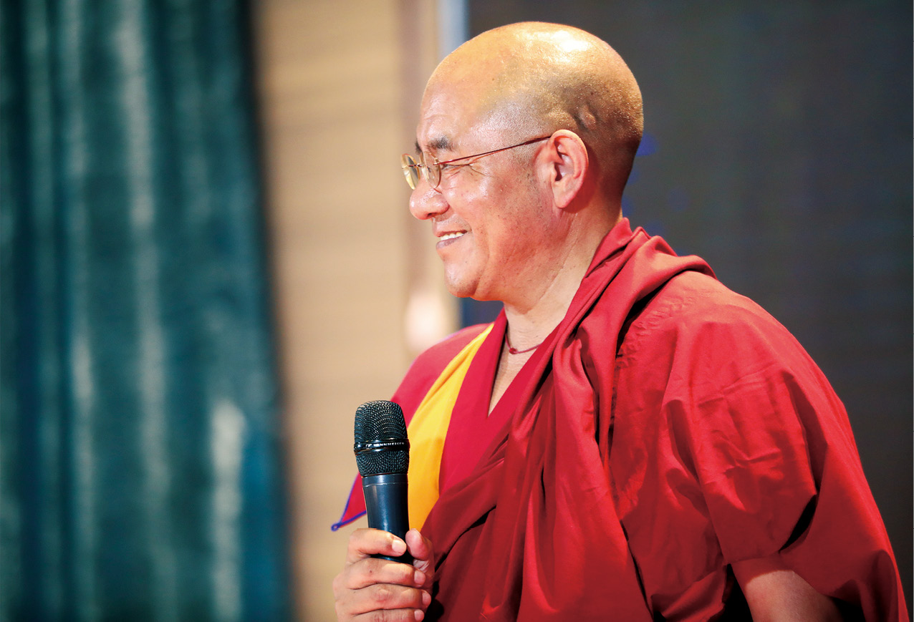
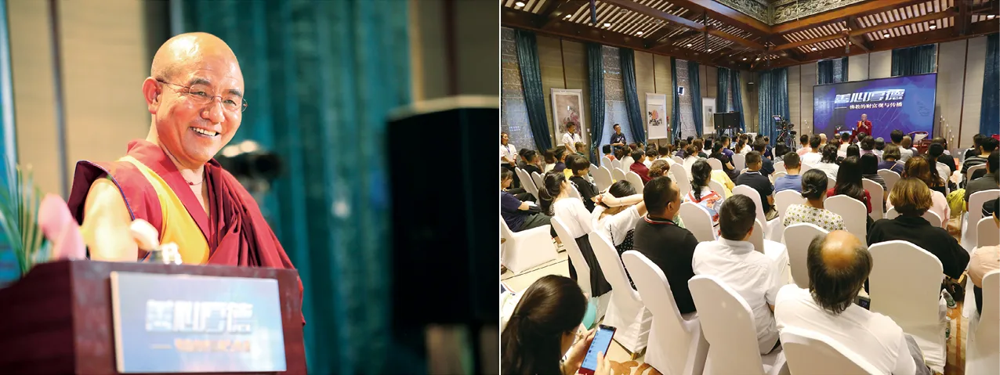
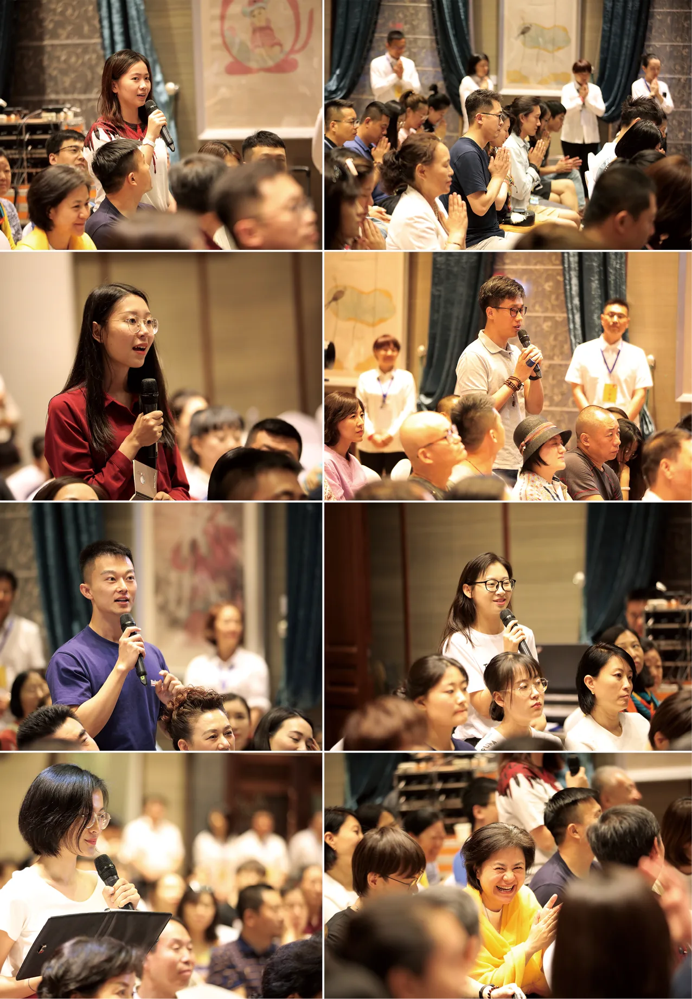
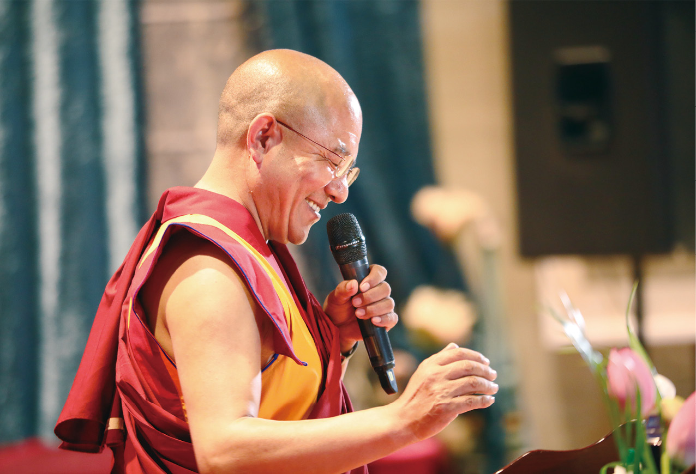

一个人的成功，

确实有运气的成分，

但运气跟我们的主观愿望没什么关系。

第170场

中国传媒大学

Communication University of China

中国·北京

2019 / 6 / 23

## 善心厚德

——佛教的财富观与传播

## Kindness and Morality: A Buddhist Perspective on Wealth

主持人：

尊敬的各位嘉宾、各位朋友，晚上好！欢迎大家来到“星期八文化交流中心”，非常有幸能在这里与各位结缘。

今天在座的有很多媒体人、企业家、商界领袖。在改革开放的几十年中，大家创造了很多的财富，但与此同时，很多人却感觉内心的幸福感和快乐感并没有随之提升。也就是说，随着财富的积累，我们精神世界和物质世界的发展并不平衡。

那么，如何才能让二者达到圆融、圆满呢？为此，我们特意请来一位著名的智者、学者——索达吉堪布。接下来，让我们一起聆听堪布的开示！

大家好，很高兴来到这里与大家一起交流。在座各位大多是商业领袖、媒体人，以及传媒大学的老师和同学们。刚才，有些人分享了他们的成功之旅，有些人分享了他们不平凡的人生经历。对我个人而言，这是一次非常好的学习机会。虽然我可能讲不出非常深刻的道理，不一定能给大家带来启发，但我们可以共同探讨一些问题。

## 合理分配财富

今天，我想和大家分享一下佛教的财富观。佛教分为南传佛教、北传佛教和藏传佛教，内容包罗万象。所以，这个话题可以从不同的角度展开讨论，很难在短时间内讲清楚，但我个人的一些见解和经验，也许能给大家提供一个新的思考角度。

从宏观层面来看，如今这个时代确实很需要佛教的财富观，因为佛教中获取和分配财富的方法非常合理。佛陀在《阿含经》中讲到，我们的财富最好能分成四份：一份用于日常生活；一份用于做慈善，回馈社会；一份存起来以备急需；还有一份可以用于做生意、投资、科研等等。其实，这种分配方式很有必要。

很多年轻人在创业的时候，往往会把自己所有的财产投入进去，但到最后可能无法从中获益，日子也会过得拮据，这恐怕不是一个明智的选择。因此，我认为大家有必要做好财富的分配。尤其是在这个瞬息万变的时代里，我们的人生充满了无常。目前来讲，你的人生可能非常成功，但再过一两年，你的处境也许会变得很悲惨。因此，大家最好有一定数量的存款，以备不时之需。这样无论外部形势如何变化，都无有畏惧、无有忧虑，会有一种安全感。

现在很多企业家认为，他们的财富是通过自己的努力得到的，因此并不热衷于回馈社会。当然，一个人财富的多少，往往与他的努力奋斗是分不开的，但其实还有一个更重要的因素，就是社会方方面面力量的协助。如果你赚到钱之后，没有回馈社会、广做布施、多做慈善，那到了一定时候，这些财产也许靠不住。

所以，我建议大家做好财富的分配。一部分可以存起来，另一部分可以用来做慈善，帮助身边那些需要帮助的人。无论是病人、穷人，还是学生，对这些人而言，哪怕只是小小的一笔资助，也可能会改变他们的一生。

对每一个企业家而言，有生之年积累的这些财富来之不易。为了让这种福报长存下去，大家一定要学会布施。现在有些人喜欢把钱都存起来，一点钱也不舍得花，这不是一种正确的财富观念。我个人认为，当我们有钱的时候，还是应该多做一些有意义的事情，这样才能真正体现财富的价值。

## 福报决定际遇

很多人经常讲，发财靠运气，只要恰当地抓住机遇，就可以一夜暴富。一个人的成功，确实有运气的成分，但运气跟我们的主观愿望没什么关系，否则谁都可以碰一碰运气了。从佛教的角度讲，所谓的运气其实是一种善业力。我们在今生、前世或前前世的某一时刻，积累了福德资粮的善因，再加上今生的努力，所以才拥有了现在的财富。如果单纯靠运气的话，也不需要努力去争取了，反正成功是靠运气而已，但实际上并不是这样。因此，无论遇到任何事情，我们都应该保持一颗善良的心，多行善事，多种善因。今天种下的种子，到了一定时候就会开花结果，这个方法才是获得成功最关键的一环。

对于这样的因果规律，很多人都不是特别了解。所以，我们经常会听到有人说“早知道事情会这样发展，我可能已经成功了”“早知道要跟这些人合作，我可能不是现在这个样子”……很多人喜欢用这种“早知道”的口吻来感叹自己时运不济。事实上，在漫长的生死轮回中，我们每个人都行过善、做过恶，而善恶业力量的不同，导致了每个人的命运也不同。对此，大多数人应该深有体会。

## 以因果看今生

当然，有些企业家对“善有善报，恶有恶报”的道理有非常深刻的认知，这对于当前的社会而言很重要。有些人不认可这种观点，他们就像《道德经》中说的那样：“上士闻道，勤而行之；中士闻道，若存若亡；下士闻道，大笑之。”所以，提到善恶因果的时候，如果有人不相信也没关系。当他们遇到特殊转折或重大灾难，甚至处于生死关头的时候，就会很自然地想到“我这次是不是没办法翻身了？”“我是不是以前做了什么坏事？”“我是不是就要离开这个世界了？”……这个时候，他们自然而然会相信因果轮回的存在。有些人，当他们风光无限的时候，天不怕地不怕，没有任何信仰；而当他们处境艰难的时候，就会对自己的人生有新的思考。

由此可见，诸事顺遂的人生不一定就是最好的。古人也说：“人有悲欢离合，月有阴晴圆缺，此事古难全。”所以，我们有时要给人生留一个缺口。对于内心强大的人来说，每一次的遭遇和坎坷，都是一堂宝贵的人生课程。如果能很好地从中吸取经验，这些遭遇就会变成机遇。佛教中经常讲：“亏损失败自取受，利益胜利奉献他。”意思是说，我们所遭遇的亏损，乃至别人的嫌弃、诽谤、轻蔑，都有值得接受的一面。

有些人可能认为：“如果我总是默默承受失败以及别人的诽谤，那我以后在社会上就没法抬头做人了，人人都会践踏我。”其实并不是这样。要知道，这句教言背后有着深刻的因果规律。如果我们在别人面前太过于高调，福报很快就会被消耗掉；如果我们在别人面前保持低调，做一些力所能及的事情回馈社会，就可以快速地积累福报。

因为前世的一些因缘，我们可能暂时会遭受痛苦和不幸，但今天积累的善业，一定会在未来得到好的结果。正如佛教中所说：“欲知前世因，今生受者是，欲知后世果，今生作者是。”意思是说，一个人前世的所作所为，通过今生的状态就可以了知。比如：如果今生财富圆满、相貌端严、地位尊贵、身体健康，这一切都说明你在前世造作了很多善业；如果今生感觉时而快乐，时而痛苦，生活总是大起大落，这说明你在前世造作了很多杂业。杂业是指前世既做了好事，又做了坏事，所以今生的生活经历会比较复杂。

总之，今生的所作所为会决定后世的感受。如果今生一边做善事，一边造恶业，来世很可能就一会儿感受快乐，一会儿感受痛苦；如果一直只做善事的话，那将来收获的只有快乐。

## 从多种角度看世界

有些人可能认为，这只是佛教的一种观点，对此并不相信。但不相信也没关系，要知道，这个世界上就是有很多不同的观点，未必每个人都能接受，但不接受也可以听一听。如果觉得有道理，就可以运用在自己的生活中；如果觉得没道理，甚至还有点排斥的话，也可以理解。尤其是在当今这个时代，每个人都可以从不同的角度来认识这个世界。我们应该用多维的视角来看待这个世界，而不是只用一种方式，不然思想就太过于狭隘了。比如，人生的快乐和痛苦，既可以通过宗教思想来观察，也可以通过哲学方法来分析。每个人所关注的焦点，看待问题的角度，很难得到所有人的认同，但正是因为大家站在不同的维度，我们的研讨才变得更有意义。

我个人而言，在刚开始学佛时，只关注佛法的学习；后来发现，除了佛教的观点以外，还应该从多个维度来看待这个世界。虽然我不是学哲学的，也不是学量子力学的，但我对这些专业都抱有好奇心，也在尝试从不同的学科角度观察物质世界和心灵世界，这给我带来了很大的帮助。在这个信息爆炸的时代，万事万物都在变化当中。如果只看眼前的问题，缺少长远的眼光和思维，恐怕很难看清这个世界的真相。

对于很多企业家来说，他们承担着很重的社会责任，因此面临的压力也很大。尤其是这个时代，知识更新非常快，只有不断地学习，才能不断地完善自己。按理来讲，像我这个年龄的人应该退休了，包括我以前的很多同学都已经退休了。但我觉得大家还不能退休，应该尽力为社会做贡献，同时合理利用新媒体，提高自身的学习能力。

现在这个世界变化特别快，知识传播的方式和速度也不断更新。从媒体方面来看，很多传统媒体已经被短视频等新媒体逐渐取代了。面对新形势，传统企业的经营模式需要做出改变，否则可能无法经营下去。据我所知，很多企业也在思考转型的问题。当然，在转型的过程中，既有很大的挑战，也有很多的机遇。不论失败还是成功，我们都要有一颗坚定的心——按照佛教的说法，就是要有一颗如如不动的心。如何才能做到如如不动呢？最好是心中有一种信仰。如果没有信仰的话，也可以只是一种兴趣爱好，或是依靠哲学思想和科学方法研究宗教。虽然每个人的兴趣爱好都不一样，但在寻找精神归宿的时候，应该依靠自己的智慧，在前人的基础上进行判断，这可以帮助我们做出更明智的选择。

## 用好手中的财富

这个时代变化非常快，以往几百年、几千年才会发生的变化，现在几个月、几天内就有可能发生。这就是佛教中讲到的“诸行无常”。也就是说，一切万法都在刹那刹那地变化，这在生活中也可以见到。比如，很多有福报的企业家，就是从十年前的身无分文，变成了今天的身价过亿。但再过十年、二十年之后，他们又会变成什么样，这个很难说。所以，我建议大家在有福报的时候，多多积德行善，否则这种福报可能维持不了太久。

按照佛教的说法，每个人都有自己的福德因缘。这种福德，就是人们常说的“厚德载物”，也可以说成“厚善载物”。如果福德深厚的话，无论是财富多还是名声大，都可以承受得住；如果福德浅薄的话，即便暂时拥有了大量的财富，可能也会在短时间内消失。比如：有些人彩票中奖一夜暴富，最后却妻离子散；有些人以不正常的手段官运亨通，最后却身陷囹圄；还有些人在生意场上超越很多人，最后却沦落街头，变成特别可怜的人。一般来讲，这些都是福报不够的表现。

事实上，我们的福德就像一艘船。如果这艘船的质量好、体积大，就可以承载很多物资；如果质量差、体积小，装的东西越多，报废就越快。所以，每个人的“船”都有一定的承载量，这跟我们的福德有很大关系。只有不断地做善事，积累更多的福德，才能让它继续航行下去。

我们现在所做的善事未必当下就能成熟。事实上，现世现报是极少数的，大多数都要在下一世，甚至下下世才能成熟。但只要我们一直坚持做下去，以后肯定会感受善报。就像美国的洛克菲勒家族（Rockefeller family），兴盛了好几代，可能就与他们世代重视慈善事业有关。虽然民间流传着“富不过三代”的说法，但我并不是特别认同。当然，如果一个家族不重视慈善，它的财富很可能就没办法传承下去。所以，当我们拥有财富和资源的时候，一定要回馈社会。

我经常做一些助学、扶贫。每当把钱交到贫困学生的手里时，我都会发自内心地感觉到，有钱真的很好，能改变他们一生的命运；每当把钱捐给那些身患绝症却又看不起病的人时，我也会觉得金钱确实很有用。但反过来说，如果没有用好手里的财富，很可能会做出损人不利己的事情。

有些人可能认为，佛教提倡知足少欲，把财富比喻成毒蛇，强调修行人要远离，怎么又说财富是好东西呢？事实上，从佛教的角度讲，财富本身没有善恶之分，要采取中道的态度。佛教也认为，财富用得好可以利益无量的众生。即使比较保守的声闻乘，也承认金钱可以帮助众生。我们可以看到，缅甸、斯里兰卡、泰国的很多寺院，一直都在做慈善事业，并且做得非常成功。实际上，佛教反对的，是对财富的过度贪求。如果欲望永无止境地发展下去，财富反而会增长相续中的贪心、傲慢心、嫉妒心等等。很多人也是因为有了钱以后才家庭不和、工作不顺，发生各种各样的不幸。所以，当我们拥有财富的时候，一定要懂得小心谨慎，不能因此增上贪心和傲慢心，否则这种福报恐怕难以维持太久。

## 善心带来善果

在日常生活中，我们应该尽量保持一颗善良的心。佛教中经常讲“善有善报，恶有恶报”，虽然有些人对此并不承认，但它背后蕴藏的甚深道理，值得每一个人深思。依靠这种高尚的品质，我们不仅可以在今生有所收获，而且还可以照亮未来的方向。

前段时间，我在网上看到一篇文章，里面讲到有一个美国人的妻子病得非常严重，他们去了很多地方都没有治好。后来听说中医很擅长治疗疑难杂症，他们就来到了中国。这个美国人生活并不富裕，但因为要和医生沟通，所以就花很低的报酬在外国语学院请了一个学生做翻译。这个学生的家境也比较困难，并且他的母亲还生病了，他就到处找翻译的工作。没过几天，同学给他介绍了一份收入更高的工作，但他思考后还是决定继续帮这对美国夫妇四处寻医问药。

最后，那个美国人的妻子还是不幸去世了。他回国之后，事业发展得很顺利，甚至要来中国开连锁店。当他想要找一个中国人做代理时，自然就想到了当年帮他的那个大学生，觉得他为人真诚、心地善良，于是就高薪聘请了他。

无论这个故事是否真实，依靠一颗善心，的确可以做一些非常有意义的事情。即使它没有立刻带来很大的改变，但在下一世或者下下世，一定会带来回报。就像种下毒药的种子，以后一定会长成毒药；种下妙药的种子，以后一定会长成妙药，这就是一种无欺的因果关系。刚才，我和一些人有过短暂的交流，我发现他们对因果哲理都有一定的了解，这一点非常好。

在此，我想给大家提出几点建议：

### 第一，多行善

希望企业家们能重视回馈社会，多做对社会有利的事情。

我刚才听说，在场的企业家当中，有很多人热衷于做慈善，希望大家能一直坚持下去。我个人认为，人生中最有意义的事情就是利他。但有些人觉得升官发财才有意义，有些人觉得长相漂亮才有意义，有些人觉得爱情美好才有意义，还有些人觉得追求文艺才有意义。每个人的价值观都不相同，但从整个人生而言，我们一定要去帮助他人、利益众生。这是大乘佛教的精髓，也是全世界公认的社会价值观。

在座各位都是非常了不起、非常有福报的大德，就像《了凡四训》中所说：“世间享千金之产者，定是千金人物；享百金之产者，定是百金人物。”有了这样的福报，我们应该尽力去饶益众生。

### 第二，懂无常

虽然现在大家在某些方面特别有福报，但将来会不会发生无常？这个也不好说。因此，我们应该对无常有所思考。

在佛教里面，最重要的哲理就是无常，包括生老病死的无常、人生事业的无常等等。如果我们有无常观的话，当无常出现的时候，心里就不会太痛苦。有些人一生特别多灾多难，但他就像一个了不起的修行人一样，能够坦然地面对，其实这种态度非常重要。如果我们每天能够观修无常，慢慢就会获得轻松自在的人生，这也是一种修行的成果。

尤其是现在的大学生，应该多学一点无常。大家毕业后就会发现，原来社会并没有想象中那么美好。很多人幻想着，毕业以后要如何创业、组建家庭，内心有很多美好的愿望。一旦步入社会，也许这些梦想就会被现实逐个击碎。如果你的心理承受能力比较差，到时候会选择走什么样的路也很难说。暂时来看，大家可能觉得观无常没多大的必要，但长久来看，了知无常的真实意义非常重要。

### 第三，信因果

希望大家相信因果。事实上，因果法则并不是按照凡夫人的分别思维来建立的，它的内涵非常深奥，难以想象。我听说有一位美国科学家，曾经尝试用布施巧克力来说明因果不虚的道理，大家有机会可以了解一下这个故事。

不论如何，我们都要遵守因果规律。当然，因果法则是一个比较大的概念。虽然很难彻底了解它的规律，但只要我们心存善良，尽心尽力地做事，行为如理如法，即便遭遇一些不太让人满意的状况，最终也会像杲日从乌云中出现一样，一切困难都会过去的。

### 第四，减烦恼

最后，希望大家能学习一些佛法。如果你的身份不太方便，也可以用研究的方式去学习。实际上，任何宗教都可以研究，任何人也都可以研究。大家可以研究之后，再决定信仰哪一个宗教。事实上，不论是佛教还是其他正信的宗教，都对人生有一定的指导意义。

在当今这个社会中，依靠物质来满足人们的所有需求，恐怕有些不切实际。有时候，物质条件越丰富，内心反而越痛苦。从我们现在的生活来看，各种吃的、穿的、用的，基本上应有尽有。但我们的内心是空虚还是充实呢？大多数人的内心都没有一种满足感，物质越丰富，欲望就越大，烦恼也就越重。这个时候，如果我们运用一些佛教的修行方法，尤其是禅修，会对整个人生有非常大的帮助，包括拥有健康的身体、平稳的心态，以及和谐的家庭等等。

没有信仰的人可能认为，我这是在宣传佛教。事实上，如果佛法对众生没有利益，传教就是没有任何意义的行为。但如果佛法的确对人的心态、生活、工作都有利，那我觉得大家有必要去了解一下。有信仰的人，可以加深信心；没有信仰的人，可以作为研究的方向。这样一来，你们会发现自己的生活质量也会有所提高。无论是面对国内外的不同形势，还是面对自己家庭和工作的各种变化，你都能用一种淡定心、快乐心去面对。我个人认为，这是最宝贵的一种财富。

无论是什么身份的人，只要还是凡夫人，相续中就会有烦恼和痛苦，我们最好是通过修行来解决这些。

现场互动

问：我以前很喜欢去寺院里做供养，但总有一种“花钱买踏实”的感觉，后来开始喜欢拿钱做慈善，就很少去寺院了。另外，不论谁需要帮助，我都会直接捐钱，虽然心里也有一点怀疑，但从来没有调查过，这样做对不对？

堪布：做供养和布施本身都是很好的行为。在大乘佛教中，经常会讲到六波罗蜜多，即布施、持戒、安忍、精进、禅定和智慧，而布施是其中的第一个。事实上，供养寺院和布施乞丐都很重要。而有些人不愿意布施乞丐，觉得他们中有很多骗子，这也可以理解。

如果对三宝有信心，可以供养寺院或出家人；如果没有信心，也可以用其他方式回馈社会。我个人认为，做布施的时候，最好先对那些急需帮助的人伸出援手，而且有必要亲自去核实情况。否则，别人说什么就信什么，将来很可能会生起后悔心。因此，选择合适的布施对象很重要。

有些人不愿意做财布施，或者根本没钱做布施，这也没关系。《杂宝藏经》中提到，布施有七种，包括身施、言施、心施、颜施、眼施、座施和房施。其中，身施是指身体力行地去帮助别人；言施是指赞叹别人的功德，不说别人的过失；心施是指对别人有恭敬心、欢喜心；颜施是指经常面带微笑，待人和善。

如果我们有能力用金钱去做供养、布施，这当然很好。但是，在布施的过程中，最好不要产生后悔心，同时还要用智慧去观察，否则随意地做布施，这样也不是很好。

问：我是中国传媒大学的学生。听了您的开示后，我对佛教有了更多的认识和更深的信心，请问如何才能皈依？

堪布：如果有信心的话，可以自己找一个皈依师，因缘具足的时候，就可以按照佛教的仪轨皈依。

问：我是一个创业公司的创始人。佛教中经常讲要随缘、放下，我知道这不是说不努力，其实创业圈中也有“不争是傻子，死争是大傻子”的说法。请问争与不争、放下与不放下的标准是什么呢？

堪布：有关不争、放下和随缘的道理，在禅宗和密宗中都有提及。就像你说的那样，佛教并不是让人把所有的事情都放下。如果把布施、持戒等六波罗蜜多全都放下，修行也就无从谈起了。

“随缘”和“放下”属于禅宗术语，是比较高的一种修行境界。包括“四大皆空”“一切都不执著”“凡所有相，皆是虚妄”，这些词也是如此。一般来讲，在现实生活中，该行持的善法要去做，该断除的恶业要去断。不论是工作还是修行，该做的事情不能随意放下。当然，遇到困难和挫折时，可以随缘、放下。

事实上，佛教中的一些个别词句，并不是随时随地都可以引用。但现在受一些影视剧的影响，很多人把这些词断章取义地用在生活里，其实这并不合适。如果遇到对众生有利的工作，还是要去争取一下。

前段时间，我讲了一部有关“生活佛教”的经典，叫做《佛说善生经》[^1]。其中讲到，不管是敬养父母，还是处理亲朋好友的关系，或是从事有关农业、工业、畜牧业等工作，都应该尽心尽力地做好，这是佛教人生观的基本内容。

要知道，如果能安住在法界的光明与空性无二无别的境界里，自然会放下一切，做到不执著。但我们不能用佛教中一两个词来代替所有，这不太合理。

问：我毕业于中国传媒大学，吃素已经大半年了。但我平时要做一些采访工作，在见嘉宾的时候，对方会非常用心地为我准备一些食物，但基本不是素的。我不知道是该拒绝他们，坚持茹素的习惯，还是随顺他们？如果不得不吃肉的话，有什么咒语可以化解？

堪布：这确实是一个非常现实的问题。对于没有条件完全吃素的在家人，汉地很多高僧大德提倡吃肉边菜。至于咒语的话，我以前是看过一个咒语，但记不太清楚了，你们可以自己去查一下。

在日常的工作和生活中，有些人可能很难做到完全吃素。这样的话，最好多念金刚萨埵心咒“嗡班匝儿萨埵吽”进行忏悔，还可以念观音心咒“嗡玛呢巴美吽”回向给众生。

问：我们公司每年都会拿出一部分收入做慈善，但有时候工作与修行会发生冲突，比如正在做一个大项目的时候，就没时间修行了。听说佛学院正在开“金刚萨埵法会”，我们特别想去参加，但工作上又脱不开身，请问应该如何取舍呢？

堪布：你们能坚持每年都做慈善，这样非常好。我个人认为，做人最重要的是要有爱心。像美国以及其他一些西方国家，已经把做慈善当成了一种生活习惯，几乎每家每户都会做。相对而言，我们这边做慈善的人很少。很多人认为做慈善和自己没关系，只有像企业家那样的有钱人才会做慈善。这种理念并不值得赞叹。

实际上，每个人都可以做慈善，穷人有穷人的方式，富人有富人的方式。如果从一个人小的时候学校就给他灌输回馈社会的理念，那他长大以后会有很强的社会责任感。所以，我们应该努力改变这种风气，要让大家明白，所有人都有做慈善的责任和义务。这一点非常重要。

当然，企业在面对一些突发状况时，也应该有一定的灵活性。如果能一如既往地做慈善，那就坚持做，如果做不下去了，也可以做一些调整。但最好不要为了不想做慈善，而找各种各样的借口。

此外，我觉得工作和参加法会并不矛盾。事实上，参加法会不一定非要到现场。如果能在家里念诵40万遍金刚萨埵心咒，基本上和现场参加没什么区别。所以，你可以一边工作一边念咒，如此一举两得，既不耽误工作，也能把法会念诵圆满。

问：您多次提到，做善事要回向。我们能不能回向给自己，让生意更好，从而更有能力做慈善？

堪布：很多人回向的目的，希望自己身体健康、生意顺利，各方面都好，这也可以理解。但与此同时，我们不要忘记回向给所有的众生，让他们也从中受益，这样回向的力量更大。

《普贤行愿品》中讲到，我们要把功德回向给所有众生，愿他们离苦得乐。要知道，大乘佛教的核心理念就是利他，这也是佛教与其他宗教的不同之处。一般而言，其他宗教只饶益自己的教徒，或者只饶益人类。而对大乘佛教来说，哪怕做了一点点的善法，包括今天一个小时沟通的善根，也要回向给天下所有的众生。这种广大的发心是很多人都无法想象的，有着非常甚深的隐含教义。

因此，我们每次回向的时候，最好按照《普贤行愿品》的精神，回向给全天下的众生。同时，也可以回向给自己，积累暂时的人天福报。

问：我在十年前开始给边远山区的学校捐建图书馆，七年前建了一所传统文化学校。我自己也在里面当老师，但这一路坚持下来，真的是身心疲惫，想从中抽离却又舍不得，请问我该怎么办？

堪布：不管是建图书馆，还是建学校，都是非常好的事情。现在很多地方政府也在提倡建图书馆，但我们这边的图书馆做得不是很理想。像一些欧美国家，就有几百年乃至上千年历史的图书馆，里面收藏着大量珍贵的图书，而我们的图书馆里几乎都是新书。

实际上，图书馆里蕴藏着人类智慧的结晶。如果你有能力的话，确实可以多建一些，毕竟图书馆跟其他学习方式有所不同。当今这个时代，人们很喜欢用iPad或手机来获取信息，愿意看纸质书的人很少。其实，看电子书很难有看纸质书的那种感觉。真正的智慧，都藏在古圣先贤的书里。因此，我们要学会藏书，把珍贵的、有价值的书放在图书馆里面，以供大家阅读。

最近几年，我们佛学院的男众区和女众区各建了一座图书馆。不论是佛教书籍，还是世间书籍，都可以放到这里面。像英国就有很多图书馆，包括一些私人图书馆，每一个都非常古老，里面收藏的书籍也非常难得。而我们在这方面还有待提高。

如果以后有因缘，大家可以去一些偏僻的学校，或者在自己的管辖范围内，多建一些图书馆。从长远来看，这样做功德很大，也给人类社会留下智慧的结晶。图书馆里还可以收藏一些珍贵的宗教、哲学以及世间的书籍，这样人们进入其中就会觉得受益匪浅、身心安逸。

你提到了身心疲惫，我想这可能是心力的原因。我和你一样，在建学校和讲课方面也花了很多时间和精力。可我不但身心不疲劳，反而还非常振奋。在交流会开始之前，主办方给我安排了一段休息时间。但我建的那个学校最近一直在做绿化，我就利用这段时间跟他们讨论工作。我认为，如果一个人的心力足够强大，也可以同时做很多事情。

现在很多人总是习惯性地说：“我太累了，身心太疲惫了。”这在无形之中就给自己增加了很多负能量，实际上未必有这么累。如果我们被关在监狱里，没有自由，心里痛苦很正常。但我们现在自由自在的，吃穿不愁，晚上可以好好睡觉，白天也能做很多事情。实际上，这不能叫累，可能只是心里的一种执著而已。十几年以来，我在坚持讲课的同时，也建了一些学校，但我并不感到累，一直用积极的态度去面对这些事情。

以前，有人问曾国藩：“你每天日理万机，是如何做到既把事情处理好，又在学问上如此出色的呢？”曾国藩说：“读书的时候别想着见客，见客的时候别惦记着读书。专注于一事，才能忙而不乱，事情自然就能做好了。”由此可见，心态调整非常重要。如果能把心态调整好，别说建一所学校，就是建一百所学校也不会累。

问：我马上就要进入媒体行业做直播，但我很容易紧张。请问怎样才能做到心如止水？

堪布：刚步入社会时，很多毕业生都会有点紧张，这是一种正常现象。当你有了一些工作经验后，应该就不会这么紧张了。不管遇到任何事情，心都要淡定。其实，我每天讲课就像是当众讲考一样。今天已经讲了两堂课，明天和后天还有课。虽然连备课的时间都没有，但我已经积累了多年的经验，所以才能保持淡定、随缘的心态。

另外，希望大家步入社会以后，能够保持一颗利他心，这会成为你最大的心理支撑。不管是做播音还是其他工作，都可以这样发愿：“希望我的语言以及所作所为能对他人有利！”有了这种心态，做事也会更加得心应手。

一般来讲，像我这种年纪的人，对于人世间的各种事情都看得比较透彻了，但人也老了，没办法做很多事了。而你们还年轻，还会遇到很多好的机缘，如果能保持内心坚强，就可以从容面对一切。

问：我是中国传媒大学的应届毕业生。我在课余时间会去学习配音，在理解每个角色的同时，也更加理解身边的人，哪怕是那些伤害我的人。但又出现了另一个问题，我忽略了自己内心的感受，总觉得自己很委屈，但理智又告诉我，可恨之人必有可怜之处。请问怎样才能取得理智和情感的平衡？

堪布：实际上，媒体起着非常重要的社会导向作用。我希望你们在传播知识的过程中，能够秉持一颗善心。当然，这个世界也许并没有想象的那么美好。不管在任何国家、任何地方，理想与现实总有一定的差距，这也是一种自然规律。但是，社会仍然很需要善的引导。如果人们的价值观是错乱的，那整个社会也会处于一种混乱的状态。即使表面上看起来井井有条，实际上内心也是紊乱的。

大多数人认为，如果别人对我好，我也应该对他好；如果别人对我不好，我也要用同样的方式和态度对待他。但佛教并不是这样。按照声闻乘的观点，修行人应该秉持“沙门四法”。也就是说：别人打我时，我不还手；别人骂我时，我不还口；别人恨我时，我不恨他；别人说我过失时，我不说他的过失。不管对方什么态度，作为一名佛教徒，都不应该有报复心。

按照大乘佛教的观点，由于无明愚痴的束缚，有些人连对恩人都没有报恩心，对其他众生就更不用说了。对于这种人，我们不但不能伤害他，还要用最大的饶益心去帮助他。当然，一般世间人很难接受这种观点。

大多数人认为，如果别人害我，我不但不报仇，反而还要帮助他，这是不是说明我很软弱，而且社会岂不是越来越乱了？实际上，这就是大乘佛教利他心超越一切的原因。有了这样的利他心，就可以处理你刚才所提到的问题。

问：我是一名老师。我觉得所有的问题在堪布看来可能都是一件好事，那有没有什么是不好的呢？

堪布：我并不认为所有的事都是好的，比如伤害众生就很不好。

问：在做善事的过程中，我有时会感受到不自由或是痛苦，而自己对此又无能为力。我认为这可能是因为智慧不够，请问如何提升智慧？

堪布：无论是做慈善，还是做其他事业，都需要有一种智慧。佛教提倡智慧，世间也提倡智慧，但什么是智慧呢？其实，智慧就是取舍，该取的取，该舍的舍。

不管做任何善事，都要善于观察，了解整个过程，从而正确地取舍。比如，现在很多人喜欢放生，但很少有人会去观察放生的地点是否合适。如果放生鱼类，也不观察是淡水鱼还是咸水鱼；如果放生鸟类，也不观察是家养的还是野生的。这些都不观察，只是以一颗慈悲心随意地放完就走了。他们也许是没有智慧，也许是没有运用智慧。事实上，做任何一件事情，都应该用智慧先观察，再思考，最后取舍。

如果个人的智慧实在有限，无法观察准确，可以向一些有经验的长辈、智者请教。其实，很多问题都需要经过多次的探讨、分析、研究，才能想明白。这时你再去做善事，效果会更好。即便做得不是很理想，也不会后悔。如果凭借一腔热血去做事，后续可能会出现各种情况。

总之，不管做任何事情，都需要用敏锐的智慧去观察。如果自己的智慧不够，就找几个有智慧的人一起讨论。当然，我并不清楚你从事的慈善事业方不方便和他人讨论。但一般来讲，这种谈论可以让我们明白应该怎样去做，我认为这是最好的一种办法。

问：我是一个毕业生。我最近经常感觉心里不平衡，尤其在和别人比较的时候，总觉得自己好像迷失了。请问怎样才能认清自己？

堪布：不仅仅是你，现在很多年轻人都是这样。这可能是因为大家在读书的时候，过于专注在学业上。而现在即将毕业，面临融入社会的现实，来自家庭、工作、感情等各方面的压力，自然会感到紧张，觉得没有安全感。

人们常说“祸不单行”，也就是说，很多不开心的事情接二连三地出现。但其实用不了多久，就会雨过天晴，遮盖心灵的“乌云”都荡然无存。究其根源，不过是我们对自己的生活太过于执著了。

暂时来讲，这种执著还无法遣除。因为人在年轻的时候，对生活、工作都充满了热情，有一种特别强大的执著。虽然佛教强调不要执著，但有些事不是说不执著就能不执著的。不过我想，随着年龄的增长，以及生活和工作阅历的丰富，这种负面情绪很快就会消失。再过两三年，你的心态会变得更加强大。到了那时，这些就不算是大问题了。

问：请堪布给大家留一个作业。

堪布：希望大家看一遍《大圆满前行》。

[^1]: 《佛说善生经》：收录于《长阿含经》第十一卷。佛陀对在家信徒宣讲的一部佛经，经中赋予礼六方新的涵义，同时，将五戒十善等佛教基础修行摄入经中，教导在家佛教徒如何妥善处理各种人际关系，创造和谐圆满富足的生活。
