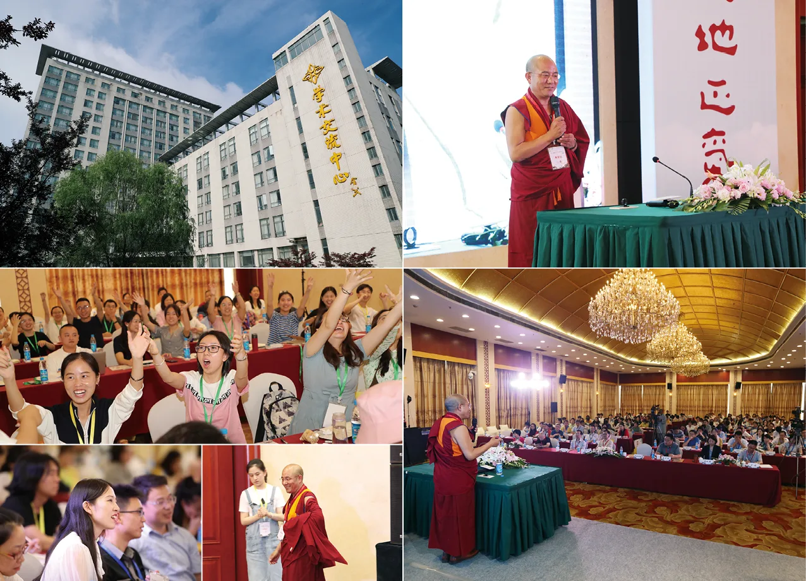
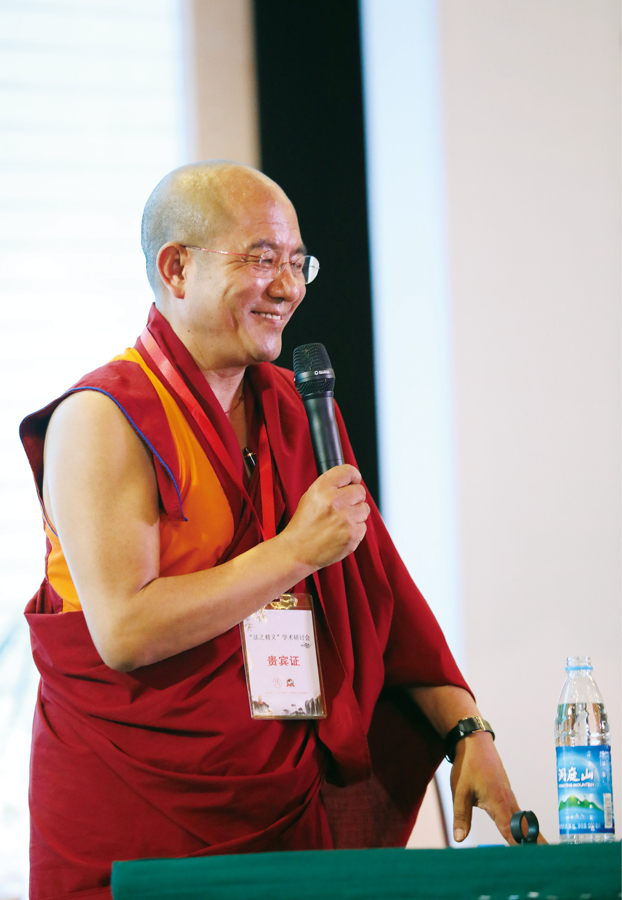

最根本的法律，

就是人心的自律。

第173场

苏州大学

Soochow University

中国·苏州

2019 / 7 / 8

## 法是约束还是自由

## Regulation: Fetters or Freedom

主持人：

请全体起立，有请我们本次研讨会的主讲嘉宾入场。大家请坐。

接下来的主题演讲与佛学有关，为我们带来演讲的索达吉堪布，本次是第三次来到我们苏州大学。堪布的第一次演讲是在哲学院，第二次是在第二期明慧论坛，两次演讲都非常精彩。我还记得，上次在明慧论坛第二期时，他的演讲主题是“戒律与法律之异同”，这个主题跟今天的研讨主题也有一定的关联。

今天堪布的演讲题目是“法是约束还是自由”，这是很多人心中的一个疑问，“法”不单单指制定法、成文法的法，也可以指佛学里讲到的法。有很多朋友会认为法是一种约束，或意味着一种不自由。

那么，法到底是约束还是自由？对于这个问题，我们应该如何抉择？如何理解？如何应对？有请堪布为我们做精彩的演讲，掌声欢迎索达吉堪布——

很高兴今天跟各位专家、老师还有同学们，有这样一个交流机会。我曾来过这所学校两次，在我的印象里，法学院的老师和学生都非常严肃。我没有跟其他学校比较，这只是我的个人印象；而且我认为，表情严肃体现了学法律的人，无论做事还是说话，在任何时候，都有一种自我约束，有一种谨慎的态度，这是很好的。像我们佛教当中，学戒律的人也是这样。我去过很多寺院，也去过一些律宗道场，律宗道场有点像法学院，是专门学戒律的，那里的人也有同样的严肃感，这给我留下了特别深刻的印象。

## 约束是通向自由的方便

约束，其实是通向永远自由的一种方便。如果为所欲为、无所不作，没有任何约束的话，很有可能会让自己的晚年生活陷于牢狱之中，而失去自由。学法律的人都应该特别清楚，越高尚的人，约束越多，而这种约束，有些来自于自我约束，有些来自于国家制定的法律，有些来自于自己的信仰，或者说来自宗教。

对于这种约束，在不了解的时候，可能会觉得它是一种痛苦，是对自己的一种控制，让人生失去了一些自由——好像做什么事情都不行。就像很多人在年轻时，要接受父母和学校的教育，不可能有绝对的自由，一直处在父母和学校老师的控制下，但等长大之后，他会知道，如果当年没有这样的约束和控制，可能永远也没办法学到这么多世间知识。

同样，在某种意义上，我认为法律非常重要，虽然从表面看来，它是一种约束，但实际上，它是让我们通往自由的一种方法。今天上午，我们的儒家专家也做了非常好的分析。在座有很多老师、很多律师，听说还有很多法官。善于接纳自己领域之外的思想是非常重要的，虽然我不是学儒家的，但今天上午听课的时候，我还是学习到了一些新的知识。我也在重新调整心态，离开自己的舒适区，让自己真正进入到儒家思想的境界当中，这样我才有可能去理解、接受并得到它的文化精髓。

## 对中华文化传承的反思

在座的很多年轻人，也许听到儒家、道教、佛教的思想时，会认为这些几千年前的思想，早已陈旧、腐朽，因此会怀疑在21世纪的今天，有没有必要再秉承这些理念。实际上并非没有必要。

我们经常说人类有五千年的文明，或者八千年的文明，但真正去观察的时候，会发现很多文明早已遗失了。大家可以思考一下，真正的文明是什么？除了儒释道三教的思想以外，有没有其他文化一直传承至今？也许我们可以给别人讲，我们有几千年的历史，这些历史在书本上也有一定的体现，但古代的智慧以及思想精髓，到今天还保留下来多少？

确实像老师今天上午所讲的一样，现在大多数的思想是效仿西方的，但我们也可以看到，实际上有些西方思想，追求的是一种物质主义——将所有精力都放在追求金钱上，以追求精神以外的财富为价值导向，被一种自我膨胀的观念所支配。在这样一种教育背景，或者说文化理念之下，人能不能得到真实的快乐呢？很难说。所以，年轻人很有必要去思考，我们特有的文化到底是什么样的？

我们经常说，很多西方国家大概有三百年或六百年左右的历史，而我们有五千年、六千年或八千年的文明。儒释道三家应该是在公元前五百年左右出现的，儒家的孔子、道家的老子、佛教的释迦牟尼佛都生活在那个时代，不过相差了大约四五十年或二十年左右，在历史上对此有不同的说法。再向前追溯，我们的历史还有两千五百多年，无论是三皇五帝的时代，还是随后的夏、商、周、秦、汉、三国、两晋、南北朝等朝代，所有朝代之中的文化，如今在我们的价值观中还留存了多少？大家可以进行思考。除了藏经阁的典籍之外，在每个人的思想当中，在人们穿着的服饰上，有没有古代思想文化的痕迹？

对于儒家的仁义礼智信，道家的自然法则，佛教的善有善报、恶有恶报等理念，我们并不是特别重视。尤其是在上个世纪，人们基本上把这些观念看作是腐朽、陈旧的思想，并进行批判，从那之后，传统文化便奄奄一息了，因此，现在想延续这个文化非常困难。而其他一些国家，比如韩国、日本、新加坡等，一直在延用我们的传统文化，而且用得非常成功。

借今天这个机会，运用各个宗教或者说各种思想，从不同维度来分析法律，是很有必要的。从某种意义上看，现在很多所谓的“法”，可以跟一些西方思想完全接轨。但在我们自己的传统文化，也就是非常优秀的古代文明中的智慧，却并没有被挖掘出来。如果我们能够去挖掘，就会发现其中有着特别甚深、兼具实用性的规则，能够与当地人们的风俗习惯、礼仪行为，乃至思想心态相应。但这样的规则，如今在这个世界上，可以说快要荡然无存了。所以，如果想要复兴传统文化，应该通过多种方式，进行探讨、学习和研究，这样一来，许多有智慧的人，应该就能够渐渐了达其义。

佛教中有一部经叫做《十善业道经》，前几年我传讲过一遍。《十善业道经》的前面有一篇“上谕”，用现代语言来说，可以叫做序，是雍正皇帝写的。其内容大概是说：儒释道三家都有让人们获得觉悟的知识，它们的理论源头一致，并行不悖，毫不相违。不过在现实中，佛教认为佛教很殊胜，道教认为道教很殊胜，儒家认为儒家特别好，因此没有完全相融，而实际上，三教对人们心态及行为的向善，有着非常大的作用。

在清朝，顺治、康熙、雍正、乾隆等帝王，对儒释道文化非常重视，因此当时的清朝也非常兴盛。唐朝也是一样，唐高宗、唐玄宗等唐代前几位皇帝，对宗教也非常重视。正因为如此，从总体而言，唐朝和清朝的国政，在历史上还是非常兴盛的。时移世易，传统的文明与智慧，渐渐受到不同程度的影响，最终，古文明，或者说人类几千年延传下来的智慧传统，已变成如今的光景。对此，年轻人应该去思考。

## 佛教对法与律的认识

我今天想简单介绍一下佛教对“法”的认知。实际上，所谓的法，从广义上讲，它并不仅仅指法律，也可以指一种法则。关于法则，我赞同上午儒家老师所说的——法则大多来自于西方。而在汉地的历史中，在六国之前就有了关于法的记载，后来法演变成律，最后又变为法。现在所谓的法官、法律、法治等，其中的“法”，实际上就有律的意思。律在藏语中叫“称”（音译）。因此，无论是叫宪法还是国法，都有律的内涵，即律仪之义。

律，在印度梵语中叫尸罗，尸罗指的就是戒律。虽然它的表面意义是戒律，但真正的内涵是清凉。如果一个人不受持戒律，便很难远离酷热和痛苦；而如果有了戒律的约束，就会得到清凉、快乐和解脱，有这样一层意思。所以从广义上讲，在佛学中，所谓的法，有律或者戒的意思。上午儒家老师所讲的观点，我的个人理解是，若从儒家思想出发，法主要是从礼的层面来解释的。

法与律在佛教的意义当中，我个人认为应该以律作为根本，出家人有出家人的戒律，在家人有在家人的戒律。世间本身也存在着一种规律，而佛教中最主要的法，实际上就是因果规律。梁启超大家都知道，他是一位非常著名的教育学家，对于因果，他是怎么讲的呢？他说：“佛教之因果，使上智下愚皆不能不信也。”意思是说，对于佛教宣讲的因果法则，无论是智者还是愚者，都应该去信仰。这种信仰并不是说一定要信仰儒家、佛教等，而是要信仰客观存在的规律，如果不相信这种规律，可能会受到宇宙的惩罚。

佛教中有一部经叫做《璎珞经》，其中讲到了“善有善报，恶有恶报”。有些人认为，因果规律是佛经中讲的，所以在佛教中才有善有善报的规律。其实不然，如果“善有善报，恶有恶报”只是佛教中才有的规律，那么只有佛教徒需要遵守，其他没有任何信仰的人，或者信仰其他宗教的人，就不用遵守，也不会遭受报应。而事实并非如此，佛陀只是一位真理的发现者，并不是创造者。

当然，佛教的戒律，有些是佛陀发现的，也有些像现在的法律一样，是制定出来的。国家的法律，有些是统治者或者国王为了实现自己的统治制定的，也有些是为了整个国家和民族的利益制定的。这个过程，首先需要立法，之后再执行，最后进行抉择。

在佛教当中，有一部分律仪是佛制的。对于佛制律仪，有些人会有疑问：“若在佛陀未制定某个律仪之前，一个人未遵守律仪是不是就不构成罪业，只有律仪制定后才构成罪业。那么佛陀是不是成了制造罪业者呢？”实际上不是这样。比如，在佛教里有一条戒律叫做过午不食，佛陀说最好遵守过午不食，那么午后进食有什么过失呢？一方面，这样做违背了饮食规律，不利于身体健康；另一方面，如果已经发愿受持过午不食戒，却没有执行的话，就违背了自己的誓言。诸如此类，佛教是这样讲善恶因果的。

法律与佛教中所界定的善恶因果，有很大的差别。差别在哪里呢？在法律中，即使一个人犯了罪，但只要没被发现，就不可能对他进行逮捕，也不可能判刑。但是不是这个人就没有罪呢？并不是，他还是有罪的，只是没有受到法律的惩罚。而在佛教讲的因果中，如果一个人已经造罪，即使别人没有发现，这些罪恶的种子，也已在心相续中种下来了。虽然暂时没有被发现和逮捕，恶果在即生中没有成熟，但他的后世仍将一直处于轮回之中，其果报终有一日会成熟。因此，从佛教的因果观念来讲，因果在时间上会延续至后世——过去造什么样的因，今生得什么样的果，来世又会有什么果。

而从法律的角度来看，如果恶行被发现了，即生中有可能会被判决；如果没有被发现，很多国家又不承认来世，那么法律对来世就没有效力了。所以从时间上看，法律与佛教所宣说的因果规律有一定差别。而从本质上来看，二者之间也有不同。法律所判定的罪行是什么呢？主要是人的语言与身体所犯下的罪行。对于犯罪动机有没有分析呢？我看很多律师也有分析，但是这种分析仅仅是从某一角度出发的一种推理，而佛教的分析是从身口意三个方面进行的——即使身体行为上做了一些坏事，但如果心完全清净的话，表面看似造罪的行为，不但不成罪业，反而是善业。佛教里有一个公案说明了这一点：一个人为了救五百个商人，杀害了一个坏人，结果他并没有造罪，反而为修行积累了非常多的资粮。而在现在的法律中，这种情况是没办法处理的。

在某种意义上，佛教所宣说的因果规律，实际上是一种自然规则，为什么这么讲呢？佛教在两千五百多年前就宣讲了十善五戒。十善相当于法，五戒相当于律。行持十善就要遣除它的违品，远离十种恶法，即身体上的杀、盗、淫，语言上的绮语、妄语、恶语、离间语，心中的贪婪、嗔恚以及愚痴的邪见。表面看来，它是佛教的一种戒条，但实际上，它是一种普世的规则。我们也可以看到，在世间的任何一个国家、任何一个民族当中，这十种不善法，基本都构成罪恶，后又通过不断演变，渐渐成为非法。所以，佛教十善法的违品，即使放在21世纪的法律体系中，也可以断定它对人类的日常生活，会带来一些负面影响。反过来说，如果人们可以很好地行持十种善法，即佛教所谓的“十善”，就叫做如法。

在如法的基础上，佛教还制定了“律”，律是什么呢？就是佛教中讲的五戒。一听到五戒，可能很多人会觉得守戒很困难，因为不愿意有任何约束和控制，一定要自在洒脱。但实际上我们也知道，五戒可以说是人类基本的道德底线，承诺守持五戒的人，无论在哪一个国家当中，有权合理合法地生存。

五戒当中的第一个戒条是不杀。不侵害他人的生命具有非常崇高的意义，而具此意义的生命本身也是有价值的。任何国家对这条戒的价值，应该是一致公认的，大家可以对此进行思考。

第二个戒条是不盗。“盗”的内涵包括了偷盗、抢劫、贪污受贿等。在我去过的一些监狱里，大多数的犯人是杀人犯、强奸犯，或者犯过偷盗、贪污受贿等等。不盗，即不侵犯别人的财物。

第三条戒是淫戒。即不邪淫，不强暴他人，不破坏别人的家庭，不离散他人家室，不破坏伦理道德。若不违背这种道德，在如今这个时代中，也算得上是一种文明。

第四条是不妄语。大家也知道，现在各种各样的犯罪案件，很多都源于诈骗与欺诈，目的是为了获取他人的财物，而欺骗的根源就是妄语。

第五条戒是不饮酒。在佛教中，饮酒并不是根本罪，但饮酒可能会令人丧失智慧与正知正念，比如醉酒后可能会偷盗，甚至是杀人，出现很多不正常的行为，正知正念会受到一定损害。

这五条戒从表面看来是一种戒律，但实际上，它是规范行为的一种方法，在这个世间，它应该是非常有用的。因为人类的基本准则，不仅适用于两千五百多年前，在如今这个时代当中，也具有重要意义。

有些人可能会思索，善恶因果的规律到底是怎样的？关于这一点，佛教里讲：“欲知前世因，今生受者是，欲知来世果，今生作者是。”前世与今世有关系的原因——从当下的行为，能推出前世是造善还是作恶。比如有些人今生即使有智慧、有能力，但智慧往往用不上，这也许就与自己前世的心行有关。另外，今生所做的事情，与来世也有一定的关系，今生所种的种子，即所造的因，无论经过多少劫，也不会被损坏。佛经里还有一句话：“众生之诸业，百劫不毁坏，因缘聚合时，其果定成熟。”我们所造之业，无论是善也好、恶也好，永远不会耗尽，因缘成熟的时候，果报自会现前。

## 法律的正面作用与不足之处

而法律并不是这样。造恶若被发现，则会受到判决；如果没有被发现，即生中不一定会受到惩罚。所以，有些人会认为，在某种意义上，法律很难有真实的公正性。大家是学法律的，对自己的专业充满信心，这当然是非常好的，但我们对任何专业、任何知识，从正反两个角度来分析也是有必要的。一般而言，法律是非常公正的，就像佛教中也讲“依法不依人”，就是说，要依靠法而不能依靠人。如果仅仅依靠人，到了一定程度，公正便无法实现。

在很多人眼中，在这个世界上，法律是最公正的，因为法律面前人人平等。但实际上，法律有时却是不平等的，比如说我请了一位律师，他非常有才华、有智慧，可以把黑的辩成白的，白的辩成黑的。律师最主要的法相是什么呢？就是一定要擅长辩论。在这种情况下，也许最后判决的结果会是什么呢？本来没有杀人，判成了杀人。所以，虽然这位律师的确很厉害，但实际上法律是不是平等的呢？不一定。很多西方电影也呈现过这类内容，比如其中有一部叫做《皇家律师》（Silk），通过其中各个角色的演绎，我们可以领悟到，在这个世界上，也许有些事情是完美的，但并不是事事皆完美。

可能有一些人，会认为某个国家的法律，是百分之百的好，但其实并非如此，比如有些行为，按照某个朝代、某个国家的法律，是合法的，但用现在的法律去审视，可能就不合法了。因此，现在认为是合法的事情，到了一定时候，可能也变成不合法的了。就目前来说，有些事情可能在某个国家合法，在另一个国家却不合法，比如说同性恋，有些国家已经立法，正式承认同性恋合法，但在一些国家，同性恋甚至会被判死刑。每个国家对死刑的审判标准也是不同的，在个别国家，很小的一件事就可以判死刑，但在另一些国家根本没有死刑。

我去过一些非洲国家和欧美国家，到了这些国家之后，确实感觉到，世间所谓的法，实际上是统治者、国王、领导集团等，为了实践自己的观点，或者为了维护整个国家的利益而立。所立之法有一定的范围，完成立法之后，再进一步去执行。那么民众能得到的是什么呢？从法律可以维护世间秩序的角度来说，民众确实有所获得，因为如果没有法律，一切将变得混乱不堪。佛教里经常把法或戒律，比喻成轨道，因为步入了轨道，生活就有了规范；有时也以灯来比喻，因为法与律像明灯，可以照亮前程；有时又以大地作比喻，因为依靠大地可以长养万物，成就一切功德。

我在想，在这个世界上，我们可以说有公平、正直、自由、客观；学法律的人也会口口声声说，要讲正义、公平、真实等等；在某个范围之内，某个群体之中，也可以说得上客观、公正、和平等等。但在国家与国家之间，有时却很难实现绝对的公平，所以就需要大家共同制定规则。比如，在国际上有商务贸易，需要由商会来制定各个国家需要遵循的规则。由于每个国家的法律不尽相同，也不可能要求国家立即制定出一个新的法律，所以商会就召集大家共同商量，同时为了达到各自的目的，制定出一个规则，最后各国按照这个规则来执行，因此暂时来讲，各项事务可以处理得比较合理。

我曾经参加过很多民间调解，而调解纠纷时用到的规则被称为习惯法。其实习惯法并不是真正的法律，比如宗教中就有习惯法，在前几年，很多教授对此也有很多辩论。虽然我们承认这种法并不是真正的法律，但不可否认它能起到一定作用。在很多地方，如果遇到一些法院也没办法解决的事情，就可以向当地有威望的宗教人士寻求帮助，或者采用一些民间的规矩来裁决，最终也可以令事件得到解决。

我去过很多民间组织，也了解过一些案件，比如说有的杀人案，凶手和受害者的家人都不愿意由法院审判的话，就可以找双方都承认的一个可靠的裁决者来评判，最终事件也可以得到解决。

因此，法律最主要的目的是什么呢？就是遣除争执与不合理的地方，令存在纠纷的双方和解。但在法律无法起到作用的时候，一些民间的规则、宗教的方式、习惯上的方法，并不是不可用，而恰恰应该要用。当然，如果民众像很多西方人一样，都只听从法律，不接受任何传统与规矩，也可以不使用习惯法，但这也需要观察当地民众，是不是真正达到了高度法制化的程度。如今在我们这个世界上，有多少真正的法治国家，这一点大家也应该清楚。所以，对于运用习惯法，或者宗教方面的法来调解纠纷，有必要合理地去进行。

通过对法官、律师等从业者的观察以及对立法本身的一些了解，我所理解到的是，法律体系的建立，综合了多方利益，协调了各个程序，所以应该是比较完善的，但可能仍无法完全解决人与人之间的矛盾，或许这也可以说是现有法律的一种缺陷。当然我们并不认为，所有宗教、所有法律，都能完美解决一切问题。至于我刚才所讲的佛教因果观念，是否能够实现这一点，值得大家去思考。事实上，我们每个人都应该遵守这样的因果规则，因为这种规则，并不是只有佛教徒才适用，其实无论是谁，如果做了恶事，最终都会感受果报。

在西方，“法”这个词的来源是什么呢？法，实际上指的就是上帝之眼，大家也应该清楚，对于法的制定，其真正源头是基督教的思想。基督教徒认为，上帝虽然是看不见、摸不着的，但他在天堂注视着我们每一个人。如果我们犯了法，上帝自然会有惩罚，所以法的最终审判者，即终极法官，就是上帝，有这样的说法。对此，一方面可以相信，一方面也不能相信。如果对这些观点全部相信，也许不太合理；如果全都不相信，也不合理。

现在很多年轻人比较极端，只相信现实，不相信其他任何可能性，比如不相信抽象、隐蔽的一些东西，这样一来，会造成认知领域的一种缺失。因此需要结合传统文化思想，去建立一种新的认知——不仅遵循推理，同时存敬畏心，但这种敬畏心并不是因为害怕法律而生起的。如果所有人都能心存敬畏而行，到了一定时候，自然而然，需要用法律裁决的事情就少了。在我去过的监狱中，里面的人好像一年比一年多，很多国家也建造了越来越多的监狱，原因是什么呢？也许是因为现在犯罪的人越来越多，犯罪方法也是各种各样，而犯罪的根源则是自我约束的缺失。当道德滑坡到一定程度，或者说教育与引导日渐式微的时候，法律再怎么好，也很难解决一些社会问题。

而最根本的法律，就是人心的自律。佛教中有一种说法：自己是自己的老师，自己是自己的见证者。其实，每个人通过自律的方式来守护自己，这可以说是法治的最高境界，而且人人都可以达到。无论你去哪里，在东西方的哪一个国家，一旦有了自律，就有了最重要的解脱，这种解脱是没有任何束缚的。如果依靠别人来管理我们，形成一种束缚的话，也许这样的方式，反而会给我们带来不同程度的痛苦。

## 结语

总结一下，我今天讲的是什么呢？就是我们要重视传统文化与现代文化的结合。对于现代文化中非常严肃的部分，与法律系的智者们共同探讨，是非常有意义的。对于年轻人来说，当然首先要学好自己的专业知识，另外，希望大家既要学习西方的科技知识，也要学习东方的古老文化。从古代传承下来的文明，有许多非常有价值的道德内涵，但如今已逐渐丧失了。也许，在古文化当中，我们能够获得更有意义的一些知识，其中也包含了与法律相关的内容。

在未来的时代中，既要重视西方的现代文化，也要重视东方的古代文化，这样一来，我们的前途会更加光明，智慧也更加增盛。否则，如果在经济不断兴盛的同时，人类的心灵却越来越倒退，那么，人类到底是在进步还是倒退也很难说。

对话

## 法是约束还是自由

主持人：

谢谢堪布的演讲！堪布在五十分钟的演讲时间里，把法的精义归结到了“律”。之后又提出，真正的、最根本的法律就是实现自律，而且从这个角度而言，实现了自律其实就是实现了自由。接下来的环节，我们请堪布提一个问题。

索达吉堪布：

我想提的问题是，我刚才讲了佛教的《璎珞经》中说“善有善报，恶有恶报”，之后好像在元朝的时候，学者在后面加了一句“不是不报，时候未到”，有这样的说法。所以，对于“善有善报，恶有恶报”的道理，你信还是不信？信是为什么，不信又是为什么？我问的就是这个问题。

主持人：

我们是一个开放、包容、自由又求真务实的平台，同时也有利他心，大家可以秉持自己最真实的想法，做一个回答。

索达吉堪布：

我看有几个人举手，还是比较多，我看得不是很清楚。请最后面穿黑色衣服的同学回答——

同学一：

今天非常荣幸能这么近距离地与您面对面，我的家人都信佛，对堪布也非常敬仰。因为我的家人都学习佛法，也修行佛法，我耳濡目染也了解到了一些因果的问题。首先，我相信因果，因果中有来世报，也有现世报，您讲的“不是不报，时候未到”，应该更多地指的是现世报。对于现世报我是相信的，而且我觉得不是说犯了某个罪没被发现，逃之夭夭成了漏网之鱼，就是没有受报。实际上作为犯罪人员，他会受到自己内心的折磨，虽然他没有受到法律的制裁，但是他自己所积累的因，会导致人生轨迹的改变，在未来的某个时间，可能会在他的人生中产生一个结果，而这个果就是之前的因所造成的。

对于来世报，我也是相信的，因为要把因果放在更长的时间之中。从唯物主义现代科学的角度来看，大家可能不相信有来世，而如果把人类放在整个宇宙与时间长河中来观察，人类真的是微不足道的。对于自己现在所做的一些事情，心中的一些烦恼，或者在生活中遇到的一些困难，你可能很难发现其中的因果关系，但其实它们可能都是由你前世所造成的。而我们现在所做的一些修行，或者做的一些恶事，可能都会对来世造成一定的影响。

假如不信有业因果、前后世，我就会觉得前世对我来说，也没什么影响，来世对我而言，也无所谓，那我就可以为所欲为。但实际上应该反过来想，如果我作为因果链中的一环去相信因果，前世修福报得到了今世果，而今生也要为了来世去做善事，更为他人去做善事，这样就是一个正向循环，是真正的福报。所以，应该有这样的正念去修炼自己，要做这样的修行。这是我的观点，谢谢。

主持人：

还有没有其他同学有不同观点？

索达吉堪布：

这个问题确实有点难。

同学二：

堪布您好，很高兴见到您。对于您刚才提的问题，我想从量子力学的角度，来讲一下我个人的理解。因为所有物质都是互相联系的，所以我的回答是：我相信因果，我们的所有行为，都与其他事物相联。比如说我花了五十块钱买了一条鱼去放生，那这五十块钱已经转换成了鱼的价值。如果用生活中的事来打个比方，就好比我作为一个家长，给孩子请了一位钢琴老师，如果我花了五百块钱去请老师，相当于这五百块钱就已经转换成了小孩子学习钢琴的价值。虽然钱表面上看来还是钱，但实际上，也可以说它转变成了一种“能量”。所以我个人认为，这也许可以看作是因果之间的一种能量，虽然我们有时候看不见因果，会觉得行善没有善报，作恶没有恶报，但其实这是一种无形的能量。我是这样理解的，感恩大家。

索达吉堪布：

好的。刚才这边有一个同学举手，那边有一个同学举手，现在轮到这边了，请中间那个男孩子回答，这样的话就形成了一个三角形，我是这样选的。

同学三：

谢谢您，堪布！也谢谢您今天的讲授。针对您的问题，我自己思考之后，我的回答是：我是相信因果的。我的解释可能跟刚才那两位同学的有些不一样，其中第一位同学，是在一个较长的时间跨度上去进行解释的，把来生、今世的观点都讲到了，而我准备将今生作为重点来讲。

我个人的思考是，如果我们的内心存有一个善念，可能去做事情的发心就不一样，而在做事情的时候，态度也会不一样，这样会慢慢影响到自己的内心，心灵会得到滋养，长此以往，人的品性也会有所改变。虽然今天在我三十岁的时候，这样的影响还不显著，但有可能再过三十年，等我六十岁的时候，性格的变化就比较明显了。也就是说，通过善念慢慢地内化，久而久之，外在的为人处事也会有变化，这时再去做一些事情时，无须刻意行善，别人也感受不到这种刻意，但实际上你已经在行善了，这样的人会得到他人的尊重与认可，也相当于是得到了社会的一种回馈，这是我对善的一个理解。

之后再讲讲我对善的反面，也就是恶的理解。如果不相信善有善报、恶有恶报，自己的内心是没有约束的，不遵守规则的，甚至会去做一些恶事，而且会心存侥幸地以为这个恶事不会被别人发现，那么就有可能从一个小恶，最终积成大恶。慢慢地，你的行为动机，你的内心深处，都会受到没有因果报应这个观念的影响。如果在之后的三十年里一直受此影响，那么可能在三十年后，你的面相也会有一些变化，这是有科学根据的。如果你每天笑口常开，等到了老年的时候，别人会感觉你就是一尊弥勒佛；而如果你在年轻的时候，没有善恶的观念，一直行恶事，那么你到老年的时候，可能真是会面目狰狞。

谢谢您堪布！

索达吉堪布：

我对三位同学的回答做一个简单的点评，从总体上看，我觉得这三位同学的回答都是非常不错的。当我们真正感受到，物质没办法满足人类的所有需求，或者说不能解决人的一切痛苦时，便会寻求其他解决方法，等到了这个时候，也许我刚才提出的问题，就更加具有意义了。现在的你们还年轻，大概是二三十岁的样子，等到了六七十岁的时候，也许会想起来，原来堪布当时就讲过“善有善报，恶有恶报”，可能到时会有这样的情况。所以有些时候，精神层面能解决的问题，是其他层面没办法解决的。想要解决问题，确实需要这样甚深的道理。

我今天很开心，因为每个同学在思考我提出的问题时，都非常专注，而且回答得也很不错。刚才最后一个回答问题的29号同学，对于他的分析，我给的分数应该多一点，原因是什么呢？左边的这位同学，虽然她以放生为比喻，结合量子力学进行了回答，但并没有回答出我今天所分析的全部内容。至于第一位回答的同学，他对因果的整个框架比较熟悉，但与我今天讲的主题联系得不够紧密。而最后作答的同学，他从唯心、唯物的角度出发，涉及到了现世因果与来世因果，将佛教的教义与现代法治的观点结合起来进行了回答。回答一个问题时，成立结论的理由是很重要的，对于这一点，学法律的人应该也很清楚。佛教中有专门讲逻辑的因明学，其中涉及到的逻辑推理是非常重要的。如果逻辑推理不过关，仅仅依靠某种传统或说法，在当今这个社会很难立足。

总的来说，我非常赞叹这三位同学。而且像刚才黄教授所说的一样，对于这种交流方式，我也是第一次采用，觉得很有意思。因为以前每次都是同学问我问题，在我答问的时候，有的同学就不是特别专注。而今天换作我来问问题，同学们就都很关注，所以我觉得这种方式很有意思。另外，回答问题的最佳奖，我给最后的29号同学，谢谢！
