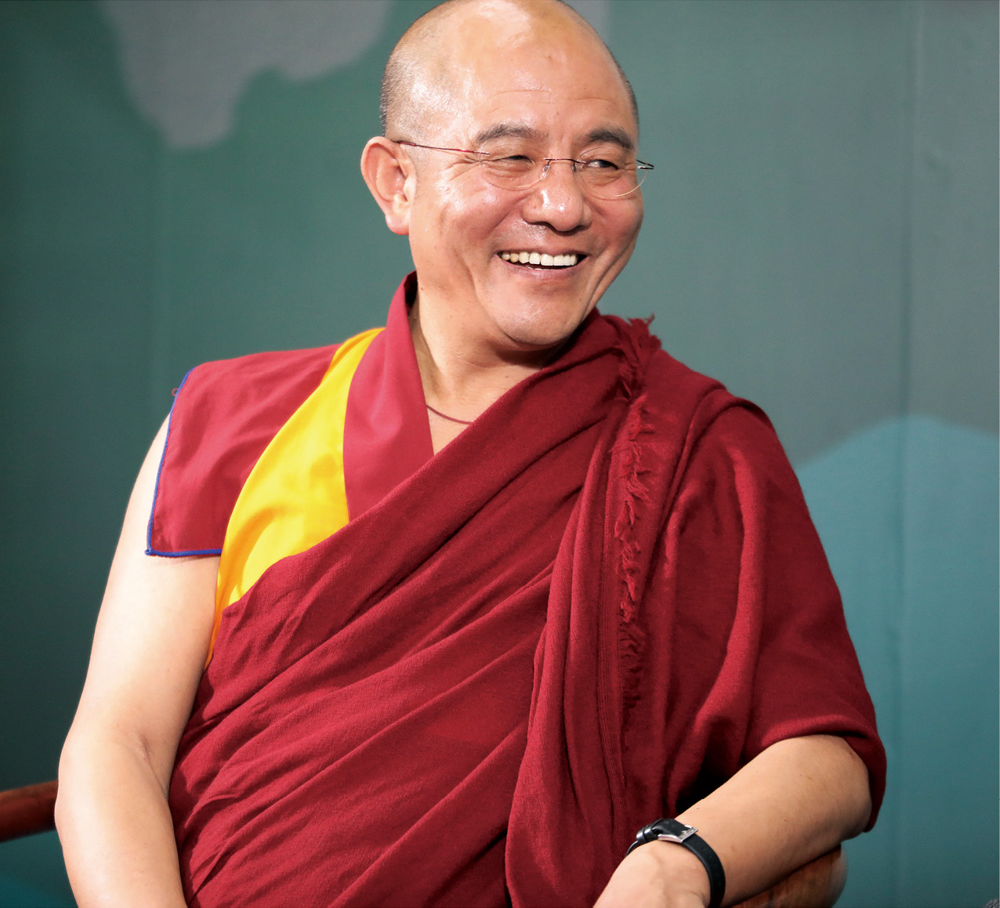
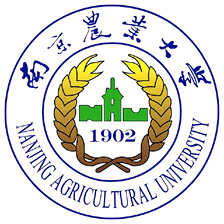
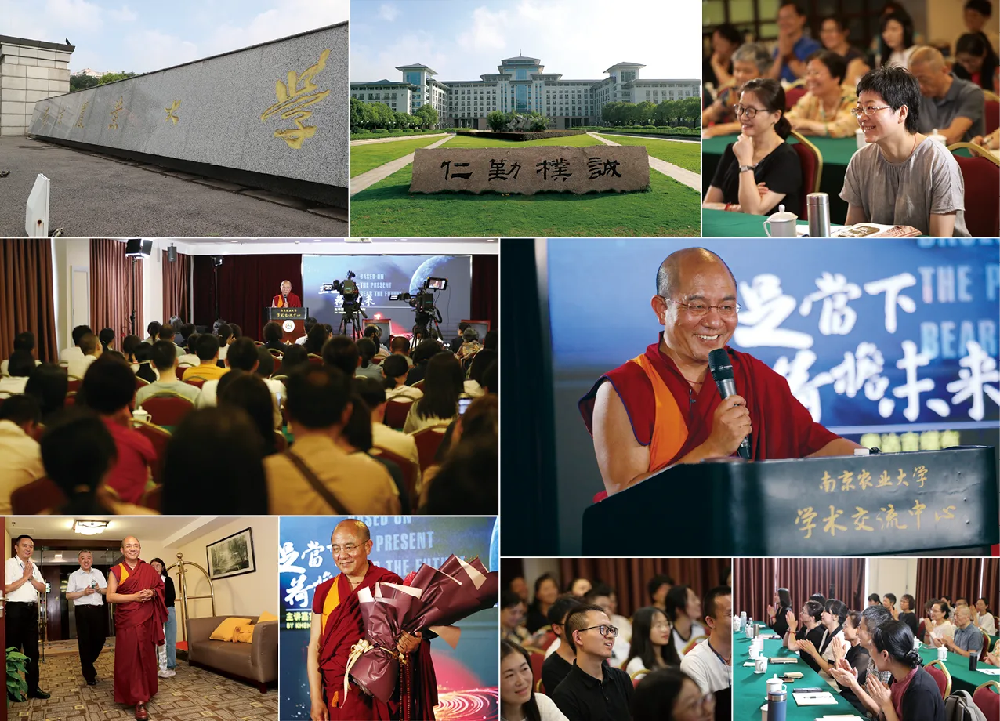
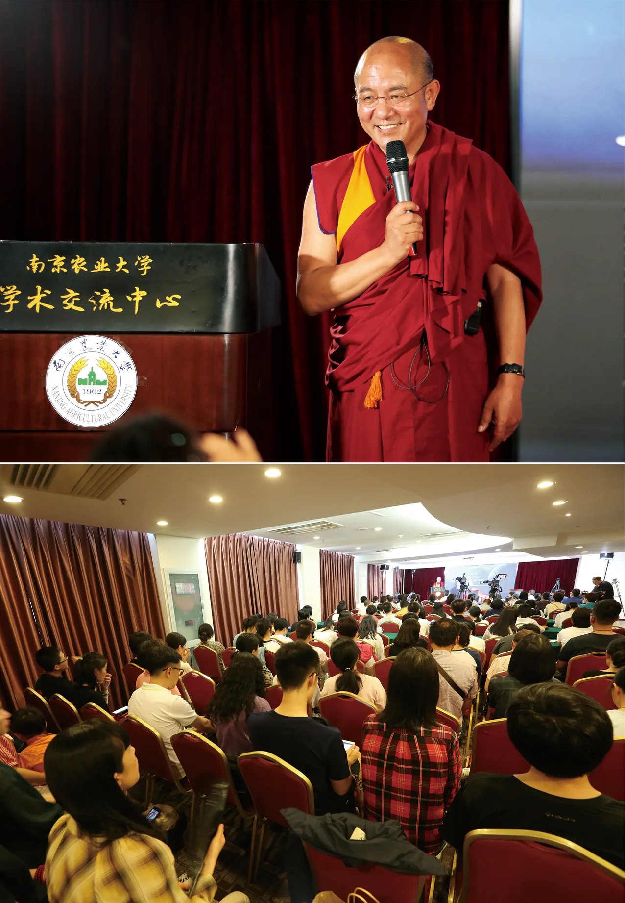
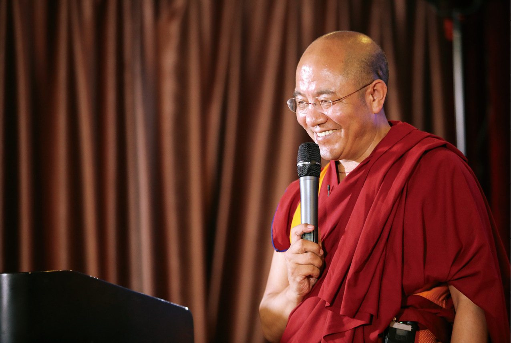
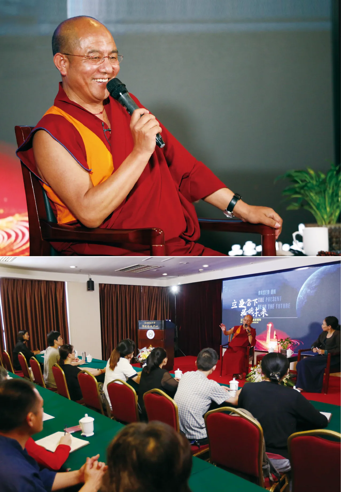
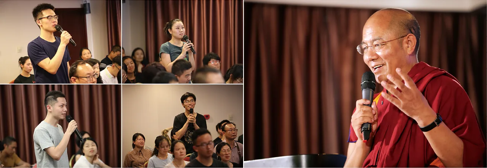
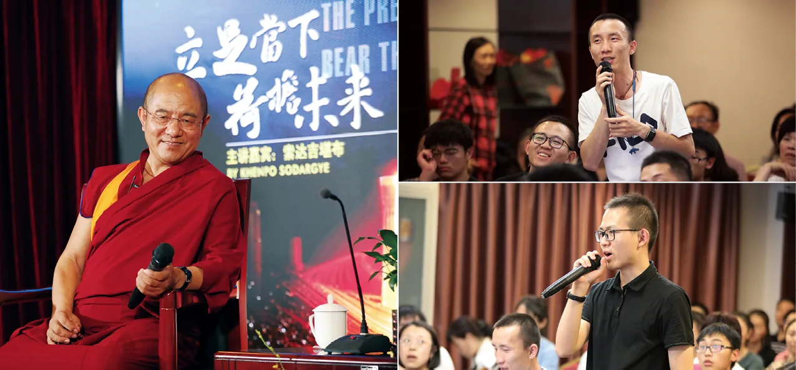

以自我为中心的自私自利，

引发了危害社会的各种问题。

第172场

南京农业大学

Nanjing Agricultural University

中国·南京

2019 / 7 / 5

## 立足当下 荷担未来

## The Future has Taken Root in the Present

牛津老师：

尊敬的索达吉堪布仁波切、尊敬的各位嘉宾，此时此刻，我们即将开启快乐的暑假模式，同时也将迎来5G时代。而让在座各位最欢喜、最幸福的是，我们请到了尊贵的索达吉堪布。请允许我代表全体参会者，向堪布表示热烈的欢迎！

2015年和2016年，堪布曾两次受邀，担任南京农业大学MBA文化讲堂的客座教授，为在校的学生做了两场主题学术讲座。今天再次邀请到堪布莅临南农，我们感到非常荣幸。感恩机缘，感恩堪布！

今天文化论坛的主题是“立足当下，荷担未来”。

对于当下这个时代，有人说它是一个最好的时代，科技的进步和物质财富的极大丰富，让我们享受着前所未有的富足的物质生活；也有人说这是一个最坏的时代，生活节奏的加快，社会竞争的残酷，让我们倍感压力，遭受着前所未有的煎熬。

当下怎样？关乎未来如何？现在让我们静下心来聆听智者的开示。

下面有请索达吉堪布做主题演讲——

这里有茶，有咖啡，还有很多其他食物，我觉得很好，非常感谢主办单位给我们提供这个非常殊胜、欢喜的交流机会！

我曾来过南京农业大学两次，这次应该是第三次。对我个人来说，这里的老师、学生以及大家的求学精神等等，都给我留下了非常深刻的印象。这一次，我们交流的主题是“立足当下，荷担未来”。

## 思考人类的当下与未来

我们的确处于一个比较特殊的时代，从整个人类的历史来看，21世纪是前所未有的。有些科学家认为，现在是人类历史上“最好的时代”，因为科学的发展，从方方面面为我们的生活提供了便利；但也有科学家认为，现在这个时代是“最坏的时代”，因为非常珍贵的传统文化被践踏，人类的内心饱受前所未有的痛苦，竞争压力史无前例，导致了各种不平等、不和谐现象的出现——人与人之间、家庭与家庭之间、民族与民族之间、国家与国家之间，以及全球整体的情况，都非常糟糕、混乱。这可能就是现在这个时代的特点。

今天在座的各位可能也思考过，我们当下是什么样的状况？未来人类将走上怎样的道路？我想，这要依靠许许多多老师与学者们的奋斗。有一种说法叫做“少年是国家的未来”“少年强，则国强”，然而，如果少年没有正确的价值观，那么国强的愿景也将难以实现。所以，我觉得老师可以说是一个国家、一个民族的未来，如果老师强，这个国家也会强，因为所有儿童、少年、青年的未来，包括他们人生目标的建立，都直接受老师影响。

今天参加这个论坛的人，90%以上都是教授或者老师。老师的责任重大，可以说是任重而道远，因为每个老师都有将近一百个学生在自己面前求学，在这个过程中，老师的人格、智慧、言行举止，直接影响着学生的未来，而学生的未来也是人类的未来。所以，如果老师心行不正，教育就会出现问题。如果教书育人没有正确的方向，我想无论是一个国家还是整个人类社会，未来都不会很光明。

## 育人的重要性

教书确实很重要，但我觉得育人更重要。现在在很多学校当中，教知识的老师普遍比较多，但真正能让学生关注自己的今生来世，或者说关注自己现在与未来的老师却并不多，把学生当作自己儿女一样来对待的老师则更少——当然也不能说完全没有。有些老师确实把自己一生的所有精力全部奉献给了学生，培养出了许许多多非常优秀的人才，对整个人类社会做出了巨大贡献，这是毫无疑问的，也是有目共睹的。但也有相当多的老师，可以说是得过且过，在浑浑噩噩中度日——如果这样下去，这些老师有可能会变成一个历史的罪人。

我经常在想，世间其他职业的从业人员，如果工作态度不积极、对职业不热爱，不一定会影响人类的未来，但如果老师的工作态度及言行举止不当，确实会直接影响学生未来的命运。所以在跟一些老师进行探讨的时候，我也会跟他们说，要当老师就一定要当个非常优秀的老师，如果自己不负责任，只是为了生存而待在这个岗位上，可能会影响很多人的未来，这样并不是很好。

我个人也选择成为了一名老师，三十多年以来，可以算是没有改行，没有去从事其他的职业。虽然出家人没什么其他职业可选择，但我不教书也是可以的。然而我自己觉得，无论是在宗教领域，还是在其他知识领域，如果能用自己所懂得的道理引导他人，这是人生当中最有意义的事情，也是最纯粹、最有价值的事情。

今天在座的老师，都是非常伟大的，你们培养了许多人才，可以说“桃李满天下”，这是非常有意义的事情。但另一方面，学校教育不能只传授知识，而不注重学生的人格培养，因为学生实际上是一张白纸，他对人生、对世界还是懵懵懂懂，他来到学校的时候，是非常单纯的，所以老师的三观会直接影响学生的思想和行为。如果老师带有批判的习气，等学生离开校园的时候，一般也会带着这样的习气进入社会；如果老师对社会公益很关注，行为也非常高尚的话，学生一般也会与老师有相同的行为。

## 老师应终生学习不辍

实际上老师并不是全知，在某种意义上，老师只是完成了某种阶段的教育，或者说习得了某种知识而已，从这个层面来讲，老师不应该有一种满足之心，而要有永无止境的求学之心。其实老师的智慧也是有限的，需要不断学习。我经常在想，在当今时代，老师所掌握的知识与前任老师所掌握的知识，可能完全不同，比如：在哥白尼（Nicolaus Copernicus, 1473-1543）时代，老师们所教的天文学，与后来老师们所教的内容肯定不一样；而今天在座的老师们所教的课，可能与十年、二十年之后要教的课程也完全不同。在这种情况下，老师们还是要不断地学习，终生学习，要有“活到老，学到老”的精神，这是我非常佩服的。

不知道你们是否看过一个纪录片，叫做《成为沃伦·巴菲特》（Becoming Warren Buffett）。从这部纪录片里我们可以感受到，一个成功的人之所以能成功，与他一生的阅读习惯有密切关系。你们应该听说过世界首富巴菲特（Warren Buffett, 1930-），从世间财富的角度来讲，他在世界上可以说是无与伦比的大亨。然而，让人难以想象的是他的求学精神，这一点让我很佩服。虽然世间人喜欢关注他有多少资产，他的身家是多少多少，但我对此并没有特别感叹，因为我觉得，这个世间上福报大的人还是比较多的，然而像他这样的富豪，却能具有这样的求学精神，确实很少见，这一点令我非常惊讶。

巴菲特的办公室里没有电脑、手机，摆满了各种各样的书。他有一位思想导师叫查理·芒格（Charlie Munger, 1924-），年龄比他大，巴菲特现在八十多岁，查理·芒格应该是九十多岁。他评价巴菲特说：“我这一辈子见过各种各样的人，虽然很多人既聪明又有智慧，但我最佩服的人就是巴菲特，因为他每天至少有四五个小时用于学习和阅读。他就像一本长着腿的书，又像是一座书籍的宝库。”虽然在座的老师肯定非常有智慧，但这种智慧也是有限的，所以巴菲特的这种求学精神值得我们学习——即使有一定智慧的人也还是要继续学习。

我的一位佛教老师，几年前示现圆寂而离开了人间，走的时候八十多岁。在他的一生中，经常拿着书，也经常看书，甚至我们经常看到他连吃饭的时候，也是边吃边看。当然，现在的人看手机的时候有时也是在看书。我有时候问别人“你天天看手机干嘛”，对方就说“我在看书，很重要”。也许是这样的，现在很方便，手机上也有很多资料，虽然有些内容对我们的生活和学习不是特别有用。这位老上师一生中，一直在学习，而且在接近离开这个世界时，也就是八十多岁的时候，仍在写作。他写了一本厚厚的书，大概有三十多万字，这也是他一生中写的最后一本书。

我们的前辈，尤其是年龄比较高的老师，有一些特别爱学习，求知的愿望非常强烈，而且淡泊名利。在这个时代非常需要这种精神，如果没有这样的精神，在如今这个时代想成为一个好老师，可能会很困难。为什么这么讲呢？如今这个时代日新月异，我看过一个报告，里面说，当今世界的知识与信息变化得非常快，完成等量变化所需要的时间，19世纪的时候需要50年，20世纪时需要10年，而到了21世纪这个科技发达的时代只需要3年左右，随着科技不断地发展，这个时间可能会继续缩短。

5G时代的来临，加速了信息与知识的更新，人类过去所掌握的很多知识已经不能称其为是一种知识了，甚至现在老师所懂得的一些知识，在新的知识体系当中，已经被推翻了。我们也可以看到，一些教科书已被多次修订，很多有经验的老师对此应该都有印象。教科书的修订，有些是源于整个时代的变化，有些是源于人们思想的变化，有些则是因为知识本身不再适用，不得不改变……由于诸如此类的原因，改变在不断发生。因此，我想在座的各位，应该要有一种与时俱进的精神，进行与时代相应的学习，以便能更加适应这个时代，更加适应自己所生存的环境，紧跟这个时代飞速发展的脚步。

## 对当前时代的反思

同时，我们也应该对这个时代进行反思：现在人们忙忙碌碌追求的是什么呢？追求的主要是物质生活，而不是特别重视自己的内心世界——我们正处于这样一个时代当中。老师们不能只关注这个世界上的新兴产品、新兴知识，更需要关注与内心有关的精神世界，因为现在人的精神世界越来越空虚，内心的烦恼也越来越炽盛，物质文明与精神文明无法平衡，是这样一个比较特殊的时代。

下午上课是有点儿困，你们也喝一点咖啡，如果你们当中有一个人打瞌睡，我都讲不下去，我的毛病就是这样，有一个人打瞌睡，我的心就无法专注于我所讲的内容，我会一直关注这个人能不能醒过来——虽然一个人听不听也不会有什么影响，但这可能就是我的毛病。现在大家全部都醒过来了，可能刚刚吃完中午饭，稍微有点儿撑。原来我们去国外听一些讲座的时候，有些外国人说：“我怎么这么倒霉，怎么下午第一节就是我的课，不应该是我的课。”有些人会这样讲，我今天正好也想起了这句话。

刚才我们说这个时代确实比较特殊，特殊的原因是什么呢？就是现在这个时代变化得特别快。那么，将来的时代会变成什么样呢？很难说，也许将来的人们可以享受一种虚幻的生活，会有这种可能性。现在我们经常使用电脑手机等电子产品，也可以说，基本过上了虚幻的生活。你们可能也清楚，我们身边的很多孩子，只有使用电子产品的时候，才能正常地坐下来；如果没有电子产品在身边，好像就无法活下去一样。未来这种情况有可能会出现在成年人身上，这是人类面临的一个比较大的问题。

随着人工智能的不断发展，各种各样的技术让我们应接不暇，各种吸引眼球的新鲜事物也将纷至沓来。本来我们的定力与正知正念就十分有限，未来在更为复杂的外境中，抵挡这样的诱惑则更是难上加难，这是值得我们去思考的事情。

对于世间人来说，无论你是什么身份，对整个宇宙的了解还是比较有限的。在座的有些科学家和老师可能对此有异议：现在科学技术这么发达，人定胜天，怎么可能无法了知所有的知识呢？实际上，在整个宇宙之中，我们所了知的知识非常有限，不了知的知识却数之不尽。如果对于外在事物的本质尚且不能了知，要了知内心的奥妙则更加困难，这不是我个人的观点，实际上，它是很多科学家公认的。

清华大学生命科学院的院长施教授，是中科院的院士，他曾在“未来论坛”上讲过生命科学的有限性。他说，现代科学对世界的了知是非常有限的，就像盲人摸象一样，到目前为止，人类能了解到的宇宙只占整个宇宙的4%，而不了解的占96%，这96%可以称之为暗物质或者暗能量。对物质的本质进行分析，无论是分子、原子，还是其他的细微之物，除了物质本身的存在之外，还存在一种能量，这种能量可以通过量子纠缠来了知。物质以外的一种力量，其实就是心识的存在，或者按照有些观点认为的，是鬼神等的存在。所以说科学家对生命的探索，对物质本身以及物质世界之外的探索，都未至究竟，也没有得到最究竟的结论。

## 重视内心世界的探索与道德教育

今天在这里想跟大家说的是什么呢？我们不能止步于某个知识领域，或者某个学术境界当中，如果有机会，应该对方方面面的知识都进行学习。可能有些人对全面学习没有什么兴趣，觉得自己就是研究某个专业的，本专业以外的知识都不太愿意学。其实这种想法不太合理，我们应该在有生之年走出自己的舒适区，去追求更高的境界。从科技领域来说，对于科学家新发现的比较细微的新的技术和知识，我们可以去学习，对其他学科也是如此，哲学也好，文学也好，或者是神学等等，尤其是对于与内心有关的知识，通过宗教学等学科去进行学习，是非常有必要的。

我曾经走访过一些学校，在西方，基本每个学校都有神学院。神学院里会开设各个宗教的课程，比如基督教、佛教、伊斯兰教、印度教、犹太教等，课程内容涉及不同的宗教及文化。这些学科也是以课时来计算的，并不是搞各种各样的仪式、活动，完全是以学术研究的方式来探索宗教的意义，更重要的是，也重视探索人类的内心世界。

虽然到目前为止，在西方科学领域，还难以见到对内心探索得比较究竟的理论，但西方一些大学的神学院建立了不同宗教的系别，开设了与探索内心世界相关的课程，所聘请的老师也有一些修行体会，因此可以给学生们提供一些帮助。

所以，我想说的是，在座的各位老师不应该满足于传递知识，应该尽可能地给学生传授更高层次的心灵疏导方法和窍诀，我认为这样就可以称得上是最成功的老师。学生将来会面临各种各样的挑战，会遇到很多问题，在这些问题当中，应该有一部分会与老师在学校里所传授的知识有关系，所以当他遇到这些问题的时候，老师所教的知识完全可以用得上，这是非常好的。但是也有一部分问题，可能老师并没有教过他，比如一些心理层面的问题，包括感情上的问题、人与人之间交往的问题等，对于这些问题，老师和父母都没有教过，这样一来，等他步入社会以后，一旦遇到这些问题，就会感觉是天大的事情。实际上，世间发生的许许多多事，都是非常正常的，如果学生在学校时就得到了很好的引导，以后遇到类似的情况就会处理得很成功。

我认识的一位老师，对于所有课程，完全是按照学校的规定来开展教学，从来没有缺过一堂课，将每一门授课都完成得圆圆满满。与此同时，他在授课的过程中，也以过来人的身份，为学生传授了很多人生经验，分享了人生中常常遇到的各种状况，完全没有保留。所以，他的学生进入社会以后，从老师那里得到的窍诀，真的可以用上，因而学生对他教学的评价，自然与其他老师不同。所以，教书育人，尤其在古代，其内涵不仅仅是传授知识，更重要的是教以道德，最终实现德才兼备——先具备道德，再长养才华与智慧，这是非常重要的。

## 重视利他思想的培养

作为一名老师，如果想非常成功地培养学生，就应该效法《周易》当中所讲的“蒙以养正”，也就是说，在童蒙之时，培养孩子纯正无邪、高尚的品质与良知是很重要的，这就是贤圣的成功之路。如果只是教学生如何赚钱、如何生活，当然这一方面是有必要的，但从另一方面讲，这些并不是最重要的。

曾国藩说过这样一句话：“不为圣贤，便为禽兽。”这句话初听起来似乎有些极端。他的意思是，人才的培养有两条路：一条路是成为具有远大理想的圣者之路；如果不追求成为圣贤，不选择高尚、无私、利他这一条路，则如同成为禽兽一般，只是靠吃喝来维持生存。所以说，作为人，一定要有治国利民或者真正的利他思想。

反观当今的教育，大多数的教育方式已经被西化，与传统文化中的理念大为不同。比如在儒家思想的教育中，人们至少对自己的亲朋好友、对自己的国家有饶益之心；而在佛教思想的教育之中，不仅要帮助自己民族和国家的众生，也要帮助所有人类乃至所有众生，是这样的一个思想。

那么，西方思想的教育理念和宗旨是什么呢？或许是以自我为中心。作为学生，如果秉持以自我为中心的理念，可能就不太会去关心父母和老师，所以可以说现在的教育理念越来越狭隘了。如果你去学习大乘佛教的思想，你会在每一堂课中听到，“我们要无条件地利益天下众生”，这种愿力就是大乘佛教的精髓。如果学习儒家的思想，我们可以看到，在《孝经》《弟子规》《论语》等很多经典当中，至少也讲了要对自己的国家、民族，尤其是对自己的家庭非常重视，对父母要孝顺，这是儒家的理念。

但到了当今这个时代，我们的教育深受西方文化的影响，这可以体现在物质主义、消费主义、自我主义等思想的盛行。在与这些思想相应的教育理念之下，每个人都非常重视自己的未来——我以后怎么成家，怎样买房，怎么变成一个非常有钱的人。而实现自我的方式，常常是以物质主义为核心的。自我的世界可以分为精神世界与物质世界，虽然物质世界也是我们追求的一部分，但现在的西方教育，普遍忽视了自我的精神层面，只看重物质、金钱。如果唯以金钱为奋斗目标，将导致年轻人的价值观皆以金钱为导向，对金钱以外的艺术、宗教等领域的理念并不是特别重视。这样的人最看重金钱，偶尔也会欣赏网络上看到的一些明星行为，除此之外，对艺术等领域兴趣索然，没有更高的追求，也不提升自己的价值观，这是社会走向堕落边缘的一个恶兆，这种状态并不理想。

## 开显智慧与觉悟之必要

作为老师，应该有一些内在底蕴，老师不仅仅是一个知识的传播者，更应该是智慧的拥有者。这样一来，无论是在教导学生还是传播文化的过程中，老师都具备了一定的能力，所言所行也会有一定的分量，这一点很重要。

佛教里经常讲悟性、觉悟，而我们平常说的理解，跟这种觉悟有一定的差别。如果想要对万事万物仅有字面上的理解或者粗浅的认识，是比较简单的，比如通过对书本的学习，基本就可以掌握其中的知识。但很多时候，也许这样的知识只是徒增分别与寻伺而已，却无法解决人生中的许多问题，就连老师自己身上的很多问题也不一定能解决。然而，如果我们能静下心来认真分析、思考，并对整个人生有一定的感悟，此时，对人生的方方面面都将生起一种非常深奥的洞见，这种洞见并非依靠文字生起，而是一种直接的经验与感受。

这样的境界完全可以达到，虽然有些人认为这种境界唯佛教具有，但其实也不一定，比如明朝的王阳明，其生活年代距今有五百多年，他的心学比较出名，我有时候也看一些他心学方面的书。他是一个军事家、思想家、哲学家，也有很多人认为他是开悟者，说他是在贵阳的一个洞里开悟的。关于他开悟的说法众说纷纭，儒家说他是儒家的开悟者，佛教个别人说他的开悟境界与佛教相同，后来的学术界对此也有不同的说法，比如梁启超等学者对此均有自己的观点。

我个人认为，他的心学境界应该还没有达到佛教中最高的证悟境界，没有那么甚深，他的观点“外在事物由自己的心而知悟”，属于心学派，可以说他是一个唯心主义者。他的一些观点的确与佛教有相似之处，比如没有外物，所有外物均是心的投射、反映与显现，这个观点与《六祖坛经》中的“本来无一物，何处惹尘埃”比较相似。如果从本性上观察，外在的一切事物都是不真实的，只不过是由于内心分别念的起现，而产生了各种各样的现象，因此，在真正的本性中，没有任何尘埃。对于这样的道理，如果依靠自己的心慢慢去观察，应该不是特别难懂。而真正懂得这样的道理，跟只是口头上说说还是有一定的差别。比如，《般若波罗蜜多心经》大概有260字，每个人都会读，大家念一遍也很容易，但想真正悟到其中的意义也并非易事。当然这里的“悟”，可以指完全的开悟，也可以指有一些领悟，领悟跟开悟还是有一定的差别，如果说只是理解，那差别就更大了。

我们人生的这些感悟，有一部分是依靠书本或者老师的传授而获得的，但也有一部分并不是依靠文字等途径而得到的。就像当年的禅宗六祖大师，看到一位比丘尼在读《涅槃经》，她对其中的一些法理尚未通达，六祖就对她说：“你问我吧，我来帮你回答。”于是比丘尼就给他看文字，大师说自己不认识字，看了也没什么用。比丘尼充满疑惑地问：“你连字都不认识，那怎么能知道内容呢？”六祖开示道：“诸佛妙理，非关文字。”诸佛宣讲的妙理并不只是依靠文字来开显，你直接念给我，我听了之后给你解释。

从六祖的传记来看，从他开悟直至最后示现圆寂，一直都不认识字，但他所证悟的境界，后人也非常清楚。而一般人是依靠分别念、依靠文字来给别人宣说知识的，这样宣说有没有作用呢？当然是有作用的，但与完全了悟内心的真相还有一定的差距。

## 结语

对于传播知识，一方面可以像我刚才讲的巴菲特等西方学者或智者一样，通过自己对阅读、学习的意乐，对学生或周围的人产生好的影响，这是很重要的。现在这个世界，大家都特别看重外表，注重文字上的表达，而对于真正对自他有利的智慧不太重视，所以为他们在增长智慧方面提供一些方便，是很重要的。这是第一个方面。

第二个方面，更为重要的是，要提倡利他的精神，因为仅仅具备知识是不够的，还应该要有利他精神。在社会的任何一个角落，利他精神都像一盏明灯，只要有明灯，周围便一定不会有黑暗。在这个世间，需要有越来越多利他的人，少一些自私自利的人，不然，这些自私自利的人将给整个社会带来不利的影响。如今，在世界上有许多危险因素，比如恐怖主义、极端分子等等，这些不法分子的行为，实际上根源于无知与愚昧，以自我为中心的自私自利引发了危害社会的各种问题。

我想说的第三点是，对我们来说，最为重要的就是人生的觉悟。人生的觉悟有两种，第一种就是我刚才讲的不立文字，依靠观心而得到的觉悟，还有一种觉悟是依靠理论而得到的。不知大家是否有意乐尝试禅修，作为老师和学生，其实把心静下来是很重要的，当心静下来的时候，智慧便可以产生。总的来说，现在的社会是非常浮躁的，所以我们需要的恰恰是把心静下来，这样一来，所有智慧将自然而然地显露，这是很重要的一件事。

对话

## 立足当下 荷担未来

主持人：

感恩堪布为大家开示。下面进入论坛的下一个环节——集中问答。有请牛津老师提问，堪布作答。

牛津老师：

我还是挺紧张的，因为这个课堂与我们在学校的课堂不一样，在学校的课堂上是学生答辩，而现在是堪布答辩，我来提问。堪布，我们对这次的讲坛，可以说是翘首以待，期盼已久。

就文化的这个主题，我想请问您的第一个问题是，当今时代是一个全球化的时代，包括经济的全球化以及各国文化的交融等，宗教是文化当中非常重要的一个内容，那么请问：不同文化中的宗教，比如说西方的基督教和东方的佛教，有没有什么共性？堪布请答。

索达吉堪布：

现在我也有点紧张。现在这个时代的确是一个全球化的时代，各个国家的文化不断融合，而更引人关注的是，现代文化或者说西方文化的力量稍微强一点，比如很多人都受到了一些西方电影、电视的影响。我前两天在一个学校里也讲了，在当今社会，文化的传承日渐式微，而所谓的文化传承不只是文字上的保存，也不仅是装裱在墙上的纪念。我们经常说五千年的文化或者八千年、两千五百年的文化，像儒家、道家、佛教文化，都起源于公元前五百年左右。是否有真正的文化传承，要观察如今的文化传承体现在哪些方面，比如说在一个家庭之中有没有体现这样的文化。

就全世界而言，埃及文明、印度文明、日本文明、中国文明传承的时间相对比较久，对于这些文明的存在时间，说法不一，比如有些人说八千年，有些人说七千年等等，各有不同。而我们要去观察的是，文明的存在，在新一代人的身上到底如何体现？观察之后发现文化的痕迹确实难以寻觅了。除了留存的文字记录以外，现在真正的文化在哪里？两千多年以来的文化有什么传承下来了呢？像我所了解的，在佛教里有个别文化还一直留存着，比如穿着的服饰，念诵的经文，还有一些仪式和仪轨等等，这些文化在现代的运用，与两千五百多年前一模一样。在其他宗教里，有一部分古老的仪式可能也还存在。但最需要关注的是，人们的生活中是否还存在这样的文化。实际上，这种文化已经很难找到了，比如说一个家庭，家里还有没有儒家思想文化的传统呢？基本上是没有的。

由于各种因素，我们的文化出现了断层现象，因此，全球都在寻找一种新的文化，我们正处于这样一个时代。

那么，各个宗教有没有共性呢？实际上可以说有，比如慈悲与爱，这些应该是每一个宗教共同拥有的。而当不同宗教对同一个事物有不同理解时，则应该彼此尊重。各个宗教的大德，各自都讲了自己对一些概念的理解，比如讲和平，基督教用自己的方式来讲，佛教也用自己的方式来讲，通过对比我们可以知道，在某种意义上，即使是不同的宗教，它们之间也存在着共性。

现在很难说有真正的文化，比如现在有些父母经常说90后和80后不懂文化，也没有什么价值观，而实际上，这是整个人类都面临的一个问题。因此，真正的文化传承如何存在，值得我们去探索。

牛津老师：

好，第一个问题堪布已经回答完毕。第二个问题是，我们这个时代的特征非常明显，一个特征是科技快速地发展，似乎推着我们不断向前，另一个特征与今天的主题文化有关——传统文化似乎又引导我们向后看。所以，一方是向前的力量，另一方是向后看的力量，两者之间的方向不一致，甚至恰恰是相反的。那么请问堪布：您觉得科技进步的向前与传统文化传承的向后，在现代社会当中应该如何去兼容？感恩堪布，请回答。

索达吉堪布：

关于向前向后的问题。实际上我认为，就像刚才讲的，无论是五千年还是两千五百年的文化，其实直到现在我们还拥有其中的智慧，这样的智慧也可以说是一种传统文化。智能时代的科技知识，无论是现在正在应用的，还是未来将会出现的，这些知识、技能都为人类所用，所以关键是看人类自己将未来引向何处。其实科技知识，包括人工智能在内，都只是一种工具，是由各种数据的集聚而建立的，而具有这样特征的一个时代就叫做科技时代。

再来说传统文化，传统文化的所有知识、智慧，蕴含在当时的社会传统当中，这就是当时的传统文化。那么现在的人类是不是把所有古代的历史、文学等知识，作为文献保留在藏经阁里就可以了，而我们自身已经不是传统文化的载体了呢？其实不是的。虽然传统文化从表面上看来，是需要回顾过去的，但实际上，我们每一个人的文化基因当中，每一代人的生命传承之中，直到今天仍然有传统文化的存在，它并没有与我们分离，它一直陪伴着我们直至此时此刻。

对于当下的科技知识与工具，我们也可以去观察，它在未来是否还能用，也许再过十年二十年，今天的科技知识就不再适用了。我看到有一本书里讲，等再过七十年以后，我们现在所拥有的这些工具等，可能就无法适用了，因为知识和技术变化得很快。

昨天我到这里的时候，他们给我拿了我降生的那一年，也就是1962年的一些报纸，他们说这是你生日那一天的《四川日报》《人民日报》，我很感兴趣，昨天晚上我也看了，看看我来到这个世界的那一天发生了什么。我读得非常认真，发现上面的内容大多与农业问题有关，因为那时对农业发展比较重视，当时四川的重大新闻，《人民日报》上刊登的重大事件，基本都是农业问题。看完报纸我就在想，五十几年之后再看现在的报纸，看到现在的我们认为这个科技时代如何如何，可能也会明显感受到生活方式的变化。所以，在不断变化的时代当中，现在认为是最科学、最先进的知识，也许等过了几十年之后，看法就发生变化了。

传统文化其实一直存在，只不过是在形式上发生了变化而已。所以，最为关键的是要对传统文化有一种感悟，如果没有自己的感悟，只是听老师讲传统文化很重要，可能意义也不大。不仅如此，我们也要明白，传统文化对我们的生活、人生有什么样的利益。如果每个人能够明白这一点，那么传统文化将会一直陪伴着我们，扎根于我们的内心。但如果我们觉得它是一种生活垃圾，是一种封建迷信思想，它离我们的生活就会非常遥远。

我觉得无论是处于科技发展的时代，还是处于任何历史进程之中，最关键的是我们自己要有悟性。如果我们已真正领悟文化的价值，就一定会重视文化。而如果只是站在一个做学问的角度，没有领悟传统文化真正的内容和价值，就不一定会那么重视。

牛津老师：

堪布，刚才说到了科技，我们知道当代科技的三大前沿领域，一个是生命科学，佛教对于生命的解释是非常令人信服的。第二个是航空航天，前一段时间公布的“黑洞脸”照片，很多人都觉得它跟佛学院徽章的LOGO“撞脸”了，我觉得这也不是偶然的。第三个科学的前沿领域就是人工智能，冒昧地问一下堪布，您觉得人工智能可怕吗？

索达吉堪布：

现在有很多科学家对人工智能比较关注。去年在泰国举办的第八届世界佛教研讨会，也以人工智能与佛学为主要话题，但我当时没有去成。本来因为是自己拟的这个主题，想好好地去分享自己的想法，但后来因为临走的时候有其他事情就没有去成。我们当时请了一位学者，我还给他写信说“你一定要去，我也会去”，结果我没有去成。后来他就说，是堪布让我来的，结果我来了他没来，他欺骗了我。（众笑）

所以对于人工智能，我自己也很感兴趣。各个专家、各个阶层的人对人工智能褒贬不一，有些人觉得人工智能没什么可怕的，而有些人觉得人工智能非常可怕。从佛学的角度出发，我个人认为它可能没有那么可怕，因为人工智能本质上是基于技术与大数据的操作，都是人造作的，所以如果人心不是特别恶的话，人工智能是完全可以控制的。

我在2017年参加世青会的时候，与阿尔法狗（AlphaGo）的命名者、最重要的发明者之一进行过探讨，我问他：人工智能到底可不可怕，它将来会不会超越、征服甚至毁灭人类？有些科幻片的内容很可怕，比如机器人把人类全部毁灭了，实际上会不会有这么可怕？我也和一些在阿里巴巴、谷歌上班的科学家探讨过，也问过他们类似的问题。他们大都认为科幻片中的内容意在吸引观众的眼球，所以拍摄各种各样的科幻片，或许只不过是给大家提供一个思考的途径而已，而在实际生活中，情况应该没有那么可怕。

后来我也阅读了最近比较出名的《人类简史》（Sapiens: A Brief History of Humankind）和《未来简史》（Homo Deus: A Brief History of Tomorrow），这两本书中所说的，跟科学家的观点基本一致。虽然人工智能会改变人类的生活，让未来的生活与现在的生活完全不同，甚至会产生翻天覆地的变化，但人工智能完全征服人类的局面，应该是不可能出现的。所以说，唯一的可能只是生活方式的改变。

有一本书里是这样讲的，我们现在一天上班八个小时，等再过五十年以后，可能一个礼拜就只需要上班六个小时，因为大多数工作都将由机器人来完成，实现机械化作业，所以到时很多人都会生活得比较轻松。比如，到那时就不需要聘请司机了，因为汽车可以无人驾驶，坐车只需要扫二维码就可以了。大多数老师也不用教课了，这与现在的授课方式——老师在上面讲，学生在下面听有明显的改变。虽然现在很多行业都有变化，与以往的传统模式相比有一定的改变，但是学校里的变化不太大，还是老师在上面讲，学生在下面听。不过现在西方很多学校认为，这是非常落后的一种做法，所以一定要做出改变，以后由机器人教学或者通过网络授课就可以了，不用花那么多的时间——对此有各种说法。所以说未来的生活模式会不一样，跟现在比将会有很大的变化。

我刚才讲老师们要不断学习，如果不学习，将来老师的职位也有可能会保不住，那可能就有点麻烦了。尤其是现在很多西方的老师和医生都是以专科来进行培养的，比如说我是化学老师，就只会教化学，物理我不会教，语文也不会教。对于医生来说，如果我是外科治疗耳朵的医生，就一辈子只看耳朵，一旦在这个职位找不到工作，即便自己是医生，也找不到其他医生的岗位了。而中医就不是这样的，中医并不一定治疗病患处这一个地方，有可能是对身体的另外一个地方进行治疗。中医有时候很奇妙，你认为他治疗的地方应该在这里，但实际上却在另外的地方，而且不同的中医医师的说法也不尽相同，比如，有些人说你头痛的时候，应该按摩脚底的经络，也有些人认为应该按摩其他地方的经络。而西医则不同，西医认为头痛时必须要治疗头。在这种情况下，如果教专业课程的岗位一旦保不住，要找教其他课的岗位还是有一定的困难。所以在人工智能的时代，如果在自己的专业领域发生了一些变化，大家还是要做好各方面的准备。

牛津老师：

刚才堪布回答的第二个问题，是关于科学技术的发展与传统文化的。第三个问题与女性有关，在复旦大学的论坛中，我也曾问过您这个问题。我们可以看到，在座的女生和女老师非常多。这个问题是什么呢？在古代的时候，或者说在传统的文化当中，社会是以男耕女织来分工的，或者叫做男主外女主内。而现在的女性顶起了半边天，可以参与社会活动与社会交往，自给自足，能养活自己，但在社会上仍存在着歧视女性的现象，无论是在就业还是生活的方方面面，都不难看到这样的情况。您觉得作为女性，如何定位自己在现代社会中的地位？请堪布回答。

索达吉堪布：

你们今天不是特意安排让大多数的女性老师坐在前面的吧？（众笑）

其实这个问题我也思考过，前一段时间在青岛大学的时候，有些人也问我：现在学佛的女性比较多一点，这是什么原因？我就回答说，我这次去一些佛教团体的时候，确实感觉学佛的女性比较多一点，然后去监狱里的时候，感觉男性多一些。我去过很多监狱，打个比方说，假如某个省有一千名男性关在监狱里，那么关在监狱里的女性可能只有一百名左右，所以，一般来说女性关在监狱里的人很少。

我跟他们开玩笑说，学佛的人可能女性多一点，犯法的人是不是男性多一点，然后我说不能这么说，我怕男众会攻击我。不过我确实进行过统计，无论是到西方还是很多其他地方，佛教团体里的女性的确比较多一点。我之前在法国时，也问过基督教的信徒，他们说在基督教里也是女性比较多，虽然无法确定具体的数量，但给人的感受确实是这样的。在看新闻的时候，我们也能感觉到当领导的男性应该比较多一点，可能是因为男性在某个年龄段里，在社会上是比较能干的。但在上学期间，一般是女生的成绩比较好，我还问过一些大学老师，他们也证实了这一点。很多大学老师说，导致这种现象的原因，可能是因为男生普遍比较爱玩，当然也有其他各种各样的原因。

但到了社会上，如果从就业层面来看，男性的就业情况会比较好一点。原因之一可能是女性从学校毕业之后，会对感情与家庭方面比较重视，尤其是成家生子之后，由于生理以及家庭角色的原因，招聘者会考虑女性与男性在劳动用工方面的差别；而且从女性本身的角度来说，很多女性到一定年龄的时候，关注点会转移到家庭和孩子上。比如对比男性与女性的日常对话就会发现，一般女性经常会说，等我将来有了宝宝，给宝宝起一个什么名字，宝宝如何如何可爱等等，对孩子和家庭比较关心。而通过男性言谈间涉及的内容，一般能感觉到男性对个人事业比较执著，对家庭的宏观规划，对国家大事、经济发展趋势比较重视。

所以，受生理以及年龄等因素的影响，每个人的关注点不同，社会分工与责任也不同，一般来说，男性的社会责任会比较重一点，女性的家庭责任会比较重一点，这样一来，他们的行为趋向自然会不同。所以社会上也并不是说轻视女性，但每个人都是实用主义者，因此，一些企业在招聘时，对女性与男性的要求有所差别的原因可能也在于此。

牛津老师：

感恩堪布。还有一个问题，是我代我们学校的一位政治思想教育部的老师向堪布祈请解答的。她今年上半年中标了一个国家社会科学基金的课题，这个课题的题目很长，题名可能是叫做“佛教戒律的中国化对社会道德规范的影响研究”。她上个月告诉我她中了这个课题，在她的课题当中要谈到的一个问题就是佛教的现代性。那么请问堪布，佛教要与时俱进吗？

索达吉堪布：

首先讲佛教的戒律。其实佛教中有很多戒律，出家的戒律，在家的戒律，还有密乘戒、菩萨戒等。其中最基本的戒律就是在家人要受持的三皈五戒，可能在座的个别老师也听说过，五戒就是所谓的不杀、不盗、不邪淫、不妄语，还有不饮酒。这五条戒看起来似乎只是佛教的戒律，但实际上，它也是规范行为的一种准则。

第一条戒是不杀人。“不杀人”在各个国家一般不叫戒律，而被称为法律，法律里也有不杀人的规定。第二条戒是不偷盗。当然，对于盗的界定标准比较多，如果受到王法惩罚的偷窃行为叫做盗，那么在法律上这个行为应该也可以判定为偷盗，因为在任何国家都是不准偷东西的，这应该可以作为一条法律。第三条戒是不邪淫，不能破坏他人家庭，对于这一点各个国家也是很重视的。第四条戒是不妄语，也就是不欺骗、不欺诈。第五条戒是不饮酒，因为喝了酒之后，会导致人的神志不清，很有可能做出很多非法的事情。这五条戒虽然表面看来是佛教的戒律，但实际上，它的内涵非常符合各国法律。因为我去监狱的时候，会问这些犯人犯了什么罪，他们回答说我杀人了，我偷盗了，我诈骗了，我破坏了别人的家庭，或者我酒后不小心杀了人，等等。对于这五条戒，如果大家都能遵守得很好，那么进监狱的人应该会非常少。这五条戒其实适用于任何国家，因为每个国家都同样需要这样的准则，无论是在两千五百多年前，还是在当今这个时代，因为这就是人类共性的法律、纪律。

这个课题是对佛教戒律的一个探索，是值得去研究的——为什么两千五百多年前的准则，也能够符合当今人类基本的法则与观念？你刚才问佛教到底需不需要与时俱进，我个人认为，佛教的内容完全可以跟得上现代的社会——虽然如今的科技这么发达，在我们可以认知到的范围内，可以说已达顶峰。而对于佛教的空性、无常、无我等思想，无论是有信仰的人，还是没有信仰的人，都没有任何理由，也没有任何办法去推翻。

而且佛教的思想与现在人们所讲到的一些理念也很契合。比如，如果科学家通过佛法的方式来调伏自己的心，是非常适用的。如果从佛教教义的角度去观察，比如佛教中的慈悲和智慧，到如今也是如此鲜活，所以，没有必要进行思想上的改革，可能只是从方法上需要与时俱进。比如，佛教在弘法的方法上，可以运用新兴的工具与载体，像我们以前用光盘来传播佛法，现在则是依靠网络时代的各种工具来弘法，这些都是可以用的，所以说佛教传播的方式完全可以与时俱进。

以前爱因斯坦（Albert Einstein, 1879-1955）也讲过：“如果有一个能够与现代科学研究之需求相适应，又能与科学相依共存的宗教，那必定是佛教。”爱因斯坦确实在他的著作中说过这样的话，所以科学再怎么发展，应该说佛教的思想都跟得上。但从方法和手段来说，也许需要与时俱进，比如禅修的方式，寺院建筑的风格等，去适应现在的一些理念也是可以的。现在有些佛教徒把佛教的内容做成摇滚音乐，这也没有什么不可以的。

牛津老师：

堪布的这个开示，我觉得会给这位老师带来启发。五戒与其说是佛教的戒律，不如说是我们为人的底线，可以这样理解吗？

索达吉堪布：

应该可以这么说。

牛津老师：

时间过得非常快，我们把下面的时间留给堪布和参会者进行互动。我的问题已经问完了，感恩堪布。

现场互动

主持人：

好，看哪一位参会者有问题要向堪布请教。有请穿白T恤的那位先生——

问：我是来自南京农业大学艺术设计专业的硕士研究生。刚才您提到一个问题，就是要多看书，少看电子产品。但现在这个时代，大家的时间都比较紧张，没有那么多时间看书，所以通过电子产品来学习，已经变成一种很普遍的方式。比如现在有很多公众号，上面有一些很好的文章，一些平台上有文化娱乐节目，还有很多听书APP，五十分钟就可以讲完一本书，您看我天天戴着耳机，也是在听书。我们是否可以用这些电子产品进行学习，来替代看书这件事情呢？这是我的问题，谢谢。

堪布：如果要用电子产品学习的话，我觉得也很好，因为我们不得不用它。像我以前出去的时候会背一大本书，而现在就只需要带一个电脑，除了极特殊的情况以外，我都不带书了，因为要带的话就要带很多。但是用电子产品也有一定的不利之处——也许这是我自己的习惯，好像用它来学习的话，给我留下的印象不是那么深，不像用书本学习的知识记得那么牢。从上个世纪八十年代开始，我都是一直看书，这几年才看的电脑，现在回想起来，感觉看完留下来的印象，好像还是有一定的差别。

另一个问题是，电子产品给大家带来的信息比较碎片化，而对于许多内容，如果没有整体性的话，深入理解也会有一定的困难。碎片文化的特点是每一个内容都显得比较有吸引力，但如果没有一个主线进行串联，看完以后就忘记了，所以对我个人来说，留下来的印象不是那么深，因为它不像一个有结构的建筑，而像许多砖瓦碎片的堆砌。就像听网课时，也许会觉得每一段内容都讲得很好，但跟现场听老师上课相比，还是感觉有一些差别，这就像佛教里讲的加持力，在力量方面有一点差别。

一方面来说，电子产品很方便——携带方便，打开也方便，看完之后也不需要重新整理，因为像有些藏文书是一条一条的，看完以后还要包半天，所以电子产品有它的优点。但它也有它的缺点，缺点是可能会使内容零散化。正因为这样，我看到很多欧美的学者，还是倾向于看书，所以他们的纸媒体仍然比较兴盛，书店的生意也一直比较好。大多数的西方人一旦有机会买书，宁可多花钱也要把书买回来，这样方便阅读时在书上打记号，还可以一直不断地看，在记忆中留下来的印象也很深。

就我的个人喜好而言，还是书本好一点，书会给人一种可以终生陪伴自己的感觉，而且如果是一本我觉得很好的书，把它放在旁边，心里会很舒服。如果是放在电脑里的书，虽然它也可以对我起到很大的作用，但有时候就是会有一种分别念，觉得书本更有力量——也许的确是这样的。所以总的来讲，两种方式各有自己的特点吧。

问：我是来自江苏开放大学的一名老师，我的专业背景是计算机科学与技术。从去年开始，我陆续读了您的几本著作，其中有一篇文章中写道：对父母最大的孝顺就是让他们学佛。但是我现在遇到了一个比较大的困难，家人对我学习佛法还是比较反对的。刚才您在讲戒律时，讲到其中有一条就是不欺骗，但其实我今天来参加这个活动也欺骗了家人，我说去一个学校参加学术交流会，所以他们也不知道我来这里了。所以刚才您讲到这里的时候，我心里就在想，这算不算是对家人的一种欺骗呢？好朋友对我讲过，也许善意的欺骗不同于真正意义上的欺骗。但我还是要慢慢地改变自己，让他们能够认识到，通过学佛可以使自己变得更好，这样他们也许就会支持我。但我不知道这个过程需要多长时间，请堪布给我一些指导，谢谢您。

堪布：我觉得这不能叫做欺骗，因为我们确实是一个学术交流活动，而且是大学举办的。对于这种交流，可以告诉家人实情，而且他们也没问具体是关于什么专业的，如果问了也可以告知，或者就说是主题为“立足当下，荷担未来”的一个学术交流就可以。即使把我们这个题目告诉他们，他们也肯定会放心的。（众笑）

一方面，我这么说是开玩笑的；另一方面，从佛教的层面讲，这叫做方便语，因为与家人有一些不方便沟通的地方才这样说。夫妻之间有时候也会说一些类似的方便妄语，比如本来自己没有去某个地方，但另一半非要问，对此特别关注的时候，也会说一些方便的语言，可能这也是为了达到某种目的时才会这么讲。

我们从佛教的层面讲，父母如果愿意学习的话，佛教对他们的利益是最大的。这个原因是什么呢？因为人有生老病死，这是人生中无法避免的，但是在现在的教育中，老师教给学生的大部分内容都只与今生有关，比如教给你生活的意义是什么，或者教你与家庭、工作有关的内容等等。而一旦我们生病、衰老、要面临死亡了，这个时候要怎么办，还有如何对人生有一个整体性的认知，对于这些内容，老师基本上都没有教。

如果想成为一名最成功的老师，那么对于人生中最为重要的环节和问题，应该给学生们讲，因为这些问题是每个人都要面对的。如果我们不需要面对生老病死，那只关心眼前的生活就足够了，但事实并非如此，每个人都会生病，生病的时候，就需要懂得如何将病痛转为道用。而等我们衰老的时候，也需要依靠修行才能够完全接受它。现在很多人都为自己的衰老而感到痛苦，如果有一些以无常观为主的佛教修行，应该会很容易接受衰老的现实。我们弘扬佛法并不是为了传播个人思想，完全不是这个目的，而是希望对他人的今生来世有帮助，是从这个层面出发的。

在上课前，我看了一本传记，是记录我们那边一位老修行人的，他已经94岁了，我看到传记中别人对他的采访，他说：“我从小就对人生无常这方面有很深的感悟，明白了人生无常的真谛，所以在我的一生当中，不管发生了什么变化，我都能完全接受。”我当时心里想，现在的老师和学生，乃至所有大众，都需要从小有这样的观念，对无常有很强的接受能力。虽然佛教的无常观听起来好像很悲观，但实际上，我们的人生的确就是无常的。

昨天我在路上接了一个北京人的电话，他说他以前家里特别富裕，就职于一个资金雄厚的公司，公司规模有几百个亿，但昨天晚上公司突然宣布说要裁员，公司要解散了，而且他还有八百万的资金投在里面，现在一分钱都拿不回来，所以他完全崩溃了。当这样的无常出现时，有些人根本无法接受，不知道怎么面对，可能会选择自杀，也有可能去当乞丐，或者选择其他出路。尤其是处于现在这个社会中，无论是家庭、感情，还是生活的各个方面，都有许许多多的变化。因此，如果没有无常的观念，一旦无常现前，接受起来确实有一定困难。所以我在想，对于生活中的许多变化，要能够去接受，这是很重要的。

再谈另一个问题，对父母的孝顺，应该从更高的精神层面出发，我们学佛并不是非要让他念阿弥陀佛，对其他事就不关心了，不是这样的。如果可以的话，应该让他们在人生中有更高的觉悟，这样一来，他们可能也不会反对你学习佛法了。就像原来弘一大师刚出家的时候，也有很多人反对，但出家之后，由于他做出的伟大贡献，反对他的声音就消失无踪了，这一点大家也都清楚。所以说我们并不建议强制性地让父母学佛，因为在任何群体当中，每个人都有选择的自由——包括每个人都有选择信仰或不信仰某个宗教的自由。如果他是学其他宗教的，我们千万不能强制性地把他同化，不能说“你一定要学我的宗教”；而对没有信仰的人，也不能说“你一定要有信仰”。采用强制性的方法不是很好，但从解脱的角度来讲，可能有一些信仰，对个人的成长和人生还是很有意义的。

问：我是来自南京农业大学经管院的一名学生。在当代学生的情感方面，很难和平地分手，我想请问，在这样的情况下，如何对执著的一方进行引导？感恩上师。

堪布：对于这个问题，我没有任何经验，怎么办呢（众笑）？那我用推断的方式来回答，好吧？

人与人之间的相识，其实都是一种因缘，无论是在学生时代，还是在步入社会以后，人与人之间都有合、有离，有各种各样的情况。尤其是在这个时代当中，一切都变化得非常快，在这种情况下，面对关系的变化，无论是哪一方，都应该心平气和地对待，最好不要结成仇怨。

好像还是回答得不太好，怎么办？这样可以了吧。

问：我是来自中国人民大学金融专业的学生。首先感恩上师，因为我前几天才在家里发愿，请菩萨保佑我尽快理解王阳明的思想，也可以有时间更好地、系统地学习佛法，今天上师您就讲到了王阳明，给了我更大的信心，所以首先感恩上师。我通过学习王阳明的学说，在平时的生活中有了转变，开始练习观察自己内心的变化。

比如说，我前两天看到一个朋友圈，我的同学去法语广播电视台工作了，当时我心想，他好厉害啊，法语这么厉害，又产生了一点小小的嫉妒心。如果换作是以前，对于这些心念我可能就忽略了，但现在我可以抓住它们，并努力克制不好的心念。然后通过一些您讲的方法，比如说自他交换来调伏自己的心，观察如果是另外一个人有这样的心念的话，我会不会觉得他有点可悲，给自己背上这么一个思想的包袱——我通过这样的观察来克制自己，但还是克制不下去。后来我又让自己生起利他心——如果我有这样的法语技能，一定要帮助更多的人，如果他们有什么需要帮助的话，我可以通过这项技能帮助到他们。

所以我想请教上师的问题是，像我这样通过观察自己的内心，把自己的不良情绪克制下去，可不可以算作修心的入门呢？谢谢。

堪布：实际上，王阳明跟很多宗教人士比起来，还是有些不同的，但也有一些相似点。第一个，在他十岁左右的时候，内心自然流露出很多诗词，从他的传记当中也可以看出来。当时有些人觉得肯定是他的家人谣传的，但后来发现，无论是以山也好、水也好，以任何事物作为对境来写诗，他都能立刻自然流露。可见，他生来就与众不同，就像佛教里的全知麦彭仁波切一样——仁波切在七岁时就造了《定解宝灯论》，而且无论是什么样的学问，仁波切都能从智慧中自然而然地流露。这是他的第一个特点，从小就与众不同。

第二个特点是他可以同时做很多事，又互不影响。当时的明朝，是比较特殊的一个时期，他是一位军事家，在政治方面又非常有建树，同时，他在修行方面也很不错，而且对哲学、心学有一些觉悟。对于一般人来说，如果又学这个、又学那个，让我们同时做很多事情就很难，比如家庭、工作中的好几个事情凑在一起让我们处理，就会觉得很烦、很痛苦。而对于王阳明来说，在他的人生当中，他可以在同一时间做很多事情，这是我比较欣赏的一点。很多佛教大德也是这样，在特殊的时代当中，他们可以扮演不同的角色，所以王阳明的这一特点跟佛教的许多大德很相似。

在座的各位老师、同学，在以后的生活中，遇到各类事情时，最好心不要乱，既然事情出现了，就要直接面对。让我们内心感觉最累、最困难的是什么呢？就是做自己不愿意做的事情。我发现一个规律，自己愿意做的事情，做起来就不会累，即使再累，自己也心甘情愿；但对于不愿意做的事情，却不得不做，就会觉得特别累。所以说，如果一定要去做一些不愿意做的事情时，你需要尝试着去接受它，这很重要。

比如，我特别喜欢研究心理学，那为了心理学花再多的时间，肯定也不会觉得有困难，心力也跟得上；如果你和特别喜欢的一个朋友在一起，即使时间再长，你也觉得值得。而如果你本来喜欢的是心理学，却非要让你上其他的学科，那你就会感觉特别累；或者你本来喜欢跟这个朋友在一起，但另外一个你不喜欢的人却一定要和你坐在一起，即使坐短短的时间也是很累的。所以，调整自己的心态是很重要的。

王阳明的第三个特点是格物致知，他对此的理解与佛教有很多相同之处。对于格物致知的理解，诸子百家中有不同观点，在讲《大学》的时候，有些人认为其中的“格物致知”是说通过物质来认识自己的心。而王阳明则认为，所谓的“格物”应该指的是抛开我们的分别念，而达到无有物质外境的境界，外物无有之时，便可以在内心当中寻找，也就是说，排除所有分别念所摄的外境的时候，自心本有的良知就会自然而然呈现出来。很多人认为人类自心具有的这种宁静境界，相当于佛教中讲的如来藏；还有很多人认为王阳明的这种思想，跟唯识宗的观点“万法唯心造”基本相同。

而我自己观察的时候，发现他的观点跟佛教的中观与唯识思想，并不完全相同，因为中观和唯识抉择到究竟的时候，连空性也是不成立的，所以与他的学说有一些差别。但当时按照这种思想来成立观点，也完全是可以的。如果你们想对他的学说进行探索，可以参考他的全集，现在出版的大概有五本书。他的学说有比较特殊的一些意义，跟一些宗教和现代知识中的观点比较类似——当然，这里说的现代知识与当前的知识，还是有一定差别，因为如果把他的学说中所运用的比喻，放入当下的一些情境中，有些就不是很合适。

你最后问到关于修心的问题。无论你遇到了任何事情，通过自他交换或其他哪一种方式来调伏自心都可以；如果自己的内心真正生起了一些觉悟，就很有意义。所谓的觉悟，可能需要依照传统佛学的教导，或者按照一些书中的方法进行观察而生起。如果你懂得了其中的意义，无论是修自他交换，还是运用其他方式来处理遇到的事情，都会特别容易。虽然有人会怀疑这些方法是否已经落后、过时，甚至没有意义，但实际上，它能起到的作用是非常积极的。

问：我毕业于南京师范大学。今天想请问您一个问题，您是如何保持对您上师法王如意宝如纯金般的信心的？我们应该如何培养像您这样对上师的信心？

堪布：在藏传佛教里，有些上师叫前世有缘之上师。今天我看的那位老上师的传记里也说，他前世有缘的上师就是玉科喇嘛。当他听到上师的名字时，内心完全发生了变化；当看到上师的尊颜时，内心生起一种难以言喻的信心。玉科喇嘛对他特别慈悲，他对上师也是格外崇拜，以这样的因缘，虽然今年他已经九十多岁了，但哪怕是上师开过的一个玩笑，对他一生的修行也起到了非常大的作用。

上师如意宝对我而言也是这样，也许这就是前世有缘吧。我在读师范学校的时候，当时应该是21岁或22岁，有一次一位老师在课堂上婉转批评了一些不如法的“上师”。我当时读的师范学校在一个叫做甘孜的县城里，他当时批评我们县上的某些上师，虽然他没有点名，但还是比较明确地说：“我们现在这里某些所谓的大德，有些行为是不太如法的。我非常佩服在色达一个山沟里的上师，听说叫‘堪布晋美彭措’，他现在培养了四五十个出家人，他的言行举止令我很钦佩。”说这些话的老师叫多杰，当时我听到这个名字，莫名其妙地就很有信心，后来决定无论如何也要去朝拜，最终梦想成真了。

所以说，确实会有前世与自己有缘的上师。当然，上师如意宝是非常出名的上师，我这样说的话，好像是间接说自己跟某位著名的上师前世有缘，也不是特别合理，所以我一般不说前世有缘，应该可以说在即生当中，见到上师我就很欢喜。但佛教里确实有一种上师叫做前世有缘之上师，弟子会对前世有缘的上师特别有信心。当然无论如何，对凡是有法恩的上师、老师，都应该非常恭敬，对于世间的老师也是一样，一日为师，终身为父。

佛教里把传法的老师作为上师来承侍，但我也经常说，在世间中若一日为师，学生也应该终生把老师当作父母亲一样来对待，这是很重要的。尤其是在我们东方的传统文化中，应该有这样的传承，但在当代西方，老师与学生完全平起平坐，学生只是把老师看作是输送知识的机器而已，除此之外别无其他。尤其是学生还交了学费，会觉得老师是为了工资才教自己的，就不认为老师有什么值得尊敬的。如果学生这样认为的话，老师教给你的知识，也只能是一般的知识，是没有力量的；而如果把老师当作一个很伟大的人，那么他的言行举止给自己带来的力量，将会是完全不同的。

在我没有认真学习佛法之前，曾经也跟老师吵过架，甚至打过架，但后来学了佛之后，很后悔，所以把这些犯过的错误弥补上了。实际上，世间的老师也特别不容易，如今自己有了一点点见识和智慧，都来自于当年老师们辛勤的汗水和心血。所以我觉得，对于每位老师、每位上师，首先要懂得他对自己的恩德，即“知恩”，知恩才能报恩，要发愿即生乃至生生世世不离老师，接受老师的任何行为，其中最主要的是铭记他对你的恩德与恩惠，这一点很重要。

问：我是一名图书馆管理员，我发现现在一些小朋友、青少年很喜欢玩手机，而很多成年人也受到一些媒体、公众号中负面内容的影响。我想问的是，以这样一个整体的大环境为背景，我们应当如何传播传统文化？感恩堪布。

堪布：我们没办法阻挡这个时代的趋势，对于宏观的形势，我们不得不接受。传统文化本身比较深奥，一般来说，很多人接受起来有一定的困难。这个时候，我们就很有必要将传统文化的理念，用三维动画片、科幻片等形式呈现出来，这样可能对小朋友也好，成年人也好，都更容易接受。如果真正想要弘扬传统文化，也许这种方式会很有必要。

现在藏地的一些传统文化，包括传统的文字，基本上也没有人传承了。那天我跟另外一位堪布商量，以后可能要想办法去传承，现在要做这些需要的资金也比较多。我们想到可以做一些与文字有关的故事，因为通过讲故事的方式，可以让更多人有兴趣去看。当然，实现这样的制作需要庞大的财力和人力，但如果能做出来的话，应该对社会和大众有一定的好处，可以增上正面的能量，否则，总有一些人为了达到某种目的，传播一些负能量的信息或情绪。

要弘扬传统文化，不能仅仅局限在书本上，也不能只是做一个论坛或讲座，更重要的是，让传统文化在形式上，更加适合现在这个时代，尤其是对于一些儿童和少年，要做与他们心态相应的视频和音频，这是非常重要的。因为要制止他们使用电子产品是不可能的，有很多孩子，如果父母没有把电脑或iPad给他的话，他就会一直哭，只有给了他才不哭，就开心了，甚至使用电子产品的时候，不吃不喝都可以。所以在这样的情况下，我们应该在这些媒介上，为他们提供学习传统文化知识和理念的方便，这是非常有必要的。

问：尊敬的堪布，我曾经是一名在校学生，现在也是您的学生。现在有一个主要的问题是，很多年轻人感到非常迷茫，不知道自己要追求什么。有时候会觉得金钱是最重要的，可以解决所有问题，但有时候又害怕困难，所以经常待在家里，沉迷于网络世界。我想向您请教的是，作为父母，应该如何用佛法的智慧来引导他们？

堪布：现在有些年轻人确实不敢面对社会，前段时间我看到一个新闻里讲，孩子读完大学之后，一直待在家里不出来，天天玩网络游戏。父母让他去上班，他上了大概三个月以后又回来了，因为不想去上班。后来他的朋友来找他，也跟他一样待在家里，父母就特别生气，最后通过报警把孩子撵出了家门。原因是什么呢？因为他不愿意上班，还觉得父母给他提供饮食理所应当，现在社会上有这种情况。

我刚才也讲了，作为父母和老师，最重要的是给孩子指明方向。在人生中，不如意的事情很常见，如果只看重金钱，而不顾及其他价值，总有一天会发现金钱不能解决所有的问题。人生由精神层面与物质层面构成，如果只追求物质层面的满足，那么精神层面的很多问题就没办法得到解决。所以父母和老师有责任为孩子讲清楚，当精神层面出现问题时该怎么办，物质层面出现问题时该怎么办，这是要尽到的责任，否则，就无法帮助孩子解决人生的痛苦。

问：我是来自南京大学物理学院的一名研究生。想请教上师一个关于佛教的问题，我知道佛教不是宿命论，但另一方面它也承认，今世的一些事情是由前世的业因导致的一个结果。那么，对于我们当下所处的境况，是否还可以有一种自我意识的抉择呢？或者说，我想做这件事情而不做另外一件事情，这样的选择是不是命中注定的？自己有没有一种可以选择的自我意识？

堪布：在佛教的因果观中，并不是一切都命中注定，但也不是一切都无缘无因，实际上，每一件事的发生都是由非常复杂的因缘结合而引发的。佛经中有一句话叫做：“欲知前世因，今生受者是，欲知来世果，今生作者是[^1]。”意思就是说，我们前世造的业跟今生的遭遇有一定关系，今生造的业跟来世的命运也有一定关系。

那这样是不是我们什么都不用做了，命中注定是什么样就是什么样，做什么都无所谓了？其实不是的。因为如果我前世做善事，今生做恶事，那么我前世所造的善业是没办法完全成熟的，因为今生所造恶业的力量太强大了。如果我前世做了恶事，但今生努力做善事的话，有些业力是可以改变的，就像《了凡四训》里所讲的一样。如果是这样，那还有没有因果呢？当然有，但因果与我们今生的奋斗和努力，也有一定程度的关系。如果我们没有努力行善、忏悔，那么前世所造的恶业可能就会成熟，因而会感受痛苦；如果努力地忏悔、行善，恶果可能就不会成熟，还有可能会变成善果。所以忏悔、行善是很重要的。

如果按照唯一是宿命论的逻辑，那我直接享受就可以了，也没有必要再积累福报了，实际上不能这样做，因为有一个说法叫做“禄尽人亡”，福禄、福报尽了，人的寿命也就没了。按照佛教的观点，如果继续积累资粮，那么就有转变寿禄的机会，这有点像往银行里存钱，如果你一直享用却不存钱，等存的钱全部用完就没有钱了，所以应该一边存钱一边使用，这样就有源源不断的钱可以用。所以，也可以说我们前世的业相当于存款一样，如果即生当中，我只是享用，却没积累任何福报，那等今生或来世把福报全部用完的时候，可能就会发生一些事情。

为什么有些本来有福报、有金钱的人，一旦出名、发财以后，各种不好的事便接踵而至，甚至变得一贫如洗呢？应该就是以前的福报快要用完了，如果你继续做善事，就可以有转变，《了凡四训》的观点也是这样。对于这样复杂的因果关系，我们一定要承认。好像有些人觉得佛教的因果论太简单了，但其实并不是这样的，这其中有因，也有缘，有能够改变的，也有不能改变的。我们之前讲过的《阿毗达磨俱舍论》中对此有非常详细的阐述，如果想进一步了解，可以参考这部论。

牛津老师：

感恩堪布，您先请坐，我要对论坛进行一个小结。筹备这次论坛的时候，我一开始觉得这个主题太大、太宏观，而我们论坛的时间又非常有限，所以会有些担心。但刚才听下来，感觉内心非常明亮、温暖。虽然时间短，但堪布的开示言之有物，内容非常详实、具体，所以非常感恩有这样的一个机缘，让大家听到了堪布的开示。

第二点我想说的是，南农非常感恩索达吉堪布。堪布2015年第一次来南农文化讲堂时，演讲的主题是“心灵的绿色家园”，为我们开示了人生观；2016年第二次来演讲的主题是“财富与人生价值”，为我们开示了价值观；今天的主题“立足当下，荷担未来”，为我们开示的是世界观。也就是说，堪布的三次到来，已经圆满了人生三观的开示，非常感恩堪布！

第三点我想说的是，虽然开示是圆满了，但还需要我们从现在开始，以实际行动去践行堪布的教言——每个人遵从本心，做愿做的事情；践行责任，做该做的事情。作为老师，我们的职责就是传道、授业、解惑，堪布告诉我们，老师对于学生人格的塑造，应该要以身作则。

我的总结结束了，现在请主持人代表我们全体，向索达吉堪布表示感谢，借花献佛。下面请全体起立，恭送索达吉堪布，祝堪布扎西德勒！

[^1]: 出自《三世因果经》。
