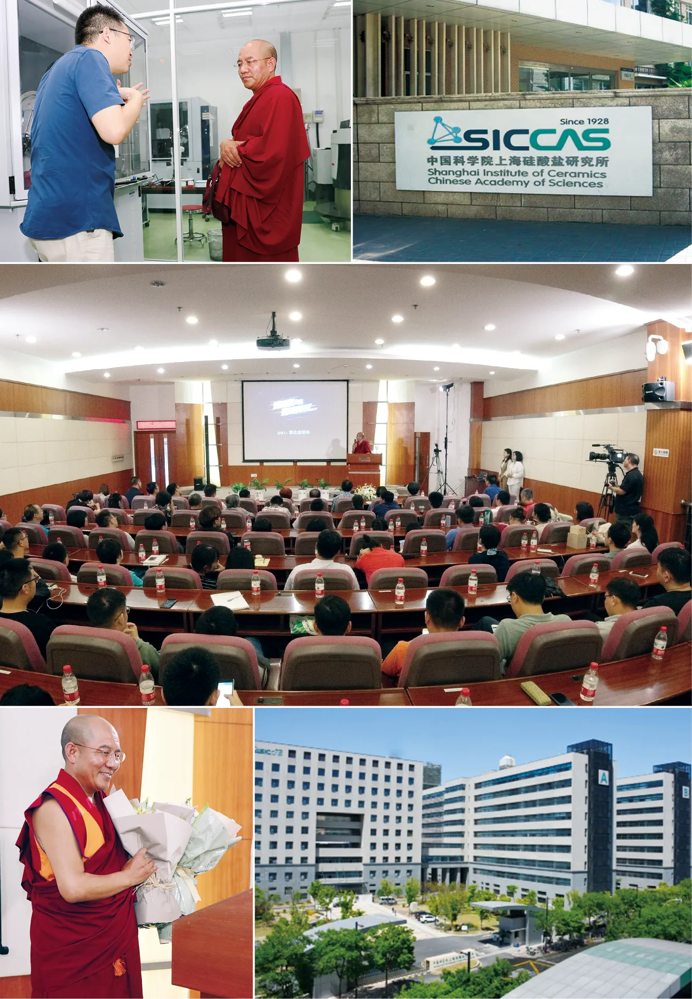
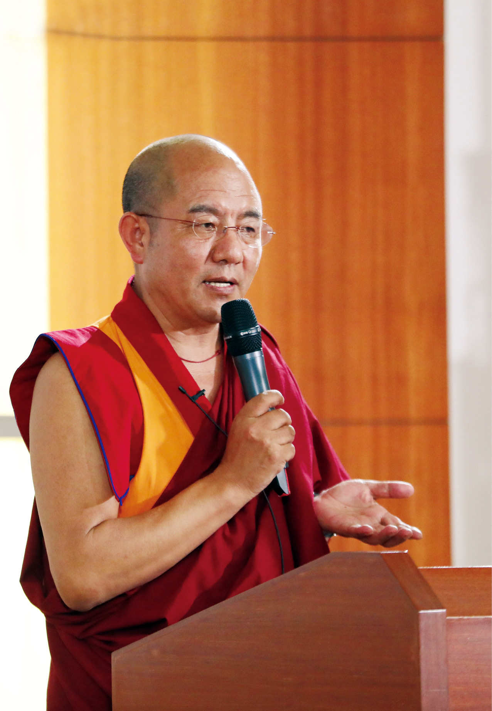
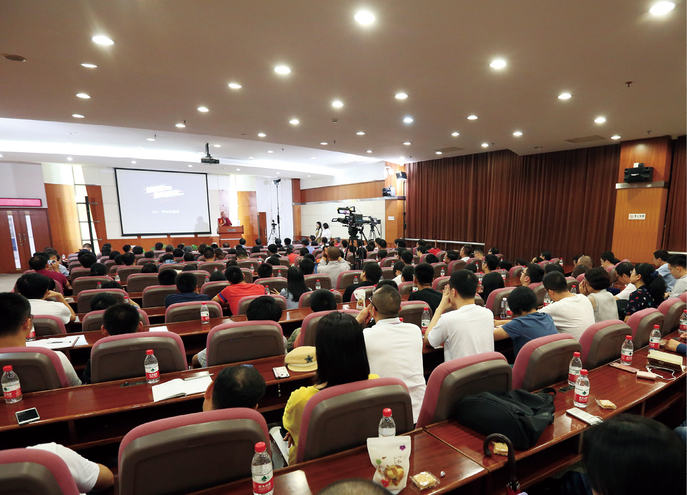
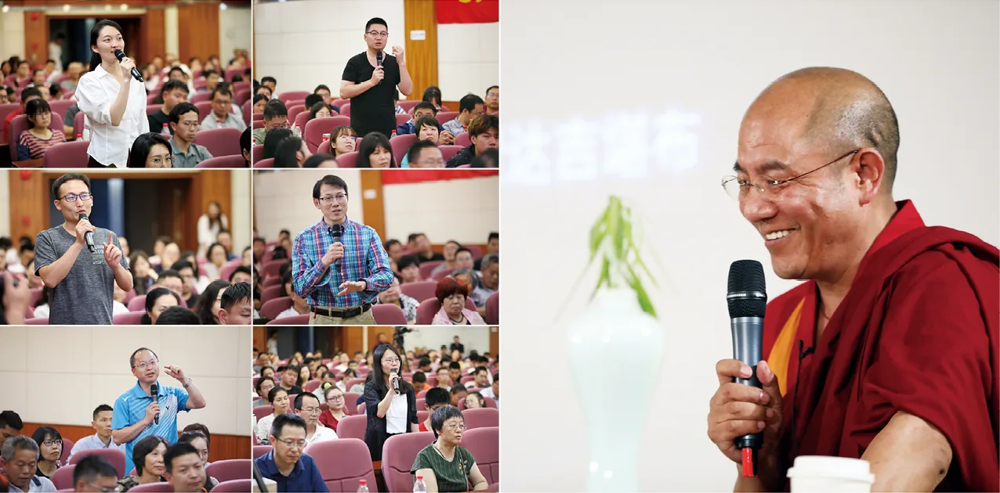
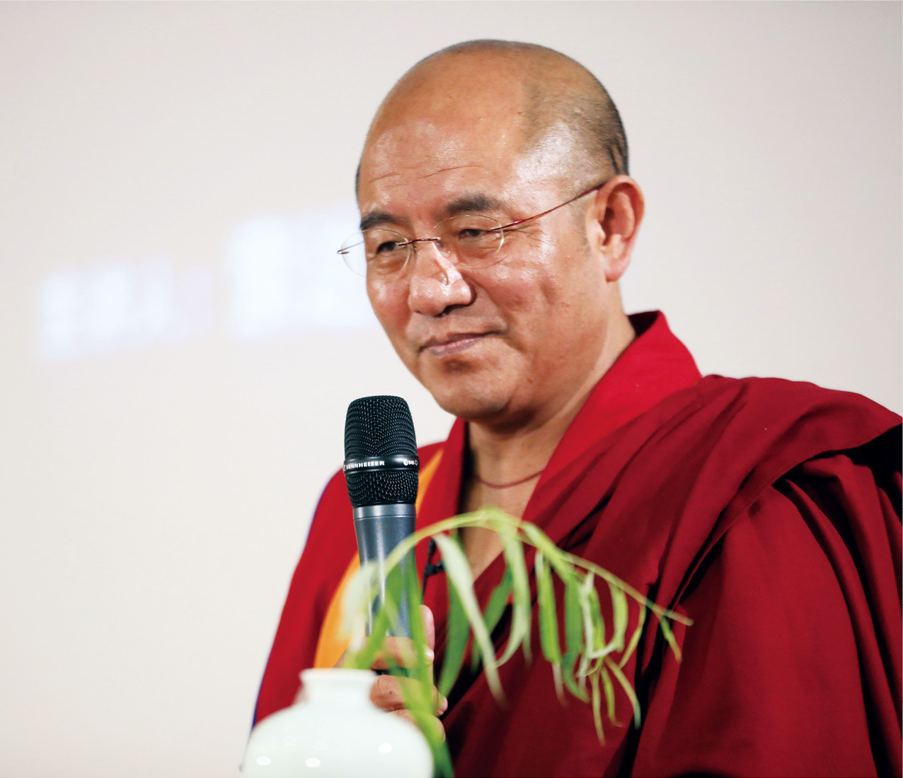

“毁掉我们的，

不是我们所憎恨的东西，

恰恰是我们所热爱的东西。”

第174场

中国科学院上海硅酸盐研究所

Chinese Academy Of Sciences,Shanghai Institute Of Ceramics

中国·上海

2019 / 7 / 10

## 速度与激情

## Engage in Scientific Research in the Era of Speed and Passion

主持人：

尊敬的各位嘉宾，晚上好！欢迎来到“速度与激情”讲座现场，很高兴能跟大家一起聆听索达吉堪布的开示。

首先，有请中科院上海硅酸盐研究所黄富强教授致欢迎辞。

黄教授：

对于堪布的到来，我们感到非常荣幸。“堪布”这个词，在藏地是指教授佛学的老师，在汉地相当于院士或权威人士。所以，你们也可以把堪布当成是老师。

几年前，我无意中得知，堪布有通过网络授课，就跟着学了一段时间。堪布上课的时候，不仅说话幽默，还非常有亲和力。通过学习，我增长了智慧，心态也变得更平和。

接下来，把宝贵的时间留给尊贵的索达吉堪布，愿他将智慧甘露洒向我们。

请全体起立，敬心恭请——

很高兴有机会与大家一起交流学习，感谢你们的到来，也特别感谢黄教授的邀请。

最近一个月，我去了一些学校、监狱、戒毒所和医院，基本上每天都会讲课。有时是一节课，有时是两三节课，后天还有一节，此次行程就圆满结束了。

这次的因缘很好，按佛学的观点讲，也是一种善缘。

## 一、无常的时代

听说这次主题是一部好莱坞电影的名字，故事情节很刺激，我还没有看过。刚才在来中科院的路上，问了一下身边人，有人说看过这部电影。我问他：“讲的是什么内容？”他说：“西方人喜欢塑造个人英雄主义，电影里面就是一群人打架，其他也没什么。”有的人可能也不清楚电影里的具体内容，但这个名字所引申出的意义，我们却不能不关注一下。

随着时代的发展，人们的生活方式有了很大变化。在佛教中讲，这种变化是无常的。现在这个时代，不是一般的无常，是非常快速的无常。有的同学还没走上社会，也许并不觉得，等你真正步入社会后，就会发现你的家庭、工作，以及人们使用的电子设备等，方方面面都变化得特别快。

这种变化在19世纪可能需要四五十年，在20世纪可能需要十几年，而在21世纪的人工智能时代，短时间内就会发生翻天覆地的变化。对个人而言，在家庭、工作、生活、修行等方面，让人很没有安全感和稳定性；对社会而言，既是挑战，也是机遇。从某种意义上说，也有好的一面，因为有变化，就会有发展、有进步、有创新，有一些史无前例的发现。

最近有报道称，阿尔法狗[^1]挑战了人类智慧的巅峰，因为下围棋需要更为缜密的逻辑思维，所以它算是一个很高端的科研成果。然后现在人们在生理学与医学上，又发现了人类基因的变化规律。如果以后真正掌握了这项技术，那一直得以传承下来的伦理道德和人文规则，可能就会受到破坏。包括人的年龄、高矮胖瘦等，都会发生变化，例如五十岁的人看起来可能像二十岁。

有的人说，到了2045年，人工智能会比人类的智力强大数十亿倍。如果真的是这样，世界上会发生很多令人无法想象的事情，我们的生活也会有巨大改变。大家可能都清楚，这些变化会给我们的生活带来哪些影响。现在这个时代变化得太快了，每天看到的商品琳琅满目，听到的信息各种各样，让人很难静下心来做事，未来更是让人难以想象。

## 二、科学与佛学

刚才有老师带我参观了这里的科学研究基地，里面的各种高端设备和实验室，非常令人赞叹。在这里，科研工作者可以利用这些先进的科技设备，深入研究分子、原子、原子核等微观粒子的振动模式和运动规律。但同时我也在想，如果能把化学、物理、量子物理学的知识，与佛教微观或宏观世界的道理结合起来，也许能起到相互促进的作用。

我以前读书时，学过物理和化学的基础知识，包括量子物理学方面，后来也学过一些。但当时年龄比较小，学得并不踏实，现在只有一点点印象了。虽然我是一名佛教徒，但也希望以后能在专业的老师面前听听课，希望能把佛学与科学结合起来，也许会受到很多启发。

同时我也建议，有些同学在做研究的过程中，可以用佛学理论来推断你所研究的道理。因为佛教不仅仅是一种信仰，两千五百多年以来，在佛教的《大藏经》和其他论著中，有大量关于微观世界和宏观世界的论述。如果能把近代量子物理学对微观世界基本粒子的研究，与中观空性的道理结合起来，也许能让人彻底了知一切万法的本体。有关这个道理，现代科学是通过科学仪器和逻辑推理来论证，而前辈大德们是通过修行体悟来论证。如果能将理论与修证相结合，这样既懂得了佛教的道理，又懂得了科学的原理。人们从这两个方面进行推断时，确实可以对万法的本体有所了悟。

如果你是一名佛教徒，并且从事现代科学的研究，那佛学会提升你对万事万物的认识，尤其是对能量场、磁、波、原子、原子核，以及其他细微物质的深入研究，应该会很有帮助。有些人在做科研的过程中，会遇到瓶颈期，一直卡在那里进行不下去，像堵车一样。这个时候，佛学理路可能会对你的研究有所帮助。

我认识很多非常有智慧的科学家，他们对佛教的中观道理特别感兴趣，因为中观是直截了当地去分析万法的本体。从科学角度讲，物质分到无法再分的时候，还有没有一个最微细的物质呢？科学家们认为可能有，也可能没有，在没有得到正确结论之前，谁都无法断定。

对此，佛教中有一些不同看法。小乘有部宗[^2]认为：所有的物质分到最后，还有一个不可再分的微尘存在，叫做无分微尘；除了未来和过去，现在的时间分到最后，还有一个最小的单位时长，叫做无分刹那。

但进一步观察时，大乘唯识宗认为无分微尘并不存在，最微细的心识可以存在，而中观宗认为最细微的心识也不存在。原因是什么呢？当我们去观察未来的心、过去的心、现在的心，会发现未来还没有产生，不可能有；过去已经灭完了，也不可能有；现在只是一个非常细微的刹那，这个刹那又可以再分成前际、后际，这样的话，所谓的现在指的又是什么？

比如说一秒钟，按照现代科学的观点，还可以继续往下再分，所谓的现在只是一种概念而已，除此以外一无所得。同样的道理，当我们分析组成物质的无分微尘时，可以通过六尘绕中尘[^3]的方法来进行观察，如果无分微尘有方向，那还可以再继续往下分……这样的话，最后无分微尘也就不存在了，都变成了空性。

这两种观点我在中观的课程里讲过很多次，其中带有一定的逻辑推理。在座很多年轻人认为自己很聪明，那不妨把你们的研究与佛教的推理结合起来，应该会非常有趣。

佛教中有一种说法，依法不依人。我们一定要寻找真理，不要因为这是老师说的，就放弃独立思考。释迦牟尼佛在经典当中也说过：“比丘们啊，智者们呀，你们应该像锤炼金子一般，再三观察我的教言。观察之后，如果合理的话，你们可以接受，如果不合理的话，则应摒弃，千万不要因为我是佛教导师就一味地接受。”所以，佛教跟其他宗教的观点完全不同。不管是哪一个道理，如果你用智慧去观察时，发现了一些错误，完全可以当场提出来，表示自己不能接受。但如果是真理的话，任何一个人都应该接受。

总之，我认为通过科学来解读佛教，尤其是空性方面的深入探讨很有必要。

以上只是我参观完实验室的一个感言，还没有正式开始讲。大家可以先提个问题，不然有些人好像没有激情了。在这个社会中，还是要活得有激情。

问：我以前听一位藏传佛教的老师说过一句话，大概意思是：“聪明的人，通过学习一种知识来认识整个世界；愚蠢的人，什么都学，最后却一无所得。”可是，现在这个社会变化得太快了，好像找不到值得用毕生精力去学习的东西，请问有哪些值得我们毕生去追求？

堪布：你的问题很好。如果从专业层面讲，每个人都有不同的专业。如果样样都学的话，结果可能一无所获，而智者是从一个方面入手，一通百通。为什么这么说呢？我个人认为，所谓的智者应该是对万法本体有所了悟的人。从科学界来看，像爱因斯坦这样的智者，已经掌握了科学领域中涉及事物本质的知识，但他是不是对所有知识都精通呢？这也不一定。比如他不一定知道怎么用汉语说“你好”，或者一些地方性的知识和风俗习惯。但是，他确实明白了世间万物发展的总体规律。

在佛教中，也有一通百通的说法。比如你通过佛学方法，已经明白了这杯咖啡只是一个概念，实际上没有一个真实的本体。以此类推，你也会明白万法的本质。当然，对于一些世俗现象的细节，也许你还是不了知，但这不是最关键的，科学家们也是对事物进行科学分析，透过现象抓住本质。对于佛教而言，最重要的是要有一种修证，这种修证并不是指精通理论，而是通过修行来了知万法的真相，以及自心的本体。在这个世界上，人们因为不认识自心而感受各种痛苦，但其实心的本来面目就是这样。以此类推，最后也会通达万法的本体。

这个问题回答完了，我再继续往下讲。

## 三、增强自控力

如今这个时代确实比较特殊。美国媒体文化研究者、批判家尼尔·波兹曼（Neil Postman, 1931 -2003）在《娱乐至死》（Amusing Ourselves to Death）中说：“毁掉我们的，不是我们所憎恨的东西，而恰恰是我们所热爱的东西。”有些人特别憎恨自己的敌人，认为是他们毁掉了我们的生活。但其实生活中最大的痛苦，往往来自于身边人，或者你所热爱的一些东西。

现在网络上有各种各样的信息，令人眼花缭乱，如果我们的心过度专注这些就会上瘾，从而带来很多痛苦。

我这次去了一些戒毒所，他们说对毒品上瘾以后，只是心里想“我以后再也不吸毒了”，但根本没办法戒毒，因为它是化学和生理上的一个问题。从吸第一口开始，终生都需要戒毒，因为你已经对毒品产生了生理依赖性。所以，年轻人要特别注意，千万不要吸毒！

另外，现在还有很多人会吸电子产品的“毒”，患上了“手机瘾”“网络瘾”，整天沉迷在游戏的虚拟世界里。一旦对这些上瘾后，短时间内是无法舍弃的，因为我们太容易被网络世界吸引了。

很多人认为，毒品才可怕，那些吸毒的人很可怜，每天都想着吸毒，并且短时间无法戒掉，但这只是世间人共称的毒品，现在有些人还染上了网络的“毒瘾”，难以自拔。大家应该清楚，不管是喝酒还是吸毒，都不是你心里想放下就能放下的，因为它已经和你的生活息息相关了。

将来人类社会会变成什么样呢？大家都知道，现在的年轻人太喜欢上网了，尤其是我们的下一代，那些正在读幼儿园、小学的孩子们，如果没有电子游戏，他们片刻都坐不住。可想而知，在他们长大以后，所得到的只是一些碎片化知识，很难有整体性思维。

在座各位应该也有这方面的体验，我们每天都可以在网上看到世界各地的信息，但看了这些信息以后，对我们有没有帮助呢？也许能让我们的见识更广一点，知道今天世界上都发生了什么，有什么好吃的、好喝的、好玩的，提高了一些认知水平。但对于深度研究自己的专业领域，以及进一步的学业提升，很难说到底有没有帮助。

现在很多人都静不下心来做研究，像国外有些科研人员在做实验的过程中，从来都不看手机，只是依靠几本资料，一直在那里专注地研究。所以说真正意义上的创新，并不是网上找些文章复制一下就可以了，而是要把自己的潜力开发出来以后，才能得到一些新的启发，这个过程需要我们有一颗非常专注的心。

有些人就安定不下来，工作总是换来换去，觉得现在这份工作不赚钱，就想辞职跟朋友合作，一起开发新项目、新软件，结果换了工作后，钱没赚到，人际交往也出现了一些问题；然后想去学校里当老师，做了老师后，还是觉得很痛苦；接着想去考公务员，考了公务员，还是觉得很麻烦；又想去山里修行，可修行并不简单，痛苦依然没有减少，最后只能下山……

很多人的心态都是这样，一直处于犹豫不定和患得患失当中。我们的人生本来就很短暂，如果没有一个坚定的目标，不可能有伟大而成功的事业。众所周知，世界上大多数的成功者，最初都有一个非常明确的目标，然后为了达到这个目标，他们一直勇往直前，中途遇到任何困难都不会退缩，更不会倒下去。

## 四、无底的欲望

现在这个网络时代，刺激着人们的欲望。很多年轻人喜欢听那种“咚咚咚”的音乐，有时候我根本听不懂里面在唱什么。他们还喜欢吃刺激性的食物，看刺激性的画面，寻求一种感官和心理上的刺激。

有的人说，这些年轻人是不是疯了？其实这也不怪他们，每个时代都有不同的价值观，再过二十年、一百年，人类的价值观还会发生更大的变化，包括老年人和年轻人喜欢的音乐也会不同。在这种情况下，我们每天都活在欲望当中，实际上很难感到快乐。

我以前看过一个故事：一个人从家里到一座禅院去，路上看到了一件趣事，想以此考考老禅师。到了禅院，与老禅师对坐品茶时，他问到：“什么是团团转？”

老禅师随口答道：“皆因绳未断。”

他不由得惊讶万分地说：“您是不是有神通呀，我要问您的就是这个事情。”

老禅师说：“我没有神通，不过你为何这样说？”

那人说：“我今天在来的路上，看到一头牛被绳子穿了鼻子，拴在树上，这头牛想离开这棵树，到别处去吃草，但一直不得脱身，只是绕着树打转。所以我故意拿这个问题来问您。”

老禅师微笑着说：“你问的是事，我答的是理。你问的是牛被绳缚而不得解脱，我答的是心被俗务纠缠而不得超脱。一理通百事啊。”

事实上，我们人类就像这头牛一样，被欲望的绳索拴在某一种境遇中，却总是得不到满足，想要追逐更多如草一般的外境。很多年轻人都是这样，想要这个，想要那个，有很多很多的需求。尤其是现在这个时代，人们在网上可以看到很多商品，宣传得也很吸引人。世界上最美的人穿什么衣服，最富裕的人开什么车，最快乐的人都有什么——人们总想知道世界上最好的东西是什么。同时也在幻想着：我要成为这个世界上最幸福的人、最快乐的人、最棒的人、最帅的人……这样去希求的时候，自己的能力又达不到，就一直被欲望的线拴着无法解脱。

还有的人，得到的财富越多，欲望反而越强。藏地民间有一种说法：“人有财发疯，牛有草发疯。”我以前放牦牛时，就有这种感觉。一般在草不多的地方，牦牛就比较听话，不会乱走；如果草特别多，它们稍微吃一点草尖就换地方，像发疯了一样到处跑。

人有时候也是这样，原来没有钱时很老实，没有傲慢心，也不贪慕虚荣，工作勤勤恳恳。后来越来越有钱了，开始跟一些狐朋狗友同流合污，直到出事了才幡然悔悟。那些在监狱里的贪污分子经常说：“我当时不应该太贪，现在后悔也晚了。”他们这样讲，也许是诚心悔过，也许是刻意而为。总之，当欲望已经过度时，一切都来不及了。

在我们对人生的真理还没有明白之前，内心可能始终会有一种贪婪。古罗马哲学家塞涅卡（Lucius Annaeus Seneca the Younger, 公元前4-65）说过：“茅草屋顶下住着自由的人，大理石和黄金下栖息着奴隶。”这句话可以有不同的解释，我的理解是，心灵已经获得解脱的人，对物质的欲望很低，对他们来说，即使住在偏僻的山里也无所谓。

我们那边山里就有很多住茅棚的人。有些人可能觉得，学佛太清贫寡欲了，对此并不赞叹。但从内心世界来讲，也许他们真的已经获得了自由。而有些人，虽然物质条件越来越好了，心却好像麻木了，对什么都没有感觉。原因就在于，我们的欲望越来越大，想要的越来越多，这样的话，压力和痛苦也会随之而来。

在这种情况下，我们是继续寻求刺激好呢，还是了知它的本质好呢？其实，最好是选择一种行于中道的生活，既不过于贪婪，也不过于贫穷。

前几年，我去过一些北欧国家，像挪威、丹麦，那边的人跟我们的价值观完全不同。就全世界而言，北欧人可以算是最幸福的人，因为他们不会像我们一样整天攀比，对于开什么车，穿什么衣服，住什么房子，互相之间没有竞争性。在那边，很多人选择骑自行车或坐船上下班，并且从来不会问对方的收入和待遇。

相对而言，我们这边的人贪欲就比较重。例如，领导阶层的人会经常谈论：局长是谁，副局长是谁，局长和副局长之间的工资差多少。当了局长，开始对厅长感兴趣；当了厅长，又幻想做市长、市委书记。包括我认识的一些村领导，也对一层层往上爬很有兴趣。然后企业家和商人们就谈论：投资的项目是什么，赚了多少钱，开什么样的车，住什么样的房子。有些家长们就谈论：自己的孩子就读于国内外哪所名校……这说明了什么呢？大家可以想一下，生活在这个充满竞争的世界里，其实很难说我们到底快不快乐。

《佛遗教经》中说：“知足之人，虽卧地上，犹为安乐。”懂得满足的人，即使是露宿街头，内心依然很安乐。在生活中，我们需要知足少欲，这样更容易获得快乐。从字形上看，汉字“贪”和“贫”很接近，古人也说：“贪则近贫。”贪欲特别重的人很容易变成贫穷者。因此，我们应该选择一个清净有质量的中等者生活。

## 五、有效的建议

第一，希望大家以后能经常禅修，因为禅修对身心健康的帮助非常大。大家应该都认识陈坤，他最近在一档聊天节目《圆桌派》里说，他从十几岁开始打坐，二十多年来一直没有间断。从他的言谈举止中，可以看出他更关注心灵的自由，比较淡泊名利。

不管将来会遇到什么事，希望大家都能在自己的人生道路上有所体悟。这种体悟最好是依靠禅修来获得，以禅修来提高我们生活的质量，而且要长期坚持，只是偶尔一两次起不到什么作用——听说有些老师已经坚持了十年、二十年。

有些人可能担心，修行会不会对我们的工作不利，或者说会不会让人变得消极？其实不会的。修行反而会加强人的社会责任感，让你变成一个有激情和责任心的人，有利于你更好地进行专业研究。我相信一个心中充满活力的人，既可以对社会有所贡献，也可以实现自我价值。

在威斯敏斯特教堂地下室里，英国圣公会主教的墓碑上写着这样的一段话：

“当我年轻自由的时候，我的想象力没有任何局限，我梦想改变这个世界。

“当我渐渐成熟明智的时候，我发现这个世界是不可能改变的，于是我将眼光放得短浅了一些，那就只改变我的国家吧！但是我的国家似乎也是我无法改变的。

“当我到了迟暮之年，抱着最后一丝努力的希望，我决定只改变我的家庭、我亲近的人——但是，唉！他们根本不接受改变。

“现在在我临终之际，我才突然意识到：如果起初我只改变自己，接着我就可以依次改变我的家人。然后，在他们的激发和鼓励下，我也许就能改变我的国家。再接下来，谁又知道呢，也许我连整个世界都可以改变。”

所以，人在年轻的时候，一定要对自己的人生和专业，有一个方向性的定位。现在很多年轻人是什么样呢？每天都是得过且过，对工作和生活失去兴趣，始终处于一种恐惧、散乱的状态当中，这种人生可以说非常不成功。我相信在这么高端的科学基地，不会有这样的人。但我也想提醒一下，年轻人一定要有目标、有志向、有奋斗、有激情。这种激情并不是跟着音乐随意跳一跳，而是要对自己的研究专业有信心。

第二，这里是非常特殊的科学研究基地，我希望在座的各位，最初的发心不是为了自己，而是为了自己的民族和国家，乃至全人类和天下所有众生，这是最重要的一点。如果没有这样的利他心，只是一种特别自私的心态，可能会有一定的社会危害性。

有些人受西方经济学家亚当·斯密一些思想的影响，开始主张“自私会促进社会”，包括在父母、亲朋好友面前，也是只想着自己。除了利益自己以外，想要帮助他人，改变民族和国家未来的人，这样的人越来越少了。这也许是我的错觉。

一般按照大乘佛教来讲，每个人都要发愿帮助天下所有众生。如果没有这么广大的意乐，至少你要做些对社会有意义的事情。这样的话，不管将来你是做企业家、高管，还是科学家，人生格局都会越来越与众不同。

相反，如果一个人活得很自私，那他的家庭也会不和谐。我们可以看到，现在的年轻人普遍都比较自私，所以家庭破裂的现象也是日益增多。有些人只是孤独地生存在这个世界上，既不像出家人，也不像在家人。说是在家人的话，别人看不惯你，你也看不惯别人；说是出家人的话，既没有修行境界，也没有所持的戒律，整个人都变得很奇怪。

当然，有的人是为了专心研究，不愿意过世俗的生活，这个另当别论。在历史上，也有很多伟大的科学家，为了争取工作时间，一直以事业为主。虽说在家人有在家人的生活方式，但也有一些特殊现象。总之，无论选择什么样的生活，最根本的是要有一颗利他心。

第三，在座各位都非常有智慧，但不知道是教育的原因，还是其他因素影响，按理来讲，人应该对自己的前世今生有所研究。可放眼全球，真正懂得自己前生后世的人很少，甚至连提这方面问题的人都没有。

人到底有没有前生后世？如果有，怎么证明？如果没有，有什么理由？按照做研究的态度，你们应该提出很多问题，有或者没有，都应该拿出证据。不能仅仅因为“我没有看到”“我没有听到”，就下定论说没有后世，毕竟很多事情都不是当下就可以得出结论。

有科学家认为，在宇宙的构成中，人类已知物质仅占4％左右，未知物质是96%，包括暗物质和暗能量。所以，我们不知道后世有还是没有。科学家们也没有进行研究，反正对他们来说有也可以，没有也可以，大多数还是认为没有。

如果真的没有后世，你可以整天玩电子游戏，生活在虚拟世界里，短暂的几十年罢了，怎么样都会过去，即使造各种恶业也无所谓。正如佛陀在经中所言：“不见后世，无恶不造。”现在很多规则不断遭到破坏的最大原因，就是我们没有前生后世的因果见解。

这是一个很重要的问题，值得每一位科学工作者去思考。我以前在很多课上讲过这个问题，在一些书中也回答过。所以，如果你们等会儿要问的话，我今天不一定回答。

最后一个建议。虽然我没有看过这部电影，但希望同学们能明白，在做研究的过程中，重要的不是激情和刺激，而是要有框架性、整体性的思维，这才是最宝贵的。

我个人的话，以前依止过一些老师，在他们面前完整学习过一些佛法，这改变了我的一生。我有时候也在想，如果我出生在这个时代，可能每天也是沉迷于网络，对自己的未来感到迷茫。所以，幸好当时的网络并不发达，让我有时间专心学习。虽然现在也没有什么特殊的成就，但至少心里对万法的本体有了一些认识，包括对自己的内心，也有了一些体悟，感觉有了归宿，不那么迷茫了，并且也有一颗想要饶益他人的心，这些都来自前辈老师们的谆谆教诲。

希望在座的同学们，有生之年也能遇到有良知、有智慧、有能力的老师，这也是一种福报的体现。一位具有正知正见、对科学有创造力、对人生真理有所领悟的老师，确实非常珍贵。这样的老师也值得去寻找，他会让我们的人生变得有活力、有温度。

现场互动

问：我是一名科研工作者，请问如何理解“万物皆数，万数皆哲，万哲皆宗，万宗皆心，万心皆空，万空皆悟”这六句话？

堪布：现在有些人太过于专注自己的领域，不愿意走出去。例如：学数学的人，只专注在数学领域；学物理的人，只专注在物理领域；学佛学的人，只专注在佛学领域。

这样的话，大家都有一个共同点：有人说佛学不好，我可能会不高兴；有人说数学不好，你可能会不高兴。实际上，我们不应该故步自封，应该走出自己擅长的领域，到别人的世界去看看。

刚进入到他人的世界，也许会感觉很陌生，但只要有勇气，肯付出努力，完全可以融入其中。就像你刚到澳大利亚时，在饮食方面可能很不适应，过了一段时间之后，基本就没问题了。

1991年时，我来过上海，这边做菜会放很多糖，所以吃得不太习惯。在四川，如果菜里放糖，父母就担心辣椒、盐巴和糖放在一起，吃了会拉肚子。其实在一个地方待得久了，慢慢会适应那里的饮食习惯。同样的道理，如果多花一些时间去研究数学、哲学、宗教之间的关系，久而久之，也能对“万心皆空，万空皆悟”有所体会。现在是大数据时代，多方面的学习很重要，不懂得学习的人，很容易产生被时代淘汰的感觉。

刚才讲到，科学与佛学在万法本性方面，看法基本一致，关键是从哪一个维度认识。如果想通过科学方法，最后要是能悟到也很好，但这跟实修的证悟还是有一些差别。所以，我觉得你刚才说的这段话很好，随喜你。

问：我们学校每年都有3到5个学生，因为学业、家庭、情感等问题，变得非常沮丧，陷入负面情绪之中，导致无法顺利毕业。请问有什么办法能让他们变得积极上进？

堪布：你们学校只是几个学生不能毕业，这已经很不错了。我在我们当地办了一所中学，有六个班，每班大概50人。最后毕业时，每个班都有十几个学生没法毕业。我们也想了很多办法，但因为那边的教育比较落后，实施起来困难重重。所以，希望老师们平时能多关注一下有困难的同学，及时进行沟通。

其实每所学校的情况都不同。前段时间，我去了一个学校，他们说50多人里，会有两三个学生不能毕业。三年前，我们中学有300多人入学，今年毕业时只有248个。有些孩子失去了读书的机会，实在很可惜。为此，我还专门跟老师们开了会，看有没有办法把他们找回来，但还是有些困难。一方面，有些老师只管讲课，不关心学生的身心健康成长；另一方面，也有学生自己家庭的原因。

很多人在学生时代会比较迷茫，希望老师们在带他们的过程中，一定要反复强调，不管发生什么事，至少要念完大学。

前几天，我看到一个新闻，有些老师会和学生说：“读大学没什么用，乔布斯、比尔·盖茨等很多成功人士，大学都没有毕业。读大学不如去创业。”这种教育理念不一定合理。

我经常和我们学校的学生说：“无论发生什么事，你们一定要把高中读完。”有些人会说：“我想出家。”我说：“出家不着急，你先读完书，到时候如果还想出家再去。”但有时候他们也不听，中间就辍学出家去了。

后来再遇到我，就说：“对不起，虽然那天您没有同意，但我还是出家了。”我个人觉得，至少应该读完高中，再选择接下来要走的路，这样比较好一些，不然当你回首时，可能会有遗憾。

问：现在汉地小孩子的学习压力很大，要不断地考试，还要参加各种兴趣班。家长有时候会和孩子说“尽力就好，不求结果”，而佛法中又说“人生要放下，不要执著”。所以，做一件事时，到底是应该尽力还是不执著？

堪布：尽力也分很多种。在工作、感情、学业等方面，有些人经常说：“我已经尽心尽力了，没什么可后悔的。”但其实到底尽力了没有，用了多少力量，只有你自己清楚。

比如，你说自己已经尽力学习了，那是不是在24小时里，尽一切力量不断学习？应该也没有吧。可见，尽力是一个非常概念化的词，缺乏具体的标准。有时候找某些领导办事，他们也会说“尽力而为”，我一听就知道这是不想帮忙的意思。所以，我对“尽力”这个词，也有一些不同的看法。

另外，学佛并不是对一切都不执著。虽然从佛教的最高境界讲，有“不执著”的说法，但在这之前，还是需要有执著，要对善恶进行取舍。完全的自在、放下、看破、无有执著，是证悟空性的极高境界。只有达到了这种境界，才可以谈没有执著，就像《坛经》中讲的“本来无一物，何处惹尘埃”，既然万法的本体都不存在，哪里还会染上什么尘埃？

物理学中也讲，现象是不空的。科学研究发现，任何物质都是由分子、原子等微观粒子构成。但平时我们看柱子时，不会说“这里有个分子”“这里有个原子”；在观察实验现象时，也不会说这是空的，不需要研究。

因此，所谓的“佛教提倡对一切都不执著”，不过是一种断章取义的说法。事实上，在佛法里面有很多执著，包括度化众生、学习佛法、实修实证、严持戒律等等。如果证得了很高的境界，有些确实不用再执著了。所以，这个问题还需要细化讨论。

问：如何在忙碌的工作中，保持一种禅修的状态？

堪布：虽然今天的主题不是禅修，但禅修的确很重要。通过内观禅修，每个人都能获得一些感悟。

有些禅师很喜欢讲“如人饮水，冷暖自知”。一般来说，你在禅修过程中所得到的境界，只有你自己知道，别人不一定能了知。

不经常禅修的人，很容易感到迷茫；经常禅修的人，会逐渐觉察到世间所有的执著和痛苦其实也不过如此，这是一种妙不可言的境界。

禅修的方法有很多种。佛教的禅修，可以在面前摆放一尊释迦牟尼佛像，以毗卢七法[^4]的坐式，把心专注在佛像上，观想佛陀的身相。世间的禅修，就像现在很多企业和高校里讲的，什么都不想，只专注在一个念头，让心保持觉知。南传佛教中也有讲到要保持纯然的觉知，而达到不散乱的状态。有些是安住在比较明清、光明的状态中，有些是安住在比较细微、寂静的快乐状态中，有些是安住在一无所有的状态中，这叫做明、乐、无念。大家可以根据自己的情况进行选择。

现在很多高校会组织禅修活动，我觉得科研机构也有必要建一些禅修室。科研人员可以只是坐在那里，什么都不想，放松身心，缓解一下压力；也可以静下心来认真思考自己的研究课题，长期坚持下去总会有所收获。许多伟大的科学家，都是在禅修中发现了一些知识的深层奥秘。所以说禅修对于开发大脑、认识自心、专业研究等方面，有一定的突破性帮助。

问：我是一名高中老师，很想将佛法的种子播撒到学生心中，希望有一天能开花结果。但谈到宗教时，总是有些敏感，有些话不能说得太直白。如何做到善巧方便？

堪布：虽然在学校里，宗教是比较敏感的话题，但从人类历史来看，文化的根底在宗教。比如中国传统文化的精髓是儒释道，具有很强的宗教特质。因此，如果在校园里只是探讨宗教文化，而不是推广信仰，应该是可以的。

国外早期的大学一般分为四个学院：法学院、文学院、医学院和神学院。很多西方人认为，一个高等大学里要有理科、文科、宗教和艺术，四者缺一不可。爱因斯坦也曾说过：“所有的宗教、艺术和科学，都是生长在同一棵树上的枝叶。人类对这三方面的追求，都是为了使生命从单纯的物质世界里提升，而达到自由。”

目前，国内大学有一些宗教研究系，暂时还没有神学院，将来可能会有。事实上，宗教在中国传统文化中占有很大比重，只不过在上世纪五六十年代，“破四旧运动”开始后，宗教受到批判，儒家文化也遭到了破坏。但后来，国内外又建立了很多孔子学院。所以，不同的历史时期，人们对宗教的认识也会不同。

在学校里，确实不方便公开地讲佛法，但如果只是念一下文殊心咒或文殊菩萨的名号，应该没什么问题，不至于因此就受到很大惩罚。如果真的有惩罚，可能有点不合理。因为在我们的文化中，释迦牟尼佛、老子、孔子都是真实存在过的历史人物，全世界的人都知道他们是谁。

我们可以善巧方便地讲这些道理，给同学们种下善根。但不能以一种过激的方式传播宗教思想，这在学校里是不被允许的。我去过一些西方大学，那里的负责人也会说：“我们学校是学术研究，千万不要在这里举办宗教仪式。”所以说，宗教研究与宗教仪式还是有区别的。相信为了满足人们更深层次的精神需求，将来国内大学可能也会涉足精神领域。

问：科研人员要有情怀、有温度，还要有一种忘我的精神，请问您在禅修、做学问的过程中，也会有这种状态吗？

堪布：我的工作与你们的研究也有相同之处。我主要是做一些经典的翻译。

在翻译时，首先要了解书中的主要内容，然后再认真细致地校对，把握每一个词的含义。遇到个别词有不同解释时，还要翻阅大量的资料，将古译与今译进行对比。

前段时间，我把藏文版的《八大菩萨传》翻译成了汉文。在翻译的过程中，需要多次翻阅汉传《大藏经》，因为里面能够找到每一位菩萨的传记。虽然网上也有电子版，搜索起来很容易，但有些故事的出处不太好找，还需要翻阅其他资料。

我有时候也会想，只是一个人在屋子里默默地做事，别人可能并不知道我的付出。但不管翻译得好还是不好，反正付出了很多时间和精力。在做的过程中，自己也比较满意，这也算是一种研究精神、忘我精神吧。对每一位科研工作者来讲，如果想要做出一番成绩，这种忘我的精神必不可少。

当然，翻译与科研还是有很多差别的。“科研”这个词，对大部分人来说听起来很陌生。刚才听王老师说的时候，我似乎有点明白了，也想以后有机会能好好学一下，希望他方便的时候，能给我讲一讲。科学与佛教空性思想的智慧碰撞，应该会很有趣。

问：听说佛菩萨既有慈悲相，也有忿怒相，请问您什么时候会使用霹雳手段，什么时候会选择修安忍？

堪布：佛菩萨确实有慈悲相，也有忿怒相。比如我们经常看到的文殊菩萨，被认为是智慧的象征，无论是谁祈祷，都会得到加持。

文殊菩萨显现慈悲相时，是拿着宝剑的形象；显现忿怒相时，是大威德的形象。这种看起来比较恐怖的忿怒相，一般是邪魔外道或天地鬼神在扰乱、损害众生时，以忿怒的形象来降伏他们。因为有些众生以寂静形象可以度化，有些众生只有以忿怒形象才可以度化。

据史书记载，建造藏地第一座具有僧人住持的寺院——桑耶寺时，屡建屡垮，白天人来建造，晚上非人来破坏。菩提萨埵以寂静相调化非人时，很多鬼神都不听。于是，藏王听从菩提萨埵的建议，从印度迎请来莲花生大士主持建寺。后来莲花生大士以忿怒相降伏了这些非人，并把他们变成藏传佛教中的护法神。

我的上师法王晋美彭措，内心非常慈悲，绝不会损害任何一个众生。但有必要的话，上师也会显现忿怒相。在课堂上，上师有时会针对某种不如法的行为，或者某一件事情，对弟子们进行非常严厉的批评，然后大家在很长时间内都会谨言慎行。

我个人的话，谈不上显现忿怒相，也不太爱生气。一般让我不高兴的有两方面：看到某些事情时，心里有点不舒服，这叫作自相的烦恼，可能会批评别人，但这种情况比较少；另外，针对有些人，用温和的语言根本起不到作用，如果假装特别生气的话，反而会起到作用。比如在开会时，有些事情实在进展不下去，我就会狠狠地批评几句，但内心尽量保持正念。可有时候说着说着，刚开始是假装的，到后面真的已经生气了，很多人也是这样，自己把自己气着了。

所以，人有时候需要寂静些，有时候需要忿怒些，有了这两方面的威力，成办事情会比较容易。

[^1]: 阿尔法围棋（AlphaGo）是第一个击败人类职业围棋选手、第一个战胜围棋世界冠军的人工智能机器人，由谷歌旗下“深度思维”（Deep Mind）团队开发。
[^2]: 有部宗：佛学术语，说一切有部的简称，小乘宗之名。
[^3]: 六尘绕中尘：在一个无分微尘的东、西、南、北、上、下六方，各放置一个无分微尘，若中尘与六尘相对，则中尘可以分成六个面，而成为有分；若不相对，则成为一体，而无法堆成粗大的色法。如此可断定无分微尘为空性。如《唯识二十颂》云：“极微与六合，一应成六分，若与六同处，聚应如极微。”
[^4]: 毗卢七法：双足金刚跏趺坐或半跏趺坐；双手结定印；脊椎正直；颈部稍向前倾；两肩放松向后张开；双目垂视鼻尖；舌抵上腭。
