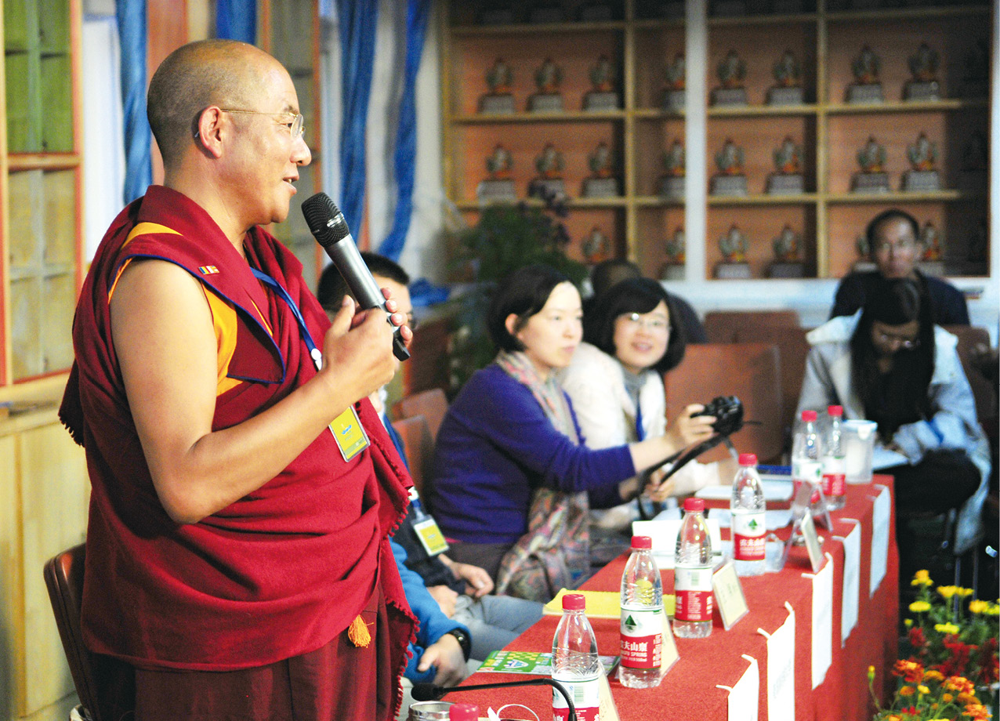
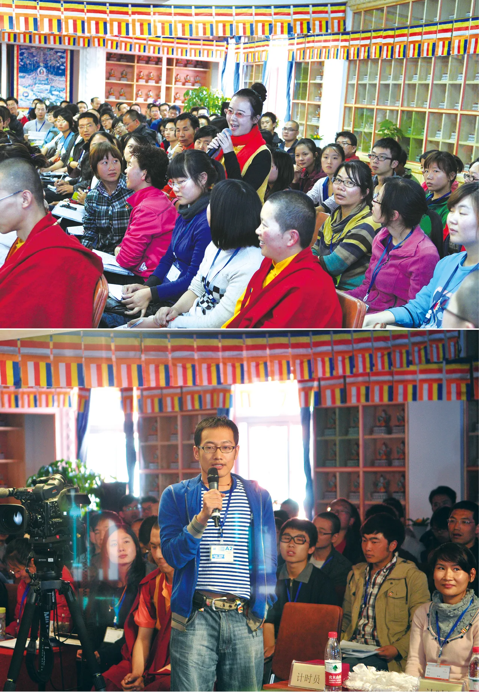
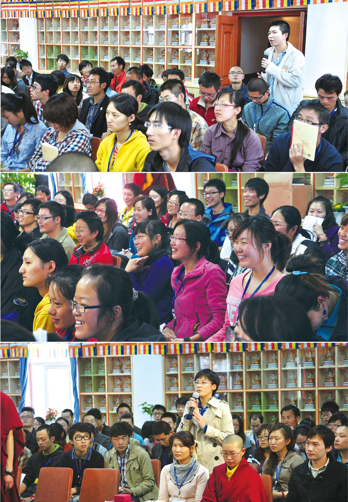
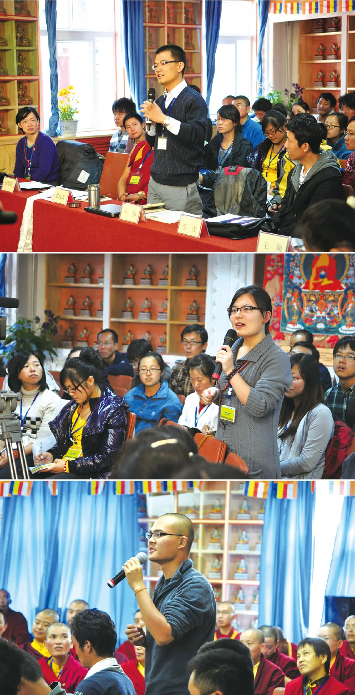

# 专场问答

## QUESTIONS AND ANSWERS

2011年8月15日

我先说两句。在刚才的发言中，有两件事值得我反思。首先是刚才上海复旦大学博士提出的问题很深刻，确实是年轻人需要思考的——生命的流转。

这次我们特意邀请了不同想法的人来交流，尤其是没有信仰的人，我们想听听他们的声音。我并不是口头上说说，而是真正想了解外面的世界在关心什么，大学生在学什么，老师在讲什么……如果我一辈子都待在山里，像有些前辈大德一样，不跟任何人接触，就不需要知道这些，也不需要举办什么研讨会——可能佛学院很多长期闭关的修行人对我有不同的看法，也是正常现象。如果我只管自己修行，那有一些修行境界就可以了。但事实并非如此。在21世纪，我们左手拿着念珠，右手拿着相机，也是非常有必要的。

很多人不明白这个道理，所以我特别希望这次来自美国、英国、日本等科技发达国家的留学生，给我们多讲一些。但不知道时间能不能安排好，不给其他同学发言的机会也不行，所以我们组委会考虑了很长时间。事实上，许多同学在这次研讨会上，了解到了东西方国家对宗教是什么态度，对科学是什么态度，哪些道理值得借鉴。只有当我们敞开心扉了，才能理解一些问题的重要性。

第二件事，刚才有个同学在演讲的时候，我坐在下面听得非常感动。他说得确实对。我以前很爱修行，但这几年觉得不管是知识分子，还是孩子、老人，我们都需要为他们做点什么。在做事的过程中，我身后有很多人在默默无闻地付出。正如他所说，无论是山上文字、视频、音频的制作，还是山下很多学员的努力，都是有目共睹的。非常感谢我们的发心人员！

这次能来参加研讨会的人很少，因为如果来这里，我们组委会负担不起所有的费用。有些同学想来却没钱，有些同学有各种约束，有些同学根本不知道。我也去过很多学校，真正希求真理的人特别多。所以，对于想要发心的你们，就像组委会说的，可以自愿报名。不管发心做多长时间，我们都非常随喜。

这是我事先跟你们说的两件事，大约花了十分钟，还剩二十分钟。如果有同学想提问，可以开始。

问：我是河北师范大学的学生，也是一名佛教徒。有个问题一直困扰着我：我养了一只狗，身上长满了螨虫。如果不治疗，狗肯定会死，但治疗的话，很多虫子都会死。我该怎么办？

堪布：在这件事上，我们可能要想办法尽量让狗也不死，虫子也不死。

以前无著菩萨在鸡足山修行十二年，一点感应都没有，于是决定放弃。下山时，他看到一只母狗，下身全部糜烂，伤口里有很多蛆虫，还对他有很大的嗔心，准备咬他。这时，无著菩萨生起极大的悲心，想帮它清理伤口里的虫子。为了不伤害虫子，他只能伸出舌头去舔，结果弥勒菩萨现前，他终于见到了本尊……

所以，发了菩提心的我们，应该设法找到一些不伤害众生的方法。

问：之前我朋友也遇到过这个问题，他去问慈诚罗珠堪布。堪布告诉他要用智慧抉择，但他还是没有这个智慧，我也没有。

堪布：应该有办法，去找医生或其他朋友讨论一下。虽然一下子解决这个问题，可能有点难，但应该想个办法，看能不能用什么方式把虫子取下来，放到比较好的地方。然后再治疗这只狗，好吗？

问：转世是不是一对一的关系？比如一头牛转世，根据业力是变成一只青蛙，还是好几只青蛙？

堪布：是一对一，因为生命的延续只有一个心识。除了诸佛菩萨的幻化身，或是众生的特殊业感现前，否则，每一个众生在轮回中不断转生的话都是这样。

问：我来自武汉科技大学。请问有没有所有众生都成佛的一天？如果有，六道再无众生了吗？

堪布：这个问题在《现观庄严论》的很多注疏中都有回答。包括《普贤行愿品》也说，众生无边则烦恼无边，烦恼无边则痛苦无边，痛苦无边则佛菩萨的度生智慧无边。那所有众生有一天都会成佛吗？应该是。那是不是众生都灭尽了，轮回也变空了？不可能。为什么呢？因为众生是无边的。

我们在座的各位将来都会成佛吗？是的，迟早都要成佛。这样的话，轮回会空尽吗？不会的。就像天空一样，天空有边际吗？没有边际。同样，众生都可以成佛，但没有轮回成空的那一天。

有人可能会问：“如果轮回不空，地藏菩萨发愿‘地狱不空，誓不成佛’，与此会相违吗？”不，因为这是菩萨因地时特别殊胜的一种发心力。例如，如果我们想做一项非常广大的事业，在开始时也会有坚定的决心和愿望。同样，菩萨在因地时的发愿，是他智慧力的一种特点，不会有任何矛盾。这也是佛教的慈悲观。

问：我来自华南农业大学。现在很多居士开佛教用品店，卖一些佛像、唐卡。请问，贩卖佛像的罪业有多大？我们佛教徒能做这样的事吗？

堪布：这个问题可能需要详细分析。一般来说，把佛像、法本、佛塔作为赚钱的工具是不合理的，《毗奈耶经》和很多大德的开示中，都谈到了这种行为的过失。然而也有一些人，在寻找生活出路的同时，对三宝的虔诚心非常强烈，同时他们有一些悲悯心，想用这种方法赚钱去帮助很多人，而不是全部用在自己身上。这应该也不太一样。

能不能做取决于自己的心态。如果动机是看到很多人不了解佛法，想让更多人看到佛像而结上善缘，以这种心态去卖，我们也不敢说什么。

总之，卖佛像确实有一些罪业，但关键是看这个人的动机。

问：我在英国学电影。英国的基督教和佛教都提倡做善事，基督教徒做这些不求回报，因为他信上帝就得永生了，但佛教中有个概念叫“功德”，之前一本佛书上说“无功便是德”，但我还是不太理解，因为现在大家为了贪求功德、福报，就大量放生印经，做很多善事。请您详细开示一下什么叫功德。

堪布：你学的是电影，我小时候模仿别人特别像，现在不行了。我直到15岁才上小学，当时学校里的学生不多，我经常模仿这个校领导、那个老师，每天都有一大群人围着看。如果我演电影，主角可能不行，演个小配角应该可以，不知道有没有这个机会。

关于你的问题，其实我们对任何宗教都应该有包容的态度。前段时间我在香港的时候说过，首先南传佛教、北传佛教、藏传佛教应该举办个圆桌会议，佛教内部要相互圆融。如果有机会，还可以和其他对人类影响很大的宗教，比如基督教、天主教，聊一聊人类需要共同解决的问题。另外，我们宗教人士与非宗教人士也不应该有任何冲突。现在整个世界都变成了“地球村”，学会宽容、圆融、开放、平等，对每个人都很重要。

所谓“功德”，按照佛教的观点，并没有那么简单。当然，如果有些人沉迷于个人利益，做放生、慈善、供养这些都想要一些回报，这种发心连小乘都不如。按照小乘的做法，做善事不求回报，只求自己解脱。而大乘佛教的精神，对自己解脱一点也不求，唯一希求对众生有利益，只要众生得到一份快乐，自己受到任何损害也不在乎。为了实现这个目的，他们做供养等各种善事。如果是一地以上的菩萨，在做布施之类的善事时，没有相状的执著，就像《入中论》讲的一样，能布施、所布施、布施的事物这三者都是空性。所以，“功德”的涵义非常广泛。

通过这个论坛，我特别希望大家以后重新认识一些宗教，不要觉得它特别简单，看到一句话就妄言它如何不对。现在很多人随随便便否定一切，没有深入思考，这是一种愚痴的行为。历史上，一些宗教对人类产生了巨大的影响，这肯定有其特殊的魅力。包括佛教徒，我曾经遇到过汉地信徒说藏传佛教不好，藏地信徒说汉传佛教不好，其实不能这样。无论是哪个宗教或教派，甚至是一些世间学派，我们都要仔细思考，谨慎取舍。

问：我来自哈尔滨商业大学广厦学院，是学艺术的。梵高（Van Gogh, 1853-1890）一生作画无数，但生前没卖出一幅，死时也比较痛苦，用枪打到自己肚子上，在地上挣扎三天三夜才死。请问，梵高对艺术的境界如果达到极致，死时能不能感悟佛理呢？

堪布：每个人的因缘不一定相同。如果他真的对佛教有信心，周围的环境也比较殊胜，他临死时或死后通过一些因缘的介入，也许会得到佛教的加持。

不单单是他一个人，历史上有无数人，无论是艺术家、明星、作家、科学家，死亡场面都有些残酷。其实人在生老病死面前，才能体会到佛法对自己的真正意义。现在很多人都在追求自己的事业、工作、容貌，但是当死亡最终来临时，他们应该非常清楚这些能起到什么作用。哪怕是海明威、爱因斯坦等世界知名人物，面对死亡也未必能像一个佛教老太太那么坦然。这不是我们佛教徒标榜自己，也不是刻意用语言包装自己，而是发自内心的一种感受。

现在有些人学佛，要么是因为家庭的影响，要么是因为前世的因缘，要么是通过自己的智慧观察，但不管怎么样，每个人在学佛的时候要多加思考，自己理解不了的现象不能统统视为迷信。

总之，你刚才说的梵高自杀，可能归结于当时的因缘，但他死时具体怎么样，各人情况还要具体分析。

问：佛陀已成就了圆满佛果，但似乎还需要感受因果报应，请问，这是他故意示现的，还是真要感受果报呢？

堪布：汉地有一部佛经叫《佛说兴起行经》，还有一部马鸣论师造的佛传，都讲述了佛陀感受果报的十大公案，比如佛背痛、头痛、脚被刺伤等。其实这是佛陀在众生面前故意示现的，是为了让世人谨慎取舍因果，但真正去观察的话，佛陀已经超离了轮回、因果。他不可思议的境界，超出了我们的想象。往昔，他在无量劫中积累了福德资粮和智慧资粮，摧毁了所有烦恼和习气，就像种子被焚后再也不会发芽一样，佛陀再也不会感受因果报应。

所以，佛陀受报的现象，是不了义的。但佛陀告诉我们的因果真理，不能轻易妄言它是空的、是不存在的。否则，如果我们相续中业力的种子没有被智慧火烧尽，口头上说“一切皆空”是没有用的，报应一定是真实存在的。因此，我们必须仔细分辨其中的奥秘。

问：我来自山东华洋学院。请问，五明佛学院是哪五明？对我们初学者来说，哪一明最实用？

堪布：五明，是藏传佛教所有学问的概括，就像汉地大学把所有知识都归入文科、理科一样。具体来说，一个是“声明”，相当于文学；一个是“医方明”，相当于医学；一个是“因明”，主要是关于逻辑学、辩论；还有就是“工巧明”，相当于技术、工艺、建筑等；最后是“内明”，指依靠佛法认识心性。

现代科学更注重前四明，而内明属于心灵科学。我去华中师范大学演讲时，有个博士写了一本书叫《心灵科学》，他自己也说这本书阐述的是内明，也就是五明的最后一明。

我们学院是“五明”学院，但最终还是会落到内明——佛法上，所以叫五明“佛”学院，而不是商学院、教育学院，也没有主要学因明、工巧明、医方明。前四明只是代表性地开设了一些课程，我们学院最主要讲的，还是佛教的显宗、密宗，不偏于任何一个教派，这是学习佛法的基础。

对于初学者来说，对于那些希求解脱的人来说，我认为佛教的内明最重要。当然，内明要有次第地一步一步修学，从零开始直至最后的境界。这方面，我们学院开了很多班，其中显宗班需要学习五部大论，密宗班需要学修加行、闻思续部、实修窍诀。这就是我们学院的整体框架。

问：我来自河南平顶山学院。听说女出家人还俗就永远没有出家的机会，男出家人却有七次机会，这是不是一种歧视呢？

堪布：佛教戒律分为别解脱戒、菩萨戒、密乘戒，其中出家属于别解脱戒。按照别解脱戒自宗的观点，无论是汉传佛教、南传佛教、藏传佛教，女众只能出家一次，因为女众守护戒律比较放逸，为了制止这一点，才这么严格要求的。但如果真正去观察，不仅是女众，男众也只能出家一次。为什么呢？因为别解脱戒规定，如果真正破了根本戒，破戒后有隐瞒，那不管是男众女众，都再没有出家的机会了。

如今有些男众再次出家，在别解脱戒中基本找不到它的依据。很多人说以菩萨戒来覆盖，一个人若是破了菩萨戒，还可以再次受持。但如果是这样，我之前和很多道友辩论时说过，不仅是男众，女众再次受戒应该也可以，因为道理是一样的。就菩萨戒而言，没有理由男众能得到、女众得不到。

只不过很多高僧大德按照传统会这样做，这在推理上不一定说得过去，但也没办法，这应该跟当年戒律的制定有关。佛陀肯定不会重男轻女，但由于一些历史原因，有了这些明文规定。包括现在的法律，对于男性、女性也有一些区别。因此，我觉得应该对这个问题有一个深入了解，而不是只看一些表面现象。

问：我是来自河南的大学生。听说宠物可以为主人承受灾难，如果是这样的话，这个主人有没有造罪业？你养了这只宠物，是不是它就必须替你挡灾？

堪布：这可能只是一种民间说法，我们在藏地没听过。有些灾难，宠物可能也没办法承受。比如主人的工厂倒闭，欠了很多钱，宠物怎么帮他还债呢？

问：我家一段时间经历了很多灾难，碰巧我们养了很多狗，狗死得非常频繁。这是巧合，还是另有原因？

堪布：这个我也不太清楚，因为有些事情有一些特殊的原因。

所谓“万法唯心造”，如果你们家平时认为所有灾难都可以由宠物来承担，并且还养了很多宠物，当灾难发生时，依靠内心的幻变，这种现象可能会出现。当然，不能说与此完全相关，但人的心态有时与外界发生的事情奇妙地联系在一起。所以，虽然我觉得不一定是这样，但也不能排除一些深层次的原因。

问：我是西南民族大学的藏族大学生。假如有一天我不小心掉进河里，有人救了我，但他不幸遇难。虽然我没有杀这个人，但他是因我而死的，这算不算我造的业呢？

堪布：佛教对此专门有一些分析。你有没有过失呢？有一点轻罪，但这个轻罪不是杀人罪，因为你没有杀他的动机。根据法律，如果没有杀人动机，就不会受到严厉的惩罚，因此，你不会犯杀人罪。但是因为你的关系，他失去了生命，所以还是有一些轻罪。
