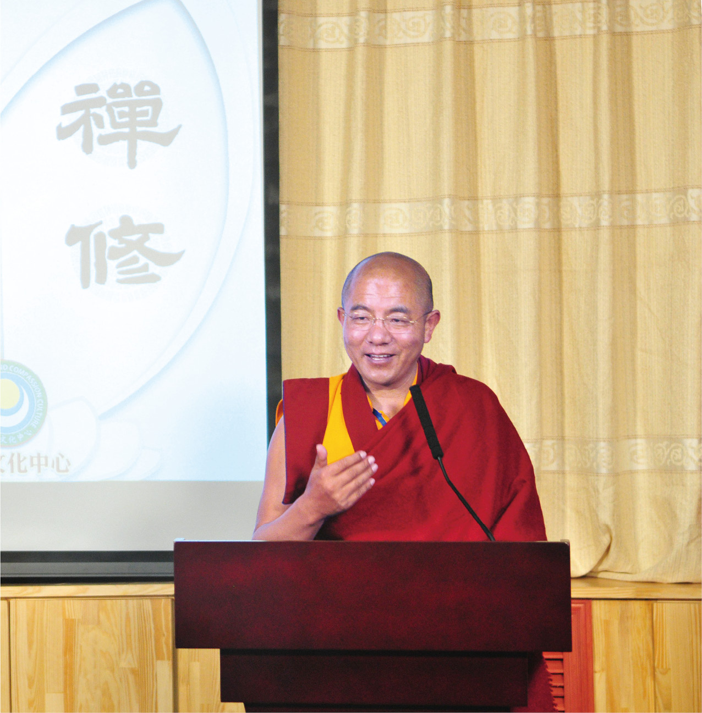
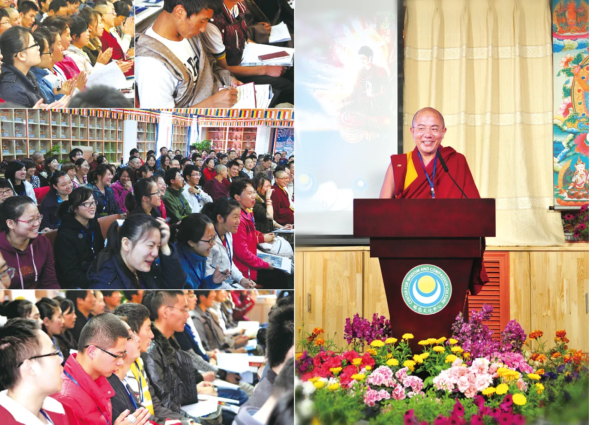

# 世间禅与出世间禅

禅修开示

## The meditation of mundane and super mundane

a meditation instruction

2011年8月11日

## 一 禅修的重要性

刚才，主持人请我讲《释迦牟尼佛修法仪轨》。关于这个仪轨，你们自己看一下就行。这里，我只是稍稍补充一点。

首先，我想说的是，信不信佛教是你的自由，我们不会用任何一种方法引诱你进入。即使有的人想出家，我也没有同意。一般来说，我不是很赞叹知识分子来这里出家。我让他们观察自己的心，出家的决定是不是深思熟虑的结果。

不然，你初到寂静地，刹那间产生了一种感觉：啊，出家是多么清净啊！但是，时间一长，你偶尔萌发的不成熟发心就渐渐退失了。对你们自愿出家，我都是抱持这样谨慎的态度；对你们信教更不会强求，会尊重你个人的抉择。

在座的同学，有的对佛教有信心，但对佛教的教义又不太了解，带着这样一种信心，跟着上师或什么人到处跑，既浪费时间，又容易趋入歧途。如果没有缘起，你不会值遇很好的上师。各种修法那么多，以后都可以求，这些都不是很重要的。重要的是系统学习佛法。

关于“禅修”，我先简略讲一下禅修对社会和个人的重要性。

现代社会上很多人，不论是企业家、领导，还是学校里的老师，都心力交瘁。从表面上看，科技发达给人身心带来诸多便利。但是，科学越发达，社会越发展，人类越贪得无厌，即使拥有再多也是欲壑难填。在短暂的一生中，一直不断地向前追逐，直至生命的终结。

有些人可能是前世习气，或者今生没有修心，他的心非常急躁、任性，无法控制；无论做什么事，一不顺心就大发脾气生嗔恨心，或者陷入极大的忧悲和苦恼。有些人分别念特别重，想象力格外丰富，一点点小事就歇斯底里，无缘无故就大声哭泣。这样的人非常需要禅修。

基督教、道教和印度瑜伽，在中国各大城市都有冥思道场或瑜伽馆。瑜伽为当今社会人们的身心带来了一线清凉和宁静。

因此，在座的各位要了解，究竟什么是禅？

我去过清华、北大、复旦等大学，它们都有禅学社。国外著名的大学，如耶鲁、哈佛、剑桥等，也有禅学社。禅学社应该对禅有比较广泛的了解吧。

禅修分世间与出世间。要进入真正很深的禅，就要入出世间禅，也就是佛说的波罗蜜多的境界。当然，在生活中，依靠世间禅就可以舒缓身心。

我觉得，不论是世间禅还是出世间禅，对你们的未来都非常重要。你们踏入社会以后，家庭、工作和生活的压力会使人不堪重负。每天放松身心，禅坐一个小时，对缓解疲劳和紧张的情绪，有出乎意料的效果。

如果你有了一定的禅境，就可以把所有事都放下，进入到更深的禅修中。这时，你要选择一个不受干扰的地方，但不一定要去山谷闭关。没有真正的窍诀，即使闭关也不会成功。

## 二 禅修的条件

佛教的根本教义就是戒定慧三学，其中戒律是三乘佛法的基础。经中说：由戒生定，因定发慧。所以，首先要持戒。没有戒，一切功德都不会产生。

有些人认为，佛教有很多条条框框，非常麻烦。其实，完全不是如此。“戒”就是一个人的人格，就是怎样做人。

世间有的人，天天偷盗、杀戮，这样的品行，根本谈不上更高的功德和境界。因此，不要把戒律看作一种特殊的约束、一种控制的手段。在看似一模一样的人中间，有些人层次很高。比如佛教中有居士五戒，就是不杀、不盗、不邪淫、不妄语、不饮酒，这是做人的基本道德。社会上有很多人，包括一些党员最高的境界也是如此。如果你违犯了这些事，你连基本的人格都没有。假如在居士五戒的基础上，能进一步受菩萨戒、密乘戒或别解脱戒中的出家戒，这样一层一层受持更高的戒，也就是一步步完善你的人格。

所以，戒定慧中的“戒”，就是怎样做一个真正的好人。在高尚人格的基础上，你的心才能清净，才能安静下来。如果心不寂静，不要说出世间的成就，连世间的快乐也不可能得到。比如你在一个单位上班，心如猿马不能安住，不久就会被老板开除。到了另一个单位，又会如此。朝三暮四或暴躁的人，到哪里都找不到清净的世界，到处是缺憾、纷争、仇恨和痛苦。这就是没有“定”的原因。

有了定就能衍生出智慧。有些法师、大学生的学习为什么特别好？就是因为：首先，他有善良诚实的品德；在这个基础上，他的心沉静稳定。这样，他的智慧就能慢慢成长。如果你心不定，即使有智慧也容易退失。我记得佛经中有这样一个比喻：没有禅定，人的智慧就像风中的灯。风中的灯，虽然闪耀美丽，但很快就会被风吹灭。

一个人可能具有智力和天赋，但是，若既缺乏人格基础，又不具备禅修的寂静，他的智慧则如无源之水，不会带来真正的利益。

## 三 禅修的历史

为什么禅宗大德能长寿无病、气色如婴儿一般？为什么印度瑜伽师能在一个月中，安住不动，不吃不喝，在没有氧气的封闭洞穴中坐上六天，而一般人连两小时都坐不住？

现在很多人去印度求瑜伽，其实，佛经中就有瑜伽。“瑜伽”在密法中叫玛哈约嘎、阿努约嘎或阿底约嘎。其中“约嘎”就是“瑜伽”，藏文叫“那炯”，意思是心入于本来的状态。

从历史上看，印度瑜伽是相当神奇的。我记得有关阿底峡尊者的故事中提道：在朗达玛灭佛后，藏王智光、菩提光为了重振佛教于西藏，前后派了许多智者去印度，最后终于请到了阿底峡尊者。

在去西藏的途中，一天，阿底峡尊者一行来到恒河边，看见一位老瑜伽士，把一具孩子的尸体放在岸边，自己跏趺坐入于定中。一会儿，老瑜伽士颓然倒下，孩子却站了起来，把瑜伽士的尸体扔进恒河，头也不回地走了。藏地学者心中不解，问阿底峡尊者：“这究竟是怎么回事呢？”阿底峡尊者说：“禅修中有一种‘夺舍法’，又叫‘迁识法’，是一种借尸还魂法。瑜伽士老了，找到一个年轻尸体，就将自己的神识迁移到那个身体里。”

藏地也有玛尔巴之子达玛多德“夺舍”婆罗门子尸体的公案。这是一个真实的故事，出自一段可靠的历史。

印度依然保存着古瑜伽的传统。在古瑜伽中，一般会吸收不同宗教的内容，既有佛教，也有婆罗门教等。迄今为止，印度都不愿开放，这是有其宗教、历史、文化等原因的。20年前，我去过印度，发现很多藏人、汉人到印度后，一直保持着一种原生的生活状态。我觉得非常好。

印度人特别重视素食，不像中国天天杀生吃肉。等你们完成学业，挣了钱后可以去印度朝圣。印度航空公司以前只供应素食，听说直到现在，有的公司依然如此。而在我们的飞机上，要得到一份素食却非常困难。当然，目前印度经济发展不如中国，有一定差距，但是他们原有的珍贵文化，却保存得相当完好。

印度的每个饭店都有咖喱，咖喱是非常清净的食品。刚吃时不知是什么味，既不是辣，也不是咸，是一种很奇怪的味道。但是在离开印度后，有时我会想：“什么时候我还能再去印度，吃上他们的咖喱呢？”

除了印度瑜伽，中国和日本的禅文化也曾风行一时。20世纪五六十年代，日本就有企业家禅令营。那时中国还没有完全开放，反对气功等一切禅修活动。昨天，一位人民大学的学生说，我们的思想处于非常狭隘、封闭的状态。确实如此。那时在藏地，只要发现山洞中有人坐禅，这个人就会立刻被投入监狱。直到80年代以后，气功才在汉地悄悄地兴起。

有一位美国总统说：二十多年前我来过中国，那时候每个人都穿一模一样的衣服，但是现在，大家都穿得五颜六色。在座的同学也许还记得他的话。每个人的心态不同，爱好不同，在外相上必然会有不同的选择。

80年代后，人们纷纷学习中功等气功，也有人通过气功趋入真正的禅修中，包括这里的一些大法师。汉地有些比较著名的法师也练过气功，练到心静时，生起一种不同于以往分别念的特殊觉受。之后，他们皈依佛门，成为当今佛教界的栋梁。

我曾经专门了解过气功到底讲了什么，为什么会形成一个全国性的气功热。后来发现，气功借用了一些佛教理论，有关气功的原理都可以在佛法中得到诠释。现在有些地方举办企业家禅修之旅、静心营、禅商文化讲座等等，在短短的几天中放下一切，松弛而坐，收到了非常良好的效果。

## 四 什么是世间禅

本来我们生活在压力、恐惧和忧郁中，禅修后身心平和，心与大自然融为一体。所谓瑜伽的意义，虽然有多种翻译，但“合而为一”可能是最恰当的。“合而为一”就是把心找回家，让它平静、沉淀，从而发现它的本来面目。

现在世间流行的禅，都属于世间禅，在佛教中叫“凡夫行禅定”。比如，在大学中参禅，心不执著于任何一法，安住在不执著中。禅定时会出现的三种境界：一种是空，心空无所有；一种是明，心了了分明；还有一种是无念，心中不起任何念头。又叫：乐、明、无念。

“乐”是轻安、快乐。这种乐受，世间任何一种快乐都不能比拟。城市中一些特别疲惫的人，一旦参禅，就不想从定中出来，可能就是因为“乐”的缘故吧。

我去五台山的时候，有个和尚对我说：“我现在禅定境界很高。”我问：“怎么个高法？”“我现在出定入定时，什么念头都没有，每天都处于无念中，太舒服了。”还有一种舒服在里面，也是无念。本来我们的分别念此起彼伏，若能不起任何念头，也是很清净的。

汉地寺院常举办禅七夏令营。七天中，每天从早上八点到晚上六点，大家坐在禅堂里观心。那时会有禅师引导：“现在你什么都不要想，不要分别，心是明明清清的，是空的……”心本来就是空、明、无念的，这就是世间禅。它有没有作用呢？有，但只是暂时的作用。

在印度瑜伽中，世间禅有五大派别。其中，哈他瑜伽是最广为人知的。它通过身体的姿势、放松的技巧和呼吸，来达到训练的目的。在一呼一吸时，原来漂泊的心，能找到回家的路，即使找不回来，也能知道自己的心是多么动荡起伏、一刻不停。经常这样练习，心会变得非常宁静。

“凡夫行禅定”，不能根治相续中的贪心、嗔心、痴心等烦恼，但能暂时压制粗大、浮躁的分别念，甚至将它摧毁。不过，摧毁的不是本质，不是习气，只有出世间禅才能从根本上彻底摧毁心中的烦恼暗习。

印度瑜伽中大多数都是世间禅。这一点，各位一定要清楚。你们在参禅时，一定要观修心的空性，这是世间禅与出世间禅的分水岭。

## 五 什么是出世间禅

在佛教中有“凡夫行静虑”“义分别静虑”和“缘真如静虑”这三种分类。

如果你安住在诸法无自性的心念中，通过心的空性，断除心的无念、明、乐的状态，是第二步境界，叫“义分别静虑”。第三步境界就是远离一切空和非空、明和不明的执著，这就是“缘真如禅定”。

在禅修过程当中，有人感受到乐、有人住于无念、有人住于空，这三种觉受中，空的感觉是比较好的。但这种“空”，只是一无所有、豁然空虚的状态，并非是对诸法显现的当下没有丝毫实有本性的认识。

安住在世间禅中，最高可以达到四禅八定，却不能从三界中解脱。要从世间禅进入真正的出世间禅，仅仅“义分别禅定”的“单空”是不够的，还要达到缘真如本体的禅定，就是远离空与不空，认识心的无缘赤裸的本性。这种境界，在禅宗中叫明心见性；在密法中，称为认识觉性。

大圆满密法中讲到光的明点。其实，人的心有一种自然的光，这种心的自然智慧的光明，会呈现在心外。在虚空的映衬下，可以在空中看见这种光。密宗的托嘎修法就是观清净透彻的蓝天，以顿超的方式见到了然明然的心的境界。当然，刚开始时什么也看不到，但慢慢地，就可以看见一些佛像。这是为什么呢？就是因为我们的心与佛陀无二无别。

除了利根者以外，三言两语是不会明白的。利根者依靠《六祖坛经》《金刚经》《大圆满直指心性》等任何一法，都能幡然开悟。从此，他的言行举止会出现翻天覆地的变化。

这种现象自古以来就是存在的，是不可否认的。

但是说实话，你们离这些窍诀还相差很远。这样的修法，要在学习佛法十几年，并完成加行后才可以传。像主持人刚才说的生起次第、圆满次第，在没有弄懂它的义理和窍诀前，自己不能盲修瞎练，否则不仅无功而返，还可能出现一些不良症状。

在藏传佛教中，禅修分了五个阶段：刚开始时心如飞瀑，一刹那都不能安住；而后就像山谷中湍急的流水，流速已经减缓，这时心安住的时间很短；之后就像江河一样，只有到了岸边，才发现它川流不息，此时的心已经比较稳固，但还有一些分别念；第四阶段犹如大海，远看风平浪静，近看还有细微的动摇；最后如须弥山王，不为狂风所动，这时心不管专注何方，都能随心所欲。

对大学生来讲，修世间道教的禅、基督教或其他宗教的禅，或世间一般明、乐、无念的禅都可以。但是，要进入真正的禅，就要修出世间禅。这时，发心是最重要的。

比如声闻乘希望从三界轮回中解脱，发心后安住下来，按照四念处，观修身体、感受、意识和法。贪心严重就修白骨观，嗔恨心严重修慈悲观。《阿含经》中宣说以五种所缘的方式来修。最后证悟人无我，获得声闻果位。如果是大乘禅修，目的不是为了身体健康、消灭烦恼、获得解脱等，而是为了利益一切众生。

在座的人如果要参禅，你的意乐和发心是什么？是想自己快乐呢，还是让天边无际的众生快乐？如果是后者，先皈依、发心，再参禅。

大乘三十七道品的一些修法，与声闻乘一些内容相同。不同的是，前者以法无我摄持，后者以人无我摄持。以空性摄持的禅定，叫止观双运。止，是寂止的止；观，是观修的观，是对诸法本体空性的证悟。禅定不仅仅是心安住下来，还有证悟空性的境界，而后在这样的境界中安住。

宗喀巴大师《菩提道次第广论》的后部分，讲的就是止观。因为非常深奥，宗大师写着写着，心想：“即使写下去，也不会有人懂的，还是不写吧。”他搁笔后，文殊菩萨亲自现身，对宗大师说：“你还是写下去吧，肯定会有人懂的。”很多大德在传法时，看到众生根基低劣，与深法不相应，所以不愿传深法，只讲一些粗浅的法门。

今天，我放一尊释迦牟尼佛像在面前。《菩提道次第广论》中也说，观修时，要以观佛像为主。如果你们有时间，最好看一下《白莲花论》最后部分的“释迦牟尼佛修法”，还有《华严经》《大集经》的公案。

我经常放一尊释迦牟尼佛像在面前，如果心实在静不下来，就睁开眼看看佛陀，而后闭上眼睛。此时，佛的影像自然在心前浮现。心在这样的状态中安住，不会出现任何违缘。要让这样的境界稳固和明显，就要持续修行。

如果你的心因此安住，当然非常好；如果不能，一直看着佛像，也能在相续中种下善根。不论你信佛与否，这样观想对你百分之百有利，不会有任何危害。

所以，我想送每个人一尊佛像。这尊佛像是我特意定做的，装藏非常珍贵、圆满。你们要找一两个上师吹气可能很困难，但这尊佛像，请所有僧众开过光，它的加持是更大的。发心人员不要伤心，也许以后，我能送你们一尊。

不管到哪里，我都会携带一尊佛像。这尊像小小的，你们出差或到什么地方时，随身携带会很方便。虽然它不是古董，但一般来讲，要做得这么精美、这么庄严，是很不容易的。希望你们一辈子都能好好珍惜，经常观想。

现场互动

问：我不承认“我不存在”的观点。昨天的我和今天的我，都是非常真实地存在的，每个人都看见我了，希望您能解除我的疑惑。

堪布：只有在学习中观后，才能彻底明白“我”不存在。但这不是在显现的层面，在没有进行任何理论观察的情况下，“我”是存在的。而是在究竟的层面，在用真理观察时，不承认“我”是真实存在的。

现在，我问你，你认为你是真实存在的吗？如果是，那么，你承不承认昨天的你，也是真实存在的？如果是，昨天的你和今天的你，究竟是一体还是他体？

如果是一体，昨天的你做了什么，今天的你也要做那件事，你永远都在做同一件事，因为你们是一体之故。这样，你永远也不会老、不会死。

假如你说，从相对而言，你是静止的，是同一个人。如果是这样，真实的你就不存在，因为你需要观待。而实有的法，永远不观待任何条件。

问：我在听您讲法时，常常走神，甚至不知道讲法已经结束。当我一个激灵醒来时，又不知道刚才想了些什么，整个人模模糊糊的。我想问您，我这神去哪儿了？为什么就不记得看过的东西了呢？

堪布：佛经中说到两种障碍：一种叫昏沉，一种叫掉举。你暂时想不起心去了哪里，模模糊糊，似醒非醒，这就叫昏沉。你想不起出神的时候想到或看到的东西，就是因为昏沉的缘故。

掉举，也就是我们经常说的散乱。这样的人虽然坐在经堂中，但心识却云游各国。不仅听法有这种现象，在学校听老师讲课时，也会经常发生。分别念四散，其实是一种迷乱的相。心识有无分别和分别念之分，你的分别念虽然四处游荡，但无分别的心识却一直在那儿。

问：我从江苏坐火车来时，说自己一定要皈依上师，我不知道这种信心从何而来。昨天一个同学就问我，你为什么要皈依？我脱口而出：“机缘到了。”我想问一下，什么是机缘？另外，违缘到底是怎么回事？怎样甄别呢？

堪布：人生有一些巧合或因缘。你千里迢迢，为了皈依来到这里。也许，你皈依佛门的因缘已经成熟。你不知道自己为什么那么说，但你说准了。

在修行过程中，违缘是正常现象。如果翻开前辈高僧大德传记、历史书籍，就会发现，当人们有一定的突破或成就时，一定会遭遇很多违缘，但是在违缘前不能屈服。佛教不把违缘看作违缘，违缘具有很多深刻的意义：它可以磨练我们的意志，增上我们的信心，开启我们内在的智慧。

当出现不顺利的征象时，我心里会想：“哦，可能会出现违缘。”事实上，我还看不出它究竟是违缘还是顺缘，但我不会因为违缘就放弃了有意义的事。如果是没有很大意义的事，我会考虑是否还要继续。当时间过去，回顾往昔，我发现违缘已成为顺缘。到了那时，你会甄别的。

问：我是贵州大学的学生，平时看佛经或您的著作时，很愉悦也很欣喜，但真正碰到一些事时，比如生病或人际关系的问题，就想不通、看不进书。我应该如何改进呢？

堪布：你学的只是理论，如果不实修，在遇到生病或不愉快的事时，很难处之泰然。不要说你，在佛学院学了很久的人，也不一定能对治。当我疾病缠身、极度疼痛时，也很难转为道用，心里也感到很惭愧。但假如有一定的修行境界，则所有的身苦和心苦都会烟消云散。

虽然如此，学佛和不学佛，还是有很大差别的。当你真正明白痛苦是净除业障的扫帚，是无常、空性的道理时，面对痛苦，你会迥然不同。此时，你会以善巧的智慧来抉择它的本性，并将它视为修心的良机。
