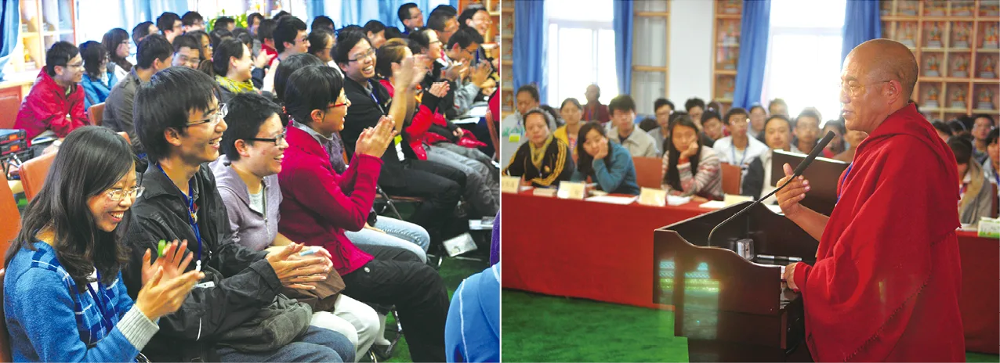
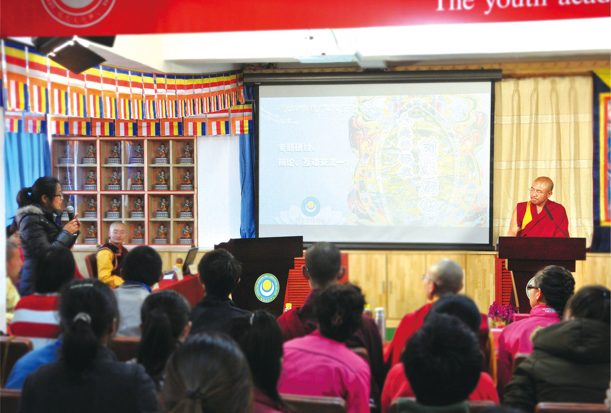

## 以科学精神探索前生后世

## Exploring previous and after life with scientific spirit

2011年8月10日

诸位学者、喇荣五明佛教大学的诸位法师：

大家好！

在这次研讨会上，我们有意邀请了一些非佛教徒，希望非佛教徒们不要感到拘束，不要觉得受到了限制。这次“青年佛教学术研讨会”虽然以研讨佛学思想为主，但同时也是一个自由、开放和平等的平台。希望通过此次研讨，你们能获得真正的利益。这既是我们的初衷，也是你们来到这里的目的。

20年前，我曾写过一些探索前生后世的文章，最近，也出过一些书和光碟。我认为，佛教徒既要了解基督教、天主教的教义，也要去一些非佛教徒的场合——刚才王博士说，有些尊者到他所在的大学讲学时，不去哲学或宗教研究所，而是去生物化学研究所。

酷爱修行的人可能对我有看法：“堪布不好好修行，为什么天天和不信佛的人扯来扯去？”不过，以此因缘，再过20年，在座的诸位或许会找到人生的真理，这就是我们的目的。

## 一 应以科学态度研究前后世

我对前世今生有坚定的信心。刚才有人问我，是不是能看到自己的前后世？我不能看到，但我以信心作证。

《大般涅槃经》中说：“不见后世，无恶不造。”人如果不知道有前后世，他即生中的人生观和价值取向，就只会为了短短几十年的利益。如果人生只有几十年，怎么过都可以，但是，人的确存在前后世。今生的几十年，关乎每个人未来世的命运。所以无论信仰宗教与否，都应该对这个问题进行深入细致的研究，得出一个符合真实的、客观的结论。

刚才王博士说，希望得到加持，让他当下具足宿命通，看到自己的前世。这是很困难的，但我可以送你们一本书，慈诚罗珠堪布结合佛教与科学造的《前世今生论》。

我在翻译这本书的过程中一再感受到，如果能真正学习此论，就不得不承认前后世。书中的推理、证据是不可否认的。如果试图否认，你至少要花十年时间去研究。

学任何知识都不是轻而易举的。首先要一遍遍阅读、思维——以王博士的学识也许不用花太长时间。读完后，请你告诉我你信不信，如果信，你会考虑：“我下辈子会变成什么样？怎样才能在今生和未来的生生世世中趋避痛苦，得到真正的快乐？”对人类来说这是最重要的。

很多年轻人都不懂得这个道理，也从未受过这样的教育，这是非常可惜的。我每到一个繁华都市，心中都会感叹：“一个人无论地位有多么尊贵，财富有多么圆满，有多少人羡慕赞叹，如果连前生后世都不懂、不承认，那他已经成为毁谤真理的人了。”

现代一些大学生行为盲目，思想封闭，受教育的范围狭窄，当然这是情有可原的。刚才申博士也说：“现代教育处于一种单一的氛围中。”的确如此。你们从小学、中学、大学本科乃至硕士生、博士生阶段的教育中，从未涉及过这一领域。老师也不了解，就随随便便予以否认。大多数人人云亦云，说的人多了，似乎就成为一种真理。

尚未思考过这个问题的人，你不一定要承认，但你一定要有一个公正谨慎的态度，要以科学的精神去证明前生后世是否存在。

## 二 前后世存在的理证

佛教不仅仅是一种信仰，如果因为是佛陀所说就正确无谬，那是不合理的。我们之所以诚信佛陀的语言，是因为它完全经得起逻辑的推敲。

法称论师在《释量论》中，对前生后世存在之理作了无可辩驳的严密推理。今天，组委会特意在主席台上挂了法称论师的唐卡。在印度佛教史上，法称论师以雄辩著称。通过因明推理，他建立了两个主要论点：

一是前生后世存在，二是释迦牟尼佛是无与伦比的导师。在东西方一致公认的逻辑推理前，任何一位学者对此都不得不接受。

在座的各位一定要学习前生后世的理论。任何一个理论，尤其是非常微妙的、深奥的理论，你不可能立刻明白它的意义。

有人问：既然前生后世存在，为什么我想不起来？

这是一种未经思维和观察、经不起推敲的推理。你想不起来，不一定不存在。不要说前生后世，一两岁时的情景，你是否能想起来？

这次研讨会不是以信仰来判断和决定，而是要以理服人。我们所提出的前后世存在的观点，是建立在大量事例、逻辑推理、教证和比喻基础之上的。从人类历史之初，到当今的21世纪，还没有人能真正推翻前后世存在之理。如果真的有人能推翻，佛教徒会随从真理而承许。

我在读书时也有过这样的疑虑：“假如真的是人死如灯灭，那么，行持念经、转转经轮、学习佛法并修行等任何一种善法不都徒劳无益了吗？”

随着深入研究佛教因明和中观，对现代科学和哲学理论进行观察和分析，再加上身边和世间的很多案例，我个人对轮回深信不疑。这不是人云亦云、随波逐流，而是30年来反复钻研的一个结果。

## 三 前后世存在的案例

对前生后世的研究，可能要花很长时间。美国弗吉尼亚大学史蒂文森博士（Ian Stevenson, 1918-2007），十多年来，依靠私人基金会的帮助，搜集到1700多个转世个案。其中大多数事例都能找到证人和历史根据。当史蒂文森博士排除其他可能的动机后，得出了一个惊人的结论：

轮回可能是真的，死亡并不是终结！

我曾读过他写的《二十案例示轮回》（Twenty Cases Suggestive of Reincarnation）。从那以后，史蒂文森博士奔波于世界各地，在40年中收集了3000多个案例，发表了几十篇学术论文，被后来的研究者引为经典。

从古至今，一直有很多前生后世存在的案例。一个名叫詹姆斯·雷宁格（James Leininger, 1998-）的美国男孩，回忆起自己前世是一位海军飞行员，在二战期间，他的飞机被日本炮弹击中，导致机毁人亡。美国各大新闻媒体都报道过他的事例。

2009年，印度一位名叫阿杰的16岁少年死于车祸。阿杰生前曾告诉家人，在1984到1993年间，他以人、苍蝇、蜜蜂和蛇的形态，在同一个家庭转世5次。最初，他转生为家中的一个男孩，6岁时，由于邻居没有孩子，十分嫉妒，把他毒死了。后来他先后转成苍蝇、蜜蜂、毒蛇以及家中一个两岁的孩子。对于每一次转世，他都记忆犹新：6岁时，邻居怎么对他下毒；他在院中变成一条毒蛇时，他婆婆怎么把他打死。

他的故事，印度所有媒体都报道过。虽然他转成蜜蜂、苍蝇的事无法查证，但对其他转世，所涉及的当事人都已经完全证实了。

对生命学家、心理学家等科学家来说，前后世是一个谜。但对佛教而言，这不是秘密。

你们有的从国外飞来，有的从东北、内蒙古、青海、海南等地飞来，有的是依靠其他“神通”而来，你们希求真理的精神非常可贵！我希望来自各国各个不同信仰和研究领域的学者，都能以严谨治学的态度，说出令人深省的道理。

现在是21世纪，各个国家都以和平共处的理念，互相尊重，共同合作。佛教徒和非佛教徒之间也应和睦共处。这样，人类才会有真正的幸福和快乐。

现场互动

问：我来自河北师范大学教育技术系，我带着半信半疑的态度来参加研讨会。我想问的是：在科学中可以作出假设，通过一系列实验去验证这个假设，得出一个结论。而佛教前世今生的理论及有人口述自己的前世时，是否有一种方法去证实？

堪布：第一个问题，前生后世的理论，有没有一种方式证实？有。《释量论》和《量理宝藏论》中说：众生今世第一刹那的心（有法），是依靠前世心识这一根本因为前提的（立宗），因为除了自己前面同类的因外，不观待其他任何法之故（因），就像我们现在的心（比喻）。

今生的第一刹那心，前面肯定有心。为什么？因为心的近取因（最主要的因、根本因）就是心，除了心以外，不可能从其他任何法中产生。有些人可能不承认，它不是观待我们的身体和父精母血吗？但这是次要的缘，不是根本因。而心识的根本因不是心识的理由，是无论如何也找不到的。同样，如果没有遇到其他障碍，未来的心识也会不断地存在，具足因的缘故。这个三相推理非常尖锐。如果你觉得这个推理无法证成，可以在台下和我辩论。

第二个问题，你认为用科学实验来证成前后世比较困难。是这样的。科学实验一般是在物质上试验，而心灵是无形之法，是非常微妙的。比如，现代科技可以把声波变成无线电波，又还原成声波，双方都可以听见；中阴的心识，也如声波一样。最初是可见的身体，离开肉体之后，成为无形无色的意识之身，而后，又转为下世的身体。对此，西方科学家已用科学实验证实。

英国医生山姆（Sam Parnia）在对濒死病人进行的试验中发现，100个人中，有7个被抢救过来的病人，能说出自己灵魂离体时，看见他放在天花板下方一块不透明薄板上的小物体——除山姆外，没有人知道这些小物体是什么。但在濒死体验中，灵魂飘到天花板上，看见了它们，所说的内容和真实情况完全一致。山姆是世界上首次用重复科学实验的方式证实“灵魂”存在的人。

最初，你持半信半疑的态度，这样非常好。禅宗说：大疑大悟，小疑小悟。假如小疑，就不会有探索真理的欲望；如果大疑，在经过长期不懈的努力之后，一定能遣除一切怀疑。

问：很多调查说，因为前世被枪杀或其他原因，转世后身上有前世遗留的标记。这种说法有没有根据？

堪布：以我们有限的意识，无法企及众多甚深的领域。龙猛菩萨之后出生的圣天论师，在距今两千年前，就已在《中观四百论》中，讲述过这样的问题：

茅草房中有一桶酸奶，一只灰白色的鸽子，从茅草房顶上走过。鸽子的脚印，清晰地出现在酸奶上。鸽子并没有踩到酸奶，然而，鸽子、酸奶、从茅草顶棚走过这些因缘聚合时，这神奇、不可思议的现象却会产生。

同样，圣天论师说，因为一切万法都是空性，只要条件聚合，如幻的现象就会产生，这是一种自然规律。前世的身体虽然已经湮灭，但依靠心识离开前世去往后世，前世身体的印记、心识田中的种子等等因缘奇妙聚合，前世的痕迹，也会在后世的身体上显现。

问：整个大千世界生命体的数量是恒定的，还是有变化的？它们之间是什么关系？每个个体最初是如何产生的？又如何在六道轮回中迁变？最后又会怎么样？

堪布：事实上，不仅是生命，物质也同样如此。按照佛教理论，世界有成住坏灭四个阶段，就这样周而复始。

此生的生命，从整体而言，属于一个总的生命体系；别别来说，在每一个众生还没有成就前，生命就会不断延续。但是生命有没有一个恒定的总数呢？没有。

佛教讲众生无边，原因是我们的世界无量无边。如刚才一位学者所说，如果你读过《华严经》玄妙的华藏世界，就知道世界浩如烟海。从世间的角度看，不仅是整个宇宙，即使是自己的生命，也是不可能了知的。

依靠天文学家，最多只能看到一个地球、几个银河系；无量无边的世界体系，天文学家还认识不到。生命也是如此。在浩瀚的世界中，有无量无边的众生。每一个众生的心识，都持续不断地存在。这种存在，是非常神奇而又微妙的。

任何一个学问，尤其是难以思议的道理，不是任何人都能了解的。比如量子力学，虽然科学人士对它深信不疑，但对其他人来说，很难了解其堂奥，只能是半信半疑。

问：佛教说：只有同类才能产生同类，心识不可能从身体和父精母血中产生，只能从心识中产生。我想问，如果把桌子烧了，它变成了烟，这还是同类相生吗？为什么在有情和无情之间，不能非同类相生呢？

堪布：以肉眼和分别念观察，烟是从火中产生的。火是炽热的、明亮的，与所生的烟似乎并非同类。但是，按照《量理宝藏论》，从同一相续的角度，也可以称之为同类因。但如果详细分析，烟有烟的近取因。现代物理学也证实了这点：烟的近取因，就是木头的分子。烟，事实上是很微细的、碳化了的木头颗粒。这就是问题的关键。

心识也是如此，不可能从物质中产生。心识能照见和觉知内外之法，能决定和取舍，它与无情之法，就像水和火一样互不相容。如果心识能从父精母血等无情法中产生，那么水中就能够产生火。

任何一个事物，依凭肉眼所见、分别念思维得出的结论，不一定是可靠的。因和果之间，有一条非常微妙的直线。如果能学习《量理宝藏论》和法称论师的《释量论·成量品》，你会对心识只能从心识中产生的道理，有一个全面的了解。

问：很多人都说，自己有灵魂出窍的体验，以此来证实轮回是存在的。灵魂出窍真的存在吗？

学员：我毕业于重庆交通大学。因为以前练过气功、接触过密宗等，就有过灵魂出窍的体验，所以很坚信人有前后世。灵魂出窍的感觉是很可怕的。我记得高三时，我每天打坐，觉得好玩，也并没有追求书上说的神通等。当时就是按照书上所说，朝着上面观想。

一个多月后的一天，大概是凌晨两点多，突然之间，一下子就感觉出来了，感觉自己飘到天花板上。但是不能穿过天花板，只能顺着飘。然后到窗口了，就特别害怕飘出去。因为当时一想到出去，就觉得会死掉，会回不来了，就怕这个。最后我就回来了。当时那种感觉就是周围一片寂静，我能看见自己在那儿打坐。大概就是这样的，很恐怖。这让我想起一句话，就是人对于未知的事物都存在一种恐惧感。在那次体验之后，我就很爱看一些哲学、心理学方面的书。

法师：以前我班上有一个道友，是浙江的济光法师。他给我讲过一段他的亲身经历。他在中学的时候从四楼掉下来，脑袋朝下，一下子摔昏了。摔昏以后他的灵魂马上就出来了，觉得自己飘到了大树上。然后他看到树上有个鸟窝，里面有麻雀，他就去抓窝里的小鸟。他一抓小鸟就飞了。再后来，他看到老师和同学们在抢救他，但他却一点痛苦的感觉都没有。整个抢救过程他都看到了。后来，突然他就回去了。回去以后，他觉得眼睛剧痛，之后便落下了后遗症。脊柱受了伤，身体很不好。他在我班上待了几年，实在扛不住就下山了。

虽然这不是我的亲身经历，但我相信老道友他跟我说的不会有假。这是我补充的一个例子。

堪布：我们曾经采访过这样的人。他是色达县人，不愿透露自己的名字。他在被抢救时死去，神识离体，来到医院上方的天空，看见医务人员正在紧张地抢救他。他非常轻松、舒适，同时，也感到隐隐的担忧和恐惧。

他来到急救室隔壁，那里有很多熟人等候着。他们对他视而不见，听而不闻。他莫名其妙。他发现，墙壁对他没有阻碍，他飘浮着，目睹了当时的一些场面。后来，他生出一念：我不能这样，还是回去吧。一念之下，他昏厥过去。过了两天，他被抢救过来。

每次，他回忆起那段经历，泪水都止不住地流。他说：“轮回真的很恐怖。那时，我可能已经是中阴身，如果没有回来，就真的去了后世！”如果有人想了解生命的奥秘，我相信，在没有信仰的知识分子和普通百姓中，也会有很多奇妙的事例。
