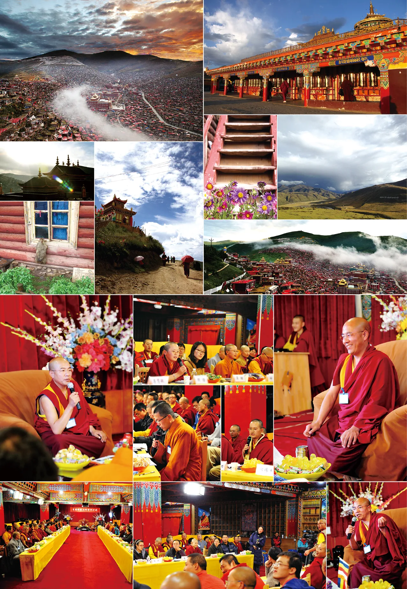
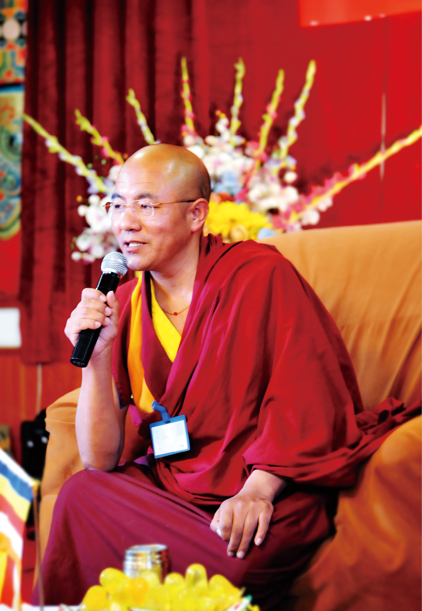
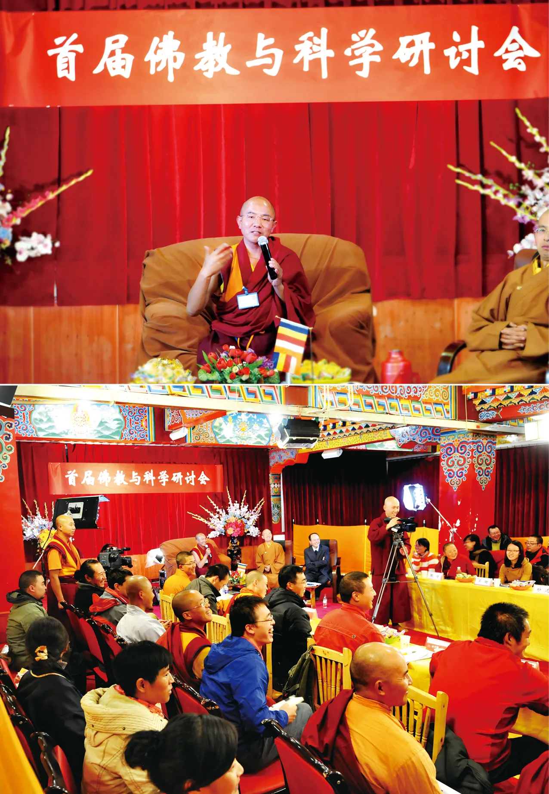

本 届 主 题

佛 教 与 科 学

Buddhism and Science

缘起篇

世界青年佛学研讨会

World Youth Buddhist Symposium

中国·色达喇荣

2010 / 10 / 3

2010年10月，在索达吉堪布的主持下，喇荣佛教大学举办了一次世界青年佛学研讨会。来自全国各地的高僧大德和科学工作者，齐聚雪域，激扬智慧，共同探讨佛教与科学如何整合并进，弘扬真理。堪布不仅为参会者答疑解惑，而且就“极乐世界到底存不存在”“世间快乐值不值得追求”“大乘佛教如何看待安乐死”等人们普遍关注的重要话题，引导大家展开激烈的辩论。

这是一个开始，一个缘起。亮出“佛教与科学”的鲜明旗帜，世界青年佛学研讨会从这里正式起步，走向世界……

## 佛教与科学的碰撞

## collision between buddhism and science

2010年10月3日

主持人：

欢迎大家的到来！我先做个自我介绍。我毕业于英国剑桥大学社会人类学硕士专业，曾在新华社当过记者，在中央电视台做过谈话节目的主编，也在欧盟做过环保工作。非常荣幸能够参与主持今天的研讨会。下面有请索达吉堪布给大家讲话——

参加这次研讨会的，有长期弘法利生的高僧大德，也有长期从事科学工作的知识分子；有学习藏传佛教的高僧大德，也有学习汉传佛教的高僧大德；有信仰佛教的知识分子，也有不信仰佛教的知识分子。

我们大家聚集这里，共同学习和研讨佛教与科学对人类发展的意义，非常有必要，也非常有价值。我先作一个抛砖引玉的发言，然后把更多的时间留给在座的各位高僧大德和知识分子。

很多年以前，我对科学和佛教就很有信心，也做过一些粗浅的研究。今天我首先抛出的话题是：人类既需要精神文明，也需要物质文明。18世纪以来，尤其是21世纪以来，科学给整个人类社会带来巨大利益和重大突破的同时，我们的精神世界也出现了倒退甚至滑坡的现象。基于这样的事实，我提出自己的观点：对21世纪乃至未来的人类而言，佛教都是非常重要的，因为人类的精神文明需要佛教来发挥作用。

希望在座的各位高僧大德和知识分子，都借此机会畅所欲言，开诚布公地探讨一下佛教与科学之间的关系，以及它们对人类社会的发展发挥着怎样不同的作用。希望每一位朋友都提出最尖锐、最有意义的话题，和大家一起进行探讨。如果我有了新的理念或想法，也会和大家分享。

问：我是广州美术学院副教授，中国资深室内设计师，做过很多建筑设计和室内环境设计。一个很偶然的机会让我来到了这里，可能是我跟这里的法门有缘。我在学校，天天给学生上课，一点都不紧张，现在拿起话筒却特别紧张。

我喜欢摄影。可以很骄傲地说，我的摄影水平还不错。我做人文摄影比较多，不过人文很难拍，这些年我一直在考虑怎么做才更好。我去过很多地方，包括印度、埃及和尼泊尔等国。后来，我发现自己应该做佛教的题材，尤其是这次，我来了以后很感动。我今天又去了经堂，拍了很多照片，很兴奋，很激动。

但是，如果只是这样单纯地拍下去，没有意义，因为没有主题。佛教精深博大，有一种力量，有一种精神，怎样才能表现这样的力量和精神？需要找到一个切入点。否则，就没生命力，做不下去。我希望大师和在座的朋友为我指点灵机，让我能进一步深入，把这个题材创作好。

堪布：今天在座的各位朋友，有很多资深的佛教人士，也有初入佛门的，还有一部分对佛教不是很了解，甚至基本上不承许佛教所讲的道理。而这位教授，可能是以一种好奇心，或者说是以一种探索心，来参加我们这个研讨会的。

你的问题，对我来讲不是很好回答。为什么呢？因为从某种角度讲，不管你是摄影，还是拍照，都是一种艺术性的爱好，而我这方面不是很在行。不过刚才你提问题的时候，我想起了自己年轻时的一些经历。跟你一样，我也去过一些国家，天天带着照相机到处拍。现在再看那些年拍的照片，很多都不尽如人意，因为当时用的照相机质量都很差，自己的拍摄技术也不是很好。

那些年，我到任何一个地方，不管是一个城市，还是一座寺院，都拼命地拍。不过，拍下来的这些照片，好多都用不上。有时候想起来，心里会有点失落，觉得心血白费了。有时候也会觉得很值，因为这些照片，有相当一部分记录了法王如意宝去美国和印度弘法的真实过程。对自己的人生而言，这是一段非常美好的回忆。看到那一张张照片，我好像又回到了二十年前、十几年前。当时的场景历历在目，因为有上师在，每一个细节都让人留恋，怀念。

我觉得作为一种个人爱好，最初拍一张照片时，不一定非要设定一个特别鲜明的目标或者理想。只管拍，一张一张地拍下去，到了最后，各种不同的经验和因缘都积聚了，很多东西自然而然就有了生命，可以相互整合，可以彼此呼应，它的价值也许就在无勤中凸显出来了。原本是没有任何意义的一个一个点，渐渐地，在某种道理或灵感的牵引下，可以变成一条鲜明的主线。

今天我们研讨的主题是佛教和科学，你能来到现场，说明在这方面有一些不共的缘起，这也算是一个非常美好的画面吧。我想，你以后会逐渐、逐渐找到自己最好的创作之路。

同时我也建议，如果你有兴趣，最好拍一拍藏传佛教的唐卡画。唐卡画的历史已有两千多年，有着非常神秘的艺术感。一旦你把目光真正投注在唐卡上，从佛教角度来讲，你将会得到很大的功德和加持；从世间角度来讲，现在国际上一些特别著名的摄影家和学者，都坦言自己从唐卡中获得了许多甚深的智慧，你应该也不会例外。

问：我是对外经济贸易大学金融学专业的学生。今天讨论的主题是“佛教与科学研讨会”。旁边一位法师认为，人类要在精神领域有所建树，可能需要更多地向宗教，尤其是向佛教寻求帮助。我的问题是：人类在精神方面的追求能不能从科学本身去获取呢？

首先，这涉及到对西方心灵学[^1]的领域划定。作为西方心理学的深化和升华，心灵学应该算一门社会科学，既然这样，我认为它也应该算科学的一个门类。

西方心灵学是以深度催眠、濒死体验、轮回案例调查和脱体体验等为实践基础的一门灵性学问。它承认轮回和转世，认为人是身体、心智和灵魂三合一的复合体，并在此基础上建立了一个比较大的体系，包括心理治疗、性格塑造和人生规划等分支。

西方心灵学经过几十年的发展，逐渐走向成熟，目前在世界范围内的影响非常大。一本西方心灵学的书籍，在全球可能有上千万的读者，还不包括我这种长期购买盗版书和在网上搜索免费电子资料的人。

我希望佛学界的人士，尤其是学院的各位高僧大德，能够抽出一点点时间去研究一下西方心灵学，做出解释，表明态度——是支持还是反对，是部分支持还是完全支持，是部分反对还是完全反对。对这些问题的研究，不论是在帮助众生解答困惑，还是在佛学的推广上，我觉得都有非常重要的意义。

第二点，西方心理学在探索宇宙和人类存在意义的时候，提出这样一种观点：我们的人生和生命，包括整个世间生活，都是一场经过精心策划的游戏，众生的轮回转世是为了玩这个游戏，体验不同的经历，好的坏的都需要体验。凡是我们所遇见的，一定都是我们所选择的。那些不好的经历，也是我们在这场游戏中为自己准备的礼物，只不过被套上了劣质的包装，但从本质上讲，仍然是礼物，是为了让我们更好地体验生活中的美好。

西方心灵学认为人生是场游戏，是丰富多彩的体验与惊喜，这与佛家强调的人生是苦、需要解脱的观点比较冲突。但这种观点看上去好像也能自圆其说，找不到明显的漏洞。我想请教一下，各位佛家人士、各位高僧大德对这个观点怎么看？

堪布：心灵学涉及好多科学无法解释的神秘现象，包括我们藏地用于预测的卦象，汉地出现的各种“特异功能”，等等。１９世纪，西方的心理学和心灵学基本上是同时起步的，但后来心理学发展得越来越好，心灵学却没有得到全世界人们的认同。这其中的原因，我想可能是心灵学研究的对境比较神秘，不容易被绝大多数人所验证吧。

对心灵学，不能一概而论，里面确实有很多深层的东西，它所涉及的一些境遇，恐怕有些人是因为不能了解，才加以否定。当时的心理学家荣格也表示了自己的这种态度[^2]。

你所提到的催眠术，据说最早是由一位德国医生[^3]发现的，也有人说是一位宗教人士[^4]发现的。莲花生大士的中阴窍诀里面有很多认识梦境的窍诀，和催眠的理论也有一些相通之处。如果对这两种理论进行研究，它们之间应该有能够对应的地方。

至于濒死体验，曾获得诺贝尔文学奖的美国作家海明威（Ernest Miller Hemingway, 1899-1961）在19岁的时候也经历过，他清楚地觉知到自己的神识离开了身体[^5]。中国的传统文化中也有很多这样的记载，包括道教的铁拐李。据说，铁拐李原本长得很庄严，因为要随师父到各地去神游，就告诉弟子，7天中好好守护他留下的身体，然后他的神识就离开了。弟子很听话，一直守着师父的身体。到了第六天晚上，弟子的家里来人说，他的母亲要死了，让他赶快回家。弟子很着急，心想：都过去六天了，师父应该不会再回来了。就把师父留下的身体烧掉了。到了第七天，铁拐李从外面神游回来，找不到原来的身体，最后只好入于附近一具尸体中。这具尸体因为瘸了一条腿，所以铁拐李就成了现在这个样子。

在我们藏地，有很多高僧大德能驾驭自己的神识前往清净刹土，比如莲花生大士的刹土或极乐世界。汉传佛教中也有这样的情况。在不同传承的佛教里，都有许多关于修行人的地狱游记或者西天游记之类的精彩故事。不过，在心理学家和心灵学家看来，佛教的这些高僧大德或普通修行人都是经历过“濒死”的人。同样一件事，他们取了不同的名称而已。

在这两者之间，应该有一些值得研究的地方。只不过以前我们没有机会把这些学问以合而为一的方式进行研究。如果我们真正去研究，可能会发现许许多多的生命奥秘。这只是我个人的看法啊。

心灵学关于人生是一场游戏的观点，刚才法师也说了，轮回的游戏不那么好玩儿，尤其是当你在地狱感受痛苦的时候。事实上，只有真正通达了佛教缘起性空的道理，才可以轻松地宣说：一切都如梦如幻，一切都只是游戏。

问：我毕业于中国地质大学矿床学专业，从事的却是人力资源方面的工作。我不是佛教徒，不知道自己提的问题和科学有没有关系。眼下“2012”的说法非常流行，因为玛雅文化有一个预言，说2012年世界会毁灭。有一部电影叫《2012》，非常火，讲述的也是这件事情。我想问一下，佛家对“2012”的说法怎么看？佛教内部有没有关于世界末日的理论和学说？

堪布：就当前来讲，“2012”确实是人们特别关注的一件事情。我以前讲课的时候，曾在小范围内给部分道友分享过自己的想法。一两年前，我在汉地治病，专门买了一些相关的书籍，在这方面进行了一些探索和研究。

这位先生所问的问题很具有代表性。不仅是我们这里，现在全世界很多国家都非常关注这个问题，而且似乎都处于一种惊慌失措的状态。原因是什么呢？大家可能知道，玛雅文化[^6]形成于公元前1500年左右，非常古老，在天文学和数学方面的测算非常精确，与现代科学测量的很多结果基本一致[^7]。据说[^8]，玛雅文化预言的事情，基本上已经应验，比如说希特勒的出生、两次世界大战、玛雅文化自己的毁灭、人类科技的进步——飞机和火箭的制造，全都一一得到了验证。

现在唯一剩下的就是“2012年世界末日”这个预言了。美国花了2亿多美元来拍《2012》这部电影，获得了2009年世界电影的最高票房——这部电影去年在很多国家好像都是票房冠军。可见这个话题已成为人们关注的热点。

据说，玛雅文化预言，到了2012年，除了非洲部分地方和中国西部——西藏地区以外，世界其他地方全部都会毁灭。按照这个预言，我们全部只能活一两年，然后必须离开世间，所以大家特别恐惧。为了躲避末日灾难，听说有一些城里人开始转移到青藏高原，也有一部分前往非洲。

在当前来讲，这件事情既是佛教徒关注的问题，也是非佛教徒关注的问题，因为无论是谁，大家都特别珍惜自己的生命，关心自己的未来。

我现在以佛教徒的身份来谈一谈自己的看法。我认为，在未来的世界，天灾人祸肯定会不断发生，但是2012年世界不会毁灭。因为根据佛教的各种经论以及推理来判断，不可能发生这样的事。引起大家恐慌的，只不过是一部电影的虚妄构想而已。观众的感官越受刺激，电影就会越赚钱，这个道理大家应该都知道。

从去年开始，我接触到很多关注2012世界末日的各界人士。清华大学的有些教授也向我提过这个问题，我当时也是这么回答的。听说一位名叫皮克顿的玛雅长老已经站出来发表讲话。他谈到，玛雅文化根本不会提所谓的“世界末日”这个词，世界末日论是西方人的观点[^9]。

大家可能还记得1999年8月18号，这一天也曾被大预言家诺查丹玛斯预言，说恐怖大王会从天而降[^10]。在这之前，如果有人拍一部1999年世界末日的电影，应该可以赚很多钱，不过也许是无人发现商机，所以这个题材的电影没有拍出来。当时的气氛也是特别紧张，全世界的人都特别激动，连一些佛教的高僧大德都站出来说：你们快快念佛，不然1999年一到，就要离开世间了。

记得当时我正在讲《入行论》。我在课堂上告诉道友们说，根据莲花生大士和高僧大德们对未来世界的授记，以及佛陀对未来众生寿命的授记，1999年应该会有一些天灾人祸，因为现在人们造业特别严重，但8月18号那天世界应该不会毁灭。

玛雅文化也好，其他文化也好，不管什么预言，都可以理性地拿来和现实进行对比。当时很多人认为，“大预言”曾预言了两次世界大战、希特勒的出生、苏联的解体等，而这些预言都一个一个得到了验证，那么1999年世界毁灭的预言肯定也会发生，“炒”得特别厉害。事实上，1999年世界并没有毁坏。

现在也有很多科学家认为，地球的磁南极和磁北极如果受到刺激，可能会发生南北磁极的互相转移。对此，有一些评论家说，地磁极转移可能会导致人类的精神状况和世界的物质状况发生改变[^11]。

不管怎么样，虽然十多年前的大预言说得很厉害，现在的玛雅预言说得也很厉害，但是按照佛教的各种经论来衡量，世界末日不可能发生，人类也不可能毁灭。当然，天灾人祸肯定还是会有的，这个可以承许。

主持人：堪布给我们吃了一颗很大的定心丸。谢谢堪布的分享。

问：顶礼堪布！我毕业于西北工业大学自动控制系。今天我的问题是帮别人问的。

一位北京的科学家得知堪布主持研讨会，短信发来一些问题。他是中科院计算机所的研究员、博士生导师，国家863计划评审委员会的委员和高级专家。他没有皈依，但喜欢看《心经》《金刚经》等佛经。今年年初本人送了他两本堪布的著作，一本是《金刚经释》，一本是《中论释》。他看后对我说：《中论》看不太懂，《金刚经》略有心得。

他一共有5个问题：

1．佛学中“不一不异”“周遍法界”的概念在物理学中如何理解？既然佛没有“我相”，为什么还有释迦牟尼佛和阿弥陀佛的区别？

2．在量子力学中，叠加态指的是一个原子基础，既处在低能级，又处在高能级，这和佛学中的不一不异、不二法门的说法一致吗？

3．物理学和佛学都强调证和信的统一，但物理学强调先证后信，而佛学强调先信后证，这种理解对吗？

4．现代物理学经常是实验观察到某种现象后，再提出一种理论去解释，只要解释得通，就认为该理论是正确的。随着新现象的不断出现，理论也会不断地调整，这种做法和佛学的因果律是否异曲同工？

5．我最大的困惑是：佛学是静止的，因为佛祖把终极真理都说出来了；而物理学是发展的，因为它还在不断追求新的认知。哪种态度更加合理？

科学家的分别念比较重，问题比较多，请堪布给他解答一下。

堪布：太多了，刚才没记住。科学家的问题肯定很多，不过我们研究佛学的人，问题也很多。以后如果有机会，也向他提很多问题，让他困惑困惑。（众笑）

第一个问题说，佛教讲万法空性，一切都是“不一不异”的，那怎么会“周遍一切”呢？其实佛教所谓的“周遍一切”，是在世俗当中讲的。我们说佛和菩萨的加持周遍一切，法界的妙力也周遍一切，这些都是在名言世俗的范围内所作的承许。

其实，这跟物理学的观点是一致的。刚才有知识分子分析过，量子力学现在已经发展到非常不错的阶段，发现了电子场或者量子场。所谓的场，物理学家认为是看不到、摸不着的一种能量。这种能量无所不及，周遍任何一个法，但是具体的每一个法却不叫能量，不能叫场。

我们如果拿眼前的这个茶杯，问一个物理学家：这是什么？他肯定回答：这是茶杯。在世俗粗大的法里面，这个就叫茶杯。但我们也可以向物理学家问难：“你们不是说电子场或能量场遍及一切吗？难道这个东西没有能量吗？它怎么能叫茶杯呢？”对于这样的说法，科学家可能也不会承认。

如果对佛教的理念，尤其是缘起空性观，没有长期研究，只是笼统地拿一两句出来发问，不管是科学家也好，我们佛教人士也好，互相之间都很难有真正的沟通。比如他的另一个问题，佛教认为真理遍及一切，万法都是空性，那怎么还会有阿弥陀佛和释迦牟尼佛的存在呢？两尊佛之间为什么还会有差别呢？这是一种非常片面、非常简单的思维方式，也是断章取义的做法。

还有一个问题，他认为佛教的证和信，是信在前、证在后，而它们在科学实践中的顺序恰恰相反。实际上，这也是不一定的。我们大家都知道，《中观庄严论释》里面讲到了两种根基[^12]的人，一种是先生起智慧，然后才产生信心；另一种是先有信心，后来才证得真理。佛教是以一种广阔包容的心态来了解万事万物的真相，并不是一刀切式的——噢，佛教只准信心在前，证理在后——不是这样的。

他还提出一个困惑，释迦牟尼佛已经把万法的真理全部说出来了，而科学呢，还在不断地发展，不断地发现新的事物和现象，不断地建立新的理论。当然，有疑惑是对的，说明在认真地思考问题，探索真理。所谓的科学，本身就是不断寻找真理的一种学科。很多人把科学定义为与真理不断接近的一门学问，目前还没有哪一个人说，科学已经发现真理、找到真理了。我记得在1888年的时候，达尔文对科学下过一个定义：“所谓的科学，就是整理事实，从中发现规律，得出结论。”科学强调事实和规律，而所谓的事实浩如烟海，没有尽头，所以科学的发展也没有终点。

而释迦牟尼佛呢，早就已经发现万法空性的真理，这是毋庸置疑的。物理学家从18世纪开始，到19世纪、20世纪、21世纪，几个世纪以来，不断地前进，至今也没有到达佛陀所宣说的空性境界。正因为如此，所以人们不会说：科学不会发展了，科学已经把一切万法的真理宣说得非常完美了。鲁迅先生曾经赞叹道：“释迦牟尼真是大哲。我平常对人生有许多难以解决的问题，而他居然大部分早已明白启示了。”这虽然是鲁迅先生对自己探索领域的一个总结，其实用在科学家身上，也没有什么不可以。

提问的这位科学家，以后若有机会，我们最好花一点时间当面探讨一下。否则的话，帮你问问题的人只是以短信转发我的回答，不知道能不能记得住。

问：中观认为，在观现世量或者世俗名言量中，找不到恒常不变的一个法。但在物理学里面，光速是一个恒定的值，爱因斯坦广义相对论认为，甚至在拐弯时，光速也是恒定的，不会发生改变。那这个光速算不算观现世量里一个恒常不变的法？

堪布：物理学家认为，一切万法都是运动的，没有一个物体是真正静止的。佛教讲万法无常，一切有为法都是变迁的，如幻如梦的。这两个道理其实完全吻合。只不过，佛陀早就发现了四法印，其中第一个法印就是“诸行无常”，而科学家刚开始并不承认万法是运动的——比如牛顿，后来的爱因斯坦等科学家才承认这一点。

问：我不太相信达尔文关于自然选择让猴子变成人的进化论。请问，关于地球上的物种起源，包括人、海洋动物和爬行动物等到底怎么来的，佛经里有没有一个大概的描述？

堪布：关于达尔文的进化论，我以前在书上也看到过不同的说法。实际上，关于现在人类的生存历史，也有其他观点。包括我们藏地的人类，有很多考古学家认为，早在4万年前，藏地高原上应该就有人类存在了[^13]。这些最新的科学发现与进化论所说的自然选择规律可能有一些抵触。

从广义上讲，人类的整个来源、生存也好，地球的成住坏灭也好，相关内容全都包含在《俱舍论》里面了。天人所在的器世界最先形成，然后才是有情世界的形成。这些内容，凡是学过《俱舍论》第三品（分别世间）的人都应该很清楚。这方面大家学习一下就会比较明白，不是很困难。

问：佛家的修行人具有神通，是一件很正常的事情。假设有一个科学工作者对此有所质疑，有没有办法通过一些录像证据或科学实验等令其信服？比如说，我小时候就看见过一些特异功能人士的录像，我曾亲眼看见过一个白色的药片慢慢穿过一个透明的玻璃瓶，最后落下来的整个过程。

堪布：有没有一些大家可以共同承认的、能现量见到的佛教修行人的“特异功能”？其实这类事情，不仅现在有，以前也有。在佛教徒当中，上师也好，普通出家人也好，都有一些示现“特异功能”的人。前一段时间，我看见一个人念金刚铠甲咒，念完以后，去接触一块烧得红红的铁——我们普通人如果去接触，一定会烧伤，而他本人却什么事也没有，根本没有被烧的迹象。后来慈诚罗珠堪布和我都认为，以后应该以很大的信心来念金刚铠甲心咒。

这些都是通过念诵咒语获得的效果。我们佛教所承认的咒语，如果你的信心非常强烈，念完了以后一定会起作用，一定会得到感应，这是毫无疑问的。其实，不管是论典当中记载的，还是人们现量看到或者从别人那里听到的，这类不可思议的“特异”事件非常多，只不过很多时候我们自己不知道而已。

问：很多欧美国家都有立法，动物必须以电击击昏以后再屠宰，以减少动物的痛苦。现在国内大部分屠宰场都没有这种理念和设备，如果我们发善心去做这样的设备引进，事实上却间接参与了杀业，因果上会有怎样的过失？或者说，我们应该怎么做才更合理？

堪布：关于动物的安乐死，按照佛教的观点，如果用电击的方式杀害众生，肯定是有过失的。不过，我个人以前也想过这个问题。如果真的非杀不可，最好用另外一种方法，不要太残忍。

以前科学不发达的年代，某座寺院的一位上师，到佐钦去求学。他知道牦牛背后有一道血脉，类似我们人类的太阳穴[^14]，如果这道血脉断了，牦牛很快就会死去。这位上师就下来告诉村里人说：“如果你们实在要杀牦牛，最好直接断掉牦牛背后的这条血脉。用这种杀法，牦牛会死得比较快。”后来有人就取笑他：“这位上师到佛学院去求学，没有学到佛法，只学到杀牦牛的方法。”实际上，他这样教别人杀牦牛，也许真的会有果报。但是，如果我们自己是一头牦牛，还是会感激这样的方式。

在欧美国家，人们非常反对用残暴的手段来杀害动物。现在一些保护动物的组织，会在大街上以裸体游行来示威。我那天看到一则电视新闻，七十多个知识分子，身上全都一丝不挂，裸体走在大街上做示威游行。为什么呢？因为他们认为屠宰场杀害动物的手段非常残忍，为了对这种行为表示强烈的反对，所以集中起来，裸体游行。不过，至于他们个人，也许还是很喜欢吃肉的。

有一次，我看中央电视台的节目，有个人发表自己的看法，一直说吃肉的过失，认为不能杀害动物。但最后结尾的时候，却一改前面的说辞：“当然，我们还是不得不吃肉，只不过，方法要温和一点。”

我想，作为大乘佛教徒，只要发心是为了减少众生的痛苦，这就是一件非常负责任的事。

辩论

主持人：下面是辩论环节。非佛教徒可以提出自己的观点，来跟某位佛教徒或者某位法师进行辩论。凡是与科学和佛教有关的问题都可以。欢迎大家提出各种尖锐的问题，比如说前世后世到底存不存在，然后双方站在各自的立场上，互相进行辩论。

## 极乐世界到底存不存在？

对方[^15]：我来自成都，算是非佛教徒吧。你们佛教认为，修行是为了下一世，甚至下一世的下一世，最终是为了达到往生西方极乐世界的目的。那么我想问一下，怎么样才算是极乐世界呢？

我个人认为，以前大家的生活条件比较艰苦，所以会向往一种衣食无忧的生活。在过去，能吃上一碗肉，就觉得已经是皇帝的生活了，但现在谁也不会这样认为。事实上，当一个人真的过上了没有忧愁的生活，由于缺少了痛苦的对比，他将永远感受不到幸福，也就是我们常说的“身在福中不知福”。那么，我们又从何感知这种永远没有痛苦的极乐世界呢？

堪布：现在的物质生活越来越发达了，那你快乐吗？幸福吗？

对方：我现在当然很快乐，很幸福啊。

堪布：你现在真的没有痛苦吗？一点都没有吗？

对方：肯定不是啦。当我遇到不好的事、不好的人，或者工作上遇到一些难以克服的困难，肯定还是会有痛苦。

堪布：那这个时候你愿不愿意接受你的痛苦呢？

对方：我当然不会永远记住我痛苦。

堪布：永远不愿意接受你的痛苦？

对方：对于痛苦，我没有接不接受的概念，只会想办法尽快走出痛苦。如果一直痛苦，那我这一生都不会快乐。

堪布：那你认为极乐世界存不存在？

对方：我就是在困惑这个问题——极乐世界到底存不存在？

堪布：你有没有理由和证据，说极乐世界是不存在的？

对方：没有。但同样的，我也没有证据说它是存在的。

堪布：只不过是你自己不知道而已。你如果学习佛法，在我们的经典和论典里，都有证明极乐世界存在的依据和理由。

对方：也许在你们的眼中是存在的。

堪布：不是也许，是真正有。

对方：但我也可以说，在我的眼里它就是不存在。

堪布：在你眼里不存在的东西，是不是就真的不存在呢？

对方：如果我们两人都是平等的话，那么您不可能说我的感受是错的，对不对？

堪布：从我们平等的角度，我不会说你的理解是错的。但是，如果有一种事物，它本身是存在的，不过你自己并不知道，那你承不承认这种存在呢？

对方：因为我现在无法解释，所以我肯定地说，从我的角度而言，确实无法说极乐世界是存在的。

堪布：你如果去学习的话，你承不承认真理？

对方：我当然希望从堪布您这里学习到西方极乐世界究竟存不存在的道理，但您不能光说“它存在”三个字啊。

堪布：我当然不会这样。你如果有信心的话，我可以给你讲它存在的道理。

对方：我希望您给我们描绘一下，或者阐述一下。

堪布：我可以阐述，但这不是三言两语能解决的问题。

对方：您是说，这需要比较高深的佛学理论？

堪布：也不是非常高深，但是基本的、基础的佛学理论肯定需要。

你刚才提的问题很好。我们就应该通过这种方式来辩论：你站在你的角度，得出你的结论，我站在我的角度，维护我的观点，然后我们通过中间的辩论，最后达到一种认知上的平衡。真正的辩论不是只有一个简单的你承认、我承认，而应该尽量用各种理论来阐述和支持自己的观点。

通过刚才我们的辩论，你最后也知道了“我承认自己有一点疑惑，不过佛教的经典中可能真的有极乐世界存在的理由。也许我去学习，就会明白这个道理，不再疑惑。”

辩论的目的其实就在这里：阐明道理，解除疑惑。

刚才你说，以前生活贫困的时候，可能极乐世界的快乐是存在的，而现在物质文明比较发达了，人们不一定希望前往极乐世界。而事实并不是这样。大家有目共睹的是，如今人们的物质条件越来越宽裕，越来越富足，但人们的幸福指数却越来越降低，像现在的上海、北京以及深圳等一线城市，他们的经济条件越来越好，但幸福指数越来越下降。

对方：那是因为人的欲求越来越多啊。

堪布：对啊。所以在这个问题上，你就不得不深入思考。

对方：的确是这样。谢谢堪布。

## 世间快乐值不值得追求？

对方一：佛法讲，轮回中的一切都是苦的。但我们明明能感受到生活中的各种快乐。难道这些快乐也不值得我们去追求，也是苦的？

法师：你生活中的快乐，能不能凭空得到？需不需要观待一些因缘呢？

对方一：需要观待因缘。比如，吃一顿美食很快乐，首先需要有美味的食物，可能还要有优雅的环境，好朋友聚在一起，等等。

法师：如果你的快乐需要观待因缘，那它就一定是空性的。比如说，吃榴莲观待你而言是快乐，观待我而言是痛苦，那这个榴莲本身，肯定就没有自己真实的、绝对的、恒常不变的体性，它就是空性的。

对方一：有一点必须说明，我从来就没有说过，要追求那种绝对的或者持久的快乐。我关注的，就是人生的各种快乐，开豪车、住豪宅，肯定比骑一辆破旧的自行车、住低洼的棚户区快乐。难道我们不应该去追求这样的快乐吗？

堪布：佛教认为一切感受都是痛苦的，并不是说，我们每个人都能明显感受到的痛苦和快乐之间没有差别。不是这样的。在我们佛教徒的真实感受里，也是既有快乐，又有痛苦的。

但是佛教认为一切都是无常的，都是刹那变化的。只要承认万法的刹那变化，所谓的快乐就有一种变化的性质。这种性质仔细分析的话，会有痛苦的成分在里面，佛教把这个叫做行苦。佛法说万法皆苦的真正含义，其实是从行苦的角度而言，并不是指变苦或坏苦。如果是从变苦或坏苦上讲，那说变乐或坏乐也是一样的。所有苦乐的性质都是在名言当中来分析的，佛教也承认，世俗当中肯定有快乐。对这个问题，《中观宝鬘论》《四百论》里面都有宣说。

但是我们佛教里没有“行乐”的概念，因为“行”只能带来“苦”，这是一个非常细微的概念。刚才你们都是在比较粗大的快乐和痛苦上面进行讨论。其实只要承认无常——万法无常的本性谁也不得不承认，那就必须承认行苦，因为无常就是一种痛苦的体性。《四百论》中说：“无常定有损，有损则非乐。”这种行苦，是我们表面的、粗大的意识根本看不到的。

对方二：师父，你不能因为觉得快乐不恒常，就不去追求世间的快乐；不能因为害怕快乐消失，就干脆不要快乐了。那不就成因噎废食了吗？

堪布：我没有说不追求快乐。我要去极乐世界，因为那里很快乐。我追求极乐世界，追求往生，就是在追求快乐啊。谁说不追求快乐了？

对方二：那世间的快乐，大家都不用追求了吗？

堪布：世间的快乐也追求啊。我们出家人能得到一种心灵的安宁，所以很多人也追求和向往出家的生活。谁说不追求？

对方二：除了出家以外的呢？

堪布：除了出家以外的快乐也要追求啊，比如念佛可以让心里安静，坐禅也可以达到同样的目的。

对方二：好，师父，我不跟您辩这个。

堪布：你不要对我发悲心啊，你有能力辩的。

对方二：总之，我认为世间人有世间人的快乐，如果学了无常以后，一下子都看透了：“唉，反正这个快乐也不恒常，我也不用追求了。”那这样的话，不就成了把孩子和洗澡水一起倒掉了吗？

我们换个话题吧，师父。我对“不信因果就是邪见”的说法想不通。佛教不也说“小疑小悟、大疑大悟”吗？这显然是在鼓励大家提出怀疑。如果不信就是邪见，那我们有怀疑都不好意思说出来，只有放在心里了。

堪布：对佛教所说的道理可以提出怀疑，我们不会因为你不相信就说你有邪见。所谓的不信和邪见是有差别的。在佛教的《俱舍论》里面，不信和邪见，一个是烦恼心所，一个是恶的见解。所以你不信是可以的，但是你起邪见就不太好。本来这个东西“是”，你却认为它“不是”，那就成了邪见——邪见是有过失的。比如，前世后世本来是存在的，你却认为不存在，这个就是邪见，有过失。但是你不相信，心里有一种怀疑：“前生后世到底存不存在？”这是允许的。不会像有些宗教说的那样，凡是不信的人都要下地狱。

对方二：像阿弥陀佛四十八愿，普通人一下子确实很难相信，因为太不可思议了。

堪布：这个可以理解。你们即使不相信，也不会有罪过。

对方二：可我一说“我不相信”，他们就说，“那是因为你业障现前”。

堪布：谁说的？不是我说的啊。“他们”的范围是很广大的，是不是美国总统说的？

对方：……

## 汶川地震中死去的人， 都是因为前世造了恶业？

对方一：我是一个非佛教徒，但是我对佛教非常感兴趣。我知道佛教讲因果，种下什么因就有什么果，善有善报、恶有恶报。我想不通的是，5·12汶川大地震死了那么多人，难道所有死去的人，在前生都造了很大的业，犯了很大的错，在今生需要以这样的方式来偿还吗？那么多无辜的人死去，都是因为他们曾经犯下很大的罪过，是果报成熟？是罪有应得？

堪布：你跟谁辩？

对方：随便谁吧。

堪布：谁愿意接招？

佛友一：我来吧。在地震中死去的人，肯定是果报成熟。佛法讲“如是因，如是果”，“历经百千劫，所造业不亡。因缘会遇时，果报还自受”。相反，如果没有造作这个恶业，是不会感受这个果报的，地震中不是还有更多的人没有死去，而是幸存下来了吗？

佛友二：我补充一下，刚才这位道友的说法，其实特别不能让非佛教徒接受，因为您是以一个学佛人士的身份，从一个系统或者说一个专业的角度来提出业报的概念。但是从非佛教徒的角度而言，他无法从这个业报的概念中获得精神支持或者说心灵上的救赎感。所以，简单地用业报来解释地震中死去的人为什么会遭受这样的大灾难，我觉得没法给人提供精神抚慰。

在这里，我也提出一个问题。佛法给人的感觉，好像是俯视众生的一种宗教。特别是遇到大灾难的时候，我们看不到佛教组织出来发挥作用——我指的是中国内地。如果佛教组织在救援方面很少露面，那如何从行动层面来体现佛学的济世情怀？这一点如果不能在普罗大众身上得到体现，佛法又如何在普罗大众当中去弘扬呢？

堪布：我来回答这个问题。前面那位佛友回答的方法是正确的，应该这样来回答。后面这位佛友，可能和提出问题的那位女士有类似的疑惑，这个也可以理解。为什么佛教在大灾难来临时不能及时行动，安抚普罗大众的心灵创伤？这是一个非常关键的问题。

当然，按照佛教的说法，这跟众生的业力有关；从世间法的角度讲，跟各个国家的国情有关。每个国家和地区的实际情况其实都不相同，像缅甸、泰国等佛教比较兴盛的国家，跟中国的情况有很大不同。

在缅甸和泰国，全民信教。我看到前段时间的一个报道，在这两个国家，每家每户的孩子到了十八岁的时候，必须要出家。而且，家里如果有人出家，就像我们藏地一样，是一件特别光荣的事。出家的孩子，一定要先穿上当年释迦牟尼佛当净饭王子时的服饰，所有人都来祝贺他们。他们在众人的簇拥下，走上大街，接受人们的祝福。整个国家的理念已经提升到这样的程度。在汉传佛教历史上，唐朝的好几个皇帝都信佛教，那时基本上也是全民信教。

为什么在汶川地震，以及其他很多场合，佛教不能大量地、公开地做慈善，不能像在台湾那样融入人间、融入生活呢？其实跟这方面的政策导向有一定的关系。平时没有政策基础，而在灾难出现后的短时间内，要让所有的佛教组织以人间佛教的形式来利益民间，恐怕有一定困难。

大家都知道，最近比尔·盖茨和巴菲特到中国来了。他们很想把美国有几百年历史和经验的慈善理念传递给中国的相关人员，不过他们也表示：中国搞慈善仅仅十年的时间，不能跟美国的慈善现状相比，中国的慈善还需要一个成长过程。

所以我想，要像刚才这位道友所希望的那样，佛教普利大众的整个理念，一下子变得像在缅甸、泰国那样广泛弘扬，全民信奉，任何一个灾难出现的地方，马上出现很多佛教徒，以佛教的名义来帮助人们解决很多实际问题，恐怕不太现实。

刚才这位女士提出问题：汶川地震死了那么多人，而且是在同一个时间死去——据说有八九万人[^16]，那他们会不会造了一个共同的业呢？我们首先来进行推理。现在的人们一起共同造业的情况有没有呢？有的。比如说，一家大的连锁渔场，有五万个工人，这些人的工作就是捕鱼、杀鱼。有没有这个可能？还是有可能的。接下来的问题是：如何证明这些人在地震中同时死去的因是共同造作的业呢？佛教有一个专门的推理来说明这种情况。不过这个推理比较深，要让你一下子就明白而且相信，不那么容易。

在这个问题上，我们还可以有另一种思路。释迦牟尼佛是佛教的创始人，他所说的这些道理，从空性到世间的任何一个法，到目前为止，有没有一个被人类历史上某个科学家驳倒过、推翻过？如果在古往今来的人类历史上，释迦牟尼佛所说的道理没有一个被推翻过，那我们可以下结论：佛陀宣说的一切，都是正确的，都是真理。既然释迦牟尼佛所说的都是真理，那么对于他宣说的种种因果关系，我们可以选择相信。

也就是说，我们首先要承认释迦牟尼佛是量士夫，承认他是真理的发现者，他所说的话都是千真万确的。如果确立了这样的见解，对于佛陀所说的善有善报、恶有恶报的因果道理，就不难相信了。

你们不相信因果，我完全能够理解，因为这个观点本身非常深奥。如果你们要深入探究，首先要知道这个观点是谁说的。知道是佛陀说的以后，还要以科学的思维去证明佛陀说的话在世间到底可不可信。在这个过程中，需要一种推理：如果你要推出一个结论，证明“释迦牟尼佛说的话不可信”，那你就需要有另外的理论来推翻它。如果找不到这样一个理论，那你的结论就不能成立。

因果确实是非常甚深的道理。前因是什么，后果是什么，非常深细，只有佛才能真正明白，十地菩萨都不能完全了知。而且，不要说我们人的前世后世，即使是一粒小小的种子，这是我们肉眼看得见的东西，它前面的因是什么，是怎样的一粒种子，它后面的果是什么，又会是怎样一种状况，也不那么容易得出结论。

所以，对于因果的甚深道理，必须要通过承认释迦牟尼佛是量士夫来决定。这个很关键。

对方二：刚才有位老师说过，因为科学在不断地发展，所以不断有后人的理论推翻前人的理论，不断证明前面的理论是错误的。堪布，您认为释迦牟尼所说道理是完全正确的，理由是到现在还没有人能够推翻它，没有人能够找到与之相反的理论。那么可不可以说，这只是我们目前的认知还没有达到那样的程度而已，但我们不能断定未来一定没有人能够推翻它。所以，目前无人推翻无法证明释迦牟尼佛永远都是正确的。

堪布：对，是这样。但是，我并没有说所有的科学理论都会被后人推翻，比如，科学发现所有物质的本体都是运动的，在暂时显现的世间名言中，这个理论是不可能被推翻的。

对方二：也许过了很多年以后，就被推翻了呢？

堪布：你现在有没有理由证明，它将来一定会被推翻呢？

对方二：没有。我只是对很多学科，包括佛教，对它们所讲的理论抱怀疑态度。

堪布：这只是你的怀疑态度，并没有真正的依据。如果没有真正的依据，你不能保证未来必定会被推翻。

对方二：因为您说，现在有些科学理论不太正确，是因为它已经被一些新的理论推翻了。

堪布：这不是我说的，是真理已经被发现了。

对方二：目前来看，佛学也许可以说在某个层面上是正确的，但是您不能说——

堪布：不是某个层面，是任何一个层面。你如果能推翻的话，我可以站出来帮你否认佛陀的说法。

对方二：刚才这位同学问：地震中那么多人同一时间死去，是不是因为造了同样的因，才遭受同样的果？你们回答说，是这样的。如果我相信你们的这种理论，而且用这种理论去推理：在座的人我不知道，因为不了解你们佛教徒是什么情况，但从普罗大众而言，百分之百多多少少都造了一定的业，包括我自己。既然造了因，那么就一定会受到惩罚。从这个角度来说，“2012”就是成立的。

堪布：怎么成立？

对方二：因为我们造了因，就会受到惩罚，所以这个世界就会毁灭啊。

堪布：毁灭的理由呢？必须是“2012”吗？

对方二：就是你们刚才说的，造了因就要受果啊。

堪布：全世界的人共同造一个业的理由，你有吗？

对方二：有啊，每个人都造了业的，都干过坏事。如果没人感受果报，可能他就没造过业。

堪布：你说的只是一种“可能”，并不能代表这是真实的。

对方二：我觉得应该是真实的。

堪布：你“觉得”应该是真实的，理由是什么？

佛友三：我来补充一句，好吧？我们的确都造了很多业，都要感受果报。但是这个果会以怎么样的方式呈现呢？一定是以全世界的人在2012年的灾难中死去的方式吗？不一定。我们也有可能以其他的方式来偿还曾经造下的恶业。

对方二：那不一定。也许上天偷个懒，打个批发就把这些人全部给毁灭了。大家看那部《冒牌》（Bruce Almighty, 2003）的西方电影，上帝受到很多人的请求，他无法一一处理，所以就……如果真的存在一个万能的主，我们每个人都在请求他，或者每个人都有自己的因和果，太复杂，他可能要用一个最先进的计算机来计算吧。

堪布：不对，不对。你现在所讲的这些，都只是一种可能，一种臆测。把没有根据的想法作为推理的依据，是不合理的。

对方二：因为我既没有佛教虔诚的想法，也没有科学严肃的态度，我对大多数理论都抱着怀疑。

堪布：你说得对，这只是你心里的一种怀疑，而怀疑的态度不能作为证据来支撑你的观点。

## 大乘佛教如何看待安乐死

### 1．安乐死是不是自杀？

对方一：我想讨论一下佛教对安乐死的态度。首先第一个，安乐死是不是自杀？我认为不是自杀。

自杀的含义是，我本来还有一段寿命，但是碰到挫折以后——不管来自爱情还是生活，觉得活不下去了，于是结束自己的生命，这叫自杀。按佛教的说法，这是有罪的。而选择安乐死的人，都是在医学上以科学的方法判定为不治之症的，就是说他已经没救了，或者说寿命很短，只能活一两个月，他是在明知道没有继续延续生命可能的情况下，请求医生让自己安乐死的，所以这个不能叫自杀。

法师：还是自杀。你的理由是，他们是因为只能活很短很短的时间，而选择安乐死的，所以不是自杀。这个理由不能成立，因为我们每一个人都可以说，只能活很短的时间，即使活一百岁，在漫长的人类历史上来看，也就是一瞬间而已。

堪布：你认为安乐死不是自杀，那这个安乐死是以什么样的方式完成的？如果是吃安眠药，是他自己吃的吗？

对方一：吃安眠药不能叫做安乐死。

堪布：比如，别人用电击的方式让他死，是不是这样的？

对方一：一个人请求别人结束他的生命，这叫安乐死。

堪布：是他本人请求的吗？

对方一：是他本人请求的。

堪布：他本人请求，让我去杀死他，是这样吗？

对方一：本人请求医生结束他的痛苦，结束他的生命，这个叫安乐死。

堪布：那是他自己要求别人杀死他自己，是不是？

对方一：对。

堪布：那不是自杀吗？

对方一：不是。

堪布：你如果要求我给你安乐死，那么你的死亡还是你自己请求的，那不是自己杀自己吗？

对方一：从名词角度可以这么理解。

堪布：实际上是不是？

对方一：实际上……不是，我——

堪布：实际上不是？

对方一：我们不是在探讨安乐死是不是自杀的问题，而是讨论安乐死有没有害处。

堪布：但你刚才说安乐死不是自杀。

对方一：从佛法角度讲，自杀是有罪的，对不对？

堪布：对。

对方一：我请求安乐死，以这种方式死亡的话，可能我就不堕三恶趣了，因为我是在快乐中死去的。

堪布：不，你不要转移话题。你本来想死，你让我通过一种方法让你死掉，那这样的话，你是不是自己死的？你让我来杀你，这不叫自杀吗？

对方一：这不叫自杀。在美国，人们认为——

堪布：你自己如果没有请求死亡的手段，你会死吗？

对方一：这个需要法律来界定。因为在美国，法律界讨论得很激烈，说执行安乐死的大夫是杀人犯，而不是说他本人在自杀。现在讨论的是这个问题。

对方二：堪布，在安乐死的个案中，很多情况是这样的：他本人已经成为植物人，或者多年人事不省，他的亲人因为不忍心看到他继续遭受这种生不如死的折磨，所以代他请求医疗部门对他进行安乐死。

堪布：所以，我认为这个安乐死，不一定全部是自杀，但也有自杀的——你不能否认这种情况的存在，应该一分为二来分析。所有个案当中，有些肯定属于自杀，有些当然不是。

### 2．大乘佛教应不应该反对安乐死？

对方二：接下来的伦理问题就在于：我们有没有权力代一个病入膏肓的重症者或多年不省人事的植物人结束他的生命？这符不符合生命的伦理？

堪布：佛教肯定不开许，在任何条件下都不能杀害生命。

对方一：但是，有个问题，一个人临死的时候，在医院急救，插管啊，电击啊，受到强烈的刺激，生命的最后一念很容易生起嗔恨心，那就到三恶趣去了。相反，如果这个时候，我主动请求结束生命，死得很安乐，很有可能我就不堕三恶趣。

大乘佛教不是事事都讲动机吗？有一位古德说过：“正人行邪法，邪法也正；邪人行正法，正法也邪[^17]。”如果大乘佛教徒发慈悲心，我就是为了解除病人的痛苦，而让他安乐死，这有什么不可以呢？其实西方医生在接受职业培训的时候，也被教诫要遵守救死扶伤的职业道德，不能看着病人痛苦而不管。所以，我的观点是，大乘佛教徒不能一概否决，坚决反对安乐死，而要针对不同的情况，有的时候我们可能反对安乐死，有的时候我们也可以同意安乐死，总之要根据不同的实际情况来定。

法师：这位先生，我问你一下，你是佛教徒吗？

对方一：啊？我是。

法师：我跟你讲，你的主要问题就是概念太模糊。我们在判断问题、发表观点的时候，首先要明确自己是站在谁的立场上。事实上，佛教很多概念的界定你没有搞清楚，而话题中涉及的科学伦理观和每个民族的道德观又很复杂，导致你的发言立场不清晰，弄得我们都不知道你究竟是不是佛教徒。

若是站在佛教的立场，对一个人有没有利益，是要长远看，多角度看，不是看他当下这一刹那或者一小段时间的苦乐。

对方一：不是您说的那样，法师。现在最简单的一个问题：一个老太太，她已经得了癌症，马上面临死亡，她不信佛教，也没人给她讲大乘佛法，她现在很痛苦，就想结束生命，安静地死去。这个时候，她求助于你，您却给她讲长远？

法师：不是，我不是说给她讲长远，而是说，若站在我们佛教的观点，就得这么判断。站在不懂佛教的老太太的角度，她肯定有她自己的判断标准。但是，哪个好哪个坏呢？我们得看是谁判断，怎么判断。

对方一：但是我认为，如果大乘佛教坚决反对安乐死的话，不利于大乘佛教在全世界的推广。

法师：这是你的观点？

对方一：西方人马上就反对您了，对不对？

法师：你不要代表西方人，你一个人怎么能代表西方人？

堪布：他说的也对。如果一个大乘佛教徒，他的发心完全是为了利益他众，去做一些杀害生命的事，我们不敢说他完全没有杀生的报应，但也不敢说他一定会感受杀生的果报。也许因为他的利他心，这件事反而成了一种功德。

比如说，我看见一个病人，我没有一点自私自利的心，只因为见他特别特别痛苦，不忍心，又没有别的办法，于是答应他的请求，给他用药，让他安乐死——这个因果的甚深道理真的很不好说。也许呢，我有杀生的罪业；也许呢，我不但没有杀生的罪业，就像以前的大悲商主杀短矛黑人一样，反而因此积累了资粮，因为我帮助了他。

但是，如果我有自私自利的心，那我肯定既有杀生的罪业，也会犯其他一些过失。

对方一：堪布的这个观点，我非常赞同。

## 此生的一切， 下一世已经忘记，如何感受果报？

对方：佛教讲因果报应，认为种善因得善果，种恶因得恶果。有些人做了坏事，这辈子就会受报应，叫现世报，我能理解。而有一些恶人明明干了很多坏事，却一直没有报应，说是要等到下一世。可是，下一世他根本就不知道自己以前做过什么坏事，对他来讲，也就不存在什么报应了。同样的，一些人做了很多善事，这辈子却一直很倒霉，很痛苦，他的人生并没有因做善事而得到改变。如果说，要等到下一世才会有好报，可下一世他根本就不知道这一世经历过怎样的痛苦，报应不报应，又有什么关系呢？

堪布：这个问题和刚才几个道友所说的一样，涉及前生后世的因果。

佛教虽然讲因果，但并不会认为，你今天做的善事，一定会在今生成熟。不要说佛教讲的“善有善报、恶有恶报”不会来得那么快，即便是世间的农民，他也知道，春天播下的庄稼，要到秋天才能收获。有些时候，农民很有可能忘记春耕时自己怎样辛苦地劳作，但是到了秋天，他还是会有收获，而且还会因为收获而高兴。

佛教里面的因果报应，有些是现世现报，有些即生当中没有报，比如今生我一直造恶业，一直干坏事，反而过得很快乐。这是什么原因？这就是我前世所造善事的果报。善的果报在这一世成熟了，我肯定要享受，而且要在这一辈子把它享受完。至于这一生我所造的恶业，来世、来世的来世，一定会成熟的。到那个时候，就不要抱怨说：我这辈子没干坏事，为什么这么倒霉？

包括因果在内的很多甚深的佛教学说，你必须要深入探究。在进行深入探究之前，的确很不好懂。一旦你学懂了，就会明白因果学宣说的的确是真理，没有丝毫错谬。举个简单的例子：我们种下一颗毒药的种子，那它最后结出的果肯定有毒，不可能是药；如果我们种下一粒妙药的种子，它结出的果肯定也是药，不可能是毒。所以我们说，善必有乐的果报，恶定有苦的果报。这个道理，通过世间学问也可以大致推演出来。

当然，要彻底明白甚深的因果道理，必须要专门学习佛教的因果学。就像没有搞懂量子力学的专业术语，仅靠表面上的几个简单的名词，根本没办法驳斥物理学一样，如果你没有深入学习佛教的因果理论，仅靠几个简单的名词和推理，也根本无法驳倒因果学说；而且，我们即便跟你讲了，你也不一定能听明白，不一定能接受。

## 佛教的临终关怀，如何推广？

佛友：在医院里，当病人心脏停止跳动时，医生会采取电击等一系列手段进行抢救，并且在确认死亡后，非常迅速地把亡者尸体转移到冷柜里。我们知道，人在濒死时本身就会经历四大分解的剧烈痛苦，此时再施以电击等手段，对亡者而言无疑是雪上加霜，加上一断气就马上转移尸体，对亡人非常不利。

但是，当我们劝人们放弃在医院的最后挣扎，到寂静的道场去，在助念中安详往生时，病人的亲属大多不同意，认为这是最后的求生机会，不能放弃。恳请堪布为我们开示：大乘佛子该以何种善巧方便，说服非佛教徒接受并采纳佛教临终关怀的种种方便，以利益无量无边的老母有情？

堪布：老母有情不一定全部死在医院里啊。

这件事情我不多说。对于临终关怀的理念，在20世纪50年代，西方科学家是非常认可的。当时的瑞士心理学家荣格，就特别接受西藏莲花生大士关于临终关怀的理论，也就是我们现在所谓的“闻解脱”[^18]。

现在的医院，确实如刚才这位道友所说，存在这样的情况。但是我想，佛教徒也好，非佛教徒也好，可能都需要根据自身的情况来定，不能一概而论。

主持人：

下面请堪布做一个总结性的发言。

非常感谢各位来到现场。今天大家在一起探讨了四个多小时，但是，我个人感觉一点也不累。

这里的佛教徒可能占多数，也有不少非佛教徒——有些非佛教徒已经发愿皈依，有些还没有发愿。不管怎样，我希望以后有更多的佛教徒和非佛教徒来参加这样的聚会，大家站在公正的立场，谈论自己的观点，相互切磋，共同进步。

## 一 不怕你挑战，只怕你不懂

佛陀曾经告诫后学弟子：“你们不要认为我是佛陀，就恭敬我、追随我，你们应该用自己的智慧先进行观察。如果觉得我宣说的真理，经得起智慧的观察，才予以承认；如果认为我说的真理经不起智慧观察，就不要承认。”这是佛陀在经典里亲口讲过的。

说实话，我研究佛教很多年了。在这个过程中，深深为佛陀的利他精神和他所宣说的真理所打动。作为一个佛教徒，我根本不害怕佛陀的教义经不起理论的推敲。关于这一点，在任何场合，我都可以大胆地这么说。我唯一担心的是什么呢？我们许多佛教徒不能真正了知佛陀所说的原汁原味的真理，世间的人们也无法通达佛陀所宣讲的真理。这是我比较担心的事情。

如果大家能真正了达佛教的观点，我根本就不会有什么担忧。现在任何一门科学，无论再怎么发展，它的理论都不可能破斥我们的观点。尤其是前一段时间，我在给道友们讲《缘起赞》的过程中，生起了前所未有的一些体悟，深深地认识到：佛陀所讲的缘起空性的道理，当前也好，未来也好，世间任何一个科学家恐怕都没办法触及。

正如刚才有些科学工作者所提到的那样，就整个世界而言，量子力学给人类带来的方便和利益是最大的。大家都知道，人类正在经历前所未有的大发展。而这一切的来源是什么？依靠在哪里？其实，目前我们领受到的各种科技与便利，大到原子弹，小到一个小小粒子的使用，全部都是量子力学发展的结果。当然，在方方面面的帮助和利益背后，也有种种威胁和副作用，这是未来人类需要面临的问题。

我的意思是什么呢？即使量子力学这么厉害，但包括量子力学在内的任何真理对佛教发起挑战，我也一点点都不会担心佛教受到威胁。

## 二 一个开始，一个缘起

前一段时间，我们本来想邀请很多科学工作者、非佛教徒以及佛教徒里面的部分知识分子，来这里共同探讨真理。其实，如果有充裕的时间，应尽可能地多讨论一些话题，这样得到的收获会比较多。但是因为时间关系和我们学院内部的一些原因，今天暂时利用几个小时的时间，象征性地讨论一下，在这方面创造一个缘起。

大家要知道，以后的世界，科学工作者和宗教人士需要有互相探讨和交流的平台。我记得上个世纪八九十年代，在美国、印度、日本和新加坡等国家，佛教徒和科学界的人士一直保持着经常交流的习惯，甚至很多佛教徒和非佛教徒都有共同的交流中心。这是非常好的一件事。

而像今天的场合，非佛教徒站在自己的认知角度，佛教徒站在佛教的角度，大家一起共同探寻真理的机会不一定有很多。

我们佛教徒不要求大家都来皈依或者学习佛法，但希望大家能正确地认识真理。对我个人而言，不管是佛教徒还是非佛教徒，我都希望大家寻找到真正的真理——人生的真理、世间万物的真理。这是我发自内心的希望。

而实现这个想法的途径，通过大家方方面面的努力，是可以得到的。这次的研讨会不过是一个开始，一个缘起，希望以后可以继续开，不断开，多多地开。我们大家一起努力！

## 三 佛教与科学，需要整合

我刚才发现，很多法师虽然对空性和缘起等佛教的道理很精通，很多教授、知识分子虽然对量子物理学或者其他世间真理特别精通，但对除此以外的其他领域，就显得比较陌生了。所以我认为，我们大家都需要整合，佛教的观点需要跟量子物理学进行整合。

可能我们好多人都在初学阶段，所以我感觉有些偏于佛教，有些偏于物理学，有些偏于其他的世间理论。我们的很多法师完全站在佛教徒的角度考虑问题，没有顾及到非佛教徒或者科学工作者的实际情况；而有些科学工作者，只从自己所在领域的理论角度出发，完全没有考虑到更上一层楼的另外一种学说或者生命现象。所以我想，关于我们之间的整合，之前可能很多人都没有思考过。

我本人虽然智慧浅薄，但在十年前，就以自己的浅识对佛教和科学进行了学习和研究，最后写出了《佛教科学论》一书。现在看来，里面有些理论还需要进一步完善。

因为时间关系，我不再啰唆。这次通过这样一种因缘，大家聚集一起探讨真理，非常难得，非常有意义。希望以后多开这样的研讨会，多给佛教与科学的互动整合提供机会，多给大家的智慧成长提供机会。

就我个人而言，今天学到了各位知识分子不同层面、不同角度的思想和理论。你们提出的一些非常尖锐的问题，我会进一步地去学习和研究。

非常感谢大家！

[^1]: 心灵学即心灵研究（psychical research），它作为一个术语和范畴，曾于19世纪流行一时。20世纪以来，逐渐为“超心理学”（parapsychology）一词所取代。心灵学是研究人类生活中发生的超出常规，而又不能用科学知识加以解释的一些精神现象的学科。19世纪后期首先在英国和美国出现，此后风行于欧洲。20世纪30年代起，普遍称为“超心理学”。虽然与心理学起源于同一时代，但发展状况却完全不同，心理学被视为人类知识大桥铺设的深层地基，而心灵学则被看成说谎者和精神病患者之间的神秘骗局，不被世人所接受。
[^2]: 荣格曾在心灵研究会上致词：“我，绝不把我无法称作欺骗的任何事，指斥为赶时髦的愚蠢行为。”
[^3]: 即麦斯麦（Franz Mesmer, 1734-1815），德国医生，被认为是现代催眠术的源头。1774年，他发现可以通过用磁铁触摸病人的方法治疗一些疾病，后来又发现，不用磁铁，直接触摸病人也可以达到同样的效果。他由此提出了动物磁学理论，并在巴黎用通磁术治愈了大量病人。1784年，他的学生皮伊塞居尔伯爵用通磁术治疗一位年轻的牧羊人，这位病人竟然睡着了。皮伊塞居尔发现通过磁疗可以让大批人处于一种清醒的睡眠中，这些人在这种状态中可以执行他发出的命令。皮伊塞居尔发现了催眠现象，但理论仍局限在麦斯麦的动物磁学论上。这之后，催眠术在医学领域开始得到一些应用。1841年，英国医生布雷德（J. Braid）出版了《神经催眠术》一书，书中引进了现代概念的“催眠术”“催眠者”等，说明了催眠的真实性，并在理论上有所突破。布雷德被称为“催眠术之父”，在他的倡导下，对催眠术的解释转向了心理学领域。
[^4]: 即麦克斯米伦·海尔神父（1720-1792），维也纳天文台台长，牧师。他将15世纪瑞士医师帕拉赛索斯的磁铁治疗观发扬光大，发现通过在病人身边以各种方式摆放磁铁能够治疗或缓解许多疾病，并取得巨大的治疗成效。1774年，他将这个结论与来访的麦斯麦分享，后者在他的研究基础上做了进一步的完善和发展。
[^5]: 1918年，19岁的海明威在意大利前线的救护车队服役。7月8日的午夜时分，一枚弹片击中了海明威的双腿，致使他身受重伤，昏迷不醒。事后他告诉朋友盖伊·希科说：“我觉得自己的灵魂从躯体内走了出来，就像拿着丝手帕的一角把它从口袋拉出来一样。丝手帕四处飘荡，最后终于回到老地方，进了口袋。”
[^6]: 玛雅（Maya）文化：是世界重要的古文化之一，孕育、兴起、发展于今墨西哥的尤卡坦半岛、恰帕斯、塔帕斯科和中美洲的部分地区，包括危地马拉、洪都拉斯、萨尔瓦多和伯利兹。虽然处于新石器时代，但在天文学、数学、农业、艺术及文字等方面都有极高的成就。
[^7]: 玛雅人测算的地球年为365.2420天，现代测算为365.2422天，误差仅0.0002天，相当于5000年误差1天；测算的金星年为584天，与现代测算的结果基本相同，50年误差7秒。
[^8]: 所谓玛雅五大预言，实为讹传，实际上它们全部出自16世纪法国预言家诺查丹玛斯（Nostradamus）所著的《诸世纪》（Les Propheties）一书，而且都是事后人们从书中含糊、晦涩的诗句中解读出来的。堪布在此用了“据说”一词，以示存疑。
[^9]: 据《每日邮报》2009年11月的报道，玛雅长老阿波利纳里奥·皮克顿（Apolinario Chile Pixtun）在电影《2012》上映前曾公开辟谣，并强调：世界末日论源于西方国家，不是玛雅人的观点。
[^10]: 法国占星家诺查丹玛斯（1503-1566），在其预言书《诸世纪》中说：“到1999年，再过7个月，恐怖大王将从天而降。他将复活蒙古之王。前后大战不止。” 20世纪80年代，日本作家五岛勉出了《恐怖大预言——1999人类大劫难》一书，对这一预言进一步解读，声称1999年8月18日，太阳、月亮和九大行星将组成“十字架”形状，洪水地震、瘟疫饥荒、世界大战以至外星人入侵等同时爆发，世界末日就此来临。
[^11]: 根据欧洲航天局发射的卫星传回的测量数据，科学家们发现地磁极每20年衰减5%，目前地球磁北极以每年64公里的速度向西伯利亚方向转移。地质学家们认为，在过去的7600万年中，地球磁极至少翻转过171次，距我们最近的一次磁极翻转是78万年前。这种翻转对人类和其他生物的影响，目前没有定论。部分科学家认为，根据地球历史上曾经发生过的磁极翻转情况来看，对生物不会有显著影响。
[^12]: 静命论师所著 《中观庄严论自释》有云：“先求真理智，胜解胜义已，缘恶见世间，遍发大悲心，精勤利众生，增长菩提心，受能仁禁戒，悲慧所庄严。诸随信行者，发大菩提心，受能仁禁戒，次勤求真智。”此中讲到了两种根基，前者是随法行者，先求“真理智”，获得般若正见，然后生起菩提心，信守佛陀制定的戒律；后者是随信行者，先信受大乘善知识和法宝的教导，发起菩提心，最后才“求真智”，生起般若智慧。
[^13]: 2018年11月30日，中国科学院举行新闻发布会宣布，该院科研人员在藏北羌塘高原发现一处具有原生地层的旧石器时代遗址——尼阿底，证实古人在距今4～3万年前已踏足青藏高原。这一发现将人类首次登上青藏高原的历史推前到4万年前，也书写了世界范围内史前人类征服高海拔极端环境的最高、最早记录。
[^14]: 太阳穴在中医经络学上被称为“经外奇穴”，也是最早被各家武术拳谱列为要害部位的“死穴”之一。少林拳中记载，太阳穴一经点中，“轻则昏厥，重则殒命”。现代医学证明，打击太阳穴，可使人短暂晕倒或脑震荡，从而失去意识。
[^15]: 对方，代表辩论的他方，是一个总的概念。实际上，每一个辩论主题涉及到的具体人员都不同，有时候还会多人一起来维护同一个观点。下文出现的对方一、对方二即是此种情况。
[^16]: 官方数据：5·12汶川地震共计造成69227人遇难、17923人失踪、374643人不同程度受伤、1993.03万人失去住所，受灾总人口达4625.6万人。
[^17]: 语出唐代赵州禅师语录：“兄弟！正人说邪法，邪法亦随正；邪人说正法，正法亦随邪。诸方难见易识，我者里易见难识。”有大德认为，此语是针对已开智慧、入佛知见、明心见性的圣者菩萨而说，非我等凡夫的境界。
[^18]: 即《西藏度亡经》（The Tibetan Book of the Dead）。1927年，此经的英译本在西方出版，荣格（1875-1961）立即将其视为自己进行死亡观与分析心理学研究的重要参考书，他写到：“自Bardo Thodrol（即《西藏度亡经》）出版以来，它一直是我常年不变的伴侣，我不但从此书承受了相当多的刺激与知识，而且连许多根本性的洞见也承自此书。”
