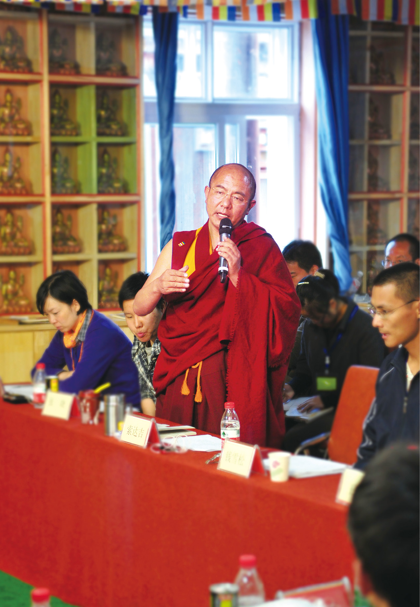

# 如何树立 正确的人生观价值观

## How to establish the correct view of life and value

2011年8月16日

今天的主题是“人生观和价值观”。如果我能做些准备，发言的效果会好一些。可是，我一没有时间，二没有这样的习惯，只能抛砖引玉，与各位分享一下我的看法。

## 一 多数人的人生观价值观堪忧

一个人对人生目的、意义的看法，叫人生观；他在这个世界上的价值取向，就是他的价值观。

比如，有人以为钱很重要，只要有钱，他梦寐以求的快乐，就会滚滚而来；也有人相信，感情是人生中最珍贵的；还有人认为，地位高于一切。

各位所学专业各不相同。有人选择某一专业是为了谋生；有人是出于爱好；有的是为了紧紧赶上社会发展的脚步。在你选择所学的专业时，事实上，已对你心目中的价值，做出了选择。

在座的学者和智者，都有一定专业领域的知识，应该思考过这个问题：人生最有意义、最有价值的是什么？如果没有真正具有意义的人生观，就和动物没有差别。

去年，我看到这样一条新闻：一些新闻媒体采访一位畅销书作家，记者问作家：“你的人生观和价值观是什么？”作家却一脸茫然，不知如何作答。

我想，他创作过数量不菲的畅销书，人们都认为他思想深邃、境界高超，但如果连作者本人都对人生意义茫然无知，这个社会的价值潮流，究竟会变成什么样呢？

当今社会，大多数人对自己的人生深感迷惘，由此，他们的价值取向，也一定没有方向。社会上流行的一些偶像和理念也是以盲导盲，人们的精神处于一种焦虑、无目的的状态。

尤其是改革开放以来，西方多元化文化充斥人们的心，在他们本来贫瘠的心灵中，不仅没有吸取到更充实、更有意义的人生观，反而更加迷惑和混乱。

昨天，有位博士论述了佛教经济学观点。他说：“社会口口声声说，要满足人们的物质需求。可是，人的贪欲永无止境，何时才能满足人类的物质追求？如果试图以物质来满足我们的欲望，那会欲壑难填。”

人们常说：“我为人人，人人为我。”但是，现在社会上许多人都是享乐主义者、拜金主义者、自私自利主义者。他们认为，只有在“人人为我”的前提下，我才能偶尔为“人人”。

现在世间的很多人，真的很可怜！他们殚精极虑追求的目标：外在的物质、名声，内心虚无缥缈的情感等，连芝麻许的利益都没有。但是，我们的感官，已经被迷幻药麻痹了，陶醉在虚假的快乐中，迷失了真正的方向。就这样不由自主地追逐，活了一辈子。

我翻过一本小说，叫《活着》。据说，张艺谋把它改编成一部电影。但是，我没有从中找到“活着"的意义。也许在座的有些专业人士的看法和我不同。

简而言之，如果我们目光短浅，就会无恶不作。大多数人在唯物论、进化论的教育下长大，信奉“人生一世，草木一秋”“人死如灯灭”。如果是这样，那么，“人不为己，天诛地灭”也就天经地义，“为自己而奋斗”就成为合情合理。这样，每个人每个团体，在为自己利益奋斗的过程中，就会不择手段。昧着良心、损害众生的各种不道德行为，就会大量涌现。

## 二 如何树立正确的人生观价值观

在这样的社会环境中，我们应该怎样定位自己的人生呢？

### 1．应了解前后世是存在的

我认为，第一个需要思考的问题是：人生，真的只有短短的几十年吗？如果人真的没有后世，那么，为了短暂的今世废寝忘食、夜以继日地奋斗，终其一生也是值得的、无可厚非的。

假如真的有后世，而且是无比漫长、久远的来世，今生所做的一切，都会对未来的快乐和痛苦产生决定的作用。就像我们年轻时辛勤工作，积累资财，就会有一个安定的晚年一样。而我们却对此茫然无知、置之不理，这样的行为，是否合理呢？

人类自称是智商最高的动物，具有高度的辨析智慧，有能力创造自然、改造自然。然而，这种智慧，却连自己有后世都不知道。所谓的万物之灵，究竟是聪明，还是愚蠢？

因此，要建立一个正确的、符合自然规律的人生观，就必须思考这个最关键的问题：人是否存在前后世？如果存在的话，快乐的因是什么？这样，我们就不会鼠目寸光，而会以对今生来世有利的方式，来确立此生的意义和价值。社会上层出不穷的各类问题，归根结底，就是人生在世，应该以什么样的价值理念，来主导人生方向的问题。

人生观有世间、出世间之分，世间有东、西方之分，西方也有个人与社会群体乃至专业领域之分。对个人来说，年轻与年老时也迥然不同。一个人年轻时，往往追求感情、财富、事业和地位，幻想精彩的人生。但是，到了一定的年龄，就会渐渐了解，所谓的感情、金钱都不能带来幸福。在一个人的人生中，只要有维持生存的基本条件就已经足够了，即使再多，也不能带来心灵的快乐。

当然，如果没有一点生活资具和条件，一个人无法生存在这个世界上。但人对自己的欲望，应该有所节制。按照佛教的观点，人应该知足少欲。如果知足，即使没有丰裕的财富，也一样快乐地生活。

从前，有一个乞丐对一位禅师说：“我一无所有，内心非常痛苦。”

禅师说：“把你的双目给我，我给你一百两金子。”

乞丐说：“我的双目远远不止一百两黄金！我绝不会给你。”

“把你的双臂给我，我给你一百两金子。”

“不！”乞丐说，“没有双臂，我怎么生活？即使你给我一千两黄金，我也不会给你。”

“那，把你的双腿给我吧，我给你一百两金子。”

“不论你给我多少金子，我也不会把双腿给你！”

禅师说：“想一想，其实，你并不穷。”

乞丐想了想：“确实是这样，我不是世界上最穷的人。至少，我有三百两黄金。”

后来，乞丐反省自己，对人生的价值重新定位，终于找到了属于自己的美丽人生。

在座的诸位，不知是否看过《假如给我三天光明》（Three Days to See）？海伦·凯勒（Helen Keller, 1880-1968）在自传中说，人的价值观大不相同，作为一个盲人，她一生中，如果有三天光明，此生就已经足够了。可是，对双目俱全之人，每天的光明，却毫不珍惜！

在这个世界上，人人都希求幸福。但是，什么才是真正的幸福？它就是心灵的快乐。一个人可以一无所有，乃至双目失明，但只要能明了人生的真谛，那么，无论是什么人，都可以感受到内心的那一份欢乐。它充溢我们的身心，令我们有限、短暂的生命，焕发出智慧和慈爱的光芒。

这里所说的快乐，不是指空性、胜义谛的境界，而是指世俗的现象。所谓现象，是耳闻目睹之法，是物理学家研究的对象；而事物的本质，则非眼耳鼻舌身之对境，需要用另一种方式去衡量。

在这个世界上，有不同的人生观和价值观，层次也各不相同。就像皈依，同是皈依佛门，目的却各不相同：有人是为了从轮回中解脱；有人是为了无量众生的安乐。如果你的人生价值，只是为了一己的快乐，是很低很低的层次；假如不论是何等众生，你都希望能利益他，则尚属中等；如果没有丝毫的自利之心，完全是“人不为他，天诛地灭”，这样的理念是最崇高的。

各位学者，你们的人生才刚刚起步。也许你关心的只是自己的家庭、职业和爱好。对此，佛教也不会一概否认。无论你持有什么样的人生观，如何提升它，令它对你及你周边的人有利，这是问题的关键。但要做到这点，归根结底，就要了解前生后世是存在的、因果真实不虚。这是我今天想说的第一点。

### 2．至高无上的人生观——利益众生

第二点，有人以为佛说四大皆空，就不敢接触、深入佛法的精髓，怕影响、破坏了他的快乐人生。其实，佛教的人生观会让你更宽容，生活得更快乐，并从内心深处生起智慧和悲心。

在所有的价值观中，最高、最有意义的价值观，就是利益众生。这不仅是佛教的观点，也是整个宇宙间最至高无上的人生观和价值观。为什么这么说呢？因为，它是最高的真理，没有一种意义和价值能超过它。

现场互动

问：有人说，如果生活很优越，说明前世积累了很多福报，这一辈子应该精进修行。如果各方面比别人差，也应精进修行，消除前世的业力？

堪布：是这样。但佛教不是宿命论，今生并非完全受前世支配。我读过《展望21世纪》——英国博士汤因比和池田大作的对话。但我不太认同其中佛教对命运的观点：今生的果，完全出自前世的因。

任何一个事物都有因和缘。比如种子是近取因，还需水分、阳光、肥料等次要的缘，才能发芽。前世因与后世果之间，有近取因（根本因）的关系；今世的行为及其他一些因素，则是俱有缘（次要的因）。

因果是一门复杂而甚深的学科，不是一两句话、轻而易举就能概括的。在尚未明白之前，一定要以公平、客观的态度潜心研究。今生的快乐虽然与前世密不可分，但今生所做的善和恶，也正在创造它们的果。

就像我们种下毒药，毒的自性终究会发芽；如果耕种妙药，则会长出药树、药果和药花。在取舍因果的时候，不要轻易践踏因果的自然规律。

问：佛法虽然很好，但是不是每个人都要学佛、都要出家呢？我们用的东西、吃的粮食，是工人和农民生产出来的，如果每个人都出家，这个世界还能够正常运行吗？怎么理解和看待这个问题呢？

堪布：做生意的人，可能都想成为企业家。但要成为企业家，需要福报、能力和各方面的因缘。即使一个大企业家希望人人都像他那样，别人也做不到。所以在这个世界上，一定会有人当工人、农民和老师的。

即使是佛陀时代，与佛陀所在国家毗邻的很多小国中，不信佛的人也占绝大多数。现在的藏地，出家人也越来越少。不久前，我还在藏地论坛呼吁：出家人能不能再多一点？汉地一个城市有几千万人，一个寺院只有三四个和尚。等末法时代的黑暗越来越深时，连三四个和尚都不会有。

所以，你真的不必为此担心。
