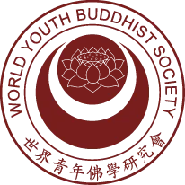
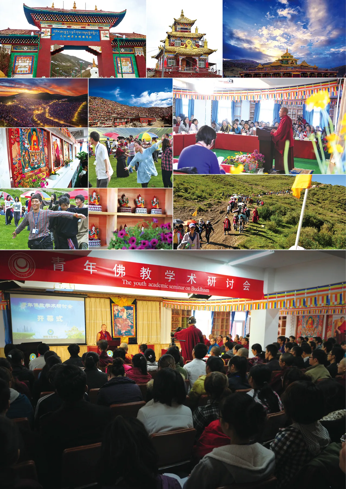

本 届 主 题

探 索 人 生 真 理

Searching for the Truth of Life

第1届

世界青年佛学研讨会

World Youth Buddhist Symposium

中国·色达喇荣

2011 / 8 / 10 - 8 / 16

## 开幕词

## opening speech

2011年8月10日

各位学者，喇荣佛教大学各位教授、法师：

上午好！

很高兴能在这里举办“青年佛教学术研讨会”。你们来自海内外各地，无视路途遥远、气候恶劣，本着对真理的希求和渴望，来到世界最大的佛教大学——喇荣佛教大学。今天，我们欢聚一堂，共求真理，实属来之不易！我感到非常欢喜。

这是一个相互尊重、平等、探求真理的平台。在这个平台上，任何一个人都有宣说自己观点的自由。人类生存在这个世界上，不但经济要开放，思想也要开放。我们共同学习，相互探讨，精诚合作，无论对政界、学术界还是宗教界，都有很大利益。

下面，我代表“世界青年佛教研究学会”“国际菩提学会”“智悲文化中心”，宣布“青年佛教学术研讨会”正式开幕！

今天研讨的主题是“人是否有前后世”。这个主题，对人类是非常重要的。我在香港理工大学发言时说：“无论科技如何发展，如果不知道存在前后世，这样的群体，是否走在一条对他们真实有利的道路上，是很值得怀疑的。”

在座的学者中，有的对前后世深信不疑，有的心存疑虑，也有人矢口否认。否认的人，是否具足理由？接下来，我们很快就会了解。

在未来七天的研讨和辩论中，除了“人是否有前后世”外，还有“禅修”“佛教与科学”“关爱生命，关爱环境”“人生观和价值观”等值得深思的主题。希望在座的每个人，都能得到真正的利益！
