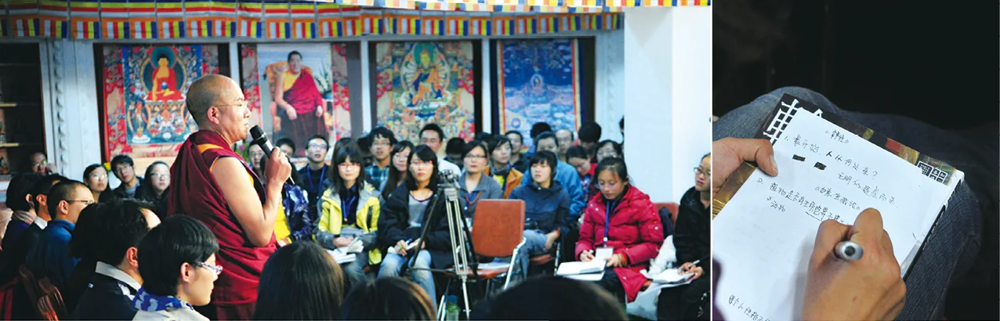

## 素食

环境与生命问题的一剂解药

## Vegetarian diet

2011年8月14日

## 一 环境与生命是社会问题

今天，我们研讨的主题是“热爱环境，热爱生命”。环境和生命问题，既是社会的问题，也是人心的问题，是需要在座诸位特别关注的大事。

怎样才能关爱环境、关爱生命呢？

只要看看我们对自己的住所是怎样毫厘必争、终其一生精心营造和小心翼翼维护的，看看我们对自己的生命是如何爱执的，就应该推己及人，如同对待自己的住所和生命一样，去关爱环境、他人和其他生命。

很多国家都在关心全球暖化、环境破坏等危害人类生存的问题。西方国家还成立了国际动物保护组织，在全球通过法律程序，让每一个人理解、尊重和保护动物的福利。相比之下，我们是什么样的观念？我们现在的观念，是否与传统的道德理念相符？

迄今为止，每当论及环保，在很多人的心目中，根本没有一丝一毫的触动。人们认为环保与他们无关，反正在他们死亡之前，地球不会毁灭；或认为环保不是他们能力所及，他们能做的，只是打扫一下住所及周围的环境，清捡一些垃圾。但是，环保的意义并非如此。

谈及生命，由于我们所受教育及环境的影响，人们认为自己、亲友乃至人类的生命是最宝贵的。80-90%的人认为动物生来该杀，否则，珍馔美味从何而来？至于它们是否与人类一样，有苦乐的感受，他们从来就没有想过，或者有意不去想。

有史以来，无论是生命的真理，还是宇宙中任何一个真理，都只是掌握在极少数人手里。我们不能认为，“因为舆论如此、潮流如此，这些现象就是正确的”“我只是随波逐流，只是其中之一，我就不会有任何过失，不会受因果律的束缚，不会遭遇噩运和相应的后果”。这是不一定的。

在座的各位，你们一定要深深地思维：当前人们关注的，只是我的生命、我的房子、院子、村落、国家……且不谈无量无边恒河沙数的世界，你们是否应该关心人类居住的地球？

每天，都有鸟类和哺乳动物，从这个地球上永远消失。它们的住所遭到人类的致命毁坏，导致家破人亡。我们所居住的地球表面，是由动物、植物、微生物和它们赖以生存的环境组成的一个生物圈，人类也是其中一员。当地球生态系统损坏到一定程度时，人类赖以生存的体系就会崩溃。

## 二 环境与生命是人心问题

1992年6月11日，联合国在巴西召开“地球环境保护高峰会议”。一位加拿大12岁的女孩，与几位同龄伙伴一起，自费抵达巴西。她请求代表饥饿的孩子和被残杀的生命，做5分钟发言。

她的发言，令所有在场的人震撼、无言。一位年仅12岁的孩子，心中却牵挂着日趋恶化的环境、可怜的生命，多么宽广、高尚的见解和胸怀！相比之下，我们又是什么样的？

从小到大，我们从社会、学校和父母那里所受的教育，就是我能得到什么。我们的人生价值和意义，就是我穿了什么昂贵、名牌的行头，住什么样的美宅，到过哪些酒店、度假村、旅游胜地，品尝过什么样的奇珍野味，享受过什么样的欢乐。我看，大多数大学生的精神世界仅是如此。

人活在世上，不仅仅是为了生存。如果是为了生存，所有飞禽走兽都与你相同。活着，也绝不是为了荣耀与享受。在座之人，将来都会走上社会岗位。但你考虑的，可能只是从工作中获得什么，却很少去思考如何利用你手中的权力和机遇，为大家做些什么。

我去过很多大学，也和一些学生、老师做过交流。个别大学生秉性善良、心地纯洁，具有非凡的勇气，一旦踏上社会，他们可能会发现，世界并非想象的那样美好。因为校园和社会相比，前者是培育梦想之所，后者是实践的舞台。要办成一件有意义的事，需要诸多因缘汇聚，并非轻而易举。不过，他们纯正、无私的品德是最宝贵的。

但大多数学生却非常糟糕。他们年纪虽轻，却从来不考虑父母、不关心社会，关心的只是他自己。学生时代的教育方向，不仅是学习知识与技能，更重要的是培养善良和正直的人格。否则，学生踏入社会以后，会不管他人死活，所学的一切，都会用于谋取私利。

西方国家的很多人，包括孩子，从小却不是这样的理念，而是会思维：“我为别人做了什么”。包括大乘佛教，获得菩提果位绝不是大乘佛教徒的目标；希求无上智慧和能力的目的，就是为了能利益无量无边的众生。

前不久，我参加了由香港中文大学和佛光大学联合主办的“佛教生态环保和心灵环保”学术研讨会。在此会议上，来自北大、南大、南开、武大、香港中文大学等高校的佛教学者发表了论文。但是，大多数人的出发点和心态，是把这个主题当作一种学术研究，或者是看成自身的一种机遇。

我在会议上毫不客气地说：“我们需要加强对环境和生命关怀的力度，要从内心真正触动，产生一种如同危及自己生命一般的紧迫感和责任感。”

## 三 环境与生命问题的一剂解药

据联合国粮食农业组织报告，在这个地球上，每年死于饥饿和营养不良的儿童，达到500多万。有没有一种方法，可以让他们免于饥饿和死亡？有，那就是素食。

美国康奈尔大学生态学家戴维·皮曼托（David Pimentel, 1925-）指出：“美国的家禽、家畜如牛、鸡、火鸡、羊、猪等等，吃掉的谷类，是美国人口吃掉的5倍。”

由于人们贪执肉食，畜牧业就会大量人工养殖动物。虽然全球很多人生活在饥饿中，但世界上大部分谷物却被喂给这些牲畜。谷物中90%的营养，都变成了牲畜的粪便；我们吃到的，只是其中的10%。如果一个人吃素一天，那么一天中，地球上就有20个人免于饥饿。

《世界各国饲料用粮统计》说：“令人震惊和可悲的是，世界粮食消费量的45%用于喂养牲畜，整个发达国家的这个数字是2/3，而美国粮食消费量的70%用于喂养牲畜。”

哈佛大学的一位营养学家吉恩·梅耶（Jean Mayer, 1920-1993）估计：“只要美国将肉类食品削减10%，就能节省足够的谷物，供6千万人食用。”

三十多年前，美国每年人均吃肉45斤，但到了2009年，每年人均消费肉食250斤。而非洲一些贫困儿童，却生活在饿鬼的世界，吃牛粪、喝牛尿，用泥巴做饼充饥。前不久，我也在智悲佛网上，发布过一些非洲儿童的相关照片和资料。

当今世界，有些人极尽奢华，拥有各种面料和样式的衣服、精心烹调的美味。可是，在地球的另一端，每隔5秒钟，就有一个儿童死于饥饿。现在全球交通是如此发达，如果这个世界真的关心他人的福祉，就应该全力救援非洲的饥饿儿童。这是完全能够做到的。但是，大多数发达国家和发展中国家，关心的只是自己的利益。

《金刚经》中说“我相、人相、众生相、寿者相”，因为人们贪执自我，从而分别自他。所做的一切，无不从利己出发。因为他人的利益看似与己无关，就不愿向他们伸出援手。我们口头上说世界和平，但是以这样的心态，是否能实现世界和平？

人类对穷苦、濒临死亡的人漠不关心，大量谷物被用于动物的养殖上，目的就是要吃它们的肉。不说来世，今生如果能以动物的生命换取强健的身体也罢。但是真的能吗？

斯洛维尼亚共和国的总统雅奈兹·德尔诺夫舍克（Janez Drnovšek, 1950-2008）博士，是一位素食总统。他在接受各大新闻媒体记者采访时表示：

多年来，他通过研究和经验认为，从健康学的角度，人类完全不需要肉食来提供营养，素食远胜于肉食。肉食只是人类一种根深蒂固的思考模式和习惯。而疯牛病与禽流感等，则是大自然对我们的警告：大自然的平衡已然破坏，我们的食物已大不如昔。从道德角度看，残杀动物是非人性的。从人类对待动物的方式可以发现，我们没有资格称为人。

代表动物说话的人凤毛麟角，这位素食总统的肺腑之言，与2500年前的佛教真理不谋而合。

人们可能担心自己营养不足。爱因斯坦说过：“没有什么能够比素食更大地增加人类在地球上存活的几率。”

各种各样的海鲜、肉类，只会增长我们的贪欲和妄执。我们本欲快乐，但是，心中的贪婪、嗔恨等各种烦恼和痛苦却越来越炽盛，与我们希求的目标背道而驰。

人们以为放生、吃素只是佛教徒一种迂腐的行为。事实上，这么做不是出于它是教义，而是因为它符合真理。如果放生不具有道德和正义的内涵，如果素食观危害环境与生命，谁都可以据理力争。可是，大多数人不仅不具有这样的意识，而且出于麻木、无知和自利之心，将非理执为真理。

20年前，我筹建放生账号时，人们不仅不筹款，还风言风语，用奇特的目光看我，要筹集一两万元都非常困难。但现在，我不敢发布倡导放生文，因为放生款太多了，今年已达700多万。这说明人们对放生的意义有了认识。放生，已不再是小范围的信仰，而成为一种正常的社会理念。

和平主义者印度甘地说：“地球可以满足人类的需要，但是不能满足人类的欲望。”不仅地球束手无策，天人、上帝、佛陀也无能为力。由于人口和经济迅速增长，人们欲壑难填，地球上原有的资源被人们抢夺、占有、浪费以致耗尽了。

生命是平等的，具有同样的价值，无论是人还是动物。这也是为什么佛陀说，杀生是重罪。吃肉，就是杀害生命。我并不是要求你们全部吃素，但是，在座的有两百人，如果能吃一天素，就会有4000人免于饥饿。

如果你们真正了解环境与生命的重要性，就应该思考：

你将以何种方式度过自己的一生？准备给子孙后代留下什么样的环境？怎样保护如我们一般贪生怕死的生命？

请大家深思！

现场互动

问：如果地球毁灭了，轮回在哪里寄托呢？

堪布：按照现代考古学家的观点，人类历史从最早170万年前的元谋猿人，一直到现在的21世纪。在170万年前，古人类是否存在？对考古学家来说还是一个谜。如果要探索人类历史及未来的去向，可以在《大毗婆沙论》和《俱舍论》等相关的佛教典籍中寻找到答案。

按照《大毗婆沙论》的观点，无论是世界的形成，还是毁灭，都会经历漫长的过程。不仅是地球，包括他方无量无边的世界，当它们毁灭时，造作恶业的众生会转生到其他世界的无间地狱中；地狱、动物、饿鬼道众生，有些转到他方世界的地狱，有些则依靠法性力转为人身，然后逐渐向上，转生到色界天中。

用现代人的语言简单地说，就是当地球毁灭时，地球上的生命会迁移到另一个星球上。

问：有一个很疑惑的问题：汶川地震有十万人死亡，南京有三十万人被屠杀，这些不能仅仅用一个共业来回答吧？是不是要精密地分析一下，这三十万人的前世到底是怎么一回事？

堪布：佛陀在经中讲过一则公案：从前，舍卫城帕吉波国王（即琉璃王）率军进攻释迦族所居住的迦毗罗卫国，八万释迦族人被杀戮。其业缘是，往昔释迦族人住在一个村里时，发生了大饥荒，人们天天到河里捕鱼吃。两条被悬吊并凌迟而死的大鱼，后来转生为帕吉波国王和玛拉洛大臣，所杀的其他鱼转生为二人的军队，在一天中，将释迦族的人斩尽杀绝。

如果能真正体会佛经中的事例，就很容易理解共业的问题。比如，某地举办一项大型活动，五百人共同聚餐，一顿饭中，要残杀多少动物？现代人举行盛大婚礼，无数人相聚过年，要杀害多少生命？

到了后世，这些众生就可能因共业，在同一场事故中毙命。汶川发生大地震时，几万生命毁于一旦；南京大屠杀，三十万人遭到涂炭。每当这样的灾难发生时，我都会想起佛陀的话：众生的业力不可思议！

你们在读到佛经、论典中的公案时，千万不能把它们当作神话、迷信和传说来对待，要做深深的思维。
