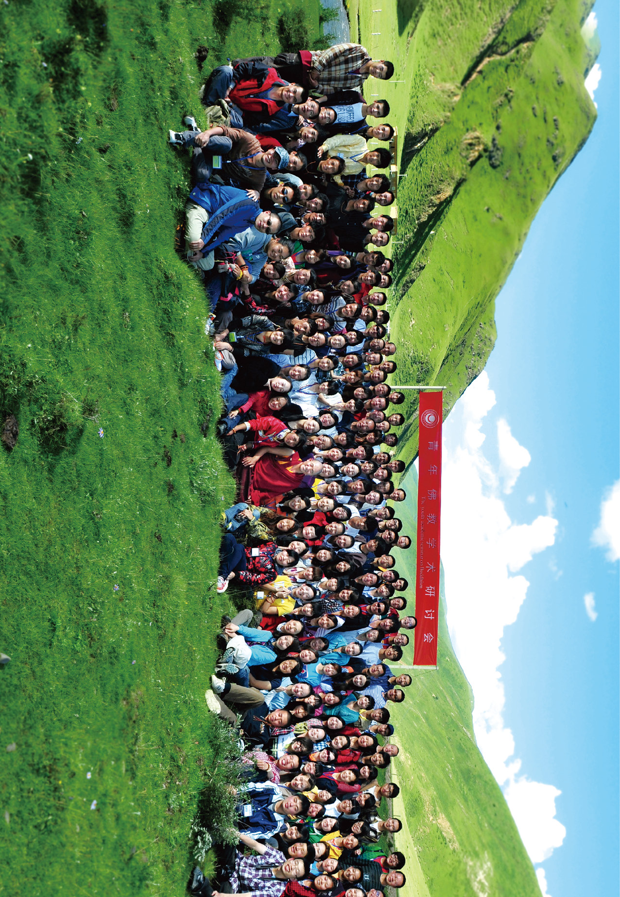

# 闭幕词

## closing SPEECH

2011年8月16日

## 我全程参加的两个原因

今天，“青年佛教学术研讨会”已经圆满。

我记得，大概是7月1日那天，我以私人名义，给大家写了一封有关夏令营的信。因为报名的人比较多，我们选了大约二百人。不料那段时间一直下雨，路况不是很好，担心你们被泥石流堵在路上进不来，我们在网上说，暂时不开了，何时举行，我们会另行通知。现在，经过大家的努力，夏令营虽然没有举行，但“青年佛教学术研讨会”已经召开了。二者从形式上来说，应该没有很大区别。

每天坐在这里，我心里还是很快乐。虽然有很多事等着我去做——翻译、讲课、管理学院工程和一些学校等，但这次，我发了大心。在座的各位也清楚，这7天中，我放下了所有的会议、翻译等事情，很久以来我都没有这样了。

一方面，我特别想学习。来到这里的不同行业的大学生，都是了不起的老师。不过，我的笔记本丢失3个了，上面记了很多你们的观点，我觉得非常珍贵。等你们走后，我要看看你们是怎么说的。如果你们谁拿了，希望能还给我。（众笑）

我的记性还算比较好，以前，我用藏文记法王如意宝智慧中流露的金刚语，记得特别快。虽然读汉文比较晚，没有那么快，但是，很多重要的问题，我都记下了。记下的原因是：这次，我扮演的不是一个医生，而是一个学生，这是我的一个学习机会。这也是7天中，我一直坐在这里的第一个原因。

第二个原因是：你们不远千里而来，非常不容易，我要对大家负责。如果我在场，有什么事就会比较方便。我参加过各种学术研讨，越到后面，人越少。闭幕式时，除相关人员外，其他人都不见踪影，教授们都非常悲伤。但这次，我们的人不仅没有减少，还有陆续增加的。只是因为我们受条件和环境的限制，实在无法满足他们。

7天中，会场的气氛格外活跃，纪律也相当好。你们来自不同行业，有着不同的兴趣和感想。我相信，每个人的分享，都会给其他人带来启迪和利益。这也是我们的初衷。

## 我想说的两件事

我想说的第一件事就是：非常感谢大家！如果没有你们的参与，没有我们工作人员的发心，没有背后很多默默无闻从财力和人力等各方面无私帮助我、支持我的人，没有大家共同的愿望，这样的活动是不可能举办的。即使能偶尔一次，也不可能长期进行。任何一种个人、单一的力量都不足以成办这样的活动，这需要各方面的力量和大家的因缘。

在这里，我非常感谢大家，并祈祷上师三宝加持所有的人，祈愿今生来世都能获得真实的解脱利益。

第二件事是：今天早上，我本想询问一些大学老师，了解研讨会的不足之处。我几次举手，主持人都没有看见，我很灰心，只能继续喝茶了。我想，会议结束后，应该做一些采访，了解这次会议值得发扬的地方、需要改进的地方。

在每天的安排中，一定会有不公平之处。组委会发心的人毕竟是少数，参与的学校又多，人心千差万别。我们基本是按照报名册和自我介绍，邀请嘉宾发言，所以，一定会有很多不周之处。在此，对我们做得不够的地方，向大家表示歉意，请多多包容。

虽然不是每个人都轮到发言，但基本上这是一个比较平等、自由的平台。也许我们中有一些名人，但我谁都不认识。我们没有因为你的特别呼吁，或你是了不起的大学教授、明星，而让你坐在前台、高位。喇荣佛教大学也有男众和女众的大学班，但因为时间等原因，我们也没有让他们参加。

所谓的自由，不是没有任何规矩，不是你想说什么就说什么，自由需要一定的水准。西方大多数人的综合素质较高，这样，推行民主和自由就不会有太大困难。

为了实现初衷，我们也邀请了一些无信仰人士参加。每个人都说佛教好是不行的，无信仰人士经常会提醒大家、监督大家，这样我们才会有进步、有发展。

我也了解到，北京附近以一所大学为主，举办了一个夏令营。在夏令营中，有人用广告煽情的方式演讲，有人用媒体比较正统的方式表达。各种不同的思想、文化相互交融，可以说，是一场非常广泛的交流。

这次的“青年佛教学术研讨会”也是如此。不仅内容广泛，丰富多样，而且，也是一次深入的交流。在7天里，我们讨论了5个主题。第一天是“前生后世是否存在”，第二天是“参禅”，第三天是“佛教与科学”，第五天是“关爱环境，关爱生命”，今天是“人生观和价值观”。

在主题发言中，每个人都发挥了自己最高的智慧，尽可能深入地做了挖掘。学文学的人，从文学侧面来思维；学理工科、教育或电影的人，也从各自专业领域的观点进行了探索。自由发言也是如此。每个人站在不同专业的角度，介绍了他们的研究心得和一些社团的活动，并提出了一些问题，让大家深受启发。

佛教徒和非佛教徒都畅所欲言，虽然有时很激烈，也有一些反对意见，但迄今为止，我心里没有任何创伤。所以，这次学术研讨会以一种自由、开放、广泛和深入的方式圆满。

## 我的三个希望

最后，我有三个希望。

第一个希望：参与这次会议的人不是很多，除了在座的诸位，还有佛学院里的出家人。他们虽然不在会场，但通过无线广播收听了。他们对研讨会有些好奇，也有人认为比较有意义。还有发心人员，他们也一边发心，一边听。

现在是信息时代，我希望研讨内容能做成光盘和文字，让还在读中学、读大学或已经进入社会的人，都能分享大家的观点。我们的发心人员有限，如果你们有时间，可以帮着做一些校对、编辑。没有时间也不要紧，对我们来说这不是什么大事。

有时我想：“如果我们考虑的只是自己的得失，从而害怕抛头露面，这是不必要的。”如果我们真的在做坏事、在贪污、在杀人，我们要躲起来；假如我们是真心行善，就应该光明磊落，不应该害怕。

这一点，让我经常想起上师。上师如意宝在弘法利生时，遇到违缘和困难，他不会屈服，不会低头。首先我们不能做违越法律、违越因果的事。在这样的前提下，要尽一切可能，从各方面利益众生。

在香港中文大学，一位来自英国的博士举例说：“当今世界，人们在地球的不同角落，依靠虚拟的网络世界，实现着各自不同的价值和目标。”佛教徒也应该有这样的理念。虽然你在英国，我在美国，他在日本，但是，我们有着共同的愿望，那就是：“众生安乐，佛法兴盛。”这是人生最有意义的目标，也可以通过网络来实现。

第二个希望：你们明天离开时，尽量不要包小车，而是坐我们预订的运输公司的大巴。大巴司机的资格是经过认证的，而小车司机的技术却不能保证。另外，你们不要让司机开得太快。车开得快和慢，相差也就半小时。慢半个小时或一个小时是无所谓的。回去的路上一定要当心。

最后一个希望，就是把会议精神落到实处。

刚才有同学说，她发现一只受伤的小狗，要把它带回成都治病并收养它。表面上她帮助了一只小狗，但是这正是我们会议的精神。不管是佛教徒、非佛教徒还是其他宗教徒，都应该有一颗开放、包容、利益他众的心，这就是这次会议的中心思想。

今天，她以一个非佛教徒身份帮助众生，这是我最欣慰的。佛教徒受过大乘菩萨戒，帮助一只生病的小狗，是自己分内的事、应尽的义务。也许是通过我们大家这次研讨，也许是她相续中本有这样的善心，她做了这样的善举。

无论如何，在所有的人生价值中，利他是最有价值的。在座的各位，将来会成为社会的栋梁，希望你们一定要知道这一点。

主持人曾几次表示过这样的愿望：未来，无论你们从事何种职业，包括广告、媒体和电影等行业，希望你们都不要忘记今天的承诺。只要你有一颗真正的善心，做什么都好办，演什么角色都可以。是不是佛教徒，也许不重要，最重要的是这颗心。如果心是恶的，就无药可救了。

希望你们回到城市以后，有不同于以往的转变。对任何一件事都要用自己的智慧来观察，即使让你参与佛教事业，你也要分析之后再决定。要时时刻刻利益你身边的人，乃至狗、猪等一切生命。这就是我对你们最后的希望。

非常感谢大家！我受组委会的委托，代表“智悲文化中心”“国际菩提学会”，宣布“青年佛教学术研讨会”圆满结束。谢谢大家！

