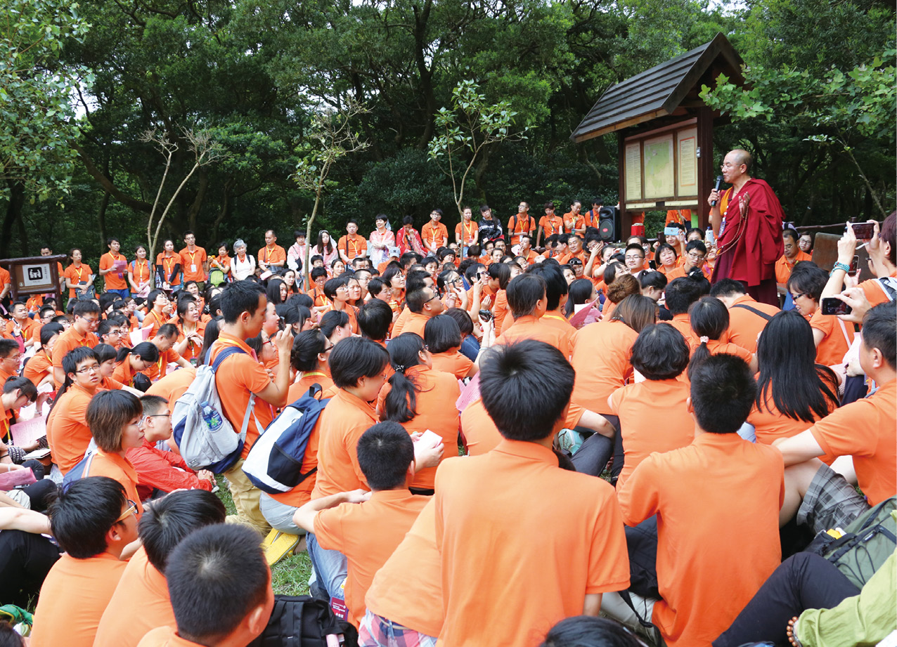

## 为什么要利他

## Why is it Important to be Altruistic

2013年7月20日

主持人：

非常感动，今天这么晚，大家还相聚在此，参加索达吉堪布特意安排的交流活动。

为了此次的青年佛学研讨会，我们相聚在香港已经四天。每次看到会务组发心人员的忙碌身影，就想：此次大会的圆满成功，真的不是靠一两个人的发心就可以实现的，更不是靠自私的心可以圆满的。是每位发心人员心存善念、深怀利他，大家积极配合，第三届“世界青年佛学研讨会”才得以成功。进而再细想，世间哪件事情的成功不是依靠利他心才能实现呢？闲话少叙，下面就有请尊敬的索达吉堪布为大家作开示——

今天共同探讨和学习的，是“可持续发展”中“为什么要利他”的话题。在座大多是“世界青年佛学研讨会”的青年人，也有特别开许的其他宗教的人士，但不管怎样，利他心对每个人都非常重要。

## 利他心对人类的价值

现今的社会是一个充满功利心的社会。学校中也不太灌输利他，培养的基本都是知识技能，让人会电脑、会说话、会写字，会各种各样的知识，很少灌输“怎样做人、怎样利他”的道理。这样培养出的，往往是只懂技术而不具备完善人格的人。

最近美国称，到2015年，能制造出在地面参与作业的机器人，但这种机器人没有人性。现在的学校培养出的人，如果只懂知识、没有德行，跟这种机器人基本相同，很可怕！

人的利他、孝心等德行，一部分是先天的，一部分是后天教育熏陶的。而现在，经由后天教育培养的德行非常少。但其实，利他心是一个人不可缺少的素质。

“世界青年佛学研讨会”会歌中有句话“智慧和慈悲是永远的新鲜话题”，我也这样认为。

只要人类存在，都需要智慧，离开智慧连基本生活都无法解决；而慈悲利他心则更为重要，如果缺少它，世界会变得很可怕。

据联合国统计，现在全球总人口72亿，再过12年增长到81亿，到2050年预计达到96亿。当前国际上最关心的，是人格教育。因为如果缺少这种教育，地球上的大多数人都以自我为中心，这样自私自利的一群人对地球和人类社会能带来什么？大家可想而知。

## 利他心对个人的利益

利他心对个人有没有利益呢？

实际上，利他心对个人获得健康长寿和内心安乐，都有巨大帮助。

以前有位心理学家马丁，给学生做测试。让其中一群学生每天过得很开心，只做一些娱乐活动等他们特别喜欢的事；同时，安排另一群学生每天帮助他人，办慈善商店、做义工和志愿者等。

一段时间后，同时测试他们的心态。结果发现：过得非常开心的那群学生，幸福指数越来越低，快乐的心无法长久；而做慈善的那群学生，幸福指数上升，快乐的心态很长久，身心的健康都有很大提升。

最近美国医学界也发现，心脏病人中有两类情形。一种人整天在说“我身体不好，心脏不好”等等，特别关注自己的病情；另一种人，虽然心脏不好，但不在乎，反而尽量去帮助别人。结果发现：整天说身体不好的人，病情越来越严重；不关心自己的病反而经常帮助别人的人，病情反而越来越轻。

藏传佛教寺院中有部非常流行的书，从印度传来的，叫《入菩萨行论》。这部论典改变了很多人的心态和命运。这里面再再讲：有了利他心会很快乐，很多事情会有随缘的感觉；相反，没有利他心，自私心越来越强，则会很痛苦。

所以，不要认为利他是很可怕的事。现在的家庭、学校和社会中，没有灌输“利他最有意义”的价值观，由此导致很多人认为利他是压力和负担，对利他不予认可。有了这种观念，利他心就无法提升。

大人也需要培养利他心，不要认为：我是大人，我是家长，我是知识分子，我是大学老师，不需要培养利他心了。

那天我遇到一个大学老师，他自己讲：“我虽然是大学老师，但其实这个名称让我滋生了很大的傲慢。因为是大学老师，好像就看不起中学或小学老师以及自己的学生。其实我相续中也没有什么大的知识，所谓的‘大’我配不上。”我觉得他对自身的评价很公正。凡夫有很多烦恼、痛苦、毛病和缺陷，应经常反省，削弱自我，这样利他心自然会出现，烦恼也会减轻。

## 利他心是人本有的

有人可能想：有些人有利他的善根，有些人不一定有。实际上并非如此，人之初性本善，利他心是每个人本有的。

对此，佛教中有很明确的观点——一切众生皆具如来藏。如来藏在每个众生心中决定存在，而如来藏的本体能散发出慈悲和善。不仅佛教中如是承认，现代科学也证实了这一点。

以色列有个心理学家，叫爱伯斯坦，他建立了一个机构，研究人的基因。研究过程中发现，三分之二的人具有利他的细胞或者说元素，它存在于血液中，医学上称为“多巴胺”。并发现，这种元素能给人的心灵带来快乐。

通过实验，科学家认为大多数人只是没有挖掘利他心，真正去挖掘时，利他心就可以显现。

所以，有些人性格不太好，有些人脾气比较暴躁，有些人习性相当恶劣，这些人有没有利他的善根呢？是有的。

《宝性论》中讲：断善根众生也具佛性。其实，并不存在真正断善根的众生，这是佛教中的常识，很关键。所以说，每个众生都有本具的利他特质。

## 帮助他人就是成就自己

彼得·辛格有一本书，里面说“帮助他人并不是自我牺牲，而是自我实现”。这句话对我触动很大。

一般人帮助别人时可能认为，“我布施钱给他，我很厉害”“路上遇到一个人特别痛苦，我把他送到医院”，或者“一个老人走路很艰难，我扶了他一把”等等。自认为了不起，在为别人付出。

实际上助人者得到了更多，也可以说，你并没有付出而是获得了。

慈慧基金会里资助大学生的一个人讲：“我原来认为，自己资助大学生很了不起——我有钱又能发心。但今天看来，其实帮助别人对我是一种机会和给予。”

他并没有认为“我给予他”，而认为是“他给予我”。在逻辑学上，有些人对此可能想不清楚，钻在牛角尖中，一直认为“我是帮助者，别人应该感恩我，回报我”。但这种想法不合理。

寂天论师在《入菩萨行论》中说：“何须更繁叙，凡愚求自利，牟尼唯利他，且观此二别。”意思是，不用说很多的语言，世间凡夫人每天以自我为中心，从早到晚为了自己而奋斗、奔波；释迦牟尼佛为主的十方三世诸佛，把一切精力用在利他上，没有丝毫自私心。但是前者依然在轮回中流浪，后者反而已经获得了成就。

## 谁有利他心就了不起

我不知道香港这边的价值观是怎样的，但是现在在价值观上，大家一定要树立“谁有利他心就了不起”的观念。

有些人稍微有点钱财地位、名声才华等，就洋洋得意，认为很了不起，开始夸夸其谈。其实真正和释迦牟尼佛因地时为利众生付出宝贵生命相比，凡夫人所做的区区小事，真的是微乎其微。人在宇宙中是相当渺小的，不应该因为一点点小事而自我夸耀、自我宣传。其实，自满行为本身就表明：此人是个凡夫。

佛陀曾在不同经典当中讲，如同不净室中不会有香味，凡夫人不会有善妙的行为。实际上，乃至未得菩萨果之前，要完全断掉自私心都有一定的困难。

但是，不论你学过大乘佛法，抑或之前从未接触，都要努力培养一颗利他心。如果没有利他心，即使有再高的智慧、再了不起的身份，也没有什么价值。

## 最大的魔，住在你的心里

前两天的交流中，我发现：有的人也许是家庭或学校的原因，内心具备感恩心、利他心；但有的人，内心充满恶见，善妙的正见及信心、智慧等都非常微弱。

21世纪时，基本的推理思辨能力，许多知识分子都具足，但是否具足感恩心呢？可以说，现在有些人，不要说大乘的利他思想，连最基本的做人的德行都不具足。这确实很可怜。

这种现象在大学群体中比比皆是。所以，家庭和学校里推广传统的利他教育非常有必要。

不一定你要改变整个教育制度，这有一定的难度。重要的是，每一个人要知道现在存在的问题，有危机感。这个问题不是金融危机，金融危机过了一个风暴后就烟消云散。这个问题是精神危机，可能影响好几代人。

忽略人格和慈悲教育，这样培养出的人即使有智慧又能做什么？不要说为家庭、社会或全人类服务，可能连基本的生存能力都不具足，甚至有可能给社会带来危害。

比如，希特勒也非常聪明。有一个名为《意志的胜利》的纪录片，是1934年纽伦堡召开帝国会议的纪录片。里面讲到希特勒，有人看后觉得：“哇，他真的很了不起——有智慧、有能力、有口才、有势力。”但是看看他最后给世界带来的危害，对此现在德国人只要一提起，都是很悲哀的声音。

现代教育也是如此，学校里经常看到口才好、能力强的人，但这些人到了高层次时往往会怎样呢？有的就用智慧和能力谋私利，成了贪官污吏。比如，有的一个人有370多套房子，贪污钱财也无数。

那天有一位印度教授说，印度有个人买了5000双鞋子，因为这个人认为，这可以作为财富的一种象征。但是一个人占有5000双鞋子，想一想，浪费了多少资源啊？与之同时，非洲等很多地方有多少人还饱受饥饿的折磨。所以说，人心太冷漠了，只管自己。

现在很多有钱、有能力的人为了私利，拼命买房子、拼命赚钱。甚至有人把钱转移到香港、瑞士或新加坡。我那天遇到了一些新加坡和瑞士的银行大老板，他们讲到很多国家中的贪污分子跟他们的关系，也许真实，也许不真实，但是我就觉得，地球上的人确实很自私。

世间中最大的魔是什么呢？大乘佛教认为，最大的魔不在外面，外面的魔王虽说也很可怕，但内在的自私自利心，才是最可怕的魔。

## 利他心是永久的财富

有利他心的人即便没有外在的财富，这颗利他心也是永久的财富。

一千多年前，有个国王，他手下有位大臣，这个大臣利用权力帮了很多人。许多奸臣对他看不惯，诬告他贪污国库的财富。于是国王要求大臣将自己的所有财产列个清单交上来。

当时大臣就把财产列成清单，交给了国王。国王一看，吓了一跳，确实他贪污了很多财产。于是问：“这些财产是你自己拥有的吗？”大臣说：“是的。”

国王继续问：“能确定吗？”他说确定。国王就准备判他死刑。

后来问：“这些财产在哪里？”他说：“我送给困难的人，全部捐出去做慈善了。”国王很不理解：“你不是说这些财产都是你自己拥有的，自己是确定的？怎么又说都捐出去了？”他说：“国王你不知道，实际上我捐出去的财产才真正是我自己的，生生世世都可以拥有；我占有的反而不是自己的，因为死时也带不走，地水火风的各种灾难也会毁坏它。”

国王听了觉得很惭愧，因为他自己也占有很多财产，而当他离开时，也确实一丝一毫都带不走。

社会上的很多人很可怜，他们拼命赚钱，目的是什么呢？就是老了用、生病时用等等，但最后真正用到的很少。国际上有些银行专门赚死人的钱，因为密码只有本人知道，人一旦死了，这些钱财下一世也无法用，别的亲友也用不了，钱就成银行的了。

这样守护财产有没有功德呢？没有。

比如自己有三万块钱，全部锁在银行里，死的时候，谁都不知道密码，这些最后都变成银行的了；而如果活着时把其中一部分拿出来做功德，就成了生生世世的财富。

所以，大家要想一想利他心的价值。《经庄严论》中讲：求自乐的人不但不会快乐，反而经常产生痛苦；求利他的人不但自己快乐，而且事业圆满成功。用佛法的智慧观察，利他心的意义和价值超越一切。

成佛的唯一因是什么呢？就是利他心。

有的人可能觉得：“我需要生存，怎么能不自利呢？”实际上，基本的自利是可以的，凡夫人对饮食等不得不关心。但如果唯一只想着自己，就不太合理。

可以观察观察，自己从早到晚想着众生、想着帮助众生的心态有多少？这样一观察就可以看出，我们的心还是充满自私的，利他心很少。

## 实践利他的五种力

即使有利他心，能进一步付诸行动的更少。

有些人经常给别人提建议，比如开会时，经常说别人“这个不对，那个不对”，但让他自己用行动做时就不说话了。这不太好。

对于利他，也不应当只是口上说，实际行动也要做得出。

当然，做的方法也要掌握，如果没有掌握，要真正利他也有困难。

藏传佛教中有部论典叫《修心七要》。里面讲到利他心时，总结了五种力，这五种力对于圆满利他很重要。

第一个：引发力。

就是要发利他的愿：我在今天、明天，这个月或这一年中，这一生乃至生生世世，一定要帮助天下无边的众生。发自内心地发这种善愿。这很重要，如果没有发愿，后续的实际行为也不可能有。

当然，利他不一定非要用钱财，也不一定非要自己的身体到医院里当义工等。哪怕坐车时帮助需要帮助的人，也是一种利他。但无论如何，首先要有利他的愿。这种利他心的发愿叫引发力。

第二个：串习力。

光是一两次嘴上说要帮助众生，或者心里发一两次愿是不行的，要长期在生活中串习。无论上班、出差或在家里做饭，尽量将利他贯穿于其中，否则很难以稳固，可能只是遇到上师、道友等时，受其影响，才愿意去帮助他人。

前两天“世青会”的有些老师讲利他心时，好多大学生一直说“我以后要帮助众生，我要发心”。但这只是一个开端，如果没有长期的修行，可能过两天就没有后续了，不能“可持续发展”。

“可持续发展”，修行上也可以用。不要认为这只是政府的一种说法，其实修行要不要可持续发展？更需要。

藏地有句俗话：“说话开头难，做事中间难，修行结尾难。”说话时，很多人不知道从何说起。做事时，中间会遇到很多麻烦和问题，比如有人办公司做项目，中间遇到很多问题，这时如果没有思想准备，就会缺少挑战的勇气和能力，事情就会夭折。但修行呢？结尾难。很多人刚开始发菩提心时，“我要努力地利益众生”，好像很勇悍，但是到了中间就开始削弱，最后变成虎头蛇尾。

有些修行人也是，刚开始特别精进，信心似乎很大，流泪哭喊着“我一定要成佛，我要度众生，我不想睡觉、不想吃饭，从今天开始一定要度众生，乃至生生世世一定要跟随我的根本上师”，就开始跟着上师跑。结果没两天，就累了，跑不动了。有的最后还对佛法生起厌烦心，甚至产生邪见。

因此，“可持续修行”很重要。一两次的利他心是不行的，要把利他贯穿在生活中，这叫串习力。

很多人特别希望做一个善良的人，做善良的人不是口头上说的，不是广告上写的，而是要在实际生活中践行的。

其实这方面，藏传佛教确实很殊胜。这不是因为我是藏族人而这样说，而是很公平、公正地说的。在藏地，一千多年以来佛法已经融入生活中，人们不是遇到困难才开始祈祷，不是生病了才开始念咒，也不是死的时候才念几句“阿弥陀佛”，而是行住坐卧中都在熏习大乘佛法。

因此，所谓的利他心不要当作偶尔的、演节目一样的一两次行为，这不是真正的修行利他，长期串习很重要。

第三个：善种力。

就是种下很多善根的力量。发愿利益一切众生后，不做善业、不积累善根，是不可能成功的。比如这次开“世界青年佛学研讨会”，背后有很多人的付出，没有这些付出就不可能有结果。做任何事都是这样。

因此平时要做七支供、祈祷或念佛等，经常积累善根。

很多人想利益众生，但并没有创造很多的资源。什么资源呢？最根本的、最重要的是精神上的资源。有些人说：我没办法利他，因为我没有钱。其实利益众生不一定非要用钱，有时真正的爱心远远超过金钱。

我那天听到一个故事，一个中国人陪一个美国妈妈带她的小孩到市场买纸和笔，这个美国小孩特别喜欢画画。

他们在路上看到一个乞丐，可怜兮兮的，小孩准备把买笔和纸的钱施舍给他。中国的这个人就说：“不要给，这些都是骗子。”这时美国的那个母亲说：“不要这么说，让他给吧，能这样施舍是我做母亲的骄傲。”

后来中国的这个人就说：“其实这些乞丐是装的，他们很有钱，可能比我们还富裕，是自己不好好挣钱，在这里要钱。”（平时很多人也喜欢这样说，“这些人是骗子，不需要去布施”等等。）

美国的这个母亲就说：“他也许是骗子，也许不是，但是我要给孩子留下的影响是什么呢？就是利他心的一种影响。利他心的价值远远超过金钱。如果今天我说‘这些乞丐是骗子’，这个孩子以后看到任何乞丐可能都会认为，‘噢，这是骗子，因为我母亲以前讲过’。”

所以这个母亲认为，眼前的这个乞丐是不是骗子不重要，从小对孩子灌输利他心才最重要。

其实，要培养利他心，首先要树立“利他很重要”的观念。如果你的孩子今天帮了他人，你就要着力地赞叹：“帮助别人很重要，你能这样做特别好！你真是我们家的骄傲，我们家里有你这样的菩萨，以后有希望了！”

但很多家庭对孩子的教育并不是这样，反而是负能量的灌输。因为父母自己也不懂真正的正能量，也认为自我宣扬、自我展现最重要。现在整个社会都普遍崇尚自我炫耀、自我宣传、自我提升，所有的精力用在自我上。其实，自我是一切痛苦的来源。

《入菩萨行论》中讲：“所有世间乐，悉从利他生；一切世间苦，咸由自利成。”世间的所有快乐，都是由利益他人而获得的；世间的所有痛苦，都是由利益自己而产生的。

这一点，我们通过智慧也可以观察得到。比如，每天自己心里的痛苦是不是自我引发的？社会上的家庭问题是不是自我引发的？

很多在家人吵架时互相抱怨，都是“你对我不好”“你对我不公平，你以前对我很好，现在如何如何”，全都是以自我为中心而吵。没有一个人说：“你对社会不好，你对别人没有帮助。”所以说自我是痛苦之源。

第四个：破斥力。

修行利他时，如果冒出自我保护的心，就要破斥它。要想到“维护自我是惭愧之处”，一定要呵斥它、对治它。

第五个：发愿力。

哪怕一点点善根也回向给一切众生，并愿自己能够生生世世利益众生。

像阿底峡尊者以及很多高僧大德，一生当中利益他众，除利他外，根本没有自我的空间。世间人拥有这种心态的有多少？是很少的。

即便成佛，其究竟目的也是利益众生。藏地有位特别伟大的上师，叫华智仁波切，他就说：成佛并不是为自己，而是为了要帮助众生。佛的主要工作就是利益众生。

因为佛觉悟了万物的真相，智慧、悲心和能力都圆满了，这时利益众生非常方便。比如，世间有觉悟的高僧大德或知识分子，帮助众生的能力就与众不同。

这以上是实践利他心的五种力，很重要。

## 没有利他心，就没有实质的意义

我以前看过一本书《沙漠的智慧》（The Wisdom of the Desert），里面说：“如果不能跨越人类与自我的隔阂，即使飞到月球也没有什么意义。”这一点说得很对，科技再发达、人类再聪明，如果不能真正将自己和人类融为一体，没有跨越这个深渊，或者说没有利他心，就没有真正的意义。

即便你长得再好看，钱再多，地位再高，都没有什么实质的价值。

那天去美国时，我发现哈佛大学里有相当一部分人，利他心非常不错；也发现个别的教授和学生，自认为在这个大学任教或读书很了不起，自高自满，对所有的人都不屑一顾。当时我就情不自禁地说：“如果没有利他心，即使你读哈佛，或者变成国家总统，也没有什么了不起，对人类不一定有利益。”

在座的大多是知识分子，是非常了不起的人才，可能你自认为很荣耀。但扪心自问我们有没有利他心？如果没有利他心，按照大乘佛法的观点，即便是再怎么样的佼佼者，也不一定真正对自他有益。

所以，各位要经常培养利他心，这样对自己有非常大的利益。更重要的，在全球来讲，利他心的价值也会熠熠生辉！

现场互动

问：有时因为习气，遇到某个人或者某些环境时，就无法做到利他。请问，在逆境中，如何仍能做到帮助他人？

堪布：这个问题，前面讲的五种力中的串习力就是答案。

仅有利他心不行，一定要时刻串习、长期修行。如果能坚持不懈地修行，心的力量就会越来越强。此时，即便遇到逆境，比如面对故意陷害或欺骗你的人，你仍然能做到去帮助他。

昨天有个老师讲，她带女儿去看病，有人把她的银行卡和包都偷走了。刚开始她心里有点不舒服，想：我的孩子病成这样，还有人来行窃。又转念一想：应该修利他心，我已经学了多年自他交换，连这种情形都不能转为道用吗？心态一调整，不但对盗贼没了怨恨心，而且把善根回向给他——“但愿我的这个小礼物，对他有帮助”。

如果没有平时长期串修的强大力量，这是很难做到的。

就像有人觉得身体很好，但如果平时不锻炼，参加比赛时，就不知如何应对。以前有个学过少林功夫的和尚跟我讲：我自认为身体很好，在比赛中应该能打赢，但因为没有锻炼，最后反而输了。

所以，如果只是自认为修得好，而缺乏长期串习，真正面对对境时可能用不上。

问：一般在西方，人们会把做义工作为日常生活的一部分，选择一到两种可长期做的义工。此时就会面对一个问题——做义工和闻思修如何协调。一方面，如果放弃闻思修，发心时难免会生烦恼；而如果偏堕到另一边“我先修行，再利他”，也不合理。

堪布：如果自己的修行比较稳固，那做义工确实很好。很多人认为，利他虽然很好，但会耽误修行。也许是有一点耽误，但修行不好的人，即使没有去利他，也修不好，这是很常见的现象。

有人说“我没时间做义工，没时间发心，我要修行”，但实际上这只是一个借口，他可能也并没有真正去修行，很多时间都在散乱和放逸。再说，发心只是利用部分时间，其他时间可以修行，不一定一天二十四小时全部利他。因此，我在不同场合也经常强调：要尽量参与到利他的发心团队中。

所以，我给你的回答是：修行人需要利他，尤其年轻人更需要。这对自己是一种锻炼。

所以当自己心理上稍微能适应其他众生时，还是要积极参与利他。这实际也不会耽误修行。

问：拿钱布施亲朋好友，但他们反用这些钱造恶业，那么自己圆满布施的同时是否也害了其他人？

堪布：钱财布施给众生后，众生用它来做什么是他自己的事，没必要过多去追踪。

对我们而言，重要的是最初的正确发心：觉得这个众生很可怜，我舍得把钱给他。钱给他后，就归他所有。此时即便他去造恶业，也不会成为你的罪过。因果律中，本来也是如此。

另外，利他的方法非常多，除财布施外，法布施也能真正利益众生。

法布施就是传播真理。其实这方面每个人都有责任。汉地众生非常多，但很多人的内心是空的——没有信仰，因为没有信仰，所做大多是违背因果的，以此今生和来世都会感受痛苦。

比如，我们自己学佛后才明白，以前不学佛时的行为多糟糕。小错误倒不要紧，比如说个小妄语、开车闯红灯等，但最大的错误就是害他害己，这些行为会导致自己今生来世的很多痛苦。

推己及人，见到身边很多人行为颠倒时，应逐渐给他们讲一些因果的道理，引导他们断恶向善。

我看城市里的人，说难听一点，像蚂蚁窝里的蚂蚁一样，每天都是自私自利地忙碌。每次在香港的街上都有这种感觉，好像每一个人的心里就是“我我……”，帮助他人的心丝毫没有。当然也并非每个人都没有，但大多数人从早到晚都是为“我”而奔波。第二天又重新这样，这就叫轮回。从小到老之间一直不断累、累、累，最后死的时候已经不累了，那时正式休息，大休息了。

世间很多人这样不知取舍，非常可怜。应该让他们懂得佛法、学会取舍。当然，不一定所有人都要信仰哪个宗教，佛教不是控制人的宗教，只要每个人的内心往善的方面改变就好。

问：如果方便，可不可以请上师现场传授皈依戒？

堪布：这里不举行皈依仪式。我一般在学校中主要是作讲解和开示。

但如果你们想皈依，我念诵“皈依佛，皈依法，皈依僧”，你自己心里想“从此之后我皈依三宝”，内心发一个誓愿，也可以得到皈依戒。所有戒体都在心上安立，不是非要有一种隆重的仪式。

（堪布念诵皈依偈……）

问：现在的一些科技研究，某种程度上推动了人类的进步，但从另一个角度看，对环境也有一定的破坏。您怎么看这个现象？您认为这种行为是利他吗？

堪布：现在的科研项目，有些是为了科学研究而开发，有些是为了发财而开发。这些开发对环境有没有污染呢？一般是有。

因为地球人口越来越多，尤其近30年来的人口膨胀史无前例，这时人类需要居住、生存的很多资源，东亚国家的这个问题尤为突出，所以一点不开发也不行。但如果过度开发，把农田全部变成开发区，空气、水等全部被污染，那付出的代价就太惨重了！现在有些西方国家很“聪明”，经常在东方国家造很多工厂，生产出产品拿回去，自己国家基本不建复杂的工厂。

你刚才提到的问题，应具体情况具体分析，有些开发是为了个人私欲，对环境又非常有害，应该予以取缔；有些开发是因很多人的基本生存需要，那么也不得不进行。

印度圣雄甘地说过：“地球能满足人类的需求，但不能满足人类的欲望。”这句话说得很对。欲望是无底洞，一个人拥有了无数高楼，可能还是不满足。为了满足私欲而不断开发是不合理的。

当然，有些必需的开发也不得不做。所以，具体问题应该具体看待。

问：作为在家居士，在自己财力有限的情况下，怎样才能做到更好地利他？

堪布：帮助别人不一定非用钱财，培养利他心、行持利他行才是最主要的。

比如，每一个人都有自己的生活圈，这个圈中有人类、动物，还有其他生命。但是首先要从家人做起，在家居士上有老人、下有孩子，平起平坐的有夫妻和兄弟姊妹，和他们要能做到和睦相处。

所以大家回去后，对家人的态度要更好一点。如果笑不出来，也尽量试着跟他（她）微笑。现在高级宾馆培训服务员，要求嘴里含着一根筷子，学微笑。即便有的人对家人有意见，一下子完全改过来有点困难，但从今天开始，也要慢慢改善。如果原来你经常对家人发火，听了一堂课能改过来，这堂课的最主要目的就达到了。

不一定要用很多钱财布施众生，这不是很重要。重要的是调伏自心，“自净其意，是诸佛教”。如果调伏了自心，我们的言行也可以感染周围人。

比如，有些人学了《入菩萨行论》后，像完全变了一个人——原来性格很不好，后来已经懂得如何做人，面对家人和社会各类人时，能做到随顺和合，这就成为佛教中的一个初步的修行人。在此基础上，用法布施、财布施和无畏布施利益众生，就又更上一步。

问：自己的利益都无法保证，如何能够做到真心利他？如果利己和利他发生冲突，应该如何智慧地抉择？

堪布：利己和利他一般不会有矛盾，但特殊情况下也可能有冲突。此时要观察自己的心，如果调心能力比较强，会放弃自己而帮助他人，这就是大乘佛教中讲的“无畏的舍弃”。这种精神非常高尚，是修行中比较高的层次。如果还没有达到这种境界，那么先利己也未尝不可。但是有一个原则——利己时不能害他。现在很多人在自他利益冲突时，会选择利己，并且把利己建立在害他的基础上，这非常不合理。

所以根据自己的心态来抉择，真正有比较高尚的心，可以以利他为主。这种利他看似让自己蒙受损失，但只是暂时的。因为不管从世间还是出世间的角度观察，利他者最后都不会吃亏。

比如，单位中经常帮助别人的人，有时不做自己的事反而经常帮助别人，看起来不合理，但实际这种人的前途会很美好。

而利己者总是重视自己的利益，自己也觉得这很合理，但长期下去反而会失败。这是一个自然规律。

问：把事业做大能帮助更多的人，这是一种利他；照顾好家人，也是一种利他。而时间和精力上不可能同时兼顾，在拓展事业和照顾家庭这二者发生冲突时，该如何平衡？

堪布：利他不一定非是要么完全舍弃家人，要么完全舍弃工作，其实二者可以兼顾。如果我有一百块钱帮助别人，那么对家庭也分一部分，对工作也分一部分。

作为在家学佛人，三样东西不能忘——三样责任：对家庭要负责、对工作要负责、对信仰和修行要负责。所以，你的时间也要在这三个方面合理分配。

有些人对家人一点不管，全部精力放在工作和修行上，最后导致家人搞“农民起义”反对，这时自己也很痛苦。这是不具善巧的一种表现。

有些人只管家人和修行，不管工作，导致工作出现问题，最后连生存都困难。

还有些修行人，因为没有智慧，刚开始特别冲动，“啊，工作不要紧，家人也不要紧，我要修行，要每天打坐”。每天都跟着这个上师跑，跟着那个上师跑。结果一段时间后不像刚开始那么激动了，信心慢慢也没了。这时工作也丢了，家人也不喜欢你了，最后变成像乞丐一样在马路上漂泊。这样不是很好。

信心要是可持续发展的信心，对家人的关心也要可持续发展，工作也是同样。

这次的话题——可持续发展，是很好的。我看到西方国家有些人，把时间安排得很好，既不得罪工作伙伴，也不得罪家里人，修行和生活都安排得很有规律。

任何事讲一个平衡，否则，只看重一个，其他全都抛弃，最后身体会出问题、心理会出问题，更重要的，修行也会出违缘。所以，要用智慧合理分配时间。

问：我的生活大起大落过。现在是二次创业，但是内心很纠结，因为这次创业对环保有一定的影响。但是我希望以二次创业所获得的东西，帮助有需要的人。所以我现在很难取舍，我该怎么做？

堪布：每个人处理问题时，都需要智慧。你做的工作对环保也许有一些影响，但具体怎样我不是很清楚，不清楚的事要我很断定地下结论，也不科学。

但不管怎样，还是用一种很细致的智慧观察，光是别人说对环保有影响，但实际上有没有，还要观察。

想要用创业的成果帮助他人，刚开始这样说，后来会不会坚定不移？这个很重要。

比如你今天虽然不是文字上的承诺，你用言语说“我要去帮助别人”，这个诺言也有它一定的作用。既然已经说出来，在自己真正有能力时就该做出来。

藏族有一个非常著名的比喻：真正的好汉和君主说出来的话永远不会变，生时说的话到死时依然存在。现在社会的很多人变得非常快，包括创办一个活动、做一些善行，想变就变、想改就改。有些家庭关系、社会关系，也是说变就变。

因此，我以这个比喻说明：人要稳重地坚守承诺。如果能做到这样，无论面对什么问题，都可以解决，会有利益。

问：很多信佛人的生活圈中有不信佛的，就特别想让他们进入佛教团体，有的会使用一些强制或灌输性的方式。请堪布开示，怎么样可以更好地以教育的方式引导他人趣入我们佛法中？

堪布：昨天研讨会时，也有些非佛教徒认为我们在灌输，其实不是。只不过是有些非佛教徒在不同的场合中，一直灌输非佛教的功德作用等，自我赞叹着。这次会议的参与者，很多人信仰佛教或对佛教感兴趣，在这样的群体中，我们开诚布公地探讨佛教的道理，是很合理的。尤其这次开的是佛教研讨会，不是唯物主义或其他宗教的研讨会。

当然，我们也欢迎非宗教徒参与，非宗教徒也是自愿来的。但是有的来了后，我们讲佛教很真实、科学的道理时，他可能因为被误解或什么心态蒙蔽，总认为是佛教徒自我宣扬、自我吹嘘，怎么跟他解释也没办法。

当年佛陀转法轮时，也有很多外道诽谤，这种现象在任何时代中都难免。别人的误解，只是他们的一种看法，对我们不会有害处，更不会有损于佛教的真理。

但是引导别人时，还是要正面给他宣讲道理。他有缘接受当然很好，如果无缘接受，我们也随缘。佛教一直讲随缘，随缘弘法、随缘教育，这很重要。

问：我是一名教师，平时教导学生要去帮助别人。很多学生一开始很愿意帮助他人，但在行善时往往不被周围人理解，被误解为怀有功利心。这样往往会影响孩子们的利他心。该如何解决这个问题？

堪布：很多老师参加这次青年佛学研讨会，我很开心。现在的教育最关键要靠老师。老师有利他心，学生多多少少会有利他心。

这个社会中有利他心的人，表面看好像经常遭遇“失败”。以前在大连，有个老师跟我讲，他在学校里经常提倡利他，结果其他老师都认为他有问题——这个人不讲课，整天讲利他。他的学生去帮助别人时，学校的其他人就用排斥的眼光看待。最后学生们自己也很苦恼：我们去帮助别人时，所有同学都认为我们精神有问题。

在现在社会中，利他心难有生存空间，遭到误解；而功利心反而有空间，被认为是正常的。此时，老师或家长如果因为得不到周围人的认可就退失信心，是不合理的。不管怎样，金子总会发光。有句俗话说，金子放在地下，但是它的光芒在天空中。

同样的道理，希望老师和家长们长期培养孩子的利他心。即使暂时不一定得到理想的结果，或者他在利他时出现一些自私功利的心——想得荣誉等，但是因为他从小在这样的教育氛围中成长，长大后整个思想观念会不同。

因此，不能因为遇到了一点点障碍，就放弃重大的事情。如果不断坚持，迟早你所培养的学生会真正走上利他的道路。

问：两个人竞争一个职位时，如何能贯彻利他心？特别是在与自己有切身利益时。

堪布：为了利益他众而竞争职位是可以的。在大乘佛教中，只要对众生有利，身体和语言的个别不善业也有开许。但如果为了自己的利益而竞争，大乘佛教中是不开许的。

比如学习佛法、帮助众生或者闻思修行上，可以有竞争心。包括昨天的研讨会，有红组、蓝组、黄组、绿组，互相竞争，这是允许的。一些高僧大德的传记中也记载，他们在背诵上一直竞争。我一位上师的传记当中也讲，他跟另外一个法师经常在背考方面竞争。这种直接间接的利益他众的竞争，在大乘佛教中是合理的。

但如果没有利他心，为了自我而竞争、嫉妒，在大乘佛教中是不允许的。当然，小乘佛教中，只要不造罪，为自己而竞争也有开许的时候，因为小乘主要求自我解脱，对于从轮回中获得解脱的有些方便有所开许。

总而言之，一方面青年佛学研讨会昨晚刚刚闭幕。这次主要是教育学院和“世界青年佛学研讨会”两个举办的一次研讨。在教育学院的何博士及其他相关老师们的积极配合下，活动得以顺利圆满。我自己认为，这次的参会者很受礼遇，得到了许多人的帮助、提示等。

同时也希望，有宗教信仰或没有宗教信仰的，佛教徒或其他宗教徒，以后有需要解答的问题，可以通过网络询问，我们会通过网络或其他方法回答。

今天时间比较短，有些问题没来得及回答。昨前天的研讨会期间，也有些问题还没有回答。但是我们今天商量，以后的问题都会一一解答。

当然，昨晚闭幕式时我也说了，大多数问题应该自己学习来解决，不要整天把希望寄托在别人身上。我没有回答的问题，说明我在暗示你：自己要好好看书，然后自问自答，好吧？
