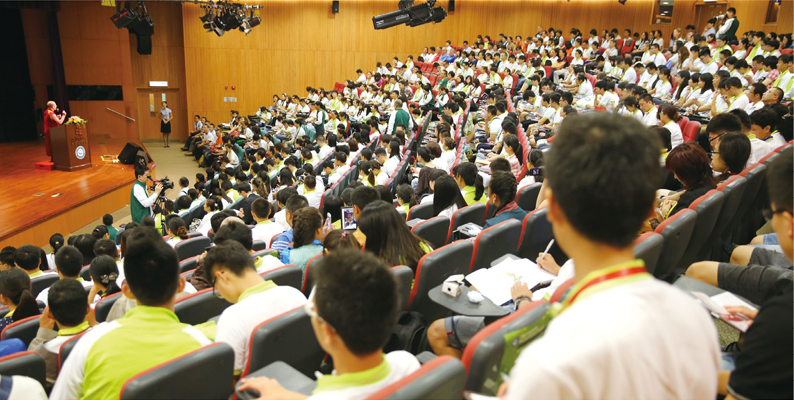
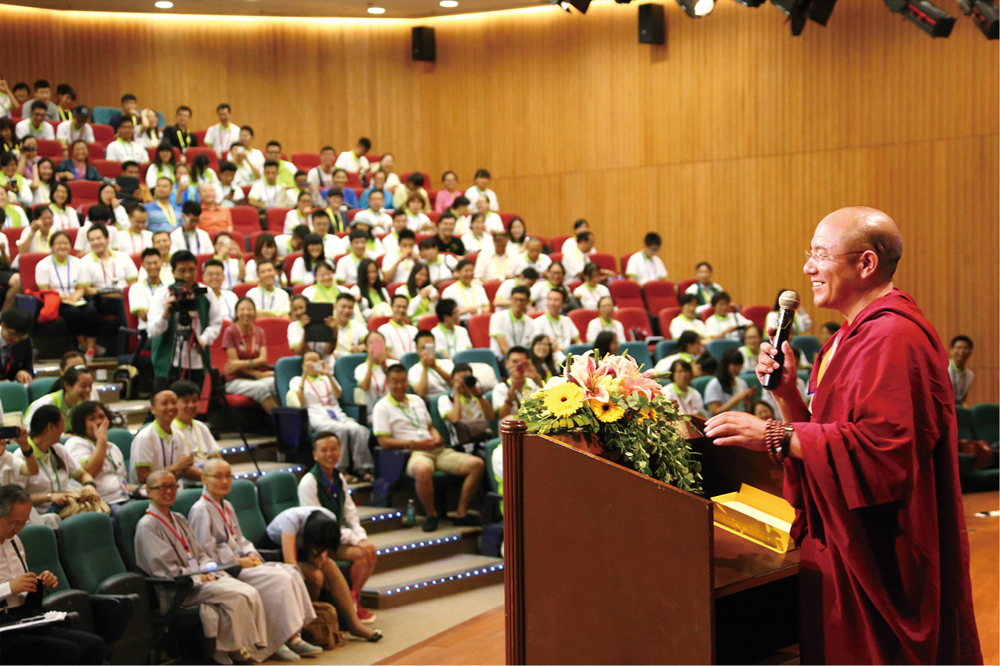
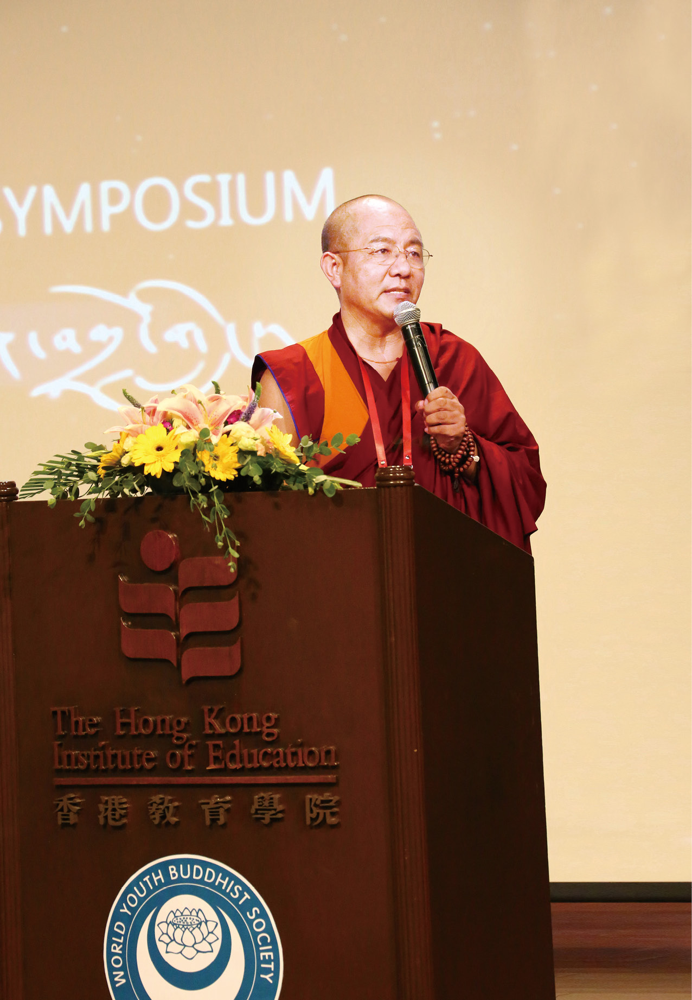
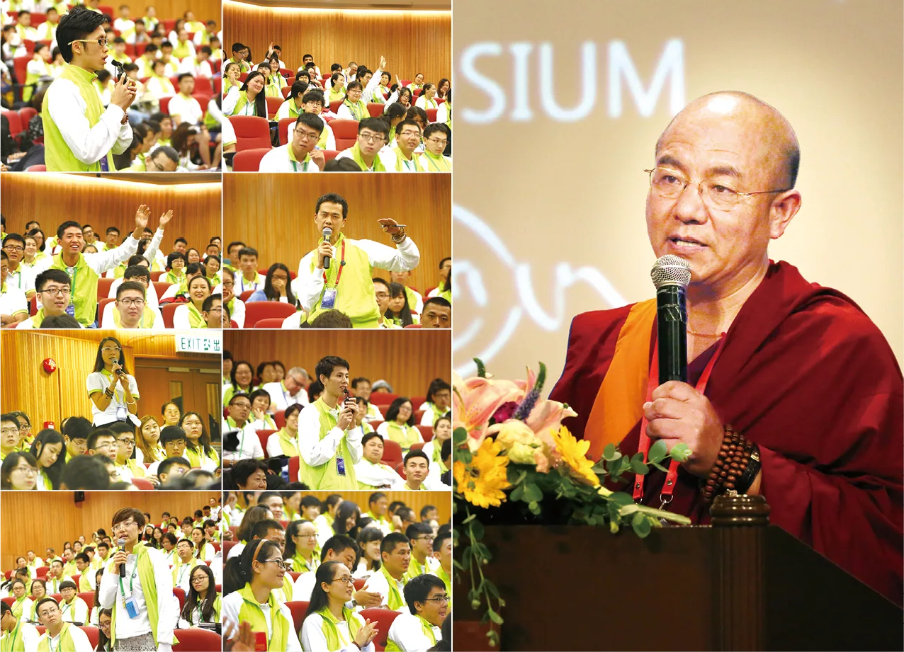

# 你也可以是菩萨

## You Can be a Bodhisattva

2014年8月5日

主持人：

大家好，这里是第四届世界青年佛学研讨会。

在人民出版社主办的《人物》杂志“年度面孔”活动中，索达吉堪布被评选为“在时代进程中具有标志性意义的宗教人物”；他写的《苦才是人生》是畅销不衰的佛教书籍，无数人因为读了这本书，从此改变命运；堪布还成为《南方人物周刊》的封面人物，他在接受记者采访时说：“我很重视知识分子这个群体，虽然我们感兴趣的点不一定相同，但有些深层次的智慧，跟知识分子进行碰撞，可以迸发出很多有意思的想法。”

下面掌声有请索达吉堪布，他演讲的题目是“你也可以是菩萨”——

很高兴能跟大家一起交流。在座各位，从某种意义上说是很有水平的。我看过今年的参会名单，所有人中间，我应该是文凭最低的一个，因为大家的学历都在本科以上，而我在中专最后一个学期，还没有得到毕业证的时候就出家了。所以严格说，我没有资格在这里演讲。这不是谦虚，而是事实，但不管怎样，我们都是为了一个共同的目标而来。

世界青年佛学研讨会已经开到第五天了，在这个过程中，我学到很多知识，从佛教角度讲，这也是一种修行。我一直认为我们在开一个法会，因为每一天，现场不管是大学教授还是在读学生，都给大家带来了许多有用的知识，帮助人们趋向善法，这在一般的世间团体中非常难得。

所以这几天，无论对现场还是网络上看直播的学者们，都是一个很好的学习机会。希望这段经历，能让大家在将来的人生路上，放下一些自我的保护、执著，潜心学习对自己更有意义的知识。这样你会过得特别快乐，对社会也能起到一定的作用。

## 藏传佛教的“菩萨”

今天我想讲的话题是，人人都可以做菩萨，“你也可以是菩萨”。

这个话题，我会用藏传佛教的道理来讲。因为大会这几年探讨了各种主题，包括可持续发展、环保、心灵与科学等，但每年都保留了一个藏传佛教版块，我是今年这个版块的主讲嘉宾。本来每个嘉宾都有60分钟时间，但我只要了40分钟，因为想多听听其他学者们讲。这是我自己请求的，不是组委会对我不公平。

在这个版块中，所有发言者都会围绕藏传佛教的主题或框架来跟大家分享。我要分享的，是其中关于菩萨、佛子的概念。

昨天，哈佛大学的亚历山大·伯金教授（Alexander Berzin, 1944-）讲了一个故事：基督教、伊斯兰教、藏传佛教、儒教，以及一些世间学者，这些不同宗教、思想的人，同时被困在南极冰川的一艘船里，他们齐心协力，最后渡过难关，以此来比喻人类社会所面临的困境和出路。

但我有点好奇，为什么其中只说到藏传佛教，不说南传佛教、北传佛教？当时很想向教授提问，可能手举得比较低，主持人没有看到。

后来，我私下找翻译问他：“故事里的每个宗教都有代表，为什么提到佛教的时候，只说藏传佛教？那南传佛教和北传佛教的人听了会不会有意见？”

他说：“一个原因是，这个世界青年佛学研讨的活动跟藏传佛教有关；另一个原因是，我自己这辈子学得最多、感受最深的就是藏传佛教，故事这样讲应该没有问题。”

“那其他的佛教怎么办？”

“那就在其他佛教举办的活动和场合中，继续讲这个故事。”（众笑）

我思考了很久，觉得他这么讲也有深远的意义。因此今天这个场合，我就讲一个藏传佛教中“菩萨”的概念。

## 我为什么要做菩萨？

关于这个概念，藏传佛教中有一部家喻户晓的论典，叫《佛子行》。明年世界青年佛学研讨会的论文大赛，也会用它作为大家研究、辩论、写论文的课题。这部论对我来讲可能比较简单，因为已经学习了三十多年。和前两届论文大赛中大家学过的《金刚经》《心经》相比，它的字数不算多：《金刚经》常用版本是五千多字，《佛子行》是一千两百字左右，《心经》是260个字。

而要学习《佛子行》，首先要知道什么是佛子，或者菩萨。有些人看到“你也可以是菩萨”，会想：“做一个成功人士多好，为什么要做菩萨？”这其实是不了解菩萨的含义。人们对菩萨通常会有两种想象，一种是寺院里金碧辉煌的塑像，一种是漫长历史中留传下来的神话人物。基于这些想象，人们会认为求菩萨保佑是一种无奈、无助的选择。但事实并非如此。

菩萨，是印度梵语“菩提萨埵”的简称。通达了万物的真相，叫菩提；帮助一切众生的勇猛智慧，叫萨埵。自己有所觉悟，还在力所能及的范围内，无条件地帮助别人，这样的人就是菩萨。

其实日常生活中，人们经常会讲“这个老菩萨”“这是活生生的菩萨”，虽然带着一些民间的理解，但也有它甚深的意义。

这个时代，每个人都有必要扮演菩萨的角色。当我们看到社会的各种现象：道德下滑、环境污染、人心混乱、生活浮躁……此时没必要怨天尤人，像菩萨那样，用和谐、智慧、慈悲的态度来观照社会，才是当前重要的一环。

人生很短暂，有些人非常成功；有些人马马虎虎，但也有自己谋生的技能；有些人特别失败，不明白生活为什么如此倒霉，老天为什么不给自己一个公平。面对不同的际遇，一方面，每个人要调整心态，做好自己该做的事，毕竟你还是这个地球上的一员；另一方面也要思考，我们的社会、家庭、生活到底需要什么？

人的第一本能，会希求自己的生活目标，这是理所当然的，大乘佛教也不否认这一点；但与此同时，应该关心别人的快乐，这更重要。“己所不欲，勿施于人。”这是儒家的说法，但我经常引用，希望大家能够换位思考，站在别人的角度、自己的角度都想一想，如何看待世界上的各种生活方式，我们需要的又是哪一种，是自私的，还是利他的？归根结底，应该需要利他。这个问题值得所有关心生活的人重视。

## 译讲《佛子行》的缘起

而利他心，正是《佛子行》所讲述的内容。

这是藏传佛教中一部无人不知的小论典，没有研究过佛教的人，可能会觉得难懂，甚至看不下去，学着学着就半途而废。但藏传佛教的思想精髓的确就在这部小小的论典中，它非常重要。

1987年，法王如意宝晋美彭措去汉地的时候，汉传佛教还很不兴盛。当时我刚开始接触汉地，也刚开始用汉语讲法，对汉语的表达方式非常生疏。在五台山菩萨顶，法王要求我给大家讲《佛子行》，为了不破坏缘起，我只好勉为其难地译讲。从那时候起，就一直用汉语弘扬《佛子行》。

有些人可能听说过法王晋美彭措，他对今天这个时代的佛教，尤其是藏传佛教的复兴起到了不可磨灭的作用，做出了巨大的贡献。他一辈子都把《佛子行》看得很重，无论去哪个国家、佛教群体，经常会讲一遍，或者念一遍。

我也受他影响，无论去哪里，有时间就给大家全部讲解，没有时间就念个传承。藏传佛教非常重视传承，在我自己的感觉中，通过这种无形的加持和力量，即生当中也跟很多朋友结上了大乘佛教和藏传佛教的殊胜因缘。

这对我来说，应该是非常殊胜的缘起。

## 《佛子行》的三个层次

今天在座的部分人，可能跟我有直接或者间接的因缘，如果你们能接纳我的观点，希望将来能把这部论当作一个重要的课题。有学术知识的人可以研究，有修行经验的人要去读诵、修持。因为这其中的甚深意义，如果只是研究，恐怕这辈子也难以通达。

比如《佛子行》的前面部分讲，获得难得的人身时，应该远离恶劣的环境、朋友，好好闻思修行等等，这些是前行的道理。

中间部分，讲到人生要希求的三种安乐：下等是自己小心谨慎取舍因果，希求今生的平安、快乐，这是下士道；中等是从世间苦海中出离，希求自我的解脱安乐，这是中士道；上等是不顾自己的痛苦，为了众生可以付出一切，希求众生的解脱安乐，这是上士道。上士道中又包含了自他交换、自轻他重、自他平等等很多佛学专用的修法。

最后部分，则讲到一些甚深的道理：世间一切显现，实际上都是由心所造，而心的本性远离四边八戏，只有泯灭了能取、所取，才是真正通达《佛子行》的奥义。

在专业的佛法面前，非佛教徒或者从来没有深入研究过的人，会容易打瞌睡、心散乱，这些都是正常现象。但要研究这部论典，大的框架就是三种层次：下士道、中士道、上士道。这在藏传佛教的《菩提道次第广论》《大圆满前行》《心性休息大车疏》中，讲法都是一致的。

## 搞懂两个要点，疑问迎刃而解

如果没有分清这三种层次，即便是佛学研究者也会遇到很多难题。

我接触过很多提问者，他们对佛教的疑问集中在两个地方：第一，不懂大乘和小乘的关系；第二，不懂胜义谛空性和世俗谛显现的关系，从而觉得矛盾重重。比如“佛教说看破一切，为什么又要精进成就、利益众生？”“佛教说一切都是空的，为什么会有眼前的这些景象？”实际上，很多问题都是因为对这两种关系不懂。如果在佛学方面稍微研究一下，你会发现这些问题并不难。

刚开始人有自私自利之心，希求自我的快乐、解脱，这种心态很正常。那些去寺院拜佛的人，就是想得到诸佛菩萨的保佑，祈祷自身离开烦恼，获得清净的解脱，对这一部分人来讲，非常合理。

而佛教讲的看破和放下，是到了最后，抉择究竟的见解和意义时，承许一切都不存在。如果学过一些中观论典，比如龙猛菩萨的《中观根本慧论》、月称菩萨的《入中论》、寂天论师的《入菩萨行论·智慧品》等，会更明白这个道理。

前一段时间，在座的很多嘉宾，包括美国和德国的一些教授，都非常认真地学习了藏传佛教的中观、因明和修行次第。我也呼吁学者们，如果有兴趣研究藏传佛教，不但要学习它的广大行为方面，比如发菩提心的方法、利益众生的六度万行等，更要学习甚深见解方面，比如中观思想和般若空性的智慧，相信对你们的人生，会带来显著的变化和利益。

对于弘扬真理，我会站在公平的立场：只要是这个世界的真理，都应该去追寻、获取，这个途径肯定是多种多样的。而我一辈子以研究藏传佛教为主，因此会建议大家多学一些藏传佛教的窍诀和理论体系，平时的许多焦虑、疑惑，在闻思的过程中就会迎刃而解，以后再慢慢学习更深层的空性智慧方面的道理，进一步放下执著。

## 菩萨特别悲悯的人

《佛子行》里还会讲到，在生活中遇到违缘、挫折时，怎样转为道用。这对现在的人来说尤为重要。

比如有人诋毁你，让你感到痛苦，此时如果能有大乘佛教的心态，把对方当作自己的善知识、父母、老师，痛苦自然会消失。这是比较高的一种境界，一般人很难做到。

世间的思想是“人不犯我，我不犯人；人若犯我，我必犯人”，但佛教的思想不会这样。小乘沙门四法中讲，别人害我，我不害他，做到这一点就可以了；而在大乘佛教中，不但不害他，还要帮助他。到了这一步，很多学者会想不通：“那太不讲道理了，明明他在害我，为什么要帮他？”当然不是每个人都要这样做，看你的心达到什么境界，如果境界比较高，像菩萨那样，就会特别悲悯那个害你的人。

印度的著名论典《中观四百论》中，有这样一句偈颂：“如是诸菩萨，特意悯恶者。”意思是说，真正的菩萨，特别悲悯那些极其恶劣的人。希望大家能记住这句话。

月称论师在《中观四百论》的讲义中，还讲过一个小故事：有个母亲生了五个孩子，其中四个孩子都正常，生活得很不错；唯独一个孩子没有生存技能，无法独立生活。但母亲最关心的，就是她这个最无能的孩子。

可能大家将来也会这样，在自己的孩子中，对最没有能力、脾气最大、心眼最坏的那个，会更加关爱。大乘佛子就是这样，如果在生活中遇到了恶劣的人，会更加着重地度化他。

但度化众生并不容易，所以大乘佛教会开许一些行为，这种行为不一定符合小乘佛教的戒律。有些大乘佛教徒为了利益众生，会放下对自己有利的言行举止，由此可能招来别人的讥嫌、辱骂，在生活中遭受很多痛苦，但他愿意。只要对身边的人有帮助，只要能将一个人从苦难中解救出来，他愿意付出自己的一切。这是大乘佛教的精神。

## 不要忘了今天的发愿

今天在座的人，百分之八九十是大学生，在大学期间，对人生往往充满信心。我听过很多大学生的人生目标，包括昨天发言的一些同学也在说，“不当银行顾问，去偏远地区当老师”“要做新闻记者，说出这个时代的真相”等等，总觉得自己可以改变世界。有这样的信心，很值得随喜，但到了将来的某一天，你还会不会记得？

以前有个问卷题目是“当初你为什么选这个？”很多人都回答“不知道”。所以不要忘了今天的选择。

人生的路，是一步一步走出来的。不要停留在大学的某个理想，或者脑海中的某个理论中，以为想做什么就能做什么，社会、环境，乃至前世的积累，众多因缘聚合的时候，你才会成功。包括将来到底能不能做菩萨，也是靠自己。

有人会想菩萨的境界是不是很难达到？也不是。实际上，菩萨的含义并不复杂，按照寂天论师《入菩萨行论》的观点，当你发自内心地想要帮助一切众生，从生起这颗心开始，就可以算是菩萨了。你的名字不再是“凡夫”，你的人生意义也从此不同。所以，只要你愿意，随时可以从身边做起，谁都有这个机会。

德国有一个女孩，12岁的时候眼睛就看不见了。在波恩大学读书时，她发愿学习藏族的盲文，也有说法是她开创了藏族的盲文。后来她到了拉萨，发现那里有一两万盲人，却没有盲人学校，于是在拉萨建立了第一所盲童学校。

看到这个故事的时候，我就想，自己虽然有正常的双眼，但如果去一个陌生国家创办学校，恐怕也很困难。而那个女孩据说已经在筹备印度的盲人学校了。

的确，心的力量在人生中起到非常大的作用。而且生命短暂，如果不努力争取，很多该做的事就会错失机缘。

这次大会结束后，大家在最初几天可能会有一种热情，觉得效果很好，但就像我在大会第一天说的，你们要好好记录，如果不记录，再过一段时间可能会忘记。人的记忆有限，再过十年、二十年，今天学到的很多知识还能不能用得上，不好说。

## 抓住机缘，行动起来

前两天的热点话题环节，我们也探讨了低碳与低贪、就业、道德等社会问题，当时台上台下互动得很好，大家都很关心，找到了切入点；但回去之后，在你的现实生活中，能不能至少做到其中的一点？理论上框架再大，实际中不一定能实现。因此希望大家能行动起来，哪怕帮助一个孩子，或者改变一个人的命运。

我们要有这样的决心和发愿。佛教说“愿大力大”，每个人都可以在正能量方面，发自内心地做一些事情，影响这个社会。只要是善的，并不一定非要带有佛教、基督教、伊斯兰教等宗教性的意味。

这几天，阿维夫教授、伯金教授等各个学者，都认真探讨了许多现实问题，这些问题不是光听一次就可以了，应该延续下去。可持续下去，这是关键。所以从现在开始，我们要做几件事，去帮助一些人：

第一件事，是启动《弟子规》的传播，发挥传统文化的作用，这在大学中很有必要。今年世界青年佛学研讨会将成立“学仁社”，针对传统文化的弘扬建立强大的团队，推广《弟子规》为主的传统经典，通过各种方式，在各大高校培养、培训一批老师。请把这个信息传递出去，这是交给大家的一个任务。

你们明天就会离开这个地方，但是学到的东西，如果没有去做，会比较可惜。在座有这么多的智者，希望你们在力所能及的范围内，用善巧方便弘扬传统文化。现在有很多的机缘，如果没有抓住，以后不会再有。

第二件事，你们如果有兴趣，可以研究大乘佛教的《佛子行》，我以前也讲过这部论。大乘佛教浩如烟海，值得所有的智者去探索。如今有很多人到藏地去拍照，其实拍风景不重要，要拍内心的照。如果拍藏地的蓝天、白云、青山、绿水，这种照片很快会消失；更重要的是，找到大乘佛教唯一完整保留至今的传承——藏传佛教，它源远流长，希望更多人能感受到。

最后，我简单讲一个佛教中的比喻：上等马，不用主人鞭打，看见鞭子的影子就会跑；中等马，要被鞭子碰到才会走；下等马，怎么打也不会走。学习也像这样，有些人稍微得到一点表示、提醒，就会领悟很多道理，并且付诸行动；有些人，再怎么讲也不一定起作用。

不管怎样，我们能相聚在这里，就是一个殊胜的因缘。

现场互动

问：您将很多藏语经论翻成了汉语，就是为了让汉族人能更好地学习藏传佛教。但现在汉地又掀起了一股学习藏语的风潮，有些人说，如果要真正学到藏传佛教的精髓，必须学习藏语。您对此怎么看？

堪布：这个说法，可能要从两方面理解。

一方面，要学会另一个民族的语言、文字，短时间内恐怕不容易成功。我看到很多学藏语的人，刚开始有一种好奇和热情，但到了中间会半途而废；当然也有一部分人，一直没有放弃努力，一直在坚持，也收获了很好的成果。像今天在座的一些教授，他们都在学习藏传佛教，学习藏语，从藏语上能懂得一些佛经的意义，这非常好。

另一方面，通过已经翻译的经典、论典、续部，同样可以学习。

每个人的根基不同，可以选择适合自己的方式，但这两种方式都是可以的。如果你非常勤奋，不但通达自己民族的语言，还能对其他民族的语言下功夫，那也可以学习藏语。但我看见学藏语的人里面，成功率并不高，有这种情况。

问：到底什么时候开始就是菩萨了呢？是从发自内心地想帮助众生开始，还是要真正做了帮助别人的事？因为现实中，很多事并不是想帮就能帮的，只能先有一个好的念头。

堪布：菩萨其实有很多含义。按照大乘佛教比较严格或者高层次的说法，就像月称论师在《入中论》中说的那样，获得一地，也就是“极喜地”之后，才可以叫菩萨。但这个标准，在座的人都很难达到。

而菩萨的另一种说法，就是能生起真正的利他心，并且付诸行动。想要帮助别人的心，佛教中叫“愿菩提心”；在生活中去实践、去做，叫“行菩提心”。如果今天看到一个可怜的人，你去帮助他，这就是菩萨的行为。

比如，最近在云南发生了地震，在座的人也都有同情心、悲悯心，大家用佛教的方式来祈祷，一起念念观音心咒好吗？

嗡玛呢巴美吽，嗡玛呢巴美吽，嗡玛呢巴美吽……

像这样，就包含了善念和善行。虽然用一两分钟做个祈祷，对我们来说很简单，但实际上，这是对遇难者的吊唁，也是一种善业的回向。

在以后的生活中，当别人遇到灾难，你会不会伸出援手？家人遇到困难、痛苦，你会帮助，因为这是人类的天性，出于自私也好、责任也好，都觉得义不容辞；但是，一个素不相识的人，当他遇到困难、痛苦，你会不会帮助？包括昨天讨论“老人摔倒扶不扶”的问题时，我看同学们的观点、心态也不一样。大家都可以扪心自问。

总之，按照第二种说法，如果真的有一颗利他心，并且采取了实际行动，就可以称为名相上的菩萨。

问：我来自加拿大，是佛光山的弟子。在星云大师提倡的人间佛教里，很强调在人间“行佛”，也就是实践佛法。所以会有很多入世的活动，比如加入义工团体，去学校、老人院等等。但我也有一些修藏传佛教的佛友，他们说，最好先花时间去“学佛”，去研究藏传佛教，等自己有了一定的佛学基础，有了更深刻的理解之后再去利益众生。但是，人的时间有限，在家人的工作、学习都很忙，那在学习佛教理论知识和实践佛法、利益众生这两方面，您觉得我们的精力应该怎样分配？

堪布：我认为学习、修行、帮助有缘的人，应该是可以同时的。

当然每个人的精力、智慧、能力都不一样。如果能力强，就可以既学习、研究，又帮助别人；如果暂时没有这样的能力，就先自我完善。这一点，藏传佛教也好，人间佛教也好，应该是一致的，都符合佛教的观念。

其实说“没时间”的人，不一定真的没时间，而是把时间浪费了。现在的很多“大忙人”，工作也只是忙的一部分，还有很多时间在忙睡觉、忙吃喝玩乐。如果把这些碎片时间都捡起来，一部分用来修行，一部分用来帮助别人，每个人都应该有时间。

所以这个问题，并不是藏传佛教跟人间佛教有差别——藏传佛教中除了修行人，也有利他者；人间佛教中除了利他者，肯定也有修行人——而是自己要经常想到，人身非常难得，应该在修行中发心、在发心中修行，做任何事情，都不可能把其他的事完全放下。

在藏传佛教中，这一点是做得很好的。藏族人随时带着念珠，不管在放牛、耕地还是上班，都不会停止念咒。包括在茶馆里，如果你们有机会见到，就会发现藏族老人在聊天的过程中，到他说话的时候他会说话，说完就继续拨念珠念咒，下次轮到他，又开始发言。这是他们的修行方式。

这方面，其他地方的人也可以想一想。很多人觉得，参加法会的时候才念咒，举办活动的时候才做善事，除此之外“我没有时间”。其实是有时间的，坐车也好，上班也好，包括在工作的过程中，只要你方便，这些都是时间。茶余饭后，都可以看书、学习、修行。

修行不能离开生活。大家没必要一直等着，要么出家，要么把所有的工作停下来，这个时候才开始修行或者研究，其实不需要。学会在生活中利用时间，每天都应该有机会。

问：佛教为什么要分胜义谛与世俗谛？对二谛有没有一种简单的说明方法？二谛的道理，如何运用在生活中？明白二谛后，怎样去帮助、利益别人？

堪布：并不是佛教非要讲一个二谛不可，而是二谛特别适合我们的生活。生活离不开“现相”和“实相”：显现上是这样，实际上是那样；人也有扮演的角色和实际的角色。一切万法都是如此，在显现上如理如实地存在，但实际上，它的本体并不存在。

就像我们的心，过去的心已经消失了，未来的心还没有生起，现在的心也是刹那生灭。在显现上，没有说心不存在，我们都有起心动念，都有分别念；但实际上，真正的心的确找不到。

所以实相和现相、胜义谛和世俗谛，这些并不是佛教的特殊说法，任何一个科学工作者或宗教人士，如果没有分清二谛，都没办法开展自己的研究。

我前面也讲过，大家关于佛教提得最多的问题，一是源于对二谛的道理不精通，觉得佛法有很多矛盾；一是源于对大乘和小乘的见解、修行、行为、结果不明白，觉得佛教也有很多矛盾。只要学懂了这两个大问题，很多疑问就能自然解开。

所以趁年轻，应该多学习、多研究。佛教的中观思想是怎样的？其他宗教也有一些经典，它们在说什么？

这是一个开放的时代，宗教之间也需要相互学习。其他宗教的人可以来学习佛教，佛教徒也要了解其他宗教，不要什么都不敢碰。在小乘戒律里，对初学者的确有一些约束：不能学外道、不能跟外道接触等；但在大乘思想中，为了利益众生，你必须精通世界上的所有知识，包括各宗教的教义、世间的学问。这一点都不矛盾。

当你明白了大小乘的关系，就会发现佛教没有问题，而且佛教知识特别适合当前的社会。大家也能看到生活中，很多人的心态是怎样的，在这个时候，特别希望年轻人能早一点遇到真理、学习真理，这对心态的调整很重要。

如果真的被困在南极冰川的一条船上，想要调整心态，还是需要窍诀的，这种窍诀并不是每个人都知道，它只掌握在极少数人手中。如果现在就努力争取，应该会有因缘得到。靠你自己。

问：您之前说到，作为一个真正的菩萨，会特别悲悯非常恶劣的人，并且尽心尽力地度化他。这让我想到《圣经》中，耶稣被钉死在十字架上的时候，也是祈求上帝宽恕那些钉死他的人。可见宗教对世界和平负有非常大的责任。而当今世界，宗教也会出现一些问题，在这种情况下，不同宗教信仰的人在对话的时候，是要相互破斥对方的理论，还是活出自己的信仰就好，不去过多评论对方的宗教？

堪布：各宗教之间的对话，或者说和平共存，既需要相互的学习、了解、尊重，也需要一些理论上的冲突，我觉得这非常合理，也很有必要。

藏传佛教自古以来就特别喜欢辩论。这几天我跟参加辩论赛的同学说：“和藏传佛教的辩论相比，你们这个还有点差距。”后来有几个同学来跟我“算账”：“我们的辩论不精彩吗？你们藏传佛教比这还精彩吗？你能不能教我们一些最厉害的招？”（众笑）

藏传佛教的各教派之间，比如格鲁、萨迦、宁玛、噶举等，乃至和其他宗教之间，的确会经常举办理论层面的辩论或对话，这是很有意义的。没必要因为宗派或信仰不同，就你不能碰我，我不能碰你。

现在有很多宗教徒，不敢面对和其他宗教在教义上的分歧。其实有因缘的时候，大家应该在教义上进行探讨。有些分歧属于历史、传统上的问题，不一定能解决；但有些分歧，一定能找到双方的契合点。

其实很多宗教的教义，包括基督教、伊斯兰教的思想，当你真正去了解，就会发现并不是外面传说的那样。我自己也是，刚开始学佛的时候很重视皈依，觉得其他宗教的教义都不能学；但后来慢慢看到，世界上的很多宗教领袖和大德并不是这样，他们很开明，既然如此，我想这背后肯定有甚深的意义，于是就改变自己的心态，去研究它们。在研究过程中确实发现，每个宗教都有它独一无二的生存价值，有对人类非常重要的贡献。

今天这个时代，不是各宗教互相抵触的时候，我们需要互相学习，在学习的过程中肯定会有辩论，但这并不是对教义或真理的轻蔑。真正的智慧经得起辩论——真金不怕火炼，它不会因此而被削弱价值。

所以，如果因缘条件具足，各宗教很有必要互相辩论、探讨。但如果眼下，大家都被困在同一条船上，也可以暂时不辩论，先渡过难关。（众笑）

问：如果遇到社会中的负能量，比如受了欺负、被人羞辱，年轻人是应该以牙还牙，还是拿起念珠念“阿弥陀佛”？或者说，我们应该怎样面对这些负能量，同时也能让更多年轻人对佛法有信心？

堪布：我刚才也讲了，《佛子行》中有很多这方面的道理。比如，我一心一意帮助的人、像亲人一样对待的人，却无缘无故来抢我的财产，害我的性命。这个时候，我不但不以牙还牙，还要把最好的财富送给他，甚至把他当作自己的父母和善知识，这就是大乘佛教的精神。

但我们其实很难做到。尤其在这个时代，人的嫉妒心特别强，就算你没有害别人，别人也可能因为嫉妒来害你，平白无故地骂你。

前几天《香港商报》的记者过来采访，他们问：“你有没有受过别人的侮辱或者诽谤？如果有，你是怎么对待的？”

我说：“其实没有出家之前我很坏，经常欺负小孩子、跟人打架（众笑）。但出了家之后到现在，三十年当中，确实不记得害过谁。即便这样，还是有很多人看不惯我、批评我。有人说我的时候，我就想，即便这辈子没害他，也可能是前世害过他。所以会默默发愿，虽然没有念‘阿弥陀佛’，但也是希望将来能帮助他。”

刚开始会有点难，但这种心态是很有用的。人在冲动下，难免会做出错误的选择，而一旦心态调整好，你会发现也没那么严重。

地球上一个小小角落的一个人给我一次谩骂，有什么呢？全世界有七十多亿人，哪怕一百个人在骂我，也还有那么多人没有骂我，对我来讲已经很幸运了。（众笑）

问：您刚才讲到的一点，我很有共鸣。人生的路是要一步一步走过来，在大学里，我们可能有很好的发心、愿望，以后怎样去利益大众、奉献社会，想法非常多。但是踏出校门之后，会发现现实跟理想不一样，来自社会各方面的压力，会冲击自己善良的心、美好的愿望。我想问，该如何将这样一颗心，在社会上继续保持下去？

还有一个问题是，我们做菩萨，去帮助别人，要怎么区别于救世主心态？因为做大、做强，救这个世界，无形中可能有一个歧途，就是养大“自我”。

堪布：在现实生活中，的确，美梦往往不能成真。尤其是现在的大学生，容易把愿望、目标定得太高。好比一个跳高运动员，本来身体素质一般，还把横杆放得特别高，那他肯定跳不过去，非常痛苦。

刚才听一位名人在讲，香港前段时间在招聘，岗位是操作电脑的售货员，每个月工资有一万多元港币。起初报名的大概有六百多人，但因为单位没有空调，结果只有11个人愿意留下来。其实在香港，月薪一万对毕业生来讲是很不错的，但大家都不愿吃苦。

前两天的辩论赛上，正方说社会应该多给机会，反方说自己应该从低处做起。后来反方胜了。虽然在辩论场上，“从低处做起”的人赢得了胜利，但在人生的赛场上，你会不会被“没有空调”打败？其实没有空调也很好，我这次出来，不管在汉地还是香港，都没有开空调，感觉非常舒服。

千里之行，始于足下。刚毕业、刚工作的人，更应该一步一步地做。虽然你有美好的愿望，但如果眼光放得太高，会很难实现。

你们可以看看俞敏洪、马云的创业史，还有一些明星、名人，包括宗教人士，他们都不是一夜成名，而是在很多年，始终不放弃努力，到了一定时候，自然会有成效。

为什么很多大学生走上社会之后，就把之前的梦想放弃了？这跟自己的心态很有关系，有些人是自暴自弃，有些人是不想再努力。

至于第二个问题，任何时候，我们都会对“自我”有所执著、完善，尤其在经济社会中，对此更加倡导。但自我的过度膨胀是没有必要的，这是重点。

佛教并不是要大家抛弃家庭、工作，全都去寂静地出家，全都去念“阿弥陀佛”，或者全都去做慈善，不是这样的。不管是研究佛法的人，还是研究其他宗教的人，对佛教的理解都不要极端。现在有些人，要么完全不学，对佛教嗤之以鼻；要么学得太痴迷，把其他事情全都放弃，结果造成很多社会问题。

大家应该有一种理性的抉择。在这个推崇成功学的经济社会，不要把自己太理想化了，否则，一旦你达不到那个境界，会非常痛苦。因此，先要掌握立足于社会的能力，同时也不放弃自己的理想，要为之奋斗。

佛教中也是，并没有要求一开始就放弃自我。作为凡夫人，要先发菩提心，一步一步做，才会慢慢有一些境界，而不是所有的境界，一天就修出来了。

问：我在生活中遇到两种情况，不知道怎么办。第一种是，修习佛法之后，我们想发善心普度众生，就去帮助一些比较穷苦的人，但对方因为本身的性格，或者说一些劣根性，受到帮助之后反而更加不思进取，这种情况下应该怎么做？还有一种是，对于身边不相信因果轮回的人，想跟他介绍佛法，又怕他对佛不恭敬，这又怎么解决？

堪布：这两个问题，我一起回答。

不管是学习佛法，还是学习任何宗教，都要有一种善巧方便。智慧很重要，没有智慧的人在世间法、出世间法当中，都很难成事，更不用说做成一些有意义的事。如果有了善巧方便，懂得分清时间、场合，找准对方基本的爱好和根基，就可以应机施教，这并不难。

在座的年轻人，有时候是出于个性，对自我的一种信任，觉得自己无所不能，以为在任何环境中，自己的思想一定会被别人接纳，但实际上不是这样。一个家庭中都可能有信仰不同宗教的人，可以办“跨宗教”的活动，将来在其他环境中更加可能遇到这种情况，甚至可以开我们这样的研讨会。所以大家要分清场合，真正懂得真理的含义。

有没有非宗教徒或者其他宗教的人提问？

问：我没有信仰什么宗教，这是第一次跟佛教接触。

我以前看过一部电影，讲一个聋哑学校的老师对学生进行性侵，有好心人想帮助那些学生，但是因为警察、律师、法官的各种利益纠结，最后恶人并没有得到惩罚，反而是一个受害的孩子，选择了跟侵犯她的老师同归于尽。电影的最后有这样一句话：“我们一路奋战，不是为了改变世界，而是不让世界改变我们。”请问您对这句话有什么看法？如果一个人坚持自己的内心不被世界改变，是否也是一种对社会负责任的表现？这样的人能不能成为菩萨？

堪布：你问得很好。可能很多人都有这种想法，希望坚持初心，但是往往到最后，世界会改变你，因为环境的力量很强大，人群的力量很强大。

特别是年轻人，刚开始可能过于激情化，觉得改变世界、改变家庭、改变生活都很容易。但我经常对一些大学生说：“等你毕业了，工作两年之后再看看，如果当时的心还在，说明这个理想可能会实现。”

但有些人一毕业，还没开始工作，自己就先变了。

我认识一个藏族学生，他在大学的时候天天拿着念珠，说将来一定要弘扬佛法，复兴传统文化。毕业之后，他去了一个单位，里面的人都喜欢喝酒、抽烟。后来我在街上碰到他，他喝了酒，对我态度不是很好。我故意说：“你不是要复兴传统文化吗？”他就特别不高兴。当时他工作的时间还很短，但是到了社会上，周围这些人的影响力是很强大的，你想改变他们，但不一定有这个能力，所以我们要努力。

我也发过愿，帮助一些众生，虽然在过程中遇到了很多困难，但还是希望有生之年不要放弃当初的愿望，哪怕对一个人，也尽量去帮助。可能社会会改变我，但如果自己的内心有一种强大的力量，应该不会被改变很多。

问：我知道佛教中有两种对待烦恼、情绪的方法：假如你有一个困惑，一种方法是去击碎它，而另一种方法是，只管看着它、接受它。那我本人就有一个毛病——一天要睡12个小时。如果正常人的睡眠是6个小时，那我解决这个问题的方法，是每天喝6个小时的咖啡让自己保持清醒，还是选择接受，“好吧，那就睡12个小时”？

堪布：你这个喝咖啡的故事，我没太听懂。

问：其实就是大乘的方式和金刚乘的方式。

堪布：你对佛教很有研究嘛，讲得这么高，又是大乘，又是金刚乘。（众笑）

对于烦恼，大乘佛教的方法，是尽量转为道用。像前面说到的，别人诽谤我的时候，我把他当作善知识，或者用其他方式，像毒药可以变成良药一样，将烦恼变成智慧。而密乘的方法，是在烦恼产生的当下，观它的本体。至于用哪种方法，要看你是哪种根基。

比如有人骂你，你特别不高兴，生起了嗔恨心，此时你是通过思考一些道理，让嗔恨烟消云散，还是能当下观嗔恨心的本体？后者就是禅宗讲的“烦恼即菩提”，金刚乘中所讲的，也是这个。

其实最给力、最容易、最快速的方法，就是直接观心的本体。但这种根基的人不多，大部分人“当下”是来不及的，因为嗔恨已经爆发了。你可能会事后懊恼：“刚才应该用上这个方法，可惜已经失态了。”很多人都是这样，在不该吵架的场合跟人吵架，过了一两天，又觉得特别不好意思。
