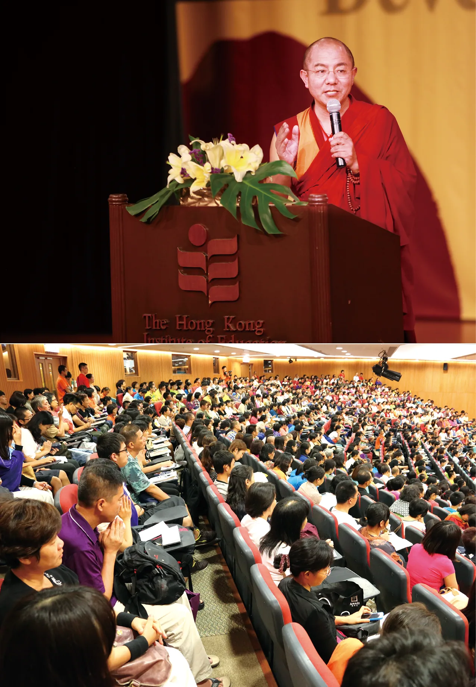

# 信仰是鲜美的生命之泉

## Belief is the fresh spring of life

2013年7月16日

今天，来自香港和其他地方的各位宗教界人士，都将以非常开放的心态，与大家分享跨宗教可持续发展方面的心得，希望诸位青年知识分子多了解他们的思想。

## 超越世俗的灵魂生活

有人认为凡是宗教都是迷信，也有人因为信仰某个宗教，就排斥其他宗教，但我认为，真正的宗教不仅无害，而且它对全人类都非常重要。所以，不妨以包容的心态看待宗教。

著名画家丰子恺将人的生活分为三种层次：物质生活、精神生活和灵魂生活。

所谓物质生活就是衣食，用饮食、财物等外在事物满足自己的生存需要；所谓精神生活就是艺术，是在物质之上追求精神层面的享受，例如音乐家、画家们的创作或思考；而所谓灵魂生活就是宗教。

丰子恺认为，过这三种生活的人相当于住在三层楼里。住在第一层楼里的人过的是物质生活，属于大多数；住在第二层楼里的人过的是精神生活，相对要少很多；而住在第三层楼里的人，则是超越了世俗，过着宗教赋予的灵魂生活，当然，这种人是最少的。现实中不管你们住在哪一层楼里，也不管你们主要过的是哪种生活，今天大家来香港参加这次聚会，说明你一定是想了解宗教。

而香港也的确是一个适当的地方。多年来，香港以它的开放和包容，让各类宗教在此自由发展，来自香港和世界各地的人士都能发表自己的见解。从他们身上，可以学会跨越狭隘的门户之见，学会用包容的视角，来融汇整个世界范围内的正确思想。

## 道德缺失使犯罪率上升

正确思想从来不只是一种思想，它还可以深刻影响人的行为。就像宗教，宗教信仰对人类的生存和发展，历来都起着不可思议的作用；即便是今天，也依然是如此。

美国总统奥巴马上任后，调整了前总统布什在政治、经济、军事等各方面的政策，唯独对宗教作了保留，甚至增加了许多有利于宗教间互相学习交流的优惠政策。

为什么呢？因为他认为，任何宗教中“平等、博爱”的主张，都为社会提供了“尊重、理解”的空间。所以，宗教对美国人、对美国的发展来讲，是不可缺少的。

前段时间我看过《中国人的信仰》一书。在书中，北大教授钱理群说：“一个不知道爱、不知道怕的民族太可怕了。”他认为，知道怕，人在道德上就会受到约束，而宗教“无形中维护了社会道德的底线”。他举例说：“假冒伪劣也有一个限度，就是不能伤害人的生命……做坏事也是有规矩、有约束的。而我们现在的问题是，这样的底线被突破了。”

可见，如今人们的思想危机、精神危机，就是缺乏信仰导致的。缺乏信仰的人就会缺乏道德，道德缺失的极端表现就是犯罪。统计研究发现，当一个国家的信仰率提高时，犯罪率会下降；信仰率降低时，犯罪率就会上升。因此，对整个世界来说，宗教信仰不可或缺。

那么，现在全世界的信仰状况如何呢？2011年美国《宗教近况》报道说：在今天69亿的全球总人口中，58亿人都有自己的宗教信仰，没有任何宗教信仰的人约有11亿。从这个数字看，没有信仰的人比例不大。

当然，今天在座的都是来寻求真理的，不管你信仰哪一个宗教，或者不信仰任何宗教，我们都一样欢迎。不过，没有信仰，不一定是个正确的选择。可能有些同学还记得，去年的研讨会上，有个哈佛女孩说自己在参加一个“活动营”时，因为没有信仰，被当成“怪物”一样。因此，以后有了机缘可以考虑考虑信仰问题。

其实每个宗教都是好的，只是彼此缺乏了解。二十一世纪，这种相互了解既有必要，也很便利。像今天这个场合就很好，对我而言是个好机会，可以让我直观地了解其他宗教。我以前读过基督教的《圣经》、伊斯兰教的《古兰经》，也读过道教的《道德经》、儒教的《四书》，甚至还看过印度教的《吠陀》。在拜读这些著名经典论典的过程中，我有一点重要的认识：在任何一个宗教的教义中，都有“真、善、美”的倡导和教诫，而这恰恰是每一个心灵最需要得到的启发，为什么不值得提倡和发扬呢？

所以我认为，宗教是人类生存和发展的精神食粮。而宗教与宗教之间，也完全可以求同存异，在互相学习、和睦相处的气氛中，共同为人类的前途做出相应的引导和维护。

## 宗教的意义隐藏于人们的内心

《爱因斯坦谈人生》（Albert Einstein: The Human Side）里有一句话，它说：“我们千万不能忘记，仅仅凭借知识和技巧并不能给人类的生活带来幸福和尊严。人类完全有理由把高尚的道德标准和价值观的宣道士，置于客观真理的发现者之上。”爱因斯坦就是客观真理的发现者，但他不认为自己以及其他科学家们，已经超越了那些宗教领袖。所以他说：“在我看来，释迦牟尼佛、摩西、耶稣，他们对人类社会的贡献，远远超过所谓的聪明才智所取得的一切成就。”

这位科学先驱的话值得深思。科学确实是给人类带来了进步，但与此同时，为什么越来越多的技术开发让社会陷入危机，让人们感到恐惧和不安？几千年来，那些伟大的精神教主到底给我们留下了什么？难道宗教里真有答案，可以解决如今的一切难题吗？

带着这些疑问，希望大家仔细地聆听各位宗教人士的教言，看能不能找到救护社会的良方，甚至发现超越平凡世间的理论和修证。有位智者说：“宗教的意义虽然隐藏于内心，但当它通过修行显现于外时，其魅力一定超胜任何知识或艺术。”

这一点，在我们学习了以后，应该会了解的。

在研讨会当中，你们心里有什么疑问，有什么见解，都可以直言不讳地向这里的宗教人士和教授们提出来。香港是自由开放的，所以我相信，每个人都有接受批评、接受辩论的能力。

著名心理学家荣格在《心理学与宗教》（Psychology and Religion）中说：“在生活中拥有信仰的人应该说他们获得了无价珍宝，因为信仰是新鲜美丽的生命之泉。”
