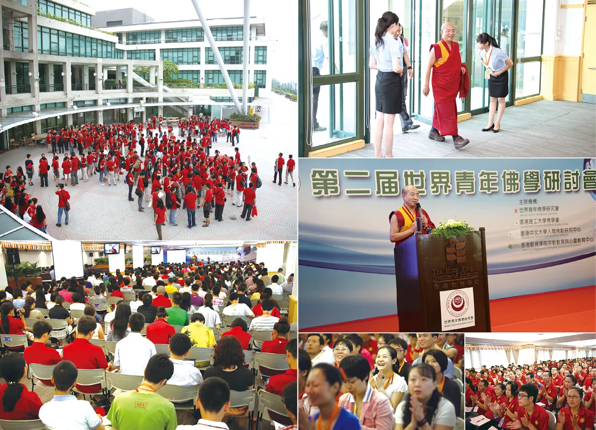

本 届 主 题

佛 教 与 心 灵 教 育

Buddhism: Education of the Heart

第2届

世界青年佛学研讨会

World Youth Buddhist Symposium

中国·香港

2012 / 8 / 2 - 8 / 5

## 开幕词

## opening speech

2012年8月2日

今天我很高兴，在香港教育学院和这么多法师、青年学者共同探讨真理，在座的大多是年轻人，能拥有这样一个机会实属不易！

首先，我特别感谢在座的法师和教授，他们的法务非常繁忙，感谢他们抽出时间和青年学者研讨，给予智慧的启迪！也特别感谢来自世界各地、五湖四海的知识分子，没有你们的到来，研讨会无法举办！同时感谢诸多的志愿者和无名英雄，没有你们的支持和付出，这样的盛会难以成办！

这次世界青年佛学研讨会，主要由香港教育学院、香港中文大学、香港理工大学以及世界青年佛学研究会、国际菩提学会举办。参会的学员、学者来自世界各地，有美国、新加坡、英国、德国以及澳洲、新西兰等，还有内地各高校的学者。现在已经报到的共有383位参会者，来自236所高等学校。

从宗教信仰的角度来看，参会人员中有60%信仰佛教，还有40%信仰其他宗教或没有信仰——这次会议不设任何信仰的限制，只要大家对真理有兴趣！民族方面大多是汉族，也有藏族、朝鲜族、蒙古族、纳西族以及云南、新疆一带的其他民族。从受教育程度及学位分布情况来看，主要是大专学历以上的在校生，本科生居多，亦不乏博士及博士后，还有很多不愿意透露姓名、希望做一个默默无闻的“学生”的教授、学者和老师。

第二届世界青年佛学研讨会的原则是包容、利他和开放。众所周知，香港是一个非常开放和国际化的城市，这次研讨会对未来的年轻学者有拓展思路的作用，至少也能让他们种下善根。

我们参加会议的目的，不是为了游玩或者购买名牌服装，更不是为了世间的其他目标，我们希求的就是心灵教育！针对青年人缺少心灵道德教育、宗教教育这个问题，我在香港找了很多教授，包括今天在座的科学家和佛学家，在他们的智慧中，隐藏着很多人类心灵科学的宝藏，我希望在座的人士能专心致志地听受他们的演讲。

这次研讨会有三个主题：第一天是“佛教与科学、环保”；第二天是“佛教与心灵教育”；第三天是怎样“认识藏传佛教”。对现在的人们来说，这些是有必要了解和探索的话题，应该受到特别的重视。

与会期间，大家一定要认认真真地学习。目前最主要的不是其他事情，而是活到老，学到老。我们应该向这些老教授们学习，以好学不倦的态度，拥有一个美好的人生！

今天是藏历也是农历的六月十五，今晚的月亮圆圆满满，无有缺陷。在此，我预祝本次研讨会圆满成功！

谢谢大家！
