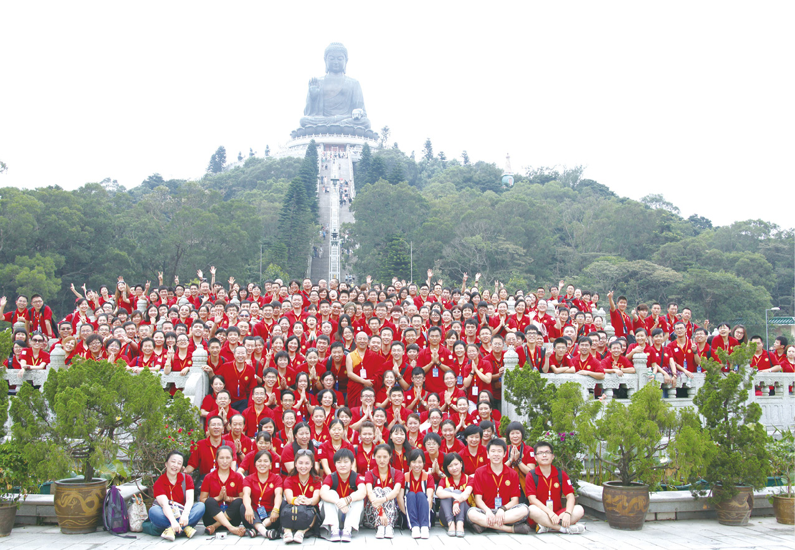
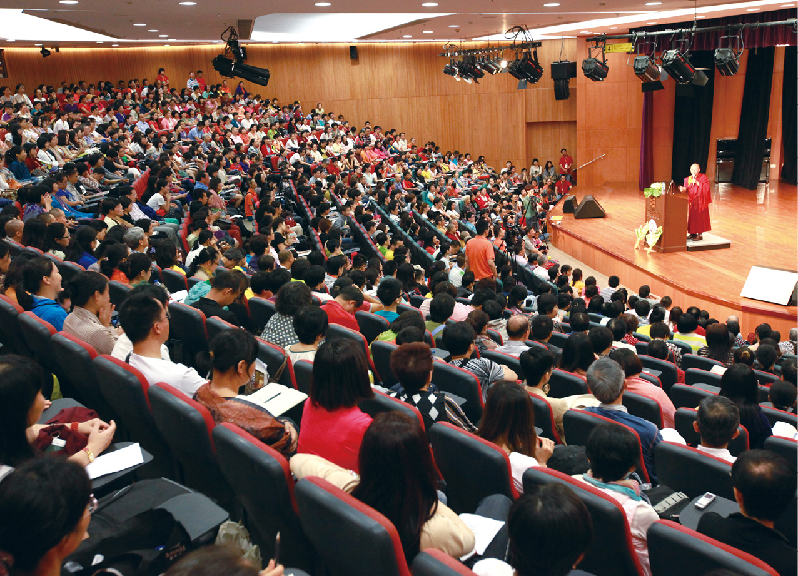
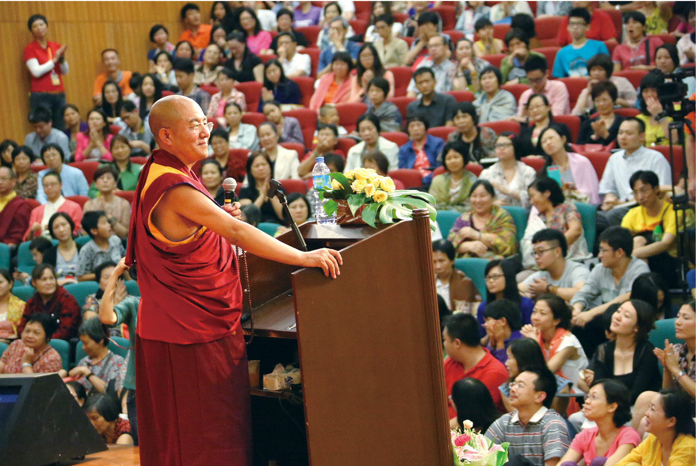

本 届 主 题

可 持 续 发 展

sustainable development

第3届

世界青年佛学研讨会

World Youth Buddhist Symposium

中国·香港

2013 / 7 /16 - 7 / 19

## 开幕词

## OPENING SPEECH

2013年7月16日

今天，我们从四面八方、五湖四海齐聚香港教育学院，这看似偶然，实则必然，是一个殊胜的因缘，相信诸位都会珍惜这段美好时光。

“世界青年佛学研讨会”已经成功举办了两届，第一届是在喇荣佛教大学，当时有两百多位知识分子参加；第二届是去年八月份在香港教育学院举行，有四百人左右；今年是第三届，就从今天开始在这里隆重开幕。

本次研讨会的主题是“可持续发展”，就像刚才宏明法师讲的，我们这里要谈的不是经济的发展，而是心灵的发展。心灵的发展更重要。汤恩比博士曾说：“人类的历史如果剥开外皮，就成了一种心灵的历史。”可见，不论时代如何变迁，社会如何进步，人类对心灵的追求始终是永恒的主旋律。

看到大家满怀喜悦、热情和信心，看到这么多知识分子欢聚于此，我本人深受鼓舞。我想，无论你有没有宗教信仰，无论你是什么身份的人，我们都是地球的一份子、世界的一员，因此我们都有责任关爱如今的地球，都有责任关心社会问题、健康问题、教育问题。我相信，通过本次论坛的共同学习和探讨，应该会给世界增添一份祥和与温暖。

预祝本届论坛圆满成功！谢谢大家！吉祥如意！
