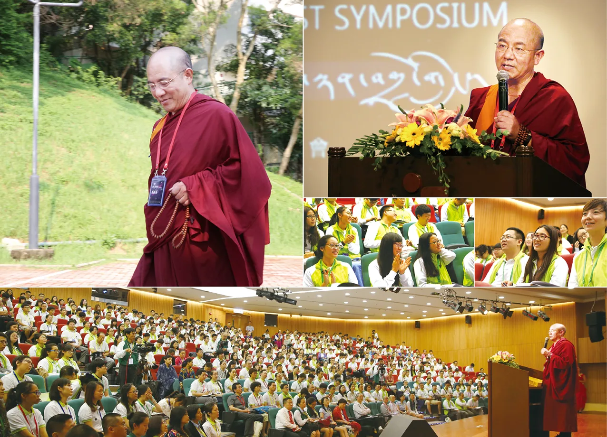

本 届 主 题

社 会 责 任

social responsibility

第4届

世界青年佛学研讨会

World Youth Buddhist Symposium

中国·香港

2014 / 8 / 1 - 8 / 5

## 开幕词

## OPENING SPEECH

2014年8月1日

今天是一个非常殊胜的吉祥日。在这个美丽的城市香港，我们第四届世界青年佛学研讨会在这里举行。这是一个非常好的因缘。

今天，来自225所大学的教授、老师、同学，以及社会各界人士、宗教界人士都来参加这次研讨会。这是一个国际性的高端论坛。在这个论坛上，我相信所有人来到这里并不是为了寻找表面的、外在的快乐，而是为了追求心灵的真相，更深更高的一种心灵安宁。因此，我们为期五天的会议将围绕“开放、包容、求真、利他”这八个字进行探讨。

## 第一，开放

在座的各位都知道，在全球化的今天，我们应该有个开放的心态。开放，不仅仅是对外贸易要开放，更重要的是我们内心要开放，要在真诚交流和相互学习的前提下探讨真理。

我们的世界青年佛学研讨会，本身是一个以佛教为中心的研究会，但来到这里的知识分子，除了佛教徒，也有其他宗教的信徒，乃至没有任何信仰的人。只有拥有了开放的心态，才能接触到更多对我们有益的知识。

## 第二，包容

我们应该有一个包容的思想。例如，今天有一场“跨宗教对话”，虽然每个信教的人不能代表这个宗教，但是他可以代表这个宗教的一部分思想。所以我们举办这样的论坛，不仅可以接触到佛教自身的思想，还可以接触到基督教、天主教、犹太教、印度教等全球许多宗教思想，以及各种非宗教的学术思想。

这一次，我们非常欢迎不同观点的交流，同时，我们可以包容各种对立的观点。即使有一些对佛教教理的反驳、攻击，我们也都允许。

在佛教中，释迦牟尼佛曾经说过：“你不应该因为对我恭敬就完全接受我的教诲，而必须像提炼黄金般，用自己的智慧反复抉择。如果我的观点正确，你可以接受；如果我的观点不正确，则不必接受。”这就是佛陀的立场。

因此，我们特别希望有很多自由的发言，以包容的心态探索真理。

## 第三，求真

如果你想攻击别人的观点，必须建立在求真的基础上。无论任何宗教或任何社会成员，都需要真理。这个真理不可能只接受一种宗教或一种思想，真理应该是多元的、多维的，应该从不同的层面去寻求。当今世界是一个多元文化的世界，我们在寻求真理时，应该求同存异。

## 第四，利他

举办本次研讨会的根本目的是什么？是利他。任何真理、任何思想，如果围绕着自私自利，以自我为中心，可能都不会长久。我特别希望今天的很多年轻人和学者都有一种求真的精神，你们将来一旦发现了万事万物的真相，不要自我膨胀、自我赞美、自我炫耀，而应该去造福他人。按照我们佛教的思想，发菩提心修行后要成佛，而成佛之后做的事情，就是利益众生。

上个世纪，有一位非常伟大的智者叫华智仁波切，他说成佛的目的就是为了度众生，而不是去极乐世界或某个刹土享受快乐。

所以，这里的很多年轻人踏上人生道路后，寻求真理是非常重要的。我特别希望，这个真理要建立在利他的基础上，这样才能真正散发光芒。

最后，希望第四届世界青年佛学研讨会取得圆满成功！非常感谢！
