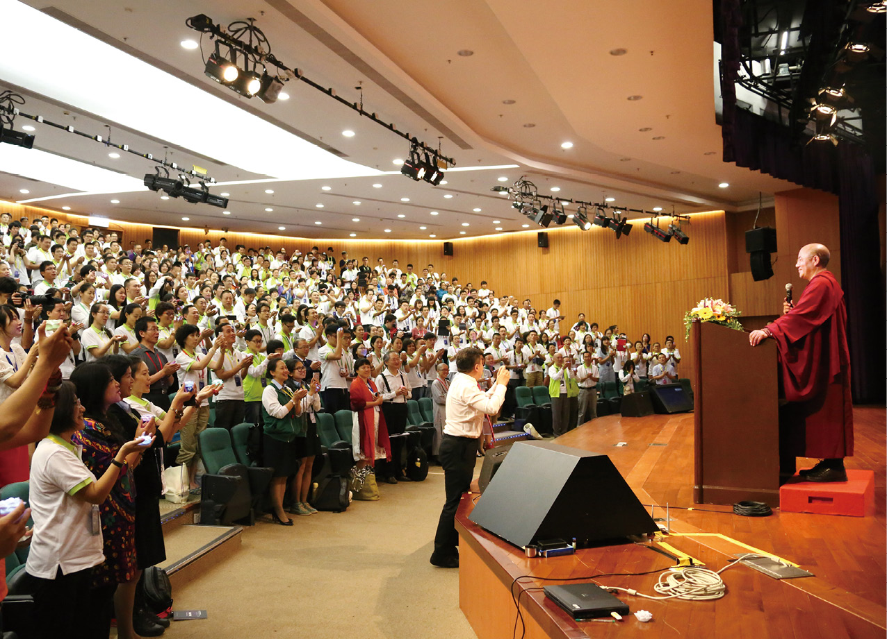
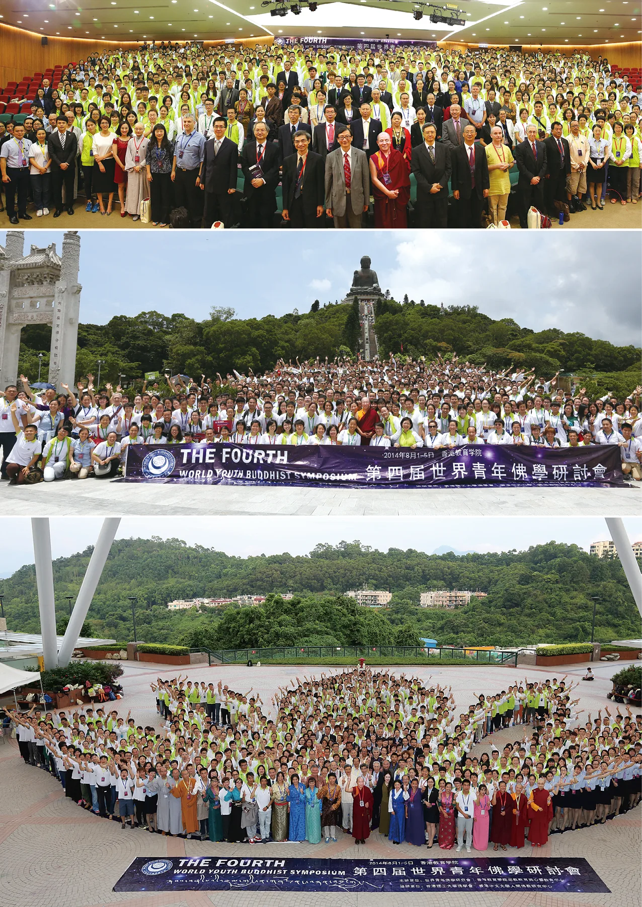

## 闭幕词

## Closing speech

2014年8月5日

第四届世界青年佛学研讨会即将结束。我相信在座的各位和所有通过网络观看的观众，心情应该有一些特别的变化。

我个人心情比较复杂。一方面，我很高兴这五天的议程已经圆满，另一方面，无论你来自哪里，无论你信仰科学还是宗教，我们中的许多人很快就会分离，当人与人分开时，感觉是不一样的。今天在座的各位，有些人可能会在未来的人生中相遇，有些人在茫茫人海中再也不会重逢，但无论如何，我们在香港教育学院一起参与这样的学术交流，是一个非常殊胜的因缘。

这五天，大家都学到了很多，各位专家跟我们分享了一些非常有意义的宝贵知识，我也从他们那里学到了一些教言，这让我常常深思。相信这五天的学习交流非常有价值。在座的同学其实也不容易，在我看来，你们的精神相当值得赞叹。以前有一次在香港的一所大学，一位教授说，很多人一开始可能会有热情，但这种热情很快就消失了。然而，我们这次研讨会，开始的时候人很多，最后的时候人也很多，从早上6点到晚上10点，你们基本上一天都坐在这里，这是值得称赞的。包括我们前排的人，一直往台上看，台上的人一直在往下看，但我们的脖子并没有完全僵硬，还能动。（众笑）

然而，在我们举办本次世界青年佛学研讨会的过程中，可能并不能让所有人都满意。包括许多国内外嘉宾，在演讲时间的安排上，有时候实在没办法。有些教授是专门从美国、德国来的，但给的时间非常短；有些老师、同学很想上来发言，但这次因为只有五天时间，除了茶歇基本都在学习，所以无法全部安排；还有些同学一直在我们座位附近等着发言，但最终没有轮到他们……如是种种，希望大家能谅解。

另外，这次没有被第四届世界青年佛学研讨会录取的，有的可能在电视上、网络上看，有的可能也会失望，但是没有办法，因为我们的场地和条件有限。不管怎样，希望我们以后继续努力，希望大家能给予我们理解，学习的精神永不中断。我就不多说了，因为今天听了很多人的发言，大家都不缺这样的声音。

最后，我要特别感谢香港教育学院宗教教育与心灵教育中心、香港理工大学佛学会、香港中文大学人间佛教研究中心，以及今天在座的所有工作人员，包括来自世界各地的学生。你们以各种方式支持我们，使第四届世界青年佛学研讨会取得圆满成功。我们希望继续与香港教育学院合作，明年夏天的这个时候，第五届世界青年佛学研讨会仍将在这里举行。希望大家到时候以各种方式参加，谢谢！

