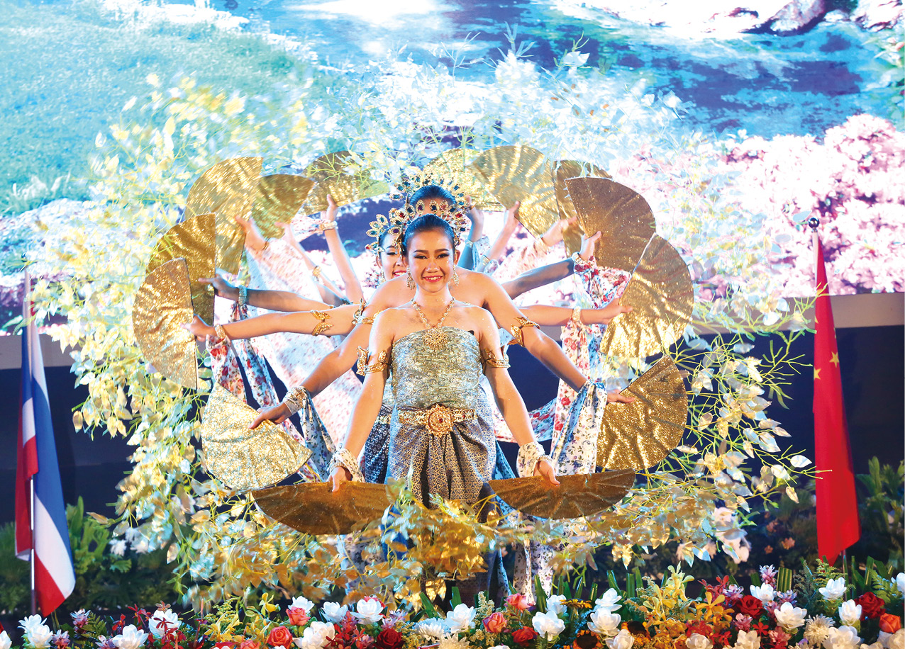
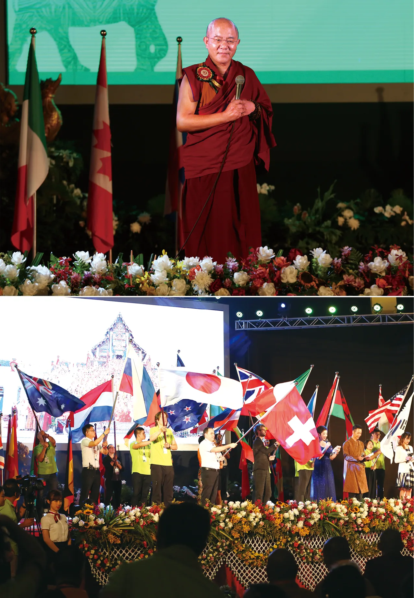
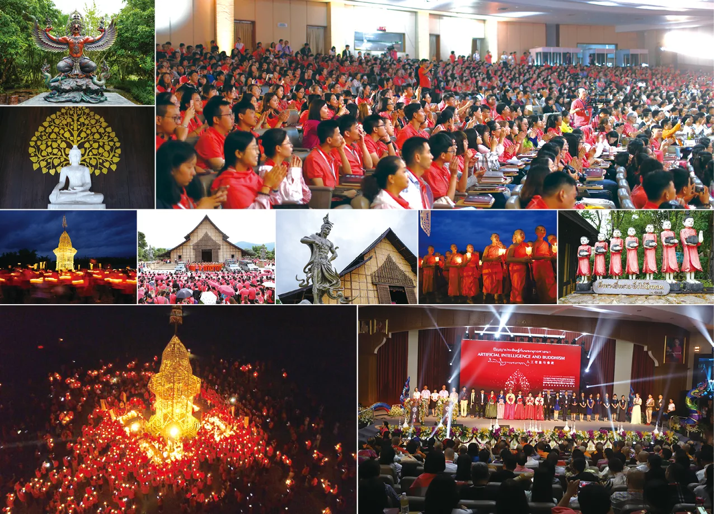
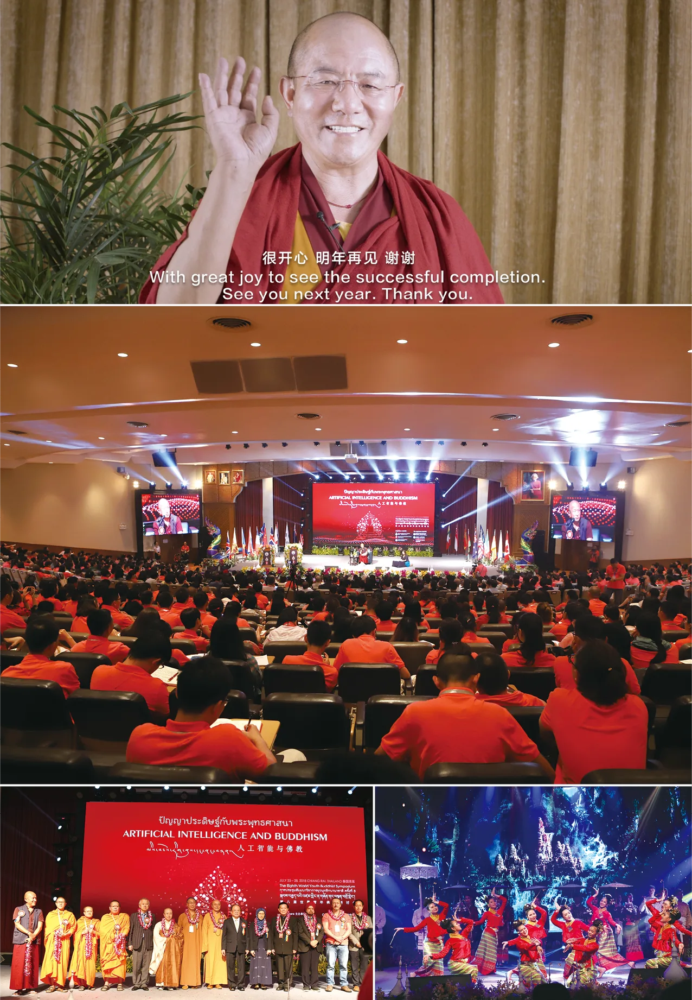
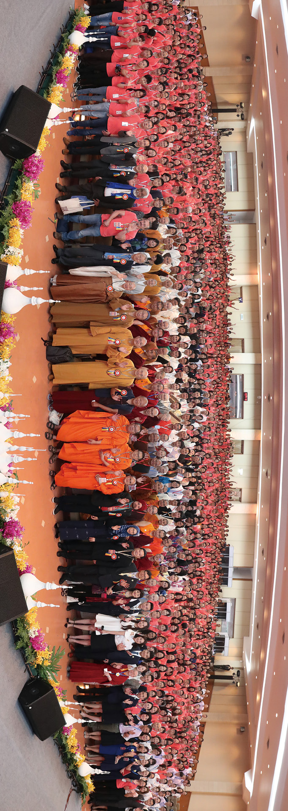

本 届 主 题

人工智能与佛教

Artificial Intelligence and Buddhism

第8届

世界青年佛学研讨会

World Youth Buddhist Symposium

泰国·清莱

2018 / 7 / 25 - 7 / 28

## 共赴智慧盛宴

## Attending the feast of wisdom together

2018年7月25日

索达吉堪布用藏语问候每个人，汉语的意思是：

尊敬的各位高僧大德，以及知识界的人士、教授和学生们：

很高兴大家从四面八方来到这里，参加第八届世界青年佛学研讨会。我在这里谨代表组委会向你们表示衷心的问候：扎西德勒，吉祥如意！

接下来，我用汉语简单讲几句——

汉语开示：

尊敬的各位高僧大德，来自世界各地的嘉宾、朋友、专家、学者：

大家上午好！

在这个非常吉祥的日子，来自五湖四海、四面八方的许多专家和学者，集聚在泰国清莱，这个美丽的佛城。我谨代表世界青年佛学研讨会的全体成员，对来自世界各地参加这次盛会的所有人，表示热烈的欢迎和真诚的祝福。

首先感谢我们的主办方，清莱皇太后大学、世界青年佛学研究会、世界和平禅修中心。这次的主办方、所有高僧大德和专家学者们，都付出了很多很多。同时，我们的协办单位是泰国摩诃朱拉隆功大学清迈校区、香港中文大学禅与人类文明研究中心和香港理工大学佛学会。事实上，举办如此盛大的活动需要很多人的努力，我们组委会约有280名志愿者参加了第八届世界青年佛学研讨会。大会的精彩呈现，离不开你们的付出。今天，我也非常感谢大家在这么长时间里所做的一切努力。

接下来，我想讲的是：从第一届到第七届世青会，每一届我都参加了。第一届是在藏地喇荣举办，第二届、第三届、第四届在香港教育学院连续举办，第五届、第六届、第七届在泰国摩诃朱拉隆功大学清迈校区举办。但是这次，由于种种原因，我没有亲自来现场。其实，我很想来，希望下一届能亲自参加。

这一届的研讨会，我一直都非常关注。这次报名的大概有3000多人，我们录取了1100多人，还有2000多人没有录取。我们这次录取了来自39个国家392所大学的学生。你们每个人都应该体会到，来到这里是一个难得的机会。

下面，我想给大家提几点希望：

第一，希望大家在举办过程中，服从组委会和志愿者的一切安排，注意安全，因为我们今年住的宾馆比较分散，各方面的压力比较大。同时，大会每年都有一些纪律，我也会强调一些纪律。大会期间，希望大家不要散乱；不要擅自离开；不要晚上去喝酒，也不要到处去玩；大会进行时不要打电话、说话。这样都不是很好。

第二，每个人应该有一颗珍惜的心。这次来了很多全球具有影响力的专家、学者、宗教人士，他们讲的道理其实非常珍贵。在这个时代，我们应该有探究真理的精神，任何人讲的真理对你以后的生活都很有意义。大家应该珍惜这段时间。

第三，大家应该卸下对自己地位和名声的傲慢，虔心学习。这四天非常有意义，不管是谁分享的，大家都要记录下来。我以前也是，第一届到第七届所有嘉宾的发言，都记在了本子上。希望你们在这次研讨会中，有一个学习的态度，应该多学点。即使你地位比较高，但有些学生提出的建议，可能对你的生活也是很实用的。

第四，我们大会的宗旨是“开放、求真、利他、包容”，既然如此，我们就应该有一个包容的思想。对于所有与会者，不管是宗教人士、非宗教人士、科学界人士，他们有权表达不同的观点，我们不要用狭隘的观念去排斥，应该有一个开放包容的心态。我相信，当今特别开放的世界需要这样的智慧，尤其是在这个非常复杂的人工智能时代，更需要全人类的探索。我们这次的主题是“人工智能与佛教”，所以要研究新时代思想与传统文化的碰撞，也要研究东西方不同的想法和观点。科学和宗教虽然是不同领域，但也需要互相融合。因此，我们聚集了知识分子和宗教人士等各方面人才，他们每个人站在自己的立场上，和大家分享是很有意义的。

最后，我想表达的是，大家在这四天旅程中学到的爱和智慧，应该好好记在心里，记录在你的书本上。然后，当你回到家乡时，希望把这份爱和智慧传递给所有的有缘人。

非常感谢大家！预祝我们的盛会圆满成功！

