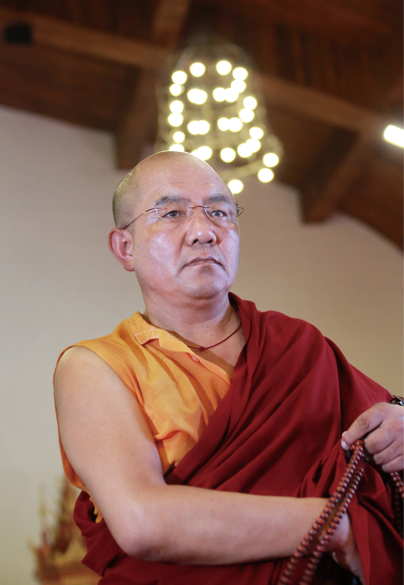
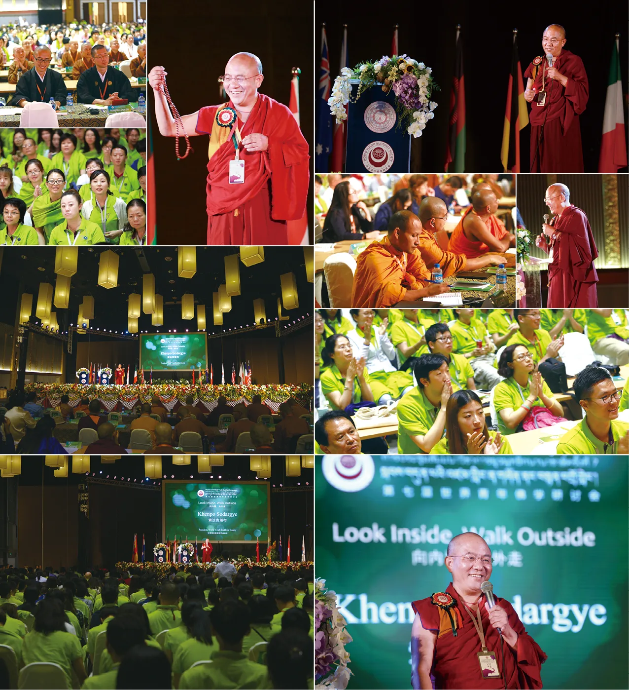
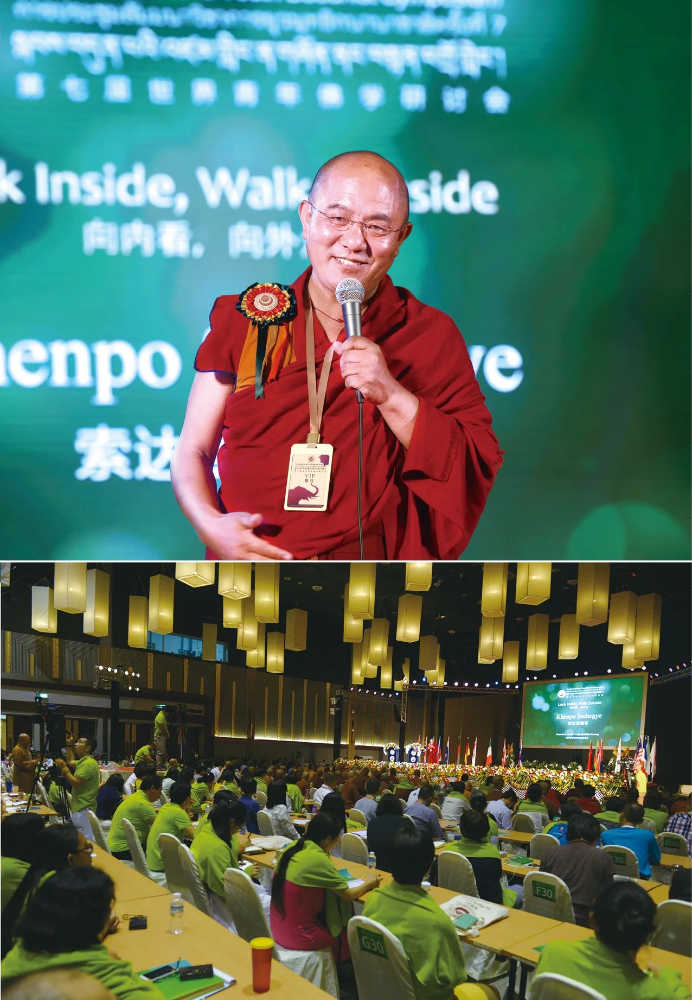
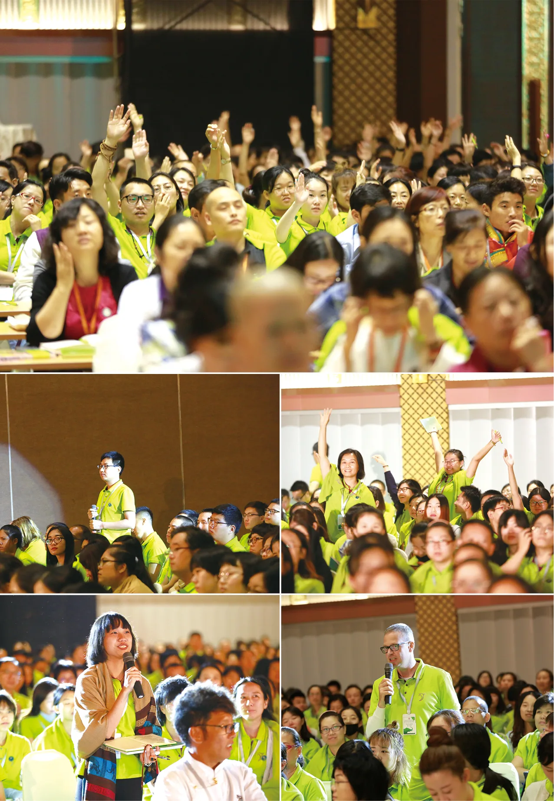
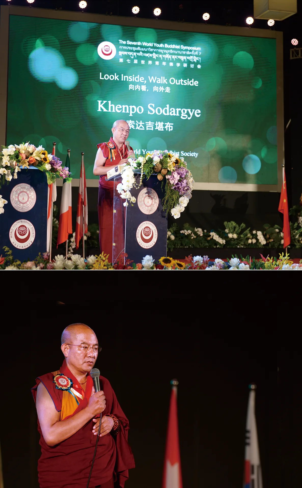

## 向内看 向外走

## Look Inside, Step outside

2017年8月2日

我们的研讨会已经接近尾声了。在这个过程中，大家都认识了国内外的很多朋友。刚才茶歇的时候，一位伊朗的大学教授给了我一个无花果，并告诉我说，他这次很开心。一些来自印度、日本等各个国家、各个层次的学者和学生，也纷纷表示，参加这次研讨会很开心。

我和大家一样，也非常开心。而今天下午，能有机会和大家一起探讨生活佛教等话题，我更是发自内心地欢喜。接下来，我将在短短的1个小时内，象征性地发表一下自己的看法。先讲一讲生活佛教，再谈一谈大家都比较关心的人工智能，最后提几个希望。

大家相聚和交流的时间总是显得不太够，还有很多教授和学者都没有机会表达自己。今天早上海涛法师的开示时间太短了，去年阿姜通长老的开示也只有半个小时——老人家显现上有点不高兴，所以今年特别要求给他的时间充足一点。

昨天阿姜通长老的开示和去年一样，也是下午，我们很多人的感觉都比较“舒服”——下午听演讲的确容易疲倦。早上海涛法师也这么说。我当时也特别想打瞌睡，可又不敢睡，一直提醒自己：现场这么多人，自己坐的地方又比较显眼，千万不能打瞌睡，不然被别人照下来了多不好，何况还是全球直播……但是提醒归提醒，有时候瞌睡来了，真的很难控制。

要是在平时，我讲课时是不准任何人睡觉的，但我今天特别开许大家在我演讲的时候睡觉，即使这一个小时都睡过去，我也理解。在这四天里，你们连续不断地听了这么多场演讲，身心都比较累，现在大家缺的不是知识，而是休息和放松。所以接下来，你们可以放宽心、轻轻松松地睡上一觉。（众笑）

## 生活佛教：融入生活，跟上时代

### 1．前辈垂范

我讲的第一个内容是生活佛教。佛教的高深智慧如果没有融入世间生活，那么佛教即使再好，也可能因为脱离社会而难以长存。在这方面，藏传佛教和汉传佛教的前辈大德们都非常重视，为我们留下了许多特别有借鉴价值的经验。

大家都知道，在藏地，上个世纪五六十年代是非常特殊的一个时代，历史上从未发生过的一些事情，也在那个时代发生了。在那样的时代，我的老师法王晋美彭措不断地弘扬生活佛教，也就是人生的佛教。[^1]法王在佛教理念方面的独特观点，可以说渗入到生活的方方面面。

本来，很多藏传佛教的寺院传统上主要以辩经、闻思修行为重点，而法王从上个世纪五六十年代开始，就在传承弟子当中推行生活佛教，佛学院成立以后，生活佛教的实践也是弟子们学习的重要内容。法王一生都在努力践行生活佛教，直到自己圆寂，为学院内外的传承弟子树立了特别好的榜样。直到现在，法王的传承弟子们在佛教融入生活和社会方面都非常重视。

汉地的太虚法师也作了非常好的榜样。他所在的民国也是一个特殊的时代。当时的佛教，完全因循古制，很多理念已不适应社会发展，而在行为上，很多寺院都只看重做经忏，超度亡灵。太虚法师认为，这样的习惯，已经沿袭百年，容易让人们产生邪见和迷茫，佛教必须要进行改革。他积极倡导“人生佛教”的理念，在整个佛教界引起极大的轰动。

### 2．跟上时代

在座的南传佛教、汉传佛教和藏传佛教为主的所有宗教的代表们，我觉得我们应该在保持各自宗教教义不变的基础上，努力适应社会，适应当下的这个科技时代、信息时代和人工智能时代。这对每一个宗教自身而言，是对外弘扬的最好方法；对整个人类社会而言，也是值得肯定的负责任的态度。

我说佛教或者其他宗教的教义要跟上时代，实际上有两层意思。第一层意思，我们如今所在的这个时代也非常特殊，这要求我们既要学会看外面的世界，也要学会看内在的世界，二者一定要结合起来。前两天我坐飞机过来的时候，发现前面的座背上写着一句话：“认识自我，认识世界。”当时想：这个道理真的很有意思。

恰好，我们今天的主题“向内看”和“向外走”，也涉及了内心与外境两个不同的世界。佛教研究有两个重要领域，也兼顾了内外两个世界，一个是心法，一个是色法，研究心法是要我们对内心世界有一种认识，研究色法是要我们对外部世界有一种认识。

著名的心理学家荣格曾说过：往外张望的人在做梦，向内审视的人清醒着。也就是说，如果一味地在外面的世界寻找答案，或者说如同随波逐流一般，心一直跟着外面的世界跑——“外面的世界很精彩”，人生的梦将永远没办法醒来。如果我们停止追逐，让心安静下来，反观内在的心态、正念和每一个起心动念，那么，在外面的世界永远找不到的一些人生观和价值观，也许会“得来全不费工夫”，很容易就拥有了。

第二层意思，在当前的情况下，关注外在的时代形势尤为重要。如果没有关注时代，一味地沉浸于自己的宗教氛围，恐怕到最后会被时代所抛弃。英国文学家狄更斯（Charles Dickens, 1812-1870）在他的《双城记》（A Tale of Two Cities）中说道：“这是一个最好的时代，这是一个最坏的时代。”这句话也完全适用于我们现在的这个时代。

这个时代有很多很多的标签，什么指数时代、大数据时代、全球化时代、多元化时代……各种各样的时代标签，从不同的侧面诠释着这个时代的种种特征，与时代的关系非常密切。比如指数时代，现代社会充满了各种指数——股价指数、房价指数、天气指数、穿衣指数等，人们的生活和情绪往往会被这些指数所左右。

昨天的环境学家[^2]在发言中讲到：中国的环境污染，以前是以平衡或不平衡来衡量的，而现在是指数时代，用的是环境污染指数[^3]。这说明什么？说明现代社会的很多变化都通过指数来表现的，非常精细，又非常复杂，不再像过去，只有一个粗略简单的概念。

而且，现在这个时代非常开放，所有的信息都公之于众，所有的隐私都暴露在外。可以这么说，当今时代是有史以来人类经历的最为特殊的一个时代，各种前所未有的危机与挑战，都层层叠叠地涌现出来了。

在这个时候，我们佛教乃至所有的宗教，如果不紧跟未来时代复杂多变的形势，及时做出相应的反应，努力跟上时代的步伐，我们未来的发展真的很堪忧。这也是我提出生活佛教的重要原因之一。

### 3．“吉祥的象征”

关于人类的未来，我们昨天问了很多专家。或许是为了安慰我们，或许是另有考虑，专家们告诉我们，未来的人类会保持与我们现在基本相同的生活方式，即便有所变化，也不是很大——我们现在做的很多工作，未来的人类还会接着做。

我原则上承认专家们给出的答案，他们毕竟是专业人士，一定会用长远的目光和智慧，着眼于未来的判断和决定。这一点毋庸置疑。但是，眼下一些事情的发展趋势，却又让我们不得不深感忧虑。

有一句少数民族的俗语说：“兔唇是一个孩子吉祥的象征。”本来孩子生下来有兔唇，是一件令人难过的事，而为了安慰他人，就说“兔唇是吉祥的象征”，合不合理呢？肯定不合理。因为对一个孩子的成长而言，兔唇肯定会有一定的障碍，不管名称上再怎么安立“吉祥”，也不一定真的吉祥。

现在的世界已经变得“日新月异”。以前用这个成语时，知道是用了夸张的手法，因为对古人的生活而言，每一天、每一月都要发生变化，有一定困难。不过，对现代人的生活而言，这已经变成了事实。

在信息革命、人工智能和大数据的共同作用下，未来人类的生活充满了各种变化和不确定因素，“日新月异”的程度已经完全超出了我们普通人的想象。在这样的情况下，未来人类还可以保持和我们今天基本相同的生活方式，恐怕只是一种充满安慰的“吉祥的象征”而已。

## 人工智能时代：做好心理准备

### 1．哈达献给科学家

第七届世界青年佛学研讨会能够圆满举行，我要特别感谢学术界的各位专家。毫无疑问，他们用自己的专业知识和人文关怀，给包括我在内的学生们提出了一些很好的建议。

我刚才准备了一条哈达——研究人工智能的科学家朱博士在吗？这次朱博士能参加我们的研讨会，我很高兴。为了表示一个缘起，我希望在讲人工智能的话题前，先给研究人工智能的科学家献一下哈达。

（朱博士上场，堪布献哈达，两人合影留念）

非常感谢朱博士来参加世青会，也非常感谢朱博士昨天给我们带来的深度智慧。朱博士是研究阿尔法狗的。阿尔法狗是围棋界的一个人工智能机器人，战胜了人类围棋的世界冠军。

客观地讲，在这次研讨会上，专家们的确在很多方面给年轻人指点了人生，值得年轻人去学习。

### 2．做好心理准备

其实，我只是一个出家人。就像海涛法师所讲的那样，不管人工智能怎么发展，只要做好出家人的本分，这辈子的生活就不会受到什么冲击，也不会有什么忧愁。

但是，我特别关心我们很多大学生的生活。在这个变化无常的时代，年轻的大学生可能随时都需要面对失去的痛苦和灾难，比如失业、失恋、失职、失败……现在年轻人得抑郁症的越来越多，有的甚至一蹶不振，彻底崩溃，再也没有重新开始的机会。所有这些悲剧，都是因为没有早一点遇到真理，不知道如何化解人生的痛苦和磨难。

在人工智能的时代，我们的生活变化一定会非常剧烈。如果大家不懂无常变迁的道理，本来只是暂时的失去和挫折，你却当成了彻底的毁灭与深渊，然后轻易地放弃了自己的前程，甚至生命，再没有比这个更令人遗憾和难过的事了。

我们应该如何迎接即将到来的时代巨变？对这个问题，每一个人都要认真思考，并做好心理准备。

### 3．超级富豪与群体失业

我们的生活方式，在未来短短的时间内，可能会受到冲击，发生剧变。这从何说起呢？

当今世界，国家与国家之间的经济独立图[^4]有很大的变化。经济实力强大的国家，手里都掌握着高端的科学技术和世界的众多资源。这样一来，很多落后国家的经济将很难发展起来。大家都知道，在任何一个时代，一个国家的经济如果得不到发展，那它的政治、文化等很多方面都难以提升和改善。这是从国家层面观察的情况。

个人方面的情况又如何呢？在今天，极少数兼具智慧与胆识、能量与胸襟、创造力与执行力的精英人士，在短短时间内就能积聚很多很多的个人财富。而在以前，一个三四十岁的人要在整个世界的经济领域产生影响，是根本不可能的事情。

马云和马化腾[^5]是如今中国经济领域的风云人物，他们都是50岁左右吧？而他们个人的经济王国，已在全球经济占了一席之地。我去年和前年都在关注淘宝。2015年，“双十一”当天的销售额好像是900多个亿，2016年的销售额则增加到1207个亿[^6]。仅仅一天的交易金额，就有1000多亿人民币。这样的经济奇迹，发生在一个国家的一个公司里，这意味什么？

当然，这个不能怪马云。这样一个时代，如果马云没有出现，也会有牛云、杨云、李云、王云等出现。总之，一定会有这样的人出现，来创建这个时代的经济格局。未来的世界更是如此，谁拥有超越性的技术，谁拥有超越性的智慧，谁就可以掌控全球的经济命脉。

昨天，朱博士也说到，将来的经济巨头如果有慈悲心，完全可以让人类在经济分配、能源节约方面变得越来越好。的确如此，依靠富豪们提供的技术和平台，很多年轻人将会拥有许多机会，比如创业的机会、发财的机会——短短的时间内收入百万、千万都是有可能的，现在的很多成功人士都是如此。不过，这只是一种美好的设想，将来的富豪们会如何承担自己的社会责任，真的很难说。

当前的现实是，照这样发展下去，再过十年、二十年，很有可能出现这样的状况：社会上会有相当一部分人因为失业而无所事事，就像最近出版的《未来简史》[^7]所描述的那样——这本书的作者听说对我有兴趣，希望过段时间与我有一个对话。我说可以。他可能是个佛教徒，我大概看了一下他写的一些书。

《未来简史》这本书认为，在未来的时代，将会出现很多很多无用的闲散之人——找不到工作，也不被社会需要。因为真正的人工智能时代到来的时候，机械性、重复性的简单工作，将全部被机器人或人工智能代替，相当多的人会因此而失去工作。

其实这个趋势，现在已经看得出来。在很多西方发达国家，宾馆、银行、股票等业务，甚至包括医学、翻译等需要脑力劳动的很多工作，现在基本上都在发生变化，朝着人工智能化的方向迅速迈进。

### 4．如何生存

在这个时候做这样的预测，也许很多专家会觉得是一种臆想。前两天有些专家讲到，人类社会的发展，一直都没有离开过变化，工业革命也好，计算机革命也好，都曾给社会带来巨大的变化。但是无论怎么变化，都没有出现人类无法生存的时代。

从曾经的历史来看，确实如此。但以前的时代变迁、技术革命，跟当今时代的种种变化，恐怕不能相提并论。这个时代的可怕在哪里？可怕在好多的经济命脉和财富，被极个别有智慧、有能力的人牢牢掌控在手里。这些超级富豪们，会不会把手中的财富均匀地分配到所有人手里呢？很难说。而在过去，社会财富不管怎么集中，贫富差距也没有今天这么大[^8]。

昨天去中通寺的时候，我心里在想：“泰国的农民比较多，也许是一件好事。在将来的时代，农民和牧民的生活也许会比较稳定。不管怎么样，农牧工作暂时不可能被取代。而其他的很多职业，包括大学生就业过程中特别关心的一些问题，也许就不那么容易解决了。”

人工智能的脚步正在变得越来越快，这是任何人都没办法改变的。全世界所有的专家、科学家以及宗教人士，都在各抒己见，发表看法。有些人是为了安慰大家，有些人的心里确实很恐慌——时代的变化真的太快了，我们甚至来不及有所反应。

### 5．开一个玩笑

作为出家人，我们也不能完全置身事外。我昨天与海涛法师、Master[^9]，也讨论到这件事。据Master介绍，泰国以前的出家人非常多，现在减少了一半，大概只有30万人，缅甸有60万人左右。我们藏传佛教的情况也是如此，有的寺庙原来有一百多僧人，现在只剩下五十来人。

为了和这样的时代潮流抗争，一些比较保守的老和尚，坚决不让年轻僧人拿手机。但是，这些手段根本起不了什么作用。各种信息翻天覆地，已经传遍了整个世界，我们出家人还能不能躲在某个角落置身事外呢？我想是不太可能的。

我有些时候开玩笑说：“没事吧。按照中国电影的剧情，社会上要是有很多很多人找不到工作，那寺院里的和尚将会越来越多。以前的很多电影都是这么演的：一个人遇到困难时，走投无路时，就会到寺院去出家。所以，我们的大学生将来如果实在找不到工作，可以选择这条路。”

今天海涛法师也一直强调，你们可以选择出家。不过到了最后，海涛法师可能觉得事情没那么简单，有点害怕了，改口说：最好是心灵出家——心灵出家是真正具有出离心的“出家”，是最好的出家。

当然，这是我给大家开的一个玩笑。

### 6．什么都快，包括毁灭

这个时代也有好的方面，其中之一就是——效率确实很高。我们需要的任何资料，只要上网一搜，立刻全都出来了。不仅是搜索系统，其他的很多系统，比如取款系统、交通系统等，都非常便捷，只要一个简单的操作，就能以最快的速度达到自己的目的。

不过，有利的东西来得快，各种伤害和负面情况纷至沓来的速度也同样很快。1914年到1918年，发生了第一次世界大战，这四年多时间一直在打仗；第二次世界大战是从1939年到1945年，大概打了六年。两次世界大战，人类投入的武器都是坦克、大炮之类的，电影里出现的上个世纪的战争场面都是这样。

现在如果真的打仗，武器不一定是坦克大炮了。如今的武器，一旦瞄准了对方，只需要几分钟甚至几秒钟，“啪”的一下，对方可能就毁于一旦。在现代战场上，用极短的时间就可以把对方的一切全部破坏，非常残酷。

人类用自己的发明，推动科技力量不断发展和提升，最终会走到哪里，没有人知道答案。

### 7．无常观

处在这样的时代，大家一定要有无常的观念。即便你真的取得了成功，也不要认为会一直成功下去。看看这几年的成功人士，个个失败起来都是非常迅速的。

20世纪90年代，我去印度和新加坡的时候，拿着一个比较低档的照相机，用的胶卷是柯达[^10]和富士[^11]，一个是黄色的，一个是绿色的。应该是1998年吧，当时拥有相机的人并不太多，柯达销售了全球86%的胶卷，拥有17万员工。而到了2013年，这两家公司都慢慢退出了这个行业。听说富士公司还在，而作为胶卷行业的巨头却已经不复存在。短短的十几年时间，他们所有相关的工厂不得不倒闭，所有的员工不得不解散。

同样的例子还有一个，那就是诺基亚手机。这个牌子的手机2000年前后非常流行，我曾经也用过一个小小的诺基亚手机。

刚开始，我特别反对用手机，觉得出家人拿手机太难看了，应该好好地保持寂静，好好地修行。昨天我一直关注泰国的比丘，看他们用不用手机。有一阵，我看身旁的泰国长老在身上摸东西，就想：他是不是也有一个iPad或手机？结果他摸出来的不是手机，而是一个钟——他要看时间。我说的是这里最年长的那位长老，一位很好的修行人。

我刚开始觉得出家人拿手机特别不好，但后来因为发心工作确实需要，就在2005年买了一部诺基亚手机。当时，全球手机份额的三分之一都掌握在诺基亚公司手里，具体数字好像是38%。

后来苹果和三星出现了，它们的数码技术一开发，智能手机一面市，诺基亚就开始走下坡路。听说诺基亚手机最后是被其他公司收购了[^12]，但它的手机技术并没有被新公司采用，或许是因为过时了吧。

那天听到有些人在说，为了对这家公司表示同情，他们特意买了一款诺基亚手机。这话怎么理解呢？原来他们曾经用过诺基亚的手机，现在为了照顾他们的生意，又买了一部。说明他们对诺基亚还是很有感情的。

但光有感情是靠不住的。诺基亚公司的业务曾遍及全球，最辉煌的时候有多少员工[^13]？其中与技术相关的员工又有多少？如此闻名全球的一家公司，不过才十几年，就基本消失于人们的视野之中了。

中国有个成语，叫“螳螂捕蝉，黄雀在后”。现在的苹果和三星，以后又会是什么样呢？能不能一直保持这样的发展呢？很难说。

### 8．机遇与挑战

昨天讲到了人工智能，也讲到了发展中的共享轿车，以及无人驾驶的无人汽车、无人自行车。所有这些新事物，如今都在不断地发展。这些新生事物的出现，给我们带来了环保上的问题、管理上的问题，总之，有很多很多的问题。

在座的很多年轻人，我希望大家好好地反思一下。我今天讲不出什么深刻的内容，因为我不是专业人士。我只是在研究佛法和翻译佛经的同时，看到当前这个时代的飞速变化，不禁对未来人类的生活有些担心。

在人工智能时代，人类的工作和感情都将受到严峻挑战。来自异性的感受，据说也可以由很多不同的机器人来实现。这些具有特殊功能的机器人，一出世就引起广泛的争论。这些争论，与各个国家的法律有关，与各个民族的传统文化有关，也与我们人类的道德伦理有关。种种全新的话题与矛盾，一一摆到了我们的面前。

我那天在北京，看到街头的共享自行车非常多，共享轿车与出租车也在路上东奔西跑，就问：“为什么还没有无人驾驶车[^14]呢？”

有人告诉我说，现在很多保险公司都在谈这个问题。围绕无人驾驶汽车的保险涉及很多细节，比如发生事故时究竟是什么原因？到底是机器在操作，还是用户在使用程序？如果不是人为的，那责任该找谁来界定？这些都是令保险公司头疼的问题，要一一界定清楚，成本会比较高。其实不仅是保险业务，无人驾驶汽车的发展还涉及国家法律等各方面的问题。

听说现在很多企业也愿意投资这个新行业，做了很多准备，包括融资、寻找技术合作，等等。不过除了这个行业，投资公司们也在四处寻找其他项目，希望在未来的某个新领域做出一些业绩来。

总之，未来的时代，方方面面的机遇特别多，变化也特别快，情况也特别复杂。

### 9．成败由因缘

这个时代的变化真的特别快，特别快。很多人意识到这里面隐藏着机遇，纷纷开动智慧的头脑，努力去开创自己的成功人生。

但是，最后真正的成功者有多少？恐怕不会很多。虽然我们经常会听到来自各大媒体的报道，“某个人成功了，通过融资赚了多少亿”，但这样的成功人士可以说是凤毛麟角，出现的概率非常小。

按照佛教的教义，任何人的成功都必然有他的因缘。前世的福德资粮，加上今生的智慧资粮，两种因缘聚合之后，极个别的人也许会获得成功。但是这个比例是很小的。100个人或1万个人同时创业，大多数人都将与成功无缘。现实就是如此，很残酷。很多人想不通，不停地抱怨社会不公，抱怨人心太坏。

在座有这么多年轻人，每当看到你们的面孔，就像前两天一些大德和专家在发言中所说的那样，我都非常羡慕。你们的脸上没有皱纹，牙齿洁白整齐，头发乌黑光亮，没有一根是白的——特意染白的除外。你们青春洋溢，充满活力，热情烂漫，真的非常让人羡慕和随喜。

但另一方面，你们面对未来的社会，肩上承担的责任，心里承受的压力，也许比任何时代都更为复杂，更为艰巨。在以前，一个家庭，一份职业，基本上可以几十年不变地维持下去，一直比较稳定，而现在，辛辛苦苦学到的很多专业知识，几年之后也许就用不上了。

这种时候，你们会用什么办法来应对？这是我今天向大家抛出的一个人生议题，希望引起大家的重视。

佛教的有些观点，比如说无常观——万法都是无常变化的，因果观——万法自有它的因缘和结果，这些观点在现在和未来的时代，显得尤为重要，它能帮助大家平稳地度过一些艰难的时光。

“我已经很努力了，却依然是个穷光蛋，而我的那些同学，付出的心血远不如我，却一个个都变成了千万富翁。不过一切都来自前世今生的因缘，我可能在前世造下了不好的业，才有今生这不好的果。”

对在座的各位而言，明白这样的道理，很重要；学习宗教，很重要。

## 提几点希望

### 1．努力学习新知识

不管你是佛教徒，还是其他宗教徒，都要不断地学习各种知识，尤其是新的知识。

最近，奥巴马也好，比尔·盖茨也好，扎克伯格也好，他们都在发表自己的观点，而且一致认为：现在的孩子，最好从幼儿园开始就学编程技术[^15]。我们现在只要会用智能产品就行，对它后台的程序和操作就算不太懂，也能在这个社会没有障碍地生存下去。而将来会变成什么样呢？将来的人，一定需要懂得各种人工智能的操作。如果不懂，可能真的没办法在社会上活下去。对此，我非常担心。

我这次为什么会带一些藏族孩子过来？因为藏族是一个特别封闭、特别保守的民族，如果现在不能跟上时代，将来可能连出门打个车都不会，在社会立足将变得非常非常困难。所以，这次我特意带了几个孩子过来，看他们能不能长点见识，学点知识，思考一下如何应对将来的社会。

亚马逊有个看书的机器叫Kindle，是吧？在那个小小的阅读器里面，可以翻阅几万本图书。不过，我们很多人不适应，看一会儿就觉得眼睛痛，而且用起来没有书的感觉，很不习惯。而将来的这些孩子，从小就看智能手机和iPad，已经习惯了电子产品的陪伴，长大了可能不会看纸质书，他们会非常自然地借助各种电子产品进行学习，获取知识。

所以，我们从现在开始，要学会不抱怨，认真学习现代的各种技术，以便适应将来的社会。这是我提的第一个希望。

### 2．学习宗教和传统文化

学习是一件终身的事情，永远没有结束的时候。

在这次研讨会上，很多大德都依然在潜心学习。昨天那位泰国长老，已经94岁了，上午还跟着大家一起学习，一起打坐，下午除了讲课以外，其他时间也在跟我们一起学习。这让我想起我的很多老上师。虽然他们有些已经圆寂了，有些还健在，但他们永不满足的求知精神都是一模一样的。

在座的年轻人坐一会儿都觉得累。等你们到了94岁的时候，会不会有昨天那位长老的学习精神？这很成问题。今天早上我出去的时候，看见很多人在楼梯上，要么玩手机，要么打瞌睡。这样下去，你们要真到了90岁，不要说学习，可能连站起来都没办法做到。

所以学宗教也好，学知识也好，都要努力，要坚持，要不怕苦，不怕累。

我们藏传佛教有一句话：“即使明早要死亡，亦应学习诸知识。今生虽不成智者，来世如自取储存。”意思是说，即使明天要离开世间，今天也要好好学习各种知识，尽管所学的这些知识这辈子用不上了——因为明天就要离开人间，但下一辈子却会因此而变成聪明人。这句话也间接说明了一个道理：为什么有些人生下来就很聪明，而有些人却特别特别笨？这与自己前世今生的行为有一定关系。

我给大家提的第二个希望是，大家好好学习宗教和传统文化，因为这里面有很多深邃的思想。

### 3．学会分享

大家对自己学到的知识，不要以自私心隐藏起来，一定要分享给有缘的众生，这是大乘佛教的究竟思想和终极意义。

现在有很多法师，为了利益众生，一直在四处云游和奔波，足迹遍满了全世界。海涛法师就是其中一位，他的精神非常值得我们学习。我感觉他团队里每一位法师都已经锻炼出来了。昨天不管是拍照，还是其他工作，他们都干得非常认真，好像一点都不知道累。其他的很多法师和他们的团队，也都很有精神，精力非常充沛。而我们的很多大学生，到后来连走路的姿势都不太正常了，一副脚很痛的样子。

总之，我希望大家将来能运用自身的资源、智慧和能力，去帮助身边的众生。他们很需要帮助，不管是精神上的欠缺，还是物质上的匮乏，都需要我们向他们伸出温暖的双手。

在这样一个多变的时代，每个人都需要生起一颗善心，一颗慈悲心。而且，我们的慈悲心不能只停留在口头和文字上，而应该到实际行动中去历练，去发光发热。在温暖别人的同时，也感受别人传递过来的温暖，对个人来讲，也许才是真正的幸福。

幸福是一件令人向往的事。这次研讨会的主要话题是“幸福”，我们每一个人也都在追求幸福。怎样才能得到幸福？我想提醒大家的是，我们在追求幸福的过程中，如果脱离不了自私心，一心只为自己，恐怕最后的结果只能感受痛苦，所求与所得背道而驰。相反，如果我们有一颗利他心，那它将像太阳一样，把光芒照射到整个世界，温暖整个世界，也温暖我们自己。

智能时代，科技特别发达，现在有一个新的名词，叫做人机联网，就是人和机器之间联网，或者说万物联网[^16]。在人机联网的时代，我们如果用一颗利他的心，去联接网络上所有的机器，再通过这些机器联接到网络上所有众生的苦乐，那么，从我们每个人心中滴淌出来的正能量的涓涓细流，必然会汇成无边无际的甘露大海，去滋养全人类干涸的心灵，为整个世界带来温润和美好。

现场互动

问：在生活中，佛法跟工作怎么融合？把佛法融入工作，有时会令同事感觉不舒服；而工作忙的时候又特别影响闻思修行，曾一度产生辞职的想法。该怎么调和二者之间的冲突？

堪布：最好不要辞职。现在失业率那么高，主动辞职特别可惜。

作为一个佛教徒，一定要把自己的时间安排好。时间只要安排好了，修行就不会有问题。如果能把所有的时间都利用起来，佛法完全可以融入生活。这次世青会，有些人那么忙，也照样空得出时间来修行和念诵。

很多人真正花在闻思修行上的时间并不多，倒是用于散乱的时间长一点。如果能把散乱的那部分时间用在闻思上，就根本不用辞职，不用离婚，不用为此做任何事情。

问：昨天坐禅的时候，我越想专注，就越散乱，外面的人睡觉、用手机，我都看在眼里。我想问，禅修是不是一定要依照指定的方法？如果觉得这种方法不适合自己，可不可以找一个自己感兴趣的事情，比如绘画，以专注绘画来达到禅修的目的？

堪布：按照某种指定的修法来坐禅，是一种禅修。把心专注于音乐、绘画等艺术活动，也是一种禅修。后一种禅修会让个人的生活品质有所提升，也很好。

每个宗教，每位大德和专家，都有一套对自己有利的禅修方法。如果你能用自己的方式让心安静下来，就是合理的。

问：堪布好！我来自非洲马拉维。马拉维现在已进入发展中国家的行列，追求物质财富的社会民风让环境破坏变得不可避免。将来我们重回马拉维的时候，利用什么方式来引导身边的人，以保护我们的生态环境？

（堪布：还有几个非洲的孩子。你们都到台上来。我来回答你们的问题。）

堪布：我简单介绍一下非洲马拉维的情况。我准备明年去那里，虽然我前年已经去了一趟，但还是准备再去一次。昨天海涛法师也对他的团队说，明年准备去非洲。从马拉维来的还有其他几个孩子，这次是特意让他们过来参加世青会的。

我以前了解过马拉维。ACC[^17]最早就是在那里创立的。昨天这个女孩的演讲提到了马拉维的一些情况，我听了心里很难受，因为以前去过，特别能感同身受。

我们这里很多大学生经常说自己痛苦、痛苦，其实你们所感受的痛苦，和在马拉维生活的痛苦相比，完全是两个不同的概念。和他们比较起来，我们真的算是很有福报的。马拉维人的平均寿命是“37岁”，这是由很多很多原因所导致的。我没有说谎，她们可以作证，“37岁”，这是他们的平均寿命……

据联合国的统计，马拉维是全世界最贫穷的六个国家之一。马拉维紧邻非洲中部，那个地方非常悲惨——现在网上也能搜到相关信息，根本没办法生存，饥饿的孩子遍地都是，个个瞪着大大的眼睛，每年都会有五千多人饿死。很多非洲国家和部分中东国家的人们，如今都生活在我们无法想象的痛苦中。

作为大乘佛教徒，我们对自己拥有的种种幸福，应该懂得珍惜。对共同拥有的种种资源，也要学会爱惜。昨天，他们的演讲都讲得非常好。这个女孩在演讲时说：“我看到这里很多孩子在浪费食物，很心疼，不由得哭起来了。”

我很理解你的感受，因为在你的家乡，很多孩子正在挨饿，甚至正在因为饥饿而死去。其实，这一届大会还不算特别浪费，第一届和第二届的时候浪费得特别厉害，后来我们采取了种种措施，情况才有所好转。

你们的国家开发以后，可能确实对环境造成了伤害。现在有很多发达国家在掠夺马拉维和莱索托等国家的资源，要么通过战争，要么通过开发。这是全世界都面临的一个大问题。

我们出家人也好，社会各界人士也好，都应该关心这个问题。我从来不推荐任何平台，但是非洲比较特殊，所以在不同的城市，我都倡导大家关心非洲的事情：孩子的教育、卫生，成年人的艾滋病、癌症，尤其是他们的寿命，有些国家47岁，有些37岁，这是平均寿命……

你看这些孩子，这么天真，这么可爱，但他们的学习、生活等各方面的条件如果得不到保障，那他们最后的命运，和自己的父辈相比，也很难有什么大的改变。

这些问题，值得我们每一个人去关心。希望以上的发言能引起大家深深的思考。

问：我来自日本。今天堪布演讲的题目“向外走”，让我想起之前有位师父讲的，弘法利生一定要向外走，去跟众生广结善缘。但问题是，在接引众生的时候，我们往往遭到很多非议，被认为偏离了佛教的主题。应该怎么做才能既接引众生，又不偏离佛教的轨道？

堪布：首先要善于学习。如果连佛教的基本道理都不懂，那你的行为即便是出于一颗慈悲的心，也很有可能偏离佛教的轨道。

第二个需要善巧方便。在这个时代，一味地以信心来传播和弘扬佛法，不一定能得到别人的认可。一些没有信仰的人，可能会被你的信心吓跑，根本不认同你的观点。

第三个要观察时机是否成熟。时机因缘如果没有成熟，即便你用尽了所有的力量和资源，也不一定管用。

现在很多年轻人比较热情，利益众生的意乐特别强，这当然是好事。但由于社会经验和人生经验都比较欠缺，做事经常会遇到障碍，愿望无法实现。等你到了五六十岁知天命的时候——就像我们现在这样，那个时候会明白，自己年轻的时候太幼稚了，当时的很多痛苦和伤心原来都是可以避免的。

问：就艺术创作或者是艺术的想象力来说，情感的多层次波动或者情绪化的表现很重要，但是禅修以后，心情会变得安详而平静，这会不会对艺术创造或者艺术想象力构成障碍？

堪布：这个问题可能要根据个人的根基而定。

有些人进入禅定的状态，感受到禅定带来的安宁与喜悦以后，整天都想入定，很多创造力自然就没有了。而另一部分人，由于以前没有认识心的本性，一旦通过某种深层次的禅定认识了心的本性，出定后，对包罗万象、各式各样的艺术形式没有一个不精通的。从藏传佛教很多高僧大德的传记来看，当他们真正开悟以后，对所有的世间艺术，包括戏剧、诗学、绘画和歌咏等，全部都无有任何障碍地一通百通了。

所以，如果我们不能很好地修持禅定，可能跟经常进行艺术创作有直接关系，也可以说没有关系。意大利是全世界的艺术之乡，但他们的很多艺术家就是通过禅定开发了自己的艺术创造力和想象力。这是我去意大利所了知到的情况。

问：泰国长老刚刚提到业力，有些人富裕，有些人聪明，这是因为前世的业力导致的。但是我们这一世的业，对这一世有什么影响？在很多国家和社会，一些苦难是因为社会的不公平、经济的不平衡以及教育的缺乏导致的，这又是什么业？他们的苦难是因为过去的业，还是当前的业？

堪布：确实如此，我们的社会有很多不公平，每个国家、每个部门、每个家庭，都有很多不公平的事情。希望我们将来的社会能变得比较公平，有充足的资源跟大家分享，这个最关键。

昨天朱博士说得很对，人类将来面临的很多问题，都需要依靠教育才能解决。如果各个国家、各个领域都对教育非常重视，各种不公平的问题就可以得到很好的解决或缓解。这是从世间层面讲的。

从佛法或者信仰的层面来讲，这些不公平都来自前世的因缘。佛教认为，今生遭遇的一切事情跟前世有关，来世所经历的一切事情跟今世有关。所以，我们即生感受不公平的因，唯一是前世我们对别人所造的不公平的业。

问：我们研究印度佛教时，发现这样一个现象：伴随着佛陀的出现，总会有很多莲花。而在日本和中国的博物馆看见的佛像，却很少有莲花的陪衬。我们知道，莲花在佛教中是非常重要的元素，为什么中国和日本的佛教，莲花元素比较少？

堪布：中国和日本的佛教，莲花元素应该不少。汉地寺院每天都念的《普贤行愿品》，就有“犹如莲华不著水”的偈颂，赞叹菩萨的行为就像莲花，出淤泥而不染。而且很多寺院的花园和放生池，都有莲花开放。观音菩萨在传记中也显现为莲花中降生。

藏传佛教也是如此，莲花生大士就是因为在莲花中化生而得名的。我去过日本，那里也有很多跟莲花有关的绘画。在他们的佛教教义里，这方面的表示法也有很多。

佛教提倡莲花，和莲花相关的元素很多。在各个国家的佛教当中，我感觉莲花的形象和元素都不少。与牡丹、菊花等其他花草相比，莲花与佛教的因缘还是更深一些。

[^1]: 法王如意宝晚年在《胜利道歌》中一如既往地强调，成“佛”必须成“人”，出离心必须以秉性善良的人格为基础。颂词为：“言行恒时随顺友，秉性正直心善良，若欲长久利己者，暂时利他乃窍诀。此乃清净人规法，三世诸佛方便道，亦为四摄之精华，诸位弟子切莫忘！”
[^2]: 即路易丝·弗艾特，荷兰生态研究所所长，荷兰皇家艺术科学院院士。在植物与昆虫关系方面的研究为可续性农业生态体系奠定了基础，并因此获得多项国际奖项。她在这次研讨会的演讲题目是《构建可循环持续发展的生物经济模式》。
[^3]: 环境污染指数，是由各种环境质量参数归纳出来，综合表示环境污染程度或环境质量等级的一个抽象概括数值。采用这一综合指标，既能客观反映当地的环境质量，又能相对比较不同时间和地区环境污染程度和环境质量的优劣。
[^4]: 指的是世界各国GDP比重图。此图通过GDP总量的比较，显示各国在世界经济体系中的比重与实力。
[^5]: 2016年，马云个人财富为1400亿元人民币，马化腾个人财富为1240亿元人民币。以马云的1400亿为例，一个人若每天花500万，要连续花76年才能花完这笔钱。
[^6]: 2016年天猫“双十一”购物节，全天总交易额达到1207.49亿元人民币，其中无线交易额占比82%，交易覆盖235个国家和地区。
[^7]: 《未来简史》（Homo Deus: A Brief History of Tomorrow），由以色列学者尤瓦尔·赫拉利创作。该书主要讲述进入21世纪后，以大数据、人工智能为代表的科技发展日益成熟，人类将面临最大的一次改变，绝大部分人将沦为“无价值的群体”，只有少部分人能进化成特质发生改变的 “神人”。
[^8]: 2016年，美国家庭净资产水平分组情况如下：前1%的家庭，拥有全社会38.6%的财富；前10%的家庭，拥有全社会77.2%的财富；剩下90%的家庭，拥有全社会22.8%的财富。中国的情况和趋势与美国基本一致，只是具体数据有一些差异。
[^9]: Master，即帕库·孙通桑卡毗尼长老，泰国的主管法师。
[^10]: 柯达公司创立于1880年，曾是世界最大的胶卷生产商。1975年，柯达公司发明了世界第一台数码相机，但为了保住在胶卷市场的垄断地位，一直不敢大力发展数码影像业务，错失市场良机，于2013年宣布破产。
[^11]: 2000年，受数码技术冲击，胶片行业陷入危机。富士胶片调整发展战略，在立足数码摄影技术开发的同时，拓展电子产品和医疗保健等业务领域，成功转型。
[^12]: 2013年9月，微软公司宣布，将以约71.7亿美元收购诺基亚手机业务以及大批专利组合。
[^13]: 2013年被微软收购时，诺基亚有3.2万员工，这些员工全部加入微软。而在2014年7月，微软宣布，未来一年将裁员1.8万人，其中约1.25万个岗位来自诺基亚部门。
[^14]: 全球已有多家企业宣布在2020年前后推出无人驾驶汽车。据预测，自动驾驶汽车的全球市场份额需要花15～20年时间达到25%，带有公路和交通堵塞自动驾驶功能的汽车将率先上路应用；到2022年，带有城市自动驾驶模式汽车上路；2025年之后，完全无人驾驶汽车才会大量出现。数据显示：到2035年全球无人驾驶汽车销量将达2100万辆，中国有望成为世界最大的无人驾驶市场。
[^15]: 2018年，中国出现一批开设AI课程的中小学校，从小学到高中的AI教材也不断推出，甚至出现幼儿园版的AI教材，此教材号称是“首套K12全学段全系列”教材，幼儿园阶段分大、中、小班，各有上下2册，共6本。
[^16]: 万物联网（IOT，Internet of things）即“万物相连的互联网”，是在互联网基础上延伸和扩展的网络，按约定的协议，把任何物品与互联网相连接，在任何时间、任何地点，将人、机、物的互联互通进行信息交换和通信，以实现对物品的智能化识别、定位、跟踪、监控和管理。目前全球物联网应用主要包括能源产业、交通应用、家居安防、医疗卫生等四大领域。
[^17]: 即阿弥陀佛关怀中心（Amitofo Care Centre ，简称ACC），台湾慧礼法师在非洲创办的佛教孤儿院。马拉维阿弥陀佛关怀中心系慧礼法师深入非洲的第一站，于2005年10月完成第一期工程，以认养孤儿2000名为目标。后续将建立艾滋关怀中心、职业训练所、佛学院等。
