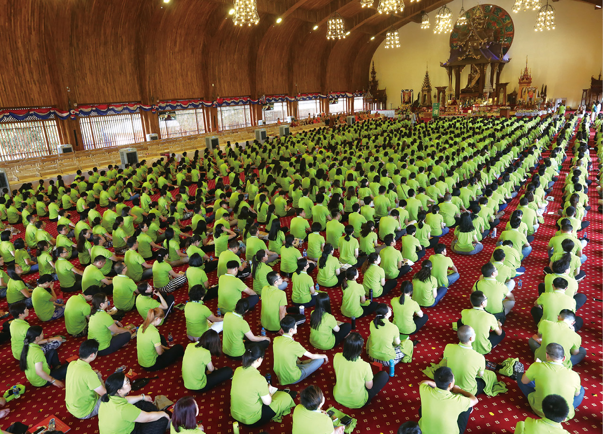
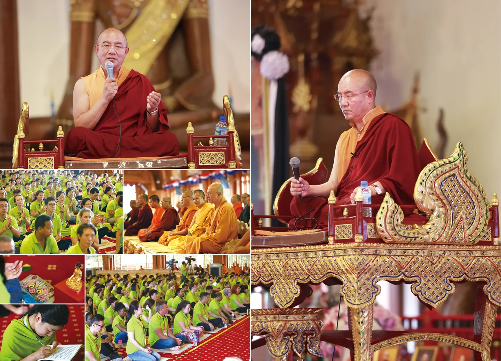
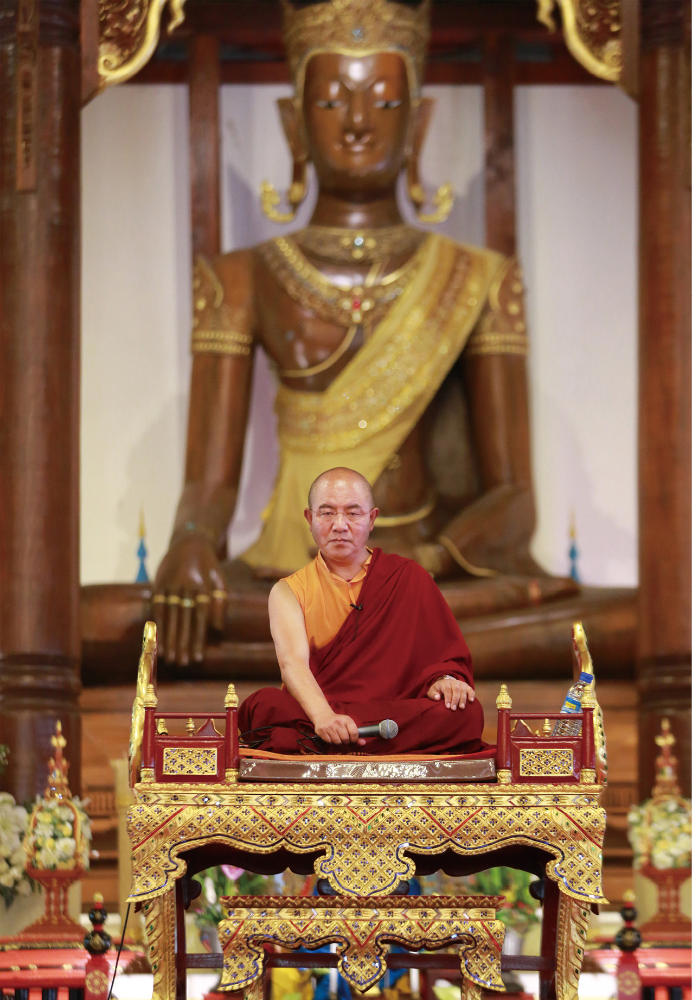
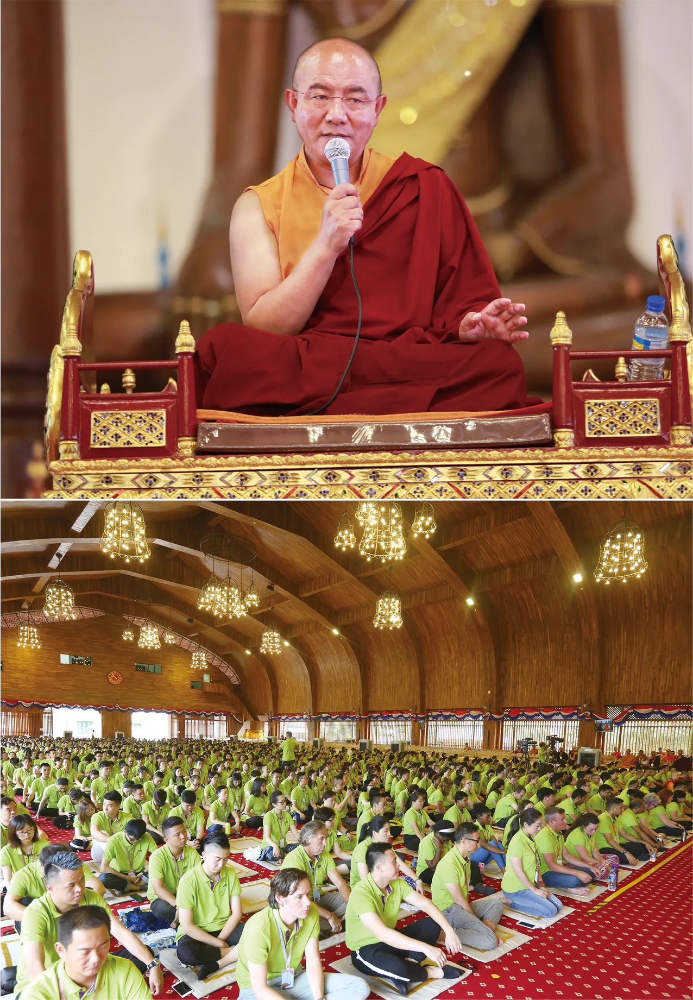
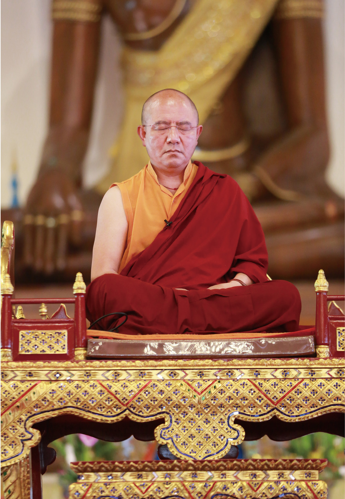
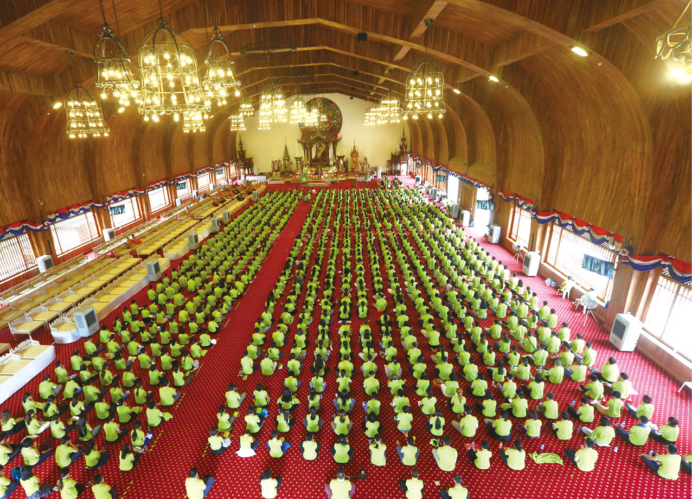

# 唤醒本初的宁静

禅修开示

## Awaken Your Inner Peace

Meditation Instruction

2017年8月1日

主持人：

尊敬的各位嘉宾、宗教代表们、专家学者们、同学们：

大家早上好！欢迎大家！

我是本场的中文主持朴焕贞，旁边这位是我的搭档石妍。接下来，我们进入禅修环节。各位请坐。

《维摩诘经》中说：“一心禅寂，摄诸乱意。”时值五浊恶世，我们的身心，一次又一次被烈火般的烦恼所灼烧，被纷繁芜杂的世事所搅扰。所幸的是，我们可以通过禅修，让这颗心得以净化、自在、觉醒。

今天，带领我们禅修的是尊敬的索达吉堪布——一位令东西方瞩目的心灵导师，一位多产的藏汉翻译家，一位现代的佛学思想家。堪布以他无私无边的慈悲，时刻为众生的幸福安乐而奔波。他经常说：“如果为了利益众生，哪怕只有一个人，让他生起一颗善心，我们百千万劫做他的仆人也可以。”

同时，作为一位真正的修行者，堪布对于藏传佛教的禅修窍诀有着独到的见解与体验。他曾这样说：“草木不生的荒地，通过开垦，可以变成生机勃勃的田野；浮躁沮丧的情绪，通过禅修，可以变成淡定、柔和的心境。”下面，就让我们在堪布的指引下，一起体验禅修带来的宁静和觉知——

尊敬的阿姜通尊者、尊敬的阿姜苏潘尊者、尊敬的海涛法师尊者：

很高兴，在如此庄严的佛国殿堂，与南传佛教、藏传佛教以及汉传佛教的高僧大德们一起，与来自三十多个国家的专家、学者、佛教徒以及智者们一起，共同修行，共同参禅。

这是一个非常美丽的时刻。

去年的研讨会，我们曾非常荣幸地邀请到阿姜通尊者和阿姜苏潘尊者，给我们传法，为我们开示，把我们带入不可思议的禅的境界——我至今记忆犹新。今天下午，我们又将迎来两位尊者的禅修法会。

这是一个非常难得的机会。

世界青年佛学研讨会的第五届、第六届和第七届，都是在泰国清迈举行的。这三年来，泰国的高僧大德和白法居士们，对我们始终如一地给予了支持、帮助和关心，令我时时感念，难以忘怀。

这是一个让人感恩的地方。

按照研讨会的议程，今天上午是由我带领的藏传佛教的禅修，下午是两位尊者带领的南传佛教的禅修，明天上午由海涛法师给我们做开示。

这是一个非常善妙的缘起。

不过，我刚才跟海涛法师做了简单的沟通。他老人家说，由于事先没有做准备，明天上午不方便做开示，但是为了创造一个殊胜的缘起，一会儿我带领大家禅修以后，留出一点时间给他，由他来给大家做简短的开示。

这意味着什么？在同一个环境中，我们每一个人，都可以修行藏传佛教、汉传佛教和南传佛教。

这，就是佛陀的教法，彼此相通，圆融无碍。

## 探寻真理——禅修的意义

这一届的世界青年佛学研讨会学术性非常强。昨天和前天，很多科学家和专家，以各自的专业视角，就心理健康或环境保护方面的课题，阐述了自己独特的观点。

今天给大家安排的，是一场特殊的禅修活动。接下来的时间，现场的每一个人，都需要扮演全新的角色。希望大家把自己所有的标签、名声、傲慢和我执，全都放下来，轻轻松松，清清净净，观察自己的这颗心。

昨天我们也看到了，泰国的很多小出家人，年纪虽然小，但身心却非常寂静。今天上午和下午的禅修环节，希望大家尽量保持身体的寂静，不要动来动去。看看现场的出家人，个个都很寂静，一直安住。我们大学生，如果连身体都没办法安住，那心就更不用说了。

现场的翻译，你们要不要轮换呢？如果两个一起上场，就会一起劳累，一起没有精神——拿出一点力气来，包括泰语的翻译。不然，还没有进入禅定呢，讲的人和听的人全部都睡着了，这有点不划算。

我知道，最近研讨会期间，大家有点累。你们大学生，平时过的生活太愉快、太舒服，可能一下子适应不了这么紧密的节奏。听说今天早上六点钟叫大家起床的时候，很多人都不高兴。

我觉得有点不可思议，为了探寻真理，为了求取正法，经受一些苦行是应该的，也是必要的。为什么要不高兴呢？你们看看阿姜通尊者，老人家94岁了，但刚才还说，不管怎样，也要来现场听习禅修。这样的高僧大德，依然如此谦虚地接受佛法的真理，年轻人真的应该好好反省一下自己。

我刚才讲了，在今天的禅修过程中，希望大家的身体保持不动，如果谁在那里动来动去的，我会请他站起来。禅修是一件很庄严的事，有着非常严格的要求——很好，现在大家都不敢动了。这叫做强迫式的禅修。（众笑）

我们的身体和我们的心，都没有自由。原因是什么？无始以来，这颗心一直被分别念扰乱，从小到大都没有用觉知来观察过它。哪怕只有2个小时、1个小时，甚至20分钟、10分钟，都难以安住。这既是我们凡夫人没有修行的原因，也是我们凡夫人没有修行的结果。

如果没有很好地进行禅修，没有很好地观察自己的心，那么，即使我们再有智慧、再聪明，甚至把全世界所有的知识都贯通于心，也没有太大的意义。

我最主要的根本上师法王晋美彭措曾经这样说过：“无边佛经唯闻说，为调自续方便故，莫依词句诸深义，融入心中反复告。”意思是，释迦牟尼佛宣讲的八万四千法门，实际上都是为了调伏自己的心。如果没有用来调伏自己的心，佛陀为我们宣说的所有理论都没有什么用处。所以说，通过禅修再三地观察自己的心，认识自己的心，极为重要。

## 反观自心，彼为何物

今天的禅修有两个内容：一个是观察我们自己的心，一个是观释迦牟尼佛的身像。现场有些人尽管不是佛教徒，也可以和大家一起禅修，观自心，观佛像。

先讲第一个内容：观察我们自己的心。

每个人都有一颗心。没有观察的时候，这颗心经常产生贪欲、嗔怒，以及各种各样的分别念。而当我们真正去观察的时候，它的本来面目将会有怎样的呈现呢？我想，很多人可能都不知道答案。正因为不知道答案，所以我们无始以来感受了数不清的痛苦。

佛陀在《金刚经》中讲：“过去心不可得，现在心不可得，未来心不可得。”意思是什么呢？我们当下观察的这颗心，要么是过去的心，要么是现在的心，要么是未来的心，除此之外不可能存在第四种心。那这三种心，哪一种是真实存在的呢？

都不可得，都不存在。

### 1．过去心，不可得

首先，过去的心已过去，现在肯定得不到。1分钟之前的所有心，它的本体现在肯定是找不到的。如果找得到，那说明最后一分钟的心，无论时间怎么延续，它都没有变化，即使过了12分钟，甚至1个小时，它还是不会灭。这样一来，前面的心成了永远不灭的东西，这在理论上根本说不过去。

你们观察一下：你刚才进入经堂时的心，或者说，一刹那之前你的那颗心，现在能不能得到？

大家现在用自己的心，去观察自己的心。

“过去心不可得。”已经过去的心，能不能得到？自己观察一下。

过去，知道吗？什么是过去？刚刚……过了……

用自己的心，观一下过去的这颗心……

### 2．现在心，不可得

“现在心不可得。”现在，就是当下。当下的这颗心也不存在，也得不到。

为什么呢？所谓的当下，是一刹那，一分钟还是一秒钟？现在的科学家把一秒又分成毫秒、微秒，分到最后，好像是幺秒[^1]，是10-24秒。如果按照幺秒来计算，所谓的现在，很少，很少，很少，基本上只有一个概念。

既然这样，那现在的这颗心，到底是什么？

你们当下看看，自己的这颗心到底是什么？

一分钟，一秒钟，一秒再继续分，一万分之一秒，一亿分之一秒……这样一直分下去，到最后，我们的这颗心到底还剩下什么？大家现在观察。

### 3．未来心，不可得

“未来心不可得。”未来的这颗心，又是什么呢？是明年的心、明天的心，或下午的心、一小时以后的心、半个小时以后的心、一分钟以后的心、一秒钟以后的心……

不管怎么样，未来的心都还没有产生，现在不可能得到。这一点，大家都能够理解。

### 4．无论什么心，本体皆是空

我们的这颗心，当下就是空性。不管你产生的是信心、悲心、慈心、菩提心，还是贪心、嗔心、痴心或其他各种各样的分别念，它的本体都是空的，当下了不可得。这就是佛教讲的万法皆空的道理，也是心本体空性的道理。

在藏传佛教的密法里，心的自性是光明，这个道理要用其他方式来讲，今天讲的是将我们的心抉择为空性的道理。

这一点，不管你对佛教有没有信仰，在理论上都不得不承认。昨天演讲的很多科学家，包括研究阿尔法狗的科学家、心理学家和环境学家，等等，所有这些科学家，都不得不承认“过去心不可得，现在心不可得，未来心不可得”。

如果你们哪位认为自己找到了心的本体，请一定跟我说一声，因为我也很想知道。而实际上，不管你用什么办法去寻找，心的本体都根本得不到。再由此推衍开去，认识万法皆空的道理，也就不那么困难了。

这是今天观修的一种方法。

## 这颗心，让它庄严地安住

接下来，大家把我刚才所讲的内容观修一下。观修的时候，如果你的身体不是特别胖，也没有什么疾病，最好跏趺坐，也就是打盘脚坐，两只手在脐下结定印。身体端直，不要歪来歪去，也不要太往前倾。我们以前讲过毗卢七法的坐式[^2]，大家尽量按照这个标准来调整坐姿。

坐好以后，就不要再动摇，也不要打哈欠，以免影响旁边的人。如果你实在很困，以这样的姿势睡觉也可以，但千万不要说梦话。（众笑）

我们藏传佛教的禅修，一般早上坐2个小时，上午4个小时，下午4个小时，晚上还有2个小时。南传佛教也经常在上午和下午各坐4小时，一天坐8个小时。

到了泰国，大家会发现南传佛教的高僧大德和普通出家人，身心都很寂静，很调柔。这是因为他们经常训练自己的心，长时间安住在禅修的状态中。我们在座的各位虽然坐不了这么长的时间，但禅修几分钟应该没什么问题。希望大家身心都不要动摇，非常庄严地安住于自己的心性当中。

在这个过程中，身上出一点汗也没有什么，冒一点“水”也没什么，稍微有点痒痒也没事，不管遇到什么样的情况，都尽量如如不动。以前的大德们在禅修的时候，即使突然发生了地震，都不会动摇。

初学者参禅的时候，身体很难静下来，心就更不用说了。所以，一定要好好地磨练磨练。这次我们没有时间，如果有时间，连续七天这样训练，到最后大家会坐得非常自然，非常整齐。

汉传佛教的禅堂都有禅板[^3]，也就是一块毛竹板，如果谁在参禅的时候动摇了，巡香师就用这个禅板，“啪”的一声打在他身上，以示警策。这样不断训练，身心都可以慢慢、慢慢变得调柔。

接下来，大家一起来参禅，观自己的心。可以用我刚才讲的观察方法，或者什么都不想，让心直接安住——安住几分钟。禅修时，眼睛可以闭上；如果外面的景物对自己没有什么影响，稍微睁开也可以。

（堪布带领大家禅修……）

效果很好。通过刚才短短的禅修，有些人也许已经有所开悟，有所觉悟，有所了悟。大家稍微放松一下，搓搓自己的双手。我看有些人都快睡着了，因为昨天晚上睡得比较少的缘故。睡觉也是个“大禅定”，但这个禅定不用到这里共修，在自己的“禅房”里修一修就可以了。（众笑）

## 三皈依，结下佛缘

接下来，我介绍今天第二个禅修的修法。

在讲正式的修法前，我说两句。这一次，大家既然是以佛学研讨会的因缘到了泰国，那就应该尽量跟佛结上善缘——是不是佛教徒不要紧，重要的是结下善妙的佛缘。原因是什么？

第一个原因，我们这次开的是佛学方面的研讨会，你能来参加，至少说明对这方面有兴趣。第二个，泰国在全世界来讲，都是非常著名、非常殊胜的佛教国家。第三个，今天我们进行禅修的佛堂，是如此的庄严明朗，这是我们非常、非常了不起的九十多岁的高僧大德带领弟子们一起建造的，非常有加持力。大家能在这里观想佛陀，因缘非常殊胜。基于这三个原因，不管你承认不承认，这次都和佛结下了善缘。

在座的年轻人，有些还没有皈依。我在这里给大家念三遍皈依偈。想要皈依的，一会儿跟我念三遍皈依偈，就算皈依了；不想皈依的，也不用害怕，只在表面上念诵一下，不会成为佛教徒的。下面，我给大家念三遍皈依偈。你们跟着我念。

（堪布念皈依偈，给大家做皈依）

## 专注佛像，尽量安住

接下来，我正式讲释迦牟尼佛的观想方法。佛经里这样讲过：“何者作意佛，佛安住彼前。”意思是，不管什么身份的人，只要在心里观想佛陀，作意佛陀，佛陀就一定会来到他的面前，给他做加持。

确实是这样，任何一个人对释迦牟尼佛进行顶礼、供养、赞叹和祈祷，都会获得不可思议的功德。哪怕是只供养一支香、一盏灯或是一朵花，功德都不可思议。我们今天一起观想释迦牟尼佛，是即生中非常有福报的一件事。

观想的释迦牟尼佛像，不管是南传佛教的，汉传佛教的，还是藏传佛教的，都可以。除了细致处稍有不同，他们总体上是一模一样的。就像一个人在不同的场合穿不同的服装一样，不论哪里的佛像，都是佛陀真正的化身像。

而且，除了释迦牟尼佛，观这个经堂里的未来佛——弥勒佛也可以，观汉传佛教的阿弥陀佛也可以，都没有什么差别。不管怎么样，我们的心要一直专注于眼前的佛像。

昨天我发给你们的佛像，可以拿出来用于观想。先睁开眼睛，专注地看着佛像，然后闭上眼睛，观想真正的佛就在自己的前面，他的身体发光，融入自己的身口意，自己由此获得了佛的加持。如果再深一点，可以观想得到佛的加持以后，自己的本性跟佛无二无别。

下面，大家在心里观想释迦牟尼佛像，观想得到佛的加持，得到佛的智慧，也得到佛的慈悲。好，一起来禅修。

（堪布带领大家一起观修……）

今天上午的禅修就到这里。因为还要留一段时间给海涛法师，和他一起创造缘起，所以今天上午的禅修要在11点钟结束。由于我们都没有什么准备，今天时间比较紧。

今天给大家种下了一个善根，让大家跟释迦牟尼佛结了缘，跟自己的心性结了缘。不论是种下善根，还是结上善缘，对各位而言，都是非常善妙、充满吉祥的人生经历。

我希望你们以后能长期坚持修行。禅修不是一天的事，也不是一年的事，而是需要永远坚持的事。只有这样，才能得到真正的进步，获得真正的成就。

[^1]: 秒以下的时间单位分别是：分秒，毫秒，微秒，纳秒，皮秒，飞秒，渺秒，仄秒，幺秒。
[^2]: 毗卢七法坐式有七个要点： 1．双腿跏趺坐，即双盘。2．手结定印（右手在上，左手在下，两个大拇指相碰），放在脐下四指处。3．双肩向后打开。4．身体坐直。5．颈椎稍向前倾，下颌微收。6．双目微闭，直视鼻尖。7．舌抵上腭，呼吸自然。
[^3]: 汉地禅堂的禅板有两种：一种为坐禅时置手用，或平时闲坐床上时倚靠，如云：“横安膝上，‘定印’乎其上。”因坐禅磨性，也称性板。另一种又叫香板，禅门集体坐禅时，巡香师见有昏沉者，就以板拍其肩背，啪然作响，使其警觉但不致受伤。此处应是第二种。
