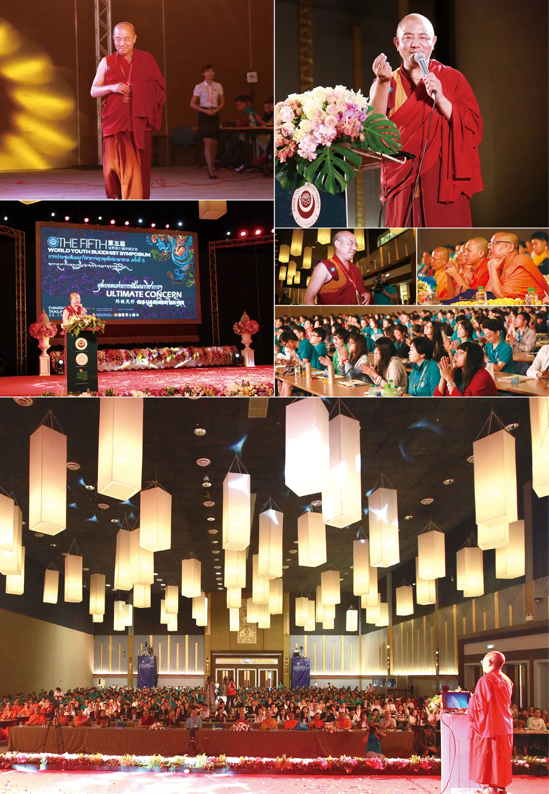
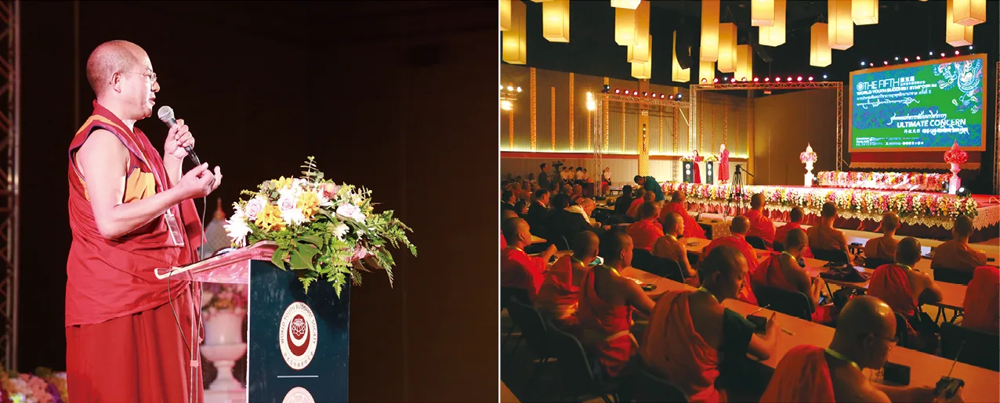
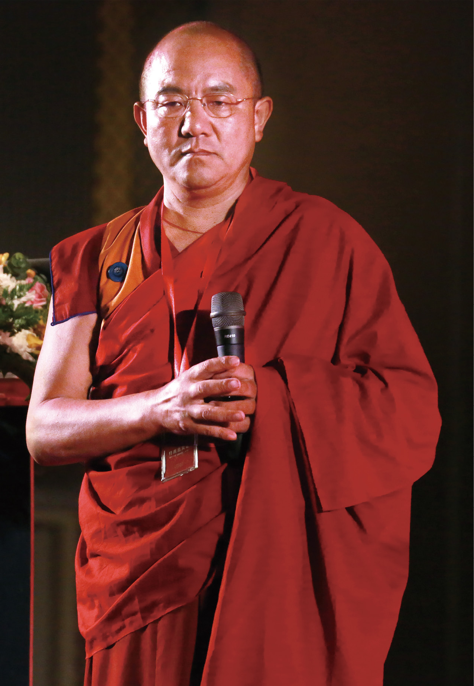

## 怎样看待死亡

## How to Face Death

2015年8月4日

主持人：

尊敬的各位来宾、朋友、宗教界代表，大家下午好！这里是第五届世界青年佛学研讨会主题演讲的环节。

很多朋友都曾看过这么一段话：“提到‘死’字，虽然好多人非常忌讳，觉得很不吉利，但实际上这是人人都要面对的。就算你再有钱，再有才，再有貌，到了最后，也仍是‘死路一条’。你对它有过准备吗？死时能带走什么呢？这是我们不能不想的。”下面，我们将隆重请出这段话的开示者——世界青年佛学研究会会长索达吉堪布，他今天要演讲的题目是“怎样看待死亡”——

很感谢能有这样的机会和大家交流。说实话，我可能是所有演讲者当中，最没准备的一个，不但文字上没有准备，心里的准备也不是很充分，因为这几天事情确实比较多。在有些国家，参加这样的会议却没有充分准备，是不太好的，他们认为这是对大会不尊重。从我个人而言，虽然没有这样的心，但也的确无法隐瞒准备不足的这个事实。所以，我今天可能讲不出太多内容。

可能很多人读过我的文章，或者听过我讲的课，那今天我利用这个时间，再跟大家分享一些我的想法。

本届世界青年佛学研讨会到今晚就圆满结束了，特别感谢所有的演说嘉宾，赐予大家智慧的悉地。在会议开始前，我就要求组委会把我发言的时间尽量缩短一些，把时间留给其他的嘉宾，因为我觉得世界上有很多有思想、有见解的高僧大德、教授、科学家和老师，他们的话非常有意义，而像这样把大家聚在一起的机会却并不常见。虽然世青会只有四天，但对有些人来讲，这也许就是一次改变命运、重新开始的契机，这也是世青会最主要的一个目标。

本届世青会为汉传佛教、藏传佛教和南传佛教的大德、学者以及年轻人提供了一个平台，让大家面对面地交流。这样的交流，曾在很长一段时间内都没有突破，而本届世青会就是历史给我们的一个机会，这对很多年轻人来讲，非常值得深思。因此，这次大会的主要特点就是，为汉传、藏传和南传佛教的大德们提供了一个交流的平台和机会，而在座的年轻人，在以后的学习过程中，也要接受南传佛教的大德们的教言。

## “泰国游记”

我曾在1999年9月9日来过泰国。很多人都比较喜欢999这个数字，但我并没有刻意这样安排，当时也不知道是什么缘起，就选了那一天从北京飞到曼谷。当时我只认识一位南传佛教的出家人，他曾经来过我们佛学院学习，而我就是接受了他的邀请，才到泰国参观寺院。我们还来到了清迈，借住在他认识的一位佛教徒家里。我现在已经想不起来那位佛教徒的住址，但我记得非常清楚的是，当时我就非常希望，有朝一日，汉传、藏传和南传佛教的出家人，能在同一个平台上，一起聊佛法，谈修行，做弘法利生的事，并以此为契机，将佛法弘扬出去。虽然我们以前能在电视中看到庄严的南传佛教出家人，但的确很少有机会能像这次一样，直接亲近寺院的长老、大德及修行人。

虽然我当时只待了七天，但我把这期间的所见所闻都写了下来，编成了一本小册子，叫《泰国游记》。大家可以在网上找到这本书，从中可以体会到我当时的心情以及对泰国的印象。

## 佛教徒应广泛学习各个传承

泰国寺院里的长老、修行人是我们恭敬、供养的对境，因此，我也希望学习汉传和藏传佛教的人，能够亲近泰国的大德和佛教徒，因为在他们的思想中，有许多原始的、直接从巴利文传来的释迦牟尼佛教言，非常清净并极具加持力。

我去过云南西双版纳的一所寺院，见到一位南传佛教的小僧人给大家加持。我当时也在他面前合掌领受，回去以后，身心确实清净了很多。其实，如果你对三宝有信心，不论是在小僧人面前，还是在大和尚面前，都可以得到加持和利益。所以，我们应该广泛地向各个传承学习。

我看过很多南传佛教大德对四念处、四谛、戒律以及禅修等内容的开示和论述。昨天为大家开示的孙通桑卡毗尼长老，也曾在印度学了六十多本藏传佛教各教派大德的教言、演讲以及论著，其中包括格鲁、宁玛、萨迦、觉囊等。其实，这种广泛的学习非常重要，否则不可能了解其他传承的内容。而一旦学习之后，这些内容的殊胜性、加持、理论以及实修的方法，就会变得非常清楚。

不出意外的话，下一届世界青年佛学研讨会依然在泰国举行，南传、汉传和藏传佛教的大德们，还会有更多以智慧和悲心摄持的交流，在教义上互相学习，甚至融会贯通。这不仅能提升我们自身的修行，而且依靠大家的凝聚力、发愿力，也会对社会和谐，乃至世界和平带来极大的利益。

## 死亡是人生必经之路

我今天演讲的主题是“怎样看待死亡”。在这两天的演讲中，大家了解了各教派以及学术界的理论，我今天再简单地强调一下藏传佛教的观点。

每一个人都会死，而且就像佛教所讲的那样：死缘众多，死期不定，必死无疑。也就是说，在座的每一位，不管是年轻人、中年人还是老年人，都终有一天会死，也许死亡很快就会降临，但也有可能百年之后才会到来。

很多人从没有考虑过死亡，甚至特别忌讳死亡，提都不愿意提。去年我在德国，有很多当地人告诉我，死这件事是不能在亲人面前提起的。不知道这是不是他们的传统，而汉地也有这种情况。

既然死亡是每个人的必经之路，那避而不谈就无异于掩耳盗铃，但在社会大环境下，很多人都认为，死亡就是灰飞烟灭，死后什么都没有。世界上有很多民族，大多也只重视眼前的生活，对来世漠不关心。

## 流行文化所带来的误导

有些人虽然不赞同“死亡就是灰飞烟灭”，但依然对死亡有一些错误的观念。尤其是西方的一些哲学家、科学家和艺术家，他们通过自己的分别念，宣说了一些道理，从而影响了世界上很多的年轻人。

最近有一部电影叫《超越潜能》（Transcendence），讲述了一个人死后，意识被上传到网络世界，不断地复制、扩大，最后掌控了一个相当大的世界，并让许多生命成为它的俘虏。最后，主角的家人觉得他对人类社会有害，于是不得不通过病毒将他杀死。虽然这只是一位好莱坞导演为了吸引观众而虚构的科幻情节，但很多没有受过生命教育、死亡教育的人，却有可能信以为真，认为当科技极其发达的时候，人类就可以在死后，将意识上传到网络中去。

## 茫然虚度是当今的生活常态

年轻人尤其应该了解一些生命的道理。现在有很多年轻人，对生命非常茫然。他们小时候忙着学习、考试，中年时为了家庭、财富、孩子而奔波，而老了以后，体力、心态都大不如前，那时再想重新思考人生，思考生命的价值和延续，恐怕就非常困难了。

如今有很多年轻人，就是这样在忙忙碌碌、浑浑噩噩中度过每一天。在参加世青会的这几天里，大家也许会意识到：生死大事确实很值得思考！但世青会结束以后，可能又随着世间各种各样的文化而随波逐流，身心不由自主地被卷在波浪当中，无所适从。所以说，轮回可怕，业力更可怕！

正因为这样，我们能在这里了解到生命的本质、价值便显得难能可贵。我不会讲太多的专业术语、理论，但大家要清楚，只有在宗教中，才能找到关于生命意义的教言，而科学、心理学等世间学科对这方面的研究还比较欠缺，个人体验就更不用说了。

## 轴心时代的遗宝

回顾人类历史，公元前800年至公元前200年被称作“轴心时代”。在这个特殊时代当中，人类留下了一些非常宝贵、意义非凡的“生命宝典”。具体是什么样的宝典呢？

在西方哲学中，苏格拉底、柏拉图和亚里士多德等人的理论，实际上都跟生命有着莫大的关系。此外，中国的老子和孔子、印度的本师释迦牟尼佛，也都生活在那个时代，而他们留下来的文化和智慧，经历了2500多年，一直传承到今天。

相比之下，更早出现于世的一些文化，如古埃及文化、古巴比伦文化，虽然曾经规模宏大，理论体系也可能极其严密，可到今天大多已经十分衰落，甚至已经从世间消失了。我们都知道，人类会经历生死，因此借助宗教来认识生死；而只有经得起考验、印证的教言，才不会随着时代的发展而衰亡。

佛教有着许多与其他宗教、文化不共的特点。这并不是佛教徒自夸，如果年轻人可以放下包袱、偏见，以非常公正的态度来进行分析，就会发现，佛教的生命观的确对每个人都至关重要。

## 荣格与《西藏度亡经》

《西藏生死书》在国际上非常出名，而这里面的很多理论，都来自莲花生大士的《西藏度亡经》（The Tibetan Book of the Dead）。《西藏度亡经》在1927年被首次译成英文，一经出版，便在西方社会引起热烈反响。其受欢迎的第一个原因是它的内容——生活中从未有过的发现；第二个原因，与弗洛伊德（Sigmund Freud，1856-1939）的大弟子、著名的心理学家和精神病学家荣格（Carl Jung, 1875-1961）有关，他为这本书作了前言，并讲道：“《西藏度亡经》是最具有大乘佛教慈悲内涵的一部宝典。我将这本书一直随身携带，它是我最好的朋友，是我很多发现、灵感、创意的源泉。”

从佛教的理念来讲，他的这些感受，就是《西藏度亡经》加持、力量的体现。我觉得荣格的评价是公正的，这并不是因为他赞扬了藏传佛教，而是因为如果一个理论本身站不住脚、在道理上说不通，那无论有多少人赞叹、敬仰，也不值得肯定。

我看过一些荣格的著作，对他还是有一些了解的。他的观点与尼采（Friedrich Nietzsche, 1844-1900）、马克思（Karl Marx, 1818-1883）等人都有冲突，甚至由于观点不合，与老师弗洛伊德也分道扬镳。当然，我和荣格没什么关系，他是1961年6月6日去世，而我是1962年6月4日才来到人间（众笑）。我认同他，仅是因为他的赞叹特别公正而有意义。

## 莲师的中阴教言

生与死，对每个人来讲都是很关键的问题，因此，在座的各位都有必要研究一下。那我们要怎样研究生死、面对生死呢？按照莲花生大士的教言，我们每个人都应该提前对死亡有所准备。

人从出生到死亡，再到转世的过程，分为四个阶段，被称为四种中阴——住世中阴、临死中阴、法性中阴和转世中阴。

虽然这里有些密法的教言不能随意公开，但在座的各位终究要面对死亡，我觉得大家应该趁着年轻，早一点知道如何为死亡做准备。此外，对很多人来讲，这可能是我们第一次见面，也可能是最后一次，因此我也想借这次机会，在尽量隐藏中阴窍诀的前提下，以比较理论的形式，向大家讲一些可以公开的道理。

## 住世中阴如燕子入窝

第一个阶段是住世中阴，指我们从降生到这个世间，一直到出现死相之前的过程。这个阶段的教言是“如燕子入窝”一般。燕子会仔细观察适合筑巢的位置，只把巢建在安全的地方，比如房檐下或者悬崖边等不受人类威胁的地方。筑巢之后，它们随时都可以飞回自己的窝，保护自己免受侵害。同样，我们应该从小就依止善知识，依靠上师的教言闻思修行。这样的话，不论自己何时面对死亡，都会有所准备，不会有怀疑、恐惧、伤心等等。虽然你们现在还很年轻，但也要提前做好准备，有了这样的境界，死的时候应该能够胸有成竹。

本届世青会中，很多演讲嘉宾年纪很小，才二十几岁，但他们在演讲中自性流露出对生命无常的深刻感受，这一点可能比我们这些老和尚还强（众笑）。我们有些出家人已经成了“老油条”：虽然经常听到无常，但当自己面对死亡时，却没有丝毫把握。我也经常思考：虽然自己为别人讲过很多次无常的道理，但死的时候一点把握都没有的话，那就太羞愧了。总而言之，在死亡来临之前，我们一定要多多思考和死亡相关的道理。

## 临死中阴如美女照镜

第二个阶段是临死中阴，指临终出现死相的阶段。虽然有些人可能遭遇突发的车祸、地震或空难而横死，来不及观察死相，但绝大多数人都不会遭遇这种情况。一般来讲，人在临终时，看到的景象是模糊的，听到的声音也隐隐约约，也就是说，六根虽然接触六境，但并不会引起强烈的感受。

除此之外，还有一些死相，是在身体的地、水、火、风等四大慢慢隐没时，出现口干舌燥、身体下坠等感受。

这时，你应该回忆自己以前所听过的佛法教言。如果实在想不起来，也应该让旁边的人为你指点，或者以念佛、念经的方式帮助你，这些都很有必要。

这就是临死中阴“如美女照镜”般的教言。就如同美女可以在镜子中非常清楚地看到自己，有些修行人在活着的时候有很好的修行，因而在临终时能清楚地了知该用什么样的方法。

## 法性中阴如子入母怀

法性中阴的教言是“如子入母怀”。就像世间的一对母子在人群中走散了，当母亲出现在人群中时，孩子肯定会立刻认出母亲，毫不怀疑地奔向她的怀抱。同样的道理，如果我们生前对自心、觉悟等方面有很好的认识，那在法性中阴时，就会认出自己的本性。特别是当我们断气之后，由于四大紊乱导致身体上出现一些变化，看见许许多多的景象，听到各种各样的声音时，如果我们能立刻想起生前所学的教言，就能直接从法界本性中获得解脱。当然，这是非常利根的人才能做到的，一般来讲，很多人可能都不会发现法性中阴这个阶段。

## 转世中阴如引水入渠

转世中阴的教言是“如引水入渠”。就像在一条河流上修一座水闸，接上水渠，需要灌溉的时候，就让水沿着水渠输送下去。

一般来讲，转世中阴长达七七四十九天，这也是为什么我们一般要为亡者念四十九天经。我问了一些南传佛教的大德：“你们这边有没有为亡人念四十九天经的习惯？”他们说：“有啊，这里有念四十九天的，也有念七天、五十天、一百天的。”可见，这一传统，各地大同小异。

人在中阴的四十九天中会出现很多选择，你可以选择投生人道，甚至选择投生在像泰国这样有信仰的地方，因为人在中阴阶段的心态很容易改变，而生前的修行就能够让你在此时自主选择。当你下一世获得人身，并进行修持的话，就能够从轮回中解脱。

可能很多人都希望自己能更好地面对死亡，但真正的面对死亡，并不仅仅是在安详中往生，最关键的是，你来世能成为一个有信仰、不造恶业、深信因果并皈依三宝的人，这样的话，你的前途一定会很美好。

以上简要地为大家介绍了藏传佛教中最精髓、甚深的教言。除了上面提到的四种中阴，还有梦中阴、禅定中阴，共计六种中阴阶段，这些在相关的教言书中都有详细解释。

## 张开双臂，拥抱世界

最后，我想再讲几件事：

首先，下一届世青会将以《心经》为主题，开展论文比赛。南传、汉传和藏传佛教中，都有《心经》的修行方法，由此可见，《心经》非常值得大家学习。我看到有些参会者已经参加了好几届世青会，而能被多次邀请参会的原因，可能就是因为论文写得非常不错。因此，希望大家都能对《心经》有所研究，并参加第六届世青会的论文比赛。

昨天我们在放生时念了南传、汉传和藏传佛教的经文，希望从此以后，大家都能更加重视放生。我在新闻上看到，泰国前总理英拉在48岁生日那天，亲自在曼谷的一座寺院中放生了3000多只鸟。可见，泰国也有这种很好的风俗。希望大家以后都能更加尊重生命，重视放生，这也毫无疑问是释迦牟尼佛慈悲思想的最基本体现。

与此同时，希望大家能以传统文化作为切入点，利益社会。世青会的宗旨是提升自己的价值观，从而利益世界。昨天有位同学讲得好，大意是说：世界上有很多不同的宗教，不一定要求所有人都信仰基督教或者佛教，但是每个国家、每个民族都有其传统文化……传统文化确实十分重要，因此，我们也以此为切入点，成立“学仁社”，通过弘扬传统文化来利益更多的众生，因为“仁”字是任何一个宗教或非宗教人士都认可的精神。

此外，就像有些人在发言中所提到的那样，所有人都是平等的，但我们也不得不承认，人与人在思想和文化上的确有差别。不论我今天是站在这里，还是站在任何一所学校的讲台上，我都觉得我和其他人一样，只不过我学过一些有价值、能对他人有所帮助的藏传佛教教言，这就好比我是一名医术还不错的医生，在这里与大家交流医学问题。

因此，我希望每一届世青会都设立“藏传佛教传统”这一分主题，因为我觉得藏传佛教对当今很多人的心灵有帮助。当然，我也希望大家能借鉴汉传佛教、南传佛教以及其他宗教的思想，共同拥抱这个世界。

我相信，只要有爱，世界各地都可以开出美丽的花，这得益于人们的无私付出与辛勤劳作。感谢大家！

现场互动

问：很多人在得了重病或年老之后会告诉家人：“我死的时候不要采取任何抢救措施，我要走得特别潇洒。”这是否属于自杀？

堪布：每个人都有自己的临终关怀方法，有些人主张全力抢救，但有些人不会。我觉得这种情况不应该算自杀，因为他的这种选择，不一定导致死亡，还是可能会出现其他的结果。而所谓的自杀，则是不留任何余地，以暴力的方式斩断自己的生命。

佛教中对杀业的判定，会根据意乐和行为等，看是否符合“无误认识对方”和“断除对方的命根”等四个条件[^1]。对照来看，这种选择也不构成自杀。对此，大家可以详细观察。

问：我来自汕头大学。我想问，现在佛教所面临的商业化趋势，是有利还是有弊呢？

堪布：寺院商业化的确不太好，但那些已经“对外开放”、成为旅游景点的寺院，恐怕很难再收回来了。这个情况不仅发生在汉地，藏地的个别寺院也有很多游客。

昨天在双龙寺的时候，我也发现有很多游客，所以泰国可能也面临类似的处境。因此，我也很想问问双龙寺的出家人如何看待这个问题。同时，我也很担心我们佛学院未来会变成这样。

当人需要精神寄托的时候，往往想去寂静的地方，而这些地方又往往是高僧大德们所在的寺院。一般来讲，寺院的环境优美，又有种种神秘的壁画、神奇的老和尚等等，人们来到这里，心自然就清净下来，有一种来到世外桃源的感觉。

那寺院该如何应对大量的游客呢？我认为，寺院不应以此赚钱。此外，如果我们能利用这样的机缘，为游客讲经说法，那就太好了。昨天摩诃朱拉隆功大学的副校长告诉我，他那天讲了五堂课，当时已经很晚了，但他还要再去赶第六堂。其实，这样的传法机会真的很难得。

不管是出家人还是佛教寺院，都不应该太在乎金钱。有钱可以，没钱也可以，最关键的是让人们的心灵得到利益。如果寺院能讲经说法，为游客们带去精神上的宁静和快乐，那出家人再累也不要紧，外面有再多的诽谤和非议也无所谓。

此外，从大乘佛教的角度来看，寺院里的人越多越好，因为他们至少会烧个香，看一眼菩萨像。对佛菩萨的见闻觉知皆能种下深厚的善根，所以，来寺院旅游可能是很多人一生中难得的机会，非常有意义。

问：现在藏传、汉传以及南传佛教都面临一种“稀释现象”。比如，现在有人将藏传佛教曼陀罗中的坛城等符号去掉，并用它来治疗心理上的亚健康状态；有人用内观禅修帮助白领解压；还有人在推广传统文化时，只注重表象的部分，而忽略其深刻的内涵等等。您如何看待这种现象，我们又该如何将善法与大众喜好相融合？

堪布：推广任何事情都需要智慧和善巧方便，这二者非常重要。其实，汉传佛教、南传佛教当中也有类似藏传佛教曼陀罗的标志；禅修也不仅仅是南传佛教的专利；而推广传统文化，也都存在于各个民族、国家当中。由此可见，如果我们有一种善巧方便，有技巧地弘扬善法，那各种善法都不相违，但如果没有技巧，即使是佛教内部，也会出现一些矛盾和冲突。

问：佛教在世界范围内的传播过程中，既出现了好的现象，也出现了一些乱象。比如，藏传佛教的传播牵涉到密法传承的问题，而现在新闻中就经常报道一些打着藏传佛教旗号的假活佛，甚至是邪教组织。您对此有什么看法呢？

堪布：任何一种宗教、思想，当它在世界范围内传播时，就会出现一些负面现象，这是一种规律。我们不能仅因为负面新闻，就认为某一宗教、传承是不合理的。很多思想在刚开始弘扬的时候，经常不被大众理解。比如，大乘佛教刚开始在汉地弘扬时，包括梁武帝在内的很多人都无法接受，后来情况才慢慢有所改善；而密法刚开始在藏地传播时，也受到了很多非议。所以，不被人理解是非常正常的现象。当然，有个别新闻报道夸大其词、添枝加叶，对此，我们不去在意就好。

对藏传佛教而言，当越来越多的人认识、了解它时，就可能会出现一些别有居心的“传法者”，也可能会出现一些不如法的信众，但这两者不应混为一谈。

有些别有用心的人，打着藏传佛教的旗号，弘扬自己的思想，甚至形成邪教，这都不应该被拿来讨论藏传佛教。

问：我们现在读的《西藏度亡经》是由英文译成汉文的，您是否有计划直接从藏文翻译成中文呢？

堪布：很多人认为《西藏度亡经》是对死亡的论述，但荣格不这么认为。他觉得《西藏度亡经》还揭示了人类本有的很多奥秘和知识。因此，很多西方人都认为，研究《西藏度亡经》非常有意义。

我几年前曾经翻译过六中阴的窍诀，但那个属于密法，不能随意公开。而《西藏度亡经》的这部分，我曾经想要翻译，但我看从英文翻译过来的版本已经很好地表达了原意，翻译得不错，所以，暂时没有必要再翻译一个新的版本。否则人们就不知道该学习哪一版本了。

[^1]: 完整的杀业需要满足四个条件，即对境是具有生命的众生、无误认定所杀的众生并在断绝对方命根前毫无后悔心、采取杀害的行动、成功断绝对方命根。
