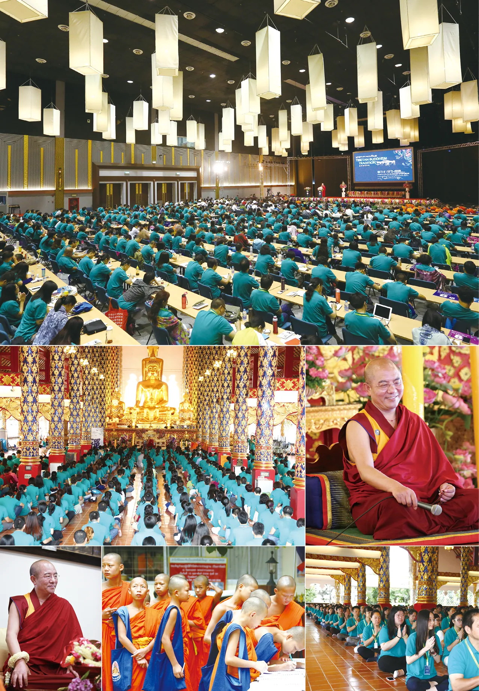
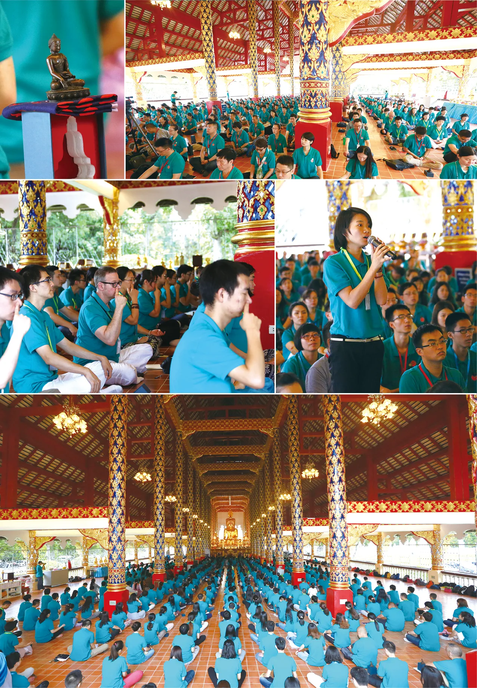

## 有相与无相的喜悦

禅修开示

## Instruction on Form and Formless Meditation

a Meditation Instruction

2015年8月3日

主持人：

尊敬的各位嘉宾、朋友们，大家早上好！很高兴与大家一起来到摩诃朱拉隆功大学清迈校区的大经堂。来到这里后，我看到很多参会朋友，双手合十，仿佛都在为世界和平、幸福安康而虔诚地祈愿着。

在开始今天的禅修前，先有请泰国松德寺的住持、摩诃朱拉隆功大学清迈校区的教授，尊敬的帕库·孙通桑卡毗尼长老致辞。

帕库·孙通桑卡毗尼长老：

尊敬的索达吉堪布、各位长老、居士、年轻人，大家好！欢迎大家来到泰国清迈参加第五届世界青年佛学研讨会，共同讨论佛学。松德寺有六百多年历史，自古以来便为出家人提供学习场所。近代的松德寺也依然坚持办学，而且，摩诃朱拉隆功大学清迈新校区，就是松德寺的旧址。当前，这里有巴利语佛学院，也有佛教大学，为出家人、在家人提供了学习佛法的机会。祖师大德们建立松德寺的目的，就是为大众提供禅修、学佛的便利，从而将佛教教义流传于世。因此，我再次代表摩诃朱拉隆功大学以及松德寺，热烈欢迎大家来到这里聆听索达吉堪布的禅修开示！

主持人：

再次感谢尊敬的长老！

在本届世界青年佛学研讨会期间，我总会不经意地听到大家在交流着有关瑜伽的话题。其实，瑜伽分为身、语、意三种。除了身瑜伽中各种不同的身姿，语瑜伽是持诵佛号，意瑜伽是谛观心的本性。若能通过这一整套瑜伽来净化生命，不但会让身心愉悦，成办事情也会非常高效。然而，瑜伽是否就是我们平时所说的禅修？我们该如何在繁杂匆忙的生活中，依然享受宁静的喜悦？请大家一起聆听索达吉堪布开示——

非常感谢摩诃朱拉隆功大学所有的教授、工作人员为世界青年佛学研讨会提供这样舒适、安静并具有加持力的禅修场所和各种便利。在接下来的一个多小时中，我会为大家介绍一些禅修方法，并与大家一起禅修。我今天要讲的禅修，涉及藏传、汉传以及南传佛教的观想方法，也就是说，我们会在同一道场、同一时间当中，学习这三种传承的观想方法。

## 皈依的道理

在经堂后面的人，可能没办法坐在地毯上，也许有些人会不太适应，甚至有点痛苦，但很多人一辈子都在山洞里面修行，相比而言，在地板上坐一两个小时，应该还是可以忍受的，希望大家坚持。

昨天有人提出想皈依佛教，所以今天会先做一个皈依仪式。已经皈依的人，这次既可以再次皈依也可以不再重复皈依，不会有任何矛盾；目前还不想皈依佛教的人，也不用担心，因为佛教不会强行令你皈依的；已经皈依其他宗教的人，也不用改变自己的信仰；而以前没有皈依过三宝，但今天想皈依的人，则可以通过这个简单的仪式皈依三宝。

皈依是指皈依佛、法、僧以及上师，汉传佛教和藏传佛教在这一点上应该是相同的。我昨天也特意请教了摩诃朱拉隆功大学的副校长，他说南传佛教也讲皈依三宝，同时皈依师父。所以，皈依三宝和皈依上师的道理，在三个传承之间，应该没有太大差别。

从皈依的发心上来看，有些人是为了在即生中获得名声、钱财、健康而皈依，有些人是想从轮回当中获得解脱而皈依，还有些人是为了帮助天下一切众生而皈依。一般而言，最后一种发心是最高尚的。

下面，我用藏语念皈依偈——“南无咕如呗，南无布达雅，南无达儿玛雅，南无僧伽雅”，也就是皈依师，皈依佛，皈依法，皈依僧。不论你们是哪一种发心，都可以观想释迦牟尼佛的佛像，释迦牟尼佛和后来高僧大德们所讲的法，以及藏传、汉传、南传佛教的出家人，即以佛、法、僧作为自己的皈依对境。

接下来，我念三遍皈依偈，你们跟着我念三遍，最后一遍时，我会弹一下手指，这个时候你们观想已获得了皈依戒。

“喇嘛拉加森切欧，桑吉拉加森切欧，秋拉加森切欧，根德拉加森切欧……”

## 对上师的忆念应随身携带

每位参会者都收到了一尊释迦牟尼佛像，这是藏传、汉传、南传佛教都承认的佛像，而且每尊都经过严格的装藏并开光加持。因此，这些佛像非常珍贵，大家应该好好保存。此外，每位参会者都还得到了一颗念珠，我念了很多咒语加持，它也算是我个人给大家的纪念品。大约在二十年前，我的上师也给了我一颗念珠，从那以后，我一直把它戴在身上，这也是对上师的一种忆念。如果你们觉得这颗念珠有价值，可以把它保存起来；如果觉得没什么价值的话，也可以把它扔在清迈的河里或草地里。（众笑）

对于有信仰的参会者来讲，能得到这一尊佛像，即使是从美国飞到清迈，这个机票钱也值了。听说有些工作人员还没得到佛像，但在接下来的一两个月之内，一定会补发到各位的手里。

## 排浊气，净身心

今天的禅修分两个部分：有相禅修，即观释迦牟尼佛的佛像；无相禅修，即安住在自己的心性当中。

一般来讲，禅修时要先调整身体坐姿，即双手结定印，双脚跏趺坐或半跏趺坐，身体端直，不要动来动去，这是禅修的基本坐姿。此外，就像盛水之前先洗净碗具一样，禅修前，我们要先排浊气，清净身心。排气的时候，一般先用右手握金刚拳，用一个手指压着右边的鼻孔，从左鼻孔里面排三次气，同时观想自相续中以贪心所造的一切恶业，都变成红色的气体被排出去。然后，换左手压住左鼻孔，从右鼻孔中排三次气，同时观想以嗔恨心所造的一切恶业，都以白色气体的形式被排出。然后，两手可以放在自己的腿上，同时从两鼻孔中排三次气，并观想无始以来以痴心所造的一切恶业，都以黑色气体的形式被排出。

如果我们以贪、嗔、痴等妄想所造的恶业，全部以红色、白色、黑色三种气体的形式被排出体外，那我们的身心就像被洗净的碗一样，不论再往里面放任何食物，都不会被污染。所以，修禅之前最好先以这样的方式排浊气，让我们的心里没有贪嗔痴的垢染，再开始禅修。

## 有相禅修带你领受佛陀加持

首先向大家介绍有相禅修。大家可以将佛像放在前面，并专注在这尊佛像或者经堂前面所供奉的佛像上。像这样将心专注在佛像上是非常有加持的，这也是佛教比较独特的禅修方法，因为其他的禅修方法，比如什么都不想，在其他宗教和一些大学里也有。但《华严经》中讲，任何一个人，看到佛像、听到佛语、观想佛像，都可以获得不可思议的功德，遣除无始以来的罪障。

释迦牟尼佛在因地时，曾无数次为众生布施头目脑髓，所以，我们应怀有感恩之心，认真思维佛陀的功德。你们可以闭着眼睛观想释迦牟尼佛，但如果观想不起来，也可以直接看着面前相好庄严、金光闪闪的佛像。其实，不论你身处经堂，还是任何一个地方，只要观想佛陀，佛陀就在面前。正如经中云：“何者作意佛，佛安住彼前，恒时赐加持，解脱一切罪。”因为佛陀的智慧身没有远近之分，因此，任何一个人只要观想佛陀，佛陀就会现前，并恒常对他作加持，令他从一切罪障当中解脱。这就像把水器放在地上，只要天空中有月亮，月影自然就会出现在水器中。

以上是对有相禅修的简单介绍，如果你观想不起来，也可以看着释迦牟尼佛像禅修，重点是心不要散乱。如果发现心稍微有些散乱，就立刻想办法把它收回来，并再次专注到佛像上。

## 无相禅修带你认识自心

刚才我们在心里面观想的释迦牟尼佛，具有相好庄严的金色身相，实际上，这是由我们的信心、智慧而显现的，但当我们再进一步观心的时候，就会发现，其实心既不是有，也不是无，它远离一切边，远离一切戏论。这就是心的本来面目，而佛教修行最根本的目的，就是要令我们认识心的本来面目。虽然善心显现清净刹土、佛像，恶心显现地狱等等，但这些仅存在于尚未认识自心本来面目的阶段；而当我们用心观察心，就会逐渐认识到，其实心远离一切戏论，同时又并非空无一物。实际上，心有光明，而光明和空性无二无别。这就是依靠窍诀来认识心的本来面目。

接下来，我向大家介绍无相禅修。大家可以安住在自己的心性当中，用心来认识心，这就是修行，也是修行的根本目的。佛教将认识自心称作开悟，它能断除轮回的根本。如果你在认识心性方面稍微有一些境界，那禅修时即使外界十分嘈杂，也不会产生任何干扰。

修行非常重要，我们在短暂的即生当中一定要修行，不然理论上讲得再好，也没有任何用处。希望大家都能安住于自己的心，用心观察自心，并认识到其实自心与光明、空性无二无别。

接下来我们一起进行无相禅修。如果你已经认识了自心的本来面目，可以安住在你的境界当中；如果对心没有任何认识，那禅修时可以什么都不想，就像大众所熟知的那种禅修一样。但千万不要睡着了，不然等会儿我们都走了，你还在“禅修”中……

## 出定时观想作七支供

以上所介绍的有相禅修和无相禅修，统称为入定的观修方法，接下来，我再为大家介绍一个简单的出定观修方法。

出定时，我们可以观想在佛前作七支供——顶礼、供养、忏悔、随喜、请转法轮、请佛住世、回向。实际上，之前入定所积累的功德叫智慧资粮，而出定时依靠七支供所积累的功德叫福德资粮。修行要成就，就必须积累这两种资粮。

在出定时，大家的心不用像入定时一样专注，只要以很真诚、恭敬的心来念诵释迦牟尼佛心咒就可以。佛经里记载，佛陀、观音菩萨等都是依靠这个咒语而成道的。此外，我们出定后修七支供的功德非常大。《观佛三昧海经》中讲到，往昔在空王如来的教法当中，有四位比丘犯了很多的罪业，他们特别后悔。正当伤心欲绝时，空中传出声音说，虽然空王如来已经示现涅槃，但如果你们观想空王如来，依然有机会清净罪业。于是，这四位比丘开始观想空王如来，并在其佛像面前作忏悔等七支供。最后，他们的确灭除了无量劫的罪，并能经常面见佛陀。这四位比丘后来成佛，分别是东方的阿閦佛、南方的宝相佛、西方的无量光佛以及北方的微妙声佛。由此也可见，观想佛像并作顶礼、忏悔、供养等七支供，是十分殊胜的。

下面，我教大家念诵释迦牟尼佛心咒：达雅塔 嗡牟尼牟尼玛哈牟尼耶索哈。

在这短短的一个多小时里，我为大家介绍了入定、出定的简单修法，希望以这个因缘，已经皈依佛陀的人，在今生当中，乃至生生世世都依靠有相和无相的方式禅修。我以前翻译过释迦牟尼佛的传记，后来就每天念诵释迦牟尼佛的仪轨，而且不管到哪里，都会随身携带一尊释迦牟尼佛的佛像，希望大家也能随时忆念、观想佛陀。

今年只安排了这一场禅修指导。如果明年我们还在清迈举办世青会，应该会准备两场，上午教授南传佛教的禅修方法，下午教授藏传或者其他传承的禅修方法。期待届时再与大家一起禅修！

现场互动

问：我是江西中医药大学的一名老师，我一直纠结一个问题，就是禅修时应该双盘还是单盘？

堪布：能双盘当然最好，但若没经过训练，一开始就双盘会觉得非常痛。此外，有些人因为生理原因，也很难双盘。如果无法双盘的话，也可以单盘打坐。

问：我在观想释迦牟尼佛的时候，脑海里到底是该观想我们发的这尊佛像，还是观想我自己所喜欢的某尊佛像？

堪布：可以观想自己所喜爱的佛像，但佛像应该标准、庄严。

问：刚刚禅修时，我觉得自己的念头很纠结，一会儿想这，一会儿想那，像打架一样，不清净。我该如何对治呢？

堪布：一般来讲，初学者都会有“打架”一样的分别念，这是精进心与烦恼在斗争。但任何事情都可以串习，时间久了以后，每个人都会在修行中有所收获，内心越来越清净，最终证悟究竟。

问：我是深圳大学的一名学生。刚才禅修的时候，我是散盘的状态，但坐在地板上面会觉得脚疼。虽然一开始还在观想佛像或者自己的心，但后来就关注在身体疼痛的地方了。请问，我该如何转化这些疼痛，从而专注在禅修上呢？

堪布：还没开始禅修时，我就想到了这个问题，因此，我也提醒大家，禅修时要坚持、安忍。因为很多人可能没有在这样的地板上坐过，更没有修行过，所以，禅修中可能会有些疼痛。

我刚才也说了，很多高僧大德一辈子住在山洞里，坐在石头上禅修，而我们这次没有特意准备坐垫，也是为了让大家看一下自己的禅修功夫如何。虽然这次禅修感觉腿疼，但只要你不断努力，以后就不会再感到疼痛。所以，还需要努力。

问：我是来自澳门大学的一名学生。我在打坐的时候，感觉腰部有一股力量，自然地往上升，然后身体自然地抖动。请问这是什么原因，我又该如何处理这个情况呢？

堪布：藏地古大德的教言中讲：“夏天的草地上，生长着各种各样的花，而修行人的境界当中，会有各种各样的显现。”因为很多人从来没有观过心，所以，刚开始观心时，各种好的、不好的现象都会出现。但如果你不去执著，并坚持以欢喜、真诚和恭敬的心来坐禅入定，时间长了，什么问题都不会再产生。

问：我来自马来西亚精英大学。我的问题是，对于曾患过精神疾病的患者来说，如何在禅修时避免精神疾病复发？

堪布：从广义上讲，在证悟之前，每个人都患有不同程度的精神疾病，因为我们把不净当作洁净，把无常当作常有，把无我当作有我，把空性当作不空。当然，对于不同的病情，我们可以采取适当的调心方法，如果病情在禅修的过程中加重，那最好用念咒语来代替禅修。

问：我很想契入无相禅修，但禅修时，脑子里总是有一个声音在重复法义，比如中观的见解、万法如梦如幻、心性本来离四边等等，像是在做推导题一样。您在开示中也曾提到，听见声音时，应观想它对我无利无害，但这句开示也一直在脑海里反复呈现。请问这是正常的体验吗，还是误入歧途呢？

堪布：修行是一件非常困难的事，很多人都可以轻易地讲出很多道理，但真正通过修行体会到人身难得、寿命无常等道理，并不是一件容易的事。所以，即便我们一生中学过很多道理，但面临死亡时，却不一定能用得上。昨天有人提到“临时佛教徒”，我觉得这是一个普遍现象，因为对大多数人来讲，只有当自己遇到违缘、患病时，才会求佛保佑，可实际上，我们应该在日常生活中时时忆念佛陀。

因此，我们虽然在禅修中不停地告诉自己，外面的声音远离一切戏论，它是空性、光明的，但仍被其干扰，这也从侧面说明，我们的修行还远远不够。如果从今往后每天用一两个小时修行，那原来像猴子般调皮的心，就会逐渐变成大象一般稳重，最后就像雪山狮子一样威严，不随外境而转。所以，我们需要用坚定的心去修持，只有这样，才能不被念头、外界声音干扰。

修行很重要，否则，外表再庄严也没用。

问：我是来自加拿大的参会者。我在观修的时候，喜欢把自己的脑袋观成一张白纸，佛像在中间，每当杂念出现的时候，就把它扔到一边去，最后只剩下佛像。但问题是，只剩下佛像时，我又很害怕，觉得四周空荡荡的。请问，这种感觉该怎么消除？

堪布：今天讲的观修方法，是依照全知麦彭仁波切的仪轨。我们应该根据前辈大德们的教言来观修佛像，哪怕是观修当中的一个比喻，也要有大德和传承上师们的依据，不能按自己的喜好观想。

听说以前有一个人，他在观修的时候，把佛像观在前方，然后把各种各样的分别妄念观想成老鼠。每当老鼠出现时，他就把正知正念当作工具，把它们撵走。其实，这样的观修方法，不一定很适合。

当你有妄念的时候，尽量制止它，更重要的是，要如法观想佛陀。
